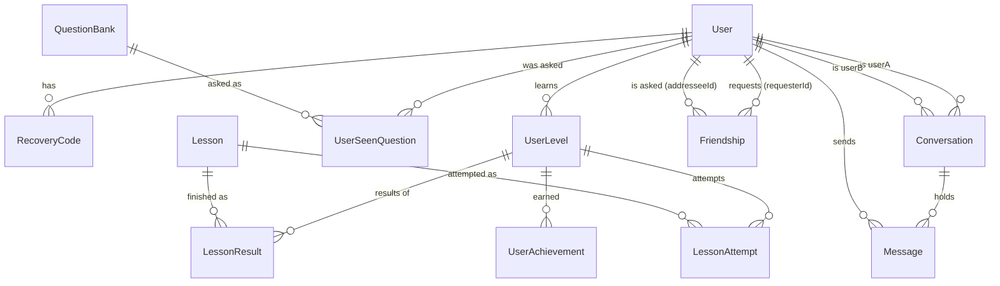

_This project has been created as part of the 42 curriculum by vbronov, eahmeti, baschni, avarrett, lumattei._

# ft_transcendence

## Description

An AI-driven platform for learning a foreign language: English, French or German, in the interface language of your choice (also English, French or German). A short adaptive test places each learner at a CEFR level (A1 to C2, the European scale of language levels). The course page then gives the lessons of the day, sized to a daily goal. Each lesson is one of four kinds (grammar, vocabulary, functions and reading), with exercises, a tutor to ask questions, an exam and a score. Learners can add friends, see who is online and send each other messages.

The lessons are written ahead of time with Claude Code, checked by validators, and loaded into the database. They are not generated while the learner waits.

Live at <https://trans.vyantares.ch/fr>.

### Key features

- **Placement:** an adaptive test that finds the learner's CEFR level, and can be retaken. Or the learner picks a level directly.
- **The daily lessons:** a planned course for each language and level, and each day the lessons that fit the learner's daily goal (10, 30 or 60 minutes).
- **Four kinds of lessons:** grammar, vocabulary, functions and reading, played page by page, with an exam at the end. The answers reach the browser only once the learner has answered.
- **A tutor in each lesson:** the learner asks questions about the lesson and the answer appears word by word (Gemini), with clear errors and rate limits.
- **Progress:** best scores, a streak, XP and ranks, a daily challenge and 16 achievements, per course.
- **All lessons:** search by words, filters, sorting, groups and pages. Each view has its own shareable address.
- **Social:** friend requests, profile pages with an avatar, live online status, and private messages that arrive without a reload and show an unread count.
- **Accounts:** sign up, log in, two-factor authentication with an authenticator app and recovery codes.
- **Three interface languages:** English, French and German, with the language in the address.
- **Runs everywhere:** one command to start it, HTTPS, pages that work without JavaScript, tested on Chromium, Firefox and WebKit, monitored with Prometheus and Grafana, deployed automatically to a cloud server.

---

## Documentation

This README is the entry point for the evaluation. The detail behind each section is in [docs/](docs/README.md), which says which document answers which question. A French copy, with the same layout and file names, is in [docs-fr/](docs-fr/README.md). The HTML pages of `docs/` are also served as a website at <https://victorbro.github.io/ft_transcendence/>.

| If you want to know…                                  | Read                                                                                                                                                                    |
| ----------------------------------------------------- | ----------------------------------------------------------------------------------------------------------------------------------------------------------------------- |
| What the subject requires                             | [docs/subject/summary.md](docs/subject/summary.md), and the subject itself, [ft_transcendence.pdf](docs/subject/ft_transcendence.pdf)                                   |
| Which modules we claim, and how to show each one      | [docs/modules/](docs/modules/README.md): one file per module, with what the subject asks, how we meet it, where the code is, how to show it, the tests and who built it |
| How the app is built, and why                         | [docs/architecture/overview.md](docs/architecture/overview.md), [product.md](docs/architecture/product.md), [technical-plan.md](docs/architecture/technical-plan.md)    |
| What the database holds                               | [docs/architecture/data-model.md](docs/architecture/data-model.md)                                                                                                      |
| What goes through REST, WebSockets or a stream        | [docs/architecture/realtime.md](docs/architecture/realtime.md)                                                                                                          |
| How the API works, file by file, explained from zero  | [docs/api/](docs/api/README.md): eleven chapters                                                                                                                        |
| How the web app works, from React basics to each page | [docs/web/](docs/web/README.md): nine chapters                                                                                                                          |
| How lessons and placement questions are written       | [docs/content/lessons.md](docs/content/lessons.md), [docs/content/item-bank.md](docs/content/item-bank.md)                                                              |
| How to deploy, monitor and update it                  | [docs/operations/](docs/operations/deployment.md): deployment, monitoring, versions, development                                                                        |
| What each member built, in their own words            | [docs/transcendence-course/](docs/transcendence-course/README.md): one folder per member, for the defence                                                               |
| Who touched which file, and in which pull requests    | [docs/code-ownership.md](docs/code-ownership.md)                                                                                                                        |
| What we know we still owe                             | [docs/backlog.md](docs/backlog.md)                                                                                                                                      |

---

## Team Information

All five members are **Developers**: everyone implements features, reviews code, tests their work and documents it. On top of that, each holds a specialised role, with a second holder so no area stalls when one person is unavailable.

| Member      | Role                            | Responsibilities                                                                                                         |
| ----------- | ------------------------------- | ------------------------------------------------------------------------------------------------------------------------ |
| **Bastian** | Product Owner, second Tech Lead | Product vision, backlog, feature priorities, validates completed work, talks to evaluators. Backs up technical decisions |
| **Victor**  | Technical Lead / Architect      | Architecture, stack decisions, code quality, reviews critical changes                                                    |
| **Endrit**  | Project Manager / Scrum Master  | Meetings and planning, progress and deadlines, team communication, risks and blockers                                    |
| **Anaïs**   | second Product Owner            | Shares backlog ownership and feature validation, covers the PO role                                                      |
| **Luca**    | second Project Manager          | Shares coordination and tracking, covers the PM role                                                                     |

## Project Management

- **How work is organised:** the work is split into three GitHub milestones, built in order:
  1. Onboarding and Evaluation: accounts, onboarding, the placement test.
  2. Course Roadmap and Lessons: the course page, the four kinds of lessons, scoring, gamification, the tutor.
  3. Real-time, social and defence: WebSockets, friends, online status, messages, the docs for the defence.

  Each task is one GitHub issue, with its goal, what to do, and when it is done. A member takes an issue, works on one branch for it (`feat/...`, `fix/...`, `docs/...`), and opens a pull request that closes it. We met when a decision or a blocker needed it, rather than on a fixed schedule. The milestones and their issues, with their live state, are on the [project site](https://victorbro.github.io/ft_transcendence/).

- **How a change reaches `main`:** nobody pushes to `main`. Every change is a pull request that needs the CI checks to pass and one teammate's approval. CODEOWNERS asks the right person for a review, and a new commit dismisses an old approval. Pull requests are squash-merged, so each commit on `main` is one reviewed pull request. Commit messages and pull request titles follow Conventional Commits, and git hooks and CI check them ([CONTRIBUTING.md](CONTRIBUTING.md)).
- **Tools:** GitHub Issues and Milestones for planning, pull requests and reviews for every change, GitHub Actions for the checks, the build and the deploy, and GitHub Pages for the project site.
- **Communication:** a team group chat on our phones for day-to-day questions, and working together in person at 42. Decisions about the code are written down where they are made: in the issue, in the pull request review, or in `docs/`.

---

## Instructions

### Prerequisites

- Docker and Docker Compose
- `make`
- VS Code with the Dev Containers extension
- On Windows: WSL2, with the repository on the WSL2 filesystem

`make` runs inside the development container, which brings Node and pnpm at the versions pinned in `.nvmrc` and `package.json`. On the host, most targets refuse to run and say so.

### Run it

Open the repository in VS Code and choose **Reopen in Container**. Then, in a terminal of the container:

```bash
make env-file           # creates .env from .env.example, or completes yours
make                    # checks, build, run, browser tests
```

**Content on the day:** 216 of the 3,990 planned lessons are ready: the first 12 of each language and level (3 languages, 6 levels). The others show as **Coming soon**.

`make env-file` never overwrites a `.env`, such as the one the devcontainer writes on a school machine: it only adds missing keys, generates the empty secrets and drops retired ones (today `DATABASE_URL`, which compose and make now build from `POSTGRES_*`). After a pull that changes `.env.example`, `scripts/align-env.sh` puts `.env` back in the template's order and keeps every value.

To get the six demo learners (streaks, results, a finished level, friends and unread messages), set `DEMO_PASSWORD` in `.env` before `make`, then sign in as `demo-anna@example.com` to `demo-felix@example.com` with that password. Every seed rebuilds them: `make` and `make seed` here, and every deploy on a server whose `.env` sets it ([docs/operations/deployment.md](docs/operations/deployment.md)).

The app is served at <https://localhost>, or at `https://localhost:<HTTPS_PORT>` on a machine that cannot publish port 443, such as a 42 school computer: `make` prints the address either way, and how to trust the local TLS certificate. API documentation is under `/api/docs`. Grafana, with the monitoring dashboards and alerts, is under `/grafana`: user `admin`, and the password `make` generated is in `.env` (`grep GRAFANA_ADMIN_PASSWORD .env`).

The lesson tutor and the question generator use Gemini. With `LLM_PROVIDER` empty, which means `fixture`, they call nothing: the tutor gives one canned answer and no question is generated. To use Gemini, create a key at <https://aistudio.google.com/apikey>, set `LLM_PROVIDER=gemini` and `LLM_API_KEY=<your key>` in `.env`, then run `make` again. The key goes in `.env` only, which git ignores. The tutor's rate limits are in `.env.example`. CI has no `.env`, so it always runs on the fixture and never calls Gemini. The project runs on a free key, on which Google may use what learners write to the tutor to train its models: the Privacy Policy (`/privacy`, section 4) says so, and moving to a paid key or another vendor means changing it first (docs/architecture/product.md section 5).

For day-to-day development use `make dev`, which starts the same stack with hot reload. `make help` lists every target.

### Browser support

The app is tested on desktop Chromium, Firefox and WebKit (the engine behind Safari): every Playwright suite runs on all three in CI (two jobs and two stacks per engine) and with `make playwright-all`. Some tests run on Chromium only. Seven `test.skip` calls say which ones and why: the API restart run (`e2e/tests/restart.spec.ts`), one in `e2e/tests/level-complete.spec.ts`, and five in `e2e/tests/lesson.spec.ts` (one test and four `describe` blocks, three of which loop over the written French A1 lessons of one kind). The list and the reasons are in [docs/modules/browsers.md](docs/modules/browsers.md#limits-and-choices). `make` runs Chromium alone to stay quick. Run one engine with `make test-e2e BROWSERS=firefox`: after a green suite it also runs the API restart spec, on Chromium. Like `make`, it runs the suite on the fixture tutor with no key, then puts the api back on the LLM provider `.env` names.

Known limits:

- **No speech voice, no Listen.** Listen buttons read text aloud through the browser's speech synthesis. A browser or system that offers no voice for the language gets no Listen buttons rather than buttons that do nothing.
- **The listening reply in Functions lessons** always offers **Show the text**, so the exercise can still be done without a voice.
- Real mobile browsers are not tested. Every page is checked at a 360 px phone width on the three engines (`e2e/tests/layout.spec.ts`).

### Known limitations

Besides the browser limits above:

- **Open book.** A lesson's exam is taken at home, in a browser: notes of what the lesson showed, outside help and a second account cannot be stopped by a web app. The score measures practice, not a supervised exam.
- **The repository is public**, so the lesson files in `content/lessons`, and the keys to their exercises, are public too. We accept it: in the app, the keys still reach the browser only once each answer is locked.

---

## Technical Stack

Everything is TypeScript, in one pnpm monorepo: `apps/web` (the site), `apps/api` (the API), `packages/shared` (the contracts both use) and `e2e` (the browser tests).

| Layer              | Choice                                            | Why                                                                                                                                       |
| ------------------ | ------------------------------------------------- | ----------------------------------------------------------------------------------------------------------------------------------------- |
| Frontend           | Next.js 16 (App Router), React 19, Tailwind CSS 4 | Server rendering, routing and a component model in one framework. Pages arrive with their content, and still work with JavaScript off     |
| Translations       | next-intl                                         | The three interface languages, with the language in the address (`/en/...`, `/fr/...`, `/de/...`)                                         |
| Backend            | NestJS 11                                         | Dependency injection makes the AI provider swappable and mockable. Guards, validation pipes, WebSocket gateways and Swagger come built in |
| Real time          | Socket.IO, and Server-Sent Events for the tutor   | One socket per tab pushes messages, friend requests, online status and course changes. The tutor's answer streams over one HTTP response  |
| Database           | PostgreSQL 18                                     | The data is relational: users, levels, lessons, results, friendships, messages. The image ships pgvector, which we do not use             |
| ORM                | Prisma 7                                          | Typed queries instead of hand-written SQL, and every schema change ships as a migration                                                   |
| Cache and sessions | Redis 8                                           | Sessions, placement runs, the tutor's rate limits and online status: short-lived data that needs to be fast                               |
| AI                 | Gemini, behind one provider interface             | The tutor and the placement question generator. A fixture provider answers in development and CI, so no key is needed to run the app      |
| Contracts          | Zod 4 in `packages/shared`                        | One schema checks the data in the browser and on the server, and the lesson files before they are loaded                                  |
| Proxy              | Caddy 2                                           | One HTTPS entry point and one origin, so there is no CORS and httpOnly cookies just work. Let's Encrypt on the server                     |
| Monitoring         | Prometheus, Grafana, Alertmanager                 | Metrics from the app, the databases and the server, four dashboards, and alerts that can go to Discord                                    |
| Tests              | Vitest, Supertest, Playwright                     | Unit tests, API integration tests, and browser tests on Chromium, Firefox and WebKit                                                      |
| CI/CD              | GitHub Actions, Docker                            | Checks on every pull request, multi-architecture images, and a server that deploys them itself                                            |

The full reasoning is in [docs/architecture/overview.md](docs/architecture/overview.md), [docs/architecture/product.md](docs/architecture/product.md) and [docs/architecture/technical-plan.md](docs/architecture/technical-plan.md).

---

## Database Schema

Twelve tables in PostgreSQL. The source of truth is [apps/api/prisma/schema.prisma](apps/api/prisma/schema.prisma) and its migrations. Every column, enum and index, and what Redis holds, is in [docs/architecture/data-model.md](docs/architecture/data-model.md).



| Table              | One row is…                                        | Key fields and types                                                                                                                                                 |
| ------------------ | -------------------------------------------------- | -------------------------------------------------------------------------------------------------------------------------------------------------------------------- |
| `User`             | An account                                         | `id` uuid, `email` and `displayName` unique, `passwordHash`, `avatarUrl?`, `locale` (interface language), `timeZone`, `activeLang?`, `totpSecret?`, `lastActiveDay?` |
| `RecoveryCode`     | One 2FA recovery code of a user                    | `userId` → User, `codeHash`, `usedAt?`                                                                                                                               |
| `UserLevel`        | One course of a user: a language being learnt      | `userId` → User, `lang`, `level?` (A1 to C2, empty before placement), `dailyGoal` int, `streak`, `bestStreak`, `xp`, `challengesDone`                                |
| `QuestionBank`     | One placement question                             | `sourceId?` unique, `lang`, `level`, `topic`, `category` (vocabulary, grammar, reading), `question`, `options` string[], `answer`, `timeLimitS`                      |
| `UserSeenQuestion` | A question a user was already asked                | `userId` → User, `questionId` → QuestionBank                                                                                                                         |
| `Lesson`           | One lesson of the planned course                   | `id` string (`fr-greetings-and-goodbyes`), `lang`, `level`, `position`, `kind`, `title`, `summary`, `brief` json, `content` json?, `ready` boolean                   |
| `LessonResult`     | The best result of a course on a lesson            | key (`userLevelId`, `lessonId`), `score` int, `day`, `finishedAt`                                                                                                    |
| `LessonAttempt`    | One run through a lesson, kept by the server       | `userLevelId`, `lessonId`, `secret` bytes, `page` int, `deadline?`, `answers` json, `completedAt?`, `results` json?                                                  |
| `UserAchievement`  | An achievement a course earned                     | key (`userLevelId`, `code`), `day`, `earnedAt`                                                                                                                       |
| `Friendship`       | A friend request or a friendship between two users | key `pairKey` (the two ids, smaller first), `requesterId`, `addresseeId`, `status` (pending, accepted)                                                               |
| `Conversation`     | The private message thread of two users            | key `pairKey`, `userAId`, `userBId`, `lastMessageAt`                                                                                                                 |
| `Message`          | One private message                                | `pairKey` → Conversation, `senderId` → User, `text`, `createdAt`, `readAt?`                                                                                          |

`?` marks a column that can be empty. Deleting an account deletes its rows everywhere: every relation to `User` and to `UserLevel` cascades. A lesson that has results cannot be deleted.

---

## Features List

The main author comes first, then the others who added to the feature. The numbers are pull requests. Each module file in [docs/modules/](docs/modules/README.md) has the full "who built it" table, and [docs/code-ownership.md](docs/code-ownership.md) lists every file each member touched.

| Feature                       | What it does                                                                                                                                                | Who                                                                                                |
| ----------------------------- | ----------------------------------------------------------------------------------------------------------------------------------------------------------- | -------------------------------------------------------------------------------------------------- |
| Project scaffold              | The monorepo, the Next.js and NestJS apps, the shared package, Docker Compose and Caddy, started with one command                                           | Victor (#2, #3)                                                                                    |
| Accounts and sessions         | Sign up, log in, log out, with a show-password button and the session in an httpOnly cookie kept in Redis                                                   | Victor (#5, #237)                                                                                  |
| Two-factor authentication     | A code from an authenticator app at every login, ten single-use recovery codes, and a way to turn it off                                                    | Victor (#5), Endrit (#218, #219)                                                                   |
| Profile and avatar            | Edit the display name, upload or remove an avatar (with a drawn default), see anyone's profile page                                                         | Anaïs (#42), Victor (#193)                                                                         |
| Onboarding                    | Choose the language to learn and a daily goal, then take the placement test or pick a level                                                                 | Luca (#67), Anaïs (#29), Victor (#99)                                                              |
| Placement test                | An adaptive exam that finds the learner's CEFR level, with a result page, and can be retaken                                                                | Bastian (#71, API), Anaïs (#104, pages), Victor (#24, question bank)                               |
| Generated placement questions | When a learner runs low on questions, Gemini writes new ones in the background, checked before they are stored                                              | Endrit (#69), Victor (#104)                                                                        |
| Courses                       | Several languages per learner, a course switcher, and a daily goal per course                                                                               | Anaïs (#60), Victor (#64)                                                                          |
| The lessons of the day        | The course page shows the lessons that fit today's goal, the streak and the level's progress                                                                | Bastian (#186, page), Endrit (#128, API), Anaïs (#120, rules)                                      |
| The lesson player             | Plays a lesson page by page with an exam at the end, keeps the attempt and the timer on the server, and scores it                                           | Bastian (#174, #175, #192), Anaïs (#190, attempts)                                                 |
| Four kinds of lessons         | Grammar, vocabulary, functions and reading, each with its own exercises                                                                                     | Bastian (#192, #197), Endrit (#203, reading)                                                       |
| Finishing a lesson            | Saves the best score, counts it toward the daily goal and keeps the streak, safely when two tabs finish at once                                             | Luca (#141), Anaïs (#190)                                                                          |
| The lesson tutor              | Ask questions about the lesson; the answer streams word by word, renders Markdown, can be read aloud, with rate limits, and a key check on the profile page | Luca (#201, #205), Endrit (#214), Victor (#237)                                                    |
| All lessons and search        | Search by words, filters, sorting, groups and pages, every view a shareable address, working without JavaScript                                             | Endrit (#128, API), Luca (#196, #227, #228, page)                                                  |
| Gamification                  | XP and ranks, a daily challenge and 16 achievements, per course                                                                                             | Anaïs (#132, #180, #199)                                                                           |
| Lesson content                | 18 outlines (3,990 lessons planned), and 216 lessons written with Claude Code and checked by validators                                                     | Endrit (#121, #142, #162, #178, #183, #184, #185), Victor (#119, #122), Bastian (#103, #107, #171) |
| Demo learners                 | Six learners with streaks, results, a finished level, friends and unread messages, on every stack whose `.env` sets `DEMO_PASSWORD`                         | Endrit (#143), Victor (#237)                                                                       |
| Friends                       | Send, accept, decline and cancel friend requests, search users, see recently active learners, and a live count of waiting requests on the menu              | Victor (#189, #193, #237)                                                                          |
| Online status                 | A green dot for friends who are online, updated live                                                                                                        | Endrit (#195)                                                                                      |
| Private messages              | Messages between friends that arrive live, are stored, and show an unread count                                                                             | Victor (#200)                                                                                      |
| Live updates                  | One WebSocket per tab pushes messages, friend requests, online status and course changes                                                                    | Victor (#181), Endrit (#195), Anaïs (#190)                                                         |
| Three interface languages     | English, French and German, the language in the address, saved on the user                                                                                  | Luca (#26, #212), Endrit (#125, #126)                                                              |
| Time zones                    | The learner's day, streak and daily goal follow their own time zone                                                                                         | Luca (#109)                                                                                        |
| Phone layouts                 | Every page laid out for a 360 px phone screen, with a header menu                                                                                           | Luca (#75), Endrit (#220)                                                                          |
| Privacy Policy and Terms      | Both pages in three languages, saying what the platform really does with data                                                                               | Luca (#26), Endrit (#206)                                                                          |
| Error codes and rate limits   | Every API error carries a code the browser translates; requests are limited per user, and per address on login and sign-up                                  | Endrit (#20, #126), Victor (#21), Bastian (#172)                                                   |
| Monitoring                    | Prometheus, Grafana with four dashboards, Alertmanager with alerts to Discord                                                                               | Victor (#130)                                                                                      |
| CI/CD and deployment          | Checks on every pull request, images for two processor types, and a cloud server that deploys them itself, with HTTPS from Let's Encrypt                    | Victor (#23, #65, #66, #131, #198), Bastian (#31, #169)                                            |
| Browser tests                 | Playwright suites on Chromium, Firefox and WebKit, in CI                                                                                                    | Bastian (#169, #177), Victor (#198), Endrit (#202)                                                 |
| Development container         | One VS Code devcontainer with the right Node, pnpm and tools, on Docker or rootless Docker                                                                  | Victor (#2, #210), Bastian (#31)                                                                   |

### Lesson scoring

The server runs every lesson attempt (`LessonAttempt`, one row per course and lesson): it sends only the page at the cursor, checks every answer and owns the exam timer. The deadline is set when an exam page is sent, with 2 s of grace, and a late page locks blank. The keys of an exercise reach the browser only after its answer is locked, in the correction of a practice page; exam pages get no correction. The lesson only goes forward: a locked page cannot be answered again, and an old page, an old attempt or a second tab gets `409 attempt.stale`. The score is written once, when the last page locks. The design is in [docs/architecture/overview.md](docs/architecture/overview.md).

---

## Modules

A Major module is worth 2 points and a Minor module 1 point. The subject requires 14 points, and the bonus above them is capped at 5. Each module has its own file in [docs/modules/](docs/modules/README.md): what the subject asks, how we meet it, where the code is, how to show it, the tests, and who built it.

| Module                                                                             | Type           | Points | Why we chose it, and how we built it                                                                                                                                                                                                                                                     | Who built it                               |
| ---------------------------------------------------------------------------------- | -------------- | ------ | ---------------------------------------------------------------------------------------------------------------------------------------------------------------------------------------------------------------------------------------------------------------------------------------- | ------------------------------------------ |
| [Framework for frontend and backend](docs/modules/framework.md)                    | Major          | 2      | Two frameworks with one language, TypeScript: Next.js (React) for the pages, NestJS for the API, and one shared package of Zod schemas between them.                                                                                                                                     | Victor (with Bastian, Endrit, Anaïs, Luca) |
| [ORM for the database](docs/modules/orm.md)                                        | Minor          | 1      | Typed queries instead of hand-written SQL: Prisma 7 talks to PostgreSQL, and every schema change ships as a migration.                                                                                                                                                                   | Victor (with Anaïs, Luca, Endrit, Bastian) |
| [Standard user management](docs/modules/user-management.md)                        | Major          | 2      | Accounts need a face: an editable profile, an avatar upload with a default, friends with a live online status, and a public profile page.                                                                                                                                                | Victor (with Anaïs, Endrit, Luca)          |
| [Complete 2FA](docs/modules/two-factor-auth.md)                                    | Minor          | 1      | A password alone is not enough to protect an account: TOTP codes from an authenticator app, a QR code to set it up, and ten single-use recovery codes.                                                                                                                                   | Victor (with Luca, Endrit, Bastian)        |
| [User interaction: chat, profiles and friends](docs/modules/user-interaction.md)   | Major          | 2      | Learners can practise together: friends, profile pages, and private messages that arrive live, are stored, and show an unread count.                                                                                                                                                     | Victor (with Endrit)                       |
| [Real-time features via WebSockets](docs/modules/websockets.md)                    | Major          | 2      | Nobody has to reload: one Socket.IO connection per tab pushes messages, friend requests, online status and course changes the moment they happen.                                                                                                                                        | Victor (with Endrit, Anaïs, Bastian)       |
| [Complete LLM interface](docs/modules/llm-interface.md)                            | Major          | 2      | A tutor that answers questions about each lesson, word by word, and new placement questions written when a learner runs low. Gemini behind one provider interface, with clear errors and rate limits.                                                                                    | Luca and Endrit (with Victor)              |
| [Internationalization: 3 languages](docs/modules/i18n.md)                          | Minor          | 1      | A language app must speak its learners' language: the whole site in English, French and German with next-intl, the language in the address, and a menu to switch.                                                                                                                        | Luca (with Victor, Endrit, Anaïs, Bastian) |
| [Support for 2 additional browsers](docs/modules/browsers.md)                      | Minor          | 1      | Learners do not all use Chrome: every browser test runs on Chromium, Firefox and WebKit (the engine behind Safari) in CI.                                                                                                                                                                | Bastian (with Victor, Endrit, Luca)        |
| [Server-Side Rendering](docs/modules/ssr.md)                                       | Minor          | 1      | Pages arrive full, not empty: the server builds each page with its data, so it shows even with JavaScript turned off.                                                                                                                                                                    | Victor (with Bastian, Luca, Anaïs, Endrit) |
| [Advanced search](docs/modules/advanced-search.md)                                 | Minor          | 1      | A level has hundreds of lessons: search by words, filter, sort, group and page through them, and every view is a shareable address.                                                                                                                                                      | Endrit and Luca                            |
| [Gamification](docs/modules/gamification.md)                                       | Minor          | 1      | The subject suggests it for a language learning platform (chapter V.6): XP and ranks, a daily challenge and 16 achievements, stored per course.                                                                                                                                          | Anaïs (with Victor)                        |
| [Monitoring with Prometheus and Grafana](docs/modules/monitoring.md)               | Major          | 2      | We need to see problems before users report them: Prometheus collects metrics from the app, the databases and the server, Grafana shows four dashboards, and alert rules can notify Discord.                                                                                             | Victor (with Luca, Anaïs)                  |
| [CI/CD](docs/modules/custom-ci-cd.md)                                              | Major (custom) | 2      | The subject's rejection rules are easy to break and hard to see in a diff: GitHub Actions checks every pull request, then builds and scans the images, and the server deploys them itself. Full justification below.                                                                     | Victor (with Bastian, Endrit, Anaïs, Luca) |
| [Cloud deployment with DNS and Let's Encrypt](docs/modules/custom-cloud-deploy.md) | Minor (custom) | 1      | HTTPS proven for real, not with a local certificate: two public servers with real domain names and Let's Encrypt certificates every browser trusts, the primary behind another web server and a copy on Oracle Cloud where our own Caddy gets the certificate. Full justification below. | Victor (with Endrit, Luca, Bastian)        |
| **Total**                                                                          |                | **22** |                                                                                                                                                                                                                                                                                          |                                            |

"Who built it" names the main author first, then the others who added to the module. Each module file gives the details and the pull requests.

**22 points claimed, 19 count** (14 required plus the 5-point bonus). The other 3 points are a margin in case a module is not accepted at the evaluation. The modules we do not claim, and why, are in [docs/modules/README.md](docs/modules/README.md#not-claimed).

### Custom module: CI/CD (Major, 2 points)

Every change goes through the same automatic path: checks on the pull request, a merge button locked until they pass and a teammate approves, then images built, scanned and published, and a server that updates itself. Full file: [docs/modules/custom-ci-cd.md](docs/modules/custom-ci-cd.md).

- **Why we chose it.** The subject rejects the project for a single console warning, a missing legal page or a committed `.env`, and a reviewer cannot see a console warning in a diff. Five people push to one repository, and commits are graded. The app also runs on a real server, and updating it by hand after each merge would be slow and error-prone.
- **The technical challenges.** Images for two processor types (`amd64` and `arm64`) built on native runners, without emulation, and tagged once so no machine pulls the wrong one. A server that pulls the images itself, so GitHub holds no key to the server, and that waits until all images of a release agree before it deploys. Tests inside the Dockerfile's `ci` stage, so they run with the production image's Node and libraries. A browser suite on three engines, each against its own production stack, split so it fits in the time. A single gate job that fails unless the whole matrix passed, because GitHub counts a skipped job as passed. A security scanner pinned by commit hash after its tags were force-pushed to malicious commits in March 2026.
- **The value it adds.** `main` always works: every commit on it after the first is a squashed pull request. The rejection rules are tested on every change, on the build the evaluator runs. A merge reaches the live site with nobody on the server, and every `main` commit since the #129 monitoring merge has an image to roll back to, by pinning `IMAGE_TAG`.
- **Why it deserves its size.** A trivial CI is one workflow that runs the tests. This one is 5 workflows, 1 shared action, 12 scripts and 3 git hooks; 41 checks on a typical pull request, 19 of them required; a full production stack started 6 times per run for 3 browser engines; 18 image jobs per push; and a deploy agent that handles half-published releases, failed migrations and retries. It has run for the whole project.

### Custom module: cloud deployment with DNS and Let's Encrypt (Minor, 1 point)

The app runs under a real domain at <https://trans.vyantares.ch>, our primary deployment: a shared VPS behind another web server, with monitoring (Grafana at `/grafana`) and a Let's Encrypt certificate that every browser trusts. A secondary copy runs on an Oracle Cloud server we set up, at <https://transcendence.dpdns.org>, where our own Caddy gets the certificate: that copy is this module's proof. It runs without monitoring, because that small free-tier VM does not have the memory for it. Full file: [docs/modules/custom-cloud-deploy.md](docs/modules/custom-cloud-deploy.md).

- **Why we chose it.** The subject asks for HTTPS. On a laptop our certificate comes from Caddy's own authority, which each browser must be told to trust; on the public server anyone gets a certificate the browser already trusts. A public address also lets the team test on real devices, and gives the images that CI/CD publishes a place to run.
- **The technical challenges.** A very small Oracle server (1 GB of RAM: 954 MiB usable, 2 vCPUs), too small to run monitoring next to the app: it runs the app alone, with a swapfile, and monitoring runs only on the primary, with a memory limit on every service. Let's Encrypt's rate limits, handled by making sure DNS resolves before the first start and keeping the certificate in a volume. An IP address that can change. A server with no checkout of the code, so a standalone compose file that only pulls images, and secrets with no defaults. A primary host where another web server owns the HTTPS ports, so our Caddy becomes a plain HTTP backend that still sees the visitor's real address. Monitoring that stays private on a public server.
- **The value it adds.** The evaluator can open the app on any device with a trusted certificate. HSTS and the security headers are on every answer, and HTTP/3 works. A fresh server needs three files and three commands, and one more file where monitoring runs. Monitoring sees the primary's real traffic.
- **Why it deserves its size.** It is real infrastructure outside the repo (a cloud instance, a firewall, a DNS zone, a trusted certificate), live and checkable from outside in a minute, on two hosts that work differently. It is a Minor and not a Major because Caddy does the certificate protocol itself, there is almost no application code in it, and the automatic build and deploy are counted under CI/CD, not twice.

## Individual Contributions

What each member built, and a few problems they had to solve. The numbers are pull requests. Each member explains their own code in depth, for the defence, in [docs/transcendence-course/](docs/transcendence-course/README.md). The full list of the files each one touched is in [docs/code-ownership.md](docs/code-ownership.md).

### Victor (`VictorBro`) — Technical Lead

- **Built:** the project scaffold and the persistence layer (#2, #3); accounts, sessions and 2FA (#5); the placement question bank (#24); git hooks, the CI checks, the deployment stack and the automatic deploy (#23, #65, #66, #198); monitoring with Prometheus, Grafana and Alertmanager (#130); the deploy behind another reverse proxy (#131); the WebSocket gateway (#181); friends, public profiles and recently active learners (#189, #193); private messages (#200); the course home and its guards (#64, #72, #99); the English and German outlines (#119, #122); the devcontainer on rootless Docker (#210); the friend request count on the menu, show password, the tutor key check, the demo learners on the servers and a `make` that spends no LLM quota (#237).
- **Challenges:**
  - **Checking socket events.** NestJS runs its guards and validation pipes on HTTP requests, not on socket events. So the gateway checks every inbound event itself: a rate limit per socket, a size limit and a schema. A bad event gets an error code, and the server never crashes.
  - **Deploying without giving GitHub a key to the server.** The server pulls the images itself. It waits until every image of a release is published before it deploys.
  - **Images for two kinds of processor.** CI builds them on native runners, without emulation.

### Endrit (`VYAntares`) — Project Manager

- **Built:** the lesson schemas and validators in `packages/shared`, ported from Bastian's prototype and extended to German and English (#142, #162); the lesson API: today, list, detail and accent-insensitive search (#128); `lessons:author`, which has Claude Code write each lesson and fixes it until the validators pass (#178); the French, English and German lessons (#183, #184, #185) and the French outlines (#121); the seed and the demo learners (#58, #140, #143); the LLM layer and the generated placement questions (#69, #111); an error code in every API error (#126); rate limits per user (#20); online status (#195); the reading lesson (#203); the tutor's Markdown and voice (#214); the header menu and phone layouts (#220); 2FA fixes (#218, #219); an honest Privacy Policy (#206); refusing a wrong database or Redis address at start (#222); the reorganised `docs/` (#215) and a defence course on that code (#234).
- **Challenges:**
  - **Rate limits behind a proxy.** Every request reaches the API through Caddy or the Next.js server, so counting by address put the whole platform on one counter. The limit now counts per signed-in user, and per real client address on login.
  - **Writing 216 lessons that are correct.** Claude Code writes each lesson, and the same validators the seed uses check it. The tool feeds the errors back until the lesson passes, and handles quotas and rate limits on the way.
  - **Online status that does not flicker.** Each user has a counter in Redis, one per open tab. The count goes down only 10 seconds after a tab closes, so a page reload does not show a friend going offline.

### Bastian (`bastian-schnitzler`) — Product Owner

- **Built:** the placement exam API (#71); the generic API clients (#57); the lesson contracts and content checks (#103, #114); the lesson player core: plan, scoring, attempt and the page views (#174, #175); the lesson page, the player and the grammar, vocabulary and functions lessons (#192, #197); the daily goal page (#186); the French A1 lessons and the `ready` flag (#107, #171); Firefox and WebKit in every browser test (#169, #177); the pre-commit hook and the devcontainer guard (#31); the docs site (#102, #112, #118, #170).
- **Challenges:**
  - **No answers in the browser before the learner answers.** The server keeps the attempt and the exam timer. Each page view is redacted, so the answers reach the browser only once the page is locked.
  - **Three browser engines in CI.** Firefox and WebKit behave differently from Chromium on timing, drag and drop and console output. Bastian paced sign-ups and logins under the rate limit, waited for the page to settle, and fixed a Firefox drag bug in the player.

### Anaïs (`avarrett`, commits as `ninisse`) — second Product Owner

- **Built:** the onboarding migration (#29); avatar upload (#42); the courses API: languages, levels and daily goals (#60); the placement exam and result pages (#104); the rules for the daily goal, the streak and the level (#120); gamification: rules and schemas, XP, and the achievements pages (#132, #180, #199); lesson attempts (#190).
- **Challenges:**
  - **Attempts kept on the server.** The `LessonAttempt` table keeps each run, its answers and its timer, so a reload or a second tab continues the same attempt. While an attempt reads its lesson, the lesson row is locked (`FOR SHARE`). So a seed that edits that lesson waits, and never changes it in the middle of an attempt.
  - **XP that matches the results.** XP and achievements are awarded in the same transaction as the finish and the daily goal, so a crash cannot give XP without the result, or the other way round.
  - **Avatars.** The upload route checks the file before it is stored, and the old file is deleted when a new one replaces it.

### Luca (`luca-mattei`) — second Project Manager

- **Built:** the three interface languages with next-intl (#26), and the interface language saved on the user (#212); the course and placement contracts (#59); onboarding (#67); phone layouts (#75); the learner's time zone (#109); the lesson tables and seeding them on every stack (#123); finishing a lesson, the daily goal and the streak (#141); the all lessons page and its filter fixes (#196, #227, #228); the lesson tutor and its window (#201, #205); the legal pages.
- **Challenges:**
  - **A tutor answer that streams.** The answer comes from Gemini piece by piece over Server-Sent Events. It stops cleanly when the learner leaves, and it is limited by three counters in Redis.
  - **The learner's own day.** A streak and a daily goal depend on when the learner's day starts, so the time zone is stored on the user and used for every "today".
  - **Two tabs finishing at once.** The course row is locked (`FOR UPDATE`) during a finish, so the daily goal and the streak count once.

---

## Resources

### References

- **The subject:** [docs/subject/ft_transcendence.pdf](docs/subject/ft_transcendence.pdf), summarised in [docs/subject/summary.md](docs/subject/summary.md).
- **The official documentation of each tool we use:** [Next.js](https://nextjs.org/docs), [React](https://react.dev), [NestJS](https://docs.nestjs.com), [Prisma](https://www.prisma.io/docs), [Socket.IO](https://socket.io/docs/v4/), [next-intl](https://next-intl.dev/docs), [Zod](https://zod.dev), [Tailwind CSS](https://tailwindcss.com/docs), [Playwright](https://playwright.dev/docs/intro), [Vitest](https://vitest.dev), [Caddy](https://caddyserver.com/docs/), [Prometheus](https://prometheus.io/docs/), [Grafana](https://grafana.com/docs/), [Docker Compose](https://docs.docker.com/compose/), [GitHub Actions](https://docs.github.com/actions) and the [Gemini API](https://ai.google.dev/gemini-api/docs).
- **For the course content:** the CEFR level descriptions, the published grammar and vocabulary inventories per level, and the guided learning hours of Cambridge English and LanguageCert. They set how many lessons each level has and what each one teaches. The list, with links, is in [docs/content/lessons.md](docs/content/lessons.md) ("Key sources").
- **Bastian's lesson prototype** (`bastian-schnitzler/lesson_prototype`), from which the lesson schemas, validators and player rules were ported (#142).

### How we used AI

We used AI in three places. In each one, a person or an automatic check stands between the AI's output and `main`.

- **AI coding assistants, while writing the code.** Members used Claude Code and GitHub Copilot to draft code and tests, and to fix review comments. Copilot Autofix proposed some fixes in pull requests, and commitlint accepts its commit trailer. Many commits carry a `Co-authored-by: Claude` trailer. **How it is checked:** every change goes through the same pull request flow as any other. CI must pass, a teammate must approve, and the author must be able to explain the code ([docs/transcendence-course/](docs/transcendence-course/README.md)).
- **Claude Code, for the course content and the docs.**
  - The 18 outlines (the plan of each language and level) were researched and written with a Claude Code skill and workflow ([.claude/skills/outline-language/](.claude/skills/outline-language/SKILL.md)).
  - The 216 lessons were written by `lessons:author`, a script that runs Claude Code on each lesson ([.claude/skills/author-lessons/](.claude/skills/author-lessons/SKILL.md), [apps/api/scripts/lessons/](apps/api/scripts/lessons/)).
  - Much of `docs/` was drafted with Claude Code, then audited against the code.

  **How it is checked:** every lesson must pass the same validators the seed runs (`validateLesson` in `packages/shared`), and the tool feeds the errors back until it does. A lesson that does not validate cannot be loaded. The docs were reviewed in pull requests, and their counts, routes and names are taken from the code.

- **Gemini, inside the product.** The lesson tutor answers the learner's questions, and the question generator writes new placement questions when a learner runs low. Both go through one provider interface, with a fixture that answers in development and CI. **How it is checked:** generated questions are checked against a schema and deduplicated before they are stored. The tutor has rate limits and clear errors. The Privacy Policy says what is sent to Gemini.

---

## Contributing

Branching, commit conventions, hooks and the pull request flow are in [CONTRIBUTING.md](CONTRIBUTING.md).
