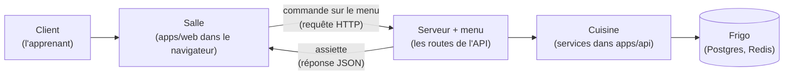
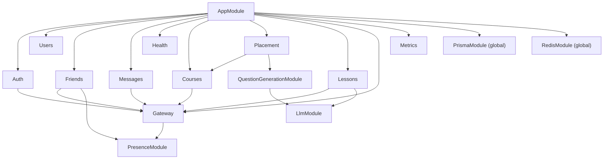
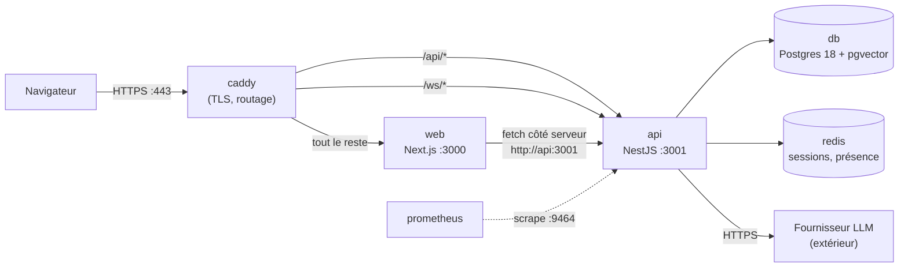
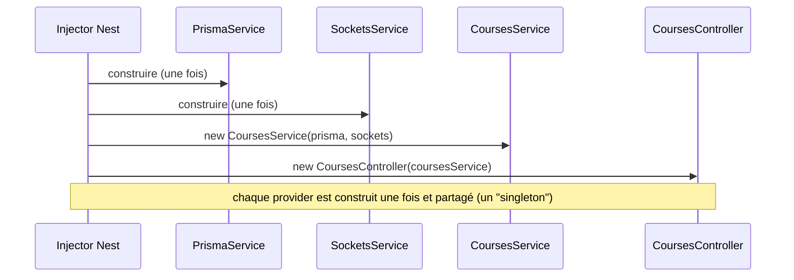
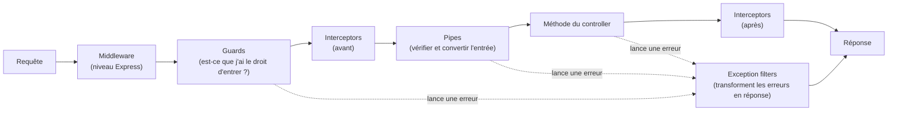
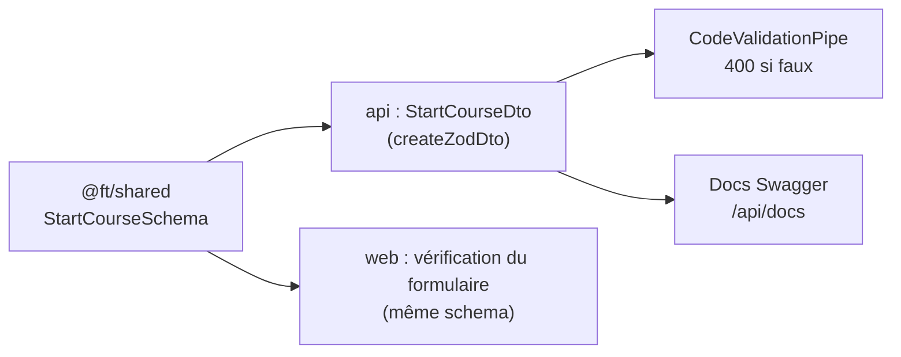
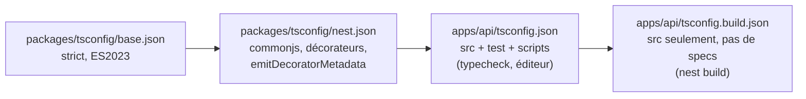
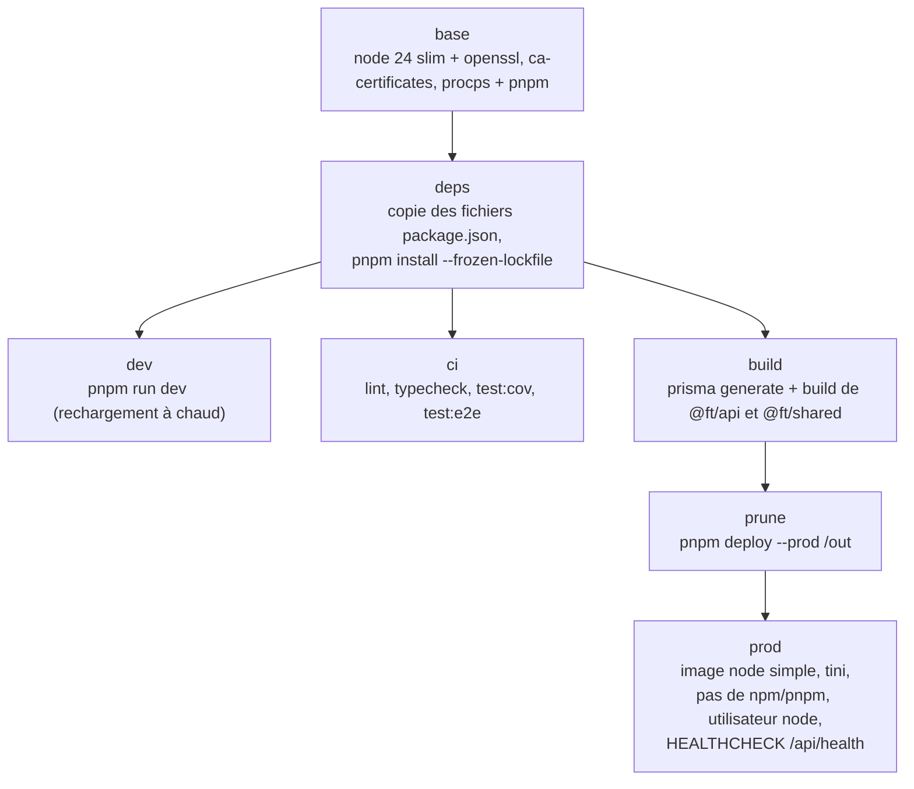

# Chapitre 1 — Vue d'ensemble

Dans ce chapitre :

- Ce qu'est un backend (une API), avec une analogie simple
- Les bases de HTTP : méthodes, codes de statut, JSON, cookies et le style REST
- Ce que fait cette API : chaque module de `apps/api/src`, une ligne chacun
- La place de l'API dans tout le système (navigateur, Caddy, web, api, Postgres, Redis)
- Node.js et TypeScript en deux minutes
- La théorie NestJS : modules, controllers, providers, injection de dépendances, décorateurs, le pipeline de requête
- Zod, `nestjs-zod` et le package `@ft/shared`
- Une carte du dossier `apps/api`, et chaque fichier d'outillage à sa racine

---

## 1. Qu'est-ce qu'un backend ? Qu'est-ce qu'une API ?

Pense à un restaurant.

- La **salle** est l'app web dans le navigateur. C'est ce que le client voit.
- La **cuisine** est le backend. Le client n'y entre jamais. Elle garde la nourriture (les données) et les recettes (les règles).
- Le **serveur et le menu** sont l'API. API veut dire _Application Programming Interface_ (interface de programmation) : une liste fixe de choses que tu peux demander, et la façon exacte de les demander. Tu ne peux pas entrer dans la cuisine ; tu commandes sur le menu, et le serveur te rapporte une assiette.

Dans ce projet, la cuisine est `apps/api`, un programme NestJS. La salle est `apps/web`, un programme Next.js. La règle de tout le projet est écrite dans [docs/architecture/overview.md](../architecture/overview.md) :

> **NestJS possède toute la logique métier et l'accès aux données. Next.js fait seulement l'affichage et le SSR.**

Donc chaque règle (« est-ce que cet utilisateur peut voir cette leçon ? », « combien d'XP donne une leçon terminée ? ») et chaque lecture ou écriture dans la base de données se passe dans l'API. L'app web ne fait que demander et afficher.



---

## 2. Les bases de HTTP

Le navigateur et l'API parlent avec **HTTP**. HTTP est un protocole texte : un côté envoie une _requête_, l'autre renvoie une _réponse_.

Une requête contient :

| Partie           | Exemple                                                | Sens                       |
| ---------------- | ------------------------------------------------------ | -------------------------- |
| Méthode          | `POST`                                                 | Quel type d'action         |
| Chemin           | `/api/auth/login`                                      | Quelle chose               |
| Headers          | `Content-Type: application/json`, `Cookie: ft.sid=...` | Des informations en plus   |
| Body (optionnel) | `{"email":"a@b.c","password":"..."}`                   | Les données que tu envoies |

Une réponse contient un **code de statut**, des headers, et en général un body.

### Méthodes

| Méthode  | Usage                                             | Exemple dans cette API                      |
| -------- | ------------------------------------------------- | ------------------------------------------- |
| `GET`    | Lire quelque chose. Ne change jamais les données. | `GET /api/courses` liste mes cours          |
| `POST`   | Créer quelque chose, ou lancer une action         | `POST /api/auth/login`, `POST /api/courses` |
| `PATCH`  | Changer une partie de quelque chose               | `PATCH /api/users/me` change mon profil     |
| `DELETE` | Supprimer quelque chose                           | `DELETE /api/friends/:userId`               |
| `PUT`    | Remplacer quelque chose en entier                 | Pas utilisé dans cette API                  |

### Codes de statut

Le code de statut est un nombre qui dit comment ça s'est passé. Le premier chiffre donne la famille.

| Code  | Nom                   | Quand cette API l'envoie                                                                                       |
| ----- | --------------------- | -------------------------------------------------------------------------------------------------------------- |
| `200` | OK                    | Succès normal                                                                                                  |
| `201` | Created               | Un `POST` qui a créé quelque chose (Nest envoie 201 pour chaque `POST`, sauf si `@HttpCode()` dit autre chose) |
| `202` | Accepted              | Login avec la 2FA activée : le mot de passe est bon, mais il faut encore un code                               |
| `204` | No Content            | Succès sans body, par exemple `DELETE /api/friends/:userId` (`@HttpCode(HttpStatus.NO_CONTENT)`)               |
| `400` | Bad Request           | Le body n'a pas passé son schema Zod                                                                           |
| `401` | Unauthorized          | Pas de session valide (pas connecté)                                                                           |
| `403` | Forbidden             | Connecté, mais pas autorisé                                                                                    |
| `404` | Not Found             | Cette route ou cette chose n'existe pas                                                                        |
| `409` | Conflict              | Par exemple : tu étudies déjà cette langue                                                                     |
| `413` | Payload Too Large     | Le fichier d'avatar est trop gros                                                                              |
| `429` | Too Many Requests     | Le rate limiter (limiteur de débit) a dit « ralentis »                                                         |
| `500` | Internal Server Error | Un bug ou un crash                                                                                             |

Dans cette API, le `message` de chaque erreur est un **code** comme `"auth.sessionRequired"`, jamais une phrase. Le navigateur connaît la langue du lecteur, donc c'est lui qui transforme le code en mots ([apps/web/lib/error-message.ts](../../apps/web/lib/error-message.ts)). Le chapitre 2 montre comment.

### JSON

JSON (_JavaScript Object Notation_) est le format texte des bodies :

```json
{ "courses": [{ "lang": "fr", "level": "A2", "dailyGoal": 30 }], "activeLang": "fr" }
```

Une méthode de controller NestJS renvoie un objet JavaScript normal, et Nest le transforme en JSON pour toi.

### Cookies et sessions

HTTP n'a pas de mémoire : chaque requête est seule. Pour se souvenir que « c'est Alice », l'API utilise un **cookie de session**.

1. Alice se connecte. L'API enregistre `{ userId: "..." }` dans **Redis** sous un id aléatoire.
2. L'API répond avec le header `Set-Cookie: ft.sid=<random id>`.
3. Le navigateur envoie `Cookie: ft.sid=<random id>` à chaque requête suivante, tout seul.
4. L'API lit l'id, trouve la session dans Redis, et sait que c'est Alice.

Le cookie est `httpOnly` (le JavaScript de la page ne peut pas le lire), donc un script injecté dans la page ne peut pas le voler. C'est configuré dans [app.setup.ts](../../apps/api/src/app.setup.ts) (chapitre 2) et utilisé par le module auth (chapitre 5).

### REST

REST est un _style_ pour concevoir des API HTTP, pas une librairie. Les idées principales :

- Une URL nomme une **ressource** (une chose) : `/courses`, `/users/:id`, `/friends`.
- La **méthode** dit quoi en faire : `GET` lit, `POST` crée, `PATCH` change, `DELETE` supprime.
- Chaque requête porte tout ce qu'il faut (ici, le cookie).

Donc `PATCH /api/courses/fr/level` veut dire « change le niveau de mon cours de français ». Cette API suit REST pour la plupart des routes, et ajoute deux choses qui ne sont pas du simple requête/réponse :

- Des **WebSockets** sur `/ws` (socket.io) : une connexion qui reste ouverte, pour que le serveur puisse _pousser_ des événements (un nouveau message de chat, un ami qui se connecte). Chapitre 9.
- Des **Server-Sent Events** (`text/event-stream`) pour la réponse du tuteur IA, qui arrive mot par mot. Chapitre 8.

---

## 3. Ce que fait cette API : les modules

Le code de [apps/api/src](../../apps/api/src) est découpé en **modules** (la section 6 explique ce qu'est un module). Voici chacun, avec ses routes. Toutes les routes HTTP commencent par `/api` (le préfixe global défini dans `app.setup.ts`).

| Dossier                                                        | Module                     | Ce qu'il fait                                                                                                                            | Routes / points d'entrée                                                                                                                                              |
| -------------------------------------------------------------- | -------------------------- | ---------------------------------------------------------------------------------------------------------------------------------------- | --------------------------------------------------------------------------------------------------------------------------------------------------------------------- |
| [prisma/](../../apps/api/src/prisma)                           | `PrismaModule` (global)    | Donne à chaque module `PrismaService`, la connexion à Postgres                                                                           | aucune                                                                                                                                                                |
| [redis/](../../apps/api/src/redis)                             | `RedisModule` (global)     | Donne à chaque module `RedisService`, la connexion à Redis (sessions, présence, compteurs)                                               | aucune                                                                                                                                                                |
| [throttler/](../../apps/api/src/throttler)                     | pas de module, un guard    | Rate limiting : combien de requêtes par minute, comptées par compte ou par IP                                                            | s'applique à chaque route                                                                                                                                             |
| [metrics/](../../apps/api/src/metrics)                         | `MetricsModule`            | Les chiffres Prometheus (temps des requêtes, utilisateurs actifs), servis sur un port séparé, 9464                                       | `:9464/metrics` (interne)                                                                                                                                             |
| [health/](../../apps/api/src/health)                           | `HealthModule`             | « Est-ce que je suis vivant ? Est-ce que Postgres et Redis répondent ? » pour Docker et la CI                                            | `GET /api/health`                                                                                                                                                     |
| [auth/](../../apps/api/src/auth)                               | `AuthModule`               | Inscription, connexion, déconnexion, sessions, authentification à deux facteurs (TOTP) ; le `AuthGuard` global                           | `/api/auth/signup`, `login`, `logout`, `me`, `2fa`, `2fa/setup`, `2fa/enable`, `2fa/verify`                                                                           |
| [users/](../../apps/api/src/users)                             | `UsersModule`              | Profils : lister et chercher des utilisateurs, en lire un, changer mon profil, envoyer ou supprimer mon avatar                           | `/api/users`, `/api/users/recently-active`, `/api/users/:id`, `/api/users/me`, `/api/users/me/avatar`                                                                 |
| [llm/](../../apps/api/src/llm)                                 | `LlmModule`                | Choisit le fournisseur d'IA (un vrai modèle, ou un faux « fixture » pour les tests) et l'exporte sous le nom `LLM_PROVIDER`              | aucune                                                                                                                                                                |
| [courses/](../../apps/api/src/courses)                         | `CoursesModule`            | Les langues qu'un utilisateur étudie, l'objectif du jour, le niveau                                                                      | `/api/courses`, `/api/courses/:lang`, `/api/courses/:lang/level`                                                                                                      |
| [question-generation/](../../apps/api/src/question-generation) | `QuestionGenerationModule` | Écrit de nouvelles questions de placement avec le LLM quand le stock baisse                                                              | aucune (utilisé par placement)                                                                                                                                        |
| [placement/](../../apps/api/src/placement)                     | `PlacementModule`          | Le test de placement qui trouve ton niveau                                                                                               | `/api/placement`, `/api/placement/answers`                                                                                                                            |
| [lessons/](../../apps/api/src/lessons)                         | `LessonsModule`            | La leçon du jour, la liste des leçons, une leçon, les succès, les tentatives (répondre aux pages), l'XP, la discussion avec le tuteur IA | `/api/courses/:lang/today`, `.../lessons`, `.../lessons/:id`, `.../achievements`, `.../lessons/:id/attempt`, `.../attempt/pages/:index`, `.../lessons/:id/discussion` |
| [gateway/](../../apps/api/src/gateway)                         | `GatewayModule`            | Le serveur socket.io sur `/ws` ; `SocketsService` permet aux autres modules de pousser des événements à un utilisateur                   | WebSocket `/ws`                                                                                                                                                       |
| [presence/](../../apps/api/src/presence)                       | `PresenceModule`           | Qui est en ligne en ce moment (gardé dans Redis)                                                                                         | aucune                                                                                                                                                                |
| [friends/](../../apps/api/src/friends)                         | `FriendsModule`            | Liste d'amis, envoyer, accepter, refuser des demandes, retirer un ami                                                                    | `/api/friends`, `/api/friends/requests/:userId`, `.../accept`, `/api/friends/:userId`                                                                                 |
| [messages/](../../apps/api/src/messages)                       | `MessagesModule`           | Messages privés : lister les conversations, lire une conversation ; envoyer et marquer comme lu via le socket                            | `/api/conversations`, `/api/conversations/:userId/messages`, événements socket                                                                                        |
| [demo/](../../apps/api/src/demo)                               | pas de module              | Des apprenants de démo, rejoués jour après jour à travers les vrais services. Lancé par le seed, en dehors de Nest                       | aucune                                                                                                                                                                |
| [items/](../../apps/api/src/items)                             | pas de module, un test     | `item-files.spec.ts` vérifie les questions de placement écrites à la main dans `content/items`                                           | aucune                                                                                                                                                                |
| [generated/](../../apps/api/src/generated)                     | pas de module              | Le client Prisma, généré à partir de `schema.prisma`. Jamais modifié à la main                                                           | aucune                                                                                                                                                                |

À côté d'eux, en haut de `src`, il y a les fichiers de démarrage : `main.ts`, `app.setup.ts`, `app.module.ts`, `validation.pipe.ts`, `error-code.filter.ts`. Ils sont au chapitre 2.

Comment les modules s'importent entre eux (d'après les tableaux `imports` de chaque `*.module.ts` ; Prisma et Redis sont globaux, donc tout le monde les utilise sans flèche) :



---

## 4. La place de l'API dans le système

Toute l'app tourne dans des containers Docker, décrits dans [compose.yml](../../compose.yml) (plus `compose.prod.yml` et `compose.override.yml`). Seul **Caddy** ouvre un port vers l'extérieur. Caddy est un _reverse proxy_ : une seule porte d'entrée qui envoie chaque requête au bon container, et qui gère le HTTPS.



Les règles de routage sont dans [infra/caddy/Caddyfile](../../infra/caddy/Caddyfile) :

```text
	# NestJS sets a global "api" prefix, so the prefix is forwarded intact.
	# handle_path would strip it and every route would answer 404.
	@api path /api /api/*
	handle @api {
		reverse_proxy api:3001 {
```

Pourquoi une seule porte d'entrée pour le web et l'api ? Parce qu'alors `/` et `/api` ont la même _origine_ (même schéma, même hôte, même port). Le cookie de session est « first-party » (du même site), donc il n'y a pas de configuration CORS à écrire. (CORS est la règle du navigateur qui empêche une page d'appeler une autre origine, sauf si cette origine l'autorise.)

Le service `api` dans `compose.yml` montre ce dont l'API a besoin pour démarrer :

```yaml
api:
  logging: *logging
  build:
    context: .
    dockerfile: apps/api/Dockerfile
  depends_on:
    db:
      condition: service_healthy
    redis:
      condition: service_healthy
  environment:
    NODE_ENV: ${NODE_ENV:-development}
    # Prometheus scrapes metrics on 9464 (apps/api/src/metrics). Internal
    # only: never add it to ports.
    PORT: 3001
```

Il attend que Postgres et Redis soient en bonne santé, et reçoit ses réglages par des variables d'environnement : `DATABASE_URL`, `REDIS_URL`, `SESSION_SECRET`, `LLM_PROVIDER`, `LLM_API_KEY`, `LLM_MODEL`, les limites de débit, et `AVATAR_STORAGE_DIR` (où vont les avatars envoyés, un volume Docker).

---

## 5. Node.js et TypeScript

**Node.js** fait tourner du JavaScript hors du navigateur, sur un serveur. Il a un seul thread principal et une _event loop_ (boucle d'événements) : quand le code attend la base de données, Node ne bloque pas ; il traite d'autres requêtes et revient quand la réponse arrive. C'est pour ça que tu vois `async` / `await` partout dans l'API. L'image Docker utilise Node 24.

**TypeScript** est du JavaScript avec des types. Tu écris des fichiers `.ts`, et le compilateur (`tsc`) vérifie les types et produit des fichiers `.js` simples dans `dist/`. Node lance `dist/main.js`. Les types existent seulement avant la compilation ; à l'exécution, ils ont disparu. Garde ça en tête : c'est pour ça que NestJS a besoin des _métadonnées de décorateurs_ (section 6.5).

---

## 6. La théorie NestJS

NestJS est un framework construit sur **Express** (la librairie classique de serveur web pour Node). Express te donne « quand une requête arrive sur cette URL, appelle cette fonction ». Nest ajoute de la structure : des modules, des classes, des décorateurs, et une façon automatique de relier les classes entre elles.

### 6.1 Modules

Un **module** est une boîte qui regroupe les pièces d'une fonctionnalité. C'est une classe avec le décorateur `@Module()`, et elle liste quatre choses :

| Clé           | Sens                                                               |
| ------------- | ------------------------------------------------------------------ |
| `imports`     | Les autres modules dont j'ai besoin des pièces exportées           |
| `controllers` | Mes classes qui répondent aux routes HTTP                          |
| `providers`   | Mes classes que Nest doit construire (services, guards, factories) |
| `exports`     | Lesquels de mes providers les autres modules peuvent utiliser      |

En voici un vrai, [courses.module.ts](../../apps/api/src/courses/courses.module.ts) :

```ts
@Module({
  imports: [GatewayModule],
  controllers: [CoursesController],
  providers: [CoursesService],
  exports: [CoursesService],
})
export class CoursesModule {}
```

Le corps de la classe est vide : le décorateur porte toute l'information. `CoursesModule` a besoin de `SocketsService` venant de `GatewayModule` (pour pousser des événements « le cours a changé »), et il exporte `CoursesService` parce que `PlacementModule` l'utilise.

Tous les modules partent d'une seule racine, [app.module.ts](../../apps/api/src/app.module.ts), qui les liste dans `imports`. Nest commence par là et parcourt l'arbre.

Un module peut être **global** avec `@Global()`. Alors ses exports sont disponibles partout sans l'importer. Seuls deux modules font ça, et [prisma.module.ts](../../apps/api/src/prisma/prisma.module.ts) explique pourquoi :

```ts
/**
 * Global: every feature module needs the database, and re-importing this in each
 * of them is boilerplate that only ever gets forgotten. Nothing else in this
 * codebase should be @Global.
 */
@Global()
@Module({
  providers: [PrismaService],
  exports: [PrismaService],
})
export class PrismaModule {}
```

### 6.2 Controllers

Un **controller** est le serveur du restaurant. Il reçoit les requêtes HTTP, lit l'entrée (body, paramètres d'URL, utilisateur courant), appelle un service, et renvoie le résultat. Il ne doit contenir aucune règle métier. Extrait de [courses.controller.ts](../../apps/api/src/courses/courses.controller.ts) :

```ts
@ApiTags('courses')
@Controller('courses')
export class CoursesController {
  constructor(private readonly courses: CoursesService) {}

  @Get()
  @ApiOperation({ summary: 'List courses for the current user' })
  @ApiOkResponse({ type: CoursesDto })
  @ApiUnauthorizedResponse({ description: 'No valid session' })
  listCourses(@CurrentUser() user: SessionUser) {
    return this.courses.listCoursesUser(user.id);
  }

  @Post()
  @ApiOperation({ summary: 'Start a course in a new language' })
  @ApiCreatedResponse({ type: CourseDto })
  @ApiUnauthorizedResponse({ description: 'No valid session' })
  @ApiConflictResponse({ description: 'Language already studied' })
  createNewCourse(@CurrentUser() user: SessionUser, @Body() body: StartCourseDto) {
    return this.courses.createCourse(user.id, body);
  }
```

- `@Controller('courses')` + `@Get()` = `GET /api/courses`.
- `@Post()` = `POST /api/courses`.
- `@CurrentUser()` donne l'utilisateur connecté ; `@Body()` donne le body JSON déjà lu.
- Les décorateurs `@Api...` décrivent seulement la route pour la page de documentation Swagger sur `/api/docs`. Ils ne changent rien à l'exécution.

### 6.3 Providers et services

Un **provider** est n'importe quelle classe (ou valeur) que Nest construit et distribue. Le type le plus courant est un **service** : le cuisinier, là où se fait le vrai travail. Un service est une classe marquée `@Injectable()`. Extrait de [courses.service.ts](../../apps/api/src/courses/courses.service.ts) :

```ts
@Injectable()
export class CoursesService {
  constructor(
    private readonly prisma: PrismaService,
    private readonly sockets: SocketsService,
  ) {}

  async listCoursesUser(userId: string) {
    const user = await this.prisma.user.findUnique({
      where: { id: userId },
      select: {
        activeLang: true,
        userLevels: { select: COURSE_SELECT, orderBy: { createdAt: 'asc' } },
      },
    });
    if (!user) {
      throw new UnauthorizedException('auth.sessionRequired');
    }
    return { courses: user.userLevels, activeLang: user.activeLang };
  }
```

Remarque deux choses. Le service n'écrit jamais `new PrismaService()` : il en _demande_ juste un dans son constructeur. Et il lance une `UnauthorizedException` avec un code ; Nest la transforme en réponse `401`.

Un provider n'est pas toujours une classe. [llm.module.ts](../../apps/api/src/llm/llm.module.ts) utilise un **factory provider** : une fonction que Nest appelle une fois au démarrage, avec un token Symbol comme nom :

```ts
    {
      // The name other classes use to ask for this provider.
      // It is a Symbol (a real value that exists at runtime),
      // because the LlmProvider interface is erased when the code is compiled.
      provide: LLM_PROVIDER,

      // The things Nest must give to the factory below.
      // Here: the ConfigService, which reads the .env file.
      // The order matches the factory's parameters.
      inject: [ConfigService],
```

### 6.4 Injection de dépendances

L'**injection de dépendances (DI)** veut dire : une classe ne construit pas les choses dont elle a besoin ; quelqu'un d'autre les lui donne.

Analogie : un cuisinier ne fait pas pousser ses légumes et ne construit pas son four. Le gérant du restaurant les met dans la cuisine avant le service. Le cuisinier dit juste « j'ai besoin d'un four et de carottes ». Dans Nest, le gérant est l'**injector** (aussi appelé conteneur IoC).



Au démarrage, Nest lit chaque constructeur, voit quels types il demande, construit ceux-là d'abord, et les passe en paramètre. Chaque provider est construit **une seule fois** et partagé par tout le monde dans l'app.

Pourquoi c'est bien :

- **Moins de code de branchement** : pas de chaînes `new X(new Y(new Z()))`.
- **Tests faciles** : un test peut donner un faux `PrismaService` à la place du vrai (chapitre 10).
- **Frontières claires** : un module ne peut utiliser que ce qu'il importe, donc les listes `imports` montrent qui dépend de qui.

### 6.5 Décorateurs

Un **décorateur** est le `@Something()` écrit au-dessus d'une classe, d'une méthode ou d'un paramètre. C'est une fonction qui s'exécute quand la classe est définie et qui lui attache des informations (des _métadonnées_). Nest lit ces métadonnées plus tard.

| Type      | Exemples                                                                       | Effet                                            |
| --------- | ------------------------------------------------------------------------------ | ------------------------------------------------ |
| Classe    | `@Module()`, `@Controller('courses')`, `@Injectable()`, `@Global()`            | Dit ce qu'est la classe                          |
| Méthode   | `@Get()`, `@Post(':id')`, `@Public()`, `@SkipThrottle()`, `@UseInterceptors()` | Route, règles pour une route                     |
| Paramètre | `@Body()`, `@Param('lang')`, `@CurrentUser()`                                  | Quelle partie de la requête va dans cet argument |

Comment Nest sait-il que le constructeur demande un `PrismaService`, si les types disparaissent à la compilation ? Les options TypeScript `experimentalDecorators` et `emitDecoratorMetadata` (dans [packages/tsconfig/nest.json](../../packages/tsconfig/nest.json)) font écrire au compilateur les types du constructeur dans des métadonnées cachées appelées `design:paramtypes`. Le package `reflect-metadata` les lit. C'est pour ça que `main.ts` commence par `import 'reflect-metadata'`, et que la config ESLint désactive la règle qui changerait `import { X }` en `import type { X }` (un import de type seul est effacé, et les métadonnées sont perdues).

Ce projet crée aussi ses propres décorateurs. Extrait de [auth.decorators.ts](../../apps/api/src/auth/auth.decorators.ts) :

```ts
/** Opens a route to anonymous callers. Everything else requires a session. */
export const Public = () => SetMetadata(IS_PUBLIC, true);

/** The user AuthGuard resolved. Only meaningful on a guarded route. */
export const CurrentUser = createParamDecorator((_data: unknown, context: ExecutionContext) => {
  return context.switchToHttp().getRequest<Request & { user?: SessionUser }>().user;
});
```

`@Public()` écrit seulement un drapeau. Le `AuthGuard` lit ce drapeau pour décider s'il demande une session.

### 6.6 Le pipeline de requête

Entre le moment où une requête arrive et le moment où ta méthode de controller s'exécute, Nest la fait passer par plusieurs types de pièces, toujours dans le même ordre :



| Pièce                | Question à laquelle elle répond                                                    | Exemple dans cette API                                                                                                                                 |
| -------------------- | ---------------------------------------------------------------------------------- | ------------------------------------------------------------------------------------------------------------------------------------------------------ |
| **Middleware**       | « Faire quelque chose avec chaque requête brute »                                  | `httpMetrics` (chronomètre chaque requête), `express-session` (charge la session depuis Redis). Les deux dans `app.setup.ts`                           |
| **Guard**            | « Est-ce que cet appelant a le droit d'entrer ? » Renvoie true ou lance une erreur | `AuthGuard` (demande une session sauf avec `@Public()`), `IdentityThrottlerGuard` (rate limit). Les deux globaux, enregistrés avec `APP_GUARD`         |
| **Interceptor**      | « Envelopper le handler : faire quelque chose avant et après »                     | `FileInterceptor('avatar', ...)` de `@nestjs/platform-express` lit le fichier d'avatar envoyé (utilise `multer`)                                       |
| **Pipe**             | « L'entrée est-elle valide ? La convertir »                                        | `CodeValidationPipe` (vérification Zod de chaque body), `LangParam` (vérifie `:lang`) dans [validation.pipe.ts](../../apps/api/src/validation.pipe.ts) |
| **Exception filter** | « Quelque chose a lancé une erreur : quelle réponse on envoie ? »                  | `ErrorCodeFilter` (global), `AvatarTooLargeFilter` dans users, `SocketExceptionFilter` pour les sockets                                                |

Un commentaire dans [http-metrics.middleware.ts](../../apps/api/src/metrics/http-metrics.middleware.ts) montre pourquoi l'ordre compte :

```ts
/**
 * A middleware, not an interceptor: interceptors run after guards, so they
 * would never see the 401s, the 429s, unknown routes or body parser errors.
 * Timed on `close`, after ErrorCodeFilter has set the final status.
 */
```

Le chapitre 2 suit une vraie requête à travers chacune de ces pièces.

---

## 7. Zod, nestjs-zod et @ft/shared

### Zod

**Zod** est une librairie pour décrire la _forme_ des données et la vérifier à l'exécution. Les types TypeScript disparaissent à l'exécution, donc ils ne peuvent pas vérifier ce qu'un utilisateur envoie. Un schema Zod, lui, le peut :

```ts
export const StartCourseSchema = z.object({
  lang: LanguageSchema,
  dailyGoal: DailyGoalSchema,
});
export type StartCourseInput = z.infer<typeof StartCourseSchema>;
```

`StartCourseSchema.parse(data)` lance une erreur si `data` est faux. `z.infer` donne le type TypeScript gratuitement, donc le type et la vérification ne sont jamais en désaccord.

### @ft/shared

Ce schema ne vit pas dans l'API. Il vit dans [packages/shared/src/schemas/course.ts](../../packages/shared/src/schemas/course.ts). Le package `@ft/shared` est le **contrat** entre l'API et l'app web. Son [index.ts](../../packages/shared/src/index.ts) explique pourquoi :

```ts
/**
 * @ft/shared is the contract layer.
 *
 * The subject requires every user input to be validated on the server and, where
 * a form exists, on the client too. Writing those rules twice guarantees the two
 * copies drift apart. So each payload that crosses the network is declared once
 * here as a Zod schema: NestJS parses requests with it, Next parses form input
 * and API responses with it, and both derive their TypeScript types from the same
 * `z.infer`. One edit, both sides.
 *
 * This package is a leaf. It must never import from apps/*.
 */
```

Ce qu'il contient :

| Dossier        | Contenu                                                                                                                                                                                                    |
| -------------- | ---------------------------------------------------------------------------------------------------------------------------------------------------------------------------------------------------------- |
| `src/schemas/` | Les schemas de requête et de réponse : user, course, placement, item (questions), lesson, friend, message, gamification, two-factor, health, language, locale, et `errors.ts` (la liste des `ERROR_CODES`) |
| `src/events/`  | Les noms et payloads des événements socket (`CLIENT_EVENTS`, `SERVER_EVENTS`)                                                                                                                              |
| `src/lessons/` | Le format des leçons (domaine, player, schemas, validation), exporté sous le nom `lessons`                                                                                                                 |

Il est compilé dans `packages/shared/dist`, et l'API l'importe sous le nom `@ft/shared` (`"@ft/shared": "workspace:*"` dans `package.json`, ce qui veut dire « la copie de ce repo »). C'est pour ça que certains scripts buildent `@ft/shared` d'abord.

### nestjs-zod

Normalement, Nest valide avec des _classes DTO_ (Data Transfer Object : une classe qui décrit un body). `nestjs-zod` construit une telle classe à partir d'un schema Zod. Extrait de [courses.dto.ts](../../apps/api/src/courses/courses.dto.ts) :

```ts
import { createZodDto } from "nestjs-zod";
import {
  StartCourseSchema,
  SetGoalSchema,
  SetLevelSchema,
  CourseSchema,
  CoursesSchema,
} from "@ft/shared";

export class StartCourseDto extends createZodDto(StartCourseSchema) {}
```

Quand un controller écrit `@Body() body: StartCourseDto`, le `CodeValidationPipe` global (construit avec `createZodValidationPipe` de `nestjs-zod`) voit le DTO, lance son schema Zod, et envoie un `400` avec des codes d'erreur si ça échoue. Swagger lit aussi le DTO pour documenter le body.



`class-validator` et `class-transformer` sont aussi dans `package.json`, mais aucun fichier de `src` ne les importe. Comme le dit `app.setup.ts` : _"Zod, not class-validator: @ft/shared owns the rules and the browser applies the same ones."_ (Zod, pas class-validator : @ft/shared possède les règles et le navigateur applique les mêmes.)

---

## 8. Carte des dossiers de apps/api

```text
apps/api/
├── src/                 the application code (chapters 2-9)
│   ├── main.ts          starts the server
│   ├── app.setup.ts     global setup (prefix, sessions, pipes, filters, Swagger)
│   ├── app.module.ts    the root module
│   ├── validation.pipe.ts, error-code.filter.ts
│   ├── auth/ users/ courses/ placement/ question-generation/ lessons/
│   ├── friends/ messages/ gateway/ presence/ llm/ demo/
│   ├── prisma/ redis/ throttler/ metrics/ health/ items/
│   └── generated/prisma/   Prisma client (generated, git-ignored)
├── prisma/              database: schema.prisma, migrations/, seed.ts (chapter 4)
├── scripts/             command-line tools: lessons/, check-outlines.ts, try-generation.ts (chapter 11)
├── test/                end-to-end tests *.e2e-spec.ts, *.fixtures.ts, fixtures/ (chapter 10)
├── coverage/            test coverage report (generated, not in git)
├── dist/                compiled JavaScript (generated, not in git)
├── package.json  nest-cli.json  nest-cli.dev.json
├── tsconfig.json  tsconfig.build.json
├── eslint.config.mjs  vitest.config.mts  vitest.config.e2e.mts
├── prisma.config.ts
├── Dockerfile  .dockerignore  Dockerfile.dockerignore
└── .gitignore
```

| Dossier          | Ce que c'est                                                                                                                                                                                                                                                                    | Modifié à la main ? |
| ---------------- | ------------------------------------------------------------------------------------------------------------------------------------------------------------------------------------------------------------------------------------------------------------------------------- | ------------------- |
| `src/`           | Tout le code qui tourne dans le serveur. Les tests unitaires (`*.spec.ts`) sont à côté du fichier qu'ils testent                                                                                                                                                                | Oui                 |
| `src/generated/` | Le client Prisma : du code TypeScript fabriqué par `prisma generate` à partir de `schema.prisma`. [.gitignore](../../apps/api/.gitignore) le garde hors de git : _"committing it would put a build artifact under review"_ (le commiter mettrait un artefact de build en revue) | Non                 |
| `prisma/`        | Le schema de la base de données, l'historique des migrations, et le script de seed                                                                                                                                                                                              | Oui                 |
| `scripts/`       | Des outils que tu lances à la main avec `tsx` : écrire et vérifier des leçons, vérifier les plans, essayer la génération de questions par le LLM. Ne font pas partie du serveur                                                                                                 | Oui                 |
| `test/`          | Les tests end-to-end : ils démarrent toute l'app et envoient de vraies requêtes HTTP avec Supertest                                                                                                                                                                             | Oui                 |
| `coverage/`      | Rapport HTML et `lcov` fabriqué par `pnpm test:cov`                                                                                                                                                                                                                             | Non                 |
| `dist/`          | La sortie de `nest build`. C'est ce qui tourne en production                                                                                                                                                                                                                    | Non                 |

---

## 9. Fichiers d'outillage

### 9.1 package.json

[package.json](../../apps/api/package.json) nomme le package `@ft/api` et liste ses scripts et ses dépendances. `"files": ["dist"]` dit que seul `dist` est livré quand le Dockerfile lance `pnpm deploy`.

Lance un script depuis la racine du repo avec `pnpm --filter @ft/api <script>`, ou depuis `apps/api` avec `pnpm <script>`.

| Script           | Commande                                                        | Ce qu'il fait                                                                                |
| ---------------- | --------------------------------------------------------------- | -------------------------------------------------------------------------------------------- |
| `dev`            | `nest start --watch --config nest-cli.dev.json`                 | Démarre l'API et la redémarre à chaque sauvegarde de fichier                                 |
| `build`          | `nest build`                                                    | Compile `src` vers `dist`                                                                    |
| `start`          | `node dist/main.js`                                             | Lance l'API compilée (production)                                                            |
| `lint`           | `eslint .`                                                      | Vérifie le style du code et les erreurs courantes                                            |
| `format:check`   | `prettier --check . --ignore-path ../../.prettierignore`        | Vérifie le formatage, ne change pas les fichiers                                             |
| `typecheck`      | `tsc --noEmit`                                                  | Vérifie tous les types (src, test, scripts), n'écrit rien                                    |
| `test`           | `vitest run`                                                    | Lance les tests unitaires (`src/**/*.spec.ts`)                                               |
| `test:cov`       | `vitest run --coverage`                                         | Pareil, plus le rapport de couverture et ses seuils                                          |
| `test:e2e`       | `vitest run --config vitest.config.e2e.mts`                     | Lance les tests end-to-end de `test/` (il faut un vrai Postgres et un vrai Redis)            |
| `db:generate`    | `prisma generate`                                               | Écrit le client Prisma dans `src/generated`                                                  |
| `db:migrate`     | `prisma migrate dev`                                            | Développement : crée une nouvelle migration à partir des changements du schema et l'applique |
| `db:deploy`      | `prisma migrate deploy`                                         | Production : applique les migrations qui ne sont pas encore appliquées                       |
| `db:seed`        | `tsx prisma/seed.ts`                                            | Remplit la base avec les données de base et les utilisateurs de démo                         |
| `generation:try` | `tsx --env-file-if-exists=../../.env scripts/try-generation.ts` | Essaie la génération de questions par le LLM à la main, avec les clés de ton `.env`          |
| `outlines:check` | `tsx scripts/check-outlines.ts`                                 | Vérifie les fichiers de plan de leçons dans `content/outlines`                               |
| `lessons:author` | build de `@ft/shared`, puis `tsx scripts/lessons/author.ts`     | Écrit des leçons avec le LLM                                                                 |
| `lessons:check`  | build de `@ft/shared`, puis `tsx scripts/lessons/check.ts`      | Valide les fichiers de leçons                                                                |

`tsx` lance un fichier TypeScript directement, sans le compiler d'abord. Il est utilisé pour le seed et les scripts, qui tournent en dehors de Nest.

**Dépendances principales** (nécessaires à l'exécution) :

| Package                                                         | Rôle                                                                                                |
| --------------------------------------------------------------- | --------------------------------------------------------------------------------------------------- |
| `@nestjs/common`, `@nestjs/core`                                | NestJS lui-même : décorateurs, modules, injector                                                    |
| `@nestjs/platform-express`                                      | Fait tourner Nest sur Express ; donne aussi `FileInterceptor`                                       |
| `@nestjs/config`                                                | `ConfigService`, lit les variables d'environnement                                                  |
| `@nestjs/websockets`, `@nestjs/platform-socket.io`, `socket.io` | La gateway WebSocket sur `/ws`                                                                      |
| `@nestjs/swagger`                                               | La page de documentation de l'API sur `/api/docs`                                                   |
| `@nestjs/throttler`                                             | Rate limiting                                                                                       |
| `@prisma/client`, `@prisma/adapter-pg`                          | Le client de base de données, et son adaptateur pour le driver Postgres `pg`                        |
| `redis`, `connect-redis`, `express-session`                     | Le client Redis, et les sessions stockées dans Redis                                                |
| `argon2`                                                        | Hachage des mots de passe                                                                           |
| `otpauth`, `qrcode-generator`                                   | 2FA : les codes TOTP, et le QR code à scanner                                                       |
| `multer`                                                        | Lit les fichiers envoyés (avatars)                                                                  |
| `zod`, `nestjs-zod`                                             | Validation (section 7)                                                                              |
| `@ft/shared`                                                    | Les schemas partagés (section 7)                                                                    |
| `@prometheus-io/client`                                         | Les métriques Prometheus                                                                            |
| `reflect-metadata`                                              | Lit les métadonnées des décorateurs (section 6.5)                                                   |
| `rxjs`                                                          | Une librairie pour des flux d'événements. Nest en a besoin en interne ; notre code ne l'importe pas |
| `class-validator`, `class-transformer`                          | Listés mais pas importés par notre code (section 7)                                                 |

**Dépendances de dev principales** (seulement pour builder et tester) : `@nestjs/cli` (la commande `nest`), `typescript`, `prisma` (la CLI), `vitest` + `@vitest/coverage-v8` (tests et couverture), `vite`, `unplugin-swc` + `@swc/core` (compiler le TypeScript avec les métadonnées de décorateurs dans les tests), `@nestjs/testing` (construire un module de test), `supertest` (envoyer des requêtes HTTP dans les tests e2e), `socket.io-client` (se connecter à la gateway dans les tests), `tsx`, `eslint`, `prettier`, les packages `@types/*`, et les configs partagées `@ft/eslint-config` et `@ft/tsconfig`.

### 9.2 nest-cli.json et nest-cli.dev.json

Ils configurent la commande `nest`. [nest-cli.json](../../apps/api/nest-cli.json) :

```json
{
  "$schema": "https://json.schemastore.org/nest-cli",
  "collection": "@nestjs/schematics",
  "sourceRoot": "src",
  "compilerOptions": {
    "deleteOutDir": true,
    "tsConfigPath": "tsconfig.build.json"
  }
}
```

- `sourceRoot: "src"` : le code est dans `src`.
- `tsConfigPath` : compiler avec `tsconfig.build.json` (sans les tests).
- `deleteOutDir: true` : vider `dist` avant chaque build, pour qu'aucun vieux fichier ne reste.
- `collection` : les modèles utilisés par `nest generate` (pas utilisé par les scripts).

[nest-cli.dev.json](../../apps/api/nest-cli.dev.json) est le même fichier avec `"deleteOutDir": false`. Seul le script `dev` l'utilise. Le fichier ne donne pas de raison ; l'effet est que le mode watch n'efface pas `dist` (ni les infos de build incrémental gardées dedans) à chaque démarrage.

### 9.3 tsconfig.json et tsconfig.build.json

Il y a trois niveaux :



[tsconfig.json](../../apps/api/tsconfig.json) est utilisé par `pnpm typecheck` et par ton éditeur. Il inclut les tests et les scripts pour qu'ils soient aussi vérifiés :

```jsonc
    // Nothing imports this app's types, and emitting declarations makes every
    // inferred type have to be nameable: createZodDto returns a type from a
    // hashed internal path and fails with TS2883.
    "declaration": false,
```

```jsonc
  // Tests and the tsx scripts (scripts/) are typechecked here and excluded from
  // the build (tsconfig.build.json).
  // src/generated is in: the Prisma client is TypeScript that has to compile
  // into dist, and excluding it would only hide errors until runtime.
  "include": ["src/**/*.ts", "test/**/*.ts", "scripts/**/*.ts"],
```

[tsconfig.build.json](../../apps/api/tsconfig.build.json) l'étend pour `nest build` : seulement `src`, pas `test` et pas de `*.spec.ts`. Il définit `rootDir: "./src"` pour que la sortie soit `dist/main.js` et pas `dist/src/main.js`. Les deux fichiers utilisent des noms de `tsBuildInfoFile` différents, pour qu'un typecheck et un build ne mélangent pas leur état sauvegardé.

Le [nest.json](../../packages/tsconfig/nest.json) partagé utilise `"module": "commonjs"` (l'ancien système de modules de Node, celui que Nest attend) et active `experimentalDecorators` et `emitDecoratorMetadata` (section 6.5).

### 9.4 eslint.config.mjs

[eslint.config.mjs](../../apps/api/eslint.config.mjs) réutilise les règles Nest partagées et ignore les dossiers générés :

```js
// .mjs, not .js: this package must stay CommonJS ("type": "module" would make
// Nest's dist/main.js unloadable), and ESLint imports the config file as-is.
import nest from "@ft/eslint-config/nest";

export default [
  ...nest,
  {
    // src/generated is the Prisma client: emitted code, never hand-edited.
    ignores: ["dist/**", "coverage/**", "**/generated/**"],
  },
];
```

Le fichier partagé [packages/eslint-config/nest.js](../../packages/eslint-config/nest.js) désactive `consistent-type-imports` (elle casserait la DI, section 6.5) et `no-extraneous-class` (un module Nest est une classe vide avec un décorateur).

### 9.5 Config des tests : vitest.config.mts et vitest.config.e2e.mts

La liste des tâches dit « jest config », mais ce projet utilise **Vitest**, pas Jest. Vitest est un lanceur de tests avec presque la même API (`describe`, `it`, `expect`). Il n'y a aucun fichier Jest.

[vitest.config.mts](../../apps/api/vitest.config.mts) sert aux tests unitaires. La partie importante est le compilateur :

```ts
  plugins: [
    // Nest's injector reads constructor parameter types off `design:paramtypes`.
    // Neither esbuild nor a plain type-stripping transform emits that metadata,
    // so swc has to do the transform or every test that resolves a provider
    // fails with "Nest can't resolve dependencies".
    swc.vite({
```

Il lance `src/**/*.spec.ts`, charge `reflect-metadata` en premier, définit `AVATAR_STORAGE_DIR` (l'app refuse de se charger sans), et demande au moins 60 % de couverture des lignes et des fonctions, en ignorant `main.ts`, `app.setup.ts`, `*.module.ts` et `src/generated`.

[vitest.config.e2e.mts](../../apps/api/vitest.config.e2e.mts) sert à `test/**/*.e2e-spec.ts`. Il force `LLM_PROVIDER: 'fixture'` (pour qu'aucun test ne dépense d'argent sur une vraie IA), remet les limites de débit à leurs valeurs par défaut, donne 30 secondes par test, et lance les fichiers un par un (`fileParallelism: false`) parce qu'ils partagent des lignes de la base. Les deux fichiers finissent en `.mts` parce que le package est en CommonJS et que Vite doit charger la config en ESM. Le chapitre 10 parle des tests en détail.

### 9.6 prisma.config.ts

[prisma.config.ts](../../apps/api/prisma.config.ts) dit à la CLI Prisma où sont le schema, les migrations et la commande de seed, et quelle URL de base de données utiliser :

```ts
export default defineConfig({
  schema: 'prisma/schema.prisma',
  migrations: {
    path: 'prisma/migrations',
    seed: 'pnpm db:seed',
  },
```

Il lit `process.env.DATABASE_URL ?? ''` au lieu du helper `env()` de Prisma, parce que `prisma generate` tourne pendant le build Docker, où aucune base n'existe. Le chapitre 4 l'explique en entier.

### 9.7 Dockerfile

Le [Dockerfile](../../apps/api/Dockerfile) construit l'image de l'API. Son contexte de build est la **racine du repo**, pas `apps/api`, parce que pnpm a besoin du lockfile racine pour résoudre les packages `workspace:*` :

```text
#   docker build -f apps/api/Dockerfile --target prod -t ft/api .
```

Il a plusieurs _stages_ (des étapes qui peuvent se réutiliser entre elles). Chaque `--target` choisit l'étape où s'arrêter :



Points utiles à savoir, chacun expliqué par un commentaire dans le fichier :

- **base** installe `openssl` (Prisma en a besoin pour choisir le bon moteur) et `procps` (`nest start --watch` utilise `ps` pour tuer l'ancien processus ; sans lui, l'ancien serveur garde le port 3001 et le rechargement à chaud sert du vieux code).
- **deps** copie d'abord seulement les fichiers `package.json`. Docker met cette couche en cache, donc modifier le code source ne réinstalle pas tout. Un nouveau package du workspace doit être ajouté à cette liste de copie.
- **build** lance `prisma generate` dans l'image, puis `pnpm --filter "@ft/api..." run build` ; le `...` builde aussi `@ft/shared` d'abord.
- **prune** utilise `pnpm deploy --prod` pour garder seulement les dépendances de production.
- **prod** part d'une image Node propre, supprime npm, npx, corepack et yarn (ils n'apportent que des alertes de sécurité), tourne avec l'utilisateur `node`, expose 3001 et 9464, et vérifie la santé avec un petit `fetch` vers `/api/health`. `tini` est un tout petit programme d'init qui transmet correctement les signaux d'arrêt à Node.

### 9.8 .dockerignore et Dockerfile.dockerignore

Ils listent ce que Docker ne doit **pas** envoyer dans le build : `node_modules`, `dist`, `generated`, `coverage`, les fichiers `.env`, `docs`, `*.md`, etc. Les deux fichiers sont identiques exprès :

```text
# BuildKit prefers <dockerfile>.dockerignore over <context>/.dockerignore, which
# makes THIS the file it reads when the context is the repo root. Keep it identical
# to the sibling .dockerignore.
```

Donc [Dockerfile.dockerignore](../../apps/api/Dockerfile.dockerignore) est celui qui sert vraiment (contexte = racine du repo), et [.dockerignore](../../apps/api/.dockerignore) servirait si quelqu'un buildait avec `apps/api` comme contexte.

### 9.9 .gitignore

[.gitignore](../../apps/api/.gitignore) a une seule ligne : `src/generated/`. Le client Prisma est reconstruit à l'installation et pendant le build Docker.

---

## Idées clés à retenir

- L'API est la cuisine : toutes les règles et tout l'accès aux données vivent dans `apps/api`. L'app web ne fait que demander et afficher.
- HTTP = méthode + chemin + headers + body ; la réponse a un code de statut. Les bodies sont en JSON. Les erreurs portent un code, pas une phrase.
- La connexion est retenue par le cookie de session `ft.sid` ; la session elle-même est stockée dans Redis.
- Seul Caddy fait face à l'extérieur. `/api/*` et `/ws/*` vont à l'API, tout le reste à Next.js, le tout sur une seule origine.
- Un **module** Nest regroupe une fonctionnalité ; un **controller** répond aux routes ; un **service** fait le travail ; Nest **injecte** les services dans les constructeurs et construit chacun une seule fois.
- Les **décorateurs** attachent des métadonnées ; `emitDecoratorMetadata` + `reflect-metadata` permettent à Nest de voir les types des constructeurs à l'exécution. N'utilise jamais `import type` pour quelque chose que tu injectes.
- Une requête passe par : middleware → guards → interceptors → pipes → controller → interceptors ; tout ce qui lance une erreur va dans un exception filter.
- Les schemas sont écrits une seule fois dans `@ft/shared` avec Zod ; l'API les transforme en DTO avec `nestjs-zod`, et le web utilise les mêmes.
- Les tests utilisent Vitest (pas Jest) avec swc, donc les métadonnées de décorateurs existent aussi dans les tests.
- Le Dockerfile builde depuis la racine du repo, en stages : `dev`, `ci`, `build`, `prod`.

---

Précédent : aucun · Suivant : [Chapitre 2 — Démarrage et cycle de vie d'une requête](02-boot-and-request-flow.md) · [Retour à l'index](README.md)
