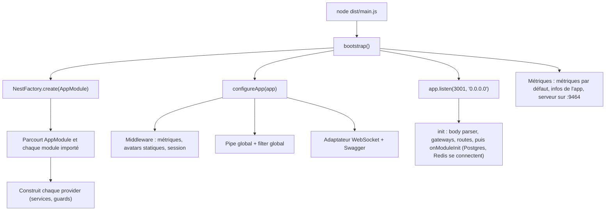
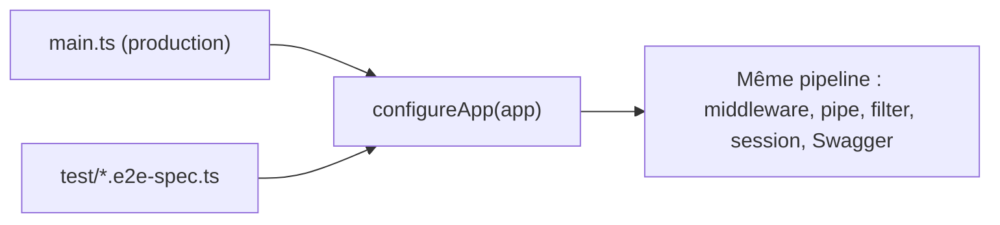
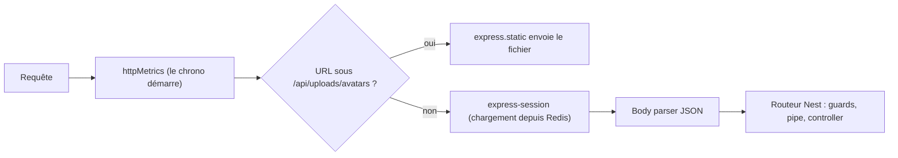
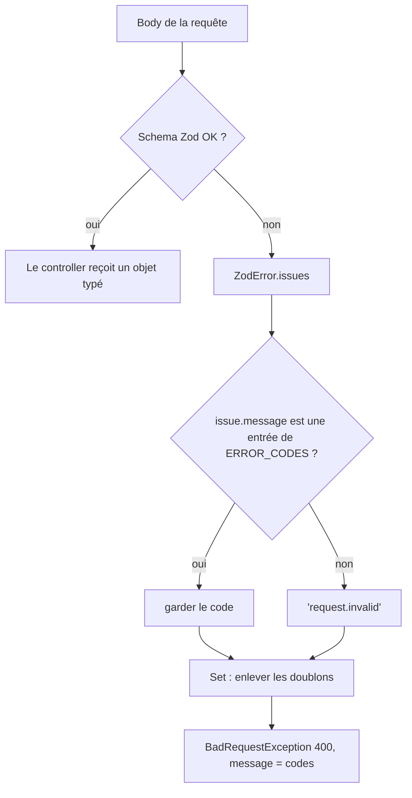
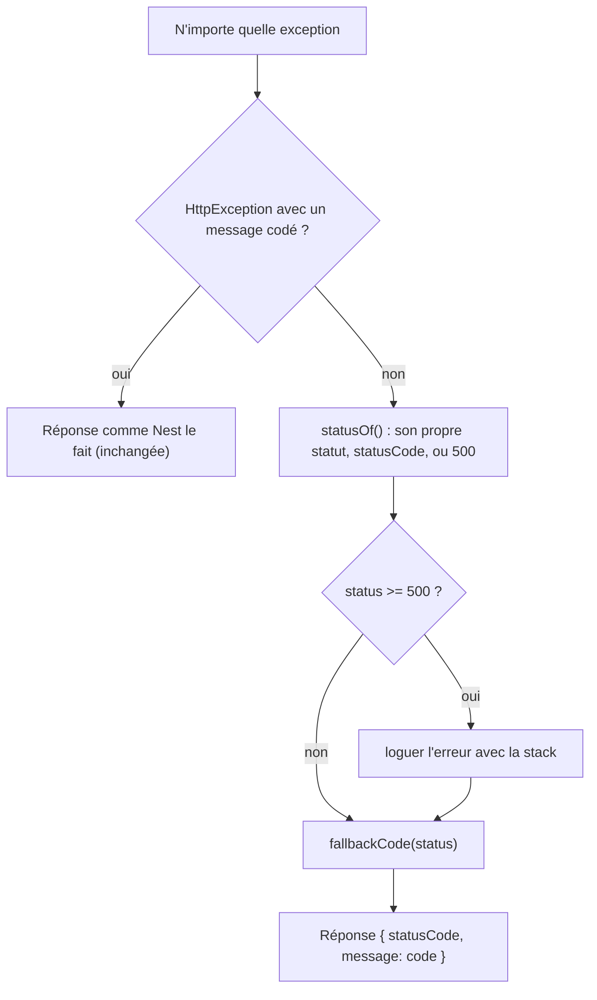
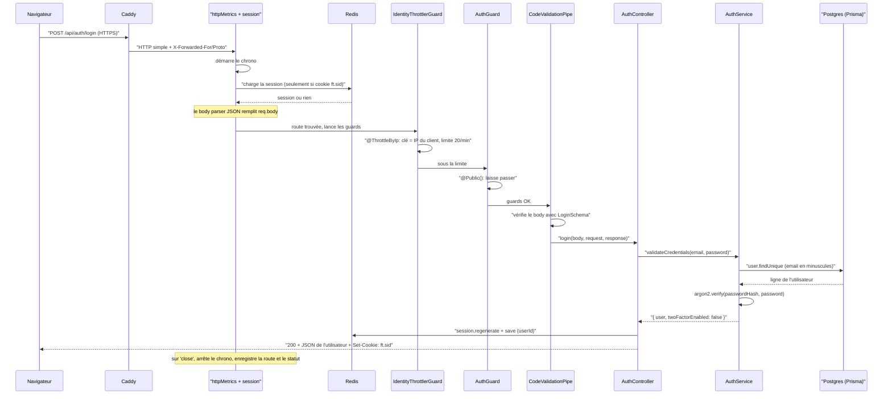
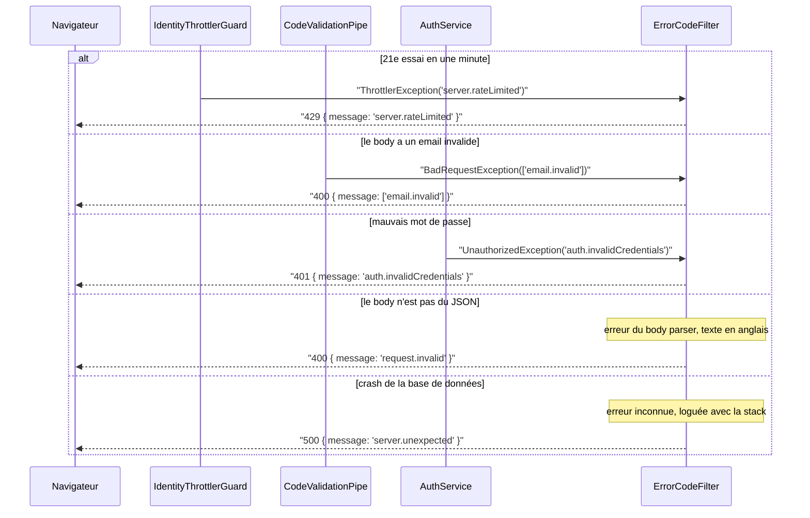

# Chapitre 2 — Le démarrage et la vie d'une requête

Dans ce chapitre :

- Ce qui se passe, étape par étape, quand tu démarres l'API (`main.ts`).
- Ce que `configureApp` met en place, ligne par ligne (`app.setup.ts`), et pourquoi les tests e2e l'appellent aussi.
- Comment `AppModule` branche tous les modules ensemble (`app.module.ts`).
- Comment un mauvais body de requête devient une liste de codes d'erreur (`validation.pipe.ts`).
- Comment toutes les autres erreurs repartent aussi avec un code d'erreur (`error-code.filter.ts`).
- Le trajet complet d'une requête, `POST /api/auth/login`, du réseau jusqu'à la base de données et retour.

## Vue d'ensemble

Démarrer l'API, c'est comme ouvrir un restaurant le matin :

1. **Embaucher le personnel** — Nest construit chaque module, controller et service (`NestFactory.create(AppModule)`).
2. **Fixer le règlement de la maison** — comment chaque client est accueilli et contrôlé à la porte (`configureApp` : sessions, validation, format des erreurs...).
3. **Ouvrir la porte** — commencer à écouter les requêtes HTTP (`app.listen`).
4. **Allumer la caméra de surveillance** — démarrer un petit serveur séparé qui montre des chiffres sur le restaurant (le serveur de métriques).



Les fichiers de ce chapitre :

| Fichier                                                         | Rôle                                                                                        |
| --------------------------------------------------------------- | ------------------------------------------------------------------------------------------- |
| [main.ts](../../apps/api/src/main.ts)                           | Le vrai point d'entrée. Démarre tout.                                                       |
| [app.setup.ts](../../apps/api/src/app.setup.ts)                 | `configureApp` : toutes les règles globales du pipeline de requête.                         |
| [app.module.ts](../../apps/api/src/app.module.ts)               | Le module racine : liste tous les autres modules.                                           |
| [validation.pipe.ts](../../apps/api/src/validation.pipe.ts)     | Vérifie les bodies et les paramètres des requêtes avec Zod, répond avec des codes d'erreur. |
| [error-code.filter.ts](../../apps/api/src/error-code.filter.ts) | Le dernier filet de sécurité : chaque réponse d'erreur porte un code d'erreur.              |

Deux mots très utilisés dans ce chapitre :

- **Middleware** : une fonction qui s'exécute sur chaque requête _avant_ que Nest choisisse le controller. Elle peut lire ou changer la requête, puis appelle `next()` pour la passer à la suite. Pense aux personnes à la porte du restaurant.
- **Pipeline** : la chaîne fixe d'étapes par laquelle passe chaque requête (middleware, guards, pipes, controller, filters).

## main.ts — le point d'entrée

`main.ts` est le fichier que Node lance. Il est court : il ne fait que mettre les pièces dans l'ordre.

```ts
const DEFAULT_PORT = 3001;

async function bootstrap(): Promise<void> {
  const app = await NestFactory.create(AppModule);
  configureApp(app);

  // 0.0.0.0, not localhost: bound to the loopback interface the process is
  // unreachable from outside the container.
  await app.listen(Number(process.env.PORT ?? DEFAULT_PORT), '0.0.0.0');

  // After listen: a boot that fails never leaves a metrics port answering.
  collectDefaultMetrics({ register: registry });
  appInfo.set({ version: process.env.APP_VERSION ?? '0.0.0' }, 1);
  // Logged, not thrown: monitoring must never take the app down. Prometheus
  // then reports the api as down, which is the right alarm.
  startMetricsServer(METRICS_PORT).catch((error: unknown) =>
    new Logger('Metrics').error(`metrics listener failed: ${String(error)}`),
  );
}

void bootstrap();
```

Ligne par ligne :

- `import 'reflect-metadata'` (première ligne du fichier) : une petite librairie qui permet aux décorateurs comme `@Injectable()` de stocker des informations sur les classes. Nest a besoin qu'elle soit chargée avant tout le reste.
- `NestFactory.create(AppModule)` : Nest lit `AppModule`, suit chaque `imports: [...]`, et construit chaque provider qu'il trouve (injection de dépendances, voir [01-big-picture.md](01-big-picture.md)). Il crée aussi un serveur Express à l'intérieur. Attention : le simple fait d'_importer_ certains fichiers exécute déjà du code, avant même `bootstrap()`. Par exemple, `app.setup.ts` lit `AVATAR_STORAGE_DIR` au moment de l'import, et `throttler/rate-limits.ts` lit les variables de rate limit. Un `AVATAR_STORAGE_DIR` manquant, ou une rate limit qui n'est pas un nombre entier positif, arrête l'API à ce moment-là, avant que quoi que ce soit écoute. (Une rate limit vide garde sa valeur par défaut.)
- `configureApp(app)` : ajoute toutes les règles globales (section suivante).
- `app.listen(port, '0.0.0.0')` : appelle d'abord le `init()` de Nest. `init()` ajoute le body parser JSON de Nest, branche les gateways, ajoute les routes, puis lance chaque `onModuleInit()` : `PrismaService` se connecte à Postgres et `RedisService` se connecte à Redis (voir [03-infrastructure.md](03-infrastructure.md)). Ensuite le serveur HTTP démarre. `0.0.0.0` veut dire « écoute sur toutes les cartes réseau », pour que les autres containers (Caddy, l'app web) puissent l'atteindre. `localhost` accepterait seulement les appels venant du même container.
- Après `listen` : la partie métriques. `collectDefaultMetrics` ajoute les chiffres standard de Node.js (mémoire, CPU, event loop). `appInfo` enregistre la version qui tourne. `startMetricsServer` ouvre un deuxième petit serveur HTTP sur le port 9464 pour Prometheus. S'il échoue, l'erreur est seulement loguée : l'app continue de marcher.
- `void bootstrap()` : lance la fonction async. `void` dit à TypeScript « je sais que ça renvoie une Promise et je ne l'attends pas ».

## app.setup.ts — le règlement de la maison

[app.setup.ts](../../apps/api/src/app.setup.ts) exporte des constantes et une fonction, `configureApp`.

### Pourquoi un fichier séparé ?

```ts
/**
 * Called by main.ts and by the e2e suite so both exercise the same request
 * pipeline. Anything global belongs here, not in bootstrap().
 */
export function configureApp(app: INestApplication): void {
```

Les tests e2e (dans `apps/api/test/`, voir [10-tests.md](10-tests.md)) construisent l'app eux-mêmes (tous sauf `demo` et `seed`, qui lancent le code du seed sans app) et envoient de vraies requêtes HTTP avec Supertest. Si les règles globales étaient dans `bootstrap()`, les tests tourneraient _sans_ sessions, sans le pipe de validation, sans le filter d'erreurs. Ils testeraient une autre app. Donc les deux utilisent la même fonction :

```ts
// apps/api/test/app.e2e-spec.ts
    configureApp(app);
    await app.init();
```



### Les constantes exportées

| Constante            | Valeur                                                      | Sert à                                            |
| -------------------- | ----------------------------------------------------------- | ------------------------------------------------- |
| `AVATAR_STORAGE_DIR` | depuis la variable d'env `AVATAR_STORAGE_DIR` (obligatoire) | Dossier où les images d'avatar sont enregistrées. |
| `API_PREFIX`         | `'api'`                                                     | Chaque route commence par `/api`.                 |
| `AVATAR_ROUTE`       | `'/api/uploads/avatars'`                                    | URL où les fichiers d'avatar sont servis.         |
| `SESSION_COOKIE`     | `'ft.sid'`                                                  | Nom du cookie de session.                         |
| `SESSION_KEY_PREFIX` | `'sess:'`                                                   | Préfixe des clés de session dans Redis.           |
| `SESSION_TTL_MS`     | 7 jours                                                     | Combien de temps vit une session inactive.        |

Deux réglages obligatoires sont vérifiés au démarrage : `AVATAR_STORAGE_DIR` ici, et `SESSION_SECRET` (plus bas).

```ts
export const AVATAR_STORAGE_DIR = requireAvatarStorageDir();

function requireAvatarStorageDir(): string {
  const dir = process.env.AVATAR_STORAGE_DIR;
  if (dir === undefined || dir.trim() === '') {
    throw new Error('AVATAR_STORAGE_DIR is unset: the api cannot start. See compose.yml.');
  }
  return dir;
}
```

Le commentaire au-dessus donne la raison : avec un « dossier temporaire » par défaut, les envois marcheraient, puis disparaîtraient au prochain redémarrage sans aucune erreur. Échouer au démarrage est mieux. `requireSessionSecret()` fait pareil pour `SESSION_SECRET`, et demande aussi au moins 32 caractères (un secret court est facile à deviner).

`SESSION_KEY_PREFIX` a un commentaire : la même chaîne `sess:` est écrite dans les fichiers compose, pour que le redis-exporter (un outil de monitoring) puisse compter les sessions ouvertes.

### Étape 1 — le middleware de métriques, en premier

```ts
  // First, so it also times the avatars, the session load and every rejection.
  app.use(httpMetrics);
```

`httpMetrics` lance un chrono pour chaque requête et l'arrête quand la réponse est envoyée (détails dans [03-infrastructure.md](03-infrastructure.md)). C'est le premier middleware, donc le temps mesuré couvre aussi tout ce qui vient après, même les requêtes refusées tôt.

### Étape 2 — le préfixe global

```ts
  app.setGlobalPrefix(API_PREFIX);
```

Un controller avec `@Controller('auth')` et `@Post('login')` répond sur `/api/auth/login`, pas sur `/auth/login`. Caddy (le reverse proxy devant) envoie chaque URL `/api/...` à cette API et le reste à l'app web.

### Étape 3 — les fichiers d'avatar

```ts
  // Here rather than in bootstrap() so the Supertest suite can reach it.
  (app as NestExpressApplication).useStaticAssets(AVATAR_STORAGE_DIR, { prefix: AVATAR_ROUTE });
```

`useStaticAssets` sert les fichiers d'un dossier tels quels (le `express.static` d'Express). Un fichier `abc.png` dans le dossier est disponible sur `/api/uploads/avatars/abc.png`. Le préfixe répète `api` parce que les fichiers statiques ne reçoivent pas le préfixe global. Le cast `as NestExpressApplication` est nécessaire parce que `useStaticAssets` n'existe que sur la version Express d'une app Nest.

### Étape 4 — trust proxy

```ts
  // Caddy terminates TLS and forwards plain http, so express only learns the
  // request was secure from X-Forwarded-Proto. Without this, `cookie.secure`
  // suppresses the Set-Cookie header and nobody can log in.
  app.getHttpAdapter().getInstance().set('trust proxy', 1);
```

Un **reverse proxy** est un serveur qui reçoit la requête du navigateur et la transmet au vrai serveur. Ici, Caddy fait le HTTPS avec le navigateur, puis parle en HTTP simple à l'API. Donc l'API voit « HTTP ». Caddy ajoute des headers comme `X-Forwarded-Proto: https` et `X-Forwarded-For: <client IP>`. `trust proxy = 1` dit à Express : « fais confiance à un proxy devant toi, crois ses headers ». Deux effets :

- `req.secure` vaut true, donc le cookie de session marqué `secure` est vraiment envoyé.
- `req.ip` est la vraie adresse du client, que le rate limiter utilise ([03-infrastructure.md](03-infrastructure.md)).

### Étape 5 — le pipe global et le filter global

```ts
  app.useGlobalPipes(new CodeValidationPipe());
  // And whatever never reaches the pipe or our throws: a malformed or oversized
  // body, an unknown route, a crash.
  app.useGlobalFilters(new ErrorCodeFilter(app.getHttpAdapter()));
```

- Un **pipe** transforme ou vérifie l'entrée d'une méthode de controller avant qu'elle s'exécute. Global veut dire « sur chaque route ».
- Un **filter** attrape les erreurs (exceptions) et construit la réponse HTTP.

Le commentaire dans le fichier donne la règle principale de cette API : **chaque `message` que l'API renvoie est un code d'erreur, jamais une phrase**. L'API ne connaît pas la langue du lecteur ; le navigateur, si. Donc l'API envoie `"auth.invalidCredentials"`, et l'app web le transforme en anglais, en français ou en allemand (`apps/web/lib/error-message.ts`). Les deux classes sont expliquées en détail plus bas.

### Étape 6 — les sessions stockées dans Redis

```ts
  const sessionMiddleware = session({
    name: SESSION_COOKIE,
    secret: requireSessionSecret(),
    store: new RedisStore({ client: app.get(RedisService).client, prefix: SESSION_KEY_PREFIX }),
    // The cookie is an opaque id, so there is nothing to write back unless the
    // session itself changed, and an anonymous visitor gets no session at all.
    resave: false,
    saveUninitialized: false,
    rolling: true,
    cookie: {
      httpOnly: true,
      secure: process.env.NODE_ENV === 'production',
      sameSite: 'lax',
      maxAge: SESSION_TTL_MS,
      path: '/',
    },
  });
  app.use(sessionMiddleware);
```

Une **session**, c'est la façon dont le serveur se souvient de toi entre deux requêtes. Analogie : un vestiaire. Tu laisses ton manteau (tes données : `userId`), tu reçois un ticket avec un numéro (le cookie `ft.sid`). Chaque fois que tu reviens, tu montres le ticket et le serveur retrouve ton manteau. Le ticket seul ne dit rien sur toi.

- `express-session` est le middleware. À chaque requête, il lit le cookie, charge la session depuis le store et la met dans `req.session`. À la fin, il la sauvegarde si besoin.
- `store: new RedisStore(...)` : les sessions sont enregistrées dans Redis sous `sess:<id>`, pas en mémoire. Elles survivent à un redémarrage de l'API. `app.get(RedisService)` demande au conteneur de Nest le service Redis déjà construit, pour que le store de sessions utilise la seule connexion Redis partagée.
- `secret` : sert à signer le cookie, pour que personne ne puisse inventer un id de session valide.
- `resave: false` : ne pas réécrire la session si elle n'a pas changé.
- `saveUninitialized: false` : ne pas créer de session pour un visiteur qui ne se connecte jamais. Pas de cookie pour les visiteurs anonymes.
- `rolling: true` : chaque requête remet le compteur de 7 jours à zéro. Donc 7 jours est un délai d'_inactivité_.

Options du cookie :

| Option            | Sens                                                                                                           |
| ----------------- | -------------------------------------------------------------------------------------------------------------- |
| `httpOnly: true`  | Le JavaScript de la page ne peut pas lire le cookie. Protège contre le vol de cookies (XSS).                   |
| `secure`          | En production, le cookie ne voyage qu'en HTTPS.                                                                |
| `sameSite: 'lax'` | Le navigateur ne l'envoie pas sur la plupart des requêtes lancées par d'autres sites (protège contre le CSRF). |
| `maxAge`          | 7 jours.                                                                                                       |
| `path: '/'`       | Envoyé pour chaque URL du site.                                                                                |

Le code de login (dans [05-auth-and-users.md](05-auth-and-users.md)) écrit `req.session.userId` ; les guards le lisent.

### Étape 7 — les sessions sur les WebSockets aussi

```ts
  // engine.io answers /ws before Express does, so the gateway gets the same
  // middleware. Here, before init, which is when gateways bind.
  app.useWebSocketAdapter(new SessionIoAdapter(app, sessionMiddleware));
```

Les fonctionnalités temps réel (chat, présence) utilisent Socket.IO sur `/ws`. Ces connexions ne passent pas par les middlewares Express. [SessionIoAdapter](../../apps/api/src/gateway/session-io.adapter.ts) donne le _même_ objet `sessionMiddleware` au moteur de Socket.IO (`server.engine.use(this.session)`), pour qu'un socket sache qui est connecté avec le même cookie. Il doit être défini avant `init()`, parce que c'est là que les gateways démarrent. Plus de détails dans [09-social-and-realtime.md](09-social-and-realtime.md).

### Étape 8 — Swagger (la page de documentation de l'API)

```ts
  const config = new DocumentBuilder()
    .setTitle('ft_transcendence API')
    ...
    .setVersion(process.env.APP_VERSION ?? '0.0.0')
    // Registered under the name `cookie`, which is what the decorators reference.
    .addCookieAuth(SESSION_COOKIE)
    // AuthGuard is global, so the document is deny-by-default too. @Public()
    // routes clear it with `security: []`.
    .addSecurityRequirements('cookie')
    .build();

  // SwaggerModule does not inherit the global prefix, so the path repeats it.
  // cleanupOpenApiDoc strips nestjs-zod's internal extensions and the 3.1 null
  // syntax it emits, which are invalid under the 3.0.0 header.
  SwaggerModule.setup(
    `${API_PREFIX}/docs`,
    app,
    cleanupOpenApiDoc(SwaggerModule.createDocument(app, config)),
  );
```

**Swagger** (ou OpenAPI) est une description standard de toutes les routes d'une API. Nest la construit en lisant des décorateurs comme `@ApiOperation` et `@ApiOkResponse`. Tu peux l'ouvrir sur `/api/docs` et essayer les routes dans le navigateur.

- `addCookieAuth` + `addSecurityRequirements('cookie')` : chaque route est marquée « a besoin du cookie de session », comme la vraie API. Les routes publiques disent `security: []` (tu peux le voir sur login et health).
- `cleanupOpenApiDoc` (de `nestjs-zod`) enlève les champs en trop que l'intégration Zod ajoute et qui ne sont pas valides en OpenAPI 3.0.

### L'ordre des middlewares compte

Express lance les middlewares dans l'ordre où ils ont été ajoutés. Après `configureApp`, le `init()` de Nest ajoute le body parser JSON et les routes. Donc une requête rencontre :



Les avatars sont servis avant le middleware de session, donc charger une image ne touche pas à Redis.

## app.module.ts — le module racine

[app.module.ts](../../apps/api/src/app.module.ts) est le module donné à `NestFactory.create`. Il n'a pas de code à lui ; il liste des modules.

```ts
@Module({
  imports: [
    ConfigModule.forRoot({ isGlobal: true }),
    // One ceiling for everyone, 100 a minute by default (RATE_LIMIT_PER_MINUTE).
    // What IdentityThrottlerGuard changes is not the number but who it is
    // counted against: each account on its own key, each anonymous visitor on
    // their own address.
    ThrottlerModule.forRoot({
      throttlers: [{ ttl: 60_000, limit: RATE_LIMITS.perAccount }],
      errorMessage: 'server.rateLimited',
    }),
    PrismaModule,
    RedisModule,
    AuthModule,
    ...
    MetricsModule,
  ],
  providers: [{ provide: APP_GUARD, useClass: IdentityThrottlerGuard }],
})
export class AppModule {}
```

Chaque import :

| Import                                     | Ce qu'il donne                                                                                             | Chapitre                                         |
| ------------------------------------------ | ---------------------------------------------------------------------------------------------------------- | ------------------------------------------------ |
| `ConfigModule.forRoot({ isGlobal: true })` | `ConfigService` pour lire les variables d'env, utilisable dans chaque module sans réimporter.              | —                                                |
| `ThrottlerModule.forRoot(...)`             | Rate limiting : 100 requêtes par 60 s par défaut. Une requête refusée reçoit le code `server.rateLimited`. | [03](03-infrastructure.md)                       |
| `PrismaModule`                             | `PrismaService`, le client de base de données (global).                                                    | [03](03-infrastructure.md), [04](04-database.md) |
| `RedisModule`                              | `RedisService`, la connexion Redis (global).                                                               | [03](03-infrastructure.md)                       |
| `AuthModule`                               | Inscription, login, 2FA, et le `AuthGuard` global.                                                         | [05](05-auth-and-users.md)                       |
| `UsersModule`                              | Profil, avatar, réglages.                                                                                  | [05](05-auth-and-users.md)                       |
| `FriendsModule`                            | Demandes d'amis et liste d'amis.                                                                           | [09](09-social-and-realtime.md)                  |
| `MessagesModule`                           | Messages de chat privés.                                                                                   | [09](09-social-and-realtime.md)                  |
| `HealthModule`                             | `GET /api/health`.                                                                                         | [03](03-infrastructure.md)                       |
| `CoursesModule`                            | Les cours par langue.                                                                                      | [07](07-courses-placement.md)                    |
| `PlacementModule`                          | Le test de placement.                                                                                      | [07](07-courses-placement.md)                    |
| `LessonsModule`                            | Leçons, tentatives, roadmap, discussion.                                                                   | [08](08-lessons.md)                              |
| `TutorModule`                              | `GET /api/tutor` et `POST /api/tutor/check` : fournisseur et modèle du tuteur IA, test de sa clé.          | [06](06-llm.md)                                  |
| `GatewayModule`                            | La gateway Socket.IO (`/ws`).                                                                              | [09](09-social-and-realtime.md)                  |
| `MetricsModule`                            | `MetricsCollector`, les métriques basées sur la base de données.                                           | [03](03-infrastructure.md)                       |

Les modules qui ne sont pas listés ici (LLM, présence, génération de questions) sont importés par les modules de fonctionnalité qui en ont besoin. (`demo/` n'est pas un module : le seed le lance en dehors de Nest.)

Est-ce que l'ordre compte ? Presque pas : Nest construit un graphe de dépendances, donc un service est construit après les services dont il a besoin, quel que soit l'ordre dans cette liste. L'ordre compte seulement pour quelques choses du type « premier enregistré, premier exécuté », comme les guards globaux (partie suivante).

### Les guards globaux

Un **guard** décide si une requête peut atteindre le controller (`true` = on continue, sinon il lance une erreur). Analogie : le videur à la porte. Un guard enregistré avec le token spécial `APP_GUARD` s'exécute sur _chaque_ route.

Il y a deux guards globaux :

1. `IdentityThrottlerGuard`, enregistré ici dans `AppModule`. Il compte les requêtes et refuse avec un 429 quand il y en a trop ([03-infrastructure.md](03-infrastructure.md)).
2. `AuthGuard`, enregistré dans `AuthModule` (`{ provide: APP_GUARD, useClass: AuthGuard }`). Il refuse avec un 401 s'il n'y a pas d'utilisateur connecté, sauf si la route est marquée `@Public()` ([05-auth-and-users.md](05-auth-and-users.md)).

Nest parcourt `AppModule` avant les modules qu'il importe, donc le guard du throttler est enregistré en premier et s'exécute en premier. Il n'a pas besoin de `AuthGuard` : il lit `req.session.userId` lui-même.

Pourquoi enregistrer les guards avec `APP_GUARD` et pas avec `app.useGlobalGuards(...)` dans `configureApp` ? Avec `APP_GUARD`, Nest construit le guard par injection de dépendances, donc le guard peut recevoir des services (`AuthGuard` a besoin de `AuthService`, `Reflector`).

## validation.pipe.ts — vérifier l'entrée avec Zod

[validation.pipe.ts](../../apps/api/src/validation.pipe.ts) exporte trois choses : `CodeValidationPipe` (une classe), et deux instances prêtes à l'emploi, `LangParam` et `UserIdParam`.

### Théorie : c'est quoi la validation ?

Les données qui viennent du réseau peuvent être n'importe quoi : un champ manquant, un nombre au lieu d'une chaîne, un « nom » de 10 Mo. La **validation** vérifie la forme et les règles avant que le code les utilise. Ce projet utilise **Zod**, une librairie où tu décris une forme une seule fois :

```ts
// packages/shared/src/schemas/user.ts
export const LoginSchema = z.object({
  email: z.email('email.invalid'),
  password: z.string('password.required').min(1, 'password.required').max(128, 'password.tooLong'),
});
```

Le schema vit dans `@ft/shared`, donc le navigateur vérifie le formulaire avec les mêmes règles avant d'envoyer. Le texte donné à chaque règle (`'email.invalid'`) n'est pas une phrase, c'est un code d'erreur.

Côté API, `nestjs-zod` transforme le schema en classe DTO (**DTO** = Data Transfer Object, une classe qui décrit la forme d'une requête ou d'une réponse) :

```ts
// apps/api/src/auth/auth.dto.ts
export class LoginDto extends createZodDto(LoginSchema) {}
```

Quand un controller écrit `@Body() body: LoginDto`, le pipe global voit le type `LoginDto`, trouve le schema Zod à l'intérieur, et vérifie le body.

### Pourquoi un pipe sur mesure ?

Le commentaire en haut du fichier l'explique. Le pipe normal de `nestjs-zod` répond :

```json
{ "statusCode": 400, "message": "Validation failed", "errors": [...] }
```

Le navigateur lit seulement `message`, donc il affichait « Something went wrong » (quelque chose s'est mal passé). Ce pipe met les codes directement dans `message` :

```json
{ "statusCode": 400, "message": ["email.invalid", "password.tooShort"] }
```

### Comment ça marche

```ts
export const CodeValidationPipe = createZodValidationPipe({
  // nestjs-zod types the error as unknown, so check it is Zod's before reading issues.
  createValidationException: (error: unknown) =>
    new BadRequestException(
      error instanceof ZodError
        ? [
            // A Set keeps one copy of each code: three mistyped fields give one
            // `request.invalid`, not three. Spread back into an array, which is
            // what BadRequestException puts in `message`.
            ...new Set(
              error.issues.map((issue) =>
                // An issue no rule names (the body is not an object, a key holds
                // the wrong type) carries Zod's English default instead of a code.
                isErrorCode(issue.message) ? issue.message : 'request.invalid',
              ),
            ),
          ]
        : // Never happens with nestjs-zod, which always passes a ZodError: a
          // code anyway, so even this branch keeps the contract.
          'request.invalid',
    ),
});
```

Étape par étape :

1. `createZodValidationPipe` (de `nestjs-zod`) fabrique une classe de pipe. On change une seule option : comment construire l'erreur.
2. Quand la validation échoue, Zod donne une `ZodError` avec une liste d'`issues` (une par problème).
3. Pour chaque issue, on prend `issue.message`. Si c'est un code connu (`isErrorCode`), on le garde. Sinon (par exemple le message anglais par défaut de Zod « Invalid input: expected string, received number »), on utilise `request.invalid`.
4. `new Set(...)` enlève les doublons : trois champs faux avec le même code donnent un seul code.
5. `BadRequestException` (HTTP 400) avec ce tableau comme `message`.



### LangParam et UserIdParam

```ts
export const LangParam = new CodeValidationPipe(LanguageSchema);

/** A user id in the path, lower-cased like every user id the API keys on. */
export const UserIdParam = new CodeValidationPipe(UserIdInputSchema);
```

Un paramètre d'URL comme `:lang` n'a pas de classe DTO, donc le pipe est créé directement avec un schema. Les controllers les utilisent comme ça : `@Param('lang', LangParam) lang: Language`. Une URL comme `/api/courses/xx` reçoit alors un 400 `course.unknownLanguage` avant qu'aucun service ne s'exécute.

## ERROR_CODES — la liste partagée

[errors.ts](../../packages/shared/src/schemas/errors.ts) dans `@ft/shared` contient la liste de tous les codes :

```ts
export const ERROR_CODES = [
  'displayName.tooShort',
  ...
  'auth.invalidCredentials',
  ...
  'request.invalid',
  /** A body over the parser's size limit. */
  'request.tooLarge',
  /** The browser never reached the API: offline, DNS, proxy down. */
  'network.unreachable',
  /** A status the client has no specific wording for. Carries `{status}`. */
  'server.unexpected',
  /** Too many requests from one address or session; the throttler's reply. */
  'server.rateLimited',
  /** Last resort, so an unrecognised code degrades to a translated sentence
   *  instead of leaking English server text into a French page. */
  'unknown',
] as const;

export type ErrorCode = (typeof ERROR_CODES)[number];

export function isErrorCode(value: string): value is ErrorCode {
  return (ERROR_CODES as readonly string[]).includes(value);
}
```

- `as const` fait garder à TypeScript chaque chaîne exacte, donc `ErrorCode` est l'union `'displayName.tooShort' | ... | 'unknown'`. Une faute de frappe dans `throw new UnauthorizedException('auth.invalidCredential')` n'est pas détectée par ce type (les exceptions de Nest acceptent n'importe quelle chaîne), mais elle est détectée à l'exécution par le filter plus bas.
- `isErrorCode` vérifie une chaîne à l'exécution.
- Les codes sont groupés par préfixe : `password.*`, `auth.*`, `course.*`, `llm.*`, `request.*`, `server.*`...
- Le commentaire du fichier dit : chaque code a besoin d'une traduction dans `apps/web/messages/{en,fr,de}.json`, et un test échoue s'il en manque une.

## error-code.filter.ts — le dernier filet de sécurité

[error-code.filter.ts](../../apps/api/src/error-code.filter.ts) exporte `ErrorCodeFilter`.

### Théorie : les exception filters

Quand du code lance une erreur, Nest ne crashe pas. Il donne l'erreur à un **exception filter**, qui écrit la réponse HTTP. Par défaut, Nest répond `{ "statusCode": 404, "message": "Cannot GET /api/xyz" }` — une phrase en anglais. Notre règle dit : seulement des codes. Notre propre code lance déjà des codes (`throw new UnauthorizedException('auth.invalidCredentials')`), et le pipe envoie des codes. Le filter s'occupe du reste :

- Express refuse le body avant que Nest le voie (pas du JSON, ou plus gros que 100 ko).
- Une route inconnue (« Cannot GET ... »).
- Un crash (« Internal server error »).

### Comment ça marche

```ts
@Catch()
export class ErrorCodeFilter extends BaseExceptionFilter {
  // Nest's own name for its handler, so these lines read like the ones it logs.
  private readonly logger = new Logger('ExceptionsHandler');

  override catch(exception: unknown, host: ArgumentsHost): void {
    // Almost every error lands here: already coded, so Nest replies as usual.
    if (exception instanceof HttpException && isCoded(messageOf(exception.getResponse()))) {
      super.catch(exception, host);
      return;
    }

    const status = statusOf(exception);
    // A 500 is a bug: keep the stack in the log, as Nest's own handler does.
    // A 4xx is the caller's mistake and needs no log.
    if (status >= 500) {
      this.logger.error(exception);
    }
    // Same status, coded message: the reply keeps Nest's { statusCode, message } shape.
    super.catch(new HttpException(fallbackCode(status), status), host);
  }
}
```

- `@Catch()` sans argument : attraper tous les types d'erreurs.
- `extends BaseExceptionFilter` : réutiliser la logique de réponse normale de Nest (`super.catch`). C'est pour ça que le constructeur reçoit `app.getHttpAdapter()` dans `app.setup.ts` : le filter de base en a besoin pour écrire les réponses.
- Si l'erreur est déjà une `HttpException` avec un message codé : on laisse Nest répondre comme d'habitude.
- Sinon : on trouve le statut, on le logue si c'est un 5xx (un bug), et on remplace le message par un code.

Les fonctions utilitaires :

| Fonction               | Rôle                                                                                                                                  |
| ---------------------- | ------------------------------------------------------------------------------------------------------------------------------------- |
| `messageOf(response)`  | Récupère `message` dans la réponse d'une exception (une chaîne, ou un objet avec `message`).                                          |
| `isCoded(message)`     | Vrai si c'est un code, ou un tableau non vide où chaque élément est un code.                                                          |
| `statusOf(exception)`  | `HttpException` → son statut. Une erreur `http-errors` (venant du body parser) → son `statusCode` (par ex. 413). Tout le reste → 500. |
| `fallbackCode(status)` | 400 → `request.invalid`, 413 → `request.tooLarge`, tout le reste → `server.unexpected`.                                               |



Exemple : `GET /api/nothing-here` → Nest lance `NotFoundException('Cannot GET /api/nothing-here')` → ce n'est pas un code → réponse `{ "statusCode": 404, "message": "server.unexpected" }`. Le navigateur affiche un message traduit avec le statut 404.

Le commentaire du fichier note aussi : un filter déclaré sur un controller ou une route (comme `AvatarTooLargeFilter` dans le module users) s'exécute avant ce filter global.

## La vie d'une requête : POST /api/auth/login

Maintenant, toutes les pièces ensemble. Un utilisateur tape son email et son mot de passe et clique sur « Log in » (se connecter). Le navigateur envoie :

```
POST /api/auth/login
Content-Type: application/json

{ "email": "ana@example.com", "password": "Secret123" }
```

La route dans [auth.controller.ts](../../apps/api/src/auth/auth.controller.ts) :

```ts
  @Public()
  @Post('login')
  @HttpCode(HttpStatus.OK)
  // Per address, like signup: this is the endpoint a password guesser hammers.
  @ThrottleByIp(RATE_LIMITS.login)
  ...
  async login(
    @Body() body: LoginDto,
    @Req() request: Request,
    @Res({ passthrough: true }) response: Response,
  ): Promise<SessionUser | TwoFactorRequired> {
    const { user, twoFactorEnabled } = await this.auth.validateCredentials(
      body.email,
      body.password,
    );
```

Le cas où tout se passe bien :



Étape par étape :

1. **Caddy** reçoit le HTTPS, transmet en HTTP simple à `api:3001` avec les headers `X-Forwarded-*`. Grâce à `trust proxy`, Express connaît la vraie IP du client.
2. **httpMetrics** démarre un chrono et compte une « requête en cours ».
3. L'URL n'est pas un avatar, donc **express-session** s'exécute. Si le navigateur a envoyé un cookie `ft.sid`, la session est chargée depuis Redis. Une première visite n'en a pas.
4. Le **body parser** transforme le texte JSON en `req.body`.
5. Nest trouve la route (`AuthController.login`) et lance les **guards globaux** :
   - `IdentityThrottlerGuard` : la route a `@ThrottleByIp(RATE_LIMITS.login)` (20 par défaut, `LOGIN_LIMIT_PER_MINUTE`), donc la clé est l'IP du client, avec une limite de 20 par minute. Sous la limite : on continue.
   - `AuthGuard` : la route est `@Public()`, donc il la laisse passer.
6. Le **pipe global** vérifie `req.body` avec `LoginSchema` (parce que le type du paramètre est `LoginDto`).
7. Le **controller** appelle `AuthService.validateCredentials`, qui appelle **Prisma** pour trouver l'utilisateur (email en minuscules), puis vérifie le hash du mot de passe avec argon2. Un email inconnu lance quand même argon2 sur un faux hash, pour que la réponse prenne le même temps.
8. De retour dans le controller, `startSession` régénère la session (un nouvel id, pour bloquer la fixation de session, voir [05-auth-and-users.md](05-auth-and-users.md)), écrit `userId`, et la sauvegarde dans **Redis**. Ensuite `sockets.closeSession(...)` ferme les sockets encore ouverts sur l'ancien id de session. express-session ajoute `Set-Cookie: ft.sid=...` à la réponse.
9. Nest envoie `200` avec l'utilisateur en JSON (`@HttpCode(HttpStatus.OK)` ; sans lui, un POST répond 201).
10. Sur l'événement `close`, **httpMetrics** arrête le chrono et enregistre `POST /api/auth/login 200`.

Si l'utilisateur a la 2FA activée, l'étape 8 démarre une session « en attente » à la place, et la réponse est `202 { "twoFactorRequired": true }`.

### Quand quelque chose se passe mal

Chaque échec est une exception, et chaque exception passe par `ErrorCodeFilter` :



Les trois premiers cas sont déjà codés, donc le filter les laisse passer sans changement. Les deux derniers sont réécrits par le filter. Dans tous les cas, `httpMetrics` enregistre quand même le statut final, parce qu'il attend l'événement `close`.

## Idées clés à retenir

- `main.ts` fait quatre choses dans l'ordre : créer l'app, `configureApp`, `listen`, démarrer les métriques.
- Les variables d'env obligatoires manquantes (`DATABASE_URL`, `REDIS_URL`, `SESSION_SECRET`, `AVATAR_STORAGE_DIR`) arrêtent l'API au démarrage, exprès.
- `configureApp` contient toutes les règles globales, pour que la production et les tests e2e utilisent exactement le même pipeline.
- Les sessions sont un cookie (`ft.sid`) qui contient seulement un id ; les données sont dans Redis sous `sess:`. Le même middleware de session est donné à Socket.IO.
- `trust proxy` est nécessaire parce que Caddy est devant : sans lui, les cookies sécurisés et les IP des clients ne marchent plus.
- `AppModule` liste seulement des modules. Deux guards s'exécutent sur chaque route : le rate limiter (`IdentityThrottlerGuard`) et `AuthGuard` (privé par défaut, `@Public()` pour ouvrir).
- La règle d'or : chaque `message` d'erreur est un code de `ERROR_CODES`, jamais une phrase. Le navigateur traduit.
- `CodeValidationPipe` transforme les issues Zod en liste de codes ; `ErrorCodeFilter` transforme toutes les autres erreurs en code selon le statut.
- L'ordre d'une requête : métriques → fichiers statiques → session → body parser → guards → pipe → controller → service → Prisma → réponse (ou filter).

Précédent : [01-big-picture.md](01-big-picture.md) · Suivant : [03-infrastructure.md](03-infrastructure.md) · [Retour à l'index](README.md)
