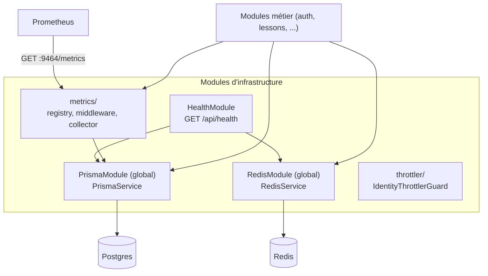
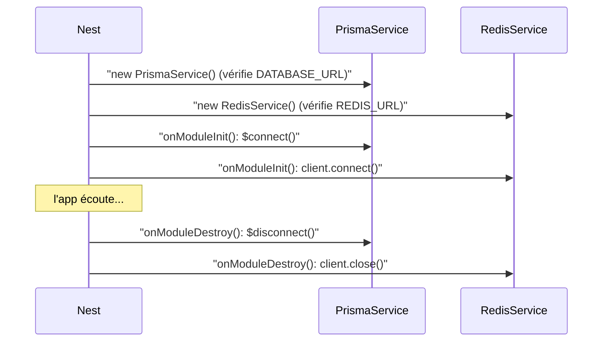
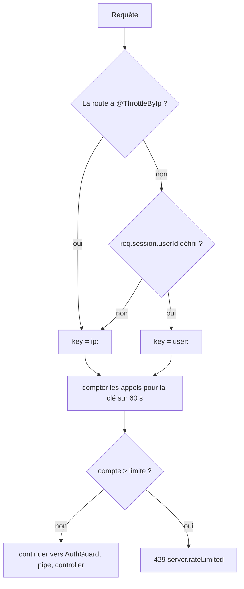
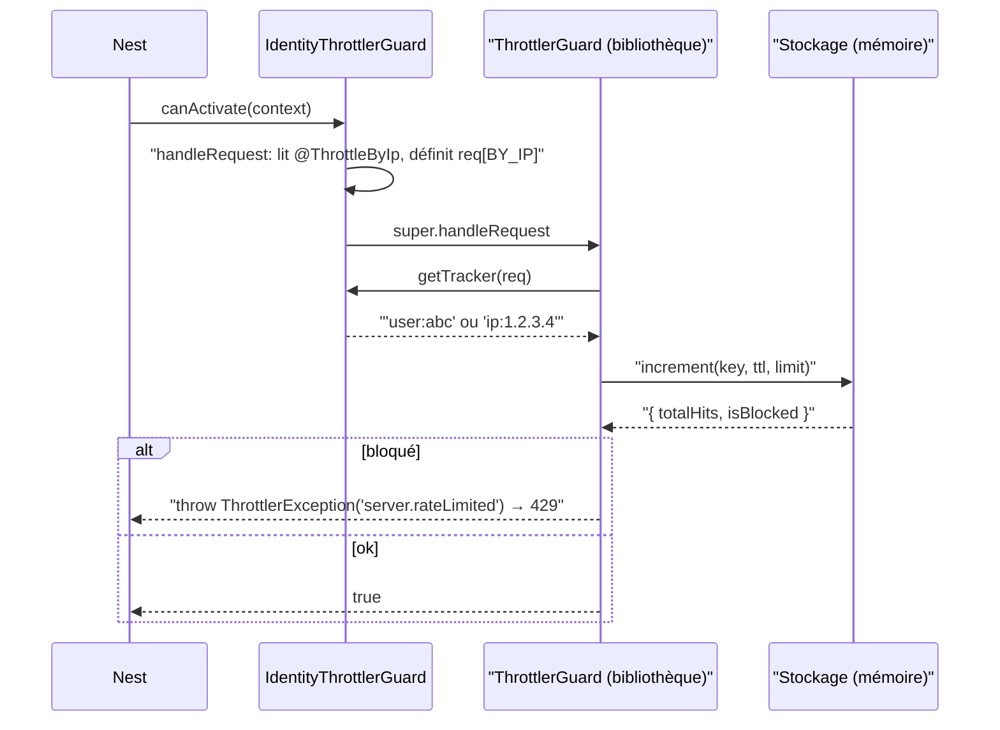
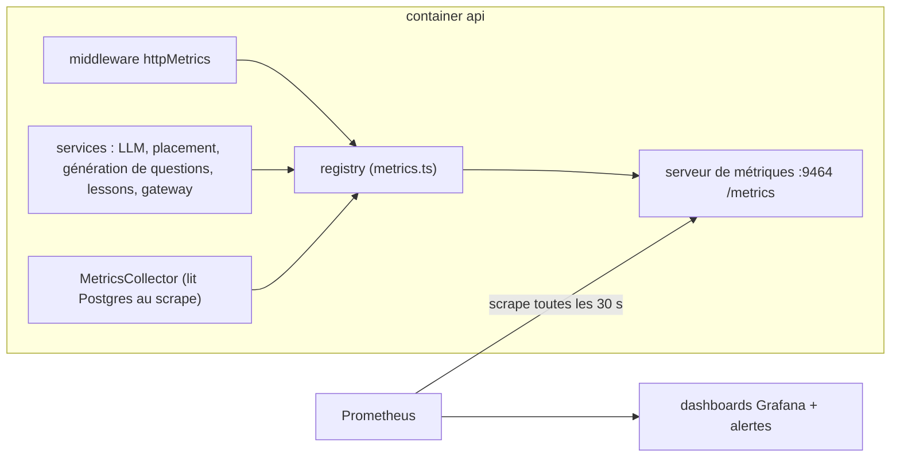
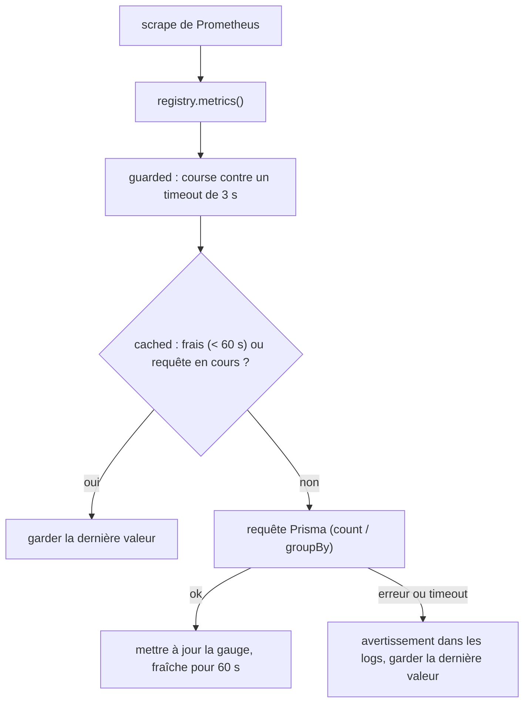
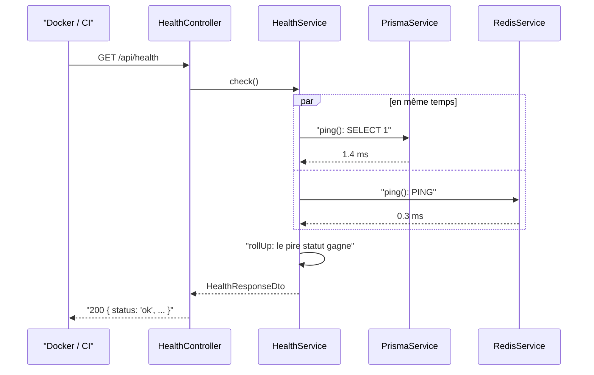

# Chapitre 3 — Les modules d'infrastructure

Dans ce chapitre :

- `prisma/` : le seul client de base de données, `PrismaService`.
- `redis/` : ce qu'est Redis, et la seule connexion Redis, `RedisService`.
- `throttler/` : ce qu'est le rate limiting (limitation du nombre de requêtes), et comment cette API compte les requêtes par compte ou par adresse.
- `metrics/` : ce que sont les métriques Prometheus, et toutes les métriques que l'API enregistre.
- `health/` : ce qu'est un health check (vérification de santé), et `GET /api/health`.

## Vue d'ensemble

Ces cinq dossiers ne contiennent aucune fonctionnalité du produit. Ce sont les « services techniques » du restaurant : l'eau et l'électricité (base de données, Redis), le portier qui empêche les gens d'entrer trop vite (throttler), les compteurs au mur (metrics), et l'infirmière qui vérifie que tout le monde va bien (health).



Carte des dossiers :

```
apps/api/src/
├── prisma/      prisma.module.ts, prisma.service.ts (+ spec)
├── redis/       redis.module.ts, redis.service.ts (+ spec)
├── throttler/   rate-limits.ts, throttle-by-ip.decorator.ts, identity-throttler.guard.ts (+ 3 specs)
├── metrics/     metrics.ts, http-metrics.middleware.ts, metrics-server.ts,
│                metrics.collector.ts, metrics.module.ts (+ 4 specs)
└── health/      health.module.ts, health.controller.ts, health.service.ts,
                 dto/health-response.dto.ts (+ 2 specs)
```

Tous suivent l'ordre de démarrage décrit dans [02-boot-and-request-flow.md](02-boot-and-request-flow.md) : les services sont construits par `NestFactory.create`, ils se connectent pendant `init()` (dans `app.listen`), et ils se ferment quand l'app est fermée avec `app.close()` (les tests le font). `main.ts` n'active pas les shutdown hooks, donc un container arrêté quitte simplement.

### Les lifecycle hooks

Deux mots de Nest reviennent dans presque tous les fichiers ici :

- `OnModuleInit` → méthode `onModuleInit()` : Nest l'appelle une fois, après avoir construit le service, pendant le démarrage. Bon endroit pour se connecter.
- `OnModuleDestroy` → méthode `onModuleDestroy()` : Nest l'appelle quand l'app se ferme (par exemple à la fin d'un test). Bon endroit pour se déconnecter.



## prisma/ — le client de base de données

**Prisma** est un ORM : une bibliothèque qui permet de parler à la base de données avec des méthodes TypeScript (`prisma.user.findUnique(...)`) au lieu d'écrire du SQL à la main. Le schema de la base et le client généré sont expliqués dans [04-database.md](04-database.md). Ici, on regarde seulement comment l'API garde le client.

### prisma.module.ts

[prisma.module.ts](../../apps/api/src/prisma/prisma.module.ts) exporte `PrismaModule` :

```ts
/**
 * Global: every feature module needs the database, and re-importing this in each
 * of them is boilerplate that only ever gets forgotten. Nothing else in this
 * codebase should be @Global.
 */
@Global()
@Module({
  providers: [PrismaService],
  exports: [PrismaService],
})
export class PrismaModule {}
```

`@Global()` veut dire : une fois que `AppModule` l'importe, n'importe quel service de n'importe quel module peut demander `PrismaService` dans son constructeur sans importer `PrismaModule` à nouveau. Le commentaire dit que cela doit rester rare. (`RedisModule` est l'autre cas.)

### prisma.service.ts

[prisma.service.ts](../../apps/api/src/prisma/prisma.service.ts) exporte `PrismaService`. Il _est_ le client Prisma : il fait `extends PrismaClient`, donc `this.prisma.user.findMany()` marche directement dessus.

D'abord, une vérification avant tout le reste :

```ts
function requireDatabaseUrl(): string {
  const url = process.env.DATABASE_URL;
  if (url === undefined || url.trim() === '') {
    throw new Error('DATABASE_URL is unset: the api cannot start. See .env.example.');
  }
  return url;
}
```

Pourquoi : sans elle, le driver Postgres utilise ses propres valeurs par défaut et échoue plus tard avec une erreur qui parle de `localhost`, ce qui t'envoie déboguer la mauvaise chose. C'est une fonction libre (pas une méthode) parce qu'elle tourne dans les arguments de `super(...)`, avant que `this` existe, donc elle ne peut pas être une méthode d'instance.

```ts
@Injectable()
export class PrismaService extends PrismaClient implements OnModuleInit, OnModuleDestroy {
  private readonly logger = new Logger(PrismaService.name);

  constructor() {
    // Read from the environment rather than through ConfigService: the client is
    // constructed before Nest resolves providers, and prisma.config.ts reads the
    // same variable for the CLI, so the two cannot point at different databases.
    super({ adapter: new PrismaPg({ connectionString: requireDatabaseUrl() }) });
  }
```

- `PrismaClient` vient de `../generated/prisma/client` (du code généré à partir du schema, voir [04-database.md](04-database.md)).
- `adapter: new PrismaPg(...)` : cette version de Prisma n'a pas de moteur à elle ; elle utilise le driver `pg` (node-postgres) à travers cet adapter. Le commentaire dit qu'il est obligatoire : sans adapter, `new PrismaClient()` lance une erreur.

```ts
  async onModuleInit(): Promise<void> {
    await this.$connect();
    this.logger.log('database connected');
  }

  async onModuleDestroy(): Promise<void> {
    await this.$disconnect();
  }
```

Le commentaire dit que la connexion se fait au démarrage pour qu'un mauvais `DATABASE_URL` fasse échouer le démarrage du container. Ce n'est pas ce qui se passe : avec `@prisma/adapter-pg`, `$connect()` construit seulement un `pg.Pool`, et un pool n'ouvre aucune connexion avant sa première requête. Donc avec un mauvais `DATABASE_URL`, `$connect()` réussit, l'API écrit « database connected » dans les logs, et c'est la première requête qui échoue (`/api/health` indique alors `database` à `down`). L'issue #221 suit ce point.

```ts
  async ping(): Promise<number> {
    const startedAt = process.hrtime.bigint();
    await this.$queryRaw`SELECT 1`;
    return Number(process.hrtime.bigint() - startedAt) / 1_000_000;
  }
```

`ping()` envoie la plus petite requête possible et renvoie le temps qu'elle a pris, en millisecondes. `process.hrtime.bigint()` est une horloge très précise, en nanosecondes ; diviser par 1 000 000 donne des millisecondes. Le service health l'utilise (plus bas). Si la base est en panne, `ping()` est rejeté et c'est l'appelant qui décide ce que cela veut dire.

**Qui l'utilise :** presque tous les services (`AuthService`, `LessonsService`, `MetricsCollector`, `HealthService`...).

**Spec** ([prisma.service.spec.ts](../../apps/api/src/prisma/prisma.service.spec.ts)) : vérifie qu'il se connecte à l'init, se déconnecte à l'arrêt, que `ping` donne une latence, qu'un ping qui échoue est rejeté, et qu'il refuse d'être construit quand `DATABASE_URL` est absente, vide ou faite d'espaces.

## redis/ — la mémoire rapide partagée

### Qu'est-ce que Redis ?

**Redis** est une base de données qui garde tout en mémoire (RAM), sous forme de simples paires `key → value` (clé → valeur). Elle est très rapide, et les clés peuvent expirer toutes seules après un certain temps (un TTL, « time to live », durée de vie).

Analogie : Postgres, c'est la salle d'archives avec ses armoires : sûre, bien rangée, plus lente. Redis, c'est le tableau blanc à côté de la porte : très rapide à lire et à écrire, bien pour les notes de courte durée, et on peut effacer une note après un certain temps.

Dans cette API, Redis contient :

| Donnée                               | Exemple de clé      | Où                                                                                        |
| ------------------------------------ | ------------------- | ----------------------------------------------------------------------------------------- |
| Sessions                             | `sess:<id>`         | [app.setup.ts](../../apps/api/src/app.setup.ts) (connect-redis)                           |
| Compteurs de présence en ligne       | `presence:<userId>` | [presence.service.ts](../../apps/api/src/presence/presence.service.ts)                    |
| État d'un test de placement en cours | `user:<userId>:eval` (+ `:eval_questions`, `:eval_lock`) | [placement-session.service.ts](../../apps/api/src/placement/placement-session.service.ts) |
| Limites de discussion des leçons | `discussion:user:<userId>:minute`, `discussion:user:<userId>:day`, `discussion:global:minute` | [discussion-limits.ts](../../apps/api/src/lessons/discussion-limits.ts) |

La gateway des sockets l'utilise aussi : elle vérifie que la clé `sess:<id>` d'un socket existe encore. Chacun de ces usages est expliqué dans son propre chapitre.

### redis.module.ts

[redis.module.ts](../../apps/api/src/redis/redis.module.ts) exporte `RedisModule`. Même forme que `PrismaModule` : `@Global()`, il fournit et exporte `RedisService`.

### redis.service.ts

[redis.service.ts](../../apps/api/src/redis/redis.service.ts) exporte `RedisService`. Il commence par `requireRedisUrl()`, la même vérification « échouer au démarrage si `REDIS_URL` manque » que pour Prisma.

```ts
/**
 * The one Redis connection. Sessions, presence, the placement run state, and
 * later the generated lesson cache, all share it rather than opening their own.
 */
@Injectable()
export class RedisService implements OnModuleInit, OnModuleDestroy {
  private readonly logger = new Logger(RedisService.name);
  readonly client: RedisClientType;

  constructor() {
    // A wrong host hangs instead of refusing, so bound it: five seconds turns a
    // misconfiguration into a startup error rather than a stuck container.
    this.client = createClient({
      url: requireRedisUrl(),
      socket: { connectTimeout: 5_000 },
    });
    // Without a listener, a dropped connection raises an unhandled 'error' event
    // and takes the process down. Reconnection is automatic.
    this.client.on('error', (error: Error) => this.logger.error(`redis: ${error.message}`));
  }
```

- Contrairement à Prisma, il n'_étend_ pas le client. Il le garde dans un champ public, `client`. Le reste du code écrit `this.redis.client.incr(...)`.
- `connectTimeout: 5_000` : arrête une tentative de connexion après cinq secondes. Le commentaire dit que ça transforme un mauvais hôte en erreur au démarrage, mais non : la bibliothèque `redis` réessaie ensuite (sa stratégie par défaut réessaie après toute erreur sauf un timeout de socket, en attendant jusqu'à environ 2 secondes entre deux essais), donc `client.connect()` ne se termine jamais et l'API reste bloquée avant `listen` au lieu de s'arrêter. L'issue #221 suit ce point.
- `client.on('error', ...)` : en Node, un événement `'error'` sans listener fait planter le process. Ici, il est seulement écrit dans les logs, et la bibliothèque `redis` se reconnecte toute seule.

`onModuleInit` appelle `client.connect()`, `onModuleDestroy` appelle `client.close()`, et `ping()` mesure `client.ping()` en millisecondes, exactement comme celui de Prisma.

**Spec** ([redis.service.spec.ts](../../apps/api/src/redis/redis.service.spec.ts)) : connexion à l'init, fermeture à l'arrêt, `ping` renvoie une latence finie, un ping qui échoue est rejeté, et il refuse d'être construit quand `REDIS_URL` est absente, vide ou faite d'espaces.

## throttler/ — le rate limiting

### Qu'est-ce que le rate limiting ?

Le **rate limiting** (ou throttling) veut dire : « un appelant peut faire au plus N requêtes en T secondes ». La suivante reçoit **HTTP 429 Too Many Requests**.

Analogie : une machine à tickets à l'entrée qui donne à chaque personne 100 tickets par minute. Quand tu n'as plus de tickets, tu attends la minute suivante.

Cela protège contre :

- Deviner un mot de passe (essayer des milliers de mots de passe sur `/login`).
- Un utilisateur ou un script qui surcharge le serveur.

La bibliothèque est `@nestjs/throttler`. Pour chaque requête, elle construit un **tracker** (une clé comme `user:abc` ou `ip:1.2.3.4`), compte les appels pour cette clé dans une fenêtre de temps, et refuse quand le compte dépasse la limite. Les compteurs sont gardés par le stockage par défaut de la bibliothèque, dans la mémoire du process de l'API (`AppModule` ne lui donne pas d'autre stockage).



La configuration globale est dans `AppModule` ([02-boot-and-request-flow.md](02-boot-and-request-flow.md)) : un throttler nommé `default`, fenêtre de 60 000 ms, limite `RATE_LIMITS.perAccount`, message d'erreur `server.rateLimited`, et `IdentityThrottlerGuard` comme guard global.

### rate-limits.ts

[rate-limits.ts](../../apps/api/src/throttler/rate-limits.ts) exporte `readLimit` et `RATE_LIMITS`.

```ts
export const RATE_LIMITS = {
  /** Requests a minute on every route, per account, or per address when signed out. */
  perAccount: readLimit(process.env, 'RATE_LIMIT_PER_MINUTE', 100),
  /** ... */
  signup: readLimit(process.env, 'SIGNUP_LIMIT_PER_MINUTE', 20),
  /** Password or 2FA code checks a minute per address, on each route that makes one. */
  login: readLimit(process.env, 'LOGIN_LIMIT_PER_MINUTE', 5),
} as const;
```

| Limite       | Variable d'env            | Défaut | Comptée par                        |
| ------------ | ------------------------- | ------ | ---------------------------------- |
| `perAccount` | `RATE_LIMIT_PER_MINUTE`   | 100    | compte, ou adresse si non connecté |
| `signup`     | `SIGNUP_LIMIT_PER_MINUTE` | 20     | adresse                            |
| `login`      | `LOGIN_LIMIT_PER_MINUTE`  | 5      | adresse                            |

`readLimit` lit une variable :

```ts
  const raw = env[name]?.trim();
  if (raw === undefined || raw === '') {
    return fallback;
  }
  const value = Number(raw);
  if (!/^\d+$/.test(raw) || !Number.isSafeInteger(value) || value < 1) {
    throw new Error(`${name} must be a positive integer, not "${raw}"`);
  }
  return value;
```

- Non définie ou vide → la valeur par défaut.
- Seuls des chiffres simples sont acceptés. `Number()` seul accepterait `0x10`, `1e3`... La regex `^\d+$` les refuse.
- Toute valeur incorrecte arrête l'API au démarrage, pour que personne ne tourne avec une limite qu'il n'a pas choisie.

Les valeurs sont lues une seule fois, quand le fichier est importé. Le commentaire de doc explique pourquoi : des décorateurs comme `@ThrottleByIp(RATE_LIMITS.login)` ont besoin d'un nombre au moment où la classe est définie, avant que `ConfigService` existe.

**Spec** ([rate-limits.spec.ts](../../apps/api/src/throttler/rate-limits.spec.ts)) : valeur par défaut si non définie/vide, accepte un entier positif (en retirant les espaces), refuse tout le reste avec le nom de la variable dans l'erreur.

### throttle-by-ip.decorator.ts

[throttle-by-ip.decorator.ts](../../apps/api/src/throttler/throttle-by-ip.decorator.ts) exporte `THROTTLE_BY_IP` (une clé de métadonnée) et le décorateur `ThrottleByIp`.

```ts
export const THROTTLE_BY_IP = 'throttle:by-ip';

export function ThrottleByIp(limit: number, ttl = 60_000) {
  return applyDecorators(Throttle({ default: { limit, ttl } }), SetMetadata(THROTTLE_BY_IP, true));
}
```

- `applyDecorators` combine plusieurs décorateurs en un seul.
- `Throttle({ default: {...} })` (de la bibliothèque) change la limite du throttler `default` pour cette route.
- `SetMetadata(THROTTLE_BY_IP, true)` colle une étiquette sur la route : « compte-moi par IP ». Le guard la lit.

**Pourquoi compter par IP sur ces routes ?** Le commentaire l'explique avec une attaque : sur une route qui vérifie un mot de passe, si on comptait par compte, un attaquant avec N comptes aurait N budgets, donc « 5 par minute » deviendrait 5×N. Compter par machine donne un seul budget, quel que soit le compte utilisé.

Il est utilisé sur les cinq routes qui vérifient un secret : `POST /api/auth/signup` (limite `signup`), et `POST /api/auth/login`, `POST /api/auth/2fa/verify`, `POST /api/auth/2fa/enable`, `DELETE /api/auth/2fa` (limite `login`). Voir [05-auth-and-users.md](05-auth-and-users.md).

Une autre route fixe sa propre limite avec le simple `@Throttle` de la bibliothèque, donc elle reste comptée par compte : `POST /api/friends/requests/:userId`, 10 par minute.

Pourquoi sa propre clé de métadonnée et pas celle de la bibliothèque ? Le commentaire donne trois façons dont la clé de la bibliothèque pourrait échouer sans bruit (son nom dépend du nom du throttler, elle n'est pas exportée, et elle est absente quand seul un ttl est défini).

### identity-throttler.guard.ts

[identity-throttler.guard.ts](../../apps/api/src/throttler/identity-throttler.guard.ts) exporte `IdentityThrottlerGuard`, une sous-classe du `ThrottlerGuard` de la bibliothèque.

**Le problème qu'il résout** (d'après le commentaire de la classe) : le guard par défaut compte par `req.ip`. Mais dans ce déploiement, les navigateurs passent par Caddy, et les rendus serveur de Next.js appellent l'API depuis le container `web`. Beaucoup d'utilisateurs peuvent partager une même adresse, donc avec le comportement par défaut toute la plateforme partageait un seul budget : le 101e visiteur dans la minute était refusé.

**La solution :** compter par compte quand on est connecté, sinon par l'adresse du client transmise par le proxy.

```ts
  protected override async getTracker(req: Request): Promise<string> {
    // Checked before the session: a route guarding a secret must count every
    // attempt from one machine against one budget, whoever is signed in.
    if ((req as TrackedRequest)[BY_IP] === true) {
      return `ip:${this.clientAddress(req)}`;
    }

    // saveUninitialized is false, so an anonymous visitor carries no session.
    const userId = req.session?.userId;
    return userId === undefined ? `ip:${this.clientAddress(req)}` : `user:${userId}`;
  }
```

Pourquoi l'id de l'utilisateur et pas l'id de session ? Le login crée un nouvel id de session (`regenerate()`). Compter par session permettrait à quelqu'un de remettre son compteur à zéro juste en se reconnectant.

```ts
  private clientAddress(req: Request): string {
    return req.ip ?? req.socket.remoteAddress ?? 'unknown';
  }
```

`req.ip` est correct grâce à `trust proxy = 1` dans `app.setup.ts` : Express prend la dernière adresse de `X-Forwarded-For`, celle que Caddy a écrite. Le commentaire note que cet en-tête peut être falsifié en général, et qu'il est sûr ici seulement parce que Caddy est la seule porte d'entrée.

**Comment `getTracker` sait-il que la route a demandé « par IP » ?** `getTracker` reçoit seulement la requête, pas la route. Donc `handleRequest`, qui voit la route, écrit d'abord un drapeau sur la requête :

```ts
const BY_IP = Symbol('identity-throttler:by-ip');

  protected override async handleRequest(request: ThrottlerRequest): Promise<boolean> {
    const { context } = request;

    // Assigned on every pass rather than only when true. handleRequest runs
    // once per configured throttler, and a flag that is only ever set would
    // leak from one throttler to the next within a single request.
    (this.getRequestResponse(context).req as TrackedRequest)[BY_IP] =
      this.reflector.getAllAndOverride<boolean>(THROTTLE_BY_IP, [
        context.getHandler(),
        context.getClass(),
      ]) ?? false;

    return super.handleRequest(request);
  }
```

- `reflector.getAllAndOverride` lit l'étiquette `THROTTLE_BY_IP` sur la méthode, puis sur la classe du controller.
- Le drapeau utilise un `Symbol` comme clé, donc il ne peut pas entrer en conflit avec une propriété qu'Express met sur `req`.
- Ensuite, `super.handleRequest` fait le comptage normal, qui appelle notre `getTracker`.



**Specs :**

- [identity-throttler.guard.spec.ts](../../apps/api/src/throttler/identity-throttler.guard.spec.ts) : les utilisateurs connectés ont une clé basée sur leur id, deux utilisateurs derrière une même IP ont des clés séparées, les appelants anonymes retombent sur l'adresse, et des appels complets à `canActivate` comptent dans le bon compteur.
- [throttler-storage.spec.ts](../../apps/api/src/throttler/throttler-storage.spec.ts) : vérifie que le stockage en mémoire de la bibliothèque garde les clés différentes séparées (quand le blocage d'une clé se termine, il n'annule pas les timers d'expiration d'une autre clé, donc la rafale de signups suivante ne reçoit pas de fausse 429).

## metrics/ — des chiffres pour Prometheus

### Que sont les métriques et Prometheus ?

Les **métriques** sont des chiffres qui décrivent l'app dans le temps : « combien de requêtes par seconde », « combien de temps prend le login », « combien d'utilisateurs sont en ligne ». **Prometheus** est un programme qui, ici toutes les 30 secondes, visite une URL de l'app (`/metrics`), lit tous les chiffres, et les enregistre avec l'heure. Ensuite, Grafana dessine des graphiques et des alertes se déclenchent quand un chiffre semble mauvais.

Analogie : le tableau de bord d'une voiture. La voiture n'enregistre pas une vidéo du trajet ; elle montre quelques jauges (vitesse, essence, température). Prometheus est un passager qui note les jauges toutes les 30 secondes (`scrape_interval: 30s` dans [prometheus.yml](../../infra/monitoring/prometheus/prometheus.yml)).

Les principaux types de métriques (de la bibliothèque `@prometheus-io/client`) :

| Type          | Ce que c'est                                                                                  | Exemple ici                           |
| ------------- | --------------------------------------------------------------------------------------------- | ------------------------------------- |
| **Counter**   | Un nombre qui ne fait que monter.                                                             | `ft_llm_requests_total`               |
| **Gauge**     | Un nombre qui monte et descend.                                                               | `http_requests_in_flight`, `ft_users` |
| **Histogram** | Compte les valeurs par tranches (« buckets »), pour calculer des moyennes et des percentiles. | `http_request_duration_seconds`       |

Chaque métrique peut avoir des **labels** : des dimensions en plus, comme `method="POST"`, `status_code="200"`. Chaque combinaison différente de valeurs de labels est une **série** séparée. Trop de séries (par exemple une par id d'utilisateur) surchargeraient Prometheus, donc les labels doivent rester **bornés** (une petite liste de valeurs connues).

Toutes les métriques sont gardées dans un **registry** (une liste de métriques). Prometheus lit le registry dans un format texte :

```
http_request_duration_seconds_count{method="POST",route="/api/auth/login",status_code="200"} 42
```



### metrics.ts — le registry et toutes les métriques

[metrics.ts](../../apps/api/src/metrics/metrics.ts) est un simple fichier, pas un service Nest :

```ts
// Module level, not an injected service: the services that record are built by
// hand in their specs, and GeminiProvider is not built by Nest at all.
// Our own registry, so nothing a dependency registers leaks into the scrape.
// Labels are always bounded: never a user id, an email or a raw URL.
export const registry = new Registry();

export const httpRequestDuration = new Histogram({
  name: 'http_request_duration_seconds',
  help: 'HTTP requests by method, route template and final status code',
  labelNames: ['method', 'route', 'status_code'] as const,
  registers: [registry],
});
```

N'importe quel fichier peut faire `import { llmRequests } from '../metrics/metrics'` et appeler `llmRequests.inc({...})`. Pas besoin d'injection.

Les métriques exportées :

| Export                    | Type                     | Labels                            | Enregistrée par                                         |
| ------------------------- | ------------------------ | --------------------------------- | ------------------------------------------------------- |
| `httpRequestDuration`     | Histogram                | method, route, status_code        | middleware `httpMetrics`                                |
| `httpRequestsInFlight`    | Gauge                    | —                                 | middleware `httpMetrics`                                |
| `wsConnections`           | Gauge                    | —                                 | gateway des sockets ([09](09-social-and-realtime.md))   |
| `wsEvents`                | Counter                  | direction, event, outcome         | gateway des sockets                                     |
| `llmRequests`             | Counter                  | provider, model, purpose, outcome | `gemini.provider.ts` ([06](06-llm.md)) |
| `llmRequestDuration`      | Histogram (0,5 s à 90 s) | provider, model, purpose          | `gemini.provider.ts` |
| `llmTokens`               | Counter                  | provider, model, purpose, type    | `gemini.provider.ts` |
| `llmProviderInfo`         | Gauge (toujours 1)       | provider, model                   | `llm.factory.ts`                                        |
| `discussionLimited`       | Counter                  | limit                             | discussion des leçons ([08](08-lessons.md))             |
| `questionRestocks`        | Counter                  | lang, level, category, status     | génération de questions ([07](07-courses-placement.md)) |
| `questionRestockFailures` | Counter                  | category, reason                  | génération de questions                                 |
| `questionRestockInserted` | Counter                  | lang, level, category             | génération de questions                                 |
| `questionRestockDuration` | Histogram                | category                          | génération de questions                                 |
| `placementDraws`          | Counter                  | lang, level, category, source     | placement                                               |
| `placementPoolExhausted`  | Counter                  | lang, level                       | placement                                               |
| `placementExams`          | Counter                  | lang, event                       | placement                                               |
| `lessonAttempts`          | Counter                  | lang, event                       | leçons                                                  |
| `appInfo`                 | Gauge (toujours 1)       | version                           | `main.ts`                                               |

Il exporte aussi les valeurs de labels autorisées sous forme de listes constantes (`WS_OUTCOMES`, `RESTOCK_STATUSES`, `RESTOCK_FAILURE_REASONS`, `DRAW_SOURCES`, `EXAM_EVENTS`, `LESSON_ATTEMPT_EVENTS`, `AUTH_SERIES`), et trois de leurs types (`RestockStatus`, `RestockFailureReason`, `DrawSource`). Cela garde les labels bornés.

**Séries créées à 0.** À la fin du fichier, des boucles créent toutes les séries importantes avec la valeur 0 :

```ts
// increase() misses a counter's first increment when the series is born at 1,
// so every label set an alert or a panel reads exists at 0 from the start.
for (const lang of LEARNABLE_LANGUAGES) {
  for (const event of EXAM_EVENTS) placementExams.inc({ lang, event }, 0);
  for (const event of LESSON_ATTEMPT_EVENTS) lessonAttempts.inc({ lang, event }, 0);
  ...
```

Pourquoi : la fonction `increase()` de Prometheus compare deux valeurs dans le temps. Si une série apparaît pour la première fois déjà à 1, il n'y a pas de valeur « avant », donc ce premier événement est perdu. Commencer à 0 règle le problème. `AUTH_SERIES` fait la même chose pour les routes de signup, de login et de vérification 2FA, avec `httpRequestDuration.zero(...)`, pour les panneaux du dashboard d'auth.

**Utilisateurs actifs.** Le fichier garde aussi une petite liste en mémoire des utilisateurs vus récemment :

```ts
const ACTIVE_WINDOW_MS = 5 * 60_000;

// In memory, so per process: enough for the single API replica, like the
// restock maps (question-stock.service.ts). Oldest first: a touch moves the
// user to the end, so pruning stops at the first recent entry.
const lastSeen = new Map<string, number>();

/** Called by AuthGuard for every signed-in request. */
export function touchActiveUser(userId: string, now = Date.now()): void {
  lastSeen.delete(userId);
  lastSeen.set(userId, now);
  prune(now);
}
```

Une `Map` JavaScript garde l'ordre d'insertion. Supprimer puis remettre déplace l'utilisateur à la fin, donc les plus anciens sont toujours en premier. `prune` retire les entrées du début tant qu'elles ont plus de 5 minutes, et s'arrête à la première récente. `countActiveUsers()` renvoie la taille. Comme tout est en mémoire, le compte est par process ; le commentaire dit que cela suffit pour une seule instance de l'API.

**Spec** ([metrics.spec.ts](../../apps/api/src/metrics/metrics.spec.ts)) : vérifie que les séries à zéro existent dès le départ, et que les utilisateurs actifs sont comptés une seule fois et disparaissent après 5 minutes.

### http-metrics.middleware.ts — mesurer le temps de chaque requête

[http-metrics.middleware.ts](../../apps/api/src/metrics/http-metrics.middleware.ts) exporte `httpMetrics`, `routeOf` et `methodOf`. C'est le premier middleware ajouté dans `configureApp`.

```ts
/**
 * A middleware, not an interceptor: interceptors run after guards, so they
 * would never see the 401s, the 429s, unknown routes or body parser errors.
 * Timed on `close`, after ErrorCodeFilter has set the final status.
 */
export function httpMetrics(req: Request, res: Response, next: NextFunction): void {
  const stop = httpRequestDuration.startTimer({ method: methodOf(req) });
  httpRequestsInFlight.inc();
  res.once('close', () => {
    httpRequestsInFlight.dec();
    // 499: the client left before the reply finished.
    const status = res.writableFinished ? res.statusCode : 499;
    stop({ route: routeOf(req, status), status_code: status });
  });
  next();
}
```

- `startTimer` renvoie une fonction `stop`. Appeler `stop(labels)` enregistre le temps passé.
- Gauge des requêtes en cours : +1 au début, −1 à la fin.
- `res.once('close', ...)` : s'exécute une fois quand la connexion de cette réponse se ferme. `res.writableFinished` dit si la réponse a été envoyée en entier ; sinon, le client est parti trop tôt, et c'est enregistré comme 499 (une convention courante, pas un vrai statut HTTP).

```ts
/** The template, never the URL: ids and query strings would make a series per request. */
export function routeOf(req: Request, status: number): string {
  if (req.route?.path) return `${req.baseUrl ?? ''}${req.route.path}`;
  // No route: an avatar from express.static, or a request nothing handled. An
  // abort before routing (499) is unmatched, whatever the default 200 said.
  return status < 400 ? 'static' : 'unmatched';
}
```

Le label route est le _template_ (`/api/users/:id`), pas la vraie URL (`/api/users/42`), pour garder les labels bornés. Sans route trouvée : `static` pour un avatar servi, `unmatched` pour une 404 ou un abandon précoce.

`methodOf` renvoie la méthode si c'est une des 7 méthodes courantes, sinon `OTHER`. N'importe qui peut envoyer une méthode bizarre comme `PROPFIND` ; cela garde le label borné.

**Spec** ([http-metrics.middleware.spec.ts](../../apps/api/src/metrics/http-metrics.middleware.spec.ts)) : enregistre à la fermeture avec la route et le statut, 499 pour un départ trop tôt, `unmatched` sans route, compte une seule fois même si `close` arrive deux fois, plus des cas pour `routeOf` et `methodOf`.

### metrics-server.ts — la porte /metrics

[metrics-server.ts](../../apps/api/src/metrics/metrics-server.ts) exporte `METRICS_PORT` (9464) et `startMetricsServer`.

```ts
/**
 * Its own port, outside Nest: caddy never routes here and compose never
 * publishes it, so no guard, throttler or Swagger exemption is needed, and
 * /api/metrics does not exist.
 */
export function startMetricsServer(port: number): Promise<Server> {
  const server = createServer((req, res) => {
    if (req.method !== 'GET' || req.url !== '/metrics') {
      res.writeHead(404).end();
      return;
    }
    registry.metrics().then(
      (body) => res.writeHead(200, { 'content-type': registry.contentType }).end(body),
      () => res.writeHead(500).end(),
    );
  });
  return new Promise((resolve, reject) => {
    server.once('error', reject);
    server.listen(port, '0.0.0.0', () => resolve(server));
  });
}
```

Il utilise le simple module `http` de Node, pas Nest. Seul `GET /metrics` marche ; tout le reste donne 404. `registry.metrics()` construit le texte (et lance les collectors plus bas). Comme il est sur un port séparé que Caddy ne route jamais et que compose ne publie jamais, seuls les containers du réseau Docker (Prometheus) peuvent le joindre, donc il n'a besoin ni de login ni de rate limit.

`main.ts` fait trois choses après `listen`, pour qu'un démarrage raté ne laisse jamais un port de métriques ouvert : `collectDefaultMetrics({ register: registry })` ajoute les métriques standard du process Node de la bibliothèque (mémoire, CPU, event loop...), `appInfo` est mis à 1 avec la version, et `startMetricsServer(METRICS_PORT)` démarre. Si le port échoue, l'erreur est seulement écrite dans les logs : le monitoring ne doit jamais faire tomber l'app.

**Spec** ([metrics-server.spec.ts](../../apps/api/src/metrics/metrics-server.spec.ts)) : sert le registry avec le bon content type, répond 404 à un autre chemin ou une autre méthode, répond 500 quand le registry échoue, est rejeté quand le port est déjà pris.

### metrics.collector.ts — des chiffres lus dans la base

[metrics.collector.ts](../../apps/api/src/metrics/metrics.collector.ts) exporte `MetricsCollector`, un service Nest (il a besoin de `PrismaService`). Dans `onModuleInit`, il crée trois gauges dont la valeur est calculée **quand Prometheus fait son scrape** (la fonction `collect`), au lieu d'être mise à jour quand quelque chose se passe :

| Gauge                        | Valeur                                                                                              |
| ---------------------------- | --------------------------------------------------------------------------------------------------- |
| `ft_question_bank_questions` | Nombre de questions dans la banque, par lang, level, category et source (`written` ou `generated`). |
| `ft_users`                   | Nombre de comptes (`prisma.user.count()`).                                                          |
| `ft_active_users`            | `countActiveUsers()` de metrics.ts.                                                                 |

```ts
    new Gauge({
      name: USERS,
      help: 'Accounts',
      registers: [registry],
      collect: this.guarded(
        USERS,
        cached(CACHE_MS, async (gauge: Gauge) => gauge.set(await this.prisma.user.count())),
      ),
    });
```

Deux wrappers (fonctions qui en enveloppent une autre) protègent les requêtes à la base des deux premières gauges (`ft_active_users` lit seulement la mémoire, donc elle n'en a pas) :

- `cached(ttlMs, collect)` : lance la requête au plus une fois par minute (`CACHE_MS = 60_000`), et jamais deux fois en même temps. Entre les deux, la gauge garde sa dernière valeur. Les questions et les comptes changent lentement, donc une requête par minute suffit.
- `guarded(name, collect)` : si la requête échoue ou prend plus de 3 s (`COLLECT_TIMEOUT_MS`), il écrit un avertissement dans les logs et garde la dernière valeur. Le commentaire explique : un `collect` qui échoue ferait échouer _tout_ le scrape, et Prometheus croirait que l'API est en panne alors que seul Postgres avait un petit problème.



`countBank` lance deux requêtes `groupBy` (les questions écrites ont un `sourceId`, les générées n'en ont pas). Quand les deux réussissent, il remet la gauge à zéro, met chaque case (chaque langue × niveau × catégorie × source) à 0, puis remplit avec les vrais comptes. Ainsi, une case vide s'affiche à 0 au lieu de manquer.

`onModuleDestroy` retire les trois gauges du registry. Le commentaire dit pourquoi : sinon, un test e2e qui construit deux apps aurait l'erreur « metric already registered ».

**Spec** ([metrics.collector.spec.ts](../../apps/api/src/metrics/metrics.collector.spec.ts)) : compte par case et par source, cases vides à 0, au plus une requête par minute, garde les dernières valeurs quand la base échoue, répond en moins de 3 s quand elle bloque, se désinscrit au destroy.

### metrics.module.ts

[metrics.module.ts](../../apps/api/src/metrics/metrics.module.ts) exporte `MetricsModule`, qui fournit seulement `MetricsCollector`. Il n'est pas `@Global` et n'exporte rien : le reste du code enregistre à travers les fonctions et objets simples de `metrics.ts`.

## health/ — « tu es en vie ? »

### Qu'est-ce qu'un health check ?

Un **health check** est un petit endpoint qui répond à « est-ce que je marche ? ». D'autres outils l'appellent encore et encore :

- Le `HEALTHCHECK` de Docker décide si le container est en bonne santé.
- La CI l'attend avant de lancer les tests e2e (`docker compose up --wait` attend ce `HEALTHCHECK`).
- Les dashboards l'affichent.

Analogie : une infirmière qui passe toutes les quelques minutes et demande « comment tu te sens ? ». Le patient répond, et dit aussi comment vont le cœur (Postgres) et les poumons (Redis).

### health.module.ts

[health.module.ts](../../apps/api/src/health/health.module.ts) exporte `HealthModule` : un controller (`HealthController`), un provider (`HealthService`). Il n'importe ni Prisma ni Redis, parce que les deux sont globaux.

### health.controller.ts

[health.controller.ts](../../apps/api/src/health/health.controller.ts) exporte `HealthController`, route `GET /api/health`.

```ts
@ApiTags('health')
// The Docker HEALTHCHECK has no session and must never get a 401.
@Public()
// The Docker HEALTHCHECK and CI poll this endpoint. Sharing the per-IP throttle
// budget with real traffic would make container health depend on load.
@SkipThrottle()
@Controller('health')
export class HealthController {
  constructor(private readonly health: HealthService) {}

  @Get()
  @ApiOperation({ summary: 'Liveness probe', security: [] })
  @ApiOkResponse({ type: HealthResponseDto })
  // Always 200, including when a dependency is down: the body carries the
  // verdict. A non-2xx here would make Docker restart a container whose only
  // problem is that Postgres is still starting.
  check(): Promise<HealthResponseDto> {
    return this.health.check();
  }
}
```

- `@Public()` : pas besoin de login, donc `AuthGuard` la laisse passer.
- `@SkipThrottle()` : le rate limiter ignore cette route. Sinon, un site très chargé pourrait faire échouer le health check avec une 429.
- `security: []` : dans Swagger, cette route n'a pas besoin de cookie.
- Elle **répond toujours 200**. Le vrai état est dans le body. Le commentaire dit qu'une réponse non-2xx ferait redémarrer le container par Docker, mais Docker et Compose ne redémarrent jamais un container `unhealthy` (seul Swarm le fait) : une réponse non-2xx le marquerait seulement `unhealthy` et ferait échouer `docker compose up --wait`. L'issue #221 suit ce point.

**Spec** ([health.controller.spec.ts](../../apps/api/src/health/health.controller.spec.ts)) : la réponse correspond au contrat Zod partagé.

### health.service.ts

[health.service.ts](../../apps/api/src/health/health.service.ts) exporte `SLOW_DEPENDENCY_MS` (250) et `HealthService`. Il reçoit `ConfigService`, `PrismaService` et `RedisService`.

```ts
  private async probe(name: DependencyHealth['name'], run: () => Promise<number>) {
    try {
      const latencyMs = await run();
      return {
        name,
        status: latencyMs > SLOW_DEPENDENCY_MS ? 'degraded' : 'ok',
        latencyMs,
      } satisfies DependencyHealth;
    } catch (error) {
      this.logger.warn(`${name} probe failed: ${error instanceof Error ? error.message : error}`);
      return { name, status: 'down', latencyMs: 0 } satisfies DependencyHealth;
    }
  }
```

`probe` ne lance jamais d'erreur. Il exécute un `ping()` :

| Résultat                      | Statut                                     |
| ----------------------------- | ------------------------------------------ |
| Réponse en 250 ms ou moins    | `ok`                                       |
| Réponse plus lente que 250 ms | `degraded`                                 |
| Erreur                        | `down` (et un avertissement dans les logs) |

`satisfies DependencyHealth` demande à TypeScript de vérifier que l'objet correspond au type partagé, sans changer son type.

```ts
  private static rollUp(dependencies: DependencyHealth[]): HealthStatus {
    if (dependencies.some((dependency) => dependency.status === 'down')) {
      return 'down';
    }
    return dependencies.some((dependency) => dependency.status === 'degraded') ? 'degraded' : 'ok';
  }
```

Le statut global est le **pire** : un seul `down` met tout en `down`.

```ts
  async check(): Promise<HealthResponseDto> {
    // Probed together: one slow dependency should not add its latency to the
    // other's reported number.
    const dependencies = await Promise.all([
      this.probe('database', () => this.prisma.ping()),
      this.probe('redis', () => this.redis.ping()),
    ]);

    return {
      status: HealthService.rollUp(dependencies),
      service: 'api',
      version: this.config.get<string>('APP_VERSION', '0.0.0'),
      uptimeSeconds: Math.floor(process.uptime()),
      checkedAt: new Date().toISOString(),
      dependencies,
    };
  }
```

`Promise.all` lance les deux pings en même temps. La réponse ressemble à ceci :

```json
{
  "status": "ok",
  "service": "api",
  "version": "0.0.0",
  "uptimeSeconds": 42,
  "checkedAt": "2026-11-24T10:00:00.000Z",
  "dependencies": [
    { "name": "database", "status": "ok", "latencyMs": 1.42 },
    { "name": "redis", "status": "ok", "latencyMs": 0.31 }
  ]
}
```



**Spec** ([health.service.spec.ts](../../apps/api/src/health/health.service.spec.ts)) : version et nom du service, uptime en secondes entières, payload accepté par le schema de `@ft/shared`, `ok` quand c'est rapide, `degraded` quand c'est lent, `down` sans lancer d'erreur quand une sonde échoue (aussi quand seul Redis est en panne).

### dto/health-response.dto.ts

[health-response.dto.ts](../../apps/api/src/health/dto/health-response.dto.ts) exporte `DependencyHealthDto` et `HealthResponseDto`.

La forme de la réponse est définie une seule fois en Zod dans `@ft/shared` ([health.ts](../../packages/shared/src/schemas/health.ts)) : `HealthResponseSchema`, `DependencyHealthSchema`, `HealthStatusSchema` (`ok | degraded | down`), `DependencyNameSchema` (`database | redis`). Mais Swagger lit les décorateurs des classes, pas Zod. Donc ce fichier décrit la même forme avec des classes :

```ts
/**
 * Swagger reads decorators off classes, and @ft/shared speaks Zod, so the two
 * describe the same payload in the two forms each tool needs. `implements`
 * is what keeps them from drifting: change the Zod schema and this stops
 * compiling.
 */
export class DependencyHealthDto implements DependencyHealth {
  @ApiProperty({ enum: DependencyNameSchema.options, example: 'database' })
  name!: DependencyHealth['name'];

  @ApiProperty({ enum: HealthStatusSchema.options, example: 'ok' })
  status!: HealthStatus;
  ...
```

- `@ApiProperty` donne à Swagger le type, les valeurs autorisées (`enum`) et un exemple.
- `implements DependencyHealth` : TypeScript vérifie que la classe a tous les champs du type Zod. Si quelqu'un change le schema, ce fichier ne compile plus. Donc les deux ne peuvent pas se décaler.
- `name!:` — le `!` dit « ce champ sera rempli, fais-moi confiance » ; la classe sert seulement de type et pour Swagger, elle n'est jamais construite avec `new`.

`HealthResponseDto` fait la même chose pour toute la réponse, avec `dependencies` typé `[DependencyHealthDto]`.

## Idées clés à retenir

- `PrismaModule` et `RedisModule` sont les seuls modules `@Global` : un client de base de données partagé, une connexion Redis partagée.
- Les deux services vérifient leur variable d'URL à la construction, se connectent dans `onModuleInit` (pour qu'une mauvaise configuration échoue au démarrage, mais aucun des deux n'y arrive : le `$connect()` de Prisma n'ouvre rien, et Redis réessaie sans fin), se ferment dans `onModuleDestroy`, et offrent un `ping()` qui renvoie des millisecondes.
- Redis est un stockage clé/valeur rapide en mémoire : ici pour les sessions, la présence, l'état du placement et les limites de discussion.
- Le rate limiting donne à chaque appelant un budget par minute. `IdentityThrottlerGuard` compte par compte (ou par adresse quand on n'est pas connecté), et les routes avec `@ThrottleByIp` comptent par adresse, pour qu'un attaquant ne puisse pas multiplier les budgets avec beaucoup de comptes.
- Les limites viennent de variables d'env, lues une fois à l'import, et une mauvaise valeur arrête l'API.
- Les métriques vivent dans un seul registry dans `metrics.ts`, avec des labels bornés. Prometheus les lit sur un port séparé, 9464, en dehors de Nest.
- `httpMetrics` est un middleware (pas un interceptor) pour voir chaque requête, même celles refusées, et il enregistre le template de route, pas l'URL.
- Les gauges basées sur la base de données sont mises en cache une minute et protégées par un timeout de 3 s, pour qu'une base lente ne casse jamais le scrape.
- `GET /api/health` est public, sans rate limit, répond toujours 200, et donne `ok / degraded / down` pour chaque dépendance ; le pire gagne.

Précédent : [02-boot-and-request-flow.md](02-boot-and-request-flow.md) · Suivant : [04-database.md](04-database.md) · [Retour à l'index](README.md)
