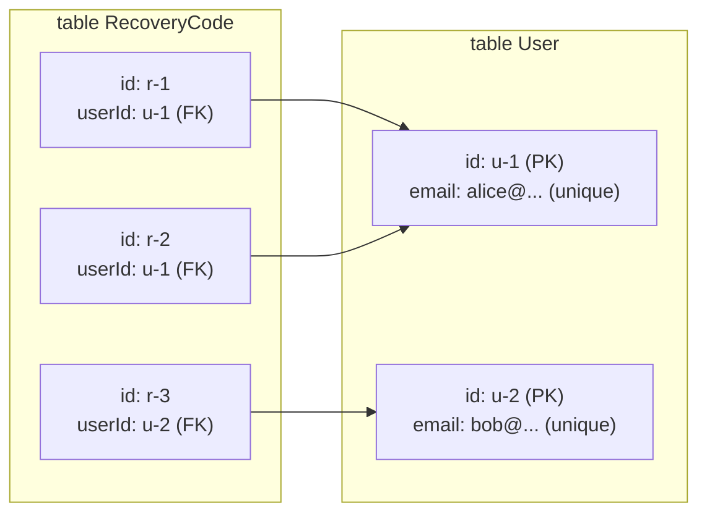
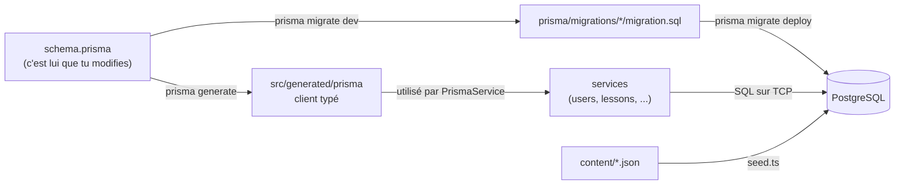
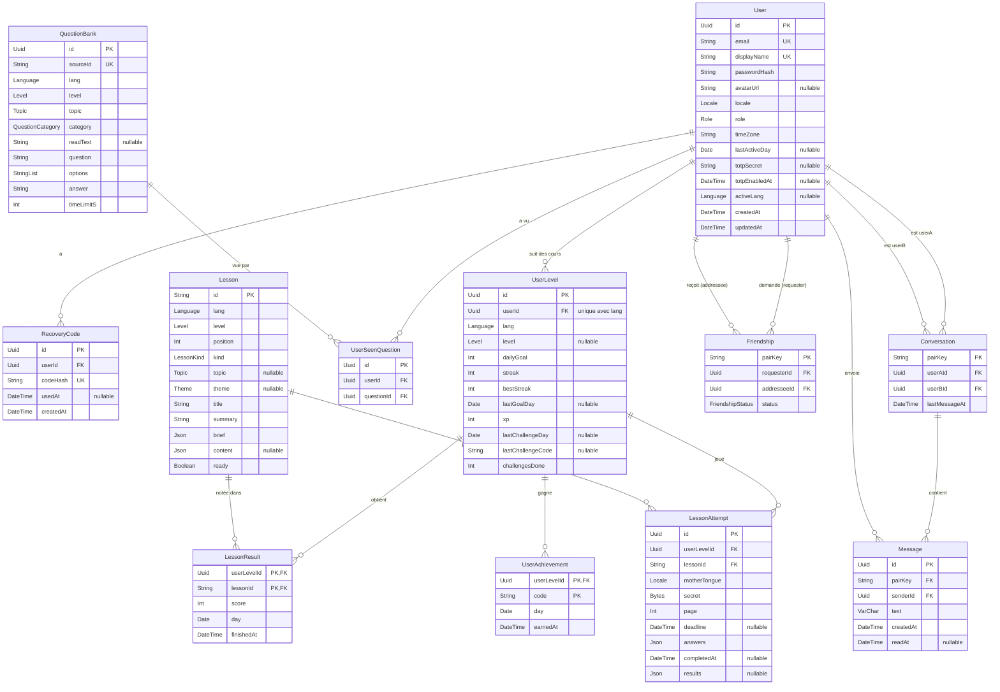
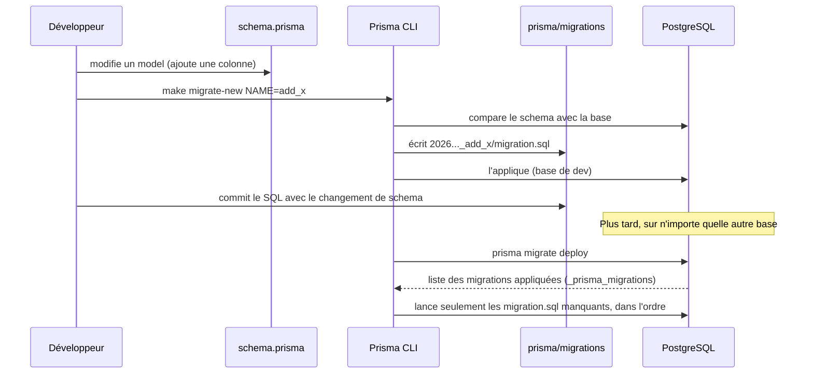
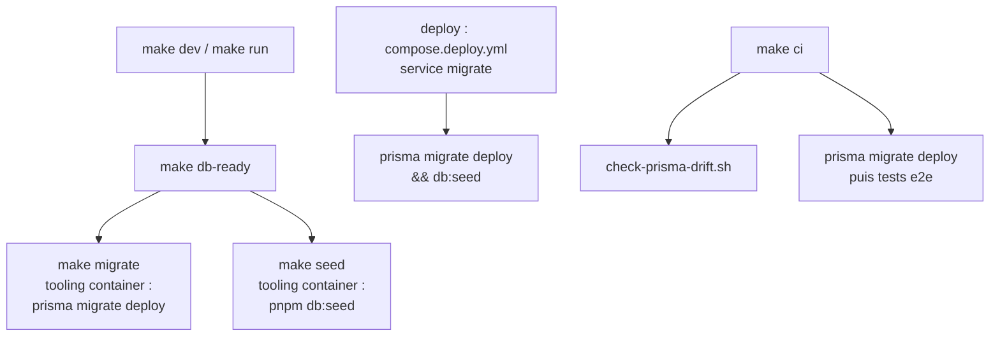
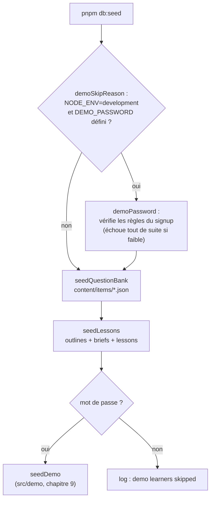

# Chapitre 4 — La base de données avec Prisma

Dans ce chapitre :

- Ce qu'est une base de données relationnelle, et ce qu'est PostgreSQL
- Tables, lignes, colonnes, clés, relations et index, avec des images simples
- Ce qu'est un ORM, et ce que Prisma fait pour nous
- [schema.prisma](../../apps/api/prisma/schema.prisma) : toutes les tables (models) et tous les enums de l'app
- [prisma.config.ts](../../apps/api/prisma.config.ts) : où Prisma trouve la base de données
- Les migrations : ce que c'est, la liste des 15, et comment elles arrivent jusqu'à une base
- [seed.ts](../../apps/api/prisma/seed.ts) : comment les questions et les leçons de `content/` entrent dans la base
- `src/generated/prisma` : le code que Prisma écrit pour nous
- De vraies requêtes tirées des services

Le chapitre 3 a montré `PrismaService`, l'objet que les services utilisent pour parler à la base de données.
Ce chapitre montre **ce qu'il y a dans la base**, et comment sa forme est définie et modifiée.

---

## 1. Théorie : les bases de données relationnelles

### Qu'est-ce qu'une base de données ?

L'API doit se souvenir de choses après son arrêt : les utilisateurs, leurs cours, leurs messages.
La mémoire (RAM) est perdue au redémarrage, donc l'API garde ces données dans une **base de données** : un programme séparé
dont le seul travail est de stocker les données en sécurité et de les retrouver vite.

On utilise **PostgreSQL** (souvent appelé « Postgres »). C'est une base de données **relationnelle** gratuite et très répandue.
Elle tourne dans son propre container Docker, le service `db` dans [compose.yml](../../compose.yml)
(l'image est `pgvector/pgvector`, une version de Postgres qui a aussi l'extension pgvector).
L'API s'y connecte avec une URL comme celle-ci, tirée de `.env.example` :

```
DATABASE_URL=postgresql://ft:ft_local_dev@db:5432/ft_transcendence?schema=public
```

Lis-la comme ceci : utilisateur `ft`, mot de passe `ft_local_dev`, hôte `db`, port `5432`, base `ft_transcendence`.

### Tables, lignes et colonnes

Imagine une base de données comme un **classeur de feuilles de calcul**.

| Mot de la base | Image du tableur                                      | Exemple dans cette app                           |
| -------------- | ----------------------------------------------------- | ------------------------------------------------ |
| **table**      | une feuille                                           | `User`                                           |
| **colonne**    | un titre de colonne, avec un type fixe                | `email` (texte), `createdAt` (date-heure)        |
| **ligne**      | une ligne de la feuille                               | l'utilisateur `alice@example.com`                |
| **enum**       | une colonne qui n'accepte qu'une courte liste de mots | `Role` vaut `USER` ou `ADMIN`                    |
| **null**       | une case vide                                         | `avatarUrl` est null quand il n'y a pas de photo |

Contrairement à un tableur, chaque colonne a un **type** et la base refuse une mauvaise valeur.
Tu ne peux pas mettre le mot `"hello"` dans une colonne de nombres, et tu ne peux pas laisser vide une colonne `NOT NULL`.

### Les clés

- Une **clé primaire** (PK, primary key) est la colonne qui nomme une ligne, comme un numéro de passeport.
  Deux lignes ne peuvent pas avoir la même. Dans la plupart des tables, c'est `id`, un **UUID** aléatoire
  (une valeur aléatoire de 128 bits comme `3f2a...-...`).
- Une **contrainte d'unicité** (unique constraint) dit « deux lignes ne peuvent pas avoir cette même valeur ». `User.email` est unique,
  donc deux comptes ne peuvent pas utiliser le même email. C'est la base qui le vérifie, pas seulement le code.
- Une **clé étrangère** (FK, foreign key) est une colonne qui contient la clé primaire d'une ligne d'une _autre_ table.
  `RecoveryCode.userId` contient un `User.id`. C'est comme écrire « voir dossier n°42 » sur un post-it :
  la base vérifie que le dossier n°42 existe vraiment.

### Les relations

Une clé étrangère crée une **relation** entre deux tables :

- **un-à-plusieurs** (one-to-many) : un utilisateur a plusieurs codes de secours, chaque code appartient à un seul utilisateur.
- **plusieurs-à-plusieurs** (many-to-many) : les utilisateurs voient plusieurs questions, une question est vue par plusieurs utilisateurs.
  Il faut alors une troisième table au milieu (`UserSeenQuestion`), avec une ligne par paire (utilisateur, question).

Que deviennent les codes quand l'utilisateur est supprimé ? C'est la clé étrangère qui le dit :

- `onDelete: Cascade` : les supprimer aussi (comme jeter un dossier avec tous ses papiers).
- `onDelete: Restrict` : refuser de supprimer l'utilisateur tant que des codes pointent encore vers lui.

### Les index

Un **index**, c'est comme l'index à la fin d'un livre. Sans lui, pour trouver toutes les pages qui parlent de
« Paris », tu lis tout le livre. Avec lui, tu sautes directement aux bonnes pages.
La base fait pareil : sans index, « trouver les messages de cette conversation » lit
tous les messages de tous les utilisateurs. Un index sur `pairKey` permet d'aller directement à eux.
Les index prennent un peu de place et rendent les écritures un peu plus lentes, donc on en ajoute seulement là où une requête en a besoin.
Une contrainte d'unicité est aussi un index (un index unique).



### Le SQL, et ce qu'est un ORM

La base parle **SQL**, un langage de commandes comme :

```sql
SELECT * FROM "User" WHERE "email" = 'alice@example.com';
```

Écrire des chaînes SQL dans du TypeScript, ça marche, mais TypeScript ne peut pas les vérifier : une faute de frappe dans un nom de
colonne n'échoue qu'au moment où le code tourne. Un **ORM** (Object-Relational Mapper) est une bibliothèque qui permet
d'écrire la requête comme du code normal, et qui la transforme en SQL pour toi. Les lignes reviennent sous forme d'objets
JavaScript normaux.

**Prisma** est l'ORM de ce projet. Il a trois parties :

| Partie            | Ce que c'est                                                                                                         | Où                              |
| ----------------- | -------------------------------------------------------------------------------------------------------------------- | ------------------------------- |
| **Schema**        | Un fichier qui décrit toutes les tables, dans le petit langage de Prisma                                             | `apps/api/prisma/schema.prisma` |
| **Prisma CLI**    | Un outil en ligne de commande : `prisma generate`, `prisma migrate dev`, `prisma migrate deploy`, `prisma studio`... | la dev dependency `prisma`      |
| **Prisma Client** | Du code TypeScript _généré à partir du schema_, avec un ensemble de méthodes typées par table                        | `apps/api/src/generated/prisma` |

Donc `prisma.user.findUnique({ where: { email } })` est vérifié par TypeScript : si `email` n'était pas une
colonne, le code ne compilerait pas.



La suite du chapitre suit cette image : le schema, la config, les migrations, le seed,
puis le client généré.

---

## 2. `prisma/schema.prisma` : la forme des données

[schema.prisma](../../apps/api/prisma/schema.prisma) est la seule source de vérité pour la
base de données. Tout le reste (migrations SQL, client typé) en découle.

### Les deux blocs d'en-tête

```prisma
// Prisma 7. Two things differ from every v6 tutorial:
//   - the connection URL lives in ../prisma.config.ts, not in this block;
//   - the generator is `prisma-client` (Rust-free) and `output` is mandatory.
datasource db {
  provider = "postgresql"
}

// Inside src/ because the prisma-client generator emits TypeScript, not JavaScript:
// it has to be compiled by `nest build` like any other source file, and rootDir
// is src, so anything above it cannot be emitted. Lint, coverage and git all
// exclude src/generated explicitly instead.
generator client {
  provider     = "prisma-client"
  output       = "../src/generated/prisma"
  runtime      = "nodejs"
  moduleFormat = "cjs"
}
```

- `datasource db` dit quel type de base on utilise. L'**URL n'est pas ici** : dans Prisma 7, elle se trouve dans
  `prisma.config.ts` (section 3). Beaucoup de tutoriels en ligne montrent `url = env("DATABASE_URL")` ici ; c'est l'ancienne façon.
- `generator client` dit quel code générer et où. `output` pointe dans `src/`, parce que le
  code généré est du TypeScript et doit être compilé avec le reste de l'API. `moduleFormat = "cjs"`
  correspond à la sortie CommonJS de `nest build`.

### Comment lire un model

Un `model` est une table. Chaque ligne est une colonne : `name  Type  @attributes`.

| Syntaxe                                                            | Sens                                                                                                                 |
| ------------------------------------------------------------------ | -------------------------------------------------------------------------------------------------------------------- |
| `String`, `Int`, `Boolean`, `DateTime`, `Json`, `Bytes`            | types de colonne (texte, nombre entier, vrai/faux, date-heure, document JSON, octets bruts)                          |
| `String?`                                                          | le `?` veut dire que la colonne peut être null (vide)                                                                |
| `String[]`                                                         | une liste de chaînes dans une seule colonne (un tableau Postgres)                                                    |
| `@id`                                                              | clé primaire                                                                                                         |
| `@default(uuid())` / `@default(now())` / `@default(0)`             | valeur utilisée quand le code n'en donne pas                                                                         |
| `@updatedAt`                                                       | Prisma la met à « maintenant » à chaque mise à jour                                                                  |
| `@unique`                                                          | contrainte d'unicité sur une colonne                                                                                 |
| `@db.Uuid`, `@db.Date`, `@db.VarChar(1000)`                        | le type Postgres exact : un vrai UUID, une date sans heure, un texte d'au plus 1000 caractères                       |
| `@relation(fields: [userId], references: [id], onDelete: Cascade)` | `userId` est une clé étrangère vers `User.id`, supprimée avec l'utilisateur                                          |
| `RecoveryCode[]` (un champ dont le type est un model)              | pas une colonne : l'« autre côté » d'une relation, pour que le code puisse écrire `include: { recoveryCodes: true }` |
| `@@unique([a, b])`                                                 | la _paire_ (a, b) est unique                                                                                         |
| `@@index([a, b])`                                                  | un index sur les colonnes a puis b                                                                                   |
| `@@id([a, b])`                                                     | une clé primaire faite de deux colonnes (une « clé composite »)                                                      |

### Tout le schema en une image

Les champs de relation (comme `recoveryCodes`) ne sont pas montrés : seulement les vraies colonnes. Pour garder l'image petite,
la plupart des colonnes `createdAt` / `updatedAt` / `startedAt` sont aussi laissées de côté (les blocs de code plus bas les montrent).
`PK` = clé primaire, `FK` = clé étrangère, `UK` = unique.



Il y a **12 models** répartis en quatre familles :

| Famille               | Models                                                       | Expliqué dans                                          |
| --------------------- | ------------------------------------------------------------ | ------------------------------------------------------ |
| Compte et sécurité    | `User`, `RecoveryCode`                                       | [05-auth-and-users.md](05-auth-and-users.md)           |
| Cours et placement    | `UserLevel`, `QuestionBank`, `UserSeenQuestion`              | [07-courses-placement.md](07-courses-placement.md)     |
| Leçons et récompenses | `Lesson`, `LessonResult`, `LessonAttempt`, `UserAchievement` | [08-lessons.md](08-lessons.md)                         |
| Social                | `Friendship`, `Conversation`, `Message`                      | [09-social-and-realtime.md](09-social-and-realtime.md) |

Maintenant, chaque model, dans cet ordre.

### `User`

```prisma
// Mirrors UserSchema in packages/shared/src/schemas/user.ts. passwordHash, the
// totp columns and lastActiveDay have no counterpart there, and must stay that way.
model User {
  id           String   @id @default(uuid()) @db.Uuid
  email        String   @unique
  displayName  String   @unique
  passwordHash String
  avatarUrl    String?
  locale       Locale   @default(en)
  role         Role     @default(USER)
  createdAt    DateTime @default(now())
  updatedAt    DateTime @updatedAt
  timeZone     String   @default("UTC")

  // The UTC day a tab last opened its socket, written by the gateway once a
  // day. Keeps the user in Recently active for a week; never sent.
  lastActiveDay DateTime? @db.Date

  // Set when enrolment starts; totpEnabledAt stays null until a first code is
  // verified, so an abandoned enrolment never blocks a login.
  totpSecret    String?
  totpEnabledAt DateTime?
  ...
  activeLang           Language?
}
```

Une ligne par compte.

- `id` : un UUID créé par Prisma (`uuid()`), stocké comme un vrai `UUID` Postgres (`@db.Uuid`), pas comme du texte.
- `email` et `displayName` sont tous les deux `@unique` : deux comptes ne peuvent partager ni l'un ni l'autre. Le code d'inscription
  compte là-dessus (section 7, exemple 1).
- `passwordHash` : jamais le mot de passe lui-même, seulement son hash argon2 (chapitre 5).
- `locale` : la langue de l'interface (`en`, `fr`, `de`). Elle est fixée à l'inscription, et l'app web
  l'enregistre à nouveau avec `PATCH /api/users/me` quand la langue de l'URL est différente (#211).
  Le tuteur des leçons la lit pour répondre dans cette langue. `activeLang` : le cours que l'utilisateur
  apprend en ce moment (null avant le premier cours).
- `timeZone` : un nom IANA comme `Europe/Paris`, utilisé pour savoir quand « aujourd'hui » commence pour la série de jours (streak).
- `lastActiveDay` : une `DATE` (sans heure). Écrite une fois par jour par la gateway WebSocket (chapitre 9).
  Elle garde l'utilisateur dans « Recently active » (actifs récemment) pendant une semaine.
- `totpSecret` / `totpEnabledAt` : la connexion à deux facteurs. Le commentaire explique pourquoi il y a deux colonnes :
  le secret est enregistré quand la configuration commence, mais la 2FA n'est « activée » qu'une fois `totpEnabledAt` rempli.
- Le commentaire du haut est important : certaines colonnes (le hash, les colonnes TOTP, `lastActiveDay`) sont **privées**.
  Le `UserSchema` partagé que voit le navigateur ne doit jamais les recevoir.

Les champs de relation en bas (`recoveryCodes`, `userLevels`, `friendshipsRequested`, ...) ne sont
pas des colonnes. Remarque les noms dans `@relation("FriendshipRequester")` : `User` a _deux_ relations vers
`Friendship` (et deux vers `Conversation`), donc chaque relation reçoit un nom pour les distinguer.

### `RecoveryCode`

```prisma
// Single-use fallback when the authenticator is lost. Stored as a SHA-256 digest
// rather than argon2: the codes are 160 bits of randomness, so there is nothing
// to brute force, and a plain digest lets a login check one indexed lookup
// instead of ten argon2 verifications.
model RecoveryCode {
  id        String    @id @default(uuid()) @db.Uuid
  userId    String    @db.Uuid
  user      User      @relation(fields: [userId], references: [id], onDelete: Cascade)
  codeHash  String    @unique
  usedAt    DateTime?
  createdAt DateTime  @default(now())

  @@index([userId])
}
```

Les codes de secours pour la 2FA. `codeHash` est unique, donc vérifier un code est une seule recherche rapide dans l'index.
`usedAt` est null tant que le code n'a pas été utilisé. `@@index([userId])` rend rapide « tous les codes de cet utilisateur ».
`onDelete: Cascade` : si on supprime l'utilisateur, les codes partent aussi.

### `UserLevel` : un cours d'un utilisateur

```prisma
model UserLevel {
  id        String   @id @default(uuid()) @db.Uuid
  userId    String   @db.Uuid
  user      User     @relation(fields: [userId], references: [id], onDelete: Cascade)
  lang      Language
  level     Level?
  dailyGoal Int
  ...
  streak      Int       @default(0)
  bestStreak  Int       @default(0)
  lastGoalDay DateTime? @db.Date

  xp                Int       @default(0)
  lastChallengeDay  DateTime? @db.Date
  lastChallengeCode String?
  challengesDone    Int       @default(0)
  ...
  @@unique([userId, lang])
}
```

Le nom est un peu trompeur : une ligne `UserLevel` est **un cours** (par exemple « Alice apprend l'allemand »).

- `@@unique([userId, lang])` : un utilisateur a au plus un cours par langue.
- `level` est null tant que le test de placement (ou l'utilisateur) n'a pas choisi un niveau (A1 à C2).
- `dailyGoal` : les minutes par jour que l'utilisateur veut étudier : 10, 30 ou 60 (`DAILY_GOALS` dans `@ft/shared`).
  Avec 10 minutes par leçon, cela fait 1, 3 ou 6 leçons par jour.
- `streak`, `bestStreak`, `lastGoalDay` : le compteur de « jours d'affilée ».
- `xp`, `lastChallengeDay`, `lastChallengeCode`, `challengesDone` : les points et le défi du jour (gamification, chapitre 8).

Les résultats de leçons, les tentatives et les succès sont rattachés à cette ligne (pas à `User`), donc chaque cours garde sa propre progression.

### `QuestionBank` et `UserSeenQuestion` : le test de placement

```prisma
model QuestionBank {
  id         String           @id @default(uuid()) @db.Uuid
  sourceId   String?          @unique
  lang       Language
  level      Level
  topic      Topic
  category   QuestionCategory
  readText   String?
  question   String
  options    String[]
  answer     String
  timeLimitS Int
  ...
  @@index([lang, level, category])
}
```

Une question à choix multiples.

- `sourceId` : l'id écrit dans le fichier JSON (`de-gram-0001`). Il est unique, donc le seed peut retrouver
  « la même question » et la mettre à jour au lieu d'ajouter une copie. Il est optionnel (`?`) parce que
  les questions écrites par l'IA (chapitre 7) n'en ont pas.
- `readText` : un court texte à lire d'abord, pour les questions de type `reading`.
- `options` : les choix, un tableau de texte Postgres. `answer` : la bonne réponse. `timeLimitS` : les secondes autorisées.
- `@@index([lang, level, category])` : le test de placement demande « donne-moi des questions de grammaire allemande B1 » ;
  cet index correspond exactement à ce filtre, dans cet ordre.

```prisma
model UserSeenQuestion {
  ...
  userId       String       @db.Uuid
  questionId   String       @db.Uuid
  ...
  @@unique([userId, questionId])
}
```

La table plusieurs-à-plusieurs « cet utilisateur a déjà vu cette question », pour qu'un nouveau test évite les répétitions.
La paire unique empêche une ligne en double.

### `Lesson`

```prisma
// Seeded from content/outlines/*.json, one row per entry. A lesson whose files
// are written (content/briefs/<id>.json, and content/lessons/<id>.json for
// every kind but vocabulary) takes its title, summary, brief and content from
// them; until then, title and summary come from the entry, brief is {} and
// content null. The id is the authored key the seed matches on, so a shipped
// lesson is edited or moved, never deleted.
model Lesson {
  id        String     @id
  lang      Language
  level     Level
  position  Int
  kind      LessonKind
  topic     Topic?
  theme     Theme?
  title     String
  summary   String
  brief     Json
  // Null for a vocabulary lesson, whose lesson is built from its brief.
  content   Json?
  // Set by the seed on every run: true when the lesson's files exist and pass
  // validateLesson. Only ready lessons are proposed and count toward a level.
  ready     Boolean    @default(false)
  updatedAt DateTime   @updatedAt
  ...
  @@index([lang, level, position])
}
```

- `id` n'est **pas** un UUID : c'est l'id lisible par un humain qui vient du fichier, comme `fr-greetings-and-goodbyes`.
  Pas de `@default` : le seed le donne toujours.
- `position` : l'ordre à l'intérieur de son (lang, level), à partir de 1. L'index `[lang, level, position]` sert
  « les leçons de français A1, dans l'ordre ».
- `kind` : `grammar`, `vocabulary`, `functions` ou `reading`. Une leçon de grammaire a un `topic`,
  les autres un `theme`, donc les deux sont optionnels.
- `brief` et `content` sont en `Json` (`JSONB` dans Postgres) : le corps de la leçon est un gros document structuré,
  pas quelque chose qu'on interroge colonne par colonne.
- `ready` : false tant que les fichiers de la leçon ne sont pas écrits et valides. La section 5 montre comment le seed le remplit.

### `LessonResult` : le meilleur score d'une leçon terminée

```prisma
// One row per course and lesson: a redo updates it rather than adding one.
// Restrict, so deleting a lesson that has results fails instead of erasing them.
model LessonResult {
  userLevelId String    @db.Uuid
  userLevel   UserLevel @relation(fields: [userLevelId], references: [id], onDelete: Cascade)
  lessonId    String
  lesson      Lesson    @relation(fields: [lessonId], references: [id], onDelete: Restrict)
  score       Int
  day         DateTime  @db.Date
  finishedAt  DateTime

  @@id([userLevelId, lessonId])
  @@index([userLevelId, day])
}
```

- Pas de colonne `id` : la clé primaire est la paire `(userLevelId, lessonId)`. C'est _justement_ la règle
  « une ligne par cours et par leçon ».
- Deux règles de suppression différentes : si on supprime le cours, ses résultats partent (`Cascade`) ; si on essaie de supprimer une leçon
  qui a des résultats, Postgres **refuse** (`Restrict`). Le travail des apprenants n'est jamais perdu par accident.
- `day` (une date) avec l'index `[userLevelId, day]` répondent à « combien de leçons ce cours a-t-il
  terminées aujourd'hui ? » pour l'objectif du jour.

### `LessonAttempt` : une leçon en cours

```prisma
/// One learner's current or last attempt at one lesson.
model LessonAttempt {
  id           String    @id @default(uuid()) @db.Uuid
  ...
  motherTongue Locale // fixed at the start
  secret       Bytes // 32 random bytes, the key of every ref; never sent
  startedAt    DateTime  @default(now())
  page         Int       @default(0) // the cursor
  deadline     DateTime? // deadline of the exam page at the cursor
  answers      Json      @default("{}") // unit id -> { response, outcome, points, timedOut, gender? }
  completedAt  DateTime?
  results      Json? // written once, when the attempt closes

  @@unique([userLevelId, lessonId])
}
```

L'état côté serveur d'une leçon en cours (le chapitre 8 explique le déroulé).
`@@unique([userLevelId, lessonId])` : on garde une seule tentative par cours et par leçon. Un départ
reprend la tentative encore en cours, ou supprime une tentative terminée et en crée une nouvelle. `secret` est en octets bruts (`BYTEA`), utilisé pour signer les références, et ne quitte jamais le serveur.
`completedAt` à null veut dire « encore en cours ».

### `UserAchievement`

```prisma
// One achievement a course earned (#95). The code is an AchievementCode of
// @ft/shared: it never changes once shipped, so a row never goes stale. The
// primary key is what stores a code once, whatever two finishes do at once.
model UserAchievement {
  userLevelId String    @db.Uuid
  ...
  code        String
  // The course day it was earned on.
  day         DateTime  @db.Date
  earnedAt    DateTime  @default(now())

  @@id([userLevelId, code])
}
```

Un badge. La clé primaire composite `(userLevelId, code)` veut dire qu'un cours ne peut gagner chaque badge
qu'une fois, même si deux leçons se terminent au même moment. Le code écrit avec `createMany({ ..., skipDuplicates: true })`
([gamification.ts](../../apps/api/src/lessons/gamification.ts)), donc la deuxième écriture du même badge est simplement ignorée.

### `Friendship`

```prisma
// One row per pair of users, whoever asked first: a request while pending, a
// friendship once accepted. Declining, cancelling and removing delete it.
model Friendship {
  // Both ids, smaller first (src/friends/pair.ts): A to B and B to A share one
  // key, so two requests that cross cannot make two rows.
  pairKey     String           @id
  requesterId String           @db.Uuid
  requester   User             @relation("FriendshipRequester", fields: [requesterId], references: [id], onDelete: Cascade)
  addresseeId String           @db.Uuid
  addressee   User             @relation("FriendshipAddressee", fields: [addresseeId], references: [id], onDelete: Cascade)
  status      FriendshipStatus @default(pending)
  ...
  @@index([requesterId])
  @@index([addresseeId])
}
```

Une astuce sympa : la clé primaire est `pairKey`, les deux ids d'utilisateurs triés et collés avec `:` (`pairKey()` dans
[pair.ts](../../apps/api/src/friends/pair.ts)). Alice-vers-Bob et
Bob-vers-Alice donnent la **même** clé, donc si les deux cliquent sur « add friend » (ajouter un ami) en même temps, la base
ne garde qu'une ligne. `status` vaut `pending` (une demande) ou `accepted`. Les deux index servent
« les demandes que j'ai envoyées » et « les demandes que j'ai reçues ».

### `Conversation` et `Message`

```prisma
// One row per pair who have exchanged a message, keyed like Friendship. It
// outlives the friendship: the history stays readable by both.
model Conversation {
  // Both ids, smaller first (src/friends/pair.ts), so a pair cannot get two.
  pairKey       String    @id
  // The smaller id.
  userAId       String    @db.Uuid
  ...
  userBId       String    @db.Uuid
  ...
  // Orders the list: set with each message.
  lastMessageAt DateTime  @default(now())
  messages      Message[]

  @@index([userAId])
  @@index([userBId])
}

model Message {
  id           String       @id @default(uuid()) @db.Uuid
  pairKey      String
  conversation Conversation @relation(fields: [pairKey], references: [pairKey], onDelete: Cascade)
  senderId     String       @db.Uuid
  ...
  text         String       @db.VarChar(1000)
  createdAt    DateTime     @default(now())
  // Null until the other user reads it. Never sent.
  readAt       DateTime?

  // The history's keyset, newest first.
  @@index([pairKey, createdAt, id])
  // What a pair has unread, for the counts and a read: they cost what is
  // unread rather than the whole history.
  @@index([pairKey, readAt])
}
```

- `Conversation` utilise la même idée de `pairKey`. `userAId` est toujours le plus petit id, `userBId` le plus grand.
- Un `Message` pointe vers sa conversation par `pairKey` (une clé étrangère en texte, pas un UUID).
- `text` est un `VARCHAR(1000)` : la base elle-même refuse un message plus long.
- Index `[pairKey, createdAt, id]` : charger l'historique page par page, du plus récent au plus ancien (section 7, exemple 3).
  `id` en fait partie parce que deux messages peuvent avoir le même `createdAt` à la milliseconde près.
- Index `[pairKey, readAt]` : compter les messages non lus (`readAt` null) sans lire tout l'historique.

### Les enums

Un enum devient un vrai type Postgres (`CREATE TYPE ... AS ENUM`), donc la base rejette toute
autre valeur.

| Enum               | Valeurs                                                                  | Utilisé par                                                                                 |
| ------------------ | ------------------------------------------------------------------------ | ------------------------------------------------------------------------------------------- |
| `Role`             | `USER`, `ADMIN`                                                          | `User.role`                                                                                 |
| `Locale`           | `en`, `fr`, `de`                                                         | `User.locale`, `LessonAttempt.motherTongue`                                                 |
| `Language`         | `en`, `fr`, `de`                                                         | la langue apprise : `User.activeLang`, `UserLevel.lang`, `QuestionBank.lang`, `Lesson.lang` |
| `Level`            | `A1` à `C2` (les niveaux européens du CECRL)                             | `UserLevel`, `QuestionBank`, `Lesson`                                                       |
| `QuestionCategory` | `vocabulary`, `grammar`, `reading`                                       | `QuestionBank.category`                                                                     |
| `Topic`            | 13 thèmes de grammaire (`pronouns`, `verbs_morphology`, `negation`, ...) | `QuestionBank.topic`, `Lesson.topic`                                                        |
| `LessonKind`       | `grammar`, `vocabulary`, `functions`, `reading`                          | `Lesson.kind`                                                                               |
| `Theme`            | 14 thèmes (`daily_life`, `travel`, `food_and_drink`, ...)                | `Lesson.theme`                                                                              |
| `FriendshipStatus` | `pending`, `accepted`                                                    | `Friendship.status`                                                                         |

`Locale` et `Language` ont les mêmes valeurs mais ne veulent pas dire la même chose (la langue de l'interface
contre la langue du cours), donc ce sont deux types. Le schema explique pourquoi la liste est carrément dans la
base :

```prisma
// Values match UserRoleSchema and LocaleSchema in @ft/shared. Adding a locale is
// already a code change there (next-intl routing reads the same tuple), so the
// migration this forces is a feature rather than a cost: the database rejects a
// value the application has not been taught to render.
```

Les mêmes valeurs existent aussi dans `packages/shared` (sous forme de schemas zod) ; les commentaires indiquent lesquelles doivent correspondre.

---

## 3. `prisma.config.ts` : où Prisma trouve la base de données

[prisma.config.ts](../../apps/api/prisma.config.ts) est lu par la **Prisma CLI** (pas par l'API qui tourne).

```ts
import { defineConfig } from 'prisma/config';

const shadowDatabaseUrl = process.env.SHADOW_DATABASE_URL;

// Not `env('DATABASE_URL')` from prisma/config: that helper throws when the
// variable is unset, and `prisma generate` runs during the Docker build, where
// no database exists yet. Migration commands fail with a clear error instead.
export default defineConfig({
  schema: 'prisma/schema.prisma',
  migrations: {
    path: 'prisma/migrations',
    seed: 'pnpm db:seed',
  },

  datasource: {
    url: process.env.DATABASE_URL ?? '',
    // `migrate diff --from-migrations` needs this; every other command rejects
    // it as an empty string with P1013, so unset means absent, not ''.
    ...(shadowDatabaseUrl ? { shadowDatabaseUrl } : {}),
  },
});
```

- `schema` et `migrations.path` : où sont les fichiers.
- `migrations.seed` : la commande que Prisma lance quand il veut faire le seed (par exemple après `prisma migrate reset`).
- `datasource.url` : lu depuis `DATABASE_URL`, avec `''` comme valeur de secours. Pourquoi ne pas lancer d'erreur quand elle manque ?
  Parce que `prisma generate` tourne pendant le build Docker, où il n'y a ni base ni URL.
  Générer du code n'a pas besoin d'une base, donc ça ne doit pas échouer là.
- `shadowDatabaseUrl` : une **shadow database** (base fantôme) est une base vide et jetable que Prisma utilise pour rejouer
  toutes les migrations et comparer le résultat avec le schema. Seule la vérification de drift (dérive)
  ([scripts/check-prisma-drift.sh](../../scripts/check-prisma-drift.sh)) la définit. Le spread
  `...(x ? { x } : {})` ajoute la clé seulement quand elle a une valeur, parce que Prisma refuse une chaîne vide.

L'API qui tourne n'utilise pas ce fichier : [PrismaService](../../apps/api/src/prisma/prisma.service.ts)
(chapitre 3) lit `DATABASE_URL` lui-même et se connecte par le driver `@prisma/adapter-pg`.

---

## 4. Les migrations

### Qu'est-ce qu'une migration ?

Le schema dit à quoi la base _devrait_ ressembler. Mais une vraie base existe déjà, avec de vraies
données dedans. Pour passer de « l'ancienne forme » à « la nouvelle forme » sans perdre de données, il faut les étapes SQL exactes :
« ajouter cette colonne », « créer cette table ». Une **migration** est une de ces étapes, enregistrée dans un fichier SQL.

Analogie : le schema est le **plan de la maison**. Les migrations sont la **liste des travaux**,
dans l'ordre : « 1. construire les murs. 2. ajouter une cuisine. 3. ajouter une fenêtre ». Une maison neuve (une base vide)
fait tous les travaux depuis le début. Une vieille maison fait seulement les travaux qu'elle n'a pas encore faits.

Prisma garde une table nommée `_prisma_migrations` dans la base, avec les noms des migrations
déjà appliquées. C'est comme ça qu'il sait ce qui n'est « pas encore fait ».



### Toutes les migrations de ce projet

Chaque dossier s'appelle `<date et heure>_<nom>/migration.sql`. La date au début les garde dans l'ordre.

| Dossier                                            | Ce qu'elle a changé                                                                                                                                     |
| -------------------------------------------------- | ------------------------------------------------------------------------------------------------------------------------------------------------------- |
| `20260807022236_init_user`                         | Crée les enums `Role` et `Locale` et la table `User`, avec `email` et `displayName` uniques.                                                            |
| `20260809004816_two_factor`                        | Ajoute `totpSecret` et `totpEnabledAt` à `User` ; crée `RecoveryCode` (`codeHash` unique, index sur `userId`, cascade).                                 |
| `20260913181513_add_user_levels_and_question_bank` | Crée les enums `QuestionCategory`, `Level`, `Language`, `Topic` et les tables `UserLevel`, `QuestionBank`, `UserSeenQuestion` avec leurs clés et index. |
| `20260913184446_question_bank_source_id_unique`    | Rend `QuestionBank.sourceId` unique (pour que le seed puisse faire un upsert dessus).                                                                   |
| `20260917234934_add_active_lang`                   | Ajoute `User.activeLang`.                                                                                                                               |
| `20261003124401_add_user_time_zone`                | Ajoute `User.timeZone`, par défaut `'UTC'`.                                                                                                             |
| `20261007134739_add_lessons`                       | Crée les enums `LessonKind` et `Theme`, les tables `Lesson` et `LessonResult` ; ajoute `streak`, `bestStreak`, `lastGoalDay` à `UserLevel`.             |
| `20261024122424_add_lesson_content`                | Ajoute `Lesson.content` (JSONB, nullable).                                                                                                              |
| `20261028175100_add_lesson_ready`                  | Ajoute `Lesson.ready`, par défaut `false`.                                                                                                              |
| `20261103225542_add_lesson_attempt`                | Crée `LessonAttempt`, unique sur `(userLevelId, lessonId)`.                                                                                             |
| `20261104003255_add_friendships`                   | Crée l'enum `FriendshipStatus` et la table `Friendship` avec ses deux index.                                                                            |
| `20261106181514_add_user_last_active_day`          | Ajoute `User.lastActiveDay` (DATE).                                                                                                                     |
| `20261107184854_add_gamification`                  | Ajoute `xp`, `lastChallengeDay`, `lastChallengeCode`, `challengesDone` à `UserLevel` ; crée `UserAchievement`.                                          |
| `20261116224104_add_messages`                      | Crée `Conversation` et `Message`, avec l'index d'historique `(pairKey, createdAt, id)`.                                                                 |
| `20261118210619_add_message_unread_index`          | Ajoute l'index `Message(pairKey, readAt)` pour compter les non-lus.                                                                                     |

Lire la liste de haut en bas est une bonne façon de voir comment l'app a grandi : les comptes, puis la 2FA,
puis les cours et le placement, puis les leçons, puis les fonctionnalités sociales.

Un petit exemple, la migration 2FA (le début) :

```sql
-- AlterTable
ALTER TABLE "User" ADD COLUMN     "totpEnabledAt" TIMESTAMP(3),
ADD COLUMN     "totpSecret" TEXT;

-- CreateTable
CREATE TABLE "RecoveryCode" (
    "id" UUID NOT NULL,
    "userId" UUID NOT NULL,
    "codeHash" TEXT NOT NULL,
    "usedAt" TIMESTAMP(3),
    "createdAt" TIMESTAMP(3) NOT NULL DEFAULT CURRENT_TIMESTAMP,

    CONSTRAINT "RecoveryCode_pkey" PRIMARY KEY ("id")
);
```

Tu vois comment les mots de Prisma deviennent du SQL : `DateTime` devient `TIMESTAMP(3)` (précision à la milliseconde),
`String?` devient `TEXT` sans `NOT NULL`, `@default(now())` devient `DEFAULT CURRENT_TIMESTAMP`.
Deux valeurs par défaut de Prisma n'ont aucun `DEFAULT` SQL : `id` est `UUID NOT NULL` parce que `uuid()` est créé par
le client, et `updatedAt` (dans `User`, première migration) est `TIMESTAMP(3) NOT NULL` parce que Prisma le remplit
côté client, pas en SQL.

Les migrations ne sont **jamais modifiées** après leur commit : une base quelque part les a peut-être déjà
lancées. Un changement est toujours une _nouvelle_ migration.

### `migration_lock.toml`

```toml
# Please do not edit this file manually
# It should be added in your version-control system (e.g., Git)
provider = "postgresql"
```

Il enregistre pour quel type de base les migrations ont été écrites. Si quelqu'un passait le schema à
une autre base (MySQL, par exemple), Prisma verrait la différence et s'arrêterait, parce que l'ancien SQL ne marcherait pas là-bas.

### Comment les migrations sont appliquées

Le `package.json` de l'API a quatre scripts `db:` :

| Script        | Commande                | Quand                                                                                                         |
| ------------- | ----------------------- | ------------------------------------------------------------------------------------------------------------- |
| `db:generate` | `prisma generate`       | écrire le client typé (section 6)                                                                             |
| `db:migrate`  | `prisma migrate dev`    | **développement seulement** : écrire une nouvelle migration à partir des changements du schema et l'appliquer |
| `db:deploy`   | `prisma migrate deploy` | appliquer les migrations manquantes, sans jamais en écrire de nouvelles (sûr pour n'importe quel serveur)     |
| `db:seed`     | `tsx prisma/seed.ts`    | charger le contenu (section 5)                                                                                |

En pratique, tu utilises le [Makefile](../../Makefile) :

- `make migrate-new NAME=add_streaks` lance `prisma migrate dev --name add_streaks`, puis
  `db:generate`. Le commentaire du Makefile dit pourquoi la deuxième étape est là : le `migrate dev` de Prisma 7
  ne régénère plus le client tout seul.
- `make migrate` lance `prisma migrate deploy` dans un **tooling container** (container d'outils) jetable.
  Pourquoi un container ? L'image de production n'a ni Prisma CLI ni fichiers de migration (elle a seulement le
  `dist` compilé), donc le Makefile build l'étape `build` de
  [apps/api/Dockerfile](../../apps/api/Dockerfile) sous le nom `ft_transcendence/api-tooling` et y lance la commande,
  sur le réseau compose pour pouvoir joindre le service `db`.
- `make db-ready` = `make migrate` puis `make seed`. `make dev`, `make run` et `make reset-db` l'appellent, donc un
  clone tout neuf a toujours les tables et les données. Les deux étapes peuvent être relancées sans risque.
- `make ci` lance `prisma migrate deploy` avant les tests e2e, plus deux vérifications :
  [check-prisma-format.sh](../../scripts/check-prisma-format.sh) (le schema est bien formaté) et
  [check-prisma-drift.sh](../../scripts/check-prisma-drift.sh). La vérification de drift rejoue chaque
  migration dans une shadow database et compare avec `schema.prisma`. Si tu as modifié le schema
  mais oublié `make migrate-new`, elle échoue avec « schema.prisma has changes with no migration ».

Sur le serveur déployé, [compose.deploy.yml](../../compose.deploy.yml) a un service `migrate` qui ne tourne qu'une fois
(derrière un profile, donc `up` ne le démarre jamais). Il utilise l'image d'outils publiée et lance :

```
pnpm --filter @ft/api exec prisma migrate deploy && pnpm --filter @ft/api run db:seed
```

Il tourne **avant** que la nouvelle API démarre, parce qu'une API qui démarre sur un schema plus ancien échoue de façons
plus difficiles à comprendre qu'une migration ratée.



---

## 5. `prisma/seed.ts` : charger le contenu

Un **seed** remplit la base avec les données dont l'app a besoin pour marcher : ici les questions de placement
et les leçons. Elles sont écrites par l'équipe sous forme de fichiers JSON dans le dossier
[content/](../../content) à la racine du repo, et pas tapées à la main dans la base :

```
content/
├── items/       de-grammar.json, fr-reading.json, ...  (9 files: 3 languages x 3 categories) -> QuestionBank
├── outlines/    fr-a1.json ... de-c2.json  (18 files: 3 languages x 6 levels)            -> Lesson rows
├── briefs/      <lesson id>.json  (the written brief of a lesson)                        -> Lesson.brief
└── lessons/     <lesson id>.json  (the content, for every kind but vocabulary)           -> Lesson.content
```

On le lance avec `pnpm db:seed`, qui correspond à `tsx prisma/seed.ts` (`tsx` exécute du TypeScript directement, sans build).
`make seed` et le service `migrate` du déploiement l'appellent. On peut le lancer autant de fois qu'on veut sans risque : il fait des **upserts**
(mettre à jour si la ligne existe, insérer sinon). Les questions sont réécrites à chaque lancement ; la partie
leçons n'écrit que ce qui a changé.

### Le bloc principal : ce qui tourne, dans l'ordre

```ts
if (require.main === module) {
  // Before anything is written: a bad password fails the seed at once.
  const skip = demoSkipReason(process.env);
  const password = skip === null ? demoPassword(process.env) : null;

  // PrismaService, not a bare PrismaClient: the demo learners build the api
  // services on it, outside Nest. Its constructor checks DATABASE_URL, and
  // without Nest nothing calls onModuleInit: Prisma connects on the first query.
  const prisma = new PrismaService();

  seedQuestionBank(findContentDir('items'), prisma)
    .then((count) => console.log(`seeded ${count} questions from ${findContentDir('items')}`))
    .then(() => seedLessons(dirname(findContentDir('outlines')), prisma))
    .then((count) =>
      console.log(`seeded ${count} lessons from ${dirname(findContentDir('outlines'))}`),
    )
    .then(async () => {
      if (password === null) {
        console.log(`demo learners skipped: ${skip}`);
        return;
      }
      // Loaded here only, so the public server never even reads the demo code.
      const { seedDemo } = await import('../src/demo/demo');
      await seedDemo(prisma, { runNow: new Date(), password });
    })
    .catch((err) => {
      console.error(err);
      process.exit(1);
    })
    .finally(() => prisma.$disconnect());
}
```

- `require.main === module` est vrai seulement quand ce fichier est le programme lancé. Le test e2e
  [test/seed.e2e-spec.ts](../../apps/api/test/seed.e2e-spec.ts) importe les fonctions, et cette garde
  empêche l'import de faire le seed de la vraie base.
- Il utilise `PrismaService` (chapitre 3), pas un simple `PrismaClient`, parce que la partie démo réutilise des services de l'API.
- Trois étapes : les questions, les leçons, puis (seulement en développement) les apprenants de démo.
- Toute erreur est affichée et le programme sort avec le code 1, donc `make` et le déploiement s'arrêtent.



### `findContentDir`

```ts
export function findContentDir(kind: 'items' | 'lessons' | 'outlines'): string {
  const candidateFromRoot = resolve(process.cwd(), 'content', kind);
  if (existsSync(candidateFromRoot)) {
    return candidateFromRoot;
  }

  const candidateFromApi = resolve(process.cwd(), '../../content', kind);
  if (existsSync(candidateFromApi)) {
    return candidateFromApi;
  }
  ...
}
```

Le seed peut être lancé depuis la racine du repo ou depuis `apps/api` (pnpm `--filter` le lance dans `apps/api`).
Donc il cherche d'abord dans `./content`, puis dans `../../content`, et sinon il échoue avec un message clair.

### `seedQuestionBank`

Pour chaque fichier `.json` de `content/items` :

1. `JSON.parse`, avec une erreur qui nomme le fichier si le JSON est cassé.
2. Validation avec `ItemFileSchema` de `@ft/shared` (un schema zod). Un fichier ressemble à ceci :

   ```json
   {
     "lang": "de",
     "category": "grammar",
     "items": [
       {
         "sourceId": "de-gram-0001",
         "level": "A1",
         "topic": "verbs_morphology",
         "question": "Wir ___ heute Abend zu Hause.",
         "options": ["bleiben", "bleibt", "bleibst", "bleibe"],
         "answer": "bleiben",
         "timeLimitS": 30
       },
   ```

3. Refus d'un `sourceId` utilisé deux fois, en nommant les deux fichiers.
4. Préparation d'un `upsert` par item, avec `sourceId` comme clé :

```ts
      operations.push(
        prisma.questionBank.upsert({
          where: { sourceId: item.sourceId },
          create: { sourceId: item.sourceId, ...itemFields },
          update: itemFields,
        }),
      );
    }
  }

  await prisma.$transaction(operations);
  return operations.length;
```

Tous les upserts vont dans **une seule transaction** : un groupe d'écritures qui réussissent toutes ensemble ou pas du tout.
Si l'item 200 échoue, les items 1 à 199 ne sont pas écrits non plus, donc la base n'est jamais à moitié remplie.
C'est pour ça que `sourceId` a dû devenir unique (migration `question_bank_source_id_unique`) :
`upsert` a besoin d'une colonne unique pour trouver la ligne existante.

### `seedLessons`

C'est la plus grosse. Son commentaire de doc explique les règles :

```ts
/**
 * Seeds one Lesson row per outline entry, from a content folder:
 *
 *   outlines/<lang>-<level>.json   the entries: id, kind, place, working title
 *   briefs/<id>.json               the lesson's brief, once written
 *   lessons/<id>.json              its content, for every kind but vocabulary
 *
 * An entry without files gets its working title and intent, an empty brief,
 * no content, and ready false. An entry with files must pass validateLesson,
 * and then takes its title, summary, brief and content from them, and ready
 * true. A file that no entry plans, or an invalid lesson, stops the seed
 * before anything is written.
 ...
 */
```

Étape par étape :

1. **Lire chaque outline** (`content/outlines/*.json`), la valider avec `LessonOutlineFileSchema`.
   Chaque entrée devient une ligne brouillon : `position` est sa place dans le fichier (`index + 1`),
   `title` est le `workingTitle`, `summary` est l'`intent`, `brief: {}`, `content: null`, `ready: false`.
   Un id de leçon utilisé dans deux fichiers est une erreur.
2. **Chercher les fichiers orphelins** : un brief sans entrée dans une outline, un fichier de contenu sans entrée dans une outline, ou un
   fichier de contenu sans brief. Chacun de ces cas arrête le seed.
3. **Valider les leçons écrites** : pour chaque brief, le lire (et son fichier de contenu s'il y en a un) et appeler
   `lessons.validateLesson` de `@ft/shared`. Si ça échoue, l'erreur liste chaque problème avec son chemin.
   Si ça passe, la ligne prend le vrai titre, le résumé, le brief et le contenu, et `ready: true`.
4. **Refuser les suppressions** : lire toutes les leçons de la base. Si l'une d'elles n'est dans aucun fichier, s'arrêter :
   « A shipped lesson is edited or moved, never deleted. » (une leçon publiée est modifiée ou déplacée, jamais supprimée). (Les ids qui commencent par `<lang>-test-` sont des restes
   de tests et sont ignorés.) Les résultats des apprenants pointent vers des ids de leçons, donc les ids doivent vivre pour toujours.
5. **N'écrire que les changements** : comparer chaque ligne avec la ligne de la base grâce à `isDeepStrictEqual`
   (l'ordre des clés est ignoré, parce que JSONB ne le garde pas). Seules les lignes nouvelles ou modifiées sont écrites, donc un
   deuxième lancement écrit 0 ligne et chaque `updatedAt` reste le même.
6. **Nettoyer les vieilles tentatives** : si le brief ou le contenu d'une leçon a changé, une tentative _non terminée_ a été construite
   à partir de l'ancienne version et pointerait vers des pages qui n'existent plus. Celles-là sont supprimées.

```ts
  await prisma.$transaction([
    ...writes.map(({ content, ...fields }) => {
      const row = { ...fields, content: content ?? Prisma.DbNull };
      return prisma.lesson.upsert({ where: { id: row.id }, create: row, update: row });
    }),
    ...(edited.length > 0
      ? [
          prisma.lessonAttempt.deleteMany({
            where: { lessonId: { in: edited }, completedAt: null },
          }),
        ]
      : []),
  ]);
```

Encore une seule transaction. `Prisma.DbNull` est la façon de dire « NULL SQL » pour une colonne `Json?` (un simple `null`
serait ambigu avec la valeur JSON `null`). Le type `LessonRow` en haut garde `content` comme un
`null` normal pendant la comparaison, et ne le transforme en `DbNull` qu'ici, « or every run would see a change » (sinon chaque lancement verrait un changement).

Donc `ready` dépend uniquement des fichiers : ajoute les fichiers d'une leçon et relance le seed, elle devient prête ; retire-les,
elle n'est plus prête. Pas besoin de migration.

### `demoSkipReason` et `demoPassword`

```ts
export function demoSkipReason(env: NodeJS.ProcessEnv): string | null {
  // An allowlist: the public server seeds with only DATABASE_URL, NODE_ENV unset.
  if (env.NODE_ENV !== 'development') {
    return `NODE_ENV is ${env.NODE_ENV ?? 'unset'}, not development`;
  }
  // Every .env has the key (make env-file adds it empty), so empty means skip.
  if ((env.DEMO_PASSWORD ?? '').trim() === '') {
    return 'DEMO_PASSWORD is empty';
  }
  return null;
}
```

Les apprenants de démo (faux utilisateurs avec des amis et de la progression, chapitre 9) sont créés seulement quand
`NODE_ENV` vaut exactement `development` **et** que `DEMO_PASSWORD` est défini. La vérification est une liste blanche (allowlist) :
tout le reste, y compris « non défini » sur le serveur public, veut dire pas d'utilisateurs de démo.
`demoPassword` vérifie le mot de passe avec le même `PasswordSchema` que l'inscription, donc un mot de passe de démo
faible échoue avant que quoi que ce soit soit écrit. Il n'affiche jamais le mot de passe.

**Tests** : [test/seed.e2e-spec.ts](../../apps/api/test/seed.e2e-spec.ts) lance ces fonctions
sur une vraie base : upserts idempotents (qu'on peut relancer sans effet en plus), erreurs claires sur les mauvais fichiers, `Restrict` sur les leçons qui ont des
résultats, `ready` qui suit les fichiers, et les règles pour sauter la démo. Le chapitre 10 en parle.

---

## 6. `src/generated/prisma` : le client généré

### Qu'est-ce que du code généré ?

`prisma generate` lit `schema.prisma` et **écrit des fichiers TypeScript** pour toi : un ensemble de types
et de méthodes par model. Tu ne les modifies jamais ; le haut de chaque fichier le dit :

```ts
/* !!! This is code generated by Prisma. Do not edit directly. !!! */
```

Si tu changes le schema, tu régénères, et les fichiers sont réécrits.

### Est-il commité dans git ?

**Non.** [apps/api/.gitignore](../../apps/api/.gitignore) dit :

```
# Prisma client output. Generated from schema.prisma on install and in the Docker
# build; committing it would put a build artifact under review.
src/generated/
```

C'est une sortie de build : relire des milliers de lignes générées dans chaque pull request ne servirait à rien.
À la place, chaque endroit qui en a besoin le génère d'abord :

- [turbo.json](../../turbo.json) : les tâches `build`, `lint` (et d'autres) dépendent de `db:generate`. Son
  commentaire : « without it, a fresh clone fails to typecheck, test or build until someone runs prisma generate by hand. » (sans ça, un clone tout neuf ne passe ni le typecheck, ni les tests, ni le build tant que quelqu'un n'a pas lancé prisma generate à la main).
- [apps/api/Dockerfile](../../apps/api/Dockerfile) : les étapes `ci` et `build` lancent `prisma generate`.
- [compose.override.yml](../../compose.override.yml) : le container `api` de dev lance `prisma generate` avant `pnpm dev`.
- `make migrate-new` lance `db:generate` après avoir écrit la migration.

Il se trouve aussi dans `src/` (voir le commentaire du generator dans la section 2), donc ESLint
(`ignores: ['**/generated/**']`) et la couverture de tests (`src/generated/**` dans
[vitest.config.mts](../../apps/api/vitest.config.mts)) l'ignorent explicitement.

### Ce qu'est chaque fichier, en gros

```
src/generated/prisma/
├── client.ts              the main import: PrismaClient class, Prisma namespace, enums, model types
├── browser.ts             same types and enums, without PrismaClient (safe outside Node)
├── enums.ts               each enum as a JS object + a TS type, e.g. Level.A1 === 'A1'
├── models.ts              re-exports the types of every file in models/
├── commonInputTypes.ts    shared filter types (StringFilter, DateTimeFilter...) used in `where`
├── models/
│   ├── User.ts            types for one model: its row type, where/create/update inputs, select/include
│   ├── Lesson.ts          ... one file per model, 12 in total
│   └── ...
└── internal/
    ├── class.ts           the PrismaClient class itself ($connect, $transaction, one property per model)
    ├── prismaNamespace.ts the Prisma namespace (Prisma.DbNull, Prisma.LessonCreateInput, error types...)
    └── prismaNamespaceBrowser.ts  the browser-safe part of that namespace
```

L'API importe depuis `client.ts`. Par exemple, [prisma.service.ts](../../apps/api/src/prisma/prisma.service.ts)
fait `import { PrismaClient } from '../generated/prisma/client';`, et `seed.ts` importe `Prisma` et
`PrismaClient` du même endroit.

---

## 7. De vraies requêtes tirées des services

Voici à quoi ressemble le code Prisma dans les services. Les détails de chaque service sont dans les chapitres suivants.

### Exemple 1 : créer un utilisateur, et laisser la contrainte d'unicité faire la vérification

Tiré de [auth.service.ts](../../apps/api/src/auth/auth.service.ts) :

```ts
    try {
      const user = await this.prisma.user.create({
        data: {
          email: input.email.toLowerCase(),
          displayName: input.displayName,
          passwordHash,
          ...(input.locale ? { locale: input.locale } : {}),
        },
      });
      return AuthService.toSessionUser(user);
    } catch (error) {
      // P2002 is the unique constraint on email or displayName. Caught rather
      // than pre-checked: a SELECT before INSERT still races another signup.
      if (
        typeof error === 'object' &&
        error !== null &&
        'code' in error &&
        error.code === 'P2002'
      ) {
        throw new ConflictException('auth.identityTaken');
      }
      throw error;
    }
```

`id`, `role`, `createdAt` et les autres ne sont pas donnés : les valeurs par défaut du schema les remplissent. Le code ne
demande pas d'abord « cet email est-il libre ? » : deux inscriptions au même moment pourraient toutes les deux recevoir « oui ». À la place, il
insère directement, et si le `@unique` sur `email` ou `displayName` refuse, Prisma lance le code d'erreur
`P2002`, qui devient un `409 Conflict`. La base est le seul juge qu'on ne peut pas prendre de vitesse.

Relire est tout aussi court (même fichier) :

```ts
    const user = await this.prisma.user.findUnique({ where: { email: email.toLowerCase() } });
```

`findUnique` n'accepte que des champs uniques dans `where` (`id`, `email`, `displayName`), et renvoie la
ligne ou `null`.

### Exemple 2 : `select` et une relation dans une seule requête

Tiré de [users.service.ts](../../apps/api/src/users/users.service.ts) :

```ts
    const user = await this.prisma.user.findUnique({
      where: { id },
      select: {
        ...PUBLIC_USER_SELECT,
        timeZone: true,
        userLevels: { orderBy: { createdAt: 'asc' } },
      },
    });
```

`select` liste les colonnes à renvoyer, donc les colonnes privées comme `passwordHash` ne quittent même jamais la
base. `userLevels` est un champ de relation : Prisma charge aussi les cours de l'utilisateur, triés, dans le même appel.

### Exemple 3 : une transaction, et une pagination par keyset sur un index

Tiré de [messages.service.ts](../../apps/api/src/messages/messages.service.ts), l'envoi d'un message :

```ts
    const [, row] = await this.prisma.$transaction([
      this.prisma.conversation.upsert({
        where: { pairKey: key },
        create: { pairKey: key, userAId, userBId, createdAt: now, lastMessageAt: now },
        update: { lastMessageAt: now },
      }),
      this.prisma.message.create({
        data: { pairKey: key, senderId: me, text, createdAt: now },
        select: MESSAGE_SELECT,
      }),
    ]);
```

Créer la conversation si c'est le premier message (ou juste avancer `lastMessageAt`), et ajouter le
message : les deux ou aucun. Et charger l'historique, une page à la fois :

```ts
    const rows = await this.prisma.message.findMany({
      where: { pairKey: key, ...before },
      select: MESSAGE_SELECT,
      orderBy: [{ createdAt: 'desc' }, { id: 'desc' }],
      take: MESSAGE_PAGE_SIZE + 1,
    });
```

`where pairKey`, `orderBy createdAt, id` : exactement les colonnes de l'index
`@@index([pairKey, createdAt, id])`. La base lit la page directement dans l'index.
`take: MESSAGE_PAGE_SIZE + 1` demande une ligne en plus, seulement pour savoir s'il existe une page plus ancienne.

---

## Idées clés à retenir

- PostgreSQL stocke les données dans des **tables** de colonnes typées. Les **clés primaires** nomment les lignes,
  les **clés étrangères** relient les tables, les **contraintes d'unicité** interdisent les doublons, les **index** rendent les recherches rapides.
- **Prisma** est l'ORM : tu écris `prisma.user.findUnique(...)`, il écrit le SQL, et TypeScript le vérifie.
- [schema.prisma](../../apps/api/prisma/schema.prisma) est la seule source de vérité : 12 models, 9 enums.
  Dans Prisma 7, l'URL se trouve dans [prisma.config.ts](../../apps/api/prisma.config.ts), pas dans le schema.
- Plusieurs règles vivent exprès dans la base : email/nom uniques, un cours par langue,
  un `pairKey` par paire, `Restrict` sur les leçons qui ont des résultats. Le code compte sur elles au lieu de faire des vérifications qui peuvent se faire doubler.
- Une **migration** est une étape SQL commitée. `make migrate-new NAME=...` en écrit une ; `prisma migrate deploy`
  applique celles qui manquent. Ne modifie jamais une ancienne migration. La vérification de drift attrape une migration oubliée.
- Le **seed** charge `content/items` dans `QuestionBank` et `content/outlines` + `briefs` + `lessons` dans `Lesson`.
  Il valide tout d'abord, écrit dans une seule transaction, n'écrit que les changements, et ne supprime jamais une leçon.
- `ready` est calculé à partir des fichiers à chaque seed. Les apprenants de démo n'apparaissent qu'avec `NODE_ENV=development` et un `DEMO_PASSWORD`.
- `src/generated/prisma` est généré par `prisma generate`, **pas commité**, et régénéré par turbo, Docker et le container de dev.

Précédent : [03-infrastructure.md](03-infrastructure.md) · Suivant : [05-auth-and-users.md](05-auth-and-users.md) · [Retour à l'index](README.md)
