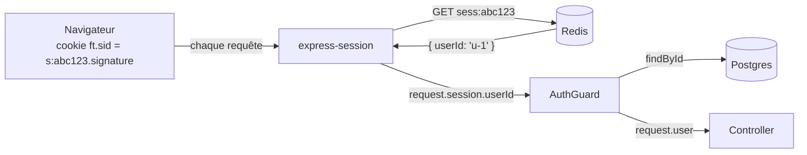
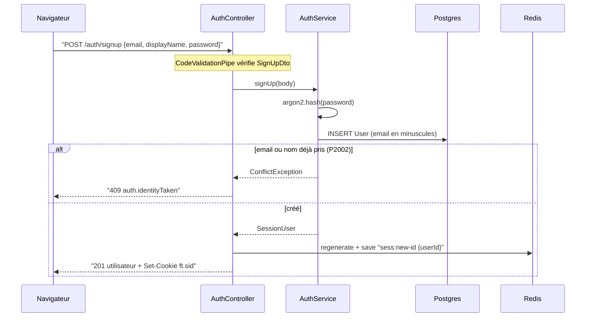
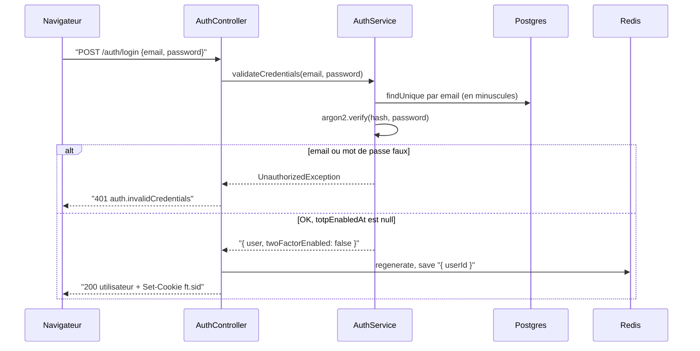
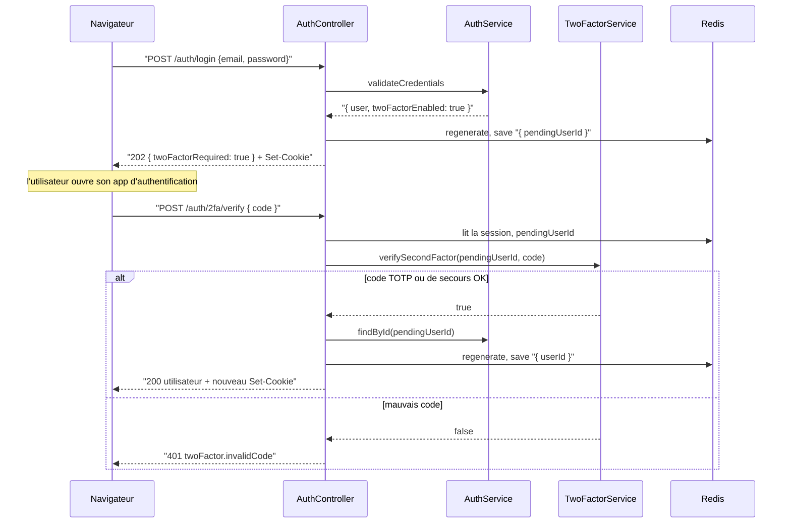
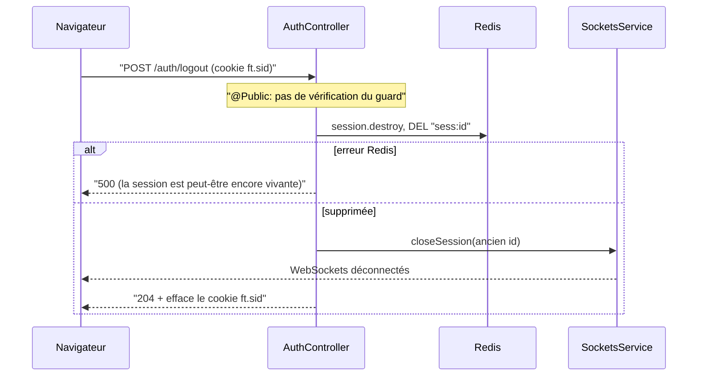
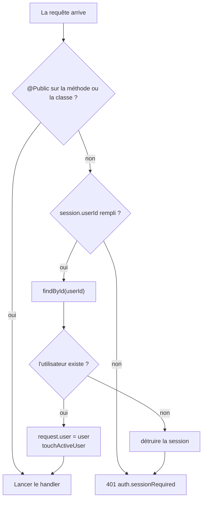
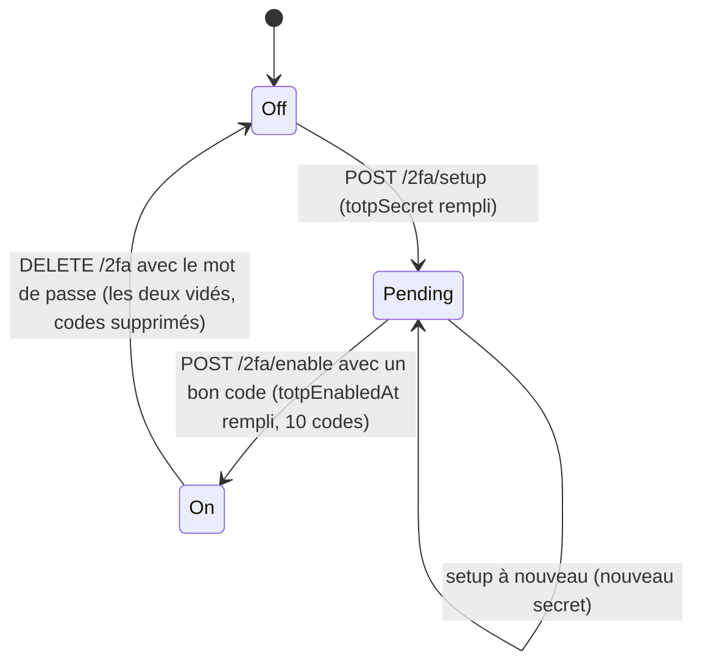
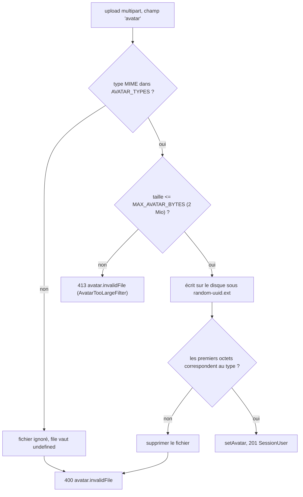
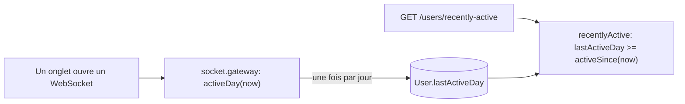

# Chapitre 5 — Les comptes : auth et utilisateurs

Dans ce chapitre :

- La théorie : authentification ou autorisation, hachage des mots de passe, sessions et cookies, 2FA et codes de secours
- Comment une session vit dans Redis et voyage dans un cookie
- Le dossier `auth/`, fichier par fichier : module, DTOs, controller (chaque route), service, guard, décorateurs, `session.d.ts`, service de double authentification
- Quatre diagrammes de séquence : inscription, connexion sans 2FA, connexion avec 2FA, déconnexion
- Le dossier `users/`, fichier par fichier : module, controller (chaque route, avec l'upload d'avatar), DTOs, service, `public-user.ts`, `active-day.ts`

---

## Vue d'ensemble

### Authentification ou autorisation

Deux mots qui se ressemblent, mais qui répondent à deux questions différentes :

| Mot                            | Question                       | Exemple dans cette app                                                                                                              |
| ------------------------------ | ------------------------------ | ----------------------------------------------------------------------------------------------------------------------------------- |
| **Authentification** ("authn") | _Qui es-tu ?_                  | Tu envoies ton email et ton mot de passe ; l'API les vérifie.                                                                       |
| **Autorisation** ("authz")     | _Qu'as-tu le droit de faire ?_ | Tu peux modifier **ton propre** profil (`PATCH /users/me`), mais il n'existe aucune route pour modifier celui de quelqu'un d'autre. |

Dans cette API, l'authentification est le travail de `AuthService` (vérifier le mot de passe) et de `AuthGuard` (vérifier la session à chaque requête).
L'autorisation vient surtout de la **conception des routes** : chaque route d'« écriture » travaille sur `me` (l'utilisateur de la session), jamais sur un id venu de l'URL.

### Le hachage des mots de passe

La base de données ne stocke jamais ton mot de passe. Elle stocke un **hash** : le résultat d'une fonction à sens unique.
Tu peux calculer `hash(password)`, mais tu ne peux pas revenir du hash au mot de passe.
À la connexion, l'API hache ce que tu as tapé et compare.

Un hash normal (comme SHA-256) est **trop rapide** pour des mots de passe. Un attaquant qui vole la base peut essayer des milliards de mots de passe par seconde.
Donc le hachage de mots de passe utilise exprès une fonction **lente et gourmande en mémoire**.

Ce projet utilise **argon2** (le package npm `argon2`), avec la variante **argon2id**.
argon2 a gagné la Password Hashing Competition et c'est le premier choix dans les recommandations de l'OWASP (l'OWASP est un groupe connu de sécurité web).
« Gourmande en mémoire » veut dire que chaque essai demande 19 Mio de RAM, ce qui rend les essais sur cartes graphiques très coûteux.

Chaque hash argon2 contient aussi un **sel** (salt : des octets aléatoires mélangés au mot de passe), donc deux utilisateurs avec le même mot de passe ont deux hashs différents.
La bibliothèque range le sel et les réglages dans la chaîne du hash elle-même, donc `argon2.verify(hash, password)` n'a besoin de rien d'autre.

### Sessions et cookies, ou tokens

HTTP n'a pas de mémoire : chaque requête arrive seule. Alors comment l'API sait-elle que la requête numéro 2 vient de la même personne qui s'est connectée à la requête numéro 1 ?

**Analogie : le ticket du vestiaire.** Au théâtre, tu donnes ton manteau et tu reçois un petit ticket avec un numéro.
Le ticket lui-même ne dit rien sur toi. Le manteau (tes données) reste derrière le comptoir.
Quand tu reviens, tu montres le ticket et on retrouve ton manteau. Si on perd ton manteau ou qu'on le jette, ton ticket ne vaut plus rien.

- Le **ticket**, c'est le **cookie** `ft.sid`. Il contient seulement un id de session aléatoire.
- Le **vestiaire**, c'est **Redis**. Il garde les données de session (`userId`) sous cet id.
- La **déconnexion**, c'est « jeter le manteau » : supprimer l'entrée dans Redis. Le ticket ne correspond plus à rien.

L'autre approche courante, c'est un **token** (par exemple un JWT, "JSON Web Token"). Un token ressemble plutôt à une **carte d'identité signée** :
les données sont écrites sur la carte elle-même, et le serveur vérifie seulement la signature. C'est pratique parce que le serveur ne garde rien,
mais c'est difficile d'**annuler** une carte avant qu'elle expire. Avec une session côté serveur, la déconnexion ou un « compte supprimé » marche tout de suite.
C'est pour ça que ce projet utilise des sessions.

|                            | Session + cookie (cette app) | Token (JWT)                                  |
| -------------------------- | ---------------------------- | -------------------------------------------- |
| Ce que garde le navigateur | Un id aléatoire              | Toutes les infos (claims), signées           |
| Où vivent les données      | Serveur (Redis)              | Dans le token                                |
| Déconnexion immédiate      | Supprimer la clé Redis       | Difficile (il faut une liste de blocage)     |
| Lisible par JavaScript ?   | Non (cookie `httpOnly`)      | Souvent stocké dans `localStorage`, donc oui |

### Comment la session est stockée dans Redis

La configuration de la session est dans [app.setup.ts](../../../apps/api/src/app.setup.ts) (voir [02-boot-and-request-flow.md](02-boot-and-request-flow.md)).
Elle utilise le middleware (code qui passe sur chaque requête) `express-session` avec un store `connect-redis` :

```ts
const sessionMiddleware = session({
  name: SESSION_COOKIE,
  secret: requireSessionSecret(),
  store: new RedisStore({ client: app.get(RedisService).client, prefix: SESSION_KEY_PREFIX }),
  // The cookie is an opaque id, so there is nothing to write back unless the
  // session itself changed, and an anonymous visitor gets no session at all.
  resave: false,
  saveUninitialized: false,
  rolling: true,
  cookie: {
    httpOnly: true,
    secure: process.env.NODE_ENV === "production",
    sameSite: "lax",
    maxAge: SESSION_TTL_MS,
    path: "/",
  },
});
```

Ce que ça veut dire :

- Le cookie s'appelle `ft.sid` (`SESSION_COOKIE`). Sa valeur est l'id de session, **signé** avec `SESSION_SECRET` (au moins 32 caractères), donc personne ne peut inventer un id.
- Dans Redis, la clé est `sess:<session id>` (`SESSION_KEY_PREFIX`). La valeur est un petit objet JSON, par exemple `{"cookie":{...},"userId":"..."}`.
- `saveUninitialized: false` : un visiteur qui ne se connecte jamais n'a **pas** de session ni de cookie.
- `rolling: true` + `maxAge` de 7 jours : la session expire après 7 jours **sans** requête. Chaque requête relance les 7 jours.
- `httpOnly` : le JavaScript du navigateur ne peut pas lire le cookie (protège contre le vol de cookie par XSS).
- `secure` en production : le cookie n'est envoyé qu'en HTTPS.
- `sameSite: 'lax'` : le navigateur n'envoie pas le cookie sur la plupart des requêtes lancées par un autre site (protège contre le CSRF).



Le même middleware tourne aussi pour les connexions WebSocket (`SessionIoAdapter`), donc le chat sait aussi qui tu es (voir [09-social-and-realtime.md](09-social-and-realtime.md)).

### Ce qu'est la 2FA / le TOTP

La **2FA** (authentification à deux facteurs) veut dire qu'il te faut deux choses différentes pour te connecter :
quelque chose que tu **sais** (le mot de passe) et quelque chose que tu **as** (ton téléphone).

Cette app utilise le **TOTP** ("Time-based One-Time Password", mot de passe à usage unique basé sur le temps), le standard utilisé par Google Authenticator, Authy, etc. :

1. Le serveur crée un **secret** aléatoire et l'affiche sous forme de QR code.
2. Tu le scannes. Maintenant ton téléphone et le serveur partagent le même secret.
3. Toutes les 30 secondes, les deux côtés calculent `HMAC-SHA1(secret, current time / 30)` et gardent 6 chiffres.
4. À la connexion, tu tapes les 6 chiffres de ton téléphone. Le serveur calcule le même nombre et compare.

Le code change toutes les 30 secondes, donc un code vu par quelqu'un d'autre devient vite inutile.

### Les codes de secours

Si tu perds ton téléphone, tu perds le second facteur. Les **codes de secours** (recovery codes) règlent ce problème.
Quand tu actives la 2FA, l'API te donne 10 codes aléatoires (comme `abcde-fghjk-mnpqr-stuvw`). Tu les notes.
Chacun peut remplacer un code TOTP **une seule fois**. Le serveur garde seulement un condensé SHA-256 de chaque code, jamais le code lui-même.

### Où sont les choses

```
apps/api/src/
├── auth/
│   ├── auth.module.ts          wires the auth part, registers the global guard
│   ├── auth.dto.ts             DTO classes from the shared Zod schemas
│   ├── auth.controller.ts      /auth/* routes
│   ├── auth.service.ts         argon2, signup, credential check
│   ├── auth.guard.ts           global guard: "is there a session?"
│   ├── auth.decorators.ts      @Public() and @CurrentUser()
│   ├── session.d.ts            types for request.session
│   └── two-factor.service.ts   TOTP + recovery codes
└── users/
    ├── users.module.ts
    ├── users.controller.ts     /users/* routes, avatar upload
    ├── users.dto.ts
    ├── users.service.ts        search, profile, recently active, avatar files
    ├── public-user.ts          the columns other users may see
    └── active-day.ts           UTC day helpers for "Recently active"
```

---

## auth.module.ts

[auth.module.ts](../../../apps/api/src/auth/auth.module.ts) regroupe la partie auth de l'app :

```ts
@Module({
  imports: [GatewayModule],
  controllers: [AuthController],
  providers: [AuthService, TwoFactorService, { provide: APP_GUARD, useClass: AuthGuard }],
  exports: [AuthService],
})
export class AuthModule {}
```

- `imports: [GatewayModule]` — le controller a besoin de `SocketsService` qui vient de là, pour fermer les connexions WebSocket quand une session se termine ou change.
- `providers` — `AuthService` et `TwoFactorService` sont des providers normaux.
- `{ provide: APP_GUARD, useClass: AuthGuard }` — c'est la ligne importante. `APP_GUARD` est un token spécial de `@nestjs/core`.
  Un provider avec ce token devient un **guard global** : Nest le lance avant **chaque** route de toute l'app, pas seulement les routes de ce module.
- `exports: [AuthService]` — les autres modules peuvent injecter `AuthService`.

`AuthModule` est importé dans [app.module.ts](../../../apps/api/src/app.module.ts) avec tous les autres modules de fonctionnalités.

## auth.dto.ts et les schemas partagés

Un **DTO** ("Data Transfer Object", objet de transfert de données) est une classe qui décrit la forme du body d'une requête ou d'une réponse.
Dans ce projet, les vraies règles sont des **schemas Zod** dans `packages/shared`, et [auth.dto.ts](../../../apps/api/src/auth/auth.dto.ts) ne fait que les emballer :

```ts
/**
 * The Zod schemas in @ft/shared are the rules; these wrap them so Nest validates
 * requests with them and Swagger documents them. The browser imports the same
 * schemas, which is what keeps client and server validation identical.
 */
export class SignUpDto extends createZodDto(CreateUserSchema) {}
export class LoginDto extends createZodDto(LoginSchema) {}
export class SessionUserDto extends createZodDto(SessionUserSchema) {}
export class UpdateProfileDto extends createZodDto(UpdateProfileSchema) {}

export class SecondFactorDto extends createZodDto(SecondFactorSchema) {}
export class EnableTwoFactorDto extends createZodDto(EnableTwoFactorSchema) {}
export class DisableTwoFactorDto extends createZodDto(DisableTwoFactorSchema) {}
```

`createZodDto` (de `nestjs-zod`) transforme un schema en classe. Le `CodeValidationPipe` global vérifie chaque body avec,
et Swagger (`/api/docs`) l'affiche. Le même fichier emballe aussi les schemas de réponse (`TwoFactorSetupDto`, `TwoFactorStatusDto`, `RecoveryCodesDto`, `TwoFactorRequiredDto`) — ceux-là servent seulement à Swagger.

Chaque message d'erreur dans ces schemas est un **code** comme `'password.tooShort'`, pas une phrase. C'est le navigateur qui le traduit (voir [02-boot-and-request-flow.md](02-boot-and-request-flow.md)).

### Les schemas de packages/shared

Depuis [user.ts](../../../packages/shared/src/schemas/user.ts) :

| Schema                | Utilisé par                    | Règles                                                                                              |
| --------------------- | ------------------------------ | --------------------------------------------------------------------------------------------------- |
| `CreateUserSchema`    | `SignUpDto`                    | `email`, `displayName`, `password`, `locale` optionnel                                              |
| `DisplayNameSchema`   | inscription, profil, recherche | 3 à 32 caractères, lettres, chiffres, `.` `_` `-` uniquement                                        |
| `PasswordSchema`      | inscription                    | 12 à 128 caractères, une minuscule, une majuscule, un chiffre                                       |
| `LoginSchema`         | `LoginDto`                     | email + n'importe quel mot de passe non vide jusqu'à 128                                            |
| `SessionUserSchema`   | réponses                       | l'utilisateur **sans** `updatedAt` (et il n'y a jamais de `passwordHash` dans aucun schema partagé) |
| `UpdateProfileSchema` | `UpdateProfileDto`             | `displayName`, `locale`, `timeZone` optionnels, au moins un                                         |

Deux commentaires de ce fichier expliquent bien les choix :

```ts
/**
 * Login deliberately does not reuse PasswordSchema. Its rules describe what a
 * NEW password must contain, and applying them here would reject an older
 * account's valid password with a message that reads like a policy complaint.
 */
export const LoginSchema = z.object({
  email: z.email("email.invalid"),
  password: z.string("password.required").min(1, "password.required").max(128, "password.tooLong"),
});
```

Le `max(128)` compte : argon2 hache n'importe quelle longueur, donc sans limite quelqu'un pourrait envoyer un mot de passe énorme et faire beaucoup travailler le serveur.

`UpdateProfileSchema` laisse de côté exprès `email`, `role` et `avatarUrl` : changer l'email ou le rôle est un changement de privilège,
et `avatarUrl` désigne un fichier sur le disque du serveur, donc quelqu'un qui pourrait le modifier « pourrait désigner le fichier de quelqu'un d'autre et nous le faire supprimer ».

Depuis [two-factor.ts](../../../packages/shared/src/schemas/two-factor.ts) :

| Schema                    | Règles                                                                          |
| ------------------------- | ------------------------------------------------------------------------------- |
| `TotpCodeSchema`          | exactement 6 chiffres (une chaîne, pour que `012345` garde son zéro au début)   |
| `RecoveryCodeSchema`      | enlève les espaces et les `-`, passe en minuscules, puis 20 caractères `a-z0-9` |
| `SecondFactorSchema`      | `{ code }` où code est **soit** un code TOTP **soit** un code de secours        |
| `EnableTwoFactorSchema`   | `{ code }`, TOTP uniquement                                                     |
| `DisableTwoFactorSchema`  | `{ password }`                                                                  |
| `TwoFactorSetupSchema`    | réponse : `secret`, `otpauthUri`, `qrDataUrl`                                   |
| `TwoFactorStatusSchema`   | réponse : `enabled`, `enrolmentPending`, `recoveryCodesRemaining`               |
| `RecoveryCodesSchema`     | réponse : `{ recoveryCodes: string[] }`                                         |
| `TwoFactorRequiredSchema` | réponse : `{ twoFactorRequired: true }`                                         |

Le même fichier contient les constantes `RECOVERY_CODE_COUNT = 10`, `RECOVERY_CODE_GROUPS = 4` et `RECOVERY_CODE_GROUP_LENGTH = 5`, que le service de double authentification utilise.

## auth.controller.ts

[auth.controller.ts](../../../apps/api/src/auth/auth.controller.ts) contient toutes les routes `/api/auth/*`. D'abord, la liste complète :

| Méthode | Chemin             | Guard     | Limite de débit (par IP) | Ce qu'elle fait                                                                                                                      |
| ------- | ------------------ | --------- | ------------------------ | ------------------------------------------------------------------------------------------------------------------------------------ |
| POST    | `/auth/signup`     | `@Public` | signup (20/min)          | Crée le compte, démarre une session, renvoie l'utilisateur (201)                                                                     |
| POST    | `/auth/login`      | `@Public` | login (5/min)            | Vérifie le mot de passe. Sans 2FA : session + utilisateur (200). Avec 2FA : session en attente + `{ twoFactorRequired: true }` (202) |
| POST    | `/auth/2fa/verify` | `@Public` | login                    | Termine une connexion en attente avec un code TOTP ou un code de secours                                                             |
| GET     | `/auth/2fa`        | session   | —                        | État de la 2FA de mon compte                                                                                                         |
| POST    | `/auth/2fa/setup`  | session   | —                        | Commence l'inscription : nouveau secret + QR code (409 si la 2FA est déjà active)                                                    |
| POST    | `/auth/2fa/enable` | session   | login                    | Confirme avec un premier code, active la 2FA, renvoie les codes de secours                                                           |
| DELETE  | `/auth/2fa`        | session   | login                    | Désactive la 2FA, redemande le mot de passe (204)                                                                                    |
| POST    | `/auth/logout`     | `@Public` | —                        | Détruit la session, efface le cookie (204)                                                                                           |
| GET     | `/auth/me`         | session   | —                        | Renvoie l'utilisateur connecté                                                                                                       |

« session » dans la colonne Guard veut dire que le `AuthGuard` global s'applique (pas de `@Public`).
Les limites de débit viennent de `@ThrottleByIp(RATE_LIMITS.…)` (voir [03-infrastructure.md](03-infrastructure.md)) ; les nombres sont les valeurs par défaut de `SIGNUP_LIMIT_PER_MINUTE` et `LOGIN_LIMIT_PER_MINUTE`.

Le controller reçoit trois services par injection de dépendances :

```ts
  constructor(
    private readonly auth: AuthService,
    private readonly twoFactor: TwoFactorService,
    private readonly sockets: SocketsService,
  ) {}
```

### Les fonctions utilitaires : un nouvel id de session à chaque fois

En haut du fichier, en dehors de la classe, il y a trois fonctions utilitaires :

```ts
function regenerate(request: Request, assign: () => void): Promise<string> {
  const replaced = request.sessionID;
  return new Promise((resolve, reject) => {
    request.session.regenerate((error) => {
      if (error) {
        reject(error instanceof Error ? error : new Error(String(error)));
        return;
      }
      assign();
      request.session.save((saveError) => {
        if (saveError) {
          reject(saveError instanceof Error ? saveError : new Error(String(saveError)));
          return;
        }
        resolve(replaced);
      });
    });
  });
}
```

`request.session.regenerate` supprime l'ancienne session et en crée une nouvelle, vide, avec un **nouvel id**. Ensuite `assign()` écrit les données, et `save` les écrit dans Redis.
`express-session` utilise des callbacks, donc la fonction les emballe dans une `Promise` pour pouvoir utiliser `await`.

Pourquoi un nouvel id ? Le commentaire l'explique : ça bloque la **fixation de session** (session fixation). Dans cette attaque, une personne malveillante met un id de session connu dans ton navigateur avant que tu te connectes.
Si l'id restait le même après la connexion, elle pourrait l'utiliser elle aussi. Avec un nouvel id à chaque connexion, l'ancien ne vaut plus rien.

La fonction renvoie l'**ancien** id. Les appelants le passent à `this.sockets.closeSession(...)`, qui déconnecte chaque WebSocket ouvert avec l'ancienne session.

```ts
function startSession(request: Request, userId: string): Promise<string> {
  return regenerate(request, () => {
    request.session.userId = userId;
    delete request.session.pendingUserId;
  });
}

function startPendingSession(request: Request, userId: string): Promise<string> {
  return regenerate(request, () => {
    request.session.pendingUserId = userId;
  });
}
```

- `startSession` : une connexion **complète**. Met `userId`, la clé que le guard lit.
- `startPendingSession` : mot de passe OK, mais il faut encore un code 2FA. Met seulement `pendingUserId`, que le guard ignore.

### POST /auth/signup

```ts
  @Public()
  @Post('signup')
  @ThrottleByIp(RATE_LIMITS.signup)
  @ApiOperation({ summary: 'Create an account and sign in', security: [] })
  @ApiCreatedResponse({ type: SessionUserDto })
  @ApiConflictResponse({ description: 'Email or display name already taken' })
  async signUp(@Body() body: SignUpDto, @Req() request: Request): Promise<SessionUser> {
    const user = await this.auth.signUp(body);
    this.sockets.closeSession(await startSession(request, user.id));
    return user;
  }
```

Le body est validé par `SignUpDto` avant que la méthode tourne. `AuthService.signUp` crée l'utilisateur, puis `startSession` le connecte tout de suite.
Les décorateurs `@Api…` servent seulement à Swagger. `security: []` dit à Swagger que cette route n'a pas besoin de cookie.
Le commentaire du code note que l'inscription est la route publique la plus coûteuse (une ligne en base + argon2), donc elle a sa propre limite de débit.



### POST /auth/login

```ts
  async login(
    @Body() body: LoginDto,
    @Req() request: Request,
    @Res({ passthrough: true }) response: Response,
  ): Promise<SessionUser | TwoFactorRequired> {
    const { user, twoFactorEnabled } = await this.auth.validateCredentials(
      body.email,
      body.password,
    );

    if (twoFactorEnabled) {
      this.sockets.closeSession(await startPendingSession(request, user.id));
      // 202 rather than 200: the credentials were accepted, the login is not
      // finished, and the body carries no user for a caller to mistake for one.
      response.status(HttpStatus.ACCEPTED);
      return { twoFactorRequired: true };
    }

    this.sockets.closeSession(await startSession(request, user.id));
    return user;
  }
```

`@HttpCode(HttpStatus.OK)` fait que la réponse normale est 200 (par défaut, Nest répond 201 pour un POST).
`@Res({ passthrough: true })` donne accès à la réponse Express **seulement** pour changer le code de statut ; Nest envoie quand même la valeur renvoyée en JSON.
Si le mot de passe est faux, `validateCredentials` lance une erreur et le client reçoit `401 auth.invalidCredentials`.



### POST /auth/2fa/verify

La deuxième étape d'une connexion avec 2FA. Elle est `@Public` parce que l'utilisateur n'est **pas** encore connecté : seul `pendingUserId` est rempli.

```ts
  async verifySecondFactor(
    @Body() body: SecondFactorDto,
    @Req() request: Request,
  ): Promise<SessionUser> {
    const pendingUserId = request.session.pendingUserId;
    if (pendingUserId === undefined) {
      throw new UnauthorizedException('auth.passwordFirst');
    }

    if (!(await this.twoFactor.verifySecondFactor(pendingUserId, body.code))) {
      throw new UnauthorizedException('twoFactor.invalidCode');
    }

    const user = await this.auth.findById(pendingUserId);
    if (user === null) {
      throw new UnauthorizedException('auth.passwordFirst');
    }

    this.sockets.closeSession(await startSession(request, user.id));
    return user;
  }
```

Elle a la même limite de débit stricte que la connexion : « six chiffres, c'est beaucoup moins de possibilités qu'un mot de passe ».



### GET /auth/2fa, POST /auth/2fa/setup

```ts
  twoFactorStatus(@CurrentUser() user: SessionUser): Promise<TwoFactorStatus> {
    return this.twoFactor.status(user.id);
  }

  setUpTwoFactor(@CurrentUser() user: SessionUser): Promise<TwoFactorSetup> {
    return this.twoFactor.beginEnrolment(user.id, user.email);
  }
```

Les deux ont besoin d'une session. `@CurrentUser()` donne l'utilisateur que le guard a chargé. La page des réglages utilise l'état pour afficher « activée », « désactivée » ou « configuration commencée », et combien de codes de secours il reste.
Setup répond 409 si la 2FA est déjà active : pour changer d'app d'authentification, tu dois d'abord désactiver la 2FA, et cette étape demande le mot de passe.

### POST /auth/2fa/enable

```ts
  async enableTwoFactor(
    @Body() body: EnableTwoFactorDto,
    @CurrentUser() user: SessionUser,
    @Req() request: Request,
  ): Promise<RecoveryCodes> {
    const recoveryCodes = await this.twoFactor.confirmEnrolment(user.id, body.code);
    await this.rotateSession(request, user.id);
    return { recoveryCodes };
  }
```

L'utilisateur tape le premier code de son app. S'il est bon, la 2FA est activée et l'utilisateur reçoit les 10 codes de secours (affichés seulement cette fois-ci).
L'id de session change parce que les privilèges ont changé. La route a une limite de débit parce qu'« un cookie volé ne doit pas devenir un moyen de deviner les codes ».

### DELETE /auth/2fa

```ts
// The password again, not just the session: an unattended browser should not
// be enough to remove a factor.
if (!(await this.auth.verifyPassword(user.id, body.password))) {
  throw new UnauthorizedException("auth.incorrectPassword");
}
await this.twoFactor.disable(user.id);
await this.rotateSession(request, user.id);
```

Ça s'appelle la **ré-authentification** : pour une action sensible, une session active ne suffit pas. Réponse : 204 No Content.

### POST /auth/logout

```ts
  // Public so that logging out of an expired session is not itself a 401.
  @Public()
  @Post('logout')
  @HttpCode(HttpStatus.NO_CONTENT)
  async logout(@Req() request: Request): Promise<void> {
    const ended = request.sessionID;
    // Failing loudly rather than returning 204: if the store entry survives, the
    // session is still usable and reporting success would be a lie.
    await new Promise<void>((resolve, reject) => {
      request.session.destroy((error) => {
        if (error) {
          reject(error instanceof Error ? error : new Error(String(error)));
          return;
        }
        resolve();
      });
    });
    // After the DEL, so a new handshake finds the session gone. One already past
    // express-session checks the session again once in its rooms (the gateway).
    this.sockets.closeSession(ended);
    // The store entry is gone; this clears the now-dangling browser cookie.
    request.res?.clearCookie('ft.sid', { path: '/' });
  }
```

L'ordre compte : d'abord supprimer l'entrée Redis, puis fermer les sockets, puis effacer le cookie.



### GET /auth/me

```ts
  me(@CurrentUser() user: SessionUser): SessionUser {
    return user;
  }
```

L'app web l'appelle pour savoir « suis-je connecté, et en tant que qui ? ». Le guard a déjà fait tout le travail.

### rotateSession

```ts
  private async rotateSession(request: Request, userId: string): Promise<void> {
    try {
      this.sockets.closeSession(await startSession(request, userId));
    } catch (error) {
      this.logger.warn(`session not rotated: ${String(error)}`);
    }
  }
```

Utilisée après l'activation ou la désactivation de la 2FA. Elle se contente de **logger** une erreur au lieu de la lancer : le changement de 2FA est déjà enregistré,
et les codes de secours doivent quand même arriver à l'utilisateur.

**Tests :** [auth.controller.spec.ts](../../../apps/api/src/auth/auth.controller.spec.ts) vérifie que la déconnexion efface le cookie et ferme les sockets, échoue quand Redis ne peut pas détruire la session,
que chaque route qui crée un nouvel id de session ferme les sockets de l'ancien id, et que les codes de secours sont renvoyés même quand la rotation échoue.

## auth.service.ts

[auth.service.ts](../../../apps/api/src/auth/auth.service.ts) fait le travail sur les mots de passe. Il a seulement besoin de `PrismaService`.

### Les réglages d'argon2

```ts
/**
 * OWASP's second recommended argon2id configuration: 19 MiB, 2 iterations,
 * 1 degree of parallelism. Raising memoryCost is what raises the cost to an
 * attacker, so tune that before the others.
 */
const ARGON2_OPTIONS = {
  type: argon2.argon2id,
  memoryCost: 19_456,
  timeCost: 2,
  parallelism: 1,
} as const;

/**
 * Hashing a throwaway string so a login for an unknown email takes as long as
 * one for a real account. Skipping it leaks which emails are registered through
 * response timing alone.
 */
const DUMMY_HASH = argon2.hash("timing-equaliser", ARGON2_OPTIONS);
```

`memoryCost` est en Kio : 19 456 Kio = 19 Mio. `DUMMY_HASH` est une **Promise**, calculée une seule fois quand le fichier se charge.

### toSessionUser

```ts
  /** Everything the owner may see about themselves. Never the password hash. */
  static toSessionUser(user: User): SessionUser {
    return {
      id: user.id,
      email: user.email,
      displayName: user.displayName,
      avatarUrl: user.avatarUrl,
      locale: user.locale,
      timeZone: user.timeZone,
      role: user.role,
      createdAt: user.createdAt.toISOString(),
    };
  }
```

Une ligne de la base contient `passwordHash`, `totpSecret` et d'autres choses. Cette fonction copie **seulement** les champs sûrs, un par un, par leur nom.
Elle est `static`, donc `UsersService` peut appeler `AuthService.toSessionUser(...)` sans injecter `AuthService`.

### signUp

```ts
  async signUp(input: CreateUserInput): Promise<SessionUser> {
    const passwordHash = await argon2.hash(input.password, ARGON2_OPTIONS);

    try {
      const user = await this.prisma.user.create({
        data: {
          email: input.email.toLowerCase(),
          displayName: input.displayName,
          passwordHash,
          ...(input.locale ? { locale: input.locale } : {}),
        },
      });
      return AuthService.toSessionUser(user);
    } catch (error) {
      // P2002 is the unique constraint on email or displayName. Caught rather
      // than pre-checked: a SELECT before INSERT still races another signup.
```

- L'email est mis en minuscules, donc `Alice@x.com` et `alice@x.com` sont un seul compte.
- `email` et `displayName` sont `@unique` dans la base. Si l'un est déjà pris, Prisma lance le code d'erreur `P2002`, et le service le transforme en `409 auth.identityTaken`.
  Le commentaire explique pourquoi il ne vérifie pas avant : deux inscriptions au même moment pourraient toutes les deux passer une vérification, mais une seule peut passer la contrainte d'unicité.

### validateCredentials

```ts
const user = await this.prisma.user.findUnique({ where: { email: email.toLowerCase() } });

if (user === null) {
  await argon2.verify(await DUMMY_HASH, password).catch(() => false);
  throw new UnauthorizedException("auth.invalidCredentials");
}

if (!(await argon2.verify(user.passwordHash, password))) {
  throw new UnauthorizedException("auth.invalidCredentials");
}

return {
  user: AuthService.toSessionUser(user),
  twoFactorEnabled: user.totpEnabledAt != null,
};
```

Deux protections ici :

1. **Le même message** pour « cet email n'existe pas » et « mauvais mot de passe », donc un attaquant ne peut pas savoir quels emails existent.
2. **Le même temps** : pour un email inconnu, il lance quand même une vérification argon2 (lente) sur le faux hash. Sans ça, « email inconnu » répondrait beaucoup plus vite, et le temps de réponse trahirait le secret.

Il renvoie aussi si la 2FA est active (`totpEnabledAt` est rempli), pour que le controller puisse choisir une session complète ou en attente sans deuxième requête en base.

### verifyPassword et findById

- `verifyPassword(userId, password)` — ré-authentification, utilisée par `DELETE /auth/2fa`. Renvoie `true`/`false`, ne lance jamais d'erreur pour un mauvais mot de passe.
- `findById(id)` — renvoie un `SessionUser` ou `null`. Utilisée par le guard à chaque requête et par `2fa/verify`.

**Tests :** [auth.service.spec.ts](../../../apps/api/src/auth/auth.service.spec.ts) vérifie qu'un hash argon2id est stocké (jamais le mot de passe), que les emails sont mis en minuscules, que le hash n'est jamais renvoyé,
que P2002 devient un 409 et que les autres erreurs passent telles quelles, qu'un email inconnu reçoit le même message qu'un mauvais mot de passe, et que `findById` renvoie null pour un utilisateur absent.

## auth.decorators.ts

[auth.decorators.ts](../../../apps/api/src/auth/auth.decorators.ts) est petit mais central :

```ts
export const IS_PUBLIC = "auth:public";

/** Opens a route to anonymous callers. Everything else requires a session. */
export const Public = () => SetMetadata(IS_PUBLIC, true);

/** The user AuthGuard resolved. Only meaningful on a guarded route. */
export const CurrentUser = createParamDecorator((_data: unknown, context: ExecutionContext) => {
  return context.switchToHttp().getRequest<Request & { user?: SessionUser }>().user;
});
```

- `@Public()` utilise `SetMetadata` : il colle une petite étiquette (`'auth:public' = true`) sur la méthode ou la classe. Il ne fait rien tout seul ; c'est le guard qui lit l'étiquette.
- `@CurrentUser()` est un **décorateur de paramètre** : dans une méthode comme `me(@CurrentUser() user)`, Nest appelle cette fonction et passe son résultat comme `user`. Elle lit `request.user`, que le guard a rempli.

## auth.guard.ts

Un **guard** dans Nest est une classe avec une méthode `canActivate`. Il tourne avant le handler de la route. S'il renvoie `true`, la requête continue ; s'il lance une erreur, la requête s'arrête.

[auth.guard.ts](../../../apps/api/src/auth/auth.guard.ts) :

```ts
/**
 * Registered globally, so a new route is private unless it says otherwise.
 * The opposite default is how endpoints end up unprotected by omission.
 */
@Injectable()
export class AuthGuard implements CanActivate {
  constructor(
    private readonly reflector: Reflector,
    private readonly auth: AuthService,
  ) {}

  async canActivate(context: ExecutionContext): Promise<boolean> {
    const isPublic = this.reflector.getAllAndOverride<boolean>(IS_PUBLIC, [
      context.getHandler(),
      context.getClass(),
    ]);
    if (isPublic) {
      return true;
    }

    const request = context.switchToHttp().getRequest<Request & { user?: SessionUser }>();
    const userId = request.session?.userId;
    if (userId === undefined) {
      throw new UnauthorizedException("auth.sessionRequired");
    }

    // Re-read the user rather than trusting a copy in the session: a deleted or
    // demoted account must lose access on its next request, not at expiry.
    const user = await this.auth.findById(userId);
    if (user === null) {
      request.session.destroy(() => undefined);
      throw new UnauthorizedException("auth.sessionRequired");
    }

    request.user = user;
    touchActiveUser(user.id);
    return true;
  }
}
```

Étape par étape :

1. `Reflector` lit les métadonnées. `getAllAndOverride` cherche `IS_PUBLIC` d'abord sur la **méthode**, puis sur la **classe**. S'il le trouve, il laisse passer la requête.
2. Sinon, il lit `request.session.userId` (rempli par `express-session` depuis Redis). Pas de `userId`, ça veut dire 401. Une connexion 2FA en attente a seulement `pendingUserId`, donc elle reçoit aussi 401.
3. Il charge l'utilisateur depuis Postgres. Si le compte a été supprimé, il détruit la session et répond 401.
4. Il met l'utilisateur dans `request.user` (pour `@CurrentUser()`), et appelle `touchActiveUser` pour la métrique des « utilisateurs actifs » (voir [03-infrastructure.md](03-infrastructure.md)).



« Privé par défaut », c'est le choix de conception clé : si un développeur oublie un décorateur, la route est **fermée**, pas ouverte.

**Tests :** [auth.guard.spec.ts](../../../apps/api/src/auth/auth.guard.spec.ts) vérifie que les routes `@Public` passent sans toucher à la session, qu'une session absente est refusée,
qu'une session valide attache l'utilisateur et le compte comme actif, et qu'une session dont l'utilisateur a disparu est détruite.

## session.d.ts

Par défaut, TypeScript ne sait pas ce que tu mets dans `request.session`. Écrire `request.session.userId` serait une erreur de type.
[session.d.ts](../../../apps/api/src/auth/session.d.ts) règle ça :

```ts
import "express-session";

declare module "express-session" {
  interface SessionData {
    /** Set only once authentication is complete. The guard reads this. */
    userId?: string;

    /**
     * The password was right but a second factor is still owed. Deliberately a
     * different key from userId, so a half-finished login can never satisfy the
     * guard by accident.
     */
    pendingUserId?: string;
  }
}
```

Ça s'appelle la **fusion de déclarations** (declaration merging). `express-session` déclare déjà une `interface SessionData` (vide). En TypeScript, deux interfaces avec le même nom dans le même module sont **fusionnées** en une seule.
Donc `declare module 'express-session' { interface SessionData { ... } }` ajoute deux champs au type de la bibliothèque elle-même. C'est un fichier `.d.ts` : seulement des types, aucun JavaScript n'est produit.

La première ligne `import 'express-session'` fait de ce fichier un module, ce qui est nécessaire pour que `declare module` _ajoute_ au module existant au lieu de le remplacer.

## two-factor.service.ts

[two-factor.service.ts](../../../apps/api/src/auth/two-factor.service.ts) fait tout le travail de la 2FA avec deux bibliothèques : `otpauth` (les calculs TOTP) et `qrcode-generator` (dessine l'image du QR code).
Les données vivent sur la ligne `User` (`totpSecret`, `totpEnabledAt`) et dans la table `RecoveryCode` (voir [04-database.md](04-database.md)).

### Le cycle de vie de la 2FA



Un compte « Pending » (en attente) se connecte encore avec seulement le mot de passe : `validateCredentials` regarde `totpEnabledAt`, pas `totpSecret`.

### Constantes et fonctions utilitaires

```ts
const ISSUER = "ft_transcendence";

/**
 * One step either side of the current one, so a code typed as the interval
 * rolls over is still accepted. Wider windows extend the replay window for a
 * code an attacker has already observed.
 */
const VALIDATION_WINDOW = 1;

/** Excludes look-alike characters, because these get copied off a screen by hand. */
const RECOVERY_ALPHABET = "abcdefghjkmnpqrstuvwxyz23456789";

function totpFor(secret: string, label: string): OTPAuth.TOTP {
  return new OTPAuth.TOTP({
    issuer: ISSUER,
    label,
    algorithm: "SHA1",
    digits: 6,
    period: 30,
    secret: OTPAuth.Secret.fromBase32(secret),
  });
}
```

- `ISSUER` et `label` (l'email de l'utilisateur) sont ce que l'app d'authentification affiche dans sa liste.
- `SHA1`, 6 chiffres, 30 secondes : les réglages standard que toutes les apps d'authentification acceptent.
- `VALIDATION_WINDOW = 1` accepte le code de 30 secondes d'avant, l'actuel et le suivant, donc un code tapé juste au moment où il change marche quand même.
- L'alphabet n'a pas de `i`, `l`, `o`, `0`, `1`, qui se ressemblent quand on les recopie à la main.

```ts
/**
 * Recovery codes are high-entropy random, so a plain digest is enough and lets a
 * login find one by indexed lookup. Passwords need argon2 precisely because they
 * are not random; these are.
 */
function digest(code: string): string {
  return createHash("sha256").update(code).digest("hex");
}
```

C'est un contraste intéressant avec les mots de passe : un code aléatoire de 20 caractères pris parmi 31 ne peut pas être deviné, donc un hash rapide est sûr.
Un hash rapide sans sel est aussi **le même** à chaque fois, donc la base peut trouver un code avec un simple `WHERE codeHash = ...` (la colonne est `@unique`).

`generateRecoveryCode` choisit 20 caractères aléatoires avec `randomBytes` (aléatoire cryptographique). `formatRecoveryCode` les découpe en 4 groupes de 5 avec des `-`.

### beginEnrolment (POST /2fa/setup)

```ts
  async beginEnrolment(userId: string, email: string) {
    const secret = new OTPAuth.Secret({ size: 20 }).base32;
    const { count } = await this.prisma.user.updateMany({
      where: { id: userId, totpEnabledAt: null },
      data: { totpSecret: secret },
    });
    if (count === 0) {
      throw new ConflictException('twoFactor.alreadyEnabled');
    }

    const otpauthUri = totpFor(secret, email).toString();
    return { secret, otpauthUri, qrDataUrl: this.qrDataUrl(otpauthUri) };
  }
```

- Un secret aléatoire de 20 octets, écrit en base32 (le format qu'attendent les apps d'authentification).
- `updateMany` avec `totpEnabledAt: null` dans le `WHERE` : la vérification « la 2FA n'est pas encore active » et l'écriture se font dans **une seule** requête SQL, donc aucune autre requête ne peut se glisser entre les deux (issue #216).
- `otpauthUri` ressemble à `otpauth://totp/ft_transcendence:me@x.com?secret=...`. C'est ce que contient le QR code.
- `qrDataUrl` dessine le QR sur le serveur et le renvoie comme une URL `data:image/gif;base64,...`, donc le navigateur n'a besoin d'aucune bibliothèque de QR code.

### status (GET /2fa)

Renvoie `enabled` (`totpEnabledAt` est rempli), `enrolmentPending` (un secret, mais pas activé), et `recoveryCodesRemaining` (les codes pas encore utilisés).

### confirmEnrolment (POST /2fa/enable)

```ts
  async confirmEnrolment(userId: string, code: string): Promise<string[]> {
    const user = await this.prisma.user.findUnique({
      where: { id: userId },
      select: { email: true, totpSecret: true, totpEnabledAt: true },
    });
    if (user?.totpEnabledAt != null) {
      throw new ConflictException('twoFactor.alreadyEnabled');
    }
    if (user?.totpSecret == null) {
      throw new BadRequestException('twoFactor.setupFirst');
    }
    if (!this.verifyCode(user.totpSecret, user.email, code)) {
      throw new UnauthorizedException('twoFactor.invalidCode');
    }

    await this.enable(userId, user.totpSecret);
    return this.issueRecoveryCodes(userId);
  }
```

L'utilisateur doit prouver que le téléphone a été bien configuré **avant** que la 2FA devienne obligatoire. Sinon, un QR code mal scanné le bloquerait dehors.

La méthode privée `enable` met elle aussi les conditions dans le `WHERE` :

```ts
const { count } = await this.prisma.user.updateMany({
  where: { id: userId, totpSecret: checkedSecret, totpEnabledAt: null },
  data: { totpEnabledAt: new Date() },
});
```

Elle active **seulement le secret qui a été vérifié**. Si un autre setup a remplacé le secret entre-temps, ou si deux confirmations arrivent en même temps, `count` vaut 0 et elle lance une erreur (409 ou 400) — donc aucun deuxième lot de codes de secours n'est créé.

### verifySecondFactor (POST /2fa/verify)

```ts
  /** Accepts either factor, so a lost authenticator is not a lost account. */
  async verifySecondFactor(userId: string, code: string): Promise<boolean> {
    const user = await this.prisma.user.findUnique({
      where: { id: userId },
      select: { email: true, totpSecret: true, totpEnabledAt: true },
    });
    if (user?.totpSecret == null || user.totpEnabledAt === null) {
      return false;
    }

    if (/^\d{6}$/.test(code) && this.verifyCode(user.totpSecret, user.email, code)) {
      return true;
    }
    return this.consumeRecoveryCode(userId, code.replace(/[\s-]/g, '').toLowerCase());
  }
```

Six chiffres : on essaie le TOTP. Sinon (ou si le TOTP a échoué) : on l'essaie comme code de secours, après avoir enlevé les espaces et les tirets.

### Les codes de secours

```ts
  async issueRecoveryCodes(userId: string): Promise<string[]> {
    const codes = Array.from({ length: RECOVERY_CODE_COUNT }, generateRecoveryCode);
    await this.prisma.$transaction([
      this.prisma.recoveryCode.deleteMany({ where: { userId } }),
      this.prisma.recoveryCode.createMany({
        data: codes.map((code) => ({ userId, codeHash: digest(code) })),
      }),
    ]);
    return codes.map(formatRecoveryCode);
  }

  async consumeRecoveryCode(userId: string, code: string): Promise<boolean> {
    const { count } = await this.prisma.recoveryCode.updateMany({
      where: { userId, codeHash: digest(code), usedAt: null },
      data: { usedAt: new Date() },
    });
    return count > 0;
  }
```

- Créer les codes **remplace** l'ancien lot en une seule transaction. Seuls les condensés sont stockés ; les codes en clair sont renvoyés une seule fois.
- Utiliser un code remplit `usedAt` dans la même requête SQL qui le trouve. Deux connexions au même moment ne peuvent pas toutes les deux utiliser le même code.
- `countUnusedRecoveryCodes` compte les lignes avec `usedAt: null`.

### disable (DELETE /2fa)

Vide `totpSecret` et `totpEnabledAt` et supprime tous les codes de secours, en une seule transaction. Donc réactiver la 2FA commence toujours avec un secret tout neuf.

**Tests :** [two-factor.service.spec.ts](../../../apps/api/src/auth/two-factor.service.spec.ts) couvre l'inscription à la 2FA (secret stocké mais pas activé, refus une fois la 2FA active (#216), mauvais code, cas de courses entre requêtes)
et le second facteur (TOTP actuel accepté, refusé si jamais activé, codes de secours avec ou sans tirets, un code déjà utilisé refusé).

---

## users.module.ts

[users.module.ts](../../../apps/api/src/users/users.module.ts) est un module tout simple :

```ts
@Module({
  controllers: [UsersController],
  providers: [UsersService],
  exports: [UsersService],
})
export class UsersModule {}
```

Il n'importe pas `AuthModule`. Il n'en a pas besoin : le guard est global, `@CurrentUser()` est juste une fonction, et `AuthService.toSessionUser` est une méthode statique.

## users.controller.ts

[users.controller.ts](../../../apps/api/src/users/users.controller.ts) contient les routes `/api/users/*`. Aucune n'est `@Public`, donc toutes ont besoin d'une session.

| Méthode | Chemin                   | Body / paramètres         | Ce qu'elle fait                                                 |
| ------- | ------------------------ | ------------------------- | --------------------------------------------------------------- |
| GET     | `/users?q=…`             | `UserSearchQueryDto`      | Cherche d'autres utilisateurs par nom affiché                   |
| GET     | `/users/recently-active` | —                         | Les utilisateurs actifs ces 7 derniers jours, à ajouter en amis |
| GET     | `/users/:id`             | `UserIdParam`             | Le profil public de quelqu'un (avec les séries par cours)       |
| PATCH   | `/users/me`              | `UpdateProfileDto`        | Change mon nom affiché, ma langue ou mon fuseau horaire         |
| POST    | `/users/me/avatar`       | multipart, champ `avatar` | Envoie mon avatar (PNG, JPEG, WebP, 2 Mio max)                  |
| DELETE  | `/users/me/avatar`       | —                         | Supprime mon avatar                                             |

### Les routes de lecture

```ts
  // Before :id, which would take "recently-active" for a malformed id.
  @Get('recently-active')
  ...
  recentlyActive(@CurrentUser() user: SessionUser): Promise<RecentlyActive> {
    return this.users.recentlyActive(user.id, new Date());
  }

  @Get(':id')
  ...
  profile(@Param('id', UserIdParam) id: string): Promise<PublicProfile> {
    return this.users.profile(id, new Date());
  }
```

- L'**ordre** des routes compte : Express essaie les routes de haut en bas, donc `recently-active` doit venir avant `:id`.
- `UserIdParam` (de [validation.pipe.ts](../../../apps/api/src/validation.pipe.ts)) vérifie que l'id est un UUID et le met en minuscules. Un mauvais id répond 400 avant que le service tourne.
- Le controller passe `new Date()` comme « maintenant ». Ça rend le service facile à tester avec une date fixe.

### PATCH /users/me

```ts
  // No PATCH :id: editing someone else's profile is the advanced permissions
  // module, and an id in the path invites forgetting to check it.
  @Patch('me')
  ...
  updateProfile(
    @Body() body: UpdateProfileDto,
    @CurrentUser() user: SessionUser,
  ): Promise<SessionUser> {
    return this.users.updateProfile(user.id, body);
  }
```

C'est l'idée de l'autorisation par la conception : l'id vient de la session, jamais de l'URL, donc tu ne peux pas modifier quelqu'un d'autre en changeant un nombre.

### POST /users/me/avatar : l'upload

Les envois de fichiers utilisent **multipart/form-data** (le navigateur envoie le fichier en plusieurs parties, pas en JSON). Nest utilise la bibliothèque **multer** à travers `FileInterceptor` :

```ts
  @UseInterceptors(
    FileInterceptor('avatar', {
      storage: diskStorage({
        destination: AVATAR_STORAGE_DIR,
        filename: (_req, file, callback) =>
          callback(null, `${randomUUID()}${AVATAR_TYPES[file.mimetype].extension}`),
      }),
      limits: { fileSize: MAX_AVATAR_BYTES },
      // A rejected type is dropped silently, so the `!file` guard answers for it.
      fileFilter: (_req, file, callback) => callback(null, file.mimetype in AVATAR_TYPES),
    }),
  )
  @UseFilters(AvatarTooLargeFilter)
  async uploadAvatar(
    @UploadedFile() file: Express.Multer.File | undefined,
    @CurrentUser() user: SessionUser,
  ): Promise<SessionUser> {
    if (!file) {
      throw new BadRequestException('avatar.invalidFile');
    }

    if (!(await looksLikeItsMimeType(file.path, file.mimetype))) {
      await unlink(file.path).catch(() => undefined);
      throw new BadRequestException('avatar.invalidFile');
    }

    return this.users.setAvatar(user.id, file.filename);
  }
```

Plusieurs vérifications de sécurité, l'une après l'autre :



1. **Nom du fichier** : un UUID aléatoire plus une extension prise dans **notre** table, jamais le nom de fichier du client. Donc pas de `../../evil.sh`.
2. **Filtre de type** : seulement `image/png`, `image/jpeg`, `image/webp`.
3. **Limite de taille** : `MAX_AVATAR_BYTES` (2 Mio) est partagé avec le navigateur, qui vérifie en premier ; le serveur vérifie à nouveau.
4. **Magic bytes** (les octets de signature au début d'un fichier) : le type MIME, c'est seulement ce que le client _dit_. `looksLikeItsMimeType` lit les 12 premiers octets du fichier enregistré et les compare avec le début d'un vrai PNG/JPEG/WebP :

```ts
const AVATAR_TYPES: Record<string, { extension: string; matchesHead: (head: Buffer) => boolean }> =
  {
    'image/png': {
      extension: '.png',
      matchesHead: (head) => head.subarray(0, 8).equals(Buffer.from('89504e470d0a1a0a', 'hex')),
    },
    'image/jpeg': {
      extension: '.jpg',
      matchesHead: (head) => head.subarray(0, 3).equals(Buffer.from('ffd8ff', 'hex')),
    },
```

Un fichier texte renommé en `.png` échoue ici et il est supprimé.

`AvatarTooLargeFilter` est un petit **exception filter** (filtre d'exceptions) défini dans le même fichier. Multer lance `PayloadTooLargeException` avec la phrase anglaise "File too large" ; le filtre la remplace par le code `avatar.invalidFile`, comme toutes les autres erreurs de cette API.

Les fichiers enregistrés sont servis comme fichiers statiques sous `/api/uploads/avatars/` (`AVATAR_ROUTE`, configuré dans [app.setup.ts](../../../apps/api/src/app.setup.ts)).

### DELETE /users/me/avatar

Appelle `clearAvatar` : l'utilisateur revient à l'image par défaut, et l'ancien fichier est supprimé.

## users.dto.ts

[users.dto.ts](../../../apps/api/src/users/users.dto.ts) emballe quatre schemas de `packages/shared/src/schemas/user.ts` :

```ts
// The search params (?q=…), checked like a display name before the controller gets them.
export class UserSearchQueryDto extends createZodDto(UserSearchQuerySchema) {}
// What goes out: only documents the answer in Swagger (/api/docs).
export class UserSearchResultDto extends createZodDto(UserSearchResultSchema) {}
export class PublicProfileDto extends createZodDto(PublicProfileSchema) {}
export class RecentlyActiveDto extends createZodDto(RecentlyActiveSchema) {}
```

- `UserSearchQuerySchema` : `q` est nettoyé des espaces au début et à la fin, puis doit être un nom affiché valide (3 à 32 caractères autorisés). Le nom le plus court est aussi la recherche la plus courte, donc un nom complet trouve toujours sa personne.
- `UserSearchResultSchema` : `{ users: PublicUser[] }`.
- `PublicProfileSchema` : un `PublicUser` plus `courses: { lang, level, streak }[]`.
- `RecentlyActiveSchema` : `{ users: (PublicUser + languages)[] }`.

`PATCH /users/me` réutilise `UpdateProfileDto` et `SessionUserDto` de `auth.dto.ts`.

## public-user.ts

[public-user.ts](../../../apps/api/src/users/public-user.ts) est une seule constante :

```ts
/** The columns another user may see, tied to PublicUserSchema's keys. */
export const PUBLIC_USER_SELECT = {
  id: true,
  displayName: true,
  avatarUrl: true,
} as const satisfies Record<keyof PublicUser, true>;
```

C'est un `select` Prisma : « lis seulement ces colonnes ». Un autre utilisateur ne voit jamais ton email ni ton fuseau horaire.

La partie `satisfies Record<keyof PublicUser, true>` est une vérification TypeScript. Elle dit : « cet objet doit avoir **exactement** les clés de `PublicUser`, chacune à `true` ».
Si quelqu'un ajoute un champ à `PublicUserSchema` dans `packages/shared` et oublie ce fichier, TypeScript affiche une erreur. Le schema et la requête ne peuvent pas se désynchroniser.

Elle est utilisée par `UsersService` et aussi par d'autres modules qui affichent des utilisateurs (amis, messages).

## users.service.ts

[users.service.ts](../../../apps/api/src/users/users.service.ts) contient la logique. Il a seulement besoin de `PrismaService`.

### search

```ts
  async search(me: string, q: string): Promise<UserSearchResult> {
    const users = await this.prisma.user.findMany({
      where: {
        id: { not: me },
        displayName: { contains: q.replace(/[\\%_]/g, '\\$&'), mode: 'insensitive' },
      },
      select: PUBLIC_USER_SELECT,
      orderBy: { displayName: 'asc' },
      take: USER_SEARCH_LIMIT,
    });
    return { users };
  }
```

- `contains` + `mode: 'insensitive'` devient en SQL `ILIKE '%q%'`.
- Dans `ILIKE`, `_` veut dire « n'importe quel caractère » et `%` veut dire « n'importe quoi ». Un nom affiché peut contenir `_`, donc le code les **échappe** avec `\` pour dire le vrai caractère.
- Jamais toi-même (`id: { not: me }`), 20 résultats au maximum (`USER_SEARCH_LIMIT`).

### profile et les fuseaux horaires

```ts
  async profile(id: string, now: Date): Promise<PublicProfile> {
    const user = await this.prisma.user.findUnique({
      where: { id },
      select: {
        ...PUBLIC_USER_SELECT,
        timeZone: true,
        userLevels: { orderBy: { createdAt: 'asc' } },
      },
    });
    if (user === null) {
      throw new NotFoundException('user.notFound');
    }

    // The course page's day and rule, so both show the same streak.
    const courses = await Promise.all(
      user.userLevels.map(async (course) => {
        const day = await currentDay(this.prisma, course, user.timeZone, now);
        const streak = currentStreak(storedStreak(course), day);
        return { lang: course.lang, level: course.level, streak };
      }),
    );
    return { id: user.id, displayName: user.displayName, avatarUrl: user.avatarUrl, courses };
  }
```

Une **série** (streak) est le nombre de jours d'affilée où l'apprenant a atteint son objectif du jour (voir [08-lessons.md](08-lessons.md)).
« Aujourd'hui » n'est pas le même jour partout : à 06:00 UTC le 6 novembre, c'est encore le 5 novembre à Los Angeles.
Donc le service lit le `timeZone` du **propriétaire** du profil et utilise les mêmes fonctions que la page du cours (`currentDay`, `currentStreak` du module des leçons) pour calculer « son aujourd'hui ».
Le fuseau horaire est lu mais **pas** renvoyé : le résultat est construit champ par champ.

### recentlyActive

```ts
const users = await this.prisma.user.findMany({
  where: {
    id: { not: me },
    lastActiveDay: { gte: activeSince(now) },
    friendshipsRequested: { none: { addresseeId: me } },
    friendshipsAddressed: { none: { requesterId: me } },
  },
  select: {
    ...PUBLIC_USER_SELECT,
    userLevels: { select: { lang: true }, orderBy: { createdAt: "asc" } },
  },
  orderBy: { displayName: "asc" },
  take: RECENTLY_ACTIVE_LIMIT,
});
```

Les personnes vues ces 7 derniers jours, pas toi, et pas quelqu'un avec qui tu as déjà une demande d'ami ou une amitié. Chaque ligne liste aussi les langues qu'elles apprennent.
C'est trié **par nom, pas par activité**, exprès : trier par heure permettrait à quelqu'un qui consulte la liste en boucle de voir à quelle heure chaque apprenant ouvre l'app pour la première fois chaque jour.

### updateProfile

Met à jour la ligne avec les données validées et renvoie un `SessionUser`. Un nom affiché déjà pris (Prisma `P2002`) devient `409 auth.displayNameTaken` — même logique « attraper l'erreur, ne pas vérifier avant » que pour l'inscription.

### Les avatars : setAvatar, clearAvatar, replaceAvatar, deleteAvatarFile

```ts
/** Relative on purpose: see setAvatar. */
export const AVATAR_URL_PREFIX = `${AVATAR_ROUTE}/`;
...
  private async replaceAvatar(userId: string, avatarUrl: string | null): Promise<SessionUser> {
    const before = await this.prisma.user.findUniqueOrThrow({
      where: { id: userId },
      select: { avatarUrl: true },
    });
    const user = await this.prisma.user.update({ where: { id: userId }, data: { avatarUrl } });

    if (before.avatarUrl) {
      await this.deleteAvatarFile(before.avatarUrl);
    }
    return AuthService.toSessionUser(user);
  }
```

- La valeur stockée est un chemin **relatif** comme `/api/uploads/avatars/<uuid>.png`. Une URL absolue construite à partir de la requête pourrait faire entrer un faux header `Host` dans la base, et `next/image` refuse les hôtes inconnus.
- Le fichier à supprimer vient de la **propre ligne** de l'utilisateur, jamais de la requête.
- `deleteAvatarFile` vérifie le préfixe, puis utilise `basename(filename)` pour qu'une valeur bizarre comme `../../etc/passwd` reste dans le dossier des avatars. C'est « au mieux » : si le fichier a déjà disparu (`ENOENT`), il ne fait rien, et les autres erreurs sont seulement loggées, parce que la ligne en base est déjà mise à jour.

**Tests :** [users.service.spec.ts](../../../apps/api/src/users/users.service.spec.ts) vérifie que le chemin de l'avatar est relatif, que l'ancien fichier est supprimé (et seulement dans le dossier), que les erreurs de unlink ne font pas échouer la requête,
que la recherche échappe `_` et t'exclut, que les utilisateurs récemment actifs utilisent les 7 derniers jours UTC triés par nom, que P2002 devient un 409, et que la série du profil utilise le fuseau horaire du propriétaire.

## active-day.ts

[active-day.ts](../../../apps/api/src/users/active-day.ts) a deux toutes petites fonctions de dates pour « Recently active » (récemment actifs) :

```ts
export const ACTIVE_DAYS = 7;

/** Midnight UTC of `now`, the value a @db.Date column holds for that day. */
export function activeDay(now: Date): Date {
  return new Date(now.toISOString().slice(0, 10));
}

/** The oldest day still in Recently active: today and the 6 before it. */
export function activeSince(now: Date): Date {
  const day = activeDay(now);
  day.setUTCDate(day.getUTCDate() - (ACTIVE_DAYS - 1));
  return day;
}
```

- `toISOString()` donne `"2026-11-06T14:30:00.000Z"`. Les 10 premiers caractères sont `"2026-11-06"`, et `new Date("2026-11-06")` est minuit UTC ce jour-là.
- `activeSince` recule de 6 jours, donc la fenêtre est « aujourd'hui + les 6 jours d'avant » = 7 jours. `setUTCDate` gère tout seul les changements de mois et d'année.

**Pourquoi UTC ici, et le fuseau horaire de l'utilisateur dans `profile` ?** La série doit correspondre à ce que l'apprenant voit sur sa propre page de cours, donc il faut son jour local.
« Recently active » a juste besoin d'un « vu cette semaine » approximatif, donc un seul jour UTC partagé, c'est plus simple. Le commentaire le dit clairement : "nothing finer" (« rien de plus précis »).

Qui écrit `lastActiveDay` ? Pas ce module : la gateway WebSocket (`socket.gateway.ts`) écrit `activeDay(new Date())` quand un onglet se connecte, au plus une fois par jour (voir [09-social-and-realtime.md](09-social-and-realtime.md)). Le seeder de démo le remplit aussi.



**Tests :** [active-day.spec.ts](../../../apps/api/src/users/active-day.spec.ts) vérifie que n'importe quelle heure garde son jour UTC, et que `activeSince` recule de 6 jours, même à travers un changement de mois et d'année.

---

## Idées clés à retenir

- **Authentification** = qui tu es (mot de passe, 2FA, session). **Autorisation** = ce que tu as le droit de faire ; ici, les routes d'écriture agissent sur `me`, jamais sur un id venu de l'URL.
- Les mots de passe sont hachés avec **argon2id** (19 Mio de mémoire), lent exprès. Les emails inconnus lancent quand même une fausse vérification, donc le temps de réponse ne révèle rien.
- Le navigateur garde seulement le cookie `ft.sid` (un id aléatoire signé, `httpOnly`). Les données de session vivent dans **Redis** sous `sess:<id>`, pendant 7 jours d'inactivité.
- Chaque connexion et chaque changement de privilège reçoit un **nouvel id de session** (`regenerate`), contre la fixation de session, et les WebSockets de l'ancien id sont fermés.
- `AuthGuard` est **global** (`APP_GUARD`) : chaque route est privée sauf si elle est marquée `@Public()`. Il relit l'utilisateur depuis Postgres à chaque requête.
- `session.d.ts` utilise la **fusion de déclarations** pour ajouter `userId` et `pendingUserId` au type de `express-session`.
- Une connexion avec 2FA se fait en deux étapes : `login` remplit `pendingUserId` (202), `2fa/verify` remplit `userId`. Le guard ne fait confiance qu'à `userId`.
- Les secrets TOTP sont stockés par utilisateur ; les codes de secours sont aléatoires, stockés en condensés SHA-256, à usage unique, vérifiés et consommés dans une seule requête SQL.
- La sécurité face aux requêtes simultanées vient des conditions mises dans le `WHERE` d'un seul `updateMany`, et du fait d'attraper `P2002` au lieu de vérifier avant.
- Avatars : nom de fichier aléatoire, filtre de type, limite de taille, vérification des magic bytes, URL relative, suppression limitée au dossier.

Précédent : [04-database.md](04-database.md) · Suivant : [06-llm.md](06-llm.md) · [Retour à l'index](README.md)
