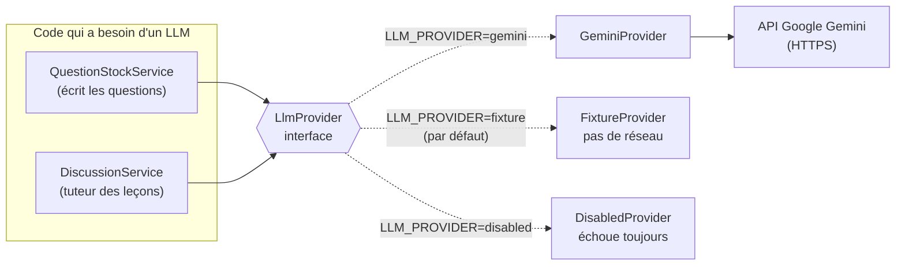
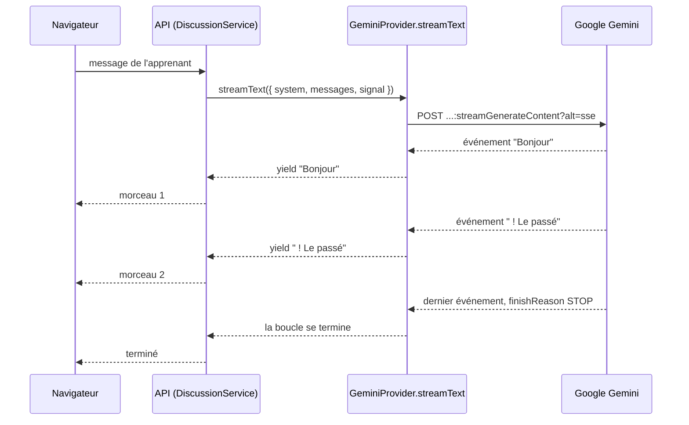
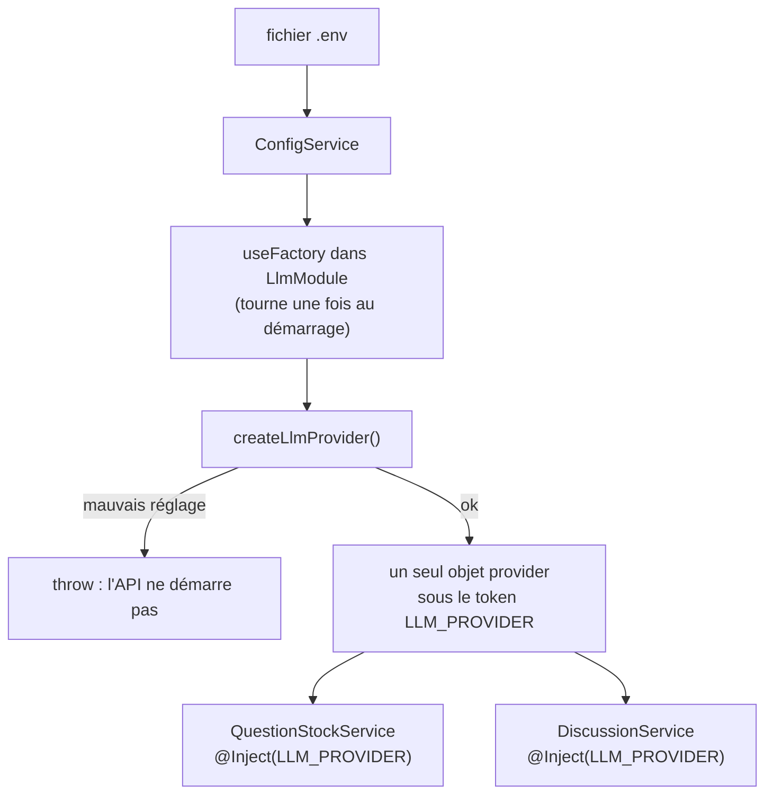
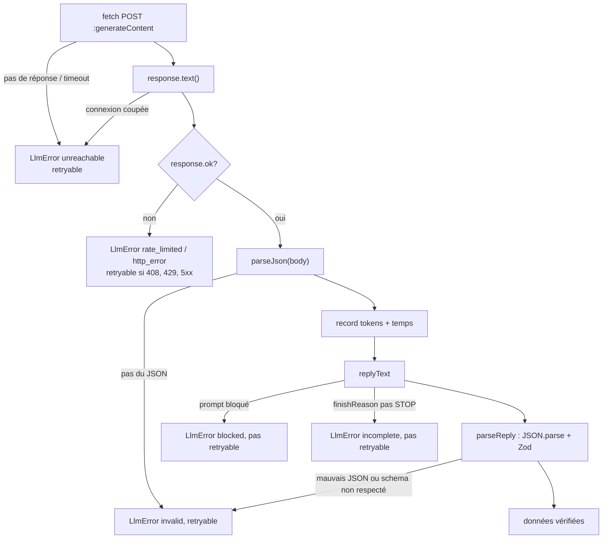

# Chapitre 6 — Parler à un modèle d'IA

Dans ce chapitre :

- Ce qu'est un LLM, et à quoi l'API s'en sert
- Le pattern "provider" : une interface, plusieurs classes derrière (comme des adaptateurs de prise électrique)
- Ce qu'est le streaming, et pourquoi la réponse du tuteur est streamée
- [llm.provider.ts](../../apps/api/src/llm/llm.provider.ts) : le contrat et le type d'erreur
- [llm.factory.ts](../../apps/api/src/llm/llm.factory.ts) et [llm.module.ts](../../apps/api/src/llm/llm.module.ts) : comment un provider est choisi à partir du fichier `.env`
- [gemini.provider.ts](../../apps/api/src/llm/gemini.provider.ts) : le vrai (requêtes HTTP, streaming, erreurs, timeouts, métriques)
- [fixture.provider.ts](../../apps/api/src/llm/fixture.provider.ts) et [disabled.provider.ts](../../apps/api/src/llm/disabled.provider.ts) : les faux, pour les tests et pour une stack sans clé
- Qui utilise le LLM dans le reste de l'API

---

## La vue d'ensemble

### C'est quoi, un LLM ?

Un **LLM** (Large Language Model, grand modèle de langage) est un programme entraîné sur une énorme quantité de
texte. Tu lui envoies du texte (un **prompt**), et il te répond par du texte. Gemini (de Google), GPT et Claude sont
des LLM. On ne fait pas tourner le modèle nous-mêmes : il tourne sur les serveurs de Google, et on l'appelle en HTTP,
comme n'importe quelle autre API web.

Le modèle lit et écrit des **tokens**. Un token est un morceau de mot (environ 3 à 4 lettres en anglais). Google
facture au nombre de tokens : les tokens qu'on envoie (le prompt) plus les tokens que le modèle écrit (la sortie).

Dans ce projet, un prompt a deux parties :

| Partie   | Ce que c'est                                                    | Exemple                                   |
| -------- | --------------------------------------------------------------- | ----------------------------------------- |
| `system` | Les règles et le rôle du modèle. Pareil pour beaucoup d'appels. | "You are an expert CEFR exam designer..." |
| `user`   | La demande précise (ou la conversation, pour le tuteur).        | "Write 13 B1 grammar questions in "fr"."  |

L'API utilise le LLM pour **deux tâches** :

1. **Écrire les questions du test de niveau** (chapitre 7). La réponse doit être du JSON avec une forme exacte, pour
   que le code puisse l'enregistrer dans la base de données. C'est `generateStructured`.
2. **Le tuteur des leçons** (chapitre 8). L'apprenant pose une question sur la leçon, et le modèle répond en texte
   libre, affiché mot par mot. C'est `streamText`.

### Le pattern provider : un adaptateur de prise

Pense à un adaptateur de voyage. Le chargeur de ton ordinateur a une seule prise. En France, en Suisse ou au
Royaume-Uni, la prise murale est différente, alors tu mets un adaptateur entre les deux. Le chargeur ne change
jamais : seul l'adaptateur change.

Ici :

- Le **chargeur**, c'est le reste de l'API (le stock de questions, le tuteur). Il ne connaît qu'une seule "forme de
  prise" : l'interface `LlmProvider`.
- Les **adaptateurs**, ce sont les classes qui suivent cette interface : `GeminiProvider`, `FixtureProvider`,
  `DisabledProvider`.
- Le **mur**, c'est ce qu'il y a vraiment derrière : les serveurs de Google, ou rien du tout.



Pourquoi le construire comme ça ?

- **Changer de fournisseur, c'est un changement de config plus un fichier.** Le fichier `.env.example` le dit : "App
  code calls the LlmProvider interface, so swapping vendors is a config change plus one file." (le code de l'app
  appelle l'interface LlmProvider, donc changer de fournisseur, c'est un changement de config plus un fichier).
- **Les tests et le développement local n'ont besoin ni de clé ni d'argent.** Avec la fixture, rien ne part sur le
  réseau.
- **Un seul endroit pour les détails de Google.** Le HTTP, le format JSON de Google et ses codes d'erreur vivent
  tous dans un seul fichier. Le reste du code ne les voit jamais.

### Le streaming : les mots au fur et à mesure

Un appel HTTP normal attend toute la réponse, puis la reçoit d'un coup. Pour une réponse du tuteur, ça peut prendre
plusieurs secondes, et la page aurait l'air figée.

Le **streaming** veut dire que le serveur envoie la réponse en petits morceaux, au fur et à mesure que le modèle les
écrit, sur une seule connexion qui reste ouverte. Google utilise pour ça les **Server-Sent Events (SSE)** : un format
texte où chaque événement est quelques lignes qui commencent par `data:`, et une ligne vide termine l'événement.

```text
data: {"candidates":[{"content":{"parts":[{"text":"Bonjour"}]}}]}

data: {"candidates":[{"content":{"parts":[{"text":" ! Le passé"}]}}]}

data: {"candidates":[{"content":{"parts":[{"text":" composé..."}]}, "finishReason":"STOP"}]}

```

En TypeScript, un flux de morceaux est un **`AsyncIterable<string>`** : quelque chose qu'on lit avec
`for await (const piece of stream) { ... }`. Chaque tour de boucle attend le morceau suivant. Les fonctions écrites
avec `async *` (un **générateur async**) créent un tel flux : chaque `yield` donne un morceau à la boucle.



---

## Les fichiers de `src/llm`

```text
apps/api/src/llm/
├── llm.provider.ts             the contract (interface), request types, LlmError
├── llm.factory.ts              picks one provider from the .env settings
├── llm.module.ts               the Nest module that offers the provider to others
├── gemini.provider.ts          the real provider: Google Gemini over HTTP
├── fixture.provider.ts         fake provider: no network (default)
├── disabled.provider.ts        fake provider: everything fails
├── GEMINI_PROVIDER.md          long French explanation of gemini.provider.ts
└── *.spec.ts                   unit tests (one per file, two for Gemini)
```

On les lit dans l'ordre où l'app les utilise : d'abord le contrat, puis comment l'app choisit un provider au
démarrage, puis chaque provider.

---

## `llm.provider.ts` — le contrat

[llm.provider.ts](../../apps/api/src/llm/llm.provider.ts) ne contient aucune logique. Il décrit la "forme de
prise" que chaque provider doit avoir. Il exporte :

| Export              | Genre           | Rôle                                                                             |
| ------------------- | --------------- | -------------------------------------------------------------------------------- |
| `LLM_PROVIDER`      | valeur `Symbol` | Le nom (token) que les autres classes utilisent pour demander le provider à Nest |
| `LlmPurpose`        | type            | À quoi sert un appel, utilisé dans les logs et les métriques                     |
| `StructuredRequest` | interface       | Ce qu'on envoie pour recevoir du JSON                                            |
| `LlmMessage`        | interface       | Un tour d'une conversation                                                       |
| `StreamRequest`     | interface       | Ce qu'on envoie pour recevoir une réponse texte streamée                         |
| `LlmProvider`       | interface       | Le contrat : deux méthodes                                                       |
| `LlmFailure`        | type            | La liste fixe des raisons d'échec                                                |
| `LlmError`          | classe          | L'erreur que chaque provider lance                                               |

### Le token d'injection

```ts
// The name other classes use to ask Nest for the LLM provider.
// It is a Symbol, a unique value that still exists at runtime,
// because the LlmProvider interface is erased when the code is compiled.
export const LLM_PROVIDER = Symbol("LLM_PROVIDER");
```

Au chapitre 1, on a vu que Nest trouve quoi injecter grâce à la **classe** d'un paramètre du constructeur. Une
interface ne peut pas faire ça : TypeScript supprime les interfaces quand il compile en JavaScript, donc à
l'exécution `LlmProvider` n'existe pas. Alors on donne à Nest une vraie valeur comme nom. Un `Symbol` est une valeur
unique : aucun autre code ne peut créer la même par erreur. Une classe demande le provider avec
`@Inject(LLM_PROVIDER)`.

### Le purpose

```ts
export type LlmPurpose = `question-batch:${QuestionCategory}` | "lesson-discussion";
```

C'est un **template literal type**. `QuestionCategory` vaut `'grammar' | 'vocabulary' | 'reading'`, donc les valeurs
autorisées sont exactement `question-batch:grammar`, `question-batch:vocabulary`, `question-batch:reading` et
`lesson-discussion`. Une faute de frappe ne compile pas. Le purpose apparaît dans les logs et étiquette les
métriques, donc tu peux voir ce que chaque appel a coûté.

### Les deux requêtes

```ts
export interface StructuredRequest<S extends z.ZodType> {
  purpose: LlmPurpose;
  /** The rules and the role of the model, for example "You are an exam designer". */
  system: string;
  /** The precise request, for example "Write 13 A1 grammar questions". */
  user: string;
  /** Describes the JSON we expect back, and checks the reply against it. */
  schema: S;
}
```

`S` est un **generic** : un type rempli à chaque appel. `S extends z.ZodType` veut dire "S doit être un schema Zod".
Le schema fait deux choses : il dit au modèle quelle forme de JSON écrire, et il vérifie la réponse.

```ts
export interface StreamRequest {
  purpose: LlmPurpose;
  system: string;
  /** The conversation so far, oldest first. The last one is the learner's new message. */
  messages: LlmMessage[];
  /** The longest answer we pay for, in tokens. The model stops there, mid-sentence if it must. */
  maxOutputTokens: number;
  signal: AbortSignal;
}
```

`LlmMessage` vaut `{ role: 'user' | 'assistant'; text: string }`. Ces noms sont les nôtres ; chaque provider les
traduit (Gemini appelle le modèle "model").

`signal` est un **`AbortSignal`** : un petit objet qui peut dire "arrête maintenant". La route le déclenche quand
l'apprenant ferme la page. Le commentaire explique pourquoi il est obligatoire et pas optionnel : "a stream nobody
can stop keeps spending tokens for no one" (un stream que personne ne peut arrêter continue de dépenser des tokens
pour personne).

### Le contrat

```ts
export interface LlmProvider {
  generateStructured<S extends z.ZodType>(request: StructuredRequest<S>): Promise<z.output<S>>;

  streamText(request: StreamRequest): AsyncIterable<string>;
}
```

- `generateStructured` renvoie `Promise<z.output<S>>` : "plus tard, un objet qui a la forme du schema, déjà
  vérifié". TypeScript lit le type à partir du schema que tu passes, donc personne n'écrit le type du résultat à la
  main.
- `streamText` renvoie un `AsyncIterable<string>` : des morceaux de texte, lus avec `for await`. Un échec est lancé
  **depuis la boucle**, peut-être après que quelques morceaux ont déjà été envoyés. Si l'appelant annule le signal,
  la boucle se termine avec une `AbortError`, pas une `LlmError` : "the caller asked for it, the LLM did not fail"
  (c'est l'appelant qui l'a demandé, le LLM n'a pas échoué).

### `LlmFailure` et `LlmError`

```ts
export type LlmFailure =
  "unreachable" | "rate_limited" | "http_error" | "blocked" | "incomplete" | "invalid" | "disabled";

export class LlmError extends Error {
  constructor(
    message: string,
    /** Whether sending the same request again may succeed. */
    readonly retryable: boolean,
    /** Why it failed, for the metrics. The message says it to a person. */
    readonly reason: LlmFailure,
  ) {
    super(message);
    this.name = "LlmError";
  }
}
```

Chaque échec d'un provider est une `LlmError` avec trois choses :

| Champ       | Pour qui                          | Exemple                                 |
| ----------- | --------------------------------- | --------------------------------------- |
| `message`   | une personne qui lit les logs     | `Gemini 429: {"error": ...}`            |
| `retryable` | l'appelant                        | `true` : un deuxième essai peut marcher |
| `reason`    | les métriques, les codes d'erreur | `rate_limited`                          |

`reason` est une liste fixe, jamais du texte libre, parce que les métriques comptent les échecs par raison : du texte
libre créerait une nouvelle série de métriques pour chaque message. Le sens de chaque raison :

| Raison         | Sens                                                                                          |
| -------------- | --------------------------------------------------------------------------------------------- |
| `unreachable`  | Aucune réponse HTTP du tout (réseau, DNS, timeout), ou la connexion a coupé en cours de route |
| `rate_limited` | HTTP 429 : trop de requêtes pour notre clé                                                    |
| `http_error`   | Tout autre statut hors 2xx                                                                    |
| `blocked`      | Les filtres de sécurité de Google ont refusé le prompt ou arrêté la réponse                   |
| `incomplete`   | La réponse a été coupée pour une autre raison                                                 |
| `invalid`      | La réponse n'est pas du JSON, ou ne respecte pas le schema                                    |
| `disabled`     | Pas de vrai LLM derrière le provider (questions de la fixture, `LLM_PROVIDER=disabled`)       |

`LlmError` est une **classe**, pas une interface, donc elle existe à l'exécution et les appelants peuvent tester
`error instanceof LlmError`.

---

## `llm.factory.ts` — choisir un provider

[llm.factory.ts](../../apps/api/src/llm/llm.factory.ts) exporte une seule fonction, `createLlmProvider`. Elle lit
trois réglages et construit le bon provider.

| Réglage        | Valeurs                                   | Par défaut         |
| -------------- | ----------------------------------------- | ------------------ |
| `LLM_PROVIDER` | `fixture`, `gemini`, `disabled`           | `fixture`          |
| `LLM_API_KEY`  | la clé Gemini (obligatoire pour `gemini`) | aucune             |
| `LLM_MODEL`    | un id de modèle Gemini                    | `gemini-3.6-flash` |

```ts
export function createLlmProvider({
  LLM_PROVIDER = "fixture",
  LLM_API_KEY,
  LLM_MODEL,
}: LlmEnv): LlmProvider {
  switch (LLM_PROVIDER) {
    case "fixture":
      showProvider("fixture", "none");
      return new FixtureProvider();
    case "gemini": {
      if (!LLM_API_KEY) throw new Error("LLM_PROVIDER=gemini needs LLM_API_KEY. See .env.example.");
      // The braces after "case" give this "model" its own scope inside the switch.
      const model = LLM_MODEL || DEFAULT_GEMINI_MODEL;
      showProvider("gemini", model);
      return new GeminiProvider({ apiKey: LLM_API_KEY, model });
    }
    case "disabled":
      showProvider("disabled", "none");
      return new DisabledProvider();
    default:
      throw new Error(
        `LLM_PROVIDER must be "fixture", "gemini" or "disabled", got "${LLM_PROVIDER}". See .env.example.`,
      );
  }
}
```

Comment ça marche :

- Les `{ ... }` dans la liste des paramètres **déstructurent** l'objet des réglages : chaque clé devient une
  variable. `LLM_PROVIDER = 'fixture'` est une valeur par défaut, donc sans `.env` l'API démarre avec la fixture :
  pas de réseau, pas de coût.
- Le type de retour est `LlmProvider`. L'appelant ne sait pas quelle classe il a reçue. C'est tout l'intérêt.
- **Elle lance une erreur sur un mauvais réglage.** La fonction tourne une seule fois, au démarrage de l'API. Une
  clé manquante ou une faute de frappe dans `LLM_PROVIDER` arrête le démarrage avec un message clair. Sans ça, le
  problème n'apparaîtrait que plus tard, au premier restock, pendant que les apprenants utilisent l'app.

`showProvider` règle une métrique, `ft_llm_provider_info{provider, model} = 1`, pour que le dashboard montre quel
provider tourne. Elle appelle d'abord `reset()`, donc un deuxième appel (dans un test) laisse un seul provider, pas
deux.

[llm.factory.spec.ts](../../apps/api/src/llm/llm.factory.spec.ts) vérifie chaque cas : la fixture par défaut, le
provider désactivé, Gemini avec sa clé et son modèle, et les erreurs.

---

## `llm.module.ts` — offrir le provider à l'app

[llm.module.ts](../../apps/api/src/llm/llm.module.ts) est un petit module Nest. Il utilise un **factory
provider** : au lieu de donner à Nest une classe à construire, on lui donne une fonction à appeler.

```ts
@Module({
  providers: [
    {
      provide: LLM_PROVIDER,
      inject: [ConfigService],
      useFactory: (config: ConfigService) =>
        createLlmProvider({
          LLM_PROVIDER: config.get("LLM_PROVIDER"),
          LLM_API_KEY: config.get("LLM_API_KEY"),
          LLM_MODEL: config.get("LLM_MODEL"),
        }),
    },
  ],
  exports: [LLM_PROVIDER],
})
export class LlmModule {}
```

- `provide: LLM_PROVIDER` : le token que les autres classes demandent.
- `inject: [ConfigService]` : ce que Nest passe à la factory. `ConfigService` lit le fichier `.env` (chapitre 2).
- `useFactory` : Nest l'appelle **une seule fois au démarrage**. Ce qu'elle renvoie est l'unique objet provider que
  toute l'API partage.
- `exports: [LLM_PROVIDER]` : les modules qui importent `LlmModule` peuvent l'injecter aussi.

C'est pour ça que `GeminiProvider` n'a pas de `@Injectable()` : Nest ne le construit jamais à partir de sa classe.
La factory appelle `new GeminiProvider({ apiKey, model })` elle-même, après avoir vérifié la clé.



[llm.module.spec.ts](../../apps/api/src/llm/llm.module.spec.ts) construit le vrai module avec un faux
`ConfigService` : il vérifie que le provider nommé dans `LLM_PROVIDER` est construit, que la fixture est la valeur
par défaut, et que Gemini sans clé échoue.

---

## `gemini.provider.ts` — le vrai provider

[gemini.provider.ts](../../apps/api/src/llm/gemini.provider.ts) est le plus gros fichier. Il appelle l'API Gemini
de Google en HTTP. Le document en français [GEMINI_PROVIDER.md](../../apps/api/src/llm/GEMINI_PROVIDER.md) juste à
côté l'explique ligne par ligne, avec un historique des changements depuis la PR #69. Voici la visite.

Le fichier a trois parties :

1. **En haut** : des constantes et l'interface `GeminiReply` (la partie du JSON de Google qu'on lit).
2. **La classe** : deux méthodes publiques (`generateStructured`, `streamText`) et trois privées (`send`, `stream`,
   `record`).
3. **En bas** : de petites fonctions d'aide privées (`requestBody`, `streamBody`, `unreachable`, `isRetryable`,
   `replyText`, `answerText`, `parseReply`, `parseJson`, `sseData`, `eventData`).

### Les constantes

```ts
const API = "https://generativelanguage.googleapis.com/v1beta/models";
// How long we wait for Gemini before giving up: 90 seconds. "90_000" is just 90000,
// the "_" only makes the number easier to read. A free key waited 73 to 83 s for
// its first word on 2026-11-18, where 2 to 40 s was usual before.
const TIMEOUT_MS = 90_000;
```

- `API` est l'adresse de base. Chaque appel ajoute `/<model>:generateContent` (une réponse) ou
  `/<model>:streamGenerateContent?alt=sse` (réponse streamée).
- `TIMEOUT_MS` : on abandonne après 90 secondes. Le commentaire donne la vraie raison de ce grand nombre : on a
  mesuré une clé gratuite qui attendait plus de 70 secondes.
- `OUTCOMES`, `TOKEN_TYPES`, `PURPOSES` : les listes d'étiquettes des métriques (voir "Le constructeur : les métriques démarrent à zéro" et "`record`" plus bas).
- `FILTERED` : les finish reasons qui veulent dire que les filtres de Google ont arrêté la réponse (`SAFETY`,
  `PROHIBITED_CONTENT`, `BLOCKLIST`, `SPII`, `RECITATION`).

### `GeminiReply` : la réponse de Google, pour la partie qu'on lit

```ts
interface GeminiReply {
  promptFeedback?: { blockReason?: string };
  candidates?: {
    finishReason?: string;
    content?: { parts?: { text?: string; thought?: boolean }[] };
  }[];
  usageMetadata?: {
    promptTokenCount?: number;
    candidatesTokenCount?: number;
    thoughtsTokenCount?: number;
    totalTokenCount?: number;
  };
}
```

Chaque champ a un `?` parce que ce JSON vient de l'extérieur et qu'on ne lui fait pas confiance. TypeScript oblige
alors le code à vérifier chaque champ (`?.`, `??`) avant de l'utiliser.

| Champ                        | Sens                                                                                                             |
| ---------------------------- | ---------------------------------------------------------------------------------------------------------------- |
| `promptFeedback.blockReason` | Rempli quand Google a refusé notre prompt (filtres de sécurité)                                                  |
| `candidates[0]`              | La réponse (on en demande une)                                                                                   |
| `finishReason`               | Pourquoi le modèle s'est arrêté. `"STOP"` = terminé normalement                                                  |
| `content.parts`              | Le texte, peut-être coupé en plusieurs parties. `thought: true` marque le raisonnement du modèle, pas la réponse |
| `usageMetadata`              | Le nombre de tokens : ce qu'on paie                                                                              |

Note : pour `generateStructured`, le texte du modèle est **lui-même une chaîne JSON**. Il y a donc deux
`JSON.parse` : un pour l'enveloppe de Google, un pour le texte du modèle.

### Le constructeur : les métriques démarrent à zéro

```ts
constructor(private readonly options: { apiKey: string; model: string }) {
  for (const purpose of PURPOSES) {
    for (const outcome of OUTCOMES) {
      llmRequests.inc({ provider: 'gemini', model: options.model, purpose, outcome }, 0);
    }
    for (const type of TOKEN_TYPES) {
      llmTokens.inc({ provider: 'gemini', model: options.model, purpose, type }, 0);
    }
  }
}
```

`private readonly options` dans la liste des paramètres déclare un champ et le remplit en une seule étape. La classe
ne lit jamais le `.env` elle-même, donc un test peut la construire avec
`new GeminiProvider({ apiKey: 'test', model: 'x' })`.

Les boucles créent chaque série de métriques avec la valeur 0. Prometheus (chapitre 3) calcule des taux à partir de
la **différence** entre deux lectures ; un compteur qui apparaît directement à 1 n'a pas d'"avant", donc son premier
appel serait invisible.

### `generateStructured` : mesurer, puis `send`

```ts
async generateStructured<S extends z.ZodType>(
  request: StructuredRequest<S>,
): Promise<z.output<S>> {
  const labels = { provider: 'gemini', model: this.options.model, purpose: request.purpose };
  // startTimer starts a clock; calling stop() records the time since then.
  const stop = llmRequestDuration.startTimer(labels);
  try {
    const reply = await this.send(request);
    llmRequests.inc({ ...labels, outcome: 'ok' });
    return reply;
  } catch (error) {
    // send() only throws LlmErrors, each with its reason.
    if (error instanceof LlmError) llmRequests.inc({ ...labels, outcome: error.reason });
    throw error;
  } finally {
    // "finally" runs either way, so failures are timed too.
    stop();
  }
}
```

La méthode publique ne fait que **mesurer** : combien de temps, et comment ça s'est terminé (`ok` ou la `reason` de
l'erreur). Puis elle relance la même erreur, donc les métriques ne changent jamais le comportement. Le travail se
fait dans `send`.

### `send` : un appel HTTP, étape par étape

```ts
const response = await fetch(`${API}/${model}:generateContent`, {
  method: "POST",
  headers: { "content-type": "application/json", "x-goog-api-key": apiKey },
  body: JSON.stringify(requestBody(request)),
  signal: AbortSignal.timeout(TIMEOUT_MS),
}).catch(unreachable);
const body = await response.text().catch(unreachable);
if (!response.ok) {
  throw new LlmError(
    `Gemini ${response.status}: ${body}`,
    isRetryable(response.status),
    response.status === 429 ? "rate_limited" : "http_error",
  );
}

const reply = parseJson(body, "response") as GeminiReply;
// Counted before the reply is checked: one that fails the check was still billed.
this.record(request.purpose, reply.usageMetadata, started);
return parseReply(request.schema, replyText(reply));
```

1. **`fetch`** envoie la requête. La clé va dans un **header** (`x-goog-api-key`), pas dans l'URL : les URL finissent
   souvent dans les logs. `AbortSignal.timeout(TIMEOUT_MS)` annule l'appel après 90 s.
2. `fetch` ne rejette que quand il n'y a **aucune réponse HTTP du tout** (pas de réseau, erreur DNS, timeout). Un 500
   ou un 429 reste une réponse. `.catch(unreachable)` transforme un rejet en `LlmError` retryable (qu'on peut
   réessayer).
3. Le body est lu comme **texte**, pas avec `response.json()`, pour qu'une page d'erreur puisse quand même être mise
   dans le message. Le timeout couvre aussi cette étape, donc elle a le même `.catch(unreachable)`.
4. Un statut hors de 200–299 lance une erreur. `isRetryable` décide si un deuxième essai a du sens.
5. Le JSON de Google est parsé, les tokens sont loggés et comptés (`record`), puis le texte du modèle est extrait
   (`replyText`) et vérifié avec le schema (`parseReply`).



### `requestBody` : ce que Google reçoit

```ts
function requestBody({ system, user, schema }: StructuredRequest<z.ZodType>) {
  return {
    systemInstruction: { parts: [{ text: system }] },
    contents: [{ role: "user", parts: [{ text: user }] }],
    generationConfig: {
      responseMimeType: "application/json",
      responseJsonSchema: z.toJSONSchema(schema),
    },
  };
}
```

`z.toJSONSchema(schema)` transforme notre schema Zod en **JSON Schema**, un format standard qui décrit une forme de
JSON. Gemini écrit alors du JSON avec exactement ces champs, ces types et ces longueurs de tableaux. Donc le prompt
n'a pas besoin de décrire le format avec des mots.

Une limite, d'après le commentaire : les règles écrites avec `.refine()` de Zod (comme "la réponse est une des
options") ne peuvent pas être transformées en JSON Schema. Gemini ne les voit jamais. Elles sont vérifiées seulement
plus tard, dans `parseReply`.

### Les erreurs : réessayer ou pas ?

```ts
function isRetryable(status: number): boolean {
  return status === 408 || status === 429 || status >= 500;
}
```

408 (timeout), 429 (trop de requêtes) et 5xx (le serveur de Google a échoué) sont temporaires. Un 400, 401, 403 ou
404 échoue de la même façon deux fois.

`replyText` vérifie la réponse avant de l'utiliser :

```ts
function replyText(reply: GeminiReply): string {
  // Gemini refused to answer our prompt at all (safety filters).
  const blocked = reply.promptFeedback?.blockReason;
  if (blocked) throw new LlmError(`Gemini blocked the prompt: ${blocked}`, false, "blocked");

  const candidate = reply.candidates?.[0];
  if (candidate?.finishReason !== "STOP") {
    const reason = candidate ? (candidate.finishReason ?? "no finish reason") : "no candidate";
    throw new LlmError(`Gemini stopped early: ${reason}`, false, "incomplete");
  }
  return answerText(candidate);
}
```

Un prompt bloqué ou une réponse coupée (`MAX_TOKENS`, `SAFETY`) revient pareil si on réessaie : pas retryable.

`answerText` colle les parties de texte ensemble et **enlève les parties de raisonnement** (`thought: true`). C'est
la "réflexion" du modèle, pas la réponse, et elles casseraient `JSON.parse`.

`parseReply` fait `JSON.parse` puis `schema.safeParse`. `safeParse` ne lance pas d'erreur : il renvoie
`{ success: true, data }` ou `{ success: false, error }`. Un échec devient une erreur `invalid` **retryable** : le
modèle écrit quelque chose de différent à chaque fois, donc le prochain essai peut être bon. `z.prettifyError` rend
l'erreur Zod lisible dans les logs.

`parseJson` est un `JSON.parse` qui lance une `LlmError` au lieu d'une `SyntaxError`. Elle est retryable aussi : un
200 dont le body n'est pas du JSON est en général une page d'erreur d'un proxy sur le chemin.

Résumé de toutes les erreurs :

| Situation                                                  | Raison         | Retryable |
| ---------------------------------------------------------- | -------------- | --------- |
| Pas de réseau, DNS, timeout, connexion coupée              | `unreachable`  | oui       |
| HTTP 429                                                   | `rate_limited` | oui       |
| HTTP 408 ou 5xx                                            | `http_error`   | oui       |
| Autre non-2xx (400, 401, 403, 404...)                      | `http_error`   | non       |
| Le body ou le texte du modèle n'est pas du JSON            | `invalid`      | oui       |
| Le JSON ne respecte pas le schema                          | `invalid`      | oui       |
| Prompt bloqué                                              | `blocked`      | non       |
| Pas de candidat, ou arrêté avant `STOP`                    | `incomplete`   | non       |
| Streamé : arrêté par un filtre                             | `blocked`      | non       |
| Streamé : autre arrêt précoce, pas de `STOP`, réponse vide | `incomplete`   | non       |

C'est le provider qui décide `retryable`, parce que c'est lui qui connaît le mieux Google. L'appelant ne fait que
lire le flag (voir `QuestionStockService` au chapitre 7).

### `record` : logs et nombre de tokens

```ts
this.logger.log(
  `${purpose} on ${model}: ${usage?.promptTokenCount ?? "?"} in, ` +
    `${usage?.candidatesTokenCount ?? "?"} out, ${thinking} thinking, ` +
    `${usage?.totalTokenCount ?? "?"} total tokens, ` +
    `${Date.now() - started} ms`,
);
```

Une ligne de log par appel, par exemple :

```text
[GeminiProvider] question-batch:grammar on gemini-3.6-flash: 5200 in, 1800 out, 0 thinking, 7000 total tokens, 8432 ms
```

Ensuite, elle ajoute les nombres de tokens à la métrique `llmTokens`. Un nombre que Google n'a pas donné est ignoré,
pas compté comme 0. `record` est partagée par `send` et `stream`, donc les deux loggent et comptent de la même façon.

### `streamText` et `stream` : la réponse du tuteur

`streamText` a la même forme "mesurer, puis faire le travail" que `generateStructured`, mais sous forme de
générateur async :

```ts
async *streamText(request: StreamRequest): AsyncIterable<string> {
  const labels = { provider: 'gemini', model: this.options.model, purpose: request.purpose };
  const stop = llmRequestDuration.startTimer(labels);
  try {
    yield* this.stream(request);
    llmRequests.inc({ ...labels, outcome: 'ok' });
  } catch (error) {
    if (error instanceof LlmError) llmRequests.inc({ ...labels, outcome: error.reason });
    throw error;
  } finally {
    stop();
  }
}
```

`yield*` fait passer chaque morceau que `stream()` donne. L'appel ne compte comme `ok` qu'une fois que toute la
réponse est passée. Deux fins ne comptent aucun résultat, seulement le temps : l'apprenant qui part (une
`AbortError`), et un appelant qui arrête de lire plus tôt.

Le corps de `stream` :

```ts
// Two reasons to cancel, whichever comes first: the learner left (request.signal),
// or the whole answer took longer than TIMEOUT_MS.
const signal = AbortSignal.any([request.signal, AbortSignal.timeout(TIMEOUT_MS)]);
// What a failed read becomes. If the learner left, the error stays as it is: it is
// not Gemini's failure. Anything else (network, timeout, a cut connection) is unreachable.
const lost = (error: Error): never => {
  if (request.signal.aborted) throw error;
  return unreachable(error);
};
```

- `AbortSignal.any` crée un seul signal à partir de deux : le signal de l'apprenant et le timeout de 90 s. Note que
  le timeout couvre **toute** la réponse, pas seulement le premier octet.
- `lost` décide ce que devient une lecture ratée : l'annulation venant de l'apprenant passe sans changement, tout le
  reste devient `unreachable`.

Ensuite, elle fait un POST vers `:streamGenerateContent?alt=sse` avec `streamBody(request)`, et lit les événements :

```ts
for await (const data of sseData(response.body, lost)) {
  const reply = parseJson(data, "response") as GeminiReply;
  usage = reply.usageMetadata ?? usage;
  const blocked = reply.promptFeedback?.blockReason;
  if (blocked) throw new LlmError(`Gemini blocked the prompt: ${blocked}`, false, "blocked");

  const candidate = reply.candidates?.[0];
  const text = answerText(candidate);
  if (text) {
    wrote = true;
    yield text;
  }
  const reason = candidate?.finishReason;
  if (reason && reason !== "STOP") {
    const failure = FILTERED.has(reason) ? "blocked" : "incomplete";
    throw new LlmError(`Gemini stopped early: ${reason}`, false, failure);
  }
  if (reason === "STOP") finished = true;
}
```

Chaque événement est un petit `GeminiReply`. Son texte est transmis **tout de suite** (`yield`). Seul le dernier
événement a un `finishReason`. Après la boucle : pas de `STOP` veut dire que Google a fermé trop tôt (`incomplete`),
et pas de texte du tout veut dire une réponse vide (`incomplete`). Un `finally` appelle `record` dans tous les cas,
même quand l'apprenant part, parce que les tokens utilisés jusque-là ont été facturés.

`streamBody` est différent de `requestBody` :

```ts
function streamBody({ system, messages, maxOutputTokens }: StreamRequest) {
  return {
    systemInstruction: { parts: [{ text: system }] },
    contents: messages.map(({ role, text }) => ({
      role: role === "assistant" ? "model" : "user",
      parts: [{ text }],
    })),
    generationConfig: { maxOutputTokens, thinkingConfig: { thinkingBudget: 0 } },
  };
}
```

- Toute la conversation est envoyée, avec `assistant` renommé en `model` (le mot de Google).
- `maxOutputTokens` limite le coût.
- `thinkingBudget: 0` coupe la "réflexion" du modèle. Le commentaire explique pourquoi : la réflexion compte dans
  `maxOutputTokens` (on a mesuré 250 à 660 tokens avant des réponses de 66 à 120), elle pourrait couper la réponse,
  et elle est facturée aussi. Une réponse courte du tuteur n'en a pas besoin.
- Pas de schema JSON : la réponse est du texte libre.

### `sseData` et `eventData` : lire le flux d'événements

Le body arrive en **paquets** réseau, et un paquet n'est pas un événement : un paquet peut contenir un événement et
demi. Donc `sseData` garde un `buffer` et ne laisse sortir que des événements complets :

```ts
const reader = body.pipeThrough(new TextDecoderStream()).getReader();
let buffer = "";
try {
  for (;;) {
    const { done, value } = await reader.read().catch(lost);
    if (done) return;
    buffer = (buffer + value).replace(/\r\n/g, "\n");
    let end = buffer.indexOf("\n\n");
    while (end !== -1) {
      const data = eventData(buffer.slice(0, end));
      buffer = buffer.slice(end + 2);
      if (data !== undefined) yield data;
      end = buffer.indexOf("\n\n");
    }
  }
} finally {
  // cancel() rejects on a body that already failed; there is nothing left to close then.
  await reader.cancel().catch(() => undefined);
}
```

- `TextDecoderStream` transforme les octets en texte, et garde de côté un caractère coupé entre deux paquets (`é`
  fait deux octets en UTF-8) jusqu'à ce que son deuxième octet arrive.
- `\r\n` devient `\n`, parce que SSE autorise les deux fins de ligne.
- Un événement se termine par une ligne vide (`\n\n`). Le texte après le dernier attend le paquet suivant ; si le
  body se termine, il est jeté (le standard SSE dit qu'un événement pas fini ne compte pas).
- `finally` annule le body quand le lecteur s'arrête plus tôt, pour que la connexion vers Google se ferme.

`eventData` prend les lignes `data:` d'un événement, enlève `data:` et un espace optionnel, et les joint avec `\n`.
Un événement sans data (une ligne de commentaire `: ...` qui garde la connexion en vie) donne `undefined` et est
ignoré.

### Les tests de Gemini

- [gemini.provider.spec.ts](../../apps/api/src/llm/gemini.provider.spec.ts) mocke `fetch` et vérifie
  `generateStructured` : la clé est dans un header et jamais dans l'URL, le JSON Schema est envoyé, le timeout de
  90 s, l'assemblage des parties sans les réflexions, les logs, quelles erreurs sont retryable, et les métriques.
- [gemini.provider.stream.spec.ts](../../apps/api/src/llm/gemini.provider.stream.spec.ts) vérifie `streamText` :
  l'endpoint SSE, les événements coupés entre des paquets (même au milieu d'un caractère), les commentaires ignorés,
  chaque arrêt précoce, l'apprenant qui part (une `AbortError`, aucun résultat compté, body annulé), et les
  métriques.

---

## `fixture.provider.ts` — de fausses réponses, pour les tests et le développement

[fixture.provider.ts](../../apps/api/src/llm/fixture.provider.ts) est le provider **par défaut**. Il ne touche
jamais le réseau. Pourquoi existe-t-il ?

- **Pas de clé, pas de coût.** Un nouveau développeur peut faire tourner toute l'app sans compte Google.
- **Tests et CI.** Le fichier `.env.example` dit "CI only runs fixture" (la CI ne tourne qu'avec la fixture). Les
  tests ne doivent pas dépendre de la disponibilité de Google, ni dépenser de l'argent.
- **Les chemins d'erreur à la demande.** Des mots spéciaux le font échouer exprès, pour que les tests e2e (et la
  soutenance du projet) puissent montrer chaque erreur sans réseau.

### Il n'écrit aucune question

```ts
async generateStructured(): Promise<never> {
  throw new LlmError('LLM_PROVIDER=fixture writes no questions', false, 'disabled');
}
```

C'est un choix voulu, expliqué dans le commentaire de la classe : "It writes no questions, because a canned one in
the bank is served to learners as real." (il n'écrit aucune question, parce qu'une question toute faite dans la
banque serait servie aux apprenants comme une vraie). Donc un restock avec la fixture échoue toujours, comme une
panne du LLM, et le test de niveau se rabat sur les questions que l'apprenant a vues il y a le plus longtemps
(chapitre 7).

- `Promise<never>` : la promesse n'obtient jamais de valeur, elle est seulement rejetée. `never` convient à
  n'importe quel type, donc ça respecte quand même le contrat. La méthode ne prend aucun paramètre non plus : une
  méthode qui utilise moins de paramètres convient quand même.
- `retryable: false` : redemander échouerait de la même façon.
- `reason: 'disabled'` : l'alerte de restock ignore ces échecs ; sur une stack sans clé, ils sont normaux.

### Il répond bien au tuteur

```ts
export const FIXTURE_ANSWER = [
  "This is the fixture tutor. ",
  "It gives the same answer to every question. ",
  "Set LLM_PROVIDER=gemini for a real one.",
];

export const FIXTURE_FAILURES = {
  /** Sends part of the answer, then the connection drops. */
  midstream: "#fail-midstream",
  /** No answer comes in time. */
  timeout: "#timeout",
  /** The prompt is refused before any text. */
  blocked: "#blocked",
} as const;
```

Une réponse fixe du tuteur ne fait pas de mal : "it is never stored and says what it is" (elle n'est jamais
enregistrée et dit ce qu'elle est).

```ts
async *streamText({ messages, signal }: StreamRequest): AsyncIterable<string> {
  // "?." because the list could be empty; "?? ''" then gives a text with no word in it.
  const last = messages.at(-1)?.text ?? '';
  if (last.includes(FIXTURE_FAILURES.blocked)) {
    throw new LlmError('Fixture blocked the prompt', false, 'blocked');
  }
  if (last.includes(FIXTURE_FAILURES.timeout)) {
    throw new LlmError('Fixture timed out', true, 'unreachable');
  }
  for (const [index, piece] of FIXTURE_ANSWER.entries()) {
    // Two pieces out, then the connection "drops": the caller has already sent part of the answer.
    if (index === 2 && last.includes(FIXTURE_FAILURES.midstream)) {
      throw new LlmError('Fixture dropped the connection midway', true, 'unreachable');
    }
    await sleep(this.delayMs, undefined, { signal });
    yield piece;
  }
}
```

- Il lit **seulement le dernier message**, donc un ancien mot d'échec dans l'historique ne fait pas échouer la
  nouvelle réponse.
- `sleep` (de `node:timers/promises`) attend `delayMs` (50 ms par défaut) avant chaque morceau, pour que la réponse
  arrive petit à petit comme une vraie, et qu'un test ait le temps de l'annuler au milieu.
- `sleep` reçoit le `signal` : quand la route annule, la pause rejette tout de suite avec une `AbortError`, comme un
  vrai appel dont la connexion est fermée.

| Le dernier message de l'apprenant contient | Ce qui se passe                                   |
| ------------------------------------------ | ------------------------------------------------- |
| `#blocked`                                 | échoue avant tout texte, raison `blocked`         |
| `#timeout`                                 | échoue avant tout texte, raison `unreachable`     |
| `#fail-midstream`                          | envoie 2 morceaux, puis échoue avec `unreachable` |
| n'importe quoi d'autre                     | envoie les 3 morceaux de `FIXTURE_ANSWER`         |

[fixture.provider.spec.ts](../../apps/api/src/llm/fixture.provider.spec.ts) vérifie chaque ligne de ce tableau,
l'annulation, et que `generateStructured` échoue toujours de façon non retryable.

---

## `disabled.provider.ts` — pas de LLM du tout

[disabled.provider.ts](../../apps/api/src/llm/disabled.provider.ts) sert à une stack qui ne doit faire tourner
**aucun** LLM, pas même le tuteur tout fait de la fixture.

```ts
export class DisabledProvider implements LlmProvider {
  async generateStructured(): Promise<never> {
    throw disabled();
  }

  // A generator that fails before its first piece: the caller's "for await" throws.
  // eslint-disable-next-line require-yield
  async *streamText(): AsyncIterable<string> {
    throw disabled();
  }
}

/** Not retryable: a second try meets the same setting. */
const disabled = () => new LlmError("LLM_PROVIDER=disabled", false, "disabled");
```

Chaque appel échoue tout de suite avec la raison `disabled`. La discussion de la leçon se termine alors avec le code
d'erreur `llm.disabled`, et un restock compte comme `llm_disabled`, que l'alerte ignore. `streamText` est un
générateur `async *` sans `yield`, donc la règle ESLint `require-yield` est désactivée pour cette ligne.

[disabled.provider.spec.ts](../../apps/api/src/llm/disabled.provider.spec.ts) vérifie que les deux méthodes
échouent.

Les trois providers côte à côte :

| Provider           | `generateStructured` (questions)    | `streamText` (tuteur)                  | Réseau |
| ------------------ | ----------------------------------- | -------------------------------------- | ------ |
| `GeminiProvider`   | vraies questions, vérifiées par Zod | vraie réponse, morceau par morceau     | oui    |
| `FixtureProvider`  | échoue toujours (`disabled`)        | réponse fixe, ou un échec à la demande | non    |
| `DisabledProvider` | échoue toujours (`disabled`)        | échoue toujours (`disabled`)           | non    |

---

## Qui utilise le LLM

Une recherche de `LLM_PROVIDER` en dehors de `src/llm` trouve exactement deux utilisateurs, chacun avec une méthode :

| Utilisateur                                                                              | Module                                         | Méthode              | Purpose                     |
| ---------------------------------------------------------------------------------------- | ---------------------------------------------- | -------------------- | --------------------------- |
| [QuestionStockService](../../apps/api/src/question-generation/question-stock.service.ts) | `QuestionGenerationModule` importe `LlmModule` | `generateStructured` | `question-batch:<category>` |
| [DiscussionService](../../apps/api/src/lessons/discussion.service.ts)                    | `LessonsModule` importe `LlmModule`            | `streamText`         | `lesson-discussion`         |

Les deux le demandent de la même façon :

```ts
@Inject(LLM_PROVIDER) private readonly llm: LlmProvider,
```

L'appel du tuteur, depuis `DiscussionService` :

```ts
answer(system: string, body: LessonDiscussionInput, signal: AbortSignal): AsyncIterable<string> {
  return this.llm.streamText({
    purpose: 'lesson-discussion',
    system,
    messages: [...body.history, { role: 'user', text: body.message }],
    maxOutputTokens: MAX_OUTPUT_TOKENS,
    signal,
  });
}
```

[discussion.controller.ts](../../apps/api/src/lessons/discussion.controller.ts) attrape une `LlmError` et
transforme sa `reason` en code d'erreur pour le navigateur. Le stock de questions lit `retryable` pour décider d'un
deuxième essai. Les deux sont expliqués dans leurs propres chapitres : [07-courses-placement.md](07-courses-placement.md)
et [08-lessons.md](08-lessons.md).

---

## Les idées clés à retenir

- Le reste de l'API ne connaît que l'interface `LlmProvider`. Il la demande à Nest avec le token `LLM_PROVIDER`
  (un `Symbol`, parce que les interfaces disparaissent à l'exécution).
- `createLlmProvider` choisit le provider **une seule fois, au démarrage**, à partir de `LLM_PROVIDER`,
  `LLM_API_KEY` et `LLM_MODEL`. Un mauvais réglage arrête le démarrage. La valeur par défaut est `fixture`.
- `generateStructured` renvoie du JSON déjà vérifié par un schema Zod. Le même schema est envoyé à Gemini sous forme
  de JSON Schema, mais les règles `.refine()` ne sont vérifiées que de notre côté.
- `streamText` renvoie un `AsyncIterable<string>` : la réponse morceau par morceau, lue à partir des événements SSE
  de Google. L'`AbortSignal` de l'apprenant peut l'arrêter.
- Chaque échec est une `LlmError` avec `retryable` (réessayer ?) et `reason` (un mot fixe pour les métriques et les
  codes d'erreur).
- Gemini attend au maximum 90 secondes ; la clé est dans un header, jamais dans l'URL ; les tokens et le temps sont
  loggés et comptés à chaque appel.
- La fixture n'écrit aucune question (pour que la banque reste propre) mais répond au tuteur avec un texte fixe, et
  échoue à la demande avec `#blocked`, `#timeout`, `#fail-midstream`.
- `DisabledProvider` fait échouer chaque appel, pour une stack sans aucun LLM.

---

Précédent : [Chapitre 5 — Auth et utilisateurs](05-auth-and-users.md) · Suivant : [Chapitre 7 — Les cours, le test de niveau et la génération de questions](07-courses-placement.md) · [Retour à l'index](README.md)
