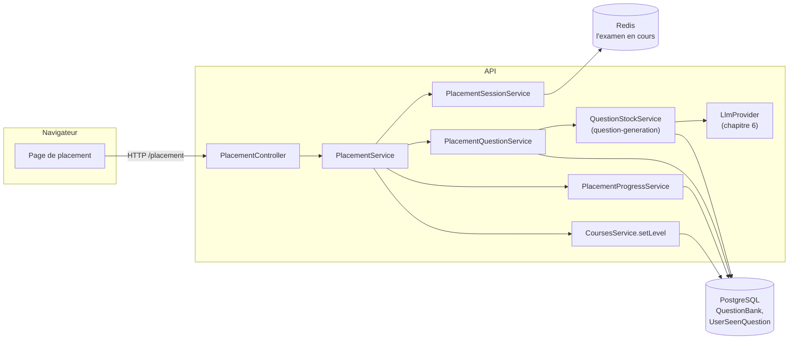
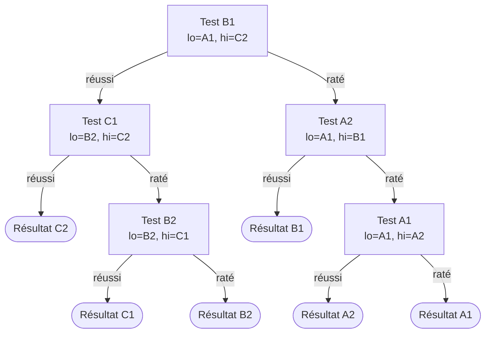
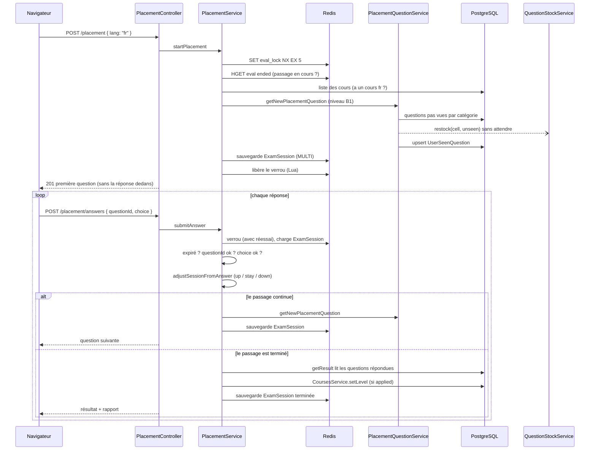
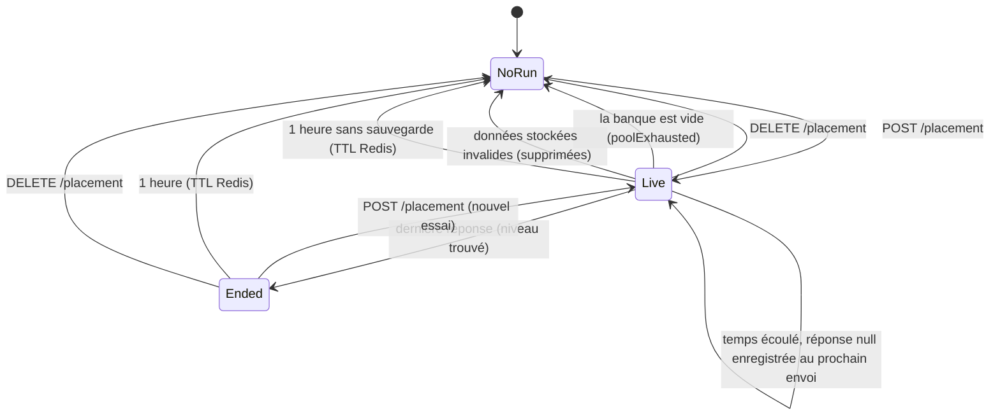
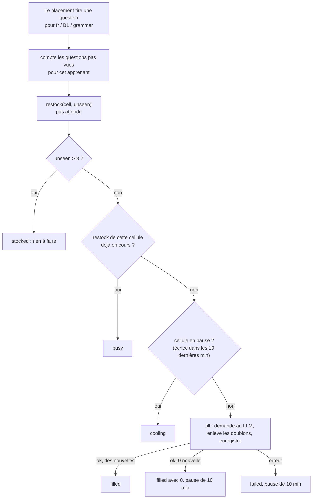

# Chapitre 7 — Les cours, le test de niveau et la génération de questions

Dans ce chapitre :

- Ce qu'est un **cours** : une langue qu'un apprenant étudie, à un niveau CECRL, avec un objectif quotidien
- Ce que sont les niveaux CECRL (A1 à C2), avec des mots simples
- Le module `courses/` : controller, service, DTO
- L'**examen de placement** : un court test adaptatif qui trouve le niveau de l'apprenant
  - où un examen en cours est gardé (Redis), comment il est verrouillé, comment une question est choisie, comment le
    niveau bouge, comment le résultat est construit
- La **banque de questions**, et comment le LLM la remplit quand un apprenant en manque (`question-generation/`)

---

## La vue d'ensemble

### Les cours et les niveaux CECRL

Un **cours**, c'est "cet apprenant étudie cette langue". L'app enseigne trois langues : `en`, `fr` et `de`
(`LEARNABLE_LANGUAGES` dans `@ft/shared`). Un apprenant peut avoir un cours par langue. Dans la base de données, un
cours est une ligne de la table `UserLevel` (chapitre 4).

Un cours a trois champs que le navigateur voit :

| Champ       | Sens                                                                  | Valeurs                  |
| ----------- | --------------------------------------------------------------------- | ------------------------ |
| `lang`      | la langue étudiée                                                     | `en`, `fr`, `de`         |
| `level`     | le niveau CECRL de l'apprenant, ou `null` avant l'examen de placement | `A1` ... `C2`, ou `null` |
| `dailyGoal` | les minutes par jour que l'apprenant veut étudier                     | `10`, `30`, `60`         |

Le **CECRL** (Cadre européen commun de référence pour les langues, en anglais CEFR) est une échelle européenne
utilisée par les écoles et les examens de langue. Il a six niveaux, de débutant à expert :

| Niveau | Nom                  | Avec des mots simples                                                                |
| ------ | -------------------- | ------------------------------------------------------------------------------------ |
| A1     | Débutant             | Salue, dit son nom, commande un café, avec des phrases apprises                      |
| A2     | Élémentaire          | Parle de la vie quotidienne, du passé et de ses projets, avec des phrases courtes    |
| B1     | Intermédiaire        | Se débrouille seul dans la plupart des situations du quotidien, donne un avis simple |
| B2     | Intermédiaire avancé | Discute de beaucoup de sujets avec des arguments, comprend des textes complexes      |
| C1     | Avancé               | Utilise la langue avec précision, comprend les sous-entendus                         |
| C2     | Maîtrise             | Comprend presque tout, saisit l'ironie et les nuances fines                          |

Dans le code, c'est `LEVELS = ['A1', 'A2', 'B1', 'B2', 'C1', 'C2']`. L'examen de placement travaille souvent avec
l'**index** dans cette liste (A1 = 0, B1 = 2, C2 = 5), parce que les nombres sont faciles à faire monter et
descendre.

### L'examen de placement, en une image

Un nouveau cours a `level: null`. Pour trouver le bon niveau, l'apprenant passe l'**examen de placement** : des
questions à choix multiples (4 options chacune) dans trois **catégories** : `grammar`, `vocabulary`, `reading`. Il
commence à B1. Si tu réussis, les questions suivantes sont plus dures ; si tu fais des erreurs, elles deviennent plus
faciles. C'est comme deviner un nombre entre 1 et 100 en demandant "plus haut ou plus bas ?" : chaque réponse coupe
l'intervalle possible en deux (une **recherche dichotomique**, binary search en anglais).

Les questions viennent de la **banque de questions** (table `QuestionBank`). Certaines ont été écrites par des
personnes (fichiers dans `content/items/`, chargés par le seed), et d'autres sont écrites par le LLM quand la banque
se vide pour un apprenant.



Pourquoi Redis pour l'examen en cours ? Ce sont des données de courte durée (une heure au maximum), modifiées à chaque
réponse, et qui ont besoin d'un verrou pour que deux clics ne se marchent pas dessus. Redis est rapide et a une
expiration automatique (chapitre 3). Seul le **niveau final** va dans PostgreSQL, dans la ligne du cours. Les
questions qu'un apprenant a vues sont aussi gardées dans PostgreSQL (`UserSeenQuestion`), parce que ça doit durer
d'un examen à l'autre.

### Plan des dossiers

```text
apps/api/src/
├── courses/
│   ├── courses.module.ts
│   ├── courses.controller.ts        GET/POST /courses, PATCH /courses/:lang, PATCH /courses/:lang/level
│   ├── courses.dto.ts
│   ├── courses.service.ts
│   └── courses.service.spec.ts
├── placement/
│   ├── placement.module.ts
│   ├── placement.controller.ts      POST/GET/DELETE /placement, POST /placement/answers
│   ├── placement.dto.ts
│   ├── placement.schema.ts          the shape of a running exam (ExamSession)
│   ├── placement.service.ts         the conductor: start, read, answer, quit
│   ├── placement-session.service.ts Redis: save, load, lock
│   ├── placement-question.service.ts pick the next question, shuffle, progress
│   ├── placement-progress.service.ts score an answer, move the level, build the result
│   └── *.spec.ts
└── question-generation/
    ├── question-generation.module.ts
    ├── question-stock.service.ts    decides when to restock and calls the LLM
    ├── question-batch.ts            pure helpers: remove duplicates, build rows
    ├── prompts/question-batch.prompt.ts  the text sent to the LLM
    ├── QUESTION_GENERATION.md       long French explanation of this folder
    └── *.spec.ts
```

---

## `courses/` — le module des cours

### `courses.module.ts`

[courses.module.ts](../../apps/api/src/courses/courses.module.ts) déclare le controller et le service, importe
`GatewayModule` (pour `SocketsService`, afin de prévenir les autres onglets de l'utilisateur qu'un cours a changé,
chapitre 9), et **exporte** `CoursesService`. `PlacementModule` l'importe, parce que l'examen écrit le niveau final
avec `CoursesService.setLevel`.

### `courses.dto.ts`

[courses.dto.ts](../../apps/api/src/courses/courses.dto.ts) transforme les schemas Zod partagés en classes DTO
Nest avec `createZodDto` (le chapitre 2 explique comment le pipe de validation les utilise) :

```ts
export class StartCourseDto extends createZodDto(StartCourseSchema) {}
export class SetGoalDto extends createZodDto(SetGoalSchema) {}
export class SetLevelDto extends createZodDto(SetLevelSchema) {}
export class CourseDto extends createZodDto(CourseSchema) {}
export class CoursesDto extends createZodDto(CoursesSchema) {}
```

Les schemas vivent dans [packages/shared/src/schemas/course.ts](../../packages/shared/src/schemas/course.ts),
donc l'app web vérifie les mêmes règles :

| Schema              | Forme                                       | Notes                                                                                                      |
| ------------------- | ------------------------------------------- | ---------------------------------------------------------------------------------------------------------- |
| `StartCourseSchema` | `{ lang, dailyGoal }`                       | "No level here: only the placement exam sets it." (pas de niveau ici : seul l'examen de placement le fixe) |
| `SetGoalSchema`     | `{ dailyGoal }`                             | `dailyGoal` vaut `10`, `30` ou `60` (chaque valeur est un bouton dans l'UI)                                |
| `SetLevelSchema`    | `{ level }`                                 | code d'erreur `course.invalidLevel`                                                                        |
| `CourseSchema`      | `{ lang, level \| null, dailyGoal }`        | à quoi ressemble un cours dans une réponse                                                                 |
| `CoursesSchema`     | `{ courses: Course[], activeLang \| null }` | la liste, plus la langue sur laquelle l'utilisateur a travaillé en dernier                                 |

### `courses.controller.ts`

[courses.controller.ts](../../apps/api/src/courses/courses.controller.ts) a quatre routes. Toutes ont besoin
d'une session (le guard d'auth global du chapitre 5) ; `@CurrentUser()` donne l'utilisateur connecté.

| Méthode et chemin            | Appel au service                 | Réponse         | Erreurs                     |
| ---------------------------- | -------------------------------- | --------------- | --------------------------- |
| `GET /courses`               | `listCoursesUser(user.id)`       | `CoursesDto`    | 401                         |
| `POST /courses`              | `createCourse(user.id, body)`    | 201 `CourseDto` | 409 `course.alreadyStarted` |
| `PATCH /courses/:lang`       | `setGoal(user, lang, body, now)` | `CourseDto`     | 404 `course.notFound`       |
| `PATCH /courses/:lang/level` | `setLevel(user.id, lang, body)`  | `CourseDto`     | 404 `course.notFound`       |

```ts
@Patch(':lang')
@ApiOperation({ summary: 'Change the daily goal, without touching level' })
// Declared by hand: `Language` is a type-only alias, so it reflects as Object
// and swagger drops the parameter instead of rendering a field for it.
@ApiParam({ name: 'lang', enum: [...LEARNABLE_LANGUAGES] })
...
setGoal(
  @CurrentUser() user: SessionUser,
  @Body() body: SetGoalDto,
  @Param('lang', LangParam) lang: Language,
) {
  return this.courses.setGoal(user, lang, body, new Date());
}
```

- `LangParam` (de `validation.pipe.ts`, chapitre 2) vérifie que `:lang` est une langue connue.
- `@ApiParam` est écrit à la main parce que `Language` est seulement un type, et Swagger ne peut pas voir les types
  à l'exécution.
- Le controller passe `new Date()` au service, pour qu'un test puisse donner n'importe quel "maintenant".
- Le résumé de `PATCH /courses/:lang/level` cite trois cas : l'apprenant a sauté l'onboarding, le résultat du
  placement, ou l'apprenant choisit un autre niveau à la main. En vrai, l'app web l'appelle pour l'onboarding et pour
  un niveau choisi à la main. Le résultat du placement ne passe pas par cette route : `PlacementService` appelle
  directement `CoursesService.setLevel` (plus bas).

### `courses.service.ts`

[courses.service.ts](../../apps/api/src/courses/courses.service.ts) parle à Prisma.

```ts
const COURSE_SELECT = { lang: true, dailyGoal: true, level: true } as const;
```

Les lectures et les écritures de `listCoursesUser`, `createCourse` et `write` ne demandent que ces trois colonnes.
`setGoal` lit la ligne entière (les fonctions de l'objectif prennent toute la ligne), mais sa réponse passe par `CourseSchema.parse`,
qui ne garde que ces trois champs. Donc les ids, la série (streak) et les XP ne fuient jamais dans une réponse de
cours.

**`listCoursesUser`** lit l'utilisateur avec ses cours (`userLevels`), du plus ancien au plus récent, et son
`activeLang`. Il lit **à travers l'utilisateur** (`where: { id: userId }`), donc les cours d'un autre utilisateur sont
inaccessibles par construction. Un utilisateur qui n'existe plus donne 401 `auth.sessionRequired`.

**`createCourse`** insère une ligne avec `level: null` :

```ts
const course = await this.prisma.userLevel.create({
  data: { userId, lang: dto.lang, dailyGoal: dto.dailyGoal, level: null },
  select: COURSE_SELECT,
});
return CourseSchema.parse(course);
```

La table a une clé unique sur `(userId, lang)`. Un deuxième cours dans la même langue fait lancer à Prisma le code
d'erreur `P2002` (contrainte d'unicité), qui devient 409 `course.alreadyStarted`. Toute autre erreur remonte sans
changement.

**`setGoal`** fait plus attention, parce que changer l'objectif peut compléter l'objectif du jour :

```ts
async setGoal(user: SessionUser, lang: Language, dto: SetGoalDto, now: Date) {
  const course = await this.prisma.$transaction(async (tx) => {
    const locked = checkCourse(await lockCourse(tx, user.id, lang));
    const course = await tx.userLevel.update({
      where: { id: locked.id },
      data: { dailyGoal: dto.dailyGoal },
    });
    await tx.user.update({ where: { id: user.id }, data: { activeLang: lang } });

    const day = await currentDay(tx, course, user.timeZone, now);
    const goal = await meetGoal(tx, course, day);
    await award(tx, course, day, { type: 'goal', goal });
    return CourseSchema.parse(course);
  });
  // After the commit: sent from inside the transaction, the other tab could
  // read the old row, or a row that then rolls back.
  this.sockets.toUser(user.id, SERVER_EVENTS.COURSE_UPDATED, { lang });
  return course;
}
```

Exemple : l'objectif est de 30 minutes et l'apprenant a fait 10 minutes aujourd'hui. Il le baisse à 10 : la journée
est maintenant atteinte, donc la série et les XP doivent bouger. Tout tourne dans une seule transaction, sous un
verrou de ligne (`lockCourse` fait `SELECT ... FOR UPDATE`), donc une fin de leçon au même moment ne peut pas valider
la journée deux fois. `checkCourse` transforme "pas de ligne" en 404 `course.notFound`. `currentDay`, `meetGoal` et
`award` viennent de `lessons/` et sont expliqués dans [08-lessons.md](08-lessons.md). L'événement socket est envoyé
**après** le commit.

**`setLevel`** utilise l'aide privée `write` :

```ts
private async write(userId: string, lang: Language, data: CourseWrite) {
  try {
    const [course] = await this.prisma.$transaction([
      this.prisma.userLevel.update({
        where: { userId_lang: { userId, lang } },
        data,
        select: COURSE_SELECT,
      }),
      this.prisma.user.update({
        where: { id: userId },
        data: { activeLang: lang },
      }),
    ]);
    return CourseSchema.parse(course);
  } catch (error) {
    if (typeof error === 'object' && error !== null && 'code' in error && error.code === 'P2025')
      throw new NotFoundException('course.notFound');
    throw error;
  }
}
```

- Deux écritures dans une seule transaction : le niveau, et `activeLang` passe à cette langue.
- Le cours est trouvé par la **clé composée** `userId_lang`, jamais par un simple id venant du navigateur.
- `P2025` est le "record not found" de Prisma (enregistrement introuvable) : 404 au lieu de créer un cours.
- Le type `CourseWrite` vaut `{ dailyGoal } | { level }` avec `never` sur l'autre clé : une écriture change un seul
  champ, jamais les deux.
- Après ça, `setLevel` envoie `COURSE_UPDATED` aux sockets de l'utilisateur.

[courses.service.spec.ts](../../apps/api/src/courses/courses.service.spec.ts) teste chaque méthode avec un Prisma
mocké : le conflit, le not-found, le verrou et les récompenses d'objectif, la clé composée, et que les sockets ne
sont prévenus qu'après un commit.

---

## `placement/` — l'examen de placement

### Les règles de l'examen

D'après [packages/shared/src/schemas/placement.ts](../../packages/shared/src/schemas/placement.ts) :

```ts
/** A level is `perCategory` times the three QUESTION_CATEGORIES, and the second mistake ends it. */
export const PLACEMENT_ROUNDS = { perCategory: 2, maxMistakes: 1 } as const;
```

Donc à chaque niveau, l'apprenant reçoit **au maximum 6 questions** (2 par catégorie × 3 catégories,
`MAX_QUESTIONS_PER_LEVEL`).

- **Deuxième erreur à ce niveau** → le niveau est raté, on **descend**.
- **6 questions avec au plus une erreur** → le niveau est réussi, on **monte**.
- Chaque question a une **limite de temps** (`timeLimitS`). Pas de réponse à temps compte comme faux
  (`choice: null`).
- L'examen commence à **B1** (`START_LEVEL`) avec l'intervalle `lo = 0` (A1) à `hi = 5` (C2).

Le résultat est **le niveau juste au-dessus du plus haut niveau réussi**, ou A1 si l'apprenant rate tout. C'est le
niveau à étudier ensuite. Exemples de parcours :



Donc un examen teste 2 ou 3 niveaux, avec entre 6 et 18 questions.

### Les routes HTTP : `placement.controller.ts`

[placement.controller.ts](../../apps/api/src/placement/placement.controller.ts) a quatre routes. Chacune appelle
simplement `PlacementService`.

| Route                     | Service          | Réponse                                 | Erreurs principales                                                                                    |
| ------------------------- | ---------------- | --------------------------------------- | ------------------------------------------------------------------------------------------------------ |
| `POST /placement`         | `startPlacement` | 201, la première question               | 409 `placement.inProgress`, 409 `placement.onboardingIncomplete`, 404 `placement.poolExhausted`        |
| `GET /placement`          | `getPlacement`   | la question en cours **ou** le résultat | 404 `placement.notFound`, 409 `placement.invalidSession`                                               |
| `POST /placement/answers` | `submitAnswer`   | la question suivante **ou** le résultat | 400 `placement.invalidChoice`, 409 `placement.questionMismatch` / `inProgress` / `invalidSession`, 404 |
| `DELETE /placement`       | `quitPlacement`  | 204, rien                               | 409 `placement.inProgress`                                                                             |

Deux d'entre elles répondent "une question ou un résultat". Pour Swagger, le controller le dit avec `oneOf`, et
`@ApiExtraModels(PlacementQuestionDto, PlacementResultDto)` enregistre les deux schemas pour que `getSchemaPath`
puisse pointer vers eux. Le commentaire du `GET` insiste : il est "strictly read-only to preserve HTTP GET
idempotency" (strictement en lecture seule pour garder l'idempotence du GET HTTP) : lire deux fois ne doit rien
changer.

### Les DTO : `placement.dto.ts`

[placement.dto.ts](../../apps/api/src/placement/placement.dto.ts) enveloppe quatre schemas partagés :

| DTO                    | Forme                                                                                                      | Notes                                                                                                                              |
| ---------------------- | ---------------------------------------------------------------------------------------------------------- | ---------------------------------------------------------------------------------------------------------------------------------- |
| `StartPlacementDto`    | `{ lang }`                                                                                                 |                                                                                                                                    |
| `SubmitAnswerDto`      | `{ questionId, choice: string \| null }`                                                                   | "null is a timeout, scored wrong; absent is a broken client" (null est un timeout, compté faux ; absent veut dire un client cassé) |
| `PlacementQuestionDto` | `{ lang, questionId, category, level, question, readText?, options[4], timeLimitS, remainingS, progress }` | un objet **strict**                                                                                                                |
| `PlacementResultDto`   | `{ lang, targetLevel, applied, report[] }`                                                                 |                                                                                                                                    |

`PlacementQuestionSchema` est un `strictObject` exprès. La ligne `QuestionBank` a un champ `answer`. Si le code
mettait un jour par erreur l'`answer` de la ligne dans le payload, un parse strict **échoue bruyamment** au lieu
d'enlever le champ en silence. Donc la réponse ne peut pas fuir vers le navigateur. La réponse n'est publiée que dans
le `report` du résultat.

`progress` contient `answered` (qui est aussi l'index de cette question) et `maxQuestionsRemaining`, expliqués plus
bas.

### L'examen en cours : `placement.schema.ts`

[placement.schema.ts](../../apps/api/src/placement/placement.schema.ts) décrit un examen en cours, l'`ExamSession`.
Il est vérifié avec Zod à chaque fois qu'il est chargé depuis Redis.

```ts
export const ExamSessionSchema = z.object({
  evalId: z.uuid(),
  lang: LanguageSchema,
  lo: z.number().int().min(0).max(6),
  hi: z.number().int().min(0).max(6),
  level: z.number().int().min(0).max(6).nullable(),
  mistakesPerLevel: z
    .number()
    .int()
    .min(0)
    .max(PLACEMENT_ROUNDS.maxMistakes + 1),
  askedPerCategory: z.record(
    QuestionCategorySchema,
    z.number().int().nonnegative().min(0).max(PLACEMENT_ROUNDS.perCategory),
  ),
  totalAnswered: z.number().int().nonnegative(),
  answers: z.array(SubmitAnswerSchema),
  ended: z.boolean(),
  currentQuestionId: z.string().nullable(),
  /** Shuffled once when served, so a reload shows the same order. */
  currentOptions: z.array(z.string().min(1)).length(OPTIONS_PER_ITEM).nullable(),
  servedAt: z.iso.datetime(),
});
```

| Champ               | Sens                                                                                                      |
| ------------------- | --------------------------------------------------------------------------------------------------------- |
| `evalId`            | un id aléatoire pour ce passage                                                                           |
| `lang`              | la langue testée                                                                                          |
| `lo`, `hi`          | l'intervalle des index de niveau encore possibles (les bornes de la recherche dichotomique)               |
| `level`             | l'index du niveau testé en ce moment ; à la fin, le résultat                                              |
| `mistakesPerLevel`  | les erreurs au niveau actuel                                                                              |
| `askedPerCategory`  | les questions posées au niveau actuel, par catégorie, par ex. `{ grammar: 1, vocabulary: 2, reading: 0 }` |
| `totalAnswered`     | les réponses sur tout le passage                                                                          |
| `answers`           | chaque `{ questionId, choice }`, dans l'ordre                                                             |
| `ended`             | le passage est terminé                                                                                    |
| `currentQuestionId` | la question à l'écran                                                                                     |
| `currentOptions`    | ses 4 options, dans l'ordre mélangé affiché                                                               |
| `servedAt`          | quand elle a été affichée : démarre son chrono                                                            |

### Le stockage Redis et le verrou : `placement-session.service.ts`

[placement-session.service.ts](../../apps/api/src/placement/placement-session.service.ts) est le seul fichier
qui touche Redis pour l'examen. Un utilisateur a trois clés :

| Clé                        | Type Redis | Contenu                                         | Durée de vie                                                                  |
| -------------------------- | ---------- | ----------------------------------------------- | ----------------------------------------------------------------------------- |
| `user:<id>:eval`           | hash       | tous les champs de `ExamSession` sauf `answers` | 1 heure (`PLACEMENT_REDIS_KEY_TTL = 3600`), remise à zéro à chaque sauvegarde |
| `user:<id>:eval_questions` | list       | les réponses, un JSON par élément               | 1 heure                                                                       |
| `user:<id>:eval_lock`      | string     | le token du verrou                              | 5 secondes (`PLACEMENT_LOCK_TTL_SECONDS`)                                     |

Il y a **une seule** clé d'examen par utilisateur, pas par langue : un utilisateur passe un seul examen à la fois.

**Sauvegarder.** `saveExamSession` écrit tous les champs dans un seul `MULTI` (une transaction Redis : toutes les
commandes s'exécutent ensemble) :

```ts
const transaction = this.redis.client.multi().hSet(key, {
  evalId: session.evalId,
  lang: session.lang,
  ...
  ended: session.ended.toString(),
  currentQuestionId: session.currentQuestionId ?? '',
  currentOptions: session.currentOptions ? JSON.stringify(session.currentOptions) : '',
  servedAt: session.servedAt,
});

transaction.expire(key, PLACEMENT_REDIS_KEY_TTL).del(questionsListKey);
for (const answer of session.answers) {
  transaction.rPush(questionsListKey, JSON.stringify(answer));
}
```

Un hash Redis ne stocke que des chaînes, donc les nombres deviennent du texte, `null` devient `''`, et les objets
deviennent du JSON. La liste des réponses est supprimée et réécrite en entier, donc aucune vieille réponse ne survit.

**Charger.** `loadExamSession` lit le hash et la liste dans un seul `MULTI`, retransforme les chaînes en nombres et
en objets, et vérifie le résultat avec `ExamSessionSchema`. Il refuse aussi deux réponses à la même question. Si
quelque chose ne va pas, le passage stocké est **supprimé** et l'appel lance 409 `placement.invalidSession` : un
passage cassé ne doit pas bloquer l'apprenant pour toujours. Un hash vide veut dire "pas de passage" et donne `null`.

**En cours ou pas.** `hasLiveSession` lit seulement le champ `ended` : le passage est en cours quand c'est le texte
`'false'`. Un passage terminé reste dans Redis (jusqu'à une heure) seulement pour afficher son rapport.
`liveSessionLang` donne la langue d'un passage en cours, sans tout charger, "so quitting must work on a run too
broken to load" (pour que quitter marche même sur un passage trop cassé pour être chargé).

**Le verrou.** Deux requêtes du même utilisateur au même moment (un double-clic, deux onglets) ne doivent pas toutes
les deux modifier le passage. Le service utilise un petit verrou Redis :

```ts
async acquireLock(
  userId: string,
  ttlSeconds = PLACEMENT_LOCK_TTL_SECONDS,
): Promise<string | null> {
  const token = randomUUID();
  const result = await this.redis.client.set(this.evalLockKey(userId), token, {
    NX: true,
    EX: ttlSeconds,
  });
  if (result === null) return null;

  return token;
}
```

- `NX` : écrire seulement si la clé n'existe **pas**. Un seul appelant gagne.
- `EX: 5` : le verrou disparaît après 5 secondes, donc une requête qui a planté ne peut pas le garder pour toujours.
- Le `token` aléatoire prouve à qui il appartient.

`acquireLockWithRetry` réessaie jusqu'à 10 fois, à 50 ms d'écart, "to absorb rapid double-clicks" (pour absorber les
doubles-clics rapides). `releaseLock` supprime la clé **seulement si elle contient encore notre token**, avec un tout
petit script Lua que Redis exécute en une seule étape :

```ts
const script = `if redis.call("get",KEYS[1]) == ARGV[1] then return redis.call("del",KEYS[1]) else return 0 end`;
```

Sans cette vérification, une requête lente dont le verrou a déjà expiré pourrait supprimer le verrou de la requête
suivante.

### Choisir une question : `placement-question.service.ts`

[placement-question.service.ts](../../apps/api/src/placement/placement-question.service.ts) choisit la question
suivante et la met en forme pour le navigateur.

**`getNewQuestion`** travaille par étapes :

1. Refuser un passage terminé (409 `placement.expired`).
2. Garder les catégories qui ont encore de la place à ce niveau (moins de 2 posées). S'il n'y en a aucune, prendre
   les trois.
3. Pour chaque catégorie, lire jusqu'à 100 questions de cette langue et de ce niveau **que l'utilisateur n'a jamais
   vues** (`userSeenQuestions: { none: { userId } }`), les écrites en premier.
4. Dire au stock combien il en reste, **sans attendre** (`void this.stock.restock(...)`).
5. Dans chaque catégorie, préférer les questions écrites : les générées de cette catégorie attendent qu'il ne reste
   plus aucune écrite dans cette catégorie.
6. Choisir une catégorie au hasard, puis une question au hasard dedans. Une question générée peut donc venir d'une
   catégorie pendant qu'une autre catégorie a encore des écrites.
7. S'il ne reste rien de pas vu nulle part : servir la question que cet utilisateur a **vue il y a le plus
   longtemps**, mais pas une de ce passage.
8. Si même ça est vide : 404 `placement.poolExhausted`.

```ts
const questions = await this.prisma.questionBank.findMany({
  where: {
    lang: session.lang,
    level,
    category: cat,
    userSeenQuestions: {
      none: {
        userId,
      },
    },
  },
  // Written rows first, so the take never hides one behind generated rows.
  orderBy: { sourceId: { sort: 'asc', nulls: 'last' } },
  take: LIMIT_UNSEEN_QUESTIONS_TO_RETRIEVE,
});

availableByCategory[cat] = questions.length;
void this.stock.restock({ lang: session.lang, level, category: cat }, questions.length);
// Nobody reviewed a generated row, so it waits until the written ones are all seen.
const written = questions.filter((question) => question.sourceId !== null);
const servable = written.length > 0 ? written : questions;
```

- Une question écrite a un `sourceId` comme `fr-gram-0001` ; une générée a `sourceId: null`. Trier avec
  `nulls: 'last'` met les écrites en premier.
- `void` veut dire "lance-le, n'attends pas". Le restock tourne en arrière-plan ; l'apprenant reçoit une question
  tout de suite.
- `take: 100` est plus grand que le seuil de restock (3), donc une cellule pleine est vue comme pleine et laissée
  tranquille.

Le repli sur une ancienne question :

```ts
// Serving it bumps updatedAt, so repeated fallbacks cycle through the whole level.
const oldest = await this.prisma.userSeenQuestion.findFirst({
  where: {
    userId,
    ...(excludeQuestionIds.length > 0
      ? { questionId: { notIn: [...new Set(excludeQuestionIds)] } }
      : {}),
    questionBank: {
      lang: session.lang,
      level,
      category: { in: [...pool] },
    },
  },
  orderBy: {
    updatedAt: 'asc',
  },
  include: {
    questionBank: true,
  },
});
```

C'est ce qui se passe avec le provider fixture (pas de nouvelles questions) : un apprenant qui a vu tout le niveau
reçoit les questions qu'il a vues il y a le plus longtemps.

Chaque tirage est compté dans une métrique (`placementDraws`) par source : `written`, `generated` ou
`seen_fallback`. Beaucoup de `seen_fallback` veut dire "les restocks ne suivent pas". Un pool vide compte
`placementPoolExhausted`.

**`shuffleOptions`** mélange les 4 options avec l'algorithme de Fisher–Yates. Le commentaire donne la raison : "The
bank lists the answer first in almost every item, so the order must not leak it." (la banque met la réponse en
premier dans presque chaque item, donc l'ordre ne doit pas la trahir).

**`getNewPlacementQuestion`** assemble le tout : tirer une question, stocker son id et les options mélangées dans la
session, relancer le chrono (`servedAt`), et la marquer comme vue dans `UserSeenQuestion` avec un `upsert` (créer la
ligne, ou mettre à jour son `updatedAt` si elle existe). Ensuite, elle appelle `createPlacementQuestion`.

**`createPlacementQuestion`** construit le payload pour le navigateur. Elle calcule `remainingS` à partir de
`servedAt`, donc un rechargement de la page reprend le compte à rebours au lieu de le recommencer. Elle envoie les
options **dans l'ordre mélangé stocké**, donc un rechargement montre le même ordre. Et elle parse avec le
`PlacementQuestionSchema` strict (aucune `answer` ne peut s'échapper).

**`getMaxQuestionsRemaining`** donne à la barre de progression son "au plus N questions restantes" :

```ts
private maxProbes(lo: number, hi: number, level: number): number {
  const upProbes =
    level >= hi - 1 ? 0 : this.maxProbes(level + 1, hi, level + Math.ceil((hi - level) / 2));
  const downProbes =
    level <= lo ? 0 : this.maxProbes(lo, level, level - Math.ceil((level - lo) / 2));
  return 1 + Math.max(upProbes, downProbes);
}
```

`maxProbes` joue la recherche dichotomique à l'avance et compte le pire nombre de niveaux qu'il reste à tester. Fois
6 questions par niveau, moins les questions déjà posées à ce niveau, ça donne le maximum restant. Il descend vite
quand l'apprenant fait des erreurs.

### Noter et faire bouger le niveau : `placement-progress.service.ts`

[placement-progress.service.ts](../../apps/api/src/placement/placement-progress.service.ts) contient la logique de
l'examen.

**`getQuestion`** lit une ligne de la banque par id, ou 404 `placement.notFound`.

**`hasTimedOut`** dit si le temps est écoulé, avec un petit cadeau pour les réseaux lents :

```ts
export const NETWORK_GRACE_S = 2;
...
hasTimedOut(question: QuestionBank, servedAt: string): boolean {
  const elapsedS = Math.floor((Date.now() - new Date(servedAt).getTime()) / 1000);
  return elapsedS >= question.timeLimitS + NETWORK_GRACE_S;
}
```

Le chrono est sur le **serveur** (`servedAt`), donc le navigateur ne peut pas tricher en arrêtant son minuteur.

**`adjustSessionFromAnswer`** est le cœur de la recherche dichotomique :

```ts
const isCorrect = answer !== null && answer === question.answer;

if (!isCorrect) {
  session.mistakesPerLevel += 1;
}

let levelChange: 'down' | 'stay' | 'up' = 'stay';

if (session.mistakesPerLevel > PLACEMENT_ROUNDS.maxMistakes) {
  levelChange = 'down';
} else {
  const askedInCurrentLevel = Object.values(session.askedPerCategory).reduce(
    (sum, count) => sum + count,
    0,
  );
  if (askedInCurrentLevel + 1 >= MAX_QUESTIONS_PER_LEVEL) {
    levelChange = 'up';
  }
}
```

Ensuite :

- `stay` : compter seulement la question dans sa catégorie.
- `up` en haut de l'intervalle (`level === hi - 1`) : le résultat est `hi`, le passage se termine.
- `down` en bas (`level === lo`) : le résultat est `lo`, le passage se termine.
- Sinon, remettre les compteurs à zéro pour le nouveau niveau, et bouger :
  - `up` : `lo = level + 1`, sauter à mi-chemin vers `hi`.
  - `down` : `hi = level`, sauter à mi-chemin vers `lo`.

```ts
if (levelChange === 'up') {
  session.lo = Math.min(session.hi, session.level + 1);
  const nextIndex = Math.min(
    session.hi - 1,
    session.level + Math.ceil((session.hi - session.level) / 2),
  );
  session.level = nextIndex;
} else {
  session.hi = session.level;
  const nextIndex = Math.max(
    session.lo,
    session.level - Math.ceil((session.level - session.lo) / 2),
  );
  session.level = nextIndex;
}
```

Note que `hi` lui-même n'est jamais testé : réussir `hi - 1` donne `hi` comme résultat. C'est pour ça que
l'intervalle de départ est `hi = 5` (C2) : réussir C1 donne C2.

**`getResult`** renvoie `undefined` tant que le passage continue. Quand il est terminé, il lit dans la banque chaque
question à laquelle l'apprenant a répondu et construit le **rapport** : pour chaque réponse, la question, son niveau,
les options, ce qui a été choisi, la bonne réponse, et `wasCorrect`. Les lignes qui ont disparu de la banque sont
ignorées.

```ts
return PlacementResultSchema.parse({
  lang: session.lang,
  targetLevel: LEVELS[Math.max(0, Math.min(session.level, LEVELS.length - 1))],
  // A learner who walked away from the run measured nothing.
  applied: session.answers.some((answer) => answer.choice !== null),
  report,
});
```

`applied` vaut `false` quand **toutes** les réponses ont expiré : l'apprenant est parti, donc on ne touche pas au
cours. Une seule vraie réponse, même fausse, suffit pour appliquer le résultat.

### Le chef d'orchestre : `placement.service.ts`

[placement.service.ts](../../apps/api/src/placement/placement.service.ts) utilise les trois aides et
`CoursesService`. Il ré-exporte aussi quelques constantes (`PLACEMENT_REDIS_KEY_TTL`, `MAX_QUESTIONS_PER_LEVEL`,
`NETWORK_GRACE_S`) et définit `START_LEVEL = 'B1'`.

**`startPlacement`** :

```ts
const lockToken = await this.sessionService.acquireLock(userId);
if (!lockToken) {
  throw new ConflictException('placement.inProgress');
}

try {
  // Live in any language: a second tab must not wipe a run someone is answering.
  if (await this.sessionService.hasLiveSession(userId)) {
    throw new ConflictException('placement.inProgress');
  }

  const { courses } = await this.coursesService.listCoursesUser(userId);
  if (!courses.some((course) => course.lang === dto.lang)) {
    throw new ConflictException('placement.onboardingIncomplete');
  }

  const examSession: ExamSession = {
    evalId: randomUUID(),
    lang: dto.lang,
    lo: 0,
    hi: 5,
    level: LEVELS.indexOf(START_LEVEL),
    ...
  };

  const newQuestion = await this.questionService.getNewPlacementQuestion(userId, examSession);
  // A retake overwrites the finished run only now, so one that cannot draw keeps its report.
  await this.sessionService.saveExamSession(userId, examSession);
  placementExams.inc({ lang: dto.lang, event: 'started' });
  return newQuestion;
} finally {
  await this.sessionService.releaseLock(userId, lockToken);
}
```

- Le démarrage prend le verrou **sans** réessayer : un deuxième démarrage au même moment est simplement refusé.
- L'utilisateur doit déjà avoir un cours dans cette langue (il l'a créé pendant l'onboarding).
- Un passage terminé peut être remplacé (un nouvel essai), mais seulement une fois la première question tirée.
- `finally` libère toujours le verrou.

**`getPlacement`** charge le passage. S'il est terminé, il renvoie le résultat. Sinon, il renvoie de nouveau la
question en cours (mêmes options, chrono qui continue). Il ne change jamais rien.

**`submitAnswer`** prend le verrou **avec** réessai, puis :

1. `checkEndedOrTimedOutAndSaveNullAnswerIfTimedOut` (un nom long mais honnête) : charger le passage ; s'il est
   terminé, renvoyer le résultat ; si la question en cours a expiré, enregistrer une réponse `null` pour elle et
   renvoyer la suite. Dans ce cas, la réponse en retard de l'apprenant est ignorée, "even a right one" (même une
   bonne).
2. Vérifier que le `questionId` est celui en cours (409 `placement.questionMismatch`), et que le `choice` est une des
   options (400 `placement.invalidChoice`).
3. `processAnswer`.

Si la banque se vide en plein passage (`placement.poolExhausted`), le passage est supprimé, "so the learner can start
again" (pour que l'apprenant puisse recommencer).

**`processAnswer`** fait le travail d'une réponse :

```ts
if (session.answers.some((answer) => answer.questionId === question.id)) {
  throw new ConflictException('placement.invalidSession');
}
session.answers.push({
  questionId: question.id,
  choice,
});
session.totalAnswered += 1;
this.progressService.adjustSessionFromAnswer(choice, question, session);

const result = await this.progressService.getResult(session);
if (result !== undefined) {
  if (result.applied) {
    await this.coursesService.setLevel(userId, session.lang, { level: result.targetLevel });
  }
  await this.sessionService.saveExamSession(userId, session);
  // Here, not wherever a result is read: this answer is the one that ended the run.
  placementExams.inc({ lang: session.lang, event: 'completed' });
  return result;
}

const newQuestion = await this.questionService.getNewPlacementQuestion(userId, session);
await this.sessionService.saveExamSession(userId, session);
return newQuestion;
```

Quand le passage se termine et que le résultat est appliqué, le niveau est écrit dans le cours dans PostgreSQL avec
`CoursesService.setLevel` (qui prévient aussi les autres onglets de l'utilisateur).

**`quitPlacement`** prend le verrou, lit d'abord la langue en cours (pour la métrique `quit`), puis supprime les deux
clés Redis. Supprimer peut se répéter sans danger.

### L'examen complet, de bout en bout



### Les états d'un passage



Dans `Ended`, `GET /placement` et `POST /placement/answers` renvoient tous les deux le résultat.

### `placement.module.ts`

[placement.module.ts](../../apps/api/src/placement/placement.module.ts) importe `CoursesModule` (pour `setLevel`
et `listCoursesUser`) et `QuestionGenerationModule` (pour le stock). Il fournit et exporte les quatre services.
`RedisService` et `PrismaService` viennent de modules globaux (chapitre 3).

### Les tests du placement

- [placement.service.spec.ts](../../apps/api/src/placement/placement.service.spec.ts) : démarrage à B1, nouveaux
  essais, la vérification du cours, le verrou, un rechargement montre la même question, les réponses en retard
  comptées comme timeouts, la banque qui se vide, quitter, les métriques, et la règle `applied`.
- [placement-session.service.spec.ts](../../apps/api/src/placement/placement-session.service.spec.ts) : le verrou
  (un seul propriétaire, libération seulement par token, réessais) et sauvegarder/charger (TTL d'une heure, en cours
  ou pas, vieux passages sans `currentOptions`).
- [placement-question.service.spec.ts](../../apps/api/src/placement/placement-question.service.spec.ts) : les
  écrites avant les générées, le repli sur la question vue il y a le plus longtemps, les appels à restock pas
  attendus, `poolExhausted`, `getMaxQuestionsRemaining`, et que le payload ne contient jamais la réponse.
- [placement-progress.service.spec.ts](../../apps/api/src/placement/placement-progress.service.spec.ts) : les
  mouvements de niveau, le timeout avec la marge, et le rapport.

---

## `question-generation/` — remplir la banque avec le LLM

[QUESTION_GENERATION.md](../../apps/api/src/question-generation/QUESTION_GENERATION.md) (en français) explique ce
dossier en détail, avec un long exemple pas à pas. Voici la visite.

### La banque de questions et la "cellule"

Une ligne `QuestionBank` contient une question : `lang`, `level`, `category`, `topic`, `question`, `options` (4),
`answer`, `readText` (lecture seulement), `timeLimitS`, et `sourceId`.

| Genre de ligne | `sourceId`     | D'où elle vient                                                   |
| -------------- | -------------- | ----------------------------------------------------------------- |
| Écrite         | `fr-gram-0001` | `content/items/*.json`, chargé par le seed, relu par une personne |
| Générée        | `null`         | ce module, jamais relue                                           |

Une **cellule** (cell) est une langue + un niveau + une catégorie, par exemple `fr / B1 / grammar`. C'est la tranche
dans laquelle l'examen tire, et l'unité qui est restockée.

```ts
export type Cell = { lang: Language; level: Level; category: QuestionCategory };
```

Les noms des champs correspondent aux colonnes de la table, donc un `Cell` peut être utilisé directement comme filtre
Prisma (`where: cell`).

Combien de questions un appel au LLM écrit (d'après `@ft/shared`) :

| Catégorie    | Par lot                      | Thème                                                   | Forme                                            |
| ------------ | ---------------------------- | ------------------------------------------------------- | ------------------------------------------------ |
| `grammar`    | 13                           | une par entrée de `TOPICS`, chacune exactement une fois | une phrase avec un trou `___`                    |
| `vocabulary` | 10 (`VOCABULARY_BATCH_SIZE`) | un des `VOCABULARY_TOPICS`                              | une phrase avec un trou `___`                    |
| `reading`    | 5 (`READING_BATCH_SIZE`)     | toujours `information_structure_and_pragmatics`         | chacune avec son propre passage de 25 à 100 mots |

`generatedBatchSchema(category)` dans
[packages/shared/src/schemas/item.ts](../../packages/shared/src/schemas/item.ts) est le schema Zod d'un lot : le
nombre exact, 4 options différentes, la réponse parmi les options, une question de grammaire par thème, des passages
de lecture distincts. Un item généré n'a **pas** de `sourceId`, de `level` ni de `timeLimitS` : c'est le serveur qui
les fixe, jamais le modèle.

### Quand est-ce qu'un restock a lieu ?



### `question-generation.module.ts`

[question-generation.module.ts](../../apps/api/src/question-generation/question-generation.module.ts) importe
`LlmModule` (pour que `QuestionStockService` puisse injecter `LLM_PROVIDER`), fournit `QuestionStockService`, et
l'exporte pour `PlacementModule`.

### `question-stock.service.ts` — le gardien du stock

[question-stock.service.ts](../../apps/api/src/question-generation/question-stock.service.ts) ne fait que
**remplir** la banque. Choisir une question à afficher, c'est le travail de `PlacementQuestionService`.

```ts
/** A learner down to this many unseen questions in a cell triggers a restock. */
const RESTOCK_AT = 3;
/** After a failure, or a batch with nothing new, a cell is left alone this long (10 minutes). */
const COOLDOWN_MS = 10 * 60_000;
```

Le service garde deux `Map` en mémoire :

```ts
private readonly inFlight = new Map<string, Promise<RestockOutcome>>();
private readonly coolingUntil = new Map<string, number>();
```

- `inFlight` : les restocks en cours, par clé de cellule comme `"fr:B1:grammar"`.
- `coolingUntil` : pour chaque cellule, l'heure avant laquelle on la laisse tranquille.

Nest construit une seule instance pour toute l'API (un **singleton**), donc ces maps sont partagées par tous les
apprenants. C'est comme ça qu'un deuxième apprenant voit qu'un restock est déjà en cours. Le commentaire note la
limite : c'est par processus, "enough for the single API replica" (suffisant pour l'unique réplique de l'API) ; avec
plusieurs serveurs d'API, chacun aurait ses propres maps.

**`restock`** est la porte d'entrée :

```ts
async restock(cell: Cell, unseen: number): Promise<RestockOutcome> {
  if (unseen > RESTOCK_AT) return { status: 'stocked', inserted: 0 };

  const key = `${cell.lang}:${cell.level}:${cell.category}`;
  if (this.inFlight.has(key)) return counted(cell, { status: 'busy', inserted: 0 });
  // "?? 0": a cell that never failed has no entry, so it counts as "cooling until 1970".
  if (Date.now() < (this.coolingUntil.get(key) ?? 0)) {
    return counted(cell, { status: 'cooling', inserted: 0 });
  }

  // No "await" on fill(): we keep its promise. ".finally" runs when it ends, success or
  // not, and frees the cell. Without it, the cell would stay "busy" forever.
  const job = this.fill(cell, key).finally(() => this.inFlight.delete(key));
  this.inFlight.set(key, job);
  return job;
}
```

Pourquoi la vérification `busy` est-elle sûre avec beaucoup d'apprenants ? JavaScript fait une seule chose à la fois.
Il n'y a pas d'`await` entre `inFlight.has` et `inFlight.set`, donc aucune autre requête ne peut s'exécuter entre les
deux et lancer le même restock.

`restock` **ne rejette jamais**. C'est important parce que le placement l'appelle avec `void` (personne n'attend) :
une promesse qui rejette sans personne pour l'écouter ("unhandled rejection", rejet non géré) peut faire planter le
processus Node.

**`fill`** fait le travail, entièrement dans un `try/catch` :

```ts
// 1. Ask the LLM (with one retry when it makes sense, see generate).
const items = await this.generate(cell, key);
// 2. Read the questions already in this cell. "where: cell" works because Cell's
//    fields have the same names as the columns. "select" reads only two columns.
const stored = await this.prisma.questionBank.findMany({
  where: cell,
  select: { question: true, readText: true },
});
// 3. Keep only the new ones, turn them into rows, save them all in one query.
//    createMany returns how many rows it inserted ("count").
const { count } = await this.prisma.questionBank.createMany({
  data: toRows(cell, freshItems(items, stored)),
});
this.logger.log(`restocked ${key}: ${count} of ${items.length} questions were new`);
// Nothing new: the model keeps writing questions we already have.
// Asking again right away would cost money for nothing, so the cell cools down.
if (count === 0) this.coolingUntil.set(key, Date.now() + COOLDOWN_MS);
```

1. Demander au LLM (`generate`).
2. Lire les questions déjà présentes dans cette cellule (seulement deux colonnes).
3. Enlever les doublons (`freshItems`), construire les lignes (`toRows`), les insérer toutes en une seule requête.

Sur n'importe quelle erreur (LLM ou base de données), il logge un avertissement, met la cellule en pause pendant
10 minutes ("otherwise a broken LLM would be called on every single draw", sinon un LLM cassé serait appelé à chaque
tirage), et renvoie `failed`.

**`generate`** appelle le LLM, avec un seul réessai et seulement quand ça a du sens :

```ts
const request = {
  purpose: `question-batch:${cell.category}`,
  schema: generatedBatchSchema(cell.category),
  ...buildQuestionBatchPrompt(cell),
} as const;
try {
  return (await this.llm.generateStructured(request)).items;
} catch (error) {
  // "instanceof LlmError" checks the error's class (a catch can receive anything).
  // Only a retryable LlmError gets a second try; anything else is thrown again.
  if (!(error instanceof LlmError && error.retryable)) throw error;
  this.logger.warn(`retrying ${key}: ${error.message}`);
  return (await this.llm.generateStructured(request)).items;
}
```

C'est là que le chapitre 6 paie : le provider a déjà vérifié la réponse avec le schema, et il a déjà décidé
`retryable`. Le stock ne fait que lire le flag. Avec le provider fixture ou disabled, l'erreur n'est pas retryable,
donc il n'y a pas de deuxième appel.

**`counted`** et **`failureReason`** alimentent les métriques. Un `filled` avec 0 inséré est compté comme `empty`,
pour que le dashboard puisse le distinguer. Un échec avec la raison `disabled` compte comme `llm_disabled` (normal
sans clé, ignoré par l'alerte) ; une erreur qui ne vient pas du LLM compte comme `other`.

| `RestockOutcome.status` | Sens                                                                           |
| ----------------------- | ------------------------------------------------------------------------------ |
| `stocked`               | l'apprenant en a encore assez, rien n'est fait (pas compté)                    |
| `busy`                  | un restock de cette cellule est déjà en cours                                  |
| `cooling`               | cette cellule a échoué ou n'a rien donné de nouveau il y a moins de 10 minutes |
| `filled`                | de nouvelles questions enregistrées (`inserted` dit combien)                   |
| `failed`                | le LLM ou la base de données a échoué                                          |

### `question-batch.ts` — des aides pures

[question-batch.ts](../../apps/api/src/question-generation/question-batch.ts) n'a ni base de données, ni LLM, ni
Nest : il prend des données et renvoie des données, donc il est facile à tester.

Les **limites de temps** sont fixées par le serveur, par catégorie et par niveau (le modèle ne les choisit jamais) :

```ts
const TIME_LIMIT_S: Record<QuestionCategory, Record<Level, number>> = {
  vocabulary: { A1: 30, A2: 45, B1: 45, B2: 45, C1: 60, C2: 60 },
  grammar: { A1: 30, A2: 45, B1: 60, B2: 60, C1: 75, C2: 90 },
  reading: { A1: 75, A2: 105, B1: 90, B2: 120, C1: 165, C2: 180 },
};
```

La **détection des doublons** compare une clé normalisée :

```ts
const normalise = (text: string) => text.trim().toLowerCase().replace(/\s+/g, ' ');

const itemKey = ({ question, readText }: GeneratedItem | Stored) =>
  [readText ?? '', question].map(normalise).join('\n');

export function freshItems(items: readonly GeneratedItem[], stored: readonly Stored[]) {
  const seen = new Set(stored.map(itemKey));
  return items.filter((item) => {
    const key = itemKey(item);
    if (seen.has(key)) return false;
    seen.add(key);
    return true;
  });
}
```

- `"Je  mange ___ ."` et `"je mange ___ ."` comptent comme la même question.
- Le passage fait partie de la clé : "What is the main idea?" (quelle est l'idée principale ?) peut à juste titre
  apparaître pour chaque texte.
- `seen` commence avec les questions stockées, et grandit avec chaque item gardé, donc une deuxième copie dans le
  même lot est enlevée aussi.

**`toRows`** transforme les items en lignes de la base de données :

```ts
export function toRows(
  cell: Cell,
  items: readonly GeneratedItem[],
): Prisma.QuestionBankCreateManyInput[] {
  const timeLimitS = TIME_LIMIT_S[cell.category][cell.level];
  return items.map((item) => ({ ...item, ...cell, sourceId: null, timeLimitS }));
}
```

`sourceId: null` marque la ligne comme générée (pour que le placement serve les écrites en premier). Le niveau vient
de la cellule, jamais du modèle, donc une question ne peut pas être rangée au mauvais niveau.

### `prompts/question-batch.prompt.ts` — ce que le LLM lit

[question-batch.prompt.ts](../../apps/api/src/question-generation/prompts/question-batch.prompt.ts) ne fait que
construire du texte : les messages `system` et `user` pour un lot.

Il a trois parties :

1. **`CEFR_LEVEL_REFERENCE`** : un long texte fixe qui décrit chaque niveau de A1 à C2 (capacité, vocabulaire,
   grammaire, longueur des phrases, lecture, quoi tester, ce qui est "trop facile" et "trop dur", exemples en
   anglais). Puis une règle de calibrage ("an item does not become B2 because it contains one difficult word", un
   item ne devient pas B2 parce qu'il contient un mot difficile), des règles pour de bonnes mauvaises options (les
   **distracteurs**), et une liste d'anti-patterns. Les exemples sont en anglais ; le modèle doit les adapter, jamais
   les copier ni les traduire.
2. **`categoryBrief(cell)`** : ce qui change selon la catégorie. Elle renvoie `count`, des `rules` en plus, un texte
   `calibration` et le court message `user`. Par exemple, pour la grammaire :

   ```ts
   user: `Write ${TOPICS.length} ${level} grammar questions in "${lang}", one per topic.`,
   ```

   Les nombres lisent les mêmes constantes que `generatedBatchSchema`, donc le prompt et le schema ne peuvent pas
   être en désaccord.

3. **`buildQuestionBatchPrompt(cell)`** : assemble le message `system`, dans l'ordre : la tâche, les RULES (règles),
   la référence CECRL, le calibrage de la catégorie, et un "internal calibration check" (contrôle de calibrage
   interne) que le modèle doit faire en silence avant chaque item.

```ts
const index = LEVELS.indexOf(level);
const lower: Level | undefined = LEVELS[index - 1];
const upper: Level | undefined = LEVELS[index + 1];
...
- Calibrate every item with the CEFR LEVEL REFERENCE below.${lower ? ` Each item must be clearly harder than typical ${lower} material.` : ''}${upper ? ` No item may require knowledge normally associated with ${upper} or above.` : ''}
```

Les niveaux juste en dessous et juste au-dessus encadrent la difficulté : "plus dur que A2, rien de B2". Pour A1, il
n'y a pas de phrase "plus dur que", pour C2 pas de phrase "rien au-dessus".

Le prompt ne décrit **pas** le format JSON. Le commentaire dit pourquoi : "The format comes from the response schema,
so the prompt only carries the content rules." (le format vient du schema de réponse, donc le prompt ne porte que les
règles de contenu). La forme est envoyée à Gemini comme `responseJsonSchema` (chapitre 6).

### Les tests de la génération de questions

- [question-batch.spec.ts](../../apps/api/src/question-generation/question-batch.spec.ts) : les doublons ignorent
  la casse et les espaces, gardent une vraie différence, enlèvent une répétition dans un lot, distinguent les
  questions de lecture par leur passage ; les lignes reçoivent la cellule, `sourceId: null` et la limite de temps de
  la cellule.
- [question-batch.prompt.spec.ts](../../apps/api/src/question-generation/prompts/question-batch.prompt.spec.ts) :
  le prompt de chaque catégorie contient la langue, le niveau, les règles communes et ses propres règles.
- [question-stock.service.spec.ts](../../apps/api/src/question-generation/question-stock.service.spec.ts) : le
  seuil de 3, seules les nouvelles questions enregistrées, un seul restock par cellule (`busy`), la pause de
  10 minutes, le réessai, un échec de la base de données devient `failed`, la fixture n'enregistre rien, et les
  métriques.

---

## Les idées clés à retenir

- Un **cours** (ligne `UserLevel`) est une langue par utilisateur, avec un `level` CECRL (null jusqu'au placement)
  et un `dailyGoal` de 10, 30 ou 60 minutes.
- Le CECRL a six niveaux, de A1 à C2. L'examen travaille avec leur index (0 à 5).
- L'**examen de placement** est une recherche dichotomique qui commence à B1. À chaque niveau : au plus 6 questions
  (2 par catégorie) ; la deuxième erreur fait descendre, 6 réponses avec au plus une erreur font monter. Le résultat
  est le niveau au-dessus du plus haut niveau réussi.
- L'examen en cours vit dans **Redis** (hash `user:<id>:eval` + liste des réponses, TTL d'une heure), vérifié avec
  Zod à chaque chargement. Un court **verrou** Redis (`SET NX EX 5`, libéré par token avec Lua) empêche les
  doubles-clics de se marcher dessus.
- Le chrono est sur le serveur. Une réponse en retard compte comme un timeout (`null`), avec 2 secondes de marge.
- Le payload de la question est un schema **strict**, donc la réponse ne peut jamais fuir ; les options sont
  mélangées une fois et gardées, donc un rechargement affiche la même chose.
- Les questions sont tirées d'abord parmi les pas vues, **les écrites avant les générées dans chaque catégorie**
  (puis une catégorie au hasard), puis la plus anciennement
  vue. C'est seulement quand même ça est vide que le passage échoue avec `poolExhausted`.
- Chaque tirage appelle `restock` sans attendre. À 3 questions pas vues ou moins, `QuestionStockService` demande un
  lot au LLM, enlève les doublons, et enregistre des lignes avec `sourceId: null` et des limites de temps fixées par
  le serveur.
- Un restock n'est jamais lancé deux fois (`busy`), ne rejette jamais, réessaie une seule fois et seulement sur une
  `LlmError` retryable, et met une cellule en pause pendant 10 minutes après un échec ou un lot vide.

---

Précédent : [Chapitre 6 — Parler à un modèle d'IA](06-llm.md) · Suivant : [Chapitre 8 — Les leçons](08-lessons.md) · [Retour à l'index](README.md)
