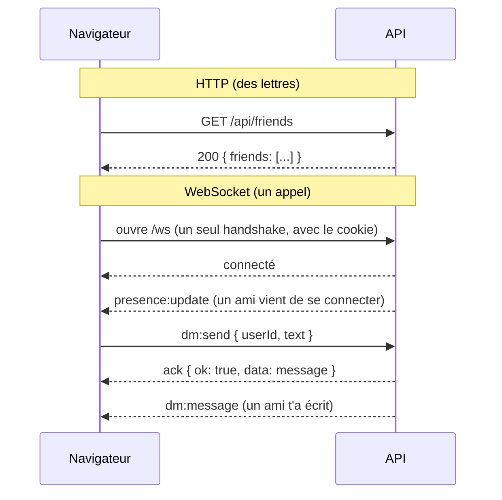
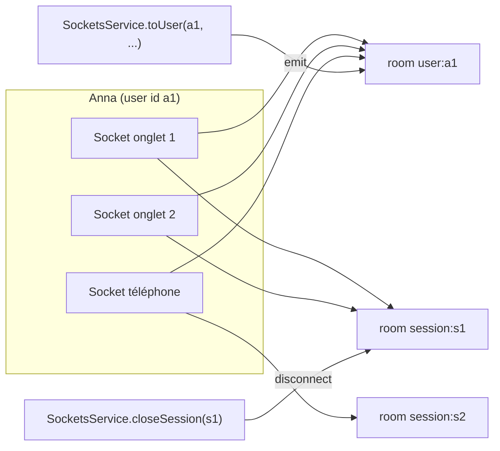
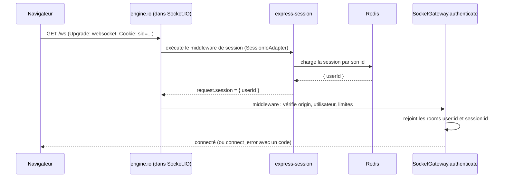
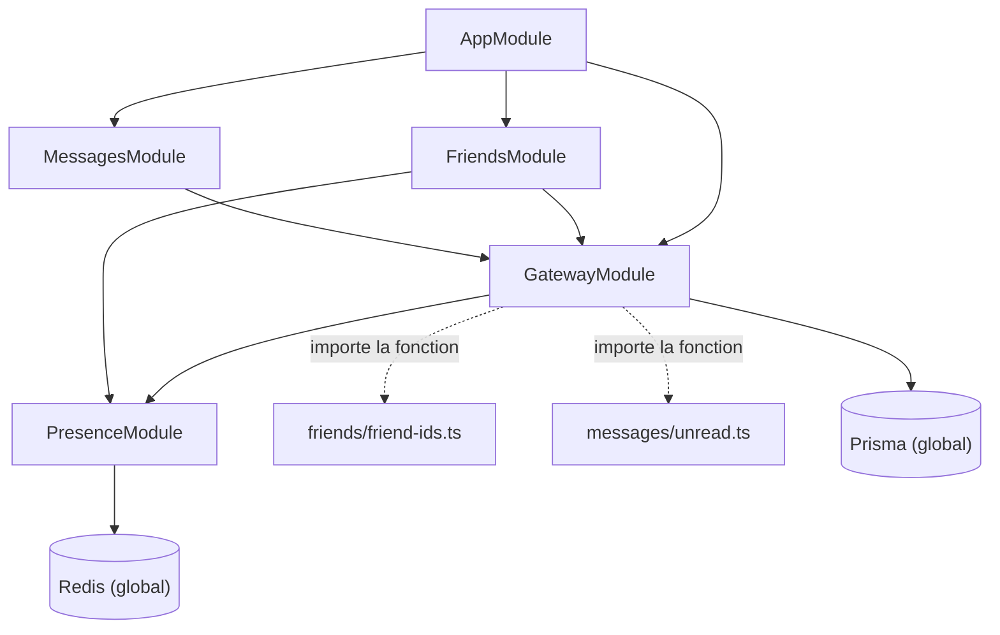
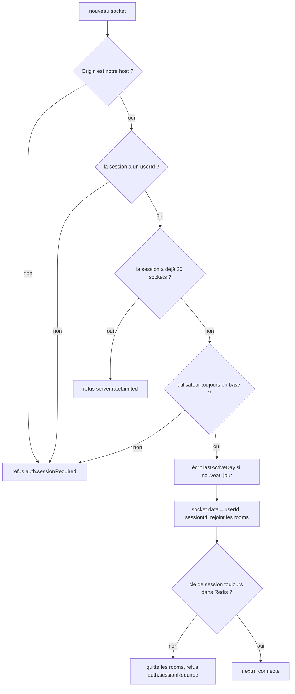
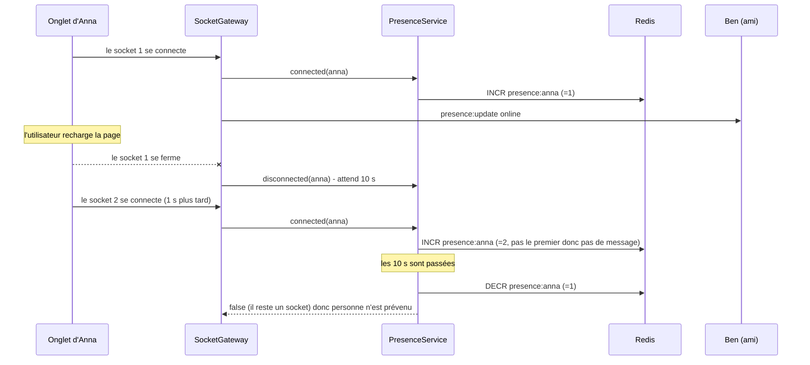
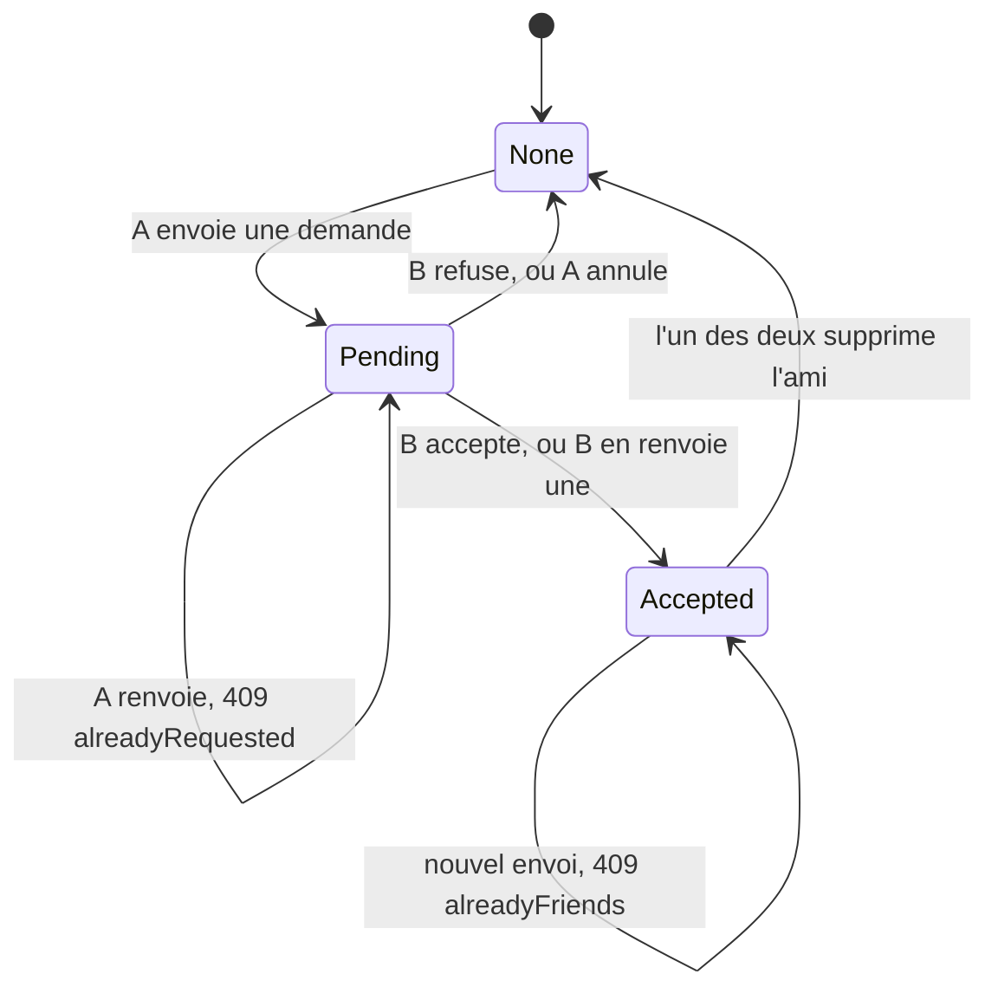
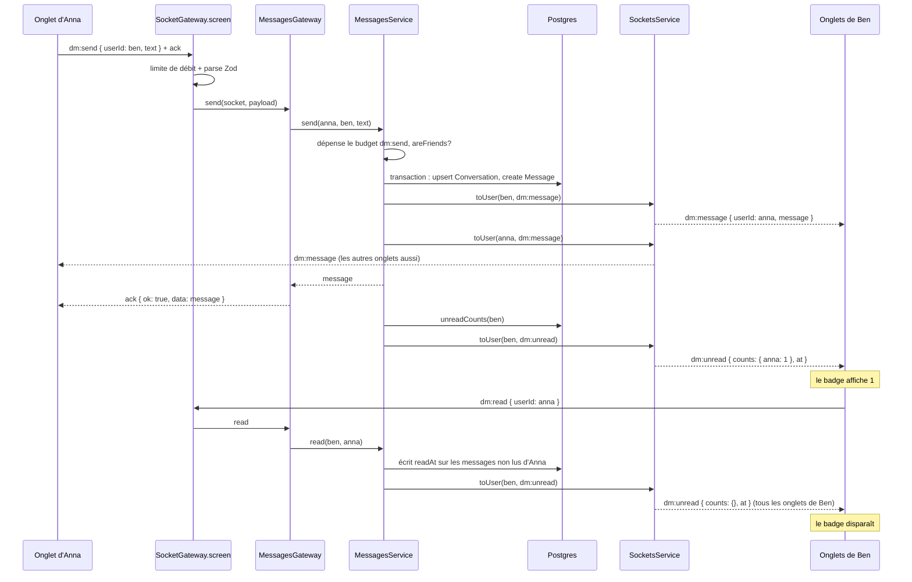
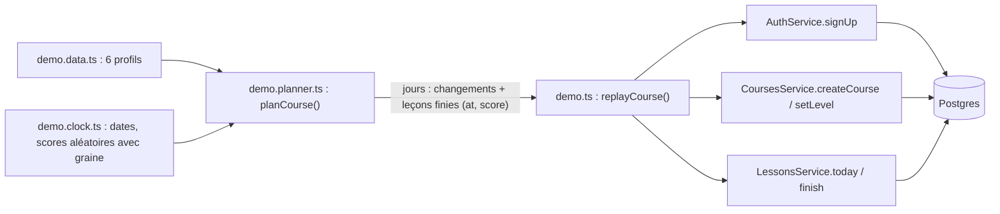

# Chapitre 9 — Amis, messages et temps réel

Dans ce chapitre :

- Ce qu'est une WebSocket, et pourquoi l'app en a besoin à côté du HTTP normal
- Socket.IO, les rooms, et comment l'API trouve « tous les onglets d'un utilisateur »
- Comment un socket est connecté avec le **même cookie de session** que le HTTP
- Ce que veut dire la « présence » (en ligne / hors ligne), et comment Redis la compte
- Le module friends : les routes, le cycle de vie d'une demande d'ami, `pair.ts`, `friend-ids.ts`
- Le module messages : lire en HTTP, envoyer par le socket, les compteurs de non-lus
- Le dossier `demo/` : les faux apprenants que le seed crée pour le développement local
- Un tableau de tous les événements du socket

---

## Vue d'ensemble

### HTTP vs WebSocket : des lettres vs un appel téléphonique

Jusqu'ici, chaque chapitre utilisait **HTTP**. HTTP, c'est comme envoyer des **lettres** : le
navigateur écrit une lettre (une requête), le serveur répond (une réponse), et c'est fini.
Le serveur ne peut jamais écrire en premier. Si un ami t'envoie un message, le serveur n'a aucun
moyen de le dire à ton navigateur. Ton navigateur devrait demander encore et encore (« un nouveau
message ? »), ce qui est lent et gaspille des ressources.

Une **WebSocket**, c'est comme un **appel téléphonique**. Le navigateur appelle une fois, la ligne
reste ouverte, et ensuite **les deux côtés peuvent parler à tout moment**. Quand ton ami envoie un
message, le serveur le dit simplement sur la ligne ouverte, et ta page l'affiche tout de suite.



L'app utilise **les deux** :

| Tâche                                                                         | Utilise                       | Pourquoi                                                          |
| ----------------------------------------------------------------------------- | ----------------------------- | ----------------------------------------------------------------- |
| Lire la liste d'amis, la liste des conversations, une page d'anciens messages | HTTP (`GET`)                  | Simple, peut être mis en cache, marche avec le rendu côté serveur |
| Envoyer / accepter / supprimer une demande d'ami                              | HTTP (`POST`, `DELETE`)       | Une écriture normale avec un code de statut                       |
| Envoyer un message, marquer comme lu                                          | Socket (`dm:send`, `dm:read`) | Rapide, et la réponse arrive sur la même ligne                    |
| « Quelque chose a changé, regarde à nouveau », envoyé par le serveur          | Socket (événements serveur)   | Seul un socket permet au serveur de parler en premier             |

### Socket.IO

L'API n'utilise pas des WebSockets brutes. Elle utilise **Socket.IO**, une bibliothèque construite
par-dessus. Socket.IO ajoute trois choses que ce chapitre utilise beaucoup :

- **Les événements nommés.** Au lieu de texte brut, chaque message a un nom, comme `dm:send`, et
  un payload (un objet JSON). C'est comme une paire `emit("name", data)` / `on("name", handler)`
  de chaque côté.
- **Les acks** (accusés de réception). Le client peut passer un callback comme dernier argument.
  Le serveur l'appelle avec une réponse. C'est comme une réponse à une question précise, un peu
  comme une réponse HTTP.
- **Les rooms.** Une room (un salon) est un groupe nommé de sockets sur le serveur. Tu peux dire
  « envoie ça à la room `user:42` » et chaque socket de cette room le reçoit.

NestJS enveloppe Socket.IO avec des **gateways**. Une gateway est aux sockets ce qu'un controller
est au HTTP : une classe marquée avec `@WebSocketGateway()` dont les méthodes, marquées avec
`@SubscribeMessage('event-name')`, gèrent les événements du client.

### Les rooms : comment l'API atteint « un utilisateur »

Un utilisateur peut avoir l'app ouverte dans plusieurs onglets, ou sur un téléphone et un
ordinateur portable. Chaque onglet ouvre **son propre socket**. Donc « envoyer à Anna » veut dire
en réalité « envoyer à tous les sockets d'Anna ». L'API règle ça avec les rooms. Quand un socket
se connecte, il rejoint deux rooms :



- `user:<userId>` — tous les sockets de cet utilisateur. Sert à **envoyer** des événements.
- `session:<sessionId>` — tous les sockets ouverts avec une même session de connexion (les onglets
  du portable partagent un cookie, donc une session). Sert à **fermer** les sockets quand cette
  session se termine (logout, changement de 2FA, nouveau login).

### Le socket utilise le même cookie de session

Dans le [Chapitre 5](05-auth-and-users.md) tu as vu que le login stocke une session dans Redis et
donne un cookie au navigateur. Quand le navigateur ouvre le socket sur `/ws`, il envoie ce même
cookie avec le handshake (la première requête HTTP qui se « transforme » en WebSocket). L'API
exécute le **même** middleware `express-session` sur ce handshake, donc elle trouve la même
session et le même `userId`. Pas de token, pas de deuxième login.



### La présence : en ligne et hors ligne

La **présence**, c'est « est-ce que cet ami utilise l'app en ce moment ? ». La règle est simple :

- Un utilisateur est **en ligne** tant qu'au moins un de ses onglets garde un socket ouvert.
- Un utilisateur est **hors ligne** une fois que le dernier socket est fermé depuis **10 secondes**
  (le « délai de grâce »).

Pourquoi ce délai ? Quand tu recharges une page, l'ancien socket se ferme et un nouveau s'ouvre un
instant plus tard. Sans l'attente, tes amis te verraient passer hors ligne puis revenir en ligne à
chaque rechargement. Le nombre de sockets ouverts vit dans **Redis** (`presence:<userId>`), pas dans
la mémoire de l'API.

---

## Où sont les fichiers

```
apps/api/src/
├── gateway/                 the socket server, shared by everyone
│   ├── gateway.module.ts
│   ├── session-io.adapter.ts
│   ├── socket.gateway.ts         handshake, screen every event, presence, sweep
│   ├── sockets.service.ts        toUser(), closeSession(): how others reach a browser
│   └── socket-exception.filter.ts
├── presence/
│   ├── presence.module.ts
│   └── presence.service.ts       socket counts in Redis
├── friends/
│   ├── friends.module.ts
│   ├── friends.controller.ts     /api/friends routes
│   ├── friends.dto.ts
│   ├── friends.service.ts
│   ├── pair.ts                   pairKey(a, b)
│   └── friend-ids.ts             friendIds(), areFriends()
├── messages/
│   ├── messages.module.ts
│   ├── messages.controller.ts    /api/conversations routes (read only)
│   ├── messages.dto.ts
│   ├── messages.gateway.ts       dm:send, dm:read
│   ├── messages.service.ts
│   └── unread.ts                 unreadCounts()
└── demo/                    fake learners for the seed (not real time)
    ├── demo.ts  demo.data.ts  demo.planner.ts  demo.clock.ts
```

Comment les modules dépendent les uns des autres. Note qu'il n'y a pas de boucle : la gateway
n'importe jamais les modules friends ou messages, elle importe deux petites **fonctions** à la place.



D'autres modules utilisent aussi `SocketsService` pour envoyer des événements :
`courses.service.ts` et `lessons/attempts.service.ts` envoient `course:updated`, et
`auth.controller.ts` appelle `closeSession()` à l'inscription, au login, au logout et aux changements de 2FA (voir
les chapitres 5, 7 et 8).

---

## gateway/gateway.module.ts

[gateway.module.ts](../../apps/api/src/gateway/gateway.module.ts) est minuscule :

```ts
/**
 * Prisma and Redis are the two globals. Presence imports nothing, so this module
 * and FriendsModule, which imports this one, can both import it.
 */
@Module({
  imports: [PresenceModule],
  providers: [SocketGateway, SocketsService],
  exports: [SocketsService],
})
export class GatewayModule {}
```

- Il **fournit** la `SocketGateway` (le serveur de sockets lui-même) et `SocketsService`.
- Il **exporte** seulement `SocketsService`. Les autres modules (friends, messages, courses, auth,
  lessons) importent `GatewayModule` pour obtenir `SocketsService` et envoyer des événements. Ils
  ne touchent jamais la classe de la gateway.
- Il importe `PresenceModule` parce que la gateway compte les sockets.

## gateway/session-io.adapter.ts

[session-io.adapter.ts](../../apps/api/src/gateway/session-io.adapter.ts) est la pièce qui
permet au socket de réutiliser le cookie de login.

```ts
/**
 * engine.io answers /ws on the http server before Express sees the request, so
 * the session middleware Express runs is handed to it as well: same cookie,
 * same store, nothing parsed by hand.
 */
export class SessionIoAdapter extends IoAdapter {
  constructor(
    app: INestApplicationContext,
    private readonly session: RequestHandler,
  ) {
    super(app);
  }

  override createIOServer(port: number, options?: ServerOptions): Server {
    const server = super.createIOServer(port, options) as Server;
    server.engine.use(this.session);
    return server;
  }
}
```

- Un **adapter** est la façon dont Nest crée son serveur de sockets. `IoAdapter` est celui de Nest
  par défaut pour Socket.IO. Cette classe l'étend et change une seule chose.
- **engine.io** est la partie bas niveau de Socket.IO qui gère le handshake HTTP. Il répond à `/ws`
  _avant_ Express, donc les middlewares d'Express (comme celui de session) ne tournent jamais dessus.
- `server.engine.use(this.session)` donne à engine.io le **même** middleware de session. Après son
  passage, `socket.request.session` contient la session, exactement comme `req.session` dans un
  controller HTTP.

Qui l'appelle ? [app.setup.ts](../../apps/api/src/app.setup.ts) (Chapitre 2), juste après avoir
construit le middleware de session :

```ts
  app.use(sessionMiddleware);
  // engine.io answers /ws before Express does, so the gateway gets the same
  // middleware. Here, before init, which is when gateways bind.
  app.useWebSocketAdapter(new SessionIoAdapter(app, sessionMiddleware));
```

## gateway/socket.gateway.ts

[socket.gateway.ts](../../apps/api/src/gateway/socket.gateway.ts) est le plus gros fichier de ce
chapitre. Il fait cinq choses :

1. Il fixe les options du serveur (chemin, transport, limite de taille).
2. Il **authentifie** chaque nouveau socket (un middleware exécuté pendant le handshake).
3. Il **filtre** chaque événement du client : limite de débit et validation Zod, avant tout handler.
4. Il gère la **présence** : il dit à tes amis quand tu te connectes / te déconnectes, et il dit à
   un nouvel onglet où en est chaque ami et ce qui n'est pas lu.
5. Il fait un **balayage** chaque minute pour fermer les sockets dont la session a expiré dans Redis.

### Constantes et petites fonctions utiles

```ts
/** Caddy sends /ws and /ws/* to the api, in dev and in prod. */
export const SOCKET_PATH = '/ws';
export const EVENT_LIMIT = 20;
/** Sockets one session may hold: one per tab, and nobody keeps 20 tabs of the app open. */
export const SESSION_SOCKET_LIMIT = 20;
export const EVENT_WINDOW_MS = 10_000;
const SWEEP_MS = 60_000;
```

Donc : au plus 20 événements d'un même nom par socket toutes les 10 secondes, au plus 20 sockets
par session, et un balayage toutes les 60 secondes.

`fixedWindow()` est un tout petit compteur pour la limite de débit. Il renvoie une fonction ; chaque
appel compte un événement et renvoie le total dans la fenêtre actuelle. Quand le temps de la
fenêtre est fini, le compte repart à zéro.

`sameOrigin()` vérifie l'en-tête `Origin` :

```ts
/**
 * Same-site is not same-origin: a page on a sibling subdomain sends our Lax
 * cookie too. Browsers always send Origin on a WebSocket; a client without one
 * is not a browser and holds the cookie itself.
 */
export function sameOrigin(origin: string | undefined, host: string | undefined): boolean {
  if (origin === undefined) return true;
  try {
    return new URL(origin).host === host;
  } catch {
    return false; // "null" and other junk
  }
}
```

Pourquoi ? Un cookie avec `SameSite=Lax` est aussi envoyé par les pages d'un sous-domaine _voisin_.
Une telle page pourrait ouvrir un socket « à ta place ». Vérifier que l'origine de la page est bien
notre propre host bloque ça. (Un outil sans en-tête `Origin` n'est pas un navigateur, donc il
possède déjà le cookie ; rien à protéger.)

`refuse()` est la façon dont la gateway dit « non » à un événement :

```ts
export function refuse(socket: AppSocket, ack: Ack | undefined, code: ErrorCode): void {
  if (ack) {
    ack({ ok: false, code });
    return;
  }
  socket.emit(SERVER_EVENTS.APP_ERROR, { code });
  wsEvents.inc({ direction: 'out', event: SERVER_EVENTS.APP_ERROR, outcome: 'ok' });
}
```

Si le client a envoyé l'événement avec un ack, la réponse va dans l'ack (`{ ok: false, code }`),
parce que le client l'attend. Sinon le serveur émet `app:error` vers **ce socket seulement**. Le
`code` est un code d'erreur de `@ft/shared` (comme `server.rateLimited`), le même genre que les
erreurs HTTP, donc le navigateur le traduit.

`GATEWAY_OPTIONS` est partagé par toutes les gateways (il y en a deux : celle-ci et
`MessagesGateway`), parce qu'elles partagent un seul serveur :

```ts
export const GATEWAY_OPTIONS = {
  path: SOCKET_PATH,
  serveClient: false,
  // One transport: the handshake is a single upgrade and nothing long-polls.
  transports: ['websocket'],
  // Events are small; socket.io's 1 MB default would let 20 events be 20 MB of zod input.
  maxHttpBufferSize: 16_384,
} satisfies GatewayMetadata;
```

`transports: ['websocket']` coupe le mode de secours de Socket.IO (le « long polling », où le
navigateur envoie des requêtes HTTP sans arrêt). Seules de vraies WebSockets sont utilisées.

### Démarrage : `afterInit`

```ts
  afterInit(server: SocketServer): void {
    // A middleware, not handleConnection: a refused socket never connects, and
    // the browser gets a CONNECT_ERROR it does not log rather than an HTTP 401 it would.
    server.use((socket, next) => void this.authenticate(socket, next));
    this.sockets.attach(server);
    this.sweep = setInterval(() => void this.closeEndedSessions(), SWEEP_MS).unref();
  }
```

Nest appelle `afterInit` une fois que le serveur Socket.IO existe. Trois choses se passent : le
middleware d'auth est installé, `SocketsService` reçoit une référence au serveur (pour que le reste
de l'API puisse émettre), et le minuteur du balayage démarre. `.unref()` veut dire « ce minuteur
seul ne doit pas garder Node en marche ». `onModuleDestroy` l'arrête à l'extinction.

### Le handshake : `authenticate`

Ceci tourne pour chaque nouveau socket, avant qu'il soit connecté. Il appelle `next()` pour laisser
entrer le socket, ou `next(new Error(code))` pour le refuser.



Les parties intéressantes, avec les commentaires du code qui les expliquent :

```ts
      // Like AuthGuard: a deleted account is refused although its session lives.
      const user = await this.prisma.user.findUnique({
        where: { id: userId },
        select: { lastActiveDay: true },
      });
      ...
      // The day only, so the first tab of the day writes and the others just read.
      const today = activeDay(new Date());
      if (user.lastActiveDay?.getTime() !== today.getTime()) {
        await this.prisma.user.update({ where: { id: userId }, data: { lastActiveDay: today } });
      }
      socket.data = { userId, sessionId: sessionID };
      // Before next(): the client's CONNECT ack then means it is in the room.
      rooms.push(userRoom(userId), sessionRoom(sessionID));
      await socket.join(rooms);
      // A logout between the session middleware and the join closed the room
      // before this socket was in it. Asked after the join, the session is
      // either still here, or gone and the socket leaves: no window left.
      if ((await this.redis.client.exists(`${SESSION_KEY_PREFIX}${sessionID}`)) === 0) {
        this.leave(socket, rooms);
        next(new Error('auth.sessionRequired'));
        return;
      }
      next();
```

- `lastActiveDay` sert à la liste « Recently active » (récemment actifs) des utilisateurs
  (Chapitre 5). Ouvrir l'app compte comme être actif ce jour-là.
- `socket.data` garde `userId` et `sessionId` sur le socket pour plus tard. Chaque handler lit
  `socket.data.userId` : l'id de l'utilisateur ne vient **jamais** du client.
- La dernière vérification Redis ferme une petite course (race condition) : si tu te déconnectes
  au moment exact où un socket est en train d'être préparé, le `closeSession()` du logout pourrait
  tourner avant que le socket ait rejoint sa room de session, et donc le rater. Vérifier après le
  join ferme ce trou.
- Tout plantage (base de données en panne...) est attrapé : le socket quitte ses rooms et il est
  refusé avec `server.unexpected`.

### Connexion et déconnexion

```ts
  handleConnection(socket: AppSocket): void {
    wsConnections.inc();
    const windows = new Map<string, () => number>();
    socket.use((packet, next) => this.screen(socket, packet, next, windows));
    void this.arrived(socket);
  }

  handleDisconnect(socket: AppSocket): void {
    wsConnections.dec();
    void this.left(socket.data.userId);
  }
```

`wsConnections` est une jauge Prometheus (Chapitre 3, métriques). `socket.use(...)` installe
`screen` comme middleware propre à chaque socket, pour chaque événement entrant. `arrived` et
`left` s'occupent de la présence.

### `arrived` : la photo complète pour un nouvel onglet

Quand un socket se connecte, la page a peut-être été rendue il y a un instant. Un ami s'est
peut-être connecté depuis, ou un message est arrivé. Donc la gateway envoie à ce nouveau socket
une **photo** complète (snapshot) :

```ts
      const [first, friends] = await Promise.all([
        this.presence.connected(userId),
        friendIds(this.prisma, userId),
      ]);
      if (first) this.tellFriends(friends, userId, 'online');
      const online = await this.presence.isOnline(friends);
      for (const friend of friends) {
        const status = online.has(friend) ? 'online' : 'offline';
        socket.emit(SERVER_EVENTS.PRESENCE_UPDATE, presenceUpdate(friend, status));
        ...
      }
```

1. `presence.connected()` ajoute 1 au compte de l'utilisateur. Si c'est le **premier** socket,
   chaque ami reçoit `presence:update { status: 'online' }`.
2. Le nouveau socket (lui seul, avec `socket.emit`) reçoit un `presence:update` par ami.
3. Enfin, il reçoit `dm:unread` avec les compteurs de non-lus — **même s'ils sont vides**, pour que
   l'onglet fasse la différence entre « rien de non lu » et « pas encore de nouvelles ». Le calcul
   des non-lus est lancé au début mais attendu à la fin, et un échec à cet endroit n'arrête pas la
   partie présence.

### `left` : passer hors ligne après le délai de grâce

```ts
  private async left(userId: string): Promise<void> {
    try {
      if (!(await this.presence.disconnected(userId))) return;
      // Asked now, not on connect: a friendship may have begun or ended since.
      this.tellFriends(await friendIds(this.prisma, userId), userId, 'offline');
    } ...
  }
```

`presence.disconnected()` attend 10 secondes, puis baisse le compte. Seulement s'il ne reste aucun
socket, les amis reçoivent `offline`. `tellFriends` utilise `SocketsService.toUser()`, donc chaque
ami le reçoit dans tous ses onglets.

### `screen` : chaque événement du client passe d'abord ici

Vois `screen` comme le vigile à la porte de chaque handler.

```ts
    const [name, ...args] = packet;
    const ack: Ack | undefined = typeof args.at(-1) === 'function' ? args.pop() : undefined;
    const schema = clientEventSchema(name);
    const event = schema ? name : 'unknown';
    // A window per event, so reads never spend the budget for sends. Unknown
    // events share one: a new name is not a new budget.
    let counter = windows.get(event);
    ...
    const seen = counter();
    try {
      if (seen > EVENT_LIMIT) {
        // Told once a window, so a flood is not answered with one. An ack is
        // answered every time: its caller is waiting on it.
        if (ack || seen === EVENT_LIMIT + 1) refuse(socket, ack, 'server.rateLimited');
        ...
        return;
      }
      // One payload: Nest hands a handler any extra arguments as an array in its place.
      const parsed = args.length === 1 ? schema?.safeParse(args[0]) : undefined;
      if (!parsed?.success) {
        refuse(socket, ack, issueCode(parsed?.error));
        ...
        return;
      }
      packet[1] = parsed.data;
      ...
      next();
```

Étape par étape :

1. Prendre le nom de l'événement, et l'ack si le dernier argument est une fonction.
2. Trouver le schema Zod de ce nom d'événement dans `@ft/shared` (`clientEventSchema`). Un nom
   inconnu n'a pas de schema.
3. Compter l'événement dans sa propre fenêtre de 10 secondes. Au-delà de 20 : refus avec
   `server.rateLimited` (une seule fois par fenêtre quand il n'y a pas d'ack, pour qu'une avalanche
   de messages ne reçoive pas une avalanche de réponses).
4. Exiger **exactement un** payload et le valider avec Zod. Si ça échoue, refus avec le code
   d'erreur de la première règle (par ex. `message.empty`, `message.tooLong`), ou
   `request.invalid`. Un événement inconnu finit aussi ici, avec `request.invalid`.
5. Remplacer le payload par la version **parsée** (texte sans espaces autour, etc.) et appeler
   `next()` : maintenant le handler de Nest tourne.

Note le commentaire au-dessus de `screen` : il n'appelle jamais `next(err)`, parce que Socket.IO le
réémettrait comme un événement `error`, ce qui fait planter Node si personne ne l'écoute.

### `closeEndedSessions` : le balayage

```ts
  /**
   * Redis expires an idle session without telling anyone, and its sockets would
   * outlive it. Known keys only, never a scan.
   */
  async closeEndedSessions(): Promise<void> {
    const ids = new Set([...this.server.sockets.sockets.values()].map((s) => s.data.sessionId));
    try {
      for (const id of ids) {
        if ((await this.redis.client.exists(`${SESSION_KEY_PREFIX}${id}`)) === 0) {
          this.sockets.closeSession(id);
        }
      }
    } catch (error) {
      // Redis unreachable is not a session ending: the next round asks again.
      ...
    }
  }
```

Les sessions dans Redis ont une durée de vie. Quand une session expire, personne n'est prévenu,
donc ses sockets resteraient ouverts pour toujours. Chaque minute, la gateway regarde les ids de
session des sockets ouverts et ferme ceux dont la clé a disparu.

**Spec :** [socket.gateway.spec.ts](../../apps/api/src/gateway/socket.gateway.spec.ts) teste
`sameOrigin`, `fixedWindow`, chaque refus d'`authenticate`, la limite de débit et la validation
dans `screen`, les messages de présence à la connexion / déconnexion, la photo des non-lus, et le
balayage.

## gateway/sockets.service.ts

[sockets.service.ts](../../apps/api/src/gateway/sockets.service.ts) est la **seule porte** que
le reste de l'API utilise pour atteindre un navigateur.

```ts
/** Private to the API: the browser never needs to name a session. */
export const sessionRoom = (sessionId: string): string => `session:${sessionId}`;

/**
 * How the rest of the API reaches a browser. It can only address one user, so
 * nothing can broadcast to everyone by mistake.
 */
@Injectable()
export class SocketsService {
  private server?: SocketServer;

  /** By the gateway once socket.io is up. Outside Nest (the seed) it never is, and emits go nowhere. */
  attach(server: SocketServer): void {
    this.server = server;
  }

  toUser<E extends ServerEventName>(
    userId: string,
    event: E,
    ...args: Parameters<ServerToClientEvents[E]>
  ): void {
    if (!this.server) return;
    this.server.to(userRoom(userId)).emit(event, ...args);
    wsEvents.inc({ direction: 'out', event, outcome: 'ok' });
  }

  /** Every socket opened with this session id: the session has ended or been replaced. */
  closeSession(sessionId: string): void {
    this.server?.in(sessionRoom(sessionId)).disconnectSockets(true);
  }
}
```

- Il exporte aussi les types `SocketServer` et `AppSocket` : le `Server` et le `Socket` de
  Socket.IO typés avec les tables d'événements de `@ft/shared`. Grâce à eux,
  `toUser(id, 'dm:message', payload)` ne compile que si `payload` a la bonne forme pour
  `dm:message`.
- `toUser` ne peut envoyer qu'à la **room d'un seul utilisateur**. Il n'y a pas de méthode
  « envoyer à tout le monde », exprès.
- Si aucun serveur n'est attaché (le script de seed tourne en dehors de Nest), les emits ne font
  rien. C'est pour ça que le code de démo peut créer `new SocketsService()` sans risque (voir la
  partie démo).
- `closeSession` déconnecte tous les sockets de cette session. `true` veut dire « ferme aussi la
  connexion en dessous ».

**Spec :** [sockets.service.spec.ts](../../apps/api/src/gateway/sockets.service.spec.ts) vérifie
que `toUser` émet seulement vers la room de l'utilisateur, ne fait rien avant `attach`, et que
`closeSession` ne ferme que les sockets de cette session.

## gateway/socket-exception.filter.ts

[socket-exception.filter.ts](../../apps/api/src/gateway/socket-exception.filter.ts) est la
version socket de l'`ErrorCodeFilter` du Chapitre 2.

```ts
// No argument: catches every exception, not only one class of them.
@Catch()
export class SocketExceptionFilter implements ExceptionFilter {
  // Nest's own name for its handler, so these lines read like the ones it logs.
  private readonly logger = new Logger('WsExceptionsHandler');

  catch(exception: unknown, host: ArgumentsHost): void {
    // What Nest hands a handler: the socket, the payload, the ack, the event name.
    const [socket, , ack] = host.getArgs<[AppSocket, unknown, Ack | undefined]>();
    let code: ErrorCode = 'server.unexpected';
    if (exception instanceof HttpException && isErrorCode(exception.message)) {
      code = exception.message;
    } else {
      this.logger.error(exception);
    }
    refuse(socket, typeof ack === 'function' ? ack : undefined, code);
  }
}
```

Pourquoi en a-t-on besoin ? Les filtres globaux (posés avec `app.useGlobalFilters`) ne marchent
que pour le HTTP. Quand un handler de socket lance une erreur, Nest émettrait par défaut un
événement `exception` que notre client n'écoute pas. Ce filtre fait la bonne chose à la place :

- Un service a lancé `new ForbiddenException('message.notFriends')` ? Le code
  `message.notFriends` est gardé et renvoyé avec `refuse()` (dans l'ack, ou comme `app:error`).
- Tout le reste est un bug : c'est loggé et la réponse est `server.unexpected`.

Donc les services peuvent lancer les mêmes `HttpException` pour le HTTP et pour les sockets.
Chaque gateway le déclare avec `@UseFilters(SocketExceptionFilter)`.

**Spec :** [socket-exception.filter.spec.ts](../../apps/api/src/gateway/socket-exception.filter.spec.ts)
vérifie les deux cas (exception avec code, erreur inconnue) avec et sans ack.

---

## presence/presence.module.ts et presence/presence.service.ts

[presence.module.ts](../../apps/api/src/presence/presence.module.ts) fournit et exporte
`PresenceService`, et n'importe rien (Redis est global). C'est pour ça que `GatewayModule` et
`FriendsModule` peuvent tous les deux l'importer sans boucle.

[presence.service.ts](../../apps/api/src/presence/presence.service.ts) garde, **dans Redis**,
combien de sockets chaque utilisateur a ouverts, sous la clé `presence:<userId>`. Il ne fait que
répondre aux questions ; prévenir les amis, c'est le travail de la gateway.

```ts
export const PRESENCE_GRACE_MS = 10_000;

const presenceKey = (userId: string): string => `presence:${userId}`;
```

Le test e2e `e2e/tests/friends.spec.ts` ne peut pas importer l'API, donc il garde sa propre copie
de `PRESENCE_GRACE_MS`. Change les deux ensemble.

| Méthode                    | Ce qu'elle fait                                                                                                                                   | Commande Redis     |
| -------------------------- | ------------------------------------------------------------------------------------------------------------------------------------------------- | ------------------ |
| `onApplicationBootstrap()` | Au démarrage, supprime toutes les clés `presence:*`. Aucun socket ne survit à un redémarrage, mais un plantage a pu laisser des comptes derrière. | `SCAN` + `DEL`     |
| `connected(userId)`        | +1. Renvoie `true` si le compte vaut maintenant 1 (premier socket : l'utilisateur vient de se connecter).                                         | `INCR`             |
| `disconnected(userId)`     | Attend 10 s, puis −1. Renvoie `true` si le compte vaut maintenant 0 ou moins (l'utilisateur est hors ligne). Remet un compte négatif à 0.         | `DECR` (+ `SET 0`) |
| `isOnline(ids)`            | Renvoie l'ensemble des ids dont le compte est > 0. Utilisé par la gateway et par `GET /api/friends`.                                              | `MGET`             |

L'astuce est dans `disconnected` :

```ts
  /**
   * A socket closed. Resolves after the grace period, true when the user has
   * no socket left.
   *
   * The socket comes off the count only once the wait is over. Meanwhile
   * isOnline still says online, a reload's new socket counts 2 (no second
   * online), and since the last DECR to land is the last close's, offline goes
   * out exactly PRESENCE_GRACE_MS after it, never earlier and never twice.
   */
  async disconnected(userId: string): Promise<boolean> {
    // unref: a pending wait must not hold the process open on shutdown.
    await new Promise((resolve) => setTimeout(resolve, PRESENCE_GRACE_MS).unref());
    const count = await this.redis.client.decr(presenceKey(userId));
    if (count < 0) await this.redis.client.set(presenceKey(userId), '0');
    return count <= 0;
  }
```

Il **attend d'abord, puis soustrait**. Regarde ce qui se passe lors d'un rechargement de page :



Ben ne voit jamais Anna « clignoter » hors ligne. Note le commentaire : le code suppose **une seule**
instance de l'API (le nettoyage au démarrage effacerait les comptes des autres instances).

**Spec :** [presence.service.spec.ts](../../apps/api/src/presence/presence.service.spec.ts)
utilise de faux minuteurs pour vérifier la règle du premier socket, le délai de grâce, les
rechargements, la remise à zéro des comptes négatifs, `isOnline`, et le nettoyage au démarrage.

---

## friends/pair.ts

[pair.ts](../../apps/api/src/friends/pair.ts) fait trois lignes, mais il est utilisé partout
dans ce chapitre :

```ts
/** The same for (a, b) and (b, a): the key of a Friendship and of a Conversation. */
export function pairKey(a: string, b: string): string {
  return a < b ? `${a}:${b}` : `${b}:${a}`;
}
```

Il construit une seule clé pour une **paire** d'utilisateurs, avec le plus petit id en premier.
Donc `pairKey(anna, ben) === pairKey(ben, anna)`. Dans la base de données (Chapitre 4), `pairKey`
est la clé primaire de `Friendship` et de `Conversation`. Ça veut dire :

- Il ne peut y avoir **qu'une seule** ligne d'amitié entre deux personnes. Si Anna et Ben cliquent
  tous les deux sur « ajouter un ami » au même moment, la deuxième insertion échoue (clé unique)
  au lieu de créer deux lignes.
- Chaque requête est construite à partir de **l'id de l'appelant lui-même** + l'autre id. Un
  utilisateur ne peut jamais atteindre une ligne qui ne le concerne pas.

## friends/friend-ids.ts

[friend-ids.ts](../../apps/api/src/friends/friend-ids.ts) contient deux fonctions simples (pas
des méthodes de service) :

```ts
// Functions, not FriendsService methods: the gateway cannot import
// FriendsModule, which imports it, and messages need no more than these.

/** The ids of everyone `me` is friends with. */
export async function friendIds(prisma: PrismaService, me: string): Promise<string[]> {
  const rows = await prisma.friendship.findMany({
    where: { status: 'accepted', OR: [{ requesterId: me }, { addresseeId: me }] },
    select: { requesterId: true, addresseeId: true },
  });
  return rows.map((row) => (row.requesterId === me ? row.addresseeId : row.requesterId));
}

/** A pending request is not a friendship, and nobody is their own friend. */
export async function areFriends(prisma: PrismaService, a: string, b: string): Promise<boolean> {
  ...
  return row?.status === 'accepted';
}
```

- `friendIds` — utilisé par `SocketGateway` pour savoir qui prévenir de la présence.
- `areFriends` — utilisé par `MessagesService.send` : tu ne peux envoyer un message qu'à un ami.

Pourquoi des fonctions ? `FriendsModule` importe `GatewayModule`. Si la gateway importait
`FriendsModule` en retour, Nest aurait un import circulaire. Une fonction qui prend `prisma` en
paramètre évite ça.

## friends/friends.module.ts

[friends.module.ts](../../apps/api/src/friends/friends.module.ts) enregistre
`FriendsController` et `FriendsService`, et importe `GatewayModule` (pour `SocketsService`) et
`PresenceModule` (pour `isOnline`).

## friends/friends.dto.ts

[friends.dto.ts](../../apps/api/src/friends/friends.dto.ts) transforme deux schemas Zod de
`@ft/shared` en classes avec `createZodDto`. Ils servent seulement à **documenter les réponses**
dans Swagger (`/api/docs`) ; aucun body de requête n'est validé ici, parce que chaque route friends
ne prend qu'un id d'utilisateur dans le chemin.

## friends/friends.controller.ts

[friends.controller.ts](../../apps/api/src/friends/friends.controller.ts) définit cinq routes
sous `/api/friends`. Toutes demandent une session (l'`AuthGuard` global, Chapitre 5). L'autre
utilisateur est toujours dans le chemin, vérifié par `UserIdParam` (Chapitre 2) : un chemin qui
n'est pas un id d'utilisateur reçoit 400.

| Méthode et chemin                           | Appel au service          | Succès                                    | Erreurs                                                                                         |
| ------------------------------------------- | ------------------------- | ----------------------------------------- | ----------------------------------------------------------------------------------------------- |
| `GET /api/friends`                          | `list(me)`                | 200 `{ friends, received, sent }`         | 401                                                                                             |
| `POST /api/friends/requests/:userId`        | `send(me, them)`          | 201 `{ status: 'pending' \| 'accepted' }` | 400 `friend.self`, 404 `user.notFound` (ou `friend.requestNotFound` si leur demande a été annulée entre-temps), 409 `friend.alreadyRequested` / `friend.alreadyFriends` |
| `POST /api/friends/requests/:userId/accept` | `accept(me, them)`        | 204                                       | 404 `friend.requestNotFound`                                                                    |
| `DELETE /api/friends/requests/:userId`      | `deleteRequest(me, them)` | 204 (refusée ou annulée)                  | 404 `friend.requestNotFound`                                                                    |
| `DELETE /api/friends/:userId`               | `remove(me, them)`        | 204                                       | 404 `friend.notFound`                                                                           |

La route d'envoi a sa propre limite de débit, plus stricte :

```ts
  // Tighter than the global 100: a declined request can be sent again at once,
  // and each send pushes an event and a refresh to the other person.
  @Post('requests/:userId')
  @Throttle({ default: { limit: 10, ttl: 60_000 } })
```

## friends/friends.service.ts

[friends.service.ts](../../apps/api/src/friends/friends.service.ts) contient les règles.

### Le cycle de vie d'une demande d'ami

Une ligne `Friendship` a un `status` : `pending` (en attente) ou `accepted` (acceptée). « Pas de
ligne » est le troisième état. Voici toutes les façons de passer de l'un à l'autre :



Chaque flèche qui change quelque chose envoie un événement aux **deux** utilisateurs
(`friend:request`, `friend:accepted` ou `friend:removed`).

### `list`

```ts
    for (const row of rows) {
      const mine = row.requesterId === me;
      const other = mine ? row.addressee : row.requester;
      if (row.status === 'accepted') friends.push(other);
      else (mine ? lists.sent : lists.received).push(other);
    }
    const online = await this.presence.isOnline(friends.map((friend) => friend.id));
    lists.friends = friends.map((friend) => ({ ...friend, online: online.has(friend.id) }));
```

Il lit chaque ligne où tu es le demandeur ou le destinataire, les plus récentes d'abord, et les
range dans trois listes : `friends` (acceptées), `sent` (en attente, c'est toi qui as demandé) et
`received` (en attente, c'est eux qui ont demandé). Seuls les amis reçoivent un indicateur
`online`, depuis Redis, en un seul `MGET`. `PUBLIC_USER_SELECT` (de `users/`) ne prend que les
champs publics d'un utilisateur.

### `send` et `trySend`

```ts
  private async trySend(me: string, them: string): Promise<FriendRequestResult> {
    const key = pairKey(me, them);
    const row = await this.prisma.friendship.findUnique({
      where: { pairKey: key },
      select: { status: true, requesterId: true },
    });
    if (row === null) {
      await this.create(key, me, them);
      this.notify(me, them, SERVER_EVENTS.FRIEND_REQUEST);
      return { status: 'pending' };
    }
    if (row.status === 'accepted') throw new ConflictException('friend.alreadyFriends');
    if (row.requesterId === me) throw new ConflictException('friend.alreadyRequested');
    await this.accept(me, them);
    return { status: 'accepted' };
  }
```

- Pas de ligne : créer une demande en attente, prévenir, répondre `pending`.
- Déjà amis, ou tu as déjà demandé : 409.
- **Eux** t'ont déjà demandé : renvoyer une demande **accepte** simplement la leur.

`send` refuse d'abord une demande à toi-même (`friend.self`). Ensuite il gère une course :

```ts
    try {
      return await this.trySend(me, them);
    } catch (error) {
      // Their request got in between our read and our insert: read again, and
      // it is theirs to accept. Once only: ...
      if (hasCode(error, 'P2002')) return this.trySend(me, them);
      throw error;
    }
```

`P2002` est l'erreur Prisma « la clé unique existe déjà ». Elle arrive si les deux utilisateurs
cliquent en même temps : une insertion gagne, l'autre échoue. Le perdant essaie une fois de plus,
trouve la demande du gagnant, et l'accepte. `create` transforme `P2003` (clé étrangère en échec :
l'autre utilisateur n'existe pas) en `404 user.notFound`. `hasCode` vérifie le code d'erreur sans
importer les classes de Prisma, donc de simples mocks marchent dans les tests.

### `accept`, `deleteRequest`, `remove`

```ts
  async accept(me: string, them: string): Promise<void> {
    const { count } = await this.prisma.friendship.updateMany({
      where: { pairKey: pairKey(me, them), requesterId: them, status: 'pending' },
      data: { status: 'accepted' },
    });
    if (count === 0) {
      throw new NotFoundException('friend.requestNotFound');
    }
    this.notify(me, them, SERVER_EVENTS.FRIEND_ACCEPTED);
  }
```

Chaque écriture est **une seule requête conditionnelle** : « mets à jour / supprime la ligne de
cette paire _si_ elle est dans cet état ». Si rien ne correspond, `count` vaut 0 et la réponse est
404. Tu ne peux accepter qu'une demande où **eux** sont le demandeur. `deleteRequest` ne supprime
qu'une ligne `pending`, `remove` qu'une ligne `accepted`, les deux via la méthode privée `drop()`.
Ainsi, un vieil onglet qui affiche encore une demande ne peut pas supprimer un ami par erreur.

### `notify`

```ts
  /** After the write, to both rooms: the other user, and the actor's other tabs. */
  private notify(me: string, them: string, event: FriendEventName): void {
    this.sockets.toUser(them, event, { userId: me });
    this.sockets.toUser(me, event, { userId: them });
  }
```

L'événement ne porte que l'id de l'**autre** utilisateur. Il veut dire « ta liste d'amis a changé,
relis-la avec `GET /api/friends` ». Il y a une seule source de vérité (la route HTTP), et le
socket dit seulement « regarde à nouveau ».

**Spec :** [friends.service.spec.ts](../../apps/api/src/friends/friends.service.spec.ts) teste
`pairKey`, l'envoi (à soi-même, nouvelle demande, la course, un compte supprimé), les suppressions
conditionnelles, et le tri et l'indicateur `online` de `list`.

---

## messages/messages.module.ts

[messages.module.ts](../../apps/api/src/messages/messages.module.ts) enregistre
`MessagesController`, `MessagesService` et `MessagesGateway`, et importe `GatewayModule` pour
`SocketsService`. Le stockage du throttler qu'il injecte vient du `ThrottlerModule` global
(Chapitre 3).

## messages/messages.dto.ts

[messages.dto.ts](../../apps/api/src/messages/messages.dto.ts) :

- `MessagePageQueryDto` — **valide** la query string `?cursor=...` avant que le controller la voie.
- `ConversationsDto`, `MessagePageDto` — documentent seulement les réponses dans Swagger.

## messages/messages.controller.ts

[messages.controller.ts](../../apps/api/src/messages/messages.controller.ts) est en **lecture
seule** :

```ts
// Reading only: messages are sent over the socket (dm:send), where the ack
// answers. The other user is named in the path, never a row id.
@ApiTags('messages')
@Controller('conversations')
export class MessagesController {
```

| Route                                             | Appel au service         | Réponse                                                                                                     |
| ------------------------------------------------- | ------------------------ | ----------------------------------------------------------------------------------------------------------- |
| `GET /api/conversations`                          | `conversations(me)`      | Tes conversations, les plus récentes d'abord, chacune avec l'autre utilisateur, `lastMessageAt` et `unread` |
| `GET /api/conversations/:userId/messages?cursor=` | `page(me, them, cursor)` | 50 messages, les plus anciens d'abord, et `nextCursor` pour les plus anciens encore                         |

## messages/messages.gateway.ts

[messages.gateway.ts](../../apps/api/src/messages/messages.gateway.ts) est la deuxième gateway.
Elle utilise les mêmes `GATEWAY_OPTIONS`, donc elle vit sur le même serveur et le même chemin `/ws`
que `SocketGateway`.

```ts
/**
 * The payloads arrive parsed and the sender limited: SocketGateway's screen
 * runs before any handler. A refusal is SocketExceptionFilter's to answer.
 */
@WebSocketGateway(GATEWAY_OPTIONS)
@UseFilters(SocketExceptionFilter)
export class MessagesGateway {
  constructor(private readonly messages: MessagesService) {}

  // Nest sends what a handler returns as the ack.
  @SubscribeMessage(CLIENT_EVENTS.DM_SEND)
  async send(
    @ConnectedSocket() socket: AppSocket,
    @MessageBody() { userId, text }: DmSend,
  ): Promise<SocketAck<Message>> {
    return { ok: true, data: await this.messages.send(socket.data.userId, userId, text) };
  }

  @SubscribeMessage(CLIENT_EVENTS.DM_READ)
  async read(...): Promise<void> {
    await this.messages.read(socket.data.userId, userId);
  }
}
```

- `@SubscribeMessage('dm:send')` est comme `@Post()` pour les sockets.
- `@ConnectedSocket()` donne le socket ; `@MessageBody()` donne le payload, déjà validé par `screen`.
- L'**expéditeur** est `socket.data.userId` (de la session), jamais pris dans le payload. Le
  `userId` du payload est l'**autre** personne.
- Ce que `send` renvoie devient la réponse de l'**ack** : `{ ok: true, data: message }`.
- Si le service lance une erreur, `SocketExceptionFilter` répond `{ ok: false, code }`.

## messages/messages.service.ts

[messages.service.ts](../../apps/api/src/messages/messages.service.ts) a quatre méthodes
publiques.

### Des limites de débit partagées par tous les sockets

```ts
// Per account: a write that pushes to another person, like friend requests at
// 10 a minute. 30 is far above anyone typing.
export const SEND_LIMIT_PER_MINUTE = 30;
...
  /** One `event` from the account, refused past its budget of a minute, from all its sockets together. */
  private async spend(event: string, me: string, limit: number): Promise<void> {
    const { isBlocked } = await this.throttler.increment(
      `${event}:${me}`,
      60_000,
      limit,
      60_000,
      'default',
    );
    if (isBlocked) {
      throw new HttpException('server.rateLimited', HttpStatus.TOO_MANY_REQUESTS);
    }
  }
```

La limite de `screen` dans la gateway est **par socket**. Un utilisateur avec 10 onglets aurait 10
fois le budget. Donc le service compte aussi **par compte**, en réutilisant le stockage du throttler
HTTP (les gateways ne passent jamais par le guard du throttler HTTP) : 30 envois par minute, et la
limite normale par compte (100 par défaut) pour les lectures.

### `send`

```ts
  async send(me: string, them: string, text: string): Promise<Message> {
    // When it arrived, and one instant for the message and the list's order.
    const now = new Date();
    // Before the friendship check: a refused send costs a query too.
    await this.spend('dm:send', me, SEND_LIMIT_PER_MINUTE);
    if (!(await areFriends(this.prisma, me, them))) {
      throw new ForbiddenException('message.notFriends');
    }
    const key = pairKey(me, them);
    const [userAId, userBId] = [me, them].sort();
    const [, row] = await this.prisma.$transaction([
      this.prisma.conversation.upsert({
        where: { pairKey: key },
        create: { pairKey: key, userAId, userBId, createdAt: now, lastMessageAt: now },
        update: { lastMessageAt: now },
      }),
      this.prisma.message.create({
        data: { pairKey: key, senderId: me, text, createdAt: now },
        select: MESSAGE_SELECT,
      }),
    ]);
    const message = toMessage(row);
    // Both rooms: the sending tab gets it too, and the page dedupes by id.
    this.sockets.toUser(them, SERVER_EVENTS.DM_MESSAGE, { userId: me, message });
    this.sockets.toUser(me, SERVER_EVENTS.DM_MESSAGE, { userId: them, message });
    // Not awaited: the message is stored and delivered, so the ack never waits on the count.
    void this.tellUnread(them);
    return message;
  }
```

1. Dépenser une unité du budget d'envoi.
2. Seuls des amis peuvent s'écrire (403 `message.notFriends`).
3. En **une seule transaction** : créer la conversation si elle n'existe pas encore (un **upsert**
   = « mettre à jour ou insérer »), avancer son `lastMessageAt`, et insérer le message. `userAId`
   est toujours le plus petit id, comme dans `pairKey`.
4. Envoyer `dm:message` aux **deux** utilisateurs. Les autres onglets de l'expéditeur le voient
   aussi ; l'onglet qui envoie peut le recevoir deux fois (ack + événement), donc la page web
   retire les doublons par id.
5. Envoyer au destinataire une nouvelle photo `dm:unread`, sans l'attendre.
6. Renvoyer le message : il devient l'ack.

### `read`

```ts
  /** Answered with a snapshot whether or not anything changed, so every read converges. */
  async read(me: string, them: string): Promise<void> {
    await this.spend('dm:read', me, READ_LIMIT_PER_MINUTE);
    await this.prisma.message.updateMany({
      where: { pairKey: pairKey(me, them), senderId: them, readAt: null },
      data: { readAt: new Date() },
    });
    await this.tellUnread(me);
  }
```

« J'ai lu ce qu'ils m'ont envoyé » : chaque message non lu **venant d'eux** dans cette paire reçoit
une date `readAt`. Ensuite chaque onglet du lecteur reçoit une nouvelle photo `dm:unread`, donc le
badge baisse dans tous les onglets. Pas de vérification d'amitié : tu peux toujours lire une
ancienne conversation.

### `conversations` et `page`

`conversations(me)` liste tes conversations (le `lastMessageAt` le plus récent d'abord), nomme
chacune par l'**autre** utilisateur, et ajoute son compteur de non-lus depuis `unreadCounts()`.

`page(me, them, cursor)` utilise la **pagination par curseur** (keyset pagination : charger « les
50 messages avant celui-ci » au lieu de « la page numéro 3 ») :

```ts
      // (createdAt, id) strictly before the cursor: two messages may share a millisecond.
      before = {
        OR: [
          { createdAt: { lt: from.createdAt } },
          { createdAt: from.createdAt, id: { lt: from.id } },
        ],
      };
    }
    // One more than a page tells whether an older one exists.
    const rows = await this.prisma.message.findMany({
      where: { pairKey: key, ...before },
      select: MESSAGE_SELECT,
      orderBy: [{ createdAt: 'desc' }, { id: 'desc' }],
      take: MESSAGE_PAGE_SIZE + 1,
    });
```

- Le curseur est un id de message. Il doit appartenir à cette paire, sinon la réponse est 400
  `request.invalid`.
- Il demande 51 lignes, les plus récentes d'abord. Si 51 reviennent, il existe des messages plus
  anciens, et `nextCursor` est l'id le plus ancien de la page. La page est inversée pour se lire
  du plus ancien au plus récent, comme un chat.
- Pas besoin d'amitié : l'historique reste lisible après avoir retiré un ami.

**Spec :** [messages.service.spec.ts](../../apps/api/src/messages/messages.service.spec.ts)
teste la transaction et son horodatage unique, les deux événements `dm:message`, le fait que l'ack
n'attend pas le compteur de non-lus, les limites par compte, `read`, la pagination, et
`conversations`.

## messages/unread.ts

[unread.ts](../../apps/api/src/messages/unread.ts) compte ce que tu n'as pas lu :

```ts
export async function unreadCounts(prisma: PrismaService, me: string): Promise<DmUnread> {
  // Before the query: a stamp taken after it could outrank the snapshot of a write it missed.
  const at = new Date().toISOString();
  const rows = await prisma.message.groupBy({
    by: ['senderId'],
    where: {
      readAt: null,
      senderId: { not: me },
      conversation: { OR: [{ userAId: me }, { userBId: me }] },
    },
    _count: { _all: true },
  });
  return { counts: Object.fromEntries(rows.map((row) => [row.senderId, row._count._all])), at };
}
```

- Une seule requête `GROUP BY` : dans mes conversations, les messages non lus qui ne sont pas de
  moi, groupés par expéditeur. Dans une conversation à deux, l'expéditeur qui n'est pas moi **est**
  l'autre utilisateur, donc l'id de l'expéditeur nomme la conversation.
- Le résultat est la **photo complète** : `{ counts: { benId: 2, eveId: 1 }, at }`. Une conversation
  à 0 n'apparaît pas. Le navigateur remplace ses compteurs ; il n'additionne jamais.
- `at` est pris **avant** la requête. Les photos peuvent arriver dans le désordre ; le navigateur
  garde celle qui a le `at` le plus récent. Un horodatage pris après la requête pourrait faire
  paraître une vieille photo plus récente qu'une autre qui a vu une écriture plus tardive.
- C'est une fonction, comme `friend-ids.ts`, parce que la gateway (qui l'envoie à la connexion) ne
  peut pas importer `MessagesModule`.

**Spec :** [unread.spec.ts](../../apps/api/src/messages/unread.spec.ts) vérifie la requête, que
les conversations vides ne sont pas incluses, et que `at` est pris avant le comptage.

### Le flux complet : Anna envoie un message à Ben



---

## Tous les événements du socket

Les noms vivent dans [packages/shared/src/events/socket.ts](../../packages/shared/src/events/socket.ts),
avec un schema Zod pour chaque payload. Le navigateur et l'API importent le même fichier.

| Événement         | Sens                       | Payload                  | Envoyé par                                 | Signification                                                                               |
| ----------------- | -------------------------- | ------------------------ | ------------------------------------------ | ------------------------------------------------------------------------------------------- |
| `dm:send`         | client → serveur, avec ack | `{ userId, text }`       | page de chat                               | Envoyer un message à `userId`. Ack : `{ ok: true, data: Message }` ou `{ ok: false, code }` |
| `dm:read`         | client → serveur           | `{ userId }`             | page de chat                               | « J'ai lu ce que `userId` m'a envoyé »                                                      |
| `dm:message`      | serveur → client           | `{ userId, message }`    | `MessagesService.send`                     | Un nouveau message dans la conversation avec `userId` (aux deux utilisateurs)               |
| `dm:unread`       | serveur → client           | `{ counts, at }`         | `SocketGateway.arrived`, `MessagesService` | Photo complète des compteurs de non-lus, classés par l'autre utilisateur                    |
| `presence:update` | serveur → client           | `{ userId, status, at }` | `SocketGateway`                            | Un ami est maintenant `online` ou `offline`                                                 |
| `friend:request`  | serveur → client           | `{ userId }`             | `FriendsService`                           | Une demande a été envoyée entre toi et `userId` : recharge les amis                         |
| `friend:accepted` | serveur → client           | `{ userId }`             | `FriendsService`                           | Toi et `userId` êtes maintenant amis                                                        |
| `friend:removed`  | serveur → client           | `{ userId }`             | `FriendsService`                           | La ligne entre vous a disparu (refusée, annulée ou ami retiré)                              |
| `course:updated`  | serveur → client           | `{ lang }`               | `CoursesService`, `AttemptsService`        | « Relis ce cours » (chapitres 7 et 8)                                                       |
| `app:error`       | serveur → client           | `{ code }`               | `refuse()`                                 | Un événement sans ack a été refusé (limite de débit, mauvais payload, erreur)               |

Deux règles tirées du commentaire en haut de ce fichier : le serveur n'utilise jamais les noms
réservés de Socket.IO (`connect`, `connect_error`, `disconnect`...), c'est pourquoi les erreurs
utilisent `app:error` et pas `error` ; et aucun événement client ne peut s'appeler `error`, parce que ça ferait planter le
serveur.

Les événements propres à Socket.IO sont aussi utilisés : le refus au handshake arrive dans le
navigateur comme `connect_error` avec le code comme message (`auth.sessionRequired`,
`server.rateLimited`, `server.unexpected`).

---

## Le dossier demo/

Le dossier `demo/` n'a **rien à voir avec le temps réel**. Il est dans ce chapitre à cause du plan
des dossiers. Il construit les **apprenants de démo** : six faux comptes avec un historique réaliste
(séries, résultats, niveaux), pour qu'un développeur qui lance le seed en local voie l'app « en
usage » au lieu de pages vides (issue #85).

### Qui l'appelle

Personne dans l'API qui tourne. Seulement le script de **seed**, et un test e2e :

```
pnpm db:seed  (apps/api/package.json: "tsx prisma/seed.ts")
  └── prisma/seed.ts
        ├── seedQuestionBank()  seedLessons()       (Chapter 4)
        └── if NODE_ENV=development and DEMO_PASSWORD is set:
              await import('../src/demo/demo') → seedDemo(prisma, { runNow, password })

apps/api/test/demo.e2e-spec.ts  → replayLearner() with replay-<stamp> identities
apps/api/src/demo/demo.planner.spec.ts → unit tests of the planner and clock
```

`prisma.config.ts` définit aussi `seed: 'pnpm db:seed'`, donc Prisma le lance après
`prisma migrate reset`. Extrait de [seed.ts](../../apps/api/prisma/seed.ts) :

```ts
    .then(async () => {
      if (password === null) {
        console.log(`demo learners skipped: ${skip}`);
        return;
      }
      // Loaded here only, so the public server never even reads the demo code.
      const { seedDemo } = await import('../src/demo/demo');
      await seedDemo(prisma, { runNow: new Date(), password });
    })
```

`demoSkipReason()` dans le seed saute la démo sauf si `NODE_ENV` vaut exactement `development`
**et** que `DEMO_PASSWORD` n'est pas vide. Donc le serveur public n'a jamais de faux utilisateurs.
Le mot de passe est d'abord vérifié avec les règles normales de l'inscription.

### L'idée : rejouer, pas faire semblant

Le commentaire en haut de `demo.ts` le dit le mieux :

```ts
/*
 * The demo learners (#85), replayed through the real services day by day
 * with an injected clock. Never progress rows written by hand: finish and
 * setLevel decide every streak and result, so the learners follow every
 * rule, and whatever finish gains later (XP, #95) they gain too.
 */
```

Au lieu d'insérer des lignes comme « streak = 12 », le seed **rejoue le passé** : il inscrit chaque
apprenant avec le vrai `AuthService`, crée les cours avec `CoursesService`, et termine les leçons
jour après jour avec `LessonsService.finish`, en passant une fausse date. Les vraies règles
calculent alors les séries et les résultats. Si les règles changent, la démo reste correcte.



### demo/demo.data.ts

[demo.data.ts](../../apps/api/src/demo/demo.data.ts) ne contient que des données : les six
profils et ce que chacun montre.

| Apprenant | Fuseau horaire   | Ce que montrent les pages en français A1                                                                                                      |
| --------- | ---------------- | --------------------------------------------------------------------------------------------------------------------------------------------- |
| anna      | Europe/Zurich    | série de 3, objectif du jour atteint                                                                                                          |
| ben       | America/New_York | série de 12, « Reach today's goal to keep it » (atteins l'objectif du jour pour la garder), 1 sur 3 aujourd'hui ; est passé en A2 puis revenu |
| chloe     | Asia/Tokyo       | série de 0, meilleure 12 ; aujourd'hui 2 sur 3, une ratée                                                                                     |
| david     | Europe/London    | série de 6 toujours en vie, 0 aujourd'hui                                                                                                     |
| eva       | Europe/Berlin    | français A1 terminé, « Start A2 » (commencer l'A2)                                                                                            |
| felix     | UTC              | pas de français ; cours d'anglais sans niveau (arrive à l'étape 2 de l'onboarding)                                                            |

Chaque `DemoCourse` a `lang`, `level` (ou `null`), `switches` (changements de niveau, en
`daysAgo`), `goal`, `passRate`, `days` et `todayScores`. `days` est soit une liste (`[3, 0, 3]` =
3 leçons finies hier, aucune avant-hier, 3 le jour d'avant), soit `{ untilAllAttempted: 6 }`
(continuer à remonter dans le temps jusqu'à ce que chaque leçon du niveau ait un résultat — utilisé
pour eva). Les scores du jour sont fixes, pour que l'état du jour ne dépende jamais du hasard.

Il exporte aussi `demoEmail(name)` → `demo-<name>@example.com`, `demoDisplayName(name)` →
`demo.<name>`, `SMALLEST_LEVEL = 48`, et `DEMO_EMAIL_FILTER` (`startsWith: 'demo-'`,
`endsWith: '@example.com'`), que le seed utilise pour supprimer les anciens utilisateurs de démo.

### demo/demo.clock.ts

[demo.clock.ts](../../apps/api/src/demo/demo.clock.ts) est « le temps et le hasard » de la démo.
Toutes les fonctions sont **pures** (pas de base de données, même entrée → même sortie) :

- `daysBefore(day, count)` — le jour du calendrier `count` jours plus tôt (utilise `previousDay` des
  règles du parcours).
- `atLocalTime(day, minutes, timeZone)` — l'instant réel de, par exemple, 19:00 un jour donné à
  Tokyo. Il mesure le décalage du fuseau horaire deux fois, parce qu'un jour de changement d'heure
  la première estimation peut être fausse.
- `seedOf(text)` — transforme un texte (l'email) en nombre (hash FNV-1a).
- `randomFrom(seed)` — un petit générateur de nombres aléatoires (mulberry32) qui donne toujours la
  **même suite** pour la même graine.
- `pastScore(random, passRate)` — un score : une réussite (de `LESSON_PASS_MARK` à 100) avec la
  probabilité `passRate`, sinon un échec. Il tire toujours deux fois, pour que changer le taux de
  réussite ne décale pas tous les scores suivants.

Résultat : deux seeds le même jour écrivent les mêmes lignes.

### demo/demo.planner.ts

[demo.planner.ts](../../apps/api/src/demo/demo.planner.ts) transforme un `DemoCourse` en une
liste de jours à rejouer, du plus ancien au plus récent, aujourd'hui en dernier :

```ts
export type PlannedDay = {
  day: CourseDay;
  /** setLevel calls, in order, before the day's finishes. */
  switches: Level[];
  finishes: PlannedFinish[];
};
```

- Les leçons finies des jours passés commencent à **19:00 heure locale**, espacées d'une durée de
  leçon.
- Les leçons finies du jour sont réparties de façon régulière entre minuit local et `runNow`, pour
  qu'aucune ne soit dans le futur.
- Pour `untilAllAttempted`, `daysToAttemptAll()` simule les vraies règles `plan` et `merge` sur des
  jours inventés pour savoir combien de jours il faut (une leçon ratée revient en premier, donc ça
  dépend des scores). Il s'arrête avec une erreur après 365 jours, pour qu'un mauvais profil ne
  puisse pas tourner en boucle pour toujours.
- La suite aléatoire est propre à chaque apprenant **et** à chaque cours (`email/lang`), donc
  ajouter un cours ne change jamais les scores d'un autre.

Le planner ne choisit pas les leçons. Le replay les demande à `LessonsService.today`, comme un
apprenant qui suit la page du jour.

### demo/demo.ts

[demo.ts](../../apps/api/src/demo/demo.ts) lance le replay. Il exporte :

- `seedDemo(prisma, { runNow, password })` — construit les services **à la main** (le seed tourne
  en dehors de Nest, donc pas d'injection de dépendances), supprime tous les anciens utilisateurs de
  démo (la cascade de la base supprime leurs cours et résultats), puis rejoue chaque profil :

```ts
  const services: DemoServices = {
    prisma,
    auth: new AuthService(prisma),
    // Never attached outside Nest: the replay's level changes reach no socket.
    courses: new CoursesService(prisma, new SocketsService()),
    lessons: new LessonsService(prisma),
  };

  await prisma.user.deleteMany({ where: { email: DEMO_EMAIL_FILTER } });
```

  C'est le lien avec ce chapitre : `CoursesService` a besoin d'un `SocketsService`, et un service
  non attaché n'envoie simplement rien.

- `replayLearner(services, identity, profile, runNow)` — inscrit l'apprenant, écrit le fuseau
  horaire et `lastActiveDay` (un apprenant du seed n'ouvre jamais de socket, donc ça le fait
  apparaître dans « Recently active »), relit l'utilisateur, puis rejoue chaque cours.
- `replayCourse` (privée) — crée le cours, fixe le niveau, puis pour chaque jour prévu : applique
  les changements de niveau, demande à `lessons.today(...)` les leçons proposées ce jour-là, et
  appelle `lessons.finish(...)` avec la date et le score prévus.
- Les types `DemoServices` et `DemoIdentity`.

Le fichier est dans `src/` exprès : si un service reçoit un nouvel argument de constructeur, la
vérification TypeScript échoue ici, et pas seulement quand quelqu'un lance le seed.

**Specs :** [demo.planner.spec.ts](../../apps/api/src/demo/demo.planner.spec.ts) teste
`atLocalTime`, `daysBefore`, `pastScore`, `planCourse` (fuseaux horaires, leçons finies à 19:00,
répartition du jour, même plan au deuxième lancement, changements de niveau), `daysToAttemptAll`,
et les profils eux-mêmes. [demo.e2e-spec.ts](../../apps/api/test/demo.e2e-spec.ts) rejoue les
profils de ben et chloe contre un vrai Postgres avec des emails `replay-<stamp>` (voir
[10-tests.md](10-tests.md)).

---

## Idées clés à retenir

- HTTP, ce sont des lettres, une WebSocket, c'est un appel téléphonique : le serveur peut parler en
  premier. L'app lit avec HTTP et utilise le socket pour les messages et les « regarde à nouveau ».
- Socket.IO ajoute des événements nommés, des acks et des rooms. Chaque socket rejoint
  `user:<id>` (pour envoyer à tous les onglets) et `session:<id>` (pour fermer au logout).
- `SessionIoAdapter` exécute le même middleware `express-session` sur le handshake de `/ws`, donc
  le socket est connecté avec le même cookie. L'id de l'utilisateur vient toujours de
  `socket.data`, jamais du client.
- `SocketGateway.authenticate` vérifie l'origine, la session, le nombre de sockets et
  l'utilisateur ; `screen` limite le débit et valide avec Zod chaque événement avant tout handler.
- `SocketsService.toUser()` est la seule façon d'envoyer, et il ne peut atteindre qu'un seul
  utilisateur.
- La présence est un compte de sockets dans Redis avec un délai de grâce de 10 secondes : attendre
  d'abord, puis soustraire, pour que les rechargements n'affichent jamais hors ligne.
- `pairKey(a, b)` donne une clé par paire : une ligne d'amitié, une conversation, et aucun moyen
  d'atteindre les lignes de quelqu'un d'autre.
- Les événements d'amis et `course:updated` disent seulement « relis » ; `dm:unread` est toujours la
  photo complète, horodatée avec `at` avant la requête.
- `friend-ids.ts` et `unread.ts` sont de simples fonctions pour éviter les imports circulaires entre
  modules.
- `demo/` n'est pas du temps réel : le seed rejoue six faux apprenants à travers les vrais services
  avec une fausse horloge, seulement en développement et avec `DEMO_PASSWORD` défini.

---

Précédent : [08-lessons.md](08-lessons.md) · Suivant : [10-tests.md](10-tests.md) · [Retour à l'index](README.md)
