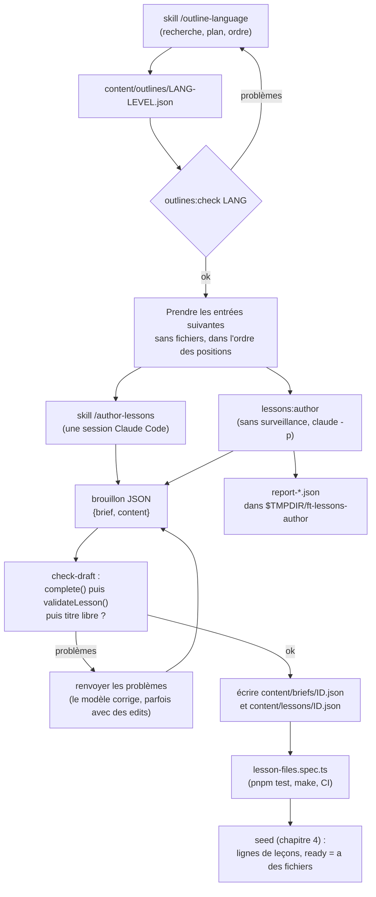
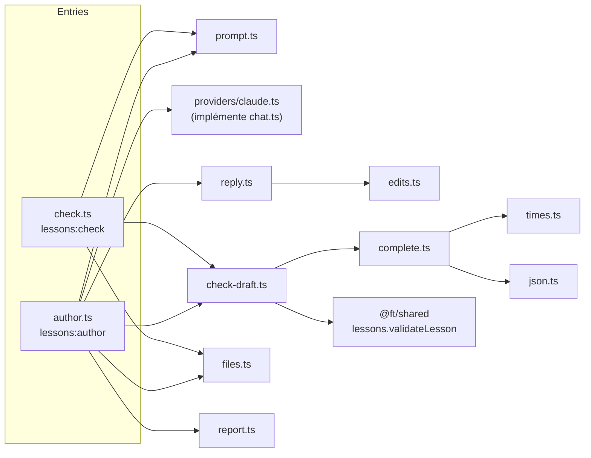
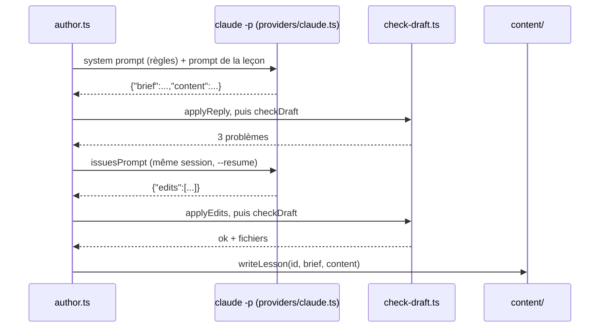

# Chapitre 11 — Le dossier scripts

Dans ce chapitre :

- Ce qu'est un « script » ici, et en quoi il diffère du serveur de l'API
- Le dossier `content/` et la **chaîne d'écriture des leçons** : outlines → briefs → leçons
- Comment chaque script est lancé (`package.json`, pnpm, les skills de Claude Code)
- [check-outlines.ts](../../../apps/api/scripts/check-outlines.ts) et
  [try-generation.ts](../../../apps/api/scripts/try-generation.ts)
- Le kit d'écriture des leçons dans [scripts/lessons/](../../../apps/api/scripts/lessons), fichier par fichier
- Les specs qui testent le kit, et [item-files.spec.ts](../../../apps/api/src/items/item-files.spec.ts)

---

## 1. Vue d'ensemble

### Qu'est-ce qu'un script ?

Le serveur de l'API (chapitres 1 à 9) tourne tout le temps et répond aux requêtes HTTP. Un
**script** est différent : c'est un petit programme que tu lances **à la main** depuis le terminal.
Il fait une seule tâche, affiche le résultat, et s'arrête. Vois le serveur comme un restaurant
ouvert toute la journée, et un script comme le cuisinier qui vient le matin préparer les
ingrédients.

Les scripts sont des fichiers TypeScript lancés avec **[tsx](https://tsx.is)**, un outil qui
exécute un fichier `.ts` directement sans le compiler avant. Ils ne font **pas** partie de l'app
compilée (`nest build` ne compile que `src/`), donc ils ne tournent jamais en production.

```
apps/api/scripts/
├── check-outlines.ts      check one language's six outline files
├── try-generation.ts      ask the LLM for real placement questions, store them
└── lessons/               the lesson authoring kit (#83)
    ├── author.ts          ENTRY: lessons:author, writes lessons with Claude Code, unattended
    ├── check.ts           ENTRY: lessons:check, checks one lesson (or prints its rules)
    ├── check-draft.ts     complete + validate + title check: shared by both entries
    ├── complete.ts        fills in what the model is not asked to write
    ├── times.ts           computes every duration and time limit
    ├── reply.ts           reads the JSON in a model's reply
    ├── edits.ts           applies small "edits" instead of a whole lesson
    ├── prompt.ts          builds the text sent to the model
    ├── files.ts           paths, reads and writes in content/
    ├── json.ts            JSON helpers and sha256 hashing
    ├── report.ts          progress lines, final summary, JSON report
    └── providers/
        ├── chat.ts        the Provider interface, rate-limit and quota errors
        └── claude.ts      the only provider: runs `claude -p`
```

### Le dossier content

Les leçons ne sont **pas** écrites par le serveur pendant qu'il tourne. Ce sont des fichiers JSON,
écrits une fois, commités dans git, puis chargés dans la base de données par le seed (chapitre 4).
Ils vivent dans le dossier [content/](../../../content) à la racine :

| Dossier             | Ce qu'il contient                                                                                                                                           | Exemple                      |
| ------------------- | ----------------------------------------------------------------------------------------------------------------------------------------------------------- | ---------------------------- |
| `content/outlines/` | Le plan d'un niveau : une entrée par leçon (id, kind, topic ou theme, titre de travail, intention). 6 niveaux × 3 langues = 18 fichiers.                    | `fr-a1.json`                 |
| `content/briefs/`   | Un **brief** par leçon écrite : le plan de cette leçon (titre, objectif, cibles...).                                                                        | `fr-greetings.json`          |
| `content/lessons/`  | Le **fichier de contenu** : la leçon jouable. Chaque type en a un sauf le vocabulaire (une leçon de vocabulaire est construite à partir de son brief seul). | `fr-ordering-at-a-cafe.json` |
| `content/items/`    | Les questions de placement écrites à la main (chapitre 7). Vérifiées par `item-files.spec.ts`.                                                              | `de-grammar.json`            |

### La chaîne d'écriture des leçons



En mots :

1. Les **outlines** (plans de niveau) sont écrits d'abord (avec le skill `/outline-language` dans
   [.claude/skills/outline-language](../../../.claude/skills/outline-language/SKILL.md)) et vérifiés
   avec `outlines:check` jusqu'à ce qu'il affiche `ok`.
2. Pour chaque entrée, un modèle écrit un **brouillon** : un brief, puis un fichier de contenu.
3. Le kit **complète** le brouillon (les parties que le code peut calculer), le **valide** avec
   `validateLesson` de `@ft/shared`, et vérifie que le titre n'est pas encore utilisé.
4. Si quelque chose ne va pas, les problèmes retournent au modèle, qui les corrige (souvent avec de
   petites **edits**). Ça se répète quelques fois au maximum.
5. Quand la leçon passe, ses fichiers sont **écrits** dans `content/`. Un fichier n'est jamais
   écrasé : pour refaire une leçon, tu supprimes d'abord ses fichiers.
6. `lesson-files.spec.ts` vérifie à nouveau chaque fichier commité, et le seed les charge.
7. `lessons:author` affiche aussi un **rapport** (temps, tokens, coût) et l'enregistre en JSON.

Les règles d'une leçon ne sont **pas** dans le kit. Ce sont les schemas Zod et les validateurs de
`packages/shared/src/lessons/`. Le kit envoie leur **code source** au modèle, donc un changement de
règle arrive au prochain lancement sans rien d'autre à mettre à jour.

---

## 2. Comment les scripts sont lancés

Extrait de [apps/api/package.json](../../../apps/api/package.json) :

```json
    "generation:try": "tsx --env-file-if-exists=../../.env scripts/try-generation.ts",
    "outlines:check": "tsx scripts/check-outlines.ts",
    "lessons:author": "pnpm --filter @ft/shared run build && tsx scripts/lessons/author.ts",
    "lessons:check": "pnpm --filter @ft/shared run build && tsx scripts/lessons/check.ts"
```

| Script           | Commande typique (depuis la racine du repo)                                      | Notes                                                                                                       |
| ---------------- | -------------------------------------------------------------------------------- | ----------------------------------------------------------------------------------------------------------- |
| `outlines:check` | `pnpm --filter @ft/api outlines:check de --level B1`                             | lit `content/outlines`                                                                                      |
| `generation:try` | `LLM_PROVIDER=gemini pnpm --filter @ft/api generation:try b1 vocabulary grammar` | charge le `.env` de la racine s'il existe ; **écrit dans la base de données**, peut **dépenser des tokens** |
| `lessons:check`  | `pnpm --filter @ft/api lessons:check fr-greetings --draft draft.json`            | build `@ft/shared` d'abord                                                                                  |
| `lessons:author` | `pnpm --filter @ft/api lessons:author fr a1 --max 3`                             | build `@ft/shared` d'abord ; demande que Claude Code soit installé et connecté                              |

Pourquoi faire le build de `@ft/shared` d'abord ? Les scripts de leçons appellent
`lessons.validateLesson` et les formules de durée de `@ft/shared`, et ils doivent utiliser les
règles **actuelles**, pas un vieux build.

`pnpm --filter` lance un script **depuis `apps/api`**. Donc les scripts trouvent `content/` avec
`../../content` (le code dit : « pnpm --filter runs from apps/api, as vitest does »).

Il n'y a **pas de cible Makefile ni de tâche turbo** pour ces scripts ; tu les lances à la main. Les
deux **skills** de Claude Code les appellent :

- [.claude/skills/author-lessons/SKILL.md](../../../.claude/skills/author-lessons/SKILL.md) :
  `lessons:check <id> --rules`, puis `--draft <draft>`, puis `--write`.
- [.claude/skills/outline-language/SKILL.md](../../../.claude/skills/outline-language/SKILL.md) :
  `outlines:check <lang>`, aussi avec `--dir` sur un dossier de travail.

Les règles pour écrire le contenu sont expliquées pour les humains dans
[docs/content/lessons.md](../content/lessons.md) (sections 7 et 8).

---

## 3. [check-outlines.ts](../../../apps/api/scripts/check-outlines.ts)

**À quoi il sert** : il vérifie les six fichiers d'outline d'une langue pendant qu'on les écrit. Il
vérifie ce que vérifie [outline-files.spec.ts](../../../apps/api/src/lessons/outline-files.spec.ts),
**plus** le style maison que la spec laisse aux relecteurs.

**Exports** : rien. Il lance `main()`.

**Comment il marche** : il lit les arguments, puis fait une boucle sur les six niveaux :

```ts
const lang = LanguageSchema.safeParse(process.argv[2]);
const level = option("--level");
const onlyLevel = level === undefined ? undefined : LevelSchema.safeParse(level.toUpperCase());
if (!lang.success || onlyLevel?.success === false) {
  console.error(USAGE);
  process.exitCode = 1;
  return;
}
// pnpm --filter runs from apps/api, as vitest does.
const dir = resolve(option("--dir") ?? join(process.cwd(), "../../content/outlines"));
```

Pour chaque fichier, il collecte les **problèmes** (des chaînes de texte) au lieu de s'arrêter au
premier :

| Vérification                                                                                                  | Exemple de message                                                                             |
| ------------------------------------------------------------------------------------------------------------- | ---------------------------------------------------------------------------------------------- |
| le fichier existe, c'est du JSON valide                                                                       | `de-b1.json: missing`                                                                          |
| correspond à `LessonOutlineFileSchema` (Zod)                                                                  | `de-b1.json #3 de-modal-verbs.intent: ...` (le numéro et l'id de l'entrée, pas juste un index) |
| déclare le bon `lang` et le bon `level`                                                                       | `declares de A2`                                                                               |
| nombre d'entrées = `LESSONS_PER_LEVEL`                                                                        | `118 entries, expected 120`                                                                    |
| entrées par kind = `KIND_COUNTS`                                                                              | `grammar 40, expected 42`                                                                      |
| clés dans l'ordre `id, kind, topic/theme, workingTitle, intent`                                               | garde les fichiers faciles à comparer (diff)                                                   |
| pas de niveau dans un id (`-b1-`)                                                                             | une leçon peut changer de niveau et garder son id                                              |
| pas de tiret demi-cadratin ou cadratin, pas de guillemets (le français peut garder « »), pas de double espace | style maison                                                                                   |
| aucun id ou titre (normalisé) utilisé deux fois dans la langue                                                | doublons sur les six niveaux                                                                   |

```ts
// A lesson can move level and keep its id (docs/content/lessons.md section 5).
if (/(^|-)[abc][12](-|$)/.test(entry.id)) problems.push(`${at}: id names a level`);
```

À la fin, `--level` ne garde que les problèmes qui nomment le fichier de ce niveau, « so several
people or agents can each fix one file while the others are half done » (pour que plusieurs
personnes ou agents puissent chacun corriger un fichier pendant que les autres sont à moitié faits).
Il affiche `ok`, ou la liste et `process.exitCode = 1`.

**Qui l'appelle** : les personnes et le skill `/outline-language`.

---

## 4. [try-generation.ts](../../../apps/api/scripts/try-generation.ts)

**À quoi il sert** : un vrai test du générateur de questions par IA (chapitre 7), en dehors des
tests. Son en-tête prévient : « WRITES to DATABASE_URL and, with Gemini, spends tokens » (il écrit
dans DATABASE_URL et, avec Gemini, dépense des tokens).

**Comment il marche** : il construit à la main, sans Nest, les mêmes objets que le serveur :

```ts
  const categories = picked.data.length > 0 ? picked.data : QUESTION_CATEGORIES;
  const prisma = new PrismaService();
  const stock = new QuestionStockService(prisma, createLlmProvider(process.env));

  try {
    for (const lang of LEARNABLE_LANGUAGES) {
      for (const category of categories) {
        const cell = { lang, level: level.data, category };
        const started = new Date();
        const { status } = await stock.restock(cell, 0);
        const ms = Date.now() - started.getTime();
        if (status !== 'filled') process.exitCode = 1;
```

Pour un niveau, toutes les langues, et les catégories choisies (ou les trois), il appelle
`QuestionStockService.restock` (le même code que celui de l'examen de placement), puis relit les
nouvelles lignes générées (`sourceId: null`, créées après `started`) et les affiche en JSON avec le
statut et le temps. `finally` déconnecte Prisma.

**Qui l'appelle** : un développeur, pour voir la vraie sortie d'un provider, comme montré dans
[docs/content/item-bank.md](../content/item-bank.md).

---

## 5. Le kit d'écriture des leçons : [scripts/lessons/](../../../apps/api/scripts/lessons)

Deux points d'entrée partagent la même vérification :



On suit un lancement de `lessons:author`, dans l'ordre où le code s'exécute.

### 5.1 [author.ts](../../../apps/api/scripts/lessons/author.ts) : l'écrivain sans surveillance

**À quoi il sert** : il écrit les leçons d'un niveau avec Claude Code, sur l'abonnement du membre
(pas de clé d'API), 12 leçons par lancement par défaut. Son en-tête dessine la boucle :

```ts
 *   the model writes the lesson ─→ complete + validateLesson (check-draft.ts) ─→ ok: write the files
 *          ▲                                                    │
 *          └──────────── the issues, same conversation ─────────┘  at most --attempts times
```

**Options** (`readOptions`, avec le `parseArgs` de Node en mode `strict`, donc une option inconnue
est une erreur) : `--only`, `--max` (12), `--concurrency` (2), `--model` (sonnet), `--effort`,
`--attempts` (4), `--timeout` (15 minutes par réponse), `--claude-bin`.

**`pickLessons`** choisit les entrées : pas encore de fichiers, correspondant à `--only`, au plus
`--max`. Il refuse un choix qui laisserait un **trou**, parce que « the lessons with files are the
level's first entries » (les leçons qui ont des fichiers sont les premières entrées du niveau) : les
leçons prêtes doivent former un début d'outline sans trou.

**`authorLesson`** écrit une leçon :

```ts
while (run.attempts < s.attempts && !s.stop) {
  run.attempts++;
  const reply = await chat.send(prompt);
  addUsage(run, reply);

  const read = applyReply(draft, reply.text);
  if ("error" in read) {
    issues = [{ path: "", message: read.error }];
    prompt = issuesPrompt(issues, []);
    continue;
  }
  const check = checkDraft(draft, ctx, s.usedTitles);
  draft = check.completed;
  issues = check.issues;
  // A failed edit is sent back even when the lesson passes: the model meant something else.
  if (check.files && read.editProblems.length === 0) {
    // No await between the title check and this line: two lessons cannot take one title.
    s.usedTitles.set(foldText(check.files.title), { title: check.files.title, id: entry.id });
    await writeLesson(entry.id, check.files.brief, check.files.content);
    run.outcome = "written";
    return run;
  }
  prompt = issuesPrompt(issues, read.editProblems);
}
```

- Chaque leçon a **une seule conversation** (`startChat`), donc le modèle voit ses réponses
  précédentes et corrige sa propre leçon.
- Le titre est réservé dans `usedTitles` **juste après** la vérification, sans `await` entre les
  deux, donc deux leçons qui tournent en même temps ne peuvent pas prendre le même titre.
- Une leçon qui échoue laisse son dernier brouillon dans `WORK_DIR/failed/<id>.json`.
- Une `QuotaError` (limite d'utilisation) met `s.stop` : toutes les autres leçons s'arrêtent après
  leur réponse en cours.

**`pool`** lance `authorLesson` sur `concurrency` leçons à la fois, et arrête d'en prendre de
nouvelles dès que `stopped()` est vrai. **`main`** assemble le tout, affiche le résumé et le chemin
du rapport, et sort avec le code 1 si quelque chose n'a pas été écrit.



### 5.2 [files.ts](../../../apps/api/scripts/lessons/files.ts) : où vivent les choses

**Exports** : `BRIEFS_DIR`, `LESSONS_DIR`, `WORK_DIR`, `Located`, `readJson`, `writeWork`,
`readOutline`, `locate`, `filesOf`, `readUsedTitles`, `writeLesson`.

- `WORK_DIR` est `$TMPDIR/ft-lessons-author` : « what the kit keeps between runs but nobody
  commits » (ce que le kit garde entre deux lancements mais que personne ne commite : system
  prompts, brouillons ratés, rapports).
- `readOutline(lang, level)` parse un outline avec son schema Zod.
- `locate(id)` trouve un id dans les six outlines de sa langue (`fr-greetings` → `fr`, son niveau,
  son entrée).
- `filesOf(entry)` répond `'none'`, `'partial'` ou `'complete'`. « Partial » (un brief sans son
  contenu, ou une leçon de vocabulaire avec un fichier de contenu qu'elle ne devrait pas avoir) est
  laissé tel quel.
- `readUsedTitles(lang)` lit le titre de chaque brief, **normalisé** (majuscules et accents retirés
  avec `foldText`), donc « Les métiers » et « les metiers » comptent comme le même titre.
- `writeLesson` formate le JSON avec **prettier**, en utilisant la config prettier du repo, pour que
  les fichiers ressemblent au reste de `content/`.

### 5.3 [prompt.ts](../../../apps/api/scripts/lessons/prompt.ts) : ce que lit le modèle

**Exports** : `PROMPT_VERSION` (`'author-4'`, noté dans la provenance de chaque fichier),
`systemPrompt(kind)`, `lessonPrompt(request)`, `issuesPrompt(issues, editProblems)`.

Le **system prompt** est le même pour toutes les leçons d'un même kind, donc le provider peut le
mettre en cache. Il contient « the ground truth, not a summary of it » (la vérité de référence, pas
un résumé) : les fichiers source des schemas et des validateurs pour ce kind (de
`packages/shared/src/lessons/`), une leçon complète qui passe, et le format de réponse :

```ts
const files = [...COMMON, ...sources]
  .map(
    (f) =>
      `<source path="packages/shared/src/lessons/${f}">\n${readFileSync(join(LESSONS, f), "utf8")}\n</source>`,
  )
  .join("\n\n");
```

Il liste aussi ce que le programme calcule (pour que le modèle puisse le laisser de côté), et « What
the checks cannot see » (ce que les vérifications ne voient pas) : une seule bonne réponse par trou
d'examen, chaque orthographe acceptée, les accords, pas de faux « seulement » ou « jamais », et le
texte d'aide en français qui utilise le **tu**.

Le **prompt de la leçon** contient ce qui change d'une leçon à l'autre : l'entrée de l'outline, les
**cinq entrées de chaque côté** (pour que le modèle ne les répète pas et n'enseigne pas ce qui vient
plus tard), et les titres déjà pris. Le **prompt des problèmes** liste ce qui ne va toujours pas et
demande des `edits` quand seules quelques choses sont fausses.

### 5.4 [providers/chat.ts](../../../apps/api/scripts/lessons/providers/chat.ts) : l'interface

**Exports** : les types `Usage`, `Reply`, `Chat`, `Provider` ; les erreurs `QuotaError` et
`RateLimitError` ; `QUOTA_MESSAGE`, `RATE_LIMIT_MESSAGE`, `refusal`, `RETRY_DELAYS_MS`,
`retryRateLimits`.

```ts
export interface Chat {
  send(prompt: string): Promise<Reply>;
}

export interface Provider {
  name: string;
  model: string;
  /** One line for the run's header: the binary it runs. */
  where: string;
  startChat(kind: LessonKind): Chat;
}
```

N'importe quel modèle peut se brancher en implémentant `Provider`. Deux types de refus sont
distingués :

| Erreur           | Signification                                                                                                                              | Ce qui se passe                                             |
| ---------------- | ------------------------------------------------------------------------------------------------------------------------------------------ | ----------------------------------------------------------- |
| `RateLimitError` | refus court (« rate limit », « too many requests », HTTP 429)                                                                              | `retryRateLimits` attend 30 s, 1 min, 2 min et réessaie     |
| `QuotaError`     | refus durable (« usage limit », « limit reached », « quota »), ou une limite de débit qui dure plus longtemps que les nouvelles tentatives | tout le lancement s'arrête ; le prochain lancement continue |

`refusal(status, message)` choisit la bonne ; les regex sont « narrow on purpose: a crash that only
says 'limit' somewhere (a memory limit, a line limit) fails one lesson, not the run » (étroites
exprès : un plantage qui dit seulement « limit » quelque part, comme une limite de mémoire ou de
lignes, fait échouer une leçon, pas tout le lancement).

### 5.5 [providers/claude.ts](../../../apps/api/scripts/lessons/providers/claude.ts) : Claude Code sans interface

**Exports** : `ClaudeOptions`, `findClaude`, `claudeProvider`.

Il lance `claude -p` (Claude Code sans son interface) avec le login du membre. Chaque appel est
coupé du repo et de la configuration du membre :

```ts
const baseArgs = [
  ...["-p", "--output-format", "json", "--model", o.model],
  ...["--tools", "", "--setting-sources", "", "--strict-mcp-config"],
  ...(o.effort ? ["--effort", o.effort] : []),
];
```

Pas d'outils, pas de settings, pas de serveurs MCP, et `--system-prompt-file` avec le system prompt
du kit (un fichier par kind, écrit dans `WORK_DIR`). La première réponse donne un `session_id` ; les
prompts suivants de la même leçon ajoutent `--resume <session>`, et c'est comme ça qu'une leçon
reste une seule conversation.

- `findClaude()` utilise `claude` depuis le PATH, sinon le binaire fourni par l'extension VS Code
  (un dev container n'a souvent que celui-là).
- `runClaude` lance le processus dans `WORK_DIR` (pour que ses sessions restent hors de la liste du
  membre), écrit le prompt sur stdin, le tue après le timeout (SIGTERM, puis SIGKILL après 5 s), et
  transforme la sortie d'erreur en `QuotaError`, `RateLimitError` ou une simple `Error`.
- `toReply` lit le nombre de tokens et `total_cost_usd` dans la sortie JSON. Le coût est le prix de
  l'API, « not billed on a subscription: a measure of the quota used » (pas facturé sur un
  abonnement : une mesure du quota utilisé).

### 5.6 [reply.ts](../../../apps/api/scripts/lessons/reply.ts) : lire la réponse

**Exports** : `parseReply(text)`, `applyReply(draft, text)`.

Un modèle entoure parfois son JSON d'un bloc de code ou ajoute du texte après. `parseReply` trouve
la **première** `{` et avance jusqu'à l'accolade qui la ferme, en sautant les accolades à
l'intérieur des chaînes :

```ts
for (let i = start; i < text.length; i++) {
  const ch = text[i];
  if (inString) {
    // A backslash skips the character after it, so \" does not end the string.
    if (ch === "\\") i++;
    else if (ch === '"') inString = false;
  } else if (ch === '"') inString = true;
  else if (ch === "{") depth++;
  else if (ch === "}" && --depth === 0) return JSON.parse(text.slice(start, i + 1));
}
```

`applyReply` accepte trois formes : `{"brief":…,"content":…}` (la leçon entière), `{"edits":[…]}`
(passé à `applyEdits`), ou un brief seul (certains modèles envoient ça pour le vocabulaire). Il
renvoie les problèmes d'edits, ou un message d'erreur pour une réponse qu'il ne peut pas lire.

### 5.7 [edits.ts](../../../apps/api/scripts/lessons/edits.ts) : de petites corrections

**Exports** : `Edit`, `applyEdits(draft, edits)`.

Pour corriger trois problèmes, le modèle peut n'envoyer que les changements :

```
{"edits":[{"file":"brief","path":"targets.3.examForms","value":["un livre"]},
          {"file":"content","path":"steps.2.pages.0.items.1","delete":true}]}
```

Chaque chemin se réfère au brouillon **tel que le modèle l'a vu**. Donc les modifications (sets)
sont appliquées d'abord, et les suppressions en dernier, **de l'index le plus haut vers le plus
bas** : « deleting items 1 and 3 of a list removes those two, not 1 and then what was 4 »
(supprimer les éléments 1 et 3 d'une liste retire ces deux-là, pas le 1 puis ce qui était le 4).
Tout ce qui ne peut pas s'appliquer est signalé en retour, jamais deviné (index hors limites, chemin
manquant). `__proto__`, `constructor` et `prototype` sont refusés, parce qu'ils atteindraient le
prototype de tous les objets.

### 5.8 [check-draft.ts](../../../apps/api/scripts/lessons/check-draft.ts) : la vérification partagée

**Exports** : `Issue`, `DraftCheck`, `checkDraft(draft, ctx, usedTitles)`.

```
draft ─→ complete() ─→ validateLesson ─→ title not taken? ─→ ok, the files to write
                                                           or every issue
```

```ts
  const completed = complete(draft, ctx);
  const result = lessons.validateLesson(completed.brief, completed.content, ctx);
  if (!result.ok) return { completed, issues: result.issues };

  const taken = usedTitles.get(foldText(result.title));
  if (taken && taken.id !== ctx.entry.id)
```

L'id de la leçon elle-même est ignoré, donc vérifier une leçon déjà écrite ne signale pas son propre
titre. `author.ts` et `check.ts` l'appellent tous les deux, donc les deux façons d'écrire une leçon
sont jugées de la même manière.

### 5.9 [complete.ts](../../../apps/api/scripts/lessons/complete.ts) : ce que le code écrit lui-même

**Exports** : `Draft`, `CompleteContext`, `GENERATOR` (`'ft lessons:author'`), `complete`.

On ne demande pas au modèle d'écrire ce que le code connaît ou peut calculer exactement. `complete`
l'ajoute :

- l'**enveloppe** : `schemaVersion`, `id`, `lang`, `level`, `locales`, `kind`, `topic` ou `theme`,
  placés en premier dans l'ordre du schema (`withEnvelope` étale la tête deux fois : une fois pour
  l'ordre, une fois pour que ses valeurs gagnent) ;
- la **provenance** : générateur, modèle, version du prompt, date, et `inputHashes` (le sha256 de
  l'entrée de l'outline, et pour le contenu aussi celui du brief final, « since the content is
  written from the brief » — puisque le contenu est écrit à partir du brief) ;
- les poids du **score** (pratique 35, examen 65) ;
- chaque **durée** (via `computeTimes`).

Une leçon de vocabulaire n'a pas de fichier de contenu, donc un fichier de contenu envoyé par le
modèle est jeté. Le brouillon reçu n'est pas modifié (`structuredClone`).

### 5.10 [times.ts](../../../apps/api/scripts/lessons/times.ts) : chaque durée

**Exports** : `pagesOf`, `computeTimes(kind, brief, content, level)`.

Les validateurs recalculent les durées à la seconde près, donc le modèle ne les écrit jamais ; elles
viennent des formules de `@ft/shared` et sont toujours d'accord :

| Kind       | Le modèle choisit                                                           | Calculé ici                                                                  |
| ---------- | --------------------------------------------------------------------------- | ---------------------------------------------------------------------------- |
| vocabulary | rien                                                                        | `targetCount`, `estimatedMinutes`                                            |
| grammar    | chaque `estimatedDurationS`, les limites de temps de l'examen dans le brief | `estimatedMinutes` (les deux fichiers), le `timeLimitS` des pages de contenu |
| functions  | rien                                                                        | la durée et la limite de chaque page, `estimatedMinutes`                     |
| reading    | rien                                                                        | pareil, plus chaque `skimSeconds`                                            |

Chaque fonction travaille sur du JSON brut qui n'est pas encore passé par un schema. Les parties
cassées sont laissées telles que le brouillon les a écrites (`try { … } catch {}`), et
`validateLesson` les signale.

### 5.11 [json.ts](../../../apps/api/scripts/lessons/json.ts) : fonctions utiles

**Exports** : `Json` (un type `any` pour la sortie non typée du modèle), `isObject`,
`canonicalJson`, `sha256`. `canonicalJson` trie les clés et retire les espaces, donc la même valeur
donne toujours le même texte, et donc le même hash : `canonicalJson({ b: 1, a: [2] })` →
`'{"a":[2],"b":1}'`.

### 5.12 [report.ts](../../../apps/api/scripts/lessons/report.ts) : ce que tu vois

**Exports** : `Outcome`, `LessonRun`, `newRun`, `addUsage`, `clock`, `printProgress`,
`failedDraftPath`, `Summary`, `printSummary`, `saveReport`.

Une ligne par leçon terminée (`✓ [3/12] fr-greetings vocabulary 2 attempts 1 min 40 s …`), puis un
résumé : écrites / ratées / pas faites, temps réel par leçon, moyennes **par kind**, tokens, le coût
équivalent API, et une estimation du temps restant pour le niveau. `saveReport` écrit les mêmes
chiffres dans `WORK_DIR/report-<date>.json`. Ce sont les chiffres cités dans le tableau des temps de
[docs/content/lessons.md](../content/lessons.md).

### 5.13 [check.ts](../../../apps/api/scripts/lessons/check.ts) : vérifier une leçon

**À quoi il sert** : la boucle du skill `/author-lessons`, et l'outil pour quiconque écrit une leçon
à la main avec un autre modèle.

```
lessons:check <id> --rules                    the prompt lessons:author would send
lessons:check <id> --draft <file>             checks a draft: {"brief":…,"content":…}
lessons:check <id> --draft <file> --write     …and writes it to content/ when valid
lessons:check <id>                            checks the lesson's committed files
```

Comment il marche :

- `--rules` affiche `systemPrompt(kind)` et `lessonPrompt(...)` : tu colles ça dans n'importe quel
  modèle.
- `--draft` est lu par rapport à `INIT_CWD` (le dossier où tu as tapé la commande ; pnpm le
  définit), pas `apps/api`.
- Un brouillon avec **seulement un brief** est vérifié comme un brief : le fichier de contenu
  manquant n'est pas encore un problème, et un `estimatedMinutes` provisoire permet de vérifier le
  reste. Il affiche « the brief passes; write the content next » (le brief passe ; écris le contenu
  ensuite).
- `--write` refuse si la leçon a déjà des fichiers.
- Code de sortie 1 tant qu'il reste quelque chose à corriger.

L'en-tête donne un avertissement : sur les fichiers commités, `complete` tourne à nouveau et
recalcule chaque durée, donc un fichier avec de mauvaises durées passerait ici.
`lesson-files.spec.ts` vérifie les fichiers tels qu'ils sont, et l'attrape.

---

## 6. Les specs de ce chapitre

Le dossier scripts n'a pas de tests à lui ; les specs vivent dans `src/` pour que `pnpm test` les
lance.

| Spec                                                                             | Ce qu'elle vérifie                                                                                                                                                                                                                                                                                                                             |
| -------------------------------------------------------------------------------- | ---------------------------------------------------------------------------------------------------------------------------------------------------------------------------------------------------------------------------------------------------------------------------------------------------------------------------------------------- |
| [lesson-complete.spec.ts](../../../apps/api/src/lessons/lesson-complete.spec.ts) | Prend des leçons prototypes de chaque kind (de `packages/shared/test/fixtures`), retire ce qu'on dit au modèle de laisser de côté, lance `complete`, et vérifie que le résultat passe `validateLesson` et retrouve **les mêmes durées à la seconde près**. Aussi les hashes de provenance, le contenu de vocabulaire jeté, et `canonicalJson`. |
| [lesson-edits.spec.ts](../../../apps/api/src/lessons/lesson-edits.spec.ts)       | `applyEdits` (chemins avec points, ordre des suppressions, mauvais index, ajout en fin, `__proto__` refusé), `parseReply`, `applyReply`, `refusal`, `retryRateLimits`.                                                                                                                                                                         |
| [outline-files.spec.ts](../../../apps/api/src/lessons/outline-files.spec.ts)     | Chaque outline commité (ce que `outlines:check` vérifie aussi, sans le style maison).                                                                                                                                                                                                                                                          |
| [lesson-files.spec.ts](../../../apps/api/src/lessons/lesson-files.spec.ts)       | Chaque brief et fichier de contenu commité, **tel qu'il est écrit** (sans `complete`).                                                                                                                                                                                                                                                         |

### [item-files.spec.ts](../../../apps/api/src/items/item-files.spec.ts)

Cette spec vérifie les **questions de placement** écrites à la main dans `content/items` (un fichier
par langue et par catégorie, comme `fr-grammar.json`). Elle est dans ce chapitre parce qu'elle joue
le même rôle que les scripts : elle vérifie des fichiers de contenu, pas du code.

Son en-tête explique deux choix :

```ts
/**
 * Validates the authored placement questions in content/items.
 *
 * A test rather than a standalone script: it runs in `make`, in `pnpm test` and
 * in CI with no extra wiring, and it fails for the person who wrote the item
 * instead of for whoever runs the seed a week later.
 *
 * It lives here rather than in @ft/shared because reading files needs Node, and
 * that package is a pure contract layer that the browser bundle also pulls in.
 * The api owns it because the api is what will seed these files.
 */
```

`describe.each(files)` crée un groupe de tests **par fichier** :

```ts
  describe.each(files)('%s', (name) => {
    const parsed = ItemFileSchema.safeParse(read(name));

    it('matches the item file schema', () => {
      // Printing the issues makes the failure actionable for an author who has
      // never seen a Zod error before.
      const issues = parsed.success
        ? ''
        : parsed.error.issues.map((i) => `  ${i.path.join('.')}: ${i.message}`).join('\n');
      expect(issues, `${name} is not a valid item file:\n${issues}\n`).toBe('');
    });
```

Comparer une chaîne de problèmes avec `''` (au lieu de `expect(parsed.success).toBe(true)`) veut
dire qu'un échec **affiche chaque problème** avec son chemin. Les autres tests :

- le nom du fichier correspond à `itemFileName(lang, category)` ;
- aucun `sourceId` n'est dans deux fichiers (« Ids are permanent: PlacementAnswer rows point at
  them » — les ids sont permanents : des lignes PlacementAnswer pointent vers eux) ;
- les catégories manquantes par langue sont **signalées** avec `console.info`, pas en échec, parce
  que « a language part-way through authoring is a normal state » (une langue à moitié écrite est un
  état normal).

---

## Idées clés à retenir

- Les scripts se lancent **à la main** avec `tsx` via `pnpm --filter @ft/api <script>` ; ils ne
  font pas partie du serveur compilé.
- Les leçons sont des **fichiers** dans `content/`, écrits une fois avec le kit, commités, puis
  chargés par le seed.
- La chaîne est **outlines → brief → contenu → vérification → écriture** ; la vérification est
  toujours `complete()` puis `validateLesson()` puis la vérification du titre (`check-draft.ts`).
- Le modèle écrit seulement le texte ; **le code écrit** l'enveloppe, la provenance, le score et
  chaque durée.
- Les règles envoyées au modèle sont le **vrai code source** des validateurs, donc elles ne se
  décalent jamais.
- `lessons:author` lance `claude -p` sans outils et sans settings, une conversation par leçon,
  réessaie les limites de débit courtes, et arrête le lancement sur une limite d'utilisation.
- Le kit **n'écrase jamais** un fichier et ne laisse jamais de trou dans un niveau.
- `outlines:check` et `lessons:check` servent à écrire ; les specs (`outline-files`,
  `lesson-files`, `item-files`) sont le contrôle dans `pnpm test`, `make` et la CI.

---

Précédent : [Chapitre 10 — Tests](10-tests.md) · [Retour à l'index](README.md)
