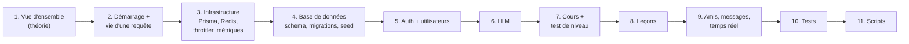

# L'API, expliquée depuis zéro

Ce dossier explique **tout ce qu'il y a dans `apps/api`** : ce que fait chaque dossier et chaque fichier, et pourquoi.
Il est écrit en français simple. Lis les chapitres dans l'ordre : chacun s'appuie sur le précédent.

Les chapitres suivent la façon dont le programme tourne. On commence par la porte d'entrée
([app.setup.ts](../../apps/api/src/app.setup.ts) et [main.ts](../../apps/api/src/main.ts)), puis on
ouvre les modules un par un, dans l'ordre où une requête les rencontre.

## Les chapitres

| #   | Chapitre                                                           | Ce que tu apprends                                                                                           | Dossiers principaux                                                      |
| --- | ------------------------------------------------------------------ | ------------------------------------------------------------------------------------------------------------ | ------------------------------------------------------------------------ |
| 1   | [Vue d'ensemble](01-big-picture.md)                                | Ce qu'est une API, HTTP, REST, comment marche NestJS (modules, controllers, services, injection), les outils | fichiers à la racine de `apps/api/`                                      |
| 2   | [Démarrage et parcours d'une requête](02-boot-and-request-flow.md) | Ce qui se passe quand l'API démarre, et le chemin complet d'une requête                                      | `main.ts`, `app.setup.ts`, `app.module.ts`                               |
| 3   | [Infrastructure](03-infrastructure.md)                             | Les modules sur lesquels tous les autres modules s'appuient                                                  | `src/prisma`, `src/redis`, `src/throttler`, `src/metrics`, `src/health`  |
| 4   | [Base de données](04-database.md)                                  | PostgreSQL, Prisma, chaque table, les migrations, le seed                                                    | `prisma/`, `src/generated`                                               |
| 5   | [Auth et utilisateurs](05-auth-and-users.md)                       | Inscription, connexion, sessions, 2FA, profils, avatars                                                      | `src/auth`, `src/users`                                                  |
| 6   | [LLM](06-llm.md)                                                   | Comment l'API parle à un modèle d'IA                                                                         | `src/llm`                                                                |
| 7   | [Cours et test de niveau](07-courses-placement.md)                 | Les cours, le test de niveau (placement), les questions écrites par l'IA                                     | `src/courses`, `src/placement`, `src/question-generation`                |
| 8   | [Leçons](08-lessons.md)                                            | Les leçons, les tentatives, l'XP et les succès, le tuteur IA                                                 | `src/lessons`                                                            |
| 9   | [Social et temps réel](09-social-and-realtime.md)                  | WebSockets, présence, amis, chat, les données de démo                                                        | `src/gateway`, `src/presence`, `src/friends`, `src/messages`, `src/demo` |
| 10  | [Tests](10-tests.md)                                               | Tests unitaires, tests end-to-end, mocks, fixtures, couverture                                               | `*.spec.ts`, `test/`                                                     |
| 11  | [Scripts](11-scripts.md)                                           | Les outils en ligne de commande qui écrivent et vérifient les leçons                                         | `scripts/`                                                               |

## Comment lire le code à côté de la doc

- Chaque chapitre a des liens vers les vrais fichiers. Ouvre-les côte à côte.
- Les extraits de code sont copiés des vrais fichiers. Si le code change, c'est le code qui a raison.
- Les mots en **gras** sont expliqués la première fois qu'ils apparaissent.

L'application web a son propre guide : [docs/web](../web/README.md).
