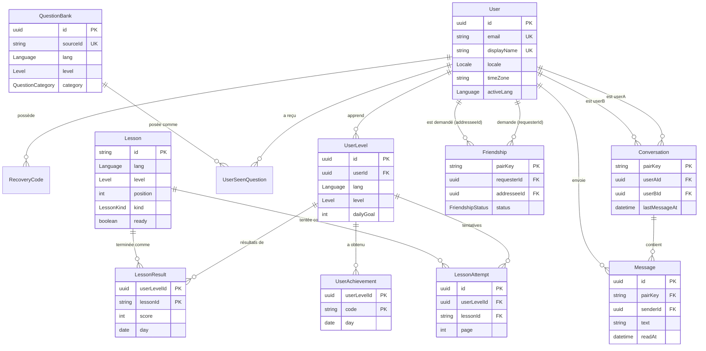

# Modèle de données

Les tables telles qu'elles existent sur cette branche. La source de vérité est
[apps/api/prisma/schema.prisma](../../apps/api/prisma/schema.prisma) et ses migrations dans
[apps/api/prisma/migrations/](../../apps/api/prisma/migrations/). Si cette page et le schema ne
sont pas d'accord, c'est le schema qui a raison, et c'est cette page qu'il faut changer.

[architecture/product.md](product.md) explique le produit que ces tables servent,
[architecture/realtime.md](realtime.md) le socket et le stream qui écrivent dans certaines d'entre elles, et
[content/lessons.md](../content/lessons.md) et [content/item-bank.md](../content/item-bank.md) le
contenu que le seed copie dans `Lesson` et `QuestionBank`.

---

## 1. Les règles

**Douze tables**, toutes migrées : `User` et `RecoveryCode` (comptes et 2FA) ; `UserLevel`,
`QuestionBank` et `UserSeenQuestion` du Milestone 1 ; `Lesson`, `LessonResult`, `LessonAttempt`
et `UserAchievement` du Milestone 2 ; `Friendship`, `Conversation` et `Message` du
Milestone 3.

- **Une table mérite sa place si elle est lue pendant l'exécution**, et une relation 1:1 est une colonne, pas une
  table.
- **Il n'y a pas de vues SQL.** Les « vues » du lecteur de leçons sont des schemas Zod de ce que le navigateur
  a le droit de voir ([content/lessons.md](../content/lessons.md) §10,
  [milestone2-data-model.html](../../docs/site/milestone2-data-model.html#player)).
- **Clés.** La plupart des tables ont un `id` UUID. Cinq n'en ont pas : `LessonResult` et `UserAchievement` ont
  pour clé leur paire (`(userLevelId, lessonId)` et `(userLevelId, code)`), `Friendship` et
  `Conversation` ont pour clé `pairKey`, les deux ids d'utilisateur avec le plus petit en premier, car c'est la paire qui
  rend une ligne unique. `Lesson` a pour clé son id écrit à la main (`de-separable-verbs`), car elle est
  remplie par le seed depuis le contenu et les résultats s'y rattachent.
- **Supprimer un compte ne laisse aucune ligne orpheline.** Chaque relation vers `User` et vers `UserLevel` est
  `onDelete: Cascade`. Le seul `Restrict` est `LessonResult.lessonId` : une leçon qui a des résultats ne peut
  pas être supprimée.

---

## 2. Le schema complet



Le diagramme montre seulement les colonnes clés. Les tableaux plus bas listent toutes les colonnes.

---

## 3. Les langues et les autres enums

```prisma
enum Locale           { en fr de }                 // the language the interface is rendered in
enum Language         { en fr de }                 // the language being taught
enum Level            { A1 A2 B1 B2 C1 C2 }
enum Role             { USER ADMIN }
enum QuestionCategory { vocabulary grammar reading }
enum FriendshipStatus { pending accepted }
enum LessonKind       { grammar vocabulary functions reading }
enum Topic            { … }                        // 13 grammar categories
enum Theme            { … }                        // 14 themes
```

`Locale` et `Language` ont les trois mêmes valeurs aujourd'hui, mais ils répondent à deux questions
différentes. `User.locale` est la langue de l'interface. `UserLevel.lang`, `QuestionBank.lang` et
`Lesson.lang` disent ce qui est enseigné. Un anglophone qui apprend le français a l'un à `en` et
l'autre à `fr`, donc un seul enum pour les deux rendrait cette ligne impossible à écrire. Ils deviendront différents le
jour où sortira une langue à apprendre dans laquelle l'interface n'est pas traduite, et rien n'aura besoin de changer
ce jour-là. Le commentaire du schema donne la raison d'un enum plutôt que d'une string : la base de données
refuse une valeur que l'application ne sait pas encore afficher.

**Les deux apparaissent dans l'URL, et ils ne veulent pas dire la même chose.** Le cours est un segment du chemin :
`/{locale}/learn/{lang}/…`, donc `/fr/learn/de` est une interface en français qui enseigne l'allemand. Avec le
cours dans le chemin plutôt que dans une colonne, on peut partager un lien, le bouton retour marche, et deux
onglets peuvent être sur deux cours en même temps.

**Un apprenant étudie plusieurs langues à la fois, donc « est-ce que cette personne a fait l'onboarding » est toujours une
question sur `(userId, lang)`.** Quelqu'un qui a fini le français et ajoute l'allemand a quand même
besoin de l'onboarding pour l'allemand. Une vérification qui demande seulement « est-ce que cet utilisateur a un niveau quelconque » se trompe
dans ce cas, sans rien dire, et seulement pour les utilisateurs qui aiment le plus le produit.

---

## 4. Comptes

| Table          | Colonnes                                                                                                                                                 | Clés et index                         | À quoi elle sert                                                                                                                                                                                                                                                                     |
| -------------- | -------------------------------------------------------------------------------------------------------------------------------------------------------- | ------------------------------------- | ------------------------------------------------------------------------------------------------------------------------------------------------------------------------------------------------------------------------------------------------------------------------------------ |
| `User`         | id, email, displayName, passwordHash, avatarUrl?, locale, role, createdAt, updatedAt, timeZone, lastActiveDay?, totpSecret?, totpEnabledAt?, activeLang? | `email` unique, `displayName` unique  | Un compte. Utilisée par l'inscription et la connexion, le profil, la 2FA, chaque cours et les fonctions sociales. Détails plus bas                                                                                                                                                   |
| `RecoveryCode` | id, userId, codeHash, usedAt?, createdAt                                                                                                                 | `codeHash` unique, index sur `userId` | Les codes de secours 2FA à usage unique. Stockés en empreinte SHA-256, pas en argon2 : les codes sont assez aléatoires pour qu'il n'y ait rien à brute-forcer, et une empreinte permet à une connexion de vérifier avec une seule recherche indexée. `usedAt` marque un code utilisé |

Les colonnes de `User` qui méritent une explication :

- **`passwordHash`** est en argon2id. Lui, les colonnes `totp*` et `lastActiveDay` n'ont pas d'équivalent dans
  `UserSchema` de [packages/shared/src/schemas/user.ts](../../packages/shared/src/schemas/user.ts),
  et ça doit rester comme ça (c'est le commentaire du schema lui-même).
- **`locale`** (par défaut `en`) est la langue de l'interface, stockée pour que le serveur puisse répondre dans cette langue :
  le tuteur des leçons la lit (`discussionPrompt(…, user.locale, …)` dans
  [discussion.service.ts](../../apps/api/src/lessons/discussion.service.ts)). L'app web l'écrit :
  `LocaleSync` ([apps/web/components/locale-sync.tsx](../../apps/web/components/locale-sync.tsx))
  envoie `PATCH /api/users/me { locale }` quand la locale de l'URL est différente de celle stockée (#211).
  Aucune page ne l'affiche.
- **`timeZone`** est un fuseau IANA (`Europe/Zurich`), envoyé par le navigateur, `UTC` par défaut. Il
  décide quand la journée de l'apprenant se termine, donc chaque jour de l'objectif quotidien et de la série est compté dans
  ce fuseau ([product.md](product.md) §1.3). Aucun autre utilisateur ne le voit.
- **`activeLang`** a un seul rôle : décider où arrive une connexion simple quand l'URL ne nomme aucun cours.
  Changer l'objectif quotidien d'un cours ou son niveau le met à jour
  ([courses.service.ts](../../apps/api/src/courses/courses.service.ts)). Une page avec un `lang` dans son
  chemin l'ignore.
- **`lastActiveDay`** est le jour UTC où un onglet a ouvert son socket pour la dernière fois. Le gateway l'écrit une fois par
  jour, et `GET /api/users/recently-active` le lit (les 7 derniers jours). Il n'est jamais envoyé.
- **`totpSecret`** est rempli quand l'activation de la 2FA commence ; **`totpEnabledAt`** reste null jusqu'à ce qu'un premier
  code soit vérifié, donc une activation abandonnée ne bloque jamais une connexion.
- **`avatarUrl`** pointe vers un fichier envoyé, servi sous `/api/uploads/avatars`
  (`AVATAR_ROUTE` dans [app.setup.ts](../../apps/api/src/app.setup.ts)) ; le fichier lui-même est sur le disque,
  pas dans la base de données.

---

## 5. Apprentissage

| Table              | Colonnes                                                                                                                                               | Clés et index                                                            | À quoi elle sert                                                                                                                                                                                                                                                                                                                                                                                                                                                                                                                                                                                                                                                                                                                           |
| ------------------ | ------------------------------------------------------------------------------------------------------------------------------------------------------ | ------------------------------------------------------------------------ | ------------------------------------------------------------------------------------------------------------------------------------------------------------------------------------------------------------------------------------------------------------------------------------------------------------------------------------------------------------------------------------------------------------------------------------------------------------------------------------------------------------------------------------------------------------------------------------------------------------------------------------------------------------------------------------------------------------------------------------------ |
| `UserLevel`        | id, userId, lang, level?, dailyGoal, createdAt, updatedAt, streak, bestStreak, lastGoalDay?, xp, lastChallengeDay?, lastChallengeCode?, challengesDone | `(userId, lang)` unique                                                  | **Un cours.** Un utilisateur peut apprendre plusieurs langues, une ligne pour chacune. L'onboarding l'écrit avec `level` à null ; le test de placement le remplit, ou un apprenant qui saute le test le fixe directement. `streak`, `bestStreak` et `lastGoalDay` sont toute la série. Les quatre colonnes de gamification (#95) : `xp` le total du cours, `lastChallengeDay` le jour du cours où le défi quotidien a été fait pour la dernière fois, `lastChallengeCode` le défi sous lequel il a été fait, et `challengesDone` le nombre que lisent les succès liés aux défis. Commencer une tentative, envoyer chacune de ses pages (la dernière finit la leçon) et changer l'objectif verrouillent cette ligne (`SELECT … FOR UPDATE`) |
| `QuestionBank`     | id, sourceId?, lang, level, topic, category, readText?, question, options, answer, timeLimitS, createdAt, updatedAt                                    | `sourceId` unique, index sur `(lang, level, category)`                   | **Les questions de placement.** Remplies par le seed depuis `content/items/*.json` et réapprovisionnées par le LLM quand un apprenant en manque dans une case. `sourceId` est l'id écrit à la main sur lequel le seed fait la correspondance ; un `sourceId` null marque une question écrite par le LLM. `timeLimitS` est le compte à rebours de la question. L'index est la case qu'un tirage lit. Spécification complète dans [content/item-bank.md](../content/item-bank.md)                                                                                                                                                                                                                                                            |
| `UserSeenQuestion` | id, userId, questionId, createdAt, updatedAt                                                                                                           | `(userId, questionId)` unique                                            | **Les questions de placement qu'un apprenant a déjà reçues.** Le tirage est un `NOT EXISTS` sur ces lignes, c'est pour ça que le placement ne répète jamais une question tant qu'il en reste des non vues ; `updatedAt`, mis à jour à chaque envoi, choisit la question vue il y a le plus longtemps en solution de repli ([product.md](product.md) §1.2)                                                                                                                                                                                                                                                                                                                                                                                  |
| `Lesson`           | id, lang, level, position, kind, topic?, theme?, title, summary, brief, content?, ready, updatedAt                                                     | Clé primaire `id` (écrit à la main), index sur `(lang, level, position)` | **Le catalogue des leçons, écrit uniquement par le seed.** Une ligne par entrée de plan dans `content/outlines/`. `brief` vaut `{}` et `content` null tant que les fichiers de la leçon n'existent pas. `content` reste null pour une leçon de vocabulaire, qui est construite depuis son brief. `ready` est fixé par le seed à chaque exécution : true quand les fichiers existent et passent `validateLesson`. `topic` étiquette les leçons de grammaire, `theme` les autres. Lue par la page de l'objectif quotidien, la page de toutes les leçons (recherche avancée), le lecteur et la discussion. Comment elle est remplie : [content/lessons.md](../content/lessons.md) §4                                                          |
| `LessonResult`     | userLevelId, lessonId, score, day, finishedAt                                                                                                          | Clé primaire `(userLevelId, lessonId)`, index sur `(userLevelId, day)`   | **Une ligne par cours et par leçon, sans historique.** Chaque fin de leçon fait un upsert : `score` garde le meilleur, `day` est le jour de l'apprenant de la dernière fin, `finishedAt` son moment exact. Pas de ligne veut dire pas commencée, un meilleur score de 70 ou plus veut dire réussie, tout le reste veut dire ratée. L'objectif quotidien compte les lignes dont le `day` est aujourd'hui, et c'est ce que l'index sert. `lessonId` est `Restrict`                                                                                                                                                                                                                                                                           |
| `LessonAttempt`    | id, userLevelId, lessonId, motherTongue, secret, startedAt, page, deadline?, answers, completedAt?, results?                                           | `(userLevelId, lessonId)` unique                                         | **La tentative en cours ou la dernière tentative d'une leçon**, gérée et notée par le serveur (#145). `motherTongue` est une `Locale`, fixée au début. `secret` est 32 octets aléatoires qui servent de clé aux refs qui nomment les unités, les options et les jetons, et il n'est jamais envoyé. `page` est le curseur et `deadline` celle de la page d'examen où il se trouve. `answers` (JSON, `{}` au début) associe un id d'unité à sa réponse verrouillée `{ response, outcome, points, timedOut, gender? }`, et `results` (JSON) est écrit une seule fois, quand la tentative se termine. Recommencer remplace la ligne. Le plan n'est jamais stocké : chaque requête le reconstruit depuis la ligne `Lesson`                      |
| `UserAchievement`  | userLevelId, code, day, earnedAt                                                                                                                       | Clé primaire `(userLevelId, code)`                                       | **Un succès qu'un cours a obtenu** (#95). La clé stocke un code une seule fois, même si deux fins de leçon arrivent en même temps, donc un succès est obtenu une fois et jamais perdu. `code` est un `AchievementCode` de `@ft/shared`, une string fixée dans le code. `day` est le jour du cours où il a été obtenu                                                                                                                                                                                                                                                                                                                                                                                                                       |

**Il n'y a pas de table `Topic`.** `enum Topic` est les 13 catégories de grammaire de la banque de questions ; sur
`Lesson` il étiquette seulement les leçons de grammaire. L'ordre, les titres et le nombre de leçons
sont tous dans `Lesson` elle-même.

**Aucune table ne contient une discussion de leçon.** Elle est sans état : le navigateur renvoie les tours précédents
avec chaque message, et le serveur n'en stocke rien ([realtime.md](realtime.md)). Aucune table
n'enregistre non plus les appels au LLM : ce sont les métriques qui le font ([operations/monitoring.md](../operations/monitoring.md)).

**Aucune table ne contient un historique des jours.** Rien ne compte les minutes : l'objectif quotidien compte les lignes de `LessonResult`
par `day`, et la série tient en trois colonnes de `UserLevel`.

---

## 6. Social

| Table          | Colonnes                                                        | Clés et index                                                            | À quoi elle sert                                                                                                                                                                                                                                                                                                                                                                                                                                                                                                                                                                                                                           |
| -------------- | --------------------------------------------------------------- | ------------------------------------------------------------------------ | ------------------------------------------------------------------------------------------------------------------------------------------------------------------------------------------------------------------------------------------------------------------------------------------------------------------------------------------------------------------------------------------------------------------------------------------------------------------------------------------------------------------------------------------------------------------------------------------------------------------------------------------ |
| `Friendship`   | pairKey, requesterId, addresseeId, status, createdAt, updatedAt | Clé primaire `pairKey`, index sur `requesterId`, index sur `addresseeId` | **Une ligne par paire d'utilisateurs**, une demande tant que `pending`, une amitié une fois `accepted` (#155). Refuser, annuler et retirer suppriment la ligne. `pairKey` contient les deux ids, le plus petit en premier ([apps/api/src/friends/pair.ts](../../apps/api/src/friends/pair.ts)), donc A vers B et B vers A partagent une seule clé et deux demandes croisées ne peuvent pas créer deux lignes. Accepter est la seule mise à jour, donc `updatedAt` est le moment où une demande est devenue une amitié. Lue par /friends, les profils publics, la présence et les messages privés (seuls les amis acceptés peuvent envoyer) |
| `Conversation` | pairKey, userAId, userBId, createdAt, lastMessageAt             | Clé primaire `pairKey`, index sur `userAId`, index sur `userBId`         | **Une ligne par paire qui a échangé un message** (#158), avec la même clé que `Friendship`, donc une paire ne peut pas en avoir deux. `userAId` est le plus petit id. `lastMessageAt`, mis à jour à chaque message, trie la liste des conversations. Elle survit à l'amitié : l'historique reste lisible par les deux. Deux colonnes d'utilisateur et pas de table de participants, car le chat de groupe n'est pas revendiqué                                                                                                                                                                                                             |
| `Message`      | id, pairKey, senderId, text, createdAt, readAt?                 | Index sur `(pairKey, createdAt, id)`, index sur `(pairKey, readAt)`      | **Un message privé entre amis** (#158). `text` est un `VARCHAR(1000)`. `readAt` reste null jusqu'à ce que l'autre utilisateur le lise, et n'est jamais envoyé. Le premier index est la clé de pagination (keyset) de l'historique, du plus récent au plus ancien ; le second garde le coût des compteurs de non-lus et d'une lecture proportionnel à ce qui n'est pas lu, pas à tout l'historique                                                                                                                                                                                                                                          |

---

## 7. Ce que Redis contient

Redis contient aussi des données, mais rien dedans n'est fait pour durer : chaque clé est chaude, jetable et
expire, ou est remise à zéro au démarrage. [product.md](product.md) §4 explique pourquoi chacune est dans Redis et pas dans
Postgres. Les clés, d'après le code :

| Clés                                                                                  | Quoi                                                                                                                                              | Écrit par                                                                                 |
| ------------------------------------------------------------------------------------- | ------------------------------------------------------------------------------------------------------------------------------------------------- | ----------------------------------------------------------------------------------------- |
| `sess:<sid>`                                                                          | La session (`connect-redis`, préfixe `SESSION_KEY_PREFIX`)                                                                                        | [app.setup.ts](../../apps/api/src/app.setup.ts)                                           |
| `user:<id>:eval`, `user:<id>:eval_questions`, `user:<id>:eval_lock`                   | Un passage de placement : son état, les questions posées, et un verrou court. TTL d'une heure pour les deux premières (`PLACEMENT_REDIS_KEY_TTL`) | [placement-session.service.ts](../../apps/api/src/placement/placement-session.service.ts) |
| `discussion:user:<id>:minute`, `discussion:user:<id>:day`, `discussion:global:minute` | Les fenêtres de limite de débit de la discussion de leçon                                                                                         | [discussion-limits.ts](../../apps/api/src/lessons/discussion-limits.ts)                   |
| `presence:<id>`                                                                       | Un compteur de sockets par utilisateur, supprimé au démarrage                                                                                     | [presence.service.ts](../../apps/api/src/presence/presence.service.ts)                    |

La présence n'est **pas** une table : le statut en ligne, c'est ce compteur, et il disparaît avec les sockets.

---

## 8. Ce dont chaque module a besoin

Chaque module revendiqué ([modules/README.md](../modules/README.md)) tourne sur ces douze tables, Redis
et les métriques. Aucun n'a besoin d'une autre table.

| Module                                               | Tables dont il a besoin                                                                                                                   |
| ---------------------------------------------------- | ----------------------------------------------------------------------------------------------------------------------------------------- |
| Framework, ORM                                       | aucune à lui : l'ORM est le mécanisme derrière toutes les tables                                                                          |
| Gestion standard des utilisateurs                    | `User`, `Friendship` (+ présence dans Redis)                                                                                              |
| 2FA complète                                         | `User`, `RecoveryCode`                                                                                                                    |
| i18n, navigateurs supplémentaires, SSR               | aucune (`User.locale` stocke la langue de l'interface pour le tuteur)                                                                     |
| Interface LLM complète                               | `QuestionBank` (le réapprovisionnement), `Lesson` et `LessonAttempt` (le prompt de la discussion et sa protection) (+ limites dans Redis) |
| Temps réel via WebSockets                            | `Conversation`, `Message`, `Friendship` (+ présence dans Redis)                                                                           |
| Interaction entre utilisateurs : chat, profils, amis | `Conversation`, `Message`, `Friendship`, `User`                                                                                           |
| Recherche avancée                                    | `Lesson` + `LessonResult`, cherchées en mémoire : un niveau a au plus 320 leçons                                                          |
| Gamification                                         | `UserAchievement`, plus `xp`, `lastChallengeDay`, `lastChallengeCode` et `challengesDone` sur `UserLevel`                                 |
| Monitoring                                           | aucune : Prometheus garde ses propres données                                                                                             |
| CI/CD, déploiement cloud                             | aucune                                                                                                                                    |

---

## 9. Retiré de l'ancien plan

Le premier plan de ce document (par exemple l'ancien `PRODUCT_ARCHITECTURE.md` dans `docs/`, au commit `207258a`)
listait des tables que la replanification du Milestone 2 (#137) et les modules abandonnés ont retirées. Aucune n'est dans
le schema ni dans aucune migration :

| Prévue                      | À quoi elle servait                                                                 | Pourquoi elle n'existe plus                                                                                      |
| --------------------------- | ----------------------------------------------------------------------------------- | ---------------------------------------------------------------------------------------------------------------- |
| `Exercise`                  | Une ligne par exercice d'une leçon, avec la réponse de l'apprenant et sa correction | Les leçons sont écrites à l'avance et commitées ; les réponses d'une tentative sont du JSON dans `LessonAttempt` |
| `Mistake`                   | Les erreurs d'une réponse d'exercice ou d'un message de chat, comptables par type   | Aucune correction par IA et aucun tableau de bord d'analyse ne sont construits                                   |
| `Document`, `DocumentChunk` | Les textes sources et leurs embeddings pour le RAG                                  | Le module RAG a été abandonné. pgvector reste dans l'image de la base de données, inutilisé                      |
| `LlmCall`                   | Une ligne par appel au LLM : tokens, latence, cache hit                             | Les métriques comptent les appels et les tokens à la place                                                       |
| `DailyStat`                 | Minutes et réponses par utilisateur et par jour, et si l'objectif a été atteint     | L'objectif compte les leçons, depuis `LessonResult.day` ; la série tient en trois colonnes de `UserLevel`        |
| `Topic`                     | Les tuiles de la feuille de route                                                   | `Lesson` contient l'ordre et les titres ; `Topic` est un enum                                                    |

`LessonDraft`, `LessonDraftFile` et `LessonBrief` n'ont jamais été des tables : c'étaient des schemas Zod des
premiers fichiers de leçon, ajoutés avec #77 (commit `f46355a` ; `LessonDraftFile` s'appelait `LessonFile` jusqu'à #114) et remplacés par les schemas de leçon du prototype
avec #135 (commit `633f9e7`).
