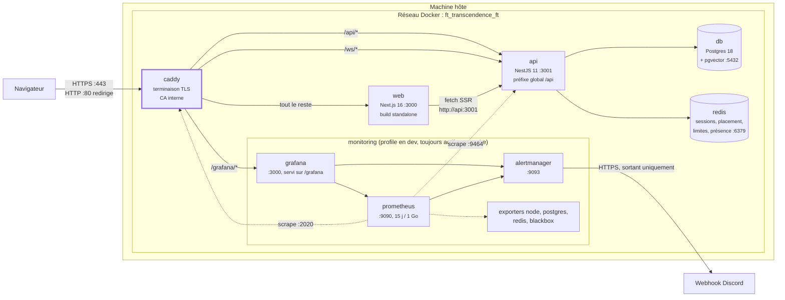
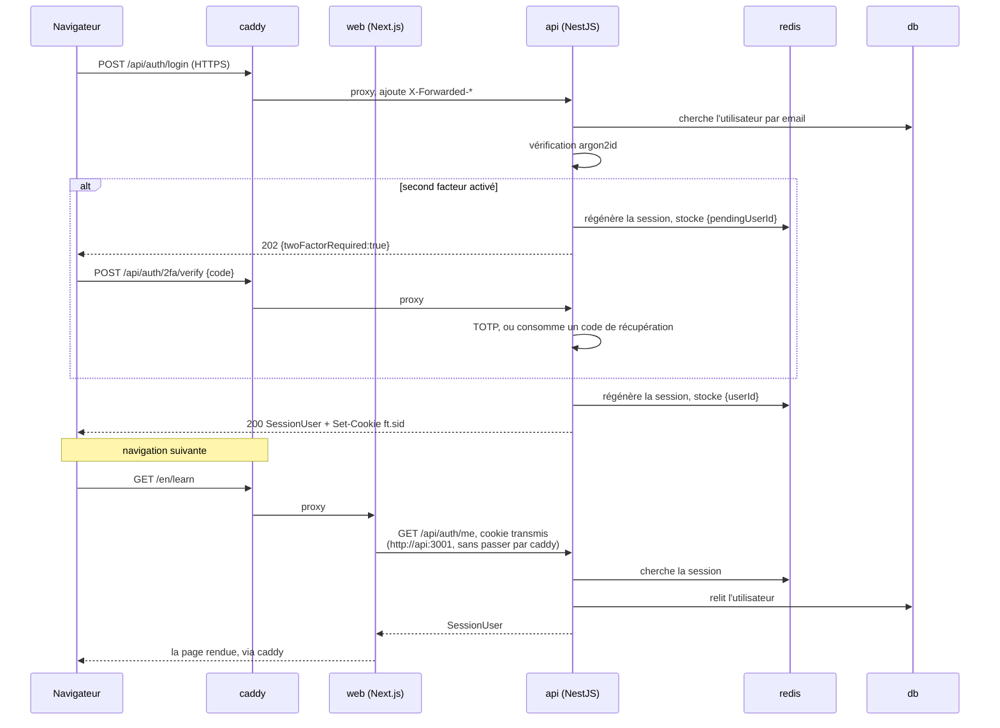
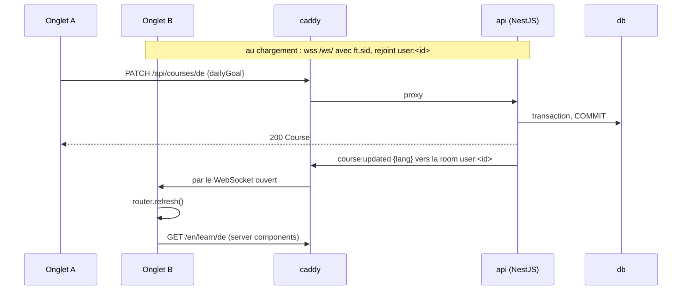
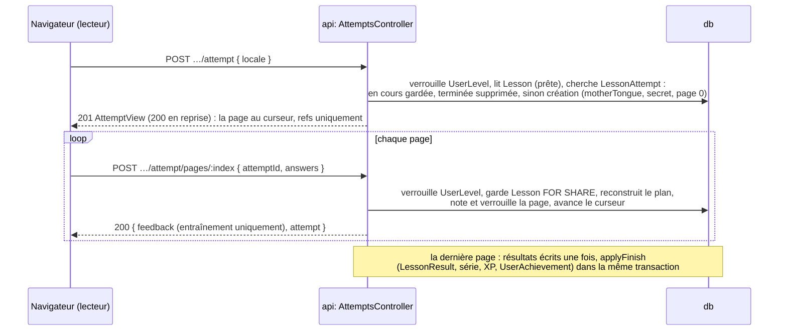
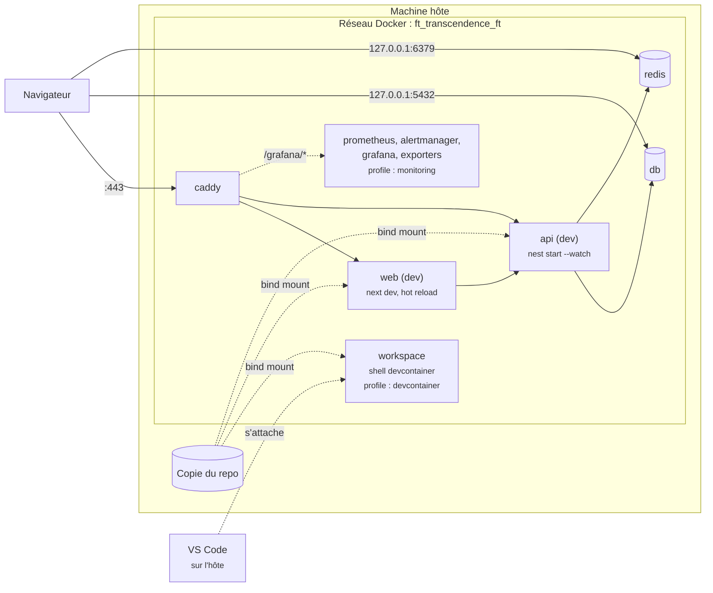
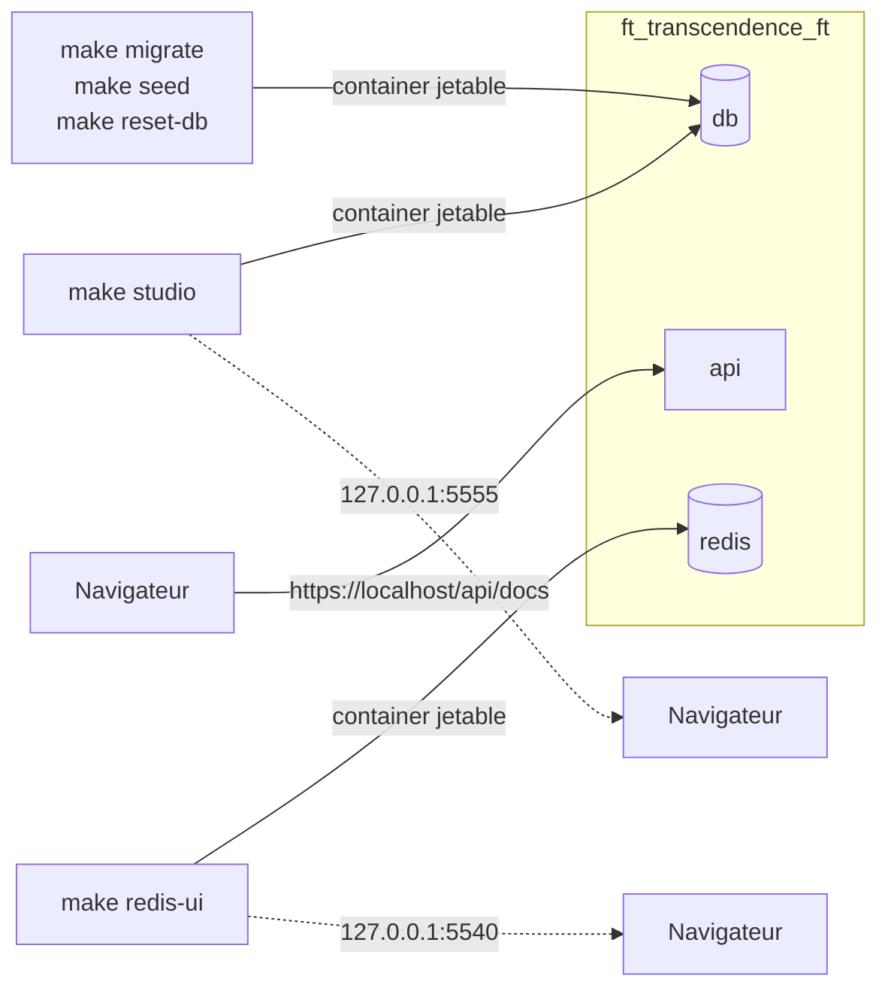
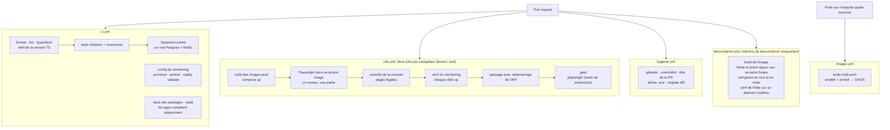
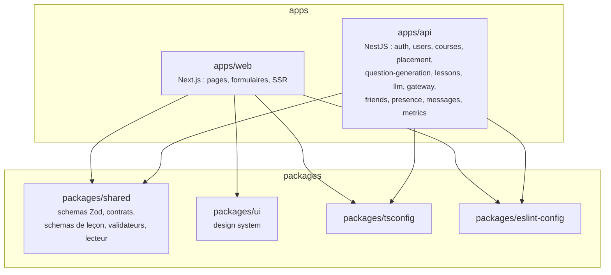

# Architecture

Comment les containers s'assemblent, en production et en développement. Le déploiement sur un serveur
(`compose.deploy.yml`) est dans [operations/deployment.md](../operations/deployment.md).
À lire avec : [architecture/technical-plan.md](technical-plan.md) (les décisions et leurs raisons),
[operations/versions.md](../operations/versions.md) (ce qui bouge ensemble, ce qui est retenu), [subject/summary.md](../subject/summary.md) (les exigences).

Chaque diagramme ci-dessous est tiré des fichiers compose tels qu'ils sont vraiment. Si
tu changes un port ou une route, change le diagramme dans le même commit.

---

## 1. La règle qui explique tout le reste

> **NestJS possède toute la logique métier et l'accès aux données. Next.js fait seulement la présentation et
> le SSR.** Pas de client Prisma dans `apps/web`, pas de logique métier dans les server actions.

Le serveur de Next appelle NestJS par le réseau interne, exactement comme le fait le navigateur,
mais sans sortir de Docker. À la soutenance, « quel runtime possède quoi » doit
avoir une réponse en une phrase, et c'est celle-ci.

---

## 2. Production (`make`, `make run`, `make up`)

Fichiers : `compose.yml` + `compose.prod.yml`. Les images sont buildées au stage `prod`,
aucune source n'est montée en bind mount, et chaque service a `restart: unless-stopped`.
La stack de monitoring est toujours active ici ([operations/monitoring.md](../operations/monitoring.md)).

**Seul caddy publie un port.** `web`, `api`, `db`, `redis` et les services de monitoring
sont injoignables depuis l'extérieur du réseau, ce que le sujet
autorise pour le trafic interne tout en exigeant HTTPS à l'entrée.

| Publié           | Service | Rôle                               |
| ---------------- | ------- | ---------------------------------- |
| `:80`            | caddy   | Redirige vers HTTPS                |
| `:443` tcp + udp | caddy   | La seule entrée. udp, c'est HTTP/3 |

Le monitoring ajoute des ports d'écoute sur le réseau uniquement. Aucun n'est dans une liste `ports:`,
et `scripts/check-monitoring-config.sh` échoue si un jour l'un d'eux y est :

| Interne uniquement       | Quoi                                               | Joint par                               |
| ------------------------ | -------------------------------------------------- | --------------------------------------- |
| `api:9464`               | le port de métriques de l'api, en dehors de Nest   | Prometheus                              |
| `caddy:2020`             | les métriques de requêtes de Caddy, un site à part | Prometheus                              |
| `prometheus:9090`        | Prometheus                                         | Grafana                                 |
| `alertmanager:9093`      | Alertmanager                                       | Prometheus, Grafana                     |
| `grafana:3000`           | Grafana                                            | caddy sur `/grafana`, la sonde blackbox |
| `node-exporter:9100`     | métriques de l'hôte                                | Prometheus                              |
| `blackbox-exporter:9115` | sondes HTTP de web et de Grafana                   | Prometheus                              |
| `redis-exporter:9121`    | métriques Redis                                    | Prometheus                              |
| `postgres-exporter:9187` | métriques Postgres                                 | Prometheus                              |

### Pourquoi une seule origine compte

Comme `/` et `/api` ont la même origine, le cookie de session est first-party (du même site) :
pas de configuration CORS, pas de `SameSite=None`, et `httpOnly` ne coûte rien. Le routage
se fait dans `infra/caddy/Caddyfile` :

| Chemin                                   | Va vers        | Remarque                                                                                                                                                                                                                          |
| ---------------------------------------- | -------------- | --------------------------------------------------------------------------------------------------------------------------------------------------------------------------------------------------------------------------------- |
| `/api`, `/api/*`                         | `api:3001`     | Préfixe transmis tel quel ; `handle_path` l'enlèverait et chaque route répondrait 404. La discussion de leçon passe par ici en stream `text/event-stream`, envoyé au fur et à mesure ([architecture/realtime.md](realtime.md) §4) |
| `/ws`, `/ws/*`                           | `api:3001`     | socket.io. Caddy détecte la poignée de main Upgrade dans `reverse_proxy`                                                                                                                                                          |
| `/grafana/metrics`, `/grafana/metrics/*` | rien, 404      | Les métriques de Grafana sont désactivées, et seraient sans authentification si elles étaient actives. Caddy les refuse aussi, et ce matcher doit rester au-dessus du suivant                                                     |
| `/grafana`, `/grafana/*`                 | `grafana:3000` | Préfixe transmis tel quel, comme `/api` : Grafana se sert lui-même sous `/grafana`                                                                                                                                                |
| tout le reste                            | `web:3000`     | Next.js                                                                                                                                                                                                                           |

`/api/metrics` n'est pas une route. L'api sert ses métriques sur `:9464`, que Caddy
ne proxifie jamais, donc ce chemin arrive à Nest et répond 404.

---

## 3. Une requête à travers la stack

La connexion touche toutes les couches, c'est donc la plus utile à suivre.

Deux détails bons à savoir :

- **`trust proxy` vaut 1, pas `true`.** Caddy termine le TLS et transmet du HTTP
  simple, donc Express ne sait que la requête était sécurisée que grâce à `X-Forwarded-Proto`.
  Faire confiance à exactement un saut veut dire qu'un `X-Forwarded-For` fourni par le client ne
  devient jamais `req.ip`, qui est ce que compte le throttler (limiteur) de connexion.
- **Le guard relit l'utilisateur à chaque requête** au lieu de faire confiance à une copie dans
  la session, donc un compte supprimé perd l'accès tout de suite et pas à l'expiration.

---

## 4. Une mise à jour en direct par le gateway

Un changement d'objectif ou de niveau dans un onglet s'affiche dans les autres onglets ouverts du compte. Le
gateway est socket.io sur `/ws`, dans l'api et sur son serveur http, donc la route
`/ws/*` de Caddy ci-dessus est toute la tuyauterie nécessaire.

Le gateway en quelques lignes (tout, avec les raisons, est dans
[architecture/realtime.md](realtime.md) §3) :

- **Le cookie de session est le seul identifiant.** `SessionIoAdapter` exécute le même
  middleware express-session sur la poignée de main, et un middleware socket.io refuse
  une autre origine, une session sans `userId` et un compte supprimé.
- **Des rooms, jamais de broadcast.** Chaque socket rejoint `user:<id>` et `session:<sid>` ;
  `SocketsService.toUser()` est le seul moyen de joindre un utilisateur. Les sockets se ferment avec
  leur session.
- **Chaque événement entrant est filtré** : une limite de débit par socket et par nom d'événement, une
  taille de frame max de 16 Kio et un parse zod depuis `CLIENT_EVENT_SCHEMAS`, avant tout handler.
- **Les événements** : `course:updated` après le commit, les événements d'amis, la présence
  (un compteur par utilisateur dans Redis, avec un délai de grâce de 10 s) et les messages privés
  (envoyés par le socket, lus par REST).
- **Une seule instance de l'API.** Les rooms vivent dans la mémoire du process qui tient le
  socket, donc l'api tourne avec une seule réplique ([architecture/product.md](product.md) §4).
- **Une connexion par onglet** (`components/tab-socket.ts`), transport WebSocket
  uniquement, et chaque reconnexion demande d'abord `/healthz/api` pour qu'une tentative ratée
  n'arrive pas dans la console.

---

## 5. Une leçon : les routes de tentative et le stream de discussion

Une leçon se joue en REST simple, et sa discussion est envoyée en stream par Server-Sent Events sur un seul
`POST`. Les deux vivent dans `LessonsModule` (`apps/api/src/lessons/`), qui contient aussi la vue du jour,
la recherche et les succès :

| Controller             | Routes, sous `/api/courses/:lang`                                                              | Service                                                                                          |
| ---------------------- | ---------------------------------------------------------------------------------------------- | ------------------------------------------------------------------------------------------------ |
| `LessonsController`    | `GET today`, `GET lessons`, `GET lessons/:id`, `GET achievements`                              | `LessonsService` : les lectures, la recherche en mémoire, `applyFinish`                          |
| `AttemptsController`   | `GET lessons/:id/attempt`, `POST lessons/:id/attempt`, `POST lessons/:id/attempt/pages/:index` | `AttemptsService` : stocke le `LessonAttempt` et exécute les fonctions pures de `lessons.player` |
| `DiscussionController` | `POST lessons/:id/discussion`, répondu en `text/event-stream`                                  | `DiscussionService` : les vérifications, les limites et le prompt, puis `LlmProvider.streamText` |

Chaque route est derrière l'`AuthGuard` global et le pipe de validation, et répond 404 pour un cours
inconnu. Les routes de tentative et de discussion répondent aussi 404 pour une leçon qui n'est pas prête, et chaque
route sauf `GET lessons/:id` (une carte de leçon s'ouvre aussi avant le placement, prête ou non) répond 409
`course.notPlaced` avant le placement. L'app web
les appelle depuis trois pages, `/{locale}/learn/{lang}/lessons/{id}`, `…/play` et `…/results`
([content/lessons.md](../content/lessons.md) §11).

### La tentative

- **`LessonAttempt` est le seul état.** Une ligne par cours et par leçon : la langue maternelle, un
  secret de 32 octets, le curseur, la date limite de l'examen, les réponses verrouillées et, une fois terminée, les
  résultats. Le plan est reconstruit depuis la ligne `Lesson` avec `buildPlan` à chaque requête et jamais
  stocké, donc un changement de code ne laisse jamais un plan stocké en plan.
- **Des refs, jamais des ids.** Chaque unité, option et jeton que le navigateur voit est nommé par
  HMAC-SHA256(secret, path), en base64url, 16 caractères (`attempt-ref.ts`). Une ref venant d'une autre
  tentative donne un 400.
- **Une transaction par écriture**, qui verrouille d'abord la ligne du cours (`FOR UPDATE`), puis garde la
  ligne de la leçon `FOR SHARE` pour qu'un nouveau seed attende ; le verrou du cours suffit pour que deux onglets qui envoient la
  même page donnent un seul verrouillage et une seule fin. Un index périmé, un vieux `attemptId` ou une
  tentative terminée donne 409 `attempt.stale`.
- **Le serveur possède l'horloge de l'examen** : la date limite est fixée quand une page d'examen est envoyée, avec 2 s de
  marge.

### Le stream de discussion

- **Toutes les vérifications d'abord.** Chaque vérification qui peut répondre avec un statut (404, 409,
  puis le 429 des limites de débit) s'exécute avant que `openEventStream()` envoie le 200.
  Après ça, un échec ne peut être qu'un événement `error { code }`.
- **Annulé avec la page**, et **sans état** : fermer la réponse annule
  l'appel à Gemini, et le serveur ne stocke rien de la discussion.
- **À travers Caddy** sans aucun changement dans les Caddyfiles : le stream est marqué
  `Cache-Control: no-cache, no-transform`, donc `encode` le laisse non compressé.

Pourquoi c'est du SSE et pas le socket, les événements en détail, le client du navigateur et
la question de `encode` sont dans [architecture/realtime.md](realtime.md) §4.

---

## 6. Développement (`make dev`)

Fichiers : `compose.yml` + `compose.override.yml`, qui se charge automatiquement. Les images
sont buildées au stage `dev`, la source est montée en bind mount, et les deux apps font du hot reload (rechargement à chaud).

Le dev publie deux ports de plus, tous les deux **en loopback uniquement**, pour qu'une base de données ne soit jamais
exposée à toute la salle :

| Publié           | Service                      |
| ---------------- | ---------------------------- |
| `127.0.0.1:5432` | db, pour un client SQL local |
| `127.0.0.1:6379` | redis, pour `redis-cli`      |

### node_modules et fichiers générés

La source est montée en bind mount, mais les dépendances vivent dans l'image. Chaque chemin `node_modules`
est masqué par un volume nommé, comme tout ce qu'un container écrit en root :

| Chemin masqué            | Volume                                     | Pourquoi                                                               |
| ------------------------ | ------------------------------------------ | ---------------------------------------------------------------------- |
| chaque `*/node_modules`  | `api-node-modules-*`, `web-node-modules-*` | Sinon les dépendances de l'hôte et du container entreraient en conflit |
| `apps/api/dist`          | `api-dist`                                 | `nest start --watch` compile en root                                   |
| `apps/api/src/generated` | `api-generated`                            | `prisma generate` s'exécute en root au démarrage du container          |
| `apps/web/.next`         | `web-next`                                 | Même raison                                                            |

Sans ça, un `make dev` laisse des fichiers en uid 0 dans la copie du repo et le `make` suivant
échoue avec `EACCES`.

### Le devcontainer

`workspace` est derrière `profiles: [devcontainer]`, donc un simple `docker compose up`
l'ignore, alors que `.devcontainer/devcontainer.json`, qui nomme le service, l'active.
`shutdownAction: none` est voulu : la valeur par défaut arrêterait toute la stack quand
la fenêtre de l'éditeur se ferme.

L'utilisateur de la session dépend du daemon Docker, et `.devcontainer/initialize.sh`
le choisit sur l'hôte avant chaque ouverture : `node` sur un daemon rootful, `root` sur un daemon
rootless (les clusters de 42), où root dans un container est ton propre utilisateur sur
l'hôte et `node` ne pourrait pas écrire dans le repo. Le même script donne au container le
socket du daemon et déplace les ports publiés que le daemon ne peut pas ouvrir.

> **Les ports dans le devcontainer.** Compose publie sur le loopback de _l'hôte_,
> et le devcontainer n'est qu'un container de plus sur le réseau. Depuis un terminal
> dedans, joins la stack par le nom du service, `https://caddy/api/health` plutôt que
> `https://localhost`. Depuis ton navigateur sur l'hôte, `https://localhost` est correct,
> avec `:<HTTPS_PORT>` quand ce n'est pas 443 (une machine de 42).

### Le profile monitoring

Les sept services de monitoring sont définis dans `compose.yml` sans profile, et
`compose.override.yml` met chacun derrière `profiles: [monitoring]`. Donc `make dev`
et le devcontainer restent aussi légers qu'avant, `make monitoring-up` les active, et
la surcouche de prod, qui ne charge jamais l'override, les lance toujours. Sans le profile,
`/grafana` répond 502. `make down`, `make clean` et `make logs` passent le profile,
donc ils atteignent aussi les containers de monitoring. Au quotidien :
[operations/development.md](../operations/development.md).

---

## 7. Les outils qui ne sont pas des services

Aucun ne tourne comme partie de la stack. Swagger UI est servi par l'api elle-même.
Prisma Studio et les commandes migrate et seed sont des containers jetables sur le
même réseau, buildés depuis le stage `build` de l'api (`ft_transcendence/api-tooling`),
et RedisInsight est un container jetable de son image officielle.

| Outil             | Où le trouver                                 | Remarques                                                                                                                                                                                                                                                                                 |
| ----------------- | --------------------------------------------- | ----------------------------------------------------------------------------------------------------------------------------------------------------------------------------------------------------------------------------------------------------------------------------------------- |
| **Swagger UI**    | `https://localhost/api/docs`                  | Servi par l'api elle-même, donc il arrive par Caddy sur la même origine. `/api/docs-json` est le document OpenAPI brut. Tu es connecté ? Le cookie `ft.sid` suit, donc « Try it out » marche sur les routes protégées sans rien coller.                                                   |
| **Prisma Studio** | `http://127.0.0.1:5555` après `make studio`   | Loopback uniquement : c'est un accès en lecture-écriture sans authentification à toute la base. `STUDIO_PORT=5556` si le port est pris. Relance-le après `make` ou `make reset-db`, car db reçoit un nouveau container et Studio garde l'ancienne connexion.                              |
| **RedisInsight**  | `http://127.0.0.1:5540` après `make redis-ui` | Loopback uniquement, pour la même raison : il lit et supprime n'importe quelle clé, sans connexion. Montre les sessions et les passages de placement en direct. `REDIS_UI_PORT=5541` si le port est pris. Rien n'est gardé entre deux lancements ; la connexion vient de l'environnement. |

Il n'y a pas de service Adminer ou pgAdmin dans ce projet ; Prisma Studio est le
navigateur de base de données, et il connaît déjà le schema.

### L'image tooling et le contenu qu'elle transporte

Les containers migrate et seed exécutent le stage `build` du Dockerfile de l'api : en local
sous le nom `ft_transcendence/api-tooling` (`make tooling-image`), sur un serveur sous le nom
`ghcr.io/victorbro/ft_transcendence/tooling`, buildée et poussée par images.yml.
Ce stage est un `COPY . .` du repo moins `Dockerfile.dockerignore` (pas de `docs`,
`docs-fr`, `infra`, `.git`, pas de `*.md`), donc il transporte la CLI Prisma, les migrations, le
seed et chaque fichier écrit à la main sous `content/` :

| Dossier             | Ce que le seed en fait                                                                                    |
| ------------------- | --------------------------------------------------------------------------------------------------------- |
| `content/items/`    | La banque de questions : une ligne `QuestionBank` par question écrite, avec correspondance sur `sourceId` |
| `content/outlines/` | Une ligne `Lesson` par entrée, 3 990 au total, avec sa position                                           |
| `content/briefs/`   | Le brief de chaque leçon écrite, 216 aujourd'hui                                                          |
| `content/lessons/`  | Le fichier de contenu de chaque leçon écrite qui n'est pas du vocabulaire, 108 aujourd'hui                |

L'image ne fait que les **transporter**. Rien dedans n'écrit ni ne génère de contenu : le
service `migrate` de `compose.deploy.yml` (en local, `make migrate` puis `make seed`) exécute
`prisma migrate deploy`, puis `db:seed`, qui valide
les fichiers et fixe `Lesson.ready` ([content/lessons.md](../content/lessons.md) §4). Les scripts du kit
d'écriture sont aussi dans l'image, puisqu'ils vivent dans `apps/api/scripts`, mais
rien ne les exécute là. L'image runtime `api` (stage `prod`) n'a ni la
CLI Prisma, ni les migrations, ni `content/` : à l'exécution, l'api lit les leçons depuis
Postgres uniquement.

---

## 8. Ce que la CI exécute

Cinq workflows. `ci` et `e2e` sont ceux qui bloquent un merge selon le comportement ;
`devcontainer` tourne seulement quand l'image du devcontainer change, ou les fichiers compose
qui la lancent.

Chaque moteur a deux jobs e2e, chacun avec sa propre stack : `lesson.spec.ts` seul
prend environ la moitié du temps de la suite, donc c'est une partie, et toutes les autres specs sont
l'autre. La vérif du monitoring et le passage avec redémarrage de l'API tournent une seule fois, dans le job Chromium
`rest`, après sa suite. Le job gate porte le check obligatoire.

Deux de ces checks sont des **critères de rejet du sujet**, c'est pourquoi ils tournent
sur les images de production plutôt que sur un serveur de dev :

- **contrôle de la console** : zéro erreur, avertissement, exception non attrapée ou requête
  échouée dans la console, sur chaque route, navigation côté client comprise.
- **pages légales** : `/privacy` et `/terms` répondent 200 avec un vrai contenu.

`make ci` exécute les mêmes checks en natif, et `make` exécute tout ça plus la
stack de production, la vérif du monitoring en direct et Playwright.

---

## 9. Où vit le code

`packages/shared` est la raison pour laquelle la validation ne peut pas diverger : l'endpoint d'inscription
applique `CreateUserSchema`, et le formulaire d'inscription applique `SignUpFormSchema`, qui
est le même schema plus la confirmation du mot de passe. C'est ce que le sujet
veut dire par valider à la fois dans le frontend et dans le backend. La seule règle qui garde ça
honnête, c'est que `passwordHash` n'apparaît jamais dans aucun schema là-dedans.

C'est pareil pour les leçons : le namespace `lessons` de `@ft/shared` contient les schemas des fichiers
de leçon et `validateLesson` (exécuté par le seed, les specs et le kit
d'écriture), et le lecteur pur (`buildPlan`, la notation, les vues que le navigateur a le droit de voir),
exécuté par `AttemptsService` sur le serveur. L'app web importe ses schemas de vue
et ses types, plus quelques helpers purs et constantes pour les formulaires (les vérifications d'article et
de pluriel, quels types d'item sautent le feedback quand la réponse est juste, le poids de l'entraînement,
le séparateur de l'ordre de lecture), donc les pages du lecteur et l'API parsent les mêmes
formes. Elle ne construit jamais un plan et ne note jamais une réponse en dehors des tests.
