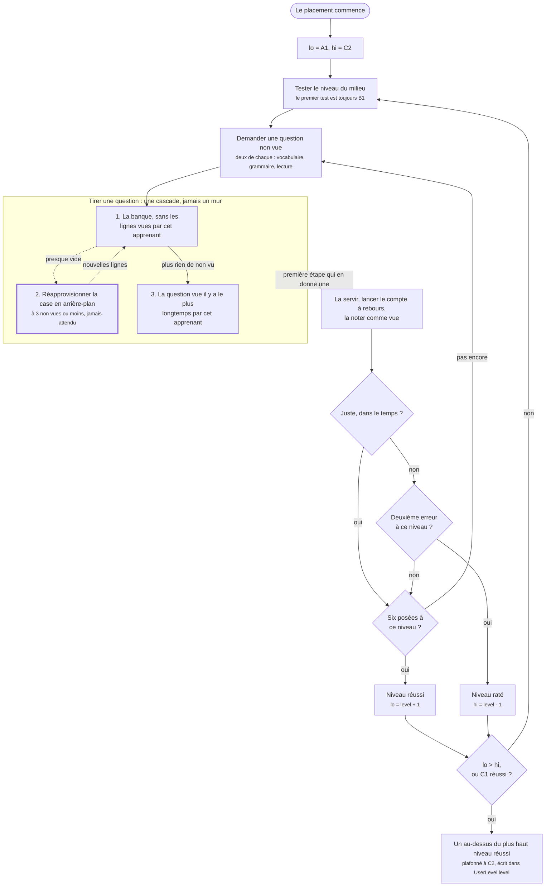
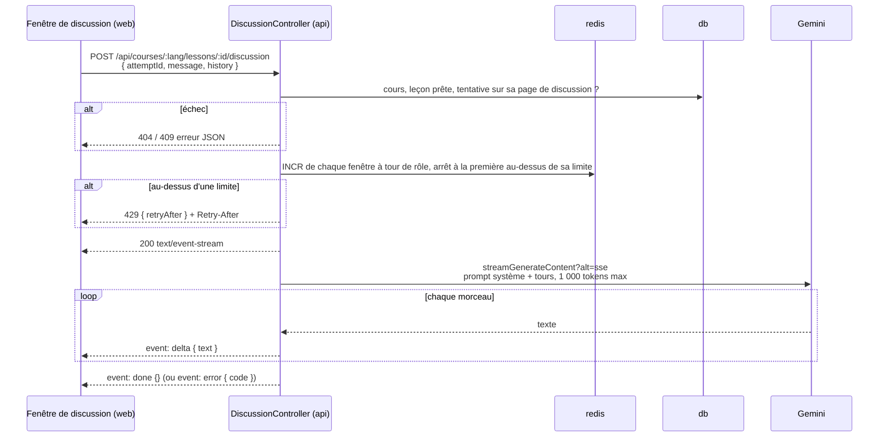

# Architecture du produit

Le produit, la couche IA, Redis et le throttling (limitation de débit), tels qu'ils sont construits sur cette branche.
[architecture/technical-plan.md](technical-plan.md) couvre l'infrastructure autour (organisation du repository,
containers, CI et ordre de construction), [architecture/overview.md](overview.md) les containers et les chemins
des requêtes, et [content/lessons.md](../content/lessons.md) le contenu des leçons, son seed et le lecteur de leçons.

Le sujet cite ce projet par son nom au chapitre V.6 :

> **Language Learning Platform**: Lessons, exercises, progress tracking, and peer practice.
> Point potential: 15+ points.

(Plateforme d'apprentissage des langues : leçons, exercices, suivi de la progression et pratique entre pairs. Points possibles : 15+.)

---

## 1. Le parcours de l'apprenant

Le produit est une boucle, répétée. Tout dans ce document existe pour la servir.

```
inscription / connexion  →  onboarding    →  placement           →  objectif quotidien  →  leçon                  →  résultats  →  objectif quotidien …
                            (2 questions)    (recherche binaire)    (leçons du jour)       (entraînement → discussion
                                                                                            → examen)
```

| Étape                  | Ce que l'apprenant voit                                                                                                                                                                                                                                                                                                                                                           | Ce que fait le système                                                                                                                                                                                                                                                                                                                                    |
| ---------------------- | --------------------------------------------------------------------------------------------------------------------------------------------------------------------------------------------------------------------------------------------------------------------------------------------------------------------------------------------------------------------------------- | --------------------------------------------------------------------------------------------------------------------------------------------------------------------------------------------------------------------------------------------------------------------------------------------------------------------------------------------------------- |
| **Onboarding**         | Deux questions : quelle langue apprendre, et un objectif quotidien (10, 30 ou 60 minutes). Répété pour chaque langue, donc ajouter un deuxième cours recommence ici                                                                                                                                                                                                               | Crée une ligne `UserLevel` pour ce `(user, language)`. `level` reste null jusqu'à ce que le placement le fixe. Aucun appel à l'IA.                                                                                                                                                                                                                        |
| **Placement**          | Une question à la fois, chacune avec son propre compte à rebours, puis un rapport en rouge et vert. Un apprenant qui connaît déjà son niveau peut le sauter, et peut le changer s'il n'est pas d'accord avec le résultat                                                                                                                                                          | Recherche binaire sur les six niveaux CECR, dans **notre code**. Les questions sont à choix multiple, donc la notation est une comparaison de strings, et le LLM réapprovisionne une case en arrière-plan quand il ne reste plus que 3 questions non vues pour un apprenant dans cette case. Écrit `UserLevel.level`. Voir §1.2                           |
| **Objectif quotidien** | Les leçons du jour tirées du programme du niveau : celles qui remplissent l'objectif, trois en plus, la série, la progression dans le niveau, l'XP et le rang, et le défi quotidien. Rien n'est verrouillé : toute leçon prête de la langue du cours peut être jouée, et la page de toutes les leçons liste tout le niveau, lignes « Coming soon » (bientôt disponible) comprises | Lit le catalogue `Lesson` rempli par le seed pour (langue, niveau) et les lignes `LessonResult` du cours, et propose les leçons **prêtes** les plus basses pas encore réussies (§1.3). N'écrit rien. Aucun appel à l'IA. Comment le programme est dimensionné, écrit et rempli par le seed est dans [content/lessons.md](../content/lessons.md)           |
| **Leçon**              | La page de départ de la leçon, puis le lecteur : des pages de présentation et d'entraînement une par une, chaque page d'entraînement corrigée dès qu'elle est vérifiée, une discussion avec le tuteur de la leçon, puis un examen chronométré (§1.4)                                                                                                                              | Joue une leçon écrite à l'avance et commitée dans le repo. Le serveur gère la tentative dans `LessonAttempt` : il envoie seulement la page au curseur, vérifie chaque réponse et possède le chronomètre de l'examen. Un appel au LLM par message de discussion, en stream. Rien d'autre dans une leçon n'appelle le LLM                                   |
| **Résultats**          | Le score, chaque réponse avec sa correction, la leçon comptée pour l'objectif du jour, réussie ou ratée, et l'XP, le défi et les succès qu'elle a rapportés                                                                                                                                                                                                                       | Score calculé **dans le code** à partir des réponses stockées par le serveur, écrit une seule fois quand la dernière page se verrouille. Le `LessonResult` du cours garde le meilleur score, la série avance quand l'objectif est atteint, et les colonnes de gamification et `UserAchievement` sont écrites dans la même transaction. Aucun appel à l'IA |

### La règle qui fait marcher tout ça

> **Le LLM écrit des items individuels et explique. Notre code possède l'état, la notation et
> la progression.**

Dans le Milestone 2, le LLM fait exactement deux choses à l'exécution : il réapprovisionne la banque de placement quand une
case se vide (§1.2), et il répond à l'apprenant sur la page de discussion d'une leçon (§1.4). Il n'écrit jamais
une leçon, ne note jamais une réponse et ne décide jamais un niveau.

C'est la colonne vertébrale de toute la conception, et ça vaut la peine de la défendre à un seul endroit, car toutes les
autres décisions en découlent :

- **C'est explicable.** Le sujet exige que tu expliques ton implémentation de l'IA à
  l'évaluation. « Une recherche binaire sur les six niveaux CECR, six questions par niveau, une deuxième
  erreur termine le niveau » s'explique en une phrase. « On a demandé au modèle de décider le niveau »,
  non.
- **C'est testable.** Avec `LLM_PROVIDER=fixture`, toute la progression est déterministe et
  testable en tests unitaires. Si le LLM possède la progression, rien n'est testable sans dépenser de l'argent.
  La proposition, la série et la fin d'un niveau sont des fonctions pures, sans horloge et sans base de données.
- **Ce n'est pas cher.** Proposer les leçons du jour, noter une tentative, garder le meilleur score, faire avancer
  la série, décider qu'un niveau est terminé : rien de tout ça n'a besoin d'un token.
- **Ça ne peut pas te mettre dans l'embarras pendant une démo.** Un modèle qui décide de donner B2 pour une réponse vide, c'est
  un échec en direct. Une recherche binaire en TypeScript, non.

### 1.2 Le placement est une recherche binaire, et jamais deux fois la même question

Un passage de placement répond à exactement une question : à lequel des six niveaux CECR est cet apprenant.
C'est une recherche dans notre code, pas un jugement du modèle.

**La recherche.** On garde l'intervalle des niveaux encore possibles, `lo = A1` et `hi = C2`, et on teste le
milieu. Le premier test est donc toujours B1.

- **Niveau réussi :** tout ce qui est au-dessus reste possible, donc `lo = level + 1`.
- **Niveau raté :** tout ce qui est en dessous reste possible, donc `hi = level - 1`.
- **`lo > hi` :** la recherche est finie. Le résultat est `lo`, le niveau à apprendre : un au-dessus du plus haut
  niveau réussi, plafonné à C2, ou A1 si aucun n'a été réussi.
- **C1 réussi :** la recherche est finie aussi, à C2. C2 n'est pas testé : réussi ou raté, le résultat
  serait C2.

Trois tests suffisent pour six niveaux, donc un passage va au plus à trois niveaux de profondeur.

**Un exemple complet.** B1 est toujours le premier test. Six questions là, dont une fausse : c'est
quand même une réussite, donc `lo` devient B2 et le test suivant est le milieu de B2 à C2, c'est-à-dire **C1**.
Deux fausses à C1 : le niveau s'arrête là, `hi` devient B2, et le dernier test est B2 lui-même. Le
résultat est C1 s'il est réussi et B2 sinon, un au-dessus du plus haut niveau réussi.

**Ce que veut dire réussir un niveau.** Six questions à ce niveau, deux de chaque catégorie :
`vocabulary`, `grammar` et `reading`. **Une erreur est permise ; la deuxième termine le niveau.**
Un apprenant qui est dépassé s'arrête après deux questions au lieu d'en subir six,
et une seule erreur d'inattention ne lui coûte pas un niveau.

Chaque question a son propre compte à rebours (`QuestionBank.timeLimitS`), et manquer de temps
compte comme une mauvaise réponse. Sans ça, un onglet bloqué serait un test sans fin.

**Tirer une question est une cascade, jamais un mur.** Chaque étape tire dans une seule case, le
`(lang, level, category)` testé, donc un test de grammaire B1 en français ne peut jamais servir qu'une question de grammaire
B1 en français :

1. **La banque**, en excluant tout ce que cet apprenant a déjà reçu (`UserSeenQuestion`).
   Les lignes écrites à la main, celles qui ont un `sourceId`, passent en premier : une ligne générée n'est tirée qu'une fois que
   l'apprenant n'a plus aucune ligne écrite non vue dans la case.
2. **Plus que 3 non vues dans la case, donc on la réapprovisionne en arrière-plan.** Un appel structuré au LLM
   renvoie un lot pour la case (13 en grammaire, 10 en vocabulaire ou 5 en lecture). Il est validé par schema,
   dédoublonné par rapport à la case et écrit dans `QuestionBank` sans `sourceId`. Le tirage ne
   l'attend jamais : les nouvelles lignes arrivent à cet apprenant et aux suivants par l'étape 1. **La banque
   grandit à mesure qu'on l'utilise**, et un `sourceId` null est ce qui marque les lignes qu'aucun humain n'a relues.
3. **Plus rien de non vu** (la génération a échoué, n'est pas encore arrivée, ou il n'y a pas de clé) : on sert la
   question que cet apprenant a vue il y a le plus longtemps à ce niveau, jamais une déjà posée dans ce passage.
   C'est le seul chemin qui répète une question. Une répétition après des mois est une mesure faible,
   et un examen abandonné n'est pas une mesure du tout.

La banque d'abord plutôt que générer à chaque fois apporte trois choses. **Qualité :** une question du seed a été
relue une fois par un humain, une question générée en direct ne peut pas l'être. **Coût :** presque zéro sur le chemin habituel.
**Preuve :** l'exclusion est un `NOT EXISTS` sur `UserSeenQuestion`, pas un espoir sur la
température d'échantillonnage.

**L'horloge appartient au serveur.** Chaque question a son propre `timeLimitS`, et le serveur
note le moment où il a servi la question. Il le note une seule fois : un rafraîchissement relit la question
avec le temps qui reste vraiment, jamais une nouvelle limite. Quand la réponse arrive, le serveur
recalcule le temps écoulé et décide lui-même du retard, quoi que dise la requête, avec
quelques secondes de marge pour le réseau. Le compte à rebours dans le navigateur est là pour que l'apprenant
puisse le voir, et ce n'est jamais lui qui juge.

**Sauter, changer et repasser.** Un apprenant qui connaît déjà son niveau saute l'examen et
fixe son niveau directement. Un apprenant qui n'est pas d'accord avec le résultat peut le changer tout de suite. Un
nouveau passage est la même recherche relancée, qui tire avec les mêmes lignes `UserSeenQuestion`, donc il pose
de nouvelles questions sauf si l'étape 3 se déclenche. Les trois finissent par la même écriture, `CoursesService.setLevel`, et seul le
niveau actuel est stocké, jamais un historique des passages. Un passage où toutes les réponses ont dépassé le temps n'écrit
rien : un apprenant qui est parti n'a rien mesuré, donc le cours garde le niveau qu'il avait, ou
reste sans niveau, et le résultat le dit avec `applied: false`.

**Le rapport est en rouge et vert.** À la fin, l'apprenant voit chaque question qu'on lui a posée,
sa réponse en rouge et la bonne en vert. Pas d'explications : rien dans la banque n'en contient.
Il est construit depuis l'état du passage et disparaît avec lui.

**Le passage lui-même n'est pas une table.** Les bornes, le niveau testé, le décompte par catégorie, les
erreurs jusque-là et le rapport vivent dans Redis sous l'apprenant, `user:<id>:eval`, avec un
TTL d'une heure (§4). Un apprenant qui se reconnecte dans l'heure revient à l'examen qu'il a quitté ;
après, le passage a disparu. Deux choses lui survivent : les lignes `UserSeenQuestion`, et le niveau final.

**Tout le passage, en dessin.** Une bordure épaisse est un appel au LLM. Il y en a un, hors du chemin du tirage : une
case est réapprovisionnée en arrière-plan quand il ne reste plus que 3 questions non vues pour un apprenant dans cette case.



### 1.3 L'objectif quotidien façonne la session, jamais le programme

**Dix, trente ou soixante minutes.** Choisi à l'onboarding, modifiable ensuite sur la page de l'objectif
quotidien. Une leçon est écrite pour prendre environ dix minutes, donc **l'objectif compte des leçons** : 10 veut dire une
leçon finie ce jour-là, 30 veut dire trois, 60 veut dire six. C'est pour ça qu'on a ces trois valeurs et pas
d'autres ; dix les divise toutes exactement. Une fin compte qu'elle soit réussie ou ratée, depuis n'importe quelle liste, et une leçon
finie deux fois dans la journée compte une seule fois. Rien ne compte les minutes, et `DailyStat` n'est pas construit.

> **Question ouverte, pour l'équipe : combien de temps prend une leçon.** L'objectif compte les leçons avec
> `LESSON_MINUTES = 10`, mais les 216 leçons prêtes sont prévues pour 8 à 37 minutes
> (`estimatedMinutes`, médiane 17,5), donc les six leçons de l'objectif de 60 minutes peuvent prendre bien plus
> d'une heure. Soit l'objectif
> continue de compter 1, 3 ou 6 leçons et les minutes sont une étiquette approximative, soit le kit d'écriture
> ([#83](https://github.com/VictorBro/ft_transcendence/issues/83)) garde les leçons plus proches de dix
> minutes. Aujourd'hui, le code fait la première option.

L'objectif fait deux choses :

- **Il dimensionne le plan du jour.** La page de l'objectif quotidien propose autant de leçons qu'il en faut encore pour l'objectif,
  puis trois en plus. Elles viennent d'une file sur les leçons prêtes du niveau actuel : celles qui ne sont pas finies
  aujourd'hui, d'abord celles pas encore réussies dans l'ordre du programme (les ratées comprises), puis celles
  réussies, en révision, celle finie il y a le plus longtemps en premier. Une fois l'objectif atteint, il ne reste que les trois
  en plus. Le lendemain, la proposition recommence à la plus basse leçon pas encore réussie.
- **Il définit la série.** Trois colonnes de `UserLevel`, donc une série par cours : `streak`,
  `bestStreak` et `lastGoalDay`. La série avance quand l'objectif du jour est atteint, par une fin de leçon
  ou en baissant l'objectif : si `lastGoalDay` est déjà aujourd'hui rien ne change, si c'est hier
  la série augmente de un, sinon elle repart à 1. Elle s'affiche tant que `lastGoalDay` est aujourd'hui ou
  hier, et 0 après. Augmenter l'objectif n'annule jamais un jour déjà atteint, donc un apprenant
  peut baisser l'objectif, l'atteindre, le remonter et garder quand même le jour. On l'accepte.
  `lastGoalDay` est le seul jour stocké : il n'y a pas d'historique des jours, donc pas de calendrier et pas de « jours
  atteints cette semaine ».

La gamification lit aussi l'objectif : l'atteindre rapporte de l'XP, et un défi quotidien demande une leçon
de plus ([#94](https://github.com/VictorBro/ft_transcendence/issues/94),
[#95](https://github.com/VictorBro/ft_transcendence/issues/95)).

**Gamification, par cours.** L'XP (10 pour la première fin d'une leçon dans la journée plus chaque point qu'elle
ajoute au meilleur score de cette leçon, 20 pour atteindre l'objectif, 30 pour le défi) et les rangs (passer du rang
n au rang n + 1 demande n × 100 XP de plus) ; un défi quotidien parmi six, choisi par un hash du cours
et du jour, donc rien ne le stocke ; et 16 succès, obtenus une fois et jamais perdus. Les règles sont
des fonctions pures (`gamification.rules.ts`), les attributions tournent dans la transaction de fin
(`gamification.ts`), et la page du cours, les résultats et `/learn/{lang}/achievements` les affichent
(#97). Les classements, badges et récompenses ne sont pas construits.

**Le jour est celui de l'apprenant.** `User.timeZone` (un fuseau IANA envoyé par le navigateur, UTC par défaut)
décide quand un jour se termine, donc un apprenant à Tokyo et un autre à New York ont chacun leur propre minuit. Une
fin qui arrive après minuit en heure locale compte pour le nouveau jour. Le jour d'un cours ne recule jamais :
il n'est jamais avant son `lastGoalDay` ni avant le jour de son résultat le plus récent, donc un vol vers l'ouest
ne peut pas annuler un jour déjà atteint.

**Un niveau est terminé quand chaque leçon prête a été tentée et qu'au moins 80 % sont réussies.** Une
leçon est réussie quand son meilleur score est de 70 ou plus. Avec 12 leçons prêtes par niveau aujourd'hui, ça veut dire
les 12 tentées et 10 réussies ; la barre bouge quand plus de leçons deviennent prêtes. Seul un niveau terminé propose « Start B1 » (commencer B1) : tenter
chaque leçon veut dire que tout le programme a été vu, et 80 % veut dire qu'il a été appris, sans demander un
score parfait sur chacune. L'apprenant peut quand même changer de niveau, ou repasser le placement, à tout moment.
**Changer de niveau garde toute la progression** : rien n'est remis à zéro, et revenir en arrière reprend là où
l'apprenant s'était arrêté.

**Le programme a pour clé `(language, level)` et jamais l'objectif.** Changer l'objectif
ne régénère rien et ne déplace aucune progression : la même liste de leçons est simplement parcourue plus vite ou
plus lentement. Un programme par objectif voudrait dire trois copies de chaque niveau à générer et à relire, et un
apprenant qui passe de 60 à 10 aurait besoin que ses leçons finies soient reportées sur une autre liste.
Chaque langue a le même nombre d'entrées de plan par niveau, de 120 en A1 à 320 en C2 :
3 990 lignes `Lesson` au total, dont **216 sont prêtes, les 12 premières de chaque langue et de chaque niveau**.
Combien il y en a et comment elles sont réparties par type est dans [content/lessons.md](../content/lessons.md) §0 à §3, comment le
seed fixe `ready` au §4, et comment elles sont écrites au §7.

Ce qu'il ne doit jamais faire, c'est bloquer du contenu. Un apprenant qui a dépassé son objectif continue s'il veut ; c'est
une cible, pas un plafond, et un plafond punirait exactement le comportement pour lequel le produit existe.
**Aucune leçon n'est verrouillée non plus.** L'ordre décide seulement quelles leçons sont proposées : l'apprenant peut
ouvrir n'importe quelle leçon prête de la langue du cours, de n'importe quel niveau, et chaque fin compte.

### 1.4 Anatomie d'une leçon

Une leçon est **écrite à l'avance, pas générée** : ses exercices, ses corrigés, son examen et sa notation sont dans
un ou deux fichiers JSON commités, vérifiés par les validateurs du prototype de leçon et copiés dans
`Lesson.brief` et `Lesson.content` par le seed ([content/lessons.md](../content/lessons.md) §4). La replanification du Milestone 2
([#137](https://github.com/VictorBro/ft_transcendence/issues/137)) a remplacé l'ancien
plan, où un tuteur transformait un court brief en exercices à l'exécution, avec un ancrage RAG et des caches.
Rien de tout ça n'a été construit.

**Les quatre pages de leçon.** Chaque type a son propre lecteur (#146 à #149), sur trois routes sous
`/{locale}/learn/{lang}/lessons/{id}` : la page de départ, `/play` et `/results`.

| Type        | Ce que fait l'apprenant                                                                                                                                              | Lecteur web       |
| ----------- | -------------------------------------------------------------------------------------------------------------------------------------------------------------------- | ----------------- |
| Grammaire   | Des explications, puis des exercices (associer, trous à choisir ou à taper, ordre des mots, trouver l'erreur), puis un examen chronométré                            | sur `main` (#146) |
| Vocabulaire | L'introduction et les flashcards de chaque groupe, associer, un aperçu des genres, de l'entraînement, puis un examen de traduction. Pas d'écoute (voir plus bas)     | sur `main` (#147) |
| Fonctions   | Une situation avec deux rôles, des expressions, des répliques à écouter avec **Show the text** (afficher le texte), un dialogue, puis un examen en plusieurs parties | sur `main` (#149) |
| Lecture     | Deux documents d'un même genre : un pour apprendre, un nouveau dans l'examen                                                                                         | sur `main` (#148) |

Un apprenant avec un objectif de 10 minutes qui ouvre une leçon de grammaire depuis la proposition du jour :

| Moment                     | Ce que l'apprenant voit                                                   | Ce que fait le système                                                                                                                                           |
| -------------------------- | ------------------------------------------------------------------------- | ---------------------------------------------------------------------------------------------------------------------------------------------------------------- |
| Page de départ             | Le titre, l'objectif, les minutes et les points d'apprentissage numérotés | `GET …/attempt` lit la ligne de la leçon et la tentative, s'il y en a une. Rien n'est écrit                                                                      |
| Départ                     | La première page                                                          | `POST …/attempt { locale }` crée le `LessonAttempt` : la langue maternelle fixée depuis la locale de l'interface, un nouveau secret de 32 octets, le curseur à 0 |
| Chaque page d'entraînement | Sa correction, dès qu'elle est vérifiée                                   | `POST …/attempt/pages/:index` verrouille les réponses de cette page, les note et avance le curseur. Seuls les corrigés de cette page sont renvoyés               |
| Page de discussion         | Un chat avec le tuteur de la leçon, facultatif                            | `POST …/discussion` envoie la réponse du tuteur en stream par Server-Sent Events. Pas noté, et rien n'est stocké (§5)                                            |
| Pages d'examen             | Un compte à rebours par page, pas de correction                           | La date limite est fixée quand la page est envoyée ; une page en retard se verrouille vide                                                                       |
| Résultats                  | Le score, chaque réponse et sa correction, l'XP, le défi et les succès    | La dernière page se verrouille : les résultats sont écrits une fois, et la fin (meilleur score, objectif, série, XP, succès) tourne dans la même transaction     |

Deux règles façonnent chaque page ([content/lessons.md](../content/lessons.md) §11) :

- **La langue maternelle.** L'aide autour de la leçon est dans la langue de l'interface, sauf si c'est
  la langue du cours, alors dans la première autre parmi en, fr, de. Elle est fixée sur la tentative à son
  départ.
- **Le vocabulaire sans écoute.** Le lecteur de vocabulaire retire le choix par écoute et la dictée du prototype,
  donc son examen est seulement la traduction. Les fonctions gardent leurs répliques à écouter, lues
  par la synthèse vocale du navigateur, avec **Show the text** pour un navigateur qui n'a pas de voix.

**L'étape de discussion remplace le parcours guidé avec le tuteur.** C'est le seul endroit où un apprenant parle
au LLM dans une leçon : une page, juste avant la page d'infos de l'examen, où le tuteur connaît les champs
d'enseignement de la leçon et les mauvaises réponses d'entraînement de l'apprenant, mais jamais l'examen ni ses réponses. Comment elle
est construite est dans [content/lessons.md](../content/lessons.md) §12 et [architecture/realtime.md](realtime.md) §4.

### 1.5 Pas construit : le chat entre langues

Une idée du début mettait deux apprenants en paire, chacun écrivant dans sa propre langue, avec un appel au LLM par message
qui corrigeait l'expéditeur et traduisait pour l'autre. Ce n'est pas construit. Les messages privés entre
amis (#158) sont du texte simple sans IA au milieu, et aucune table ne stocke une correction ou une
erreur.

---

## 2. Modules et points

Les modules qu'on revendique, leur type et leurs points, et le total sont dans
[modules/README.md](../modules/README.md), avec un fichier par module qui explique ce qui a été construit
et où est le code. Ce tableau est la seule copie, donc il ne peut pas diverger de ce document.

---

## 3. Transport : REST, Server-Sent Events et un WebSocket

La plus grande partie du produit est en requête et réponse par REST. Le gateway socket.io sur `/ws` transporte ce que
plusieurs clients doivent voir en même temps : les mises à jour en direct des cours et des amis, le statut en ligne et les messages
privés. La discussion de leçon envoie une réponse en stream par Server-Sent Events sur un `POST`.
[architecture/realtime.md](realtime.md) dit quelle fonction utilise quoi, pourquoi, et comment le gateway et
le stream fonctionnent.

---

## 4. Redis : ce qu'il contient

Redis est déjà dans la stack. Ce n'est pas une seule chose mais plusieurs, avec des durées de vie différentes.

**Redis est là pour l'expiration, pas pour le partage.** L'api tourne avec une seule réplique et c'est voulu :
une machine, un `docker compose up`, pas d'orchestrateur. Rien ci-dessous n'est dans Redis pour qu'un deuxième
process puisse le lire. Chaque clé est chaude, jetable et expire, et c'est une forme qui demande un
stockage avec TTL, quel que soit le nombre de répliques. La règle simple, quand quelque chose de nouveau arrive :
si ça doit survivre d'une requête à la suivante, c'est Redis ou Postgres, et le perdre coûte de
refaire quelque chose plutôt que des données ; sinon, c'est une simple constante ou une valeur par requête dans le code.

| Rôle                                        | Clés                                                                                  | Pourquoi Redis et pas Postgres                                                                                                                                                                                                                                                                                                                                                                                                                                                                                                                                                                                                                                                                                                                                             | Statut                    |
| ------------------------------------------- | ------------------------------------------------------------------------------------- | -------------------------------------------------------------------------------------------------------------------------------------------------------------------------------------------------------------------------------------------------------------------------------------------------------------------------------------------------------------------------------------------------------------------------------------------------------------------------------------------------------------------------------------------------------------------------------------------------------------------------------------------------------------------------------------------------------------------------------------------------------------------------- | ------------------------- |
| **Stockage des sessions** (`connect-redis`) | `sess:<sid>`                                                                          | Les sessions sont chaudes, de courte durée et jetables. Redémarrer l'api ne doit pas déconnecter tout le monde                                                                                                                                                                                                                                                                                                                                                                                                                                                                                                                                                                                                                                                             | utilisé                   |
| **État du passage de placement**            | `user:<id>:eval`, `user:<id>:eval_questions`, `user:<id>:eval_lock`                   | Les bornes de la recherche, le niveau testé, le décompte par catégorie, les erreurs jusque-là, la date limite de la question actuelle et le rapport. **Toujours avec un TTL** : une heure (`PLACEMENT_REDIS_KEY_TTL`) pour `eval` et `eval_questions`, et 5 s (`PLACEMENT_LOCK_TTL_SECONDS`) pour `eval_lock`, le verrou `SET NX EX` qui empêche deux départs ou deux réponses d'un même apprenant d'entrer en concurrence. La clé est l'utilisateur, pas la session comme prévu au début, donc un apprenant qui se reconnecte dans l'heure revient à l'examen qu'il a quitté. Il vit exactement aussi longtemps que l'examen, donc une table serait une ligne supprimée quelques minutes après avoir été écrite, et le TTL sert aussi de nettoyage des examens abandonnés | utilisé (#48)             |
| **Limites de la discussion de leçon**       | `discussion:user:<id>:minute`, `discussion:user:<id>:day`, `discussion:global:minute` | Des compteurs à fenêtre fixe : le premier message crée la clé avec son TTL (60 s ou 24 h), `INCR`, `EXPIRE … NX` et `TTL` dans un seul `MULTI`, donc un crash ne laisse jamais un compteur sans expiration. Le TTL est aussi le `Retry-After`                                                                                                                                                                                                                                                                                                                                                                                                                                                                                                                              | utilisé (#150)            |
| **Présence**                                | `presence:<id>`                                                                       | Un compteur de sockets par utilisateur : `INCR` à la connexion, `DECR` 10 s après une déconnexion, donc un rechargement ne s'affiche jamais comme un départ. Tous les compteurs sont supprimés au démarrage, car un crash n'a jamais rendu ses sockets (une seule instance de l'API supposée). Voir [architecture/realtime.md](realtime.md) §3                                                                                                                                                                                                                                                                                                                                                                                                                             | utilisé (#157)            |
| **Compteurs du throttler**                  | aucune                                                                                | `@nestjs/throttler` tourne sans adaptateur de stockage, donc ses compteurs sont dans la mémoire du process. Correct pour une seule réplique ; le seul coût, c'est qu'un redémarrage efface la limite de tout le monde                                                                                                                                                                                                                                                                                                                                                                                                                                                                                                                                                      | pas dans Redis, par choix |

Pas construit, et plus prévu : un cache des réponses du LLM et un budget de tokens par utilisateur. Les leçons sont
écrites à la main, donc il n'y a pas d'explication ni d'exercices générés à mettre en cache, et les limites de la
discussion remplacent le budget (§5).

---

## 5. La couche IA

### Provider

`LLM_PROVIDER` choisit l'implémentation de `LlmProvider` une seule fois, au démarrage (`createLlmProvider` dans
`apps/api/src/llm/llm.factory.ts`), et une mauvaise valeur empêche le démarrage :

| `LLM_PROVIDER`         | Réapprovisionnement du placement                                                          | Discussion de leçon                                                                                                                            | Utilisé par                              |
| ---------------------- | ----------------------------------------------------------------------------------------- | ---------------------------------------------------------------------------------------------------------------------------------------------- | ---------------------------------------- |
| `fixture` (par défaut) | N'écrit aucune question : le tirage se rabat sur la question vue il y a le plus longtemps | Une réponse toute faite, en stream. Des messages spéciaux (`#fail-midstream`, `#timeout`, `#blocked`) déclenchent chaque échec, pour les specs | Développement, CI, chaque test           |
| `gemini`               | Un appel structuré par case presque vide                                                  | La réponse de Gemini, en stream                                                                                                                | Un serveur avec une clé                  |
| `disabled`             | Comme la fixture                                                                          | Chaque message se termine par `error { code: "llm.disabled" }`                                                                                 | Un serveur qui ne fait tourner aucun LLM |

`LLM_API_KEY` est obligatoire avec `gemini`, et l'api refuse de démarrer sans elle. `LLM_MODEL` est
l'id du modèle Gemini ; **vide veut dire `gemini-3.6-flash`** (`DEFAULT_GEMINI_MODEL`). Le provider et le
modèle utilisés sont exportés en `ft_llm_provider_info{provider, model}`. Le fichier compose de déploiement
exige que `LLM_PROVIDER` soit défini : il n'y a pas de repli silencieux sur un serveur
([operations/deployment.md](../operations/deployment.md) §5).

**La clé.** Elle vit dans `.env` sous le nom `LLM_API_KEY` et nulle part ailleurs, et elle est envoyée dans un header de requête,
jamais dans une URL. Une clé qui a été collée dans un chat, un doc ou un ticket est grillée : change-la.
gitleaks protège les commits, pas les conversations.

**Ce qui arrive chez Google.** La discussion envoie les messages de l'apprenant, les tours précédents, les
champs d'enseignement de la leçon et les mauvaises réponses d'entraînement de l'apprenant. Jamais un email, un nom affiché ou
un id d'utilisateur.

**Une clé gratuite, décidé le 2026-11-20 (#204).** Vérifié le 2026-08-22 : l'offre gratuite de Gemini permet environ
30 requêtes par minute et 1 500 par jour par clé. En pratique, la clé a refusé des appels après moins de 10
en deux minutes, c'est pourquoi `LLM_DISCUSSION_GLOBAL_PER_MINUTE` vaut 5 par défaut (Google AI Studio
affiche le quota actuel). Sur l'offre gratuite, **Google peut utiliser les prompts et les réponses pour
l'entraînement et la relecture humaine** ; les offres payantes ne sont pas utilisées pour l'entraînement. La Privacy Policy (politique de confidentialité) le dit
(`/privacy`, section 4), et c'est un critère de rejet en soi. Passer à une clé payante,
quelques dizaines d'euros pour tout le projet à notre volume, est donc un changement de politique : la section 4
en en, fr et de, et son `lastUpdated`, dans la même pull request que la clé.

### Deux formes d'appel

La sortie structurée et le streaming tirent dans des directions opposées : on ne peut pas valider du JSON tant qu'il
n'est pas complet. L'interface règle ça avec deux méthodes plutôt qu'à chaque endroit qui appelle. Tiré de
[apps/api/src/llm/llm.provider.ts](../../apps/api/src/llm/llm.provider.ts), sans ses commentaires :

```ts
export interface StreamRequest {
  purpose: LlmPurpose;
  system: string;
  messages: LlmMessage[];
  maxOutputTokens: number;
  signal: AbortSignal;
}

export interface LlmProvider {
  generateStructured<S extends z.ZodType>(request: StructuredRequest<S>): Promise<z.output<S>>;

  streamText(request: StreamRequest): AsyncIterable<string>;
}
```

| Étape                                         | Forme                | Étiquette de rôle           | Pourquoi                                                                                                          |
| --------------------------------------------- | -------------------- | --------------------------- | ----------------------------------------------------------------------------------------------------------------- |
| Réapprovisionnement de la banque de placement | structurée           | `question-batch:<category>` | Elle a des champs : question, options, réponse. Validée par schema, dédoublonnée, puis écrite dans `QuestionBank` |
| Discussion de leçon                           | **stream**           | `lesson-discussion`         | C'est de la prose, et la lire pendant qu'elle s'écrit, c'est tout l'intérêt                                       |
| Noter une tentative                           | calculé dans le code | aucune                      | Ce n'est pas du tout un appel au LLM                                                                              |

Le `streamText` de Gemini appelle `streamGenerateContent?alt=sse` et renvoie chaque morceau de texte dès qu'il
arrive. Un échec est une `LlmError` avec une `reason` fixe (`unreachable`, `rate_limited`,
`http_error`, `blocked`, `incomplete`, `invalid`, `disabled`), que les métriques comptent et que la
route de discussion transforme en code d'erreur `llm.*`. Quand l'apprenant part, l'appel est annulé, donc Google
arrête d'écrire une réponse que personne ne lit, et aucun résultat n'est compté. Chaque appel expire après 90 s.

### La discussion de leçon, de bout en bout



### Contrôle des coûts

1. `LLM_PROVIDER=fixture` dans la CI et dans chaque test unitaire et e2e. Aucun test ne dépense d'argent.
2. **Les leçons sont écrites hors ligne**, avec Claude Code sur les abonnements personnels des membres
   ([content/lessons.md](../content/lessons.md) §7). La clé de l'app n'en écrit jamais une.
3. **Les limites de la discussion**, comptées dans Redis avant tout appel au LLM : par apprenant 2 par minute et 60
   par jour, et 5 par minute pour tout le monde ensemble, toutes modifiables dans `.env`. Au-dessus d'une limite : 429, avec
   `retryAfter`.
4. **Des réponses plafonnées** : 1 000 tokens de sortie, un message de 500 caractères, les 10 derniers tours.
5. **Des dépenses visibles** : `ft_llm_requests_total`, `ft_llm_tokens_total` et
   `ft_llm_discussion_limited_total` sur le dashboard Learning, et l'alerte `LlmErrorRateHigh`
   ([operations/monitoring.md](../operations/monitoring.md)). Aucune table n'enregistre les appels au LLM.

**Les items de placement ne sont pas mis en cache par contenu.** Les mettre en cache donnerait à chaque apprenant le même
test et casserait le §1.2. Leur mécanisme de réutilisation, c'est la banque d'items plus l'exclusion par utilisateur.

---

## 6. Throttling : quatre rôles séparés

`@nestjs/throttler` est installé et appliqué globalement. Quatre rôles, et seul le premier est évident :

| Où                         | Contre quoi                                                                                                                                                                                            | Comment                                                                                                                                                                                                                                                                                                 |
| -------------------------- | ------------------------------------------------------------------------------------------------------------------------------------------------------------------------------------------------------ | ------------------------------------------------------------------------------------------------------------------------------------------------------------------------------------------------------------------------------------------------------------------------------------------------------- |
| **Endpoints d'auth**       | Le credential stuffing (essai d'identifiants volés) et le brute force du TOTP                                                                                                                          | Par adresse : `LOGIN_LIMIT_PER_MINUTE` (5), `SIGNUP_LIMIT_PER_MINUTE` (20), plus strict que le `RATE_LIMIT_PER_MINUTE` global (100) par compte ou par adresse                                                                                                                                           |
| **La discussion de leçon** | L'argent, et le quota de la clé partagée                                                                                                                                                               | Ses propres fenêtres Redis, après chaque vérification 404 et 409, donc une requête refusée ne consomme rien : `LLM_DISCUSSION_USER_PER_MINUTE` (2), `LLM_DISCUSSION_USER_PER_DAY` (60), `LLM_DISCUSSION_GLOBAL_PER_MINUTE` (5). Chaque dépassement compte dans `ft_llm_discussion_limited_total{limit}` |
| **Événements du socket**   | `dm:send`, `dm:read`. **Le guard HTTP ne les couvre pas** : une connexion socket est un seul upgrade HTTP, donc un client peut émettre des milliers d'événements à travers une seule requête autorisée | Le filtre du gateway limite chaque socket à 20 de chaque événement par 10 s, et chacun a un budget par compte : 30 `dm:send` et 100 `dm:read` par minute ([architecture/realtime.md](realtime.md) §3)                                                                                                   |
| **API publique**           | Le module _exige_ une limitation de débit                                                                                                                                                              | Pas revendiqué ([modules/README.md](../modules/README.md))                                                                                                                                                                                                                                              |

Chaque limite est lue une fois au démarrage ; tout ce qui n'est pas un nombre entier arrête l'api (les limites HTTP refusent aussi 0).

---

## 7. Modèle de données

Douze tables, toutes migrées, de `User` à `Message`. Chaque modèle avec ses colonnes, ses clés et ses
index, à quoi il sert et quelle fonction l'utilise, les clés Redis, et les tables de l'ancien plan
qui ont été retirées sont dans [architecture/data-model.md](data-model.md).
`apps/api/prisma/schema.prisma` est la source de vérité.

## 8. Ce que le squelette te donne déjà

Rien ci-dessous n'a besoin d'être reconstruit. Voici à quoi sert chaque pièce, pour que personne ne retire quelque chose
qui porte une charge.

| Pièce                                           | Rôle                                                                                                                                        | Verdict                                                                                          |
| ----------------------------------------------- | ------------------------------------------------------------------------------------------------------------------------------------------- | ------------------------------------------------------------------------------------------------ |
| Workspace pnpm + Turborepo                      | Tâches par package en cache, `node_modules` strict                                                                                          | garder                                                                                           |
| `apps/api` NestJS                               | Toute la logique métier et l'accès aux données                                                                                              | garder, la moitié d'un Major                                                                     |
| `apps/web` Next.js                              | Présentation et SSR uniquement                                                                                                              | garder, la moitié d'un Major                                                                     |
| `packages/shared`                               | Contrats Zod. Un seul schema, validé des deux côtés                                                                                         | garder, **exigence obligatoire**, et le contrat du socket vit déjà ici                           |
| `packages/ui`                                   | Bibliothèque de composants                                                                                                                  | garder ; le Minor design system n'est pas revendiqué ([modules/README.md](../modules/README.md)) |
| `packages/{eslint-config,tsconfig}`             | Presets partagés. Les deux tsconfigs sont différents exprès                                                                                 | garder                                                                                           |
| Caddy + CA interne                              | Une seule entrée TLS, une seule origine, pas de CORS                                                                                        | garder, **HTTPS est obligatoire**                                                                |
| Postgres 18 + pgvector                          | Données relationnelles. pgvector est installé dans l'image et inutilisé depuis l'abandon du RAG ([modules/README.md](../modules/README.md)) | garder                                                                                           |
| Redis                                           | Sessions, passages de placement, limites de discussion, présence, voir §4                                                                   | garder                                                                                           |
| Prisma 7                                        | Minor ORM ; `schema.prisma` sert aussi de section schema du README                                                                          | garder                                                                                           |
| argon2 + express-session + connect-redis        | Auth obligatoire avec hash et sel                                                                                                           | garder                                                                                           |
| otpauth + qrcode-generator                      | Minor 2FA                                                                                                                                   | garder, fait                                                                                     |
| `@nestjs/swagger`                               | Docs de l'API sur `/api/docs`, route SSE comprise                                                                                           | garder                                                                                           |
| `@nestjs/throttler`                             | Quatre rôles, voir §6                                                                                                                       | garder                                                                                           |
| Playwright + contrôle de la console             | Le **critère de rejet** zéro erreur dans la console                                                                                         | garder                                                                                           |
| CI : ci / e2e / hygiene / images / devcontainer | gitleaks, commitlint, hygiène du `.env`, dérive de Prisma                                                                                   | garder                                                                                           |
| `LLM_PROVIDER` fixture / gemini / disabled      | CI gratuite, tests déterministes, fournisseur remplaçable (§5)                                                                              | garder                                                                                           |

## 9. Deux choses qui te feront perdre des points sans bruit

**Le SSR doit être démontrable, pas accidentel.** L'App Router fait le rendu côté serveur par défaut, mais une page
construite entièrement avec des composants `'use client'` envoie une coquille vide. Pour revendiquer le Minor : garde la
page d'accueil, la page de l'objectif quotidien, la page de toutes les leçons et les pages de profil en server
components qui font des fetch vers l'api, donne-leur un vrai `<title>`/meta, et vérifie que `view-source` montre du
contenu. La page de toutes les leçons est un simple formulaire GET, donc elle filtre, trie et pagine avec JavaScript
désactivé. Une démo où l'évaluateur désactive JavaScript et voit quand même du texte, c'est tout l'argument.

**Le « Multi-user simultaneous support » (support simultané de plusieurs utilisateurs) est obligatoire, pas un module.** Deux onglets qui finissent des leçons au
même moment, ou beaucoup d'apprenants à la fois, ne doivent pas corrompre l'état des autres. Ça veut dire : un
verrou de ligne sur le cours (`SELECT ... FOR UPDATE` sur sa ligne `UserLevel`) autour de chaque écriture d'une tentative (la dernière est la fin de leçon) et des changements
d'objectif, pour que deux fins qui atteignent toutes les deux l'objectif valident le jour une seule fois et fassent avancer la série une seule fois ;
la clé primaire `(userLevelId, lessonId)` de `LessonResult`, pour qu'un double-clic ne puisse pas créer deux
résultats ; et un test e2e qui pilote **deux contextes de navigateur en même temps** sur un seul compte. Écris ce
test tôt, c'est la preuve la moins chère possible d'une exigence qui est un critère de rejet.

---

## 10. L'ordre de construction, tel qu'il s'est passé

Le plan d'origine construisait la boucle des leçons sur un tuteur LLM, puis sur du RAG. La replanification du Milestone 2 (#137)
a remplacé les deux par des leçons écrites à la main et une seule discussion en stream. Ce qui a été construit, dans l'ordre :

1. **La migration du domaine** et les catalogues remplis par le seed : `QuestionBank` depuis `content/items/`, puis une
   ligne `Lesson` par entrée de plan (#79, #134).
2. **`LlmProvider` + fixture**, `generateStructured` d'abord, avec les schemas Zod dans `@ft/shared`.
3. **Onboarding et placement** (Milestone 1) : la recherche binaire et le tirage dans la banque en excluant
   `UserSeenQuestion`, sur des fixtures, puis Gemini qui réapprovisionne la banque (#54).
4. **La feuille de route** (Milestone 2) : les règles en fonctions pures (#80), les lectures et la recherche
   (#81), la fin de leçon et la série (#82), les pages de l'objectif quotidien et de toutes les leçons (#86, #87).
5. **Le modèle et le contenu des leçons** : les schemas et validateurs du prototype (#135, #136), le
   kit d'écriture (#83), le français A1 et le flag ready (#84), puis 12 leçons par niveau partout
   (#91 à #93).
6. **La boucle des leçons** : le domaine du lecteur (#144), les tentatives notées sur le serveur (#145), les pages
   de leçon (#146 à #149), le stream de discussion (#150) et sa fenêtre (#151). `streamText` arrive
   avec #150.
7. **Gamification** : les règles (#94), les attributions (#95), les pages (#97).
8. **Gateway socket et social** (Milestone 3) : gateway, amis, profils, présence, messages
   (#154 à #158).

Chaque étape avant le premier vrai appel à Gemini a tourné sur des fixtures, sans clé d'API et sans réseau, et
la CI le fait encore.
