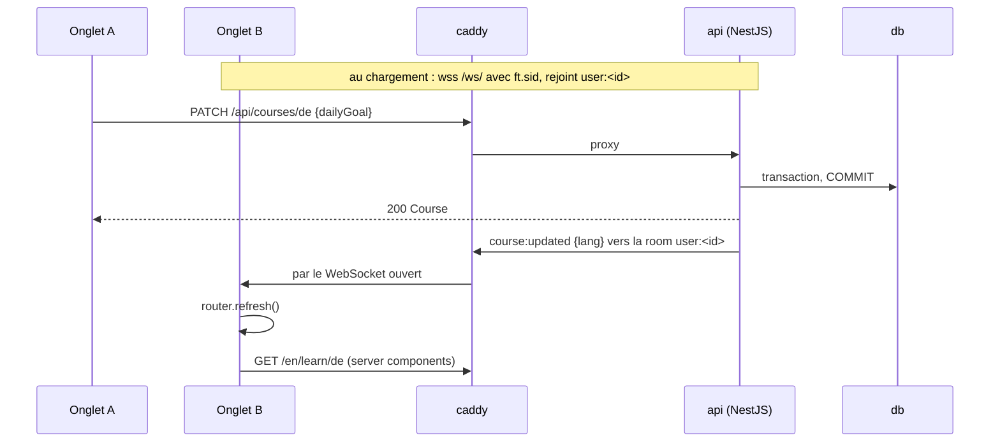
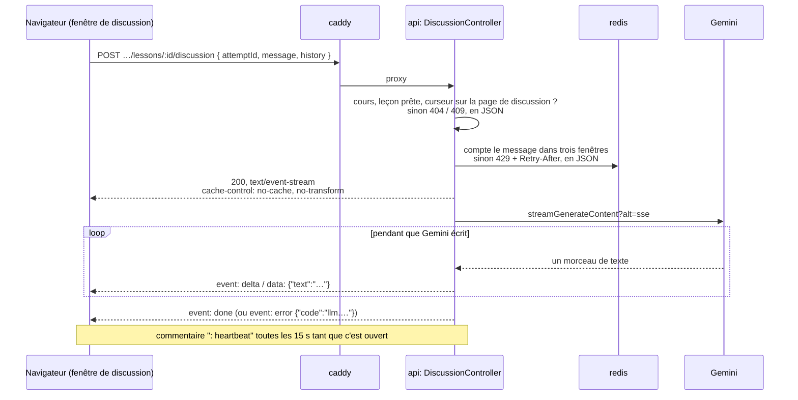

# REST, WebSocket et Server-Sent Events

L'api parle au navigateur de trois façons. Cette page dit quelle fonction utilise laquelle, et pourquoi.

- **REST** : une requête, une réponse JSON. Presque tout.
- **WebSocket** (socket.io sur `/ws`) : le serveur pousse des événements vers le navigateur, vers plusieurs onglets et
  plusieurs utilisateurs à la fois. Les mises à jour en direct des cours et des amis, le statut en ligne et les messages privés.
- **Server-Sent Events** (SSE) : une requête, une réponse envoyée en morceaux pendant qu'elle s'écrit. Seulement la
  discussion de leçon.

[architecture/overview.md](overview.md) montre les containers et comment Caddy route `/api` et `/ws`.
[architecture/data-model.md](data-model.md) contient les tables que ces routes et ces événements écrivent. Le
contrat du socket est dans
[packages/shared/src/events/socket.ts](../../packages/shared/src/events/socket.ts).

---

## 1. La répartition

|                               | Transport                                       | Exemples                                                                                                                                                                                                                   |
| ----------------------------- | ----------------------------------------------- | -------------------------------------------------------------------------------------------------------------------------------------------------------------------------------------------------------------------------- |
| **Tout le CRUD**              | REST, controllers Nest, documentés dans Swagger | `POST /api/courses`, `GET /api/courses/:lang/today`, `GET /api/courses/:lang/lessons`, `GET` et `POST /api/courses/:lang/lessons/:id/attempt`, `POST …/attempt/pages/:index`, `GET /api/friends`, `GET /api/conversations` |
| **Une réponse, en stream**    | Server-Sent Events sur un `POST`                | `POST /api/courses/:lang/lessons/:id/discussion` : `delta`, `done` ou `error`, et un heartbeat (signal de vie)                                                                                                             |
| **Tout ce qui est en direct** | socket.io sur `/ws`                             | `course:updated`, `friend:request`, `friend:accepted`, `friend:removed`, `presence:update`, `dm:message`, `dm:unread` et `app:error` depuis le serveur ; `dm:send` (avec un ack) et `dm:read` depuis le navigateur         |

### Pourquoi presque tout est en REST

L'onboarding, les leçons du jour, commencer une leçon, envoyer une page, lire sa progression : chacun est une
question d'un seul apprenant avec une seule réponse, donc chacun est en HTTP. Un tuteur qui répond à un seul apprenant n'est pas
du « temps réel » au sens du sujet ; le module demande _"real-time updates across
clients"_ (des mises à jour en temps réel entre clients) et _"handle connection/disconnection gracefully"_ (gérer proprement la connexion et la déconnexion), ce qui concerne plusieurs clients.

### Pourquoi une partie est un socket

Le socket doit mériter sa place sur des parties qui impliquent vraiment plusieurs clients. C'est le cas sur
trois :

| Partie                                           | Pourquoi ça doit être un socket                                                                 | Module servi                                |
| ------------------------------------------------ | ----------------------------------------------------------------------------------------------- | ------------------------------------------- |
| **Messages privés** entre amis                   | Deux clients, une conversation, un écho en moins d'une seconde, des compteurs de non-lus        | Real-time (Major), User interaction (Major) |
| **Présence**, statut en ligne des amis           | Le serveur pousse des changements d'état que personne n'a demandés                              | User management (Major)                     |
| **Mises à jour en direct des cours et des amis** | Un changement dans un onglet s'affiche dans les autres onglets du compte, et dans ceux de l'ami | Real-time (Major)                           |

Même là, la lecture reste en REST. Un message privé est envoyé par le socket, mais la liste des
conversations et l'historique sont `GET /api/conversations` et `GET /api/conversations/:userId/messages`. Un
`course:updated` ou un événement d'ami ne transporte aucune donnée : il dit à l'onglet de relire la page.

### Pourquoi la discussion est en SSE, et pas par le socket

Un apprenant, une requête, une réponse lue pendant qu'elle s'écrit : un `POST` dont la réponse est
`text/event-stream`. Il réutilise le cookie de session de la route REST, les guards, le pipe de validation et les codes
d'erreur, chaque vérification qui peut échouer répond avec un statut avant que le stream s'ouvre, et fermer la
réponse annule l'appel à Gemini. Un socket ajouterait un deuxième chemin d'authentification, de validation et d'erreur
pour un échange en tête-à-tête. Le navigateur le lit avec `fetch` et un lecteur de stream, car
`EventSource` n'envoie que des `GET`.

### L'API est neutre côté langue, et ne prend aucun score

**Aucune route de lecture ne prend de paramètre `locale`.** Une leçon est écrite dans une seule langue, celle du cours,
comme une question de la banque, donc la réponse est la même pour toutes les langues d'interface. L'app web
traduit la page autour de la leçon. Deux endroits utilisent la locale de l'interface exprès :
`POST …/attempt { locale }` l'envoie pour fixer la langue maternelle de la tentative, et la discussion, dont le
body ne contient pas de locale, lit le `User.locale` de l'utilisateur de la session et répond dans cette langue.

**Aucune route ne prend de score.** Le serveur gère chaque tentative de leçon sous
`/api/courses/:lang/lessons/:id/attempt` : il envoie seulement la page où se trouve l'apprenant, vérifie chaque
réponse, possède le chronomètre de l'examen, et quand la dernière page se verrouille il enregistre le score à partir des réponses qu'il a
stockées ([content/lessons.md](../content/lessons.md) §10).

---

## 2. À travers Caddy

Les deux Caddyfiles ([infra/caddy/Caddyfile](../../infra/caddy/Caddyfile) et
[infra/caddy/Caddyfile.prod](../../infra/caddy/Caddyfile.prod)) envoient `/api` et `/api/*`, et `/ws`
et `/ws/*`, vers `api:3001`. Il n'y a pas de directive websocket : Caddy 2 détecte la poignée de main Upgrade
dans `reverse_proxy`. Le gateway doit être monté sur `/ws` plutôt que sur le `/socket.io` par défaut de socket.io,
sinon la requête tomberait sur `web`. Comme la page, `/api` et `/ws` partagent
une seule origine, le cookie de session est first-party (du même site) et rien n'a besoin de CORS.

Le stream SSE passe par la route `/api` comme n'importe quelle autre requête.

---

## 3. Le gateway WebSocket

Le gateway est socket.io sur `/ws`, dans l'api et sur son serveur HTTP
([apps/api/src/gateway/](../../apps/api/src/gateway/)). `SocketGateway` authentifie, filtre chaque
événement entrant et gère la présence ; `MessagesGateway`
([messages.gateway.ts](../../apps/api/src/messages/messages.gateway.ts)) gère `dm:send` et
`dm:read`. Ils partagent un seul serveur, donc ils partagent un seul objet d'options, `GATEWAY_OPTIONS` : chemin `/ws`,
transport WebSocket uniquement, frames limitées à 16 Kio.

### Quatre règles

1. **Monter avec `path`, pas `namespace`.** `path` est l'endpoint HTTP sur lequel engine.io écoute ;
   `namespace` est un canal logique multiplexé par-dessus. Le gateway est monté avec
   `path: '/ws'` et le client est `io({ path: '/ws' })`. Les namespaces, c'est pour plus tard, si deux types de
   trafic ont un jour besoin d'être séparés.
2. **Authentifier la poignée de main.** Le même middleware express-session que celui du côté REST lit le
   cookie de session signé, l'Origin doit être la nôtre (même site n'est pas même origine), et le socket
   reçoit `SocketData { userId, sessionId }`. Un socket non authentifié est refusé à la poignée de main,
   jamais connecté.
3. **Parser chaque payload entrant avec le schema Zod partagé** (`CLIENT_EVENT_SCHEMAS`). Tout ce qui
   arrive sur un gateway n'est pas fiable, y compris ce qui vient de notre propre client.
4. **Limiter le débit par socket.** Le guard de `@nestjs/throttler` ne marche qu'en HTTP ; les événements du socket le contournent
   complètement ([product.md](product.md) §6).

### Une mise à jour en direct, de bout en bout

Un changement d'objectif ou de niveau dans un onglet s'affiche dans les autres onglets ouverts du compte. Finir une leçon envoie
le même événement.

### La poignée de main

- **Le cookie est le seul identifiant.** engine.io répond à `/ws` avant Express, donc
  `SessionIoAdapter` lui donne le même middleware express-session : même cookie, même stockage, rien
  parsé à la main. Un middleware socket.io refuse ensuite une page d'une autre origine, une session sans
  `userId` et un compte supprimé, tous avec `auth.sessionRequired`. La vérification de l'Origin compte parce que
  `ft.sid` est `SameSite=Lax`, et même site n'est pas même origine : une page sur un sous-domaine voisin
  l'enverrait aussi. La vérification du compte lit aussi `User.lastActiveDay`, et écrit la date UTC du jour quand
  ce n'est pas aujourd'hui : le premier onglet de la journée écrit, les autres lisent seulement. « Recently active » (actifs récemment) sur
  /friends liste qui a été actif dans les 7 derniers jours, par nom : l'interroger régulièrement montre quelqu'un qui revient
  après une semaine d'absence, et rien de plus fin.
- **Refusé sans bruit.** Un refus est un CONNECT_ERROR sur un WebSocket qui s'est bien ouvert, ce que le
  navigateur n'affiche pas dans les logs ; un HTTP 401 sur l'upgrade serait une erreur dans la console.
- **Des rooms, jamais de broadcast.** Chaque socket rejoint `user:<id>` et `session:<sid>` avant sa
  réponse CONNECT. `SocketsService.toUser()` est le seul moyen de joindre un utilisateur. À part les acks, le gateway
  écrit à un seul socket seulement dans deux cas : au socket qui a envoyé un mauvais événement, et à un socket qui vient de
  se connecter, avec la présence de chaque ami et les compteurs de non-lus (plus bas).
- **Les sockets se ferment avec leur session** : à la déconnexion (seulement les sockets de cette session), à chaque changement
  d'id de session (inscription, connexion, vérification 2FA, activation et désactivation de la 2FA), et quand une session se termine
  d'une autre façon, grâce à un balayage toutes les 60 s qui demande à Redis le `sess:<sid>` de chaque socket ouvert (des clés connues,
  jamais un scan). Une poignée de main vérifie sa session encore une fois après avoir rejoint ses rooms, donc une déconnexion qui
  a eu lieu pendant ce temps ne peut pas lui échapper.

### Chaque événement entrant

- **Un seul filtre pour chaque événement entrant** : 20 de chaque nom d'événement par 10 s par socket, frames limitées
  à 16 Kio, un seul payload en plus de l'ack, un parse zod depuis `CLIENT_EVENT_SCHEMAS`. Chaque nom compte
  dans sa propre fenêtre, et les noms inconnus en partagent une, donc une rafale de `dm:read` ne peut pas consommer le budget
  de `dm:send`. Un événement refusé est ignoré, jamais un crash, et son code est une entrée de `ERROR_CODES` :
  `server.rateLimited` au-delà de la limite, sinon celui de la règle qui a échoué (`message.empty`,
  `message.tooLong`), sinon `request.invalid`. Envoyé avec un ack, il reçoit `{ ok: false, code }` dedans,
  à chaque fois, car celui qui l'a appelé attend la réponse. Sans ack, il reçoit `app:error { code }`, et au-delà de
  la limite seul le premier de la fenêtre est prévenu. Une session a au plus 20 sockets, vérifié
  avant l'écriture de l'utilisateur : un par onglet, c'est bien en dessous, et un client qui ouvre des sockets en boucle ne coûte
  aucune requête. Plus de sockets veut quand même dire plus d'événements ; ce qui limite le travail qu'ils causent, ce sont les
  budgets par compte de `dm:send` et `dm:read` (plus bas).
- **Un filtre attrape-tout pour les handlers.** Les guards, pipes et filtres globaux n'atteignent jamais un gateway
  dans Nest 11, c'est pourquoi le filtre valide et limite. Ce qu'un handler lance va à
  `SocketExceptionFilter`, déclaré avec `@UseFilters` sur chaque gateway qui gère des événements : une
  `HttpException` codée d'un service garde son code (`message.notFriends`), tout le reste est loggé
  et répondu `server.unexpected`, par l'ack quand il y en a un, sinon par `app:error`.

### Les événements

- **Mises à jour des cours, envoyées après le commit.** `course:updated { lang }` veut dire « relis ce
  cours ». Il est envoyé par `CoursesService` après un changement d'objectif ou de niveau et par `AttemptsService` quand
  une tentative se termine. La page est rendue sur le serveur, donc l'onglet appelle `router.refresh()` plutôt
  que de garder une deuxième copie du cours. `RefreshOn` prend la liste des événements qui rafraîchissent une
  page.
- **Les événements d'amis** (`friend:request`, `friend:accepted`, `friend:removed`) vont aux deux utilisateurs de la
  paire, donc les autres onglets de celui qui agit suivent aussi. Ils transportent `{ userId }`, l'autre utilisateur, et /friends,
  /users/[id] et /chat se rafraîchissent sur n'importe lequel. Refuser et annuler envoient `friend:removed` : la ligne entre
  les deux a disparu.
- **La présence** (`presence:update { userId, status, at }`, `online` ou `offline`), dans
  `PresenceService` ([apps/api/src/presence/](../../apps/api/src/presence/)) :
  - **Un compteur par utilisateur** dans Redis, `presence:<id>` : `INCR` quand un socket s'ouvre, `DECR` quand il
    se ferme. En ligne dès le premier socket.
  - **Un délai de grâce de 10 s** (`PRESENCE_GRACE_MS`) : un socket fermé n'est retiré du compteur qu'après
    ce délai. Le nouveau socket d'un rechargement met le compteur à 2, pas à 1, donc les amis ne voient rien. Hors ligne part
    10 s après la _dernière_ fermeture, et `isOnline` continue de dire en ligne jusque-là, donc les routes REST
    sont d'accord avec les amis qui regardent déjà. L'attente est unref'd : elle ne garde jamais le process ouvert
    lors d'un arrêt.
  - **Les amis uniquement** : les mises à jour vont à la room `user:<id>` de chaque ami accepté
    (`friendIds()`, `status: 'accepted'`). Quelqu'un qui a seulement envoyé une demande ne voit rien, comme
    /privacy le promet. Les amis sont recherchés à nouveau au moment du passage hors ligne, car une amitié a pu
    commencer ou finir entre-temps.
  - **Un instantané à la connexion** : le nouveau socket, et seulement lui, reçoit un `presence:update` par ami,
    car la page a pu être rendue un instant avant que l'un d'eux arrive ou parte.
    `GET /api/friends` donne `online` pour chaque ami, depuis `isOnline(ids)` (un seul `MGET`).
  - **Dans l'onglet** : `tab-socket.ts` garde une table de présence aussi longtemps que le socket. Elle est alimentée par
    l'instantané et chaque `presence:update`. Un ami est retiré sur `friend:removed`, et aussi sur
    `friend:accepted`, donc un nouvel ami part du rendu rafraîchi : aucune mise à jour n'arrive pour
    quelqu'un déjà en ligne. Chaque connexion vide la table, car son instantané la remplace, et une
    entrée laissée par un événement manqué pendant l'absence ne peut pas survivre à un nouveau rendu. `PresenceDot` la lit
    et utilise le `online` du rendu seulement pour un ami dont l'onglet n'a rien entendu. Une page que Next
    restaure depuis son cache client avec Retour montre quand même ce qui s'est passé pendant son absence.
  - **Une remise à zéro au démarrage** : aucun socket ne survit à un redémarrage, mais Redis garde les compteurs qu'un crash n'a jamais
    décrémentés, donc `onApplicationBootstrap` supprime chaque clé `presence:*` (`SCAN`, jamais `KEYS`). Un compteur
    qui descend quand même sous zéro est remis à zéro.
- **Les messages privés** entre amis (`dm:send`, `dm:message`, `dm:unread`, `dm:read`), dans
  `MessagesService` ([apps/api/src/messages/](../../apps/api/src/messages/)). Dans chaque payload,
  `userId` est l'autre personne de la conversation, comme dans un événement d'ami :
  - **Envoyés par le socket, lus par REST.** `dm:send { userId, text }` vient avec un ack. Seuls les
    amis acceptés peuvent envoyer (`areFriends()`), donc une demande en attente, ou toi-même, reçoit
    `message.notFriends`. Un compte peut envoyer 30 messages par minute sur tous ses sockets, comptés dans le
    stockage du throttler HTTP ; au-delà, l'ack répond `server.rateLimited`. L'upsert de la conversation
    et l'insertion du message sont une seule transaction ; ensuite `dm:message { userId, message }` va
    aux deux rooms, onglet expéditeur compris, et l'ack répond `{ ok: true, data: message }`.
    Le fil de discussion dédoublonne par id. `GET /api/conversations` liste les conversations, la plus récente en premier, avec
    leurs compteurs de non-lus, et `GET /api/conversations/:userId/messages?cursor=` pagine l'historique, 50
    à la fois sur `(createdAt, id)`. Lire n'a pas besoin d'amitié : l'historique reste lisible par les deux
    après la fin de l'amitié.
  - **Les compteurs de non-lus sont des instantanés.** `dm:unread { counts, at }` contient le compteur de chaque conversation,
    avec pour clé l'autre utilisateur, jamais un changement à appliquer. Il va au destinataire après chaque message,
    sans retarder l'ack (un échec est loggé) ; au lecteur après chaque `dm:read`, qu'il y ait un changement
    ou non, pour qu'une lecture finisse toujours par converger ; et à chaque nouveau socket après l'instantané de présence, vide
    compris, pour que l'onglet puisse distinguer « rien de non lu » de « pas encore de nouvelles ». `at` est pris avant le
    comptage, donc de deux instantanés qui se croisent (une lecture et un nouveau message en même temps) celui avec la date la plus récente
    a compté chaque écriture que l'autre a vue : l'onglet garde le `at` le plus récent, quel que soit l'ordre d'arrivée.
  - **`dm:read { userId }`** remplit `readAt` sur ce que cet utilisateur t'a envoyé. Pas d'ack : la réponse est
    l'instantané, envoyé à chaque onglet du lecteur. Le fil ouvert l'envoie tant que l'onglet est visible et
    connecté et que la conversation a des messages non lus, et chaque instantané le réarme. Un compte
    peut lire 100 fois par minute sur tous ses sockets, ce qu'une route HTTP autorise
    (`RATE_LIMIT_PER_MINUTE`), car chaque lecture coûte deux requêtes et un instantané à chaque onglet ; au-delà,
    il reçoit `app:error` avec `server.rateLimited`, et les compteurs restent tels quels jusqu'au prochain
    instantané. `readAt` ne quitte jamais le serveur. L'index sur `(pairKey, readAt)` garde le coût des compteurs
    et d'une lecture proportionnel à ce qui n'est pas lu, pas à tout l'historique.
  - **Dans l'onglet** : `tab-socket.ts` garde le dernier instantané aussi longtemps que le socket, comme la
    table de présence, et le supprime à la déconnexion du compte. Le badge du bouton du menu de l'en-tête et de son lien
    Messages affiche son total (#220), 99+ au-delà de 99, et rien avant le premier instantané. `sendMessage()` refuse tout de suite avec
    `network.unreachable` quand il n'y a pas de connexion : socket.io mettrait l'événement en attente et le livrerait longtemps
    après que le fil a dit que l'envoi avait échoué. Un ack perdu (10 s, ou le socket qui se ferme) dit la même chose, même si
    le message a peut-être été stocké : le renvoyer peut alors l'afficher deux fois, c'est accepté, car rien ne
    distingue deux envois du même texte.
  - **Rattraper le retard après une reconnexion** : les événements envoyés pendant l'absence sont perdus, donc le fil ouvert récupère
    la page la plus récente à chaque connexion, la première comprise, et la fusionne par id. Quand cette page ne
    rejoint pas ce que le fil contient, plus d'une page est arrivée entre-temps, et le fil repart
    de cette page. L'instantané de connexion remet les compteurs à jour.

### Une seule instance de l'API

Les rooms vivent dans la mémoire du process qui tient le socket, donc `toUser()` n'atteint que les sockets de ce
process : avec deux répliques de `api`, un message envoyé par l'une raterait un ami
connecté à l'autre. Plusieurs répliques auraient besoin de `@socket.io/redis-adapter`, qui fait passer les emits de room
par Redis (`InterServerEvents` l'attend), et d'une remise à zéro de la présence au démarrage qui ne touche pas aux
compteurs des autres instances. L'api tourne avec une seule réplique par conception ([product.md](product.md) §4).

### Le côté navigateur

- **Une connexion par onglet**, gardée au niveau du module
  ([apps/web/components/tab-socket.ts](../../apps/web/components/tab-socket.ts)) et ouverte par
  `SessionNav` pour un utilisateur connecté, donc un remontage de groupe de routes ou un changement de locale ne la coupe jamais, et
  une page anonyme n'en ouvre jamais. Transport WebSocket uniquement : un long poll garde une requête ouverte,
  et un 502 en polling est une erreur dans la console.
- **Se reconnecter sans bruit dans la console.** Une tentative de connexion WebSocket ratée est une erreur de console qu'aucun code ne peut
  cacher, donc chaque nouvel essai (1, 2, 4, 8, puis toutes les 10 s, avec un peu d'aléatoire) demande d'abord `/healthz/api`, une route web
  qui répond toujours 200, et ne se connecte qu'une fois que l'api répond
  ([apps/web/lib/reconnect.ts](../../apps/web/lib/reconnect.ts)). « Reconnecting… » (reconnexion…) s'affiche pendant ce temps,
  et revenir rafraîchit la page, car les événements envoyés pendant l'absence sont perdus.
- **Ce que la sonde ne peut pas cacher** : l'api qui meurt entre une sonde et la connexion (une ligne), et l'échec
  de la sonde elle-même quand web redémarre aussi ou que le portable se retrouve hors ligne.
- **En dev**, chaque sauvegarde dans `apps/api` redémarre le process, donc les sockets tombent et le badge clignote ;
  le Fast Refresh de `tab-socket.ts` laisse l'ancien socket ouvert jusqu'à un rechargement.
- **Pas de CSP aujourd'hui.** Si on en ajoute une, `connect-src 'self'` couvre `wss:` sur la même origine dans les
  moteurs actuels.

---

## 4. Le stream de discussion de leçon

La route est `DiscussionController`
([discussion.controller.ts](../../apps/api/src/lessons/discussion.controller.ts)), dans son propre
controller car elle répond avec un stream d'événements sur une seule réponse HTTP plutôt qu'avec une seule
réponse JSON. [content/lessons.md](../content/lessons.md) §12 explique ce que le tuteur sait et ce que la
page de discussion affiche.

- **Deux moitiés, à cause de HTTP.** `DiscussionService.open()` exécute chaque vérification qui peut encore
  répondre avec un statut, puis `countMessage()` les limites de débit. Seulement ensuite `openEventStream()`
  ([event-stream.ts](../../apps/api/src/lessons/event-stream.ts)) envoie le 200 et ses headers.
  Après ça, un échec ne peut être qu'un événement : `error { code }`, avec un code `llm.*` tiré de la
  raison de la `LlmError` (`llm.unavailable`, `llm.rateLimited`, `llm.blocked`, `llm.incomplete`,
  `llm.disabled`), ou `unknown` pour un bug.
- **Annulé avec la page.** Quand le navigateur ferme la réponse, un `AbortSignal` annule
  l'appel à Gemini, même s'il est parti pendant les vérifications. Stop dans la fenêtre fait la même chose.
- **Sans état.** Le body contient les 10 derniers tours ; le serveur construit le prompt système depuis le
  brief de la leçon et les mauvaises réponses d'entraînement de la tentative (`discussion-prompt.ts`) et ne stocke
  rien.
- **Le navigateur** le lit avec `fetch` et un lecteur de stream
  ([apps/web/lib/discussion-client.ts](../../apps/web/lib/discussion-client.ts)), car
  `EventSource` n'envoie que des `GET`. Un refus avant le stream arrive comme l'erreur JSON habituelle, avec
  `retryAfter` sur un 429.

### Le SSE à travers Caddy, et l'exclusion de `encode`

Caddy compresse chaque route (`encode zstd gzip` dans les deux Caddyfiles). Un compresseur retient les octets
jusqu'à en avoir assez à compresser, ce qui transformerait un stream de petits événements `delta` en quelques rafales
en retard. L'issue #150 prévoyait d'exclure `text/event-stream` de `encode` si ça arrivait. **Les
Caddyfiles ne contiennent aucune exclusion** : l'API marque le stream `Cache-Control: no-cache, no-transform`,
et le `encode` de Caddy laisse une réponse `no-transform` non compressée, tandis que `reverse_proxy` envoie un
stream d'événements au fur et à mesure. Vérifié à la main à travers Caddy avec Gemini dans la PR #201 : les morceaux arrivent
un par un. Le heartbeat empêche tout proxy sur le chemin de fermer un stream silencieux. Si une future version de Caddy
change l'un de ces comportements, la solution est un matcher sur la directive `encode`, pas un changement dans
l'API.
