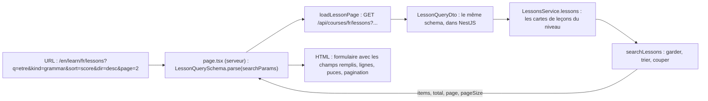

# Recherche avancée (Minor, 1 point)

**Type :** Minor. **Points :** 1. **Statut :** fait.

La page de toutes les leçons liste chaque leçon du niveau actuel de l'apprenant. L'apprenant peut y
chercher par mots, la filtrer par statut, type, sujet et thème, la trier, la regrouper, et la parcourir
page par page. Chaque vue est une adresse web, donc on peut la partager, la recharger ou la mettre en favori, et la
page marche avec JavaScript désactivé.

## Ce que demande le sujet

Le module est une ligne du tableau Web de [../subject/summary.md](../subject/summary.md) :

> | Minor | Advanced search: filters, sorting, pagination |

Le PDF ([../../subject/ft_transcendence.pdf](../../subject/ft_transcendence.pdf), chapitre IV, Web)
le formule comme ceci :

> Minor: Implement advanced search functionality with filters, sorting, and pagination.

Aucune règle de dépendance du sujet ne s'applique à ce module.

## Comment on y répond

| Le sujet demande  | Ce qu'on a construit                                                                                                                                                                                                                                                                                                                                                                                                                                                       | Où                                                                                                                                                                                                                                                                                                    |
| ----------------- | -------------------------------------------------------------------------------------------------------------------------------------------------------------------------------------------------------------------------------------------------------------------------------------------------------------------------------------------------------------------------------------------------------------------------------------------------------------------------- | ----------------------------------------------------------------------------------------------------------------------------------------------------------------------------------------------------------------------------------------------------------------------------------------------------- |
| Recherche avancée | Une zone de recherche texte. Chaque mot tapé doit être trouvé, dans n'importe quel ordre, dans le titre ou le résumé de la leçon. Les majuscules et les accents ne comptent pas (« etre » trouve « être »), un morceau de mot suffit, et en allemand « ae », « oe », « ue » trouvent aussi « ä », « ö », « ü ». La recherche tourne dans NestJS, derrière `GET /api/courses/:lang/lessons`.                                                                                | [`lesson-search.ts`](../../../apps/api/src/lessons/lesson-search.ts) (`searchLessons`, `matchesText`, `bareVowels`), [`foldText`](../../../packages/shared/src/schemas/lesson.ts), [`lessons.controller.ts`](../../../apps/api/src/lessons/lessons.controller.ts)                                     |
| Filtres           | Quatre filtres, tous en cases à cocher : **Status** (Not started, Not passed yet, Passed, Coming soon), **Kind** (Grammar, Vocabulary, Everyday phrases, Reading), **Topics** (13) et **Themes** (14). Dans un même filtre, une leçon passe si elle a une des valeurs cochées. Entre les filtres, elle doit passer tous les filtres, et la recherche texte aussi. Chaque filtre actif s'affiche comme une puce (chip) qui le retire, et **Clear filters** les retire tous. | [`lesson-search.ts`](../../../apps/api/src/lessons/lesson-search.ts) (`matchesFilters`), [`lesson-list.tsx`](<../../../apps/web/app/[locale]/(dashboard)/learn/[lang]/lessons/lesson-list.tsx>) (`LessonFilters`, `ActiveFilters`)                                                                    |
| Tri               | **Sort** par Order (la place de la leçon dans le niveau), Score ou Last finished, avec **Direction** Ascending ou Descending. Les leçons jamais commencées sont toujours à la fin, dans les deux sens. En cas d'égalité, c'est l'ordre de la leçon qui décide. **Group** (None, Status, Day, Kind) ajoute un titre à chaque endroit où le groupe change.                                                                                                                   | [`lesson-search.ts`](../../../apps/api/src/lessons/lesson-search.ts) (`compareFor`, `GROUPS`, `nullsLast`), [`lesson-list.tsx`](<../../../apps/web/app/[locale]/(dashboard)/learn/[lang]/lessons/lesson-list.tsx>) (`LessonToolbar`, `LessonRows`)                                                    |
| Pagination        | 20 leçons par page (`LESSONS_PAGE_SIZE`). L'API renvoie la page, le total des leçons qui correspondent et la taille de page. La page affiche « 1 to 20 of N », **Previous**, un lien par numéro de page, et **Next**. Chaque lien de page garde la recherche, les filtres et le tri. Une page après la fin donne la dernière page.                                                                                                                                         | [`lesson-search.ts`](../../../apps/api/src/lessons/lesson-search.ts), [`lesson.ts`](../../../packages/shared/src/schemas/lesson.ts) (`LESSONS_PAGE_SIZE`, `LessonPageSchema`), [`lesson-list.tsx`](<../../../apps/web/app/[locale]/(dashboard)/learn/[lang]/lessons/lesson-list.tsx>) (`LessonPager`) |

## Comment ça marche

1. **L'URL contient toute la vue.** Les paramètres sont `q`, `status`, `kind`, `topic`,
   `theme`, `sort`, `dir`, `group` et `page`. Les listes sont séparées par des virgules (`kind=grammar,reading`)
   ou la clé est répétée (`kind=grammar&kind=reading`, c'est ce qu'envoie un formulaire de cases à cocher).
   Une valeur par défaut n'est pas mise dans l'URL, donc la page sans paramètres est la vue par défaut
   ([`lesson-list.ts`](../../../apps/web/lib/lesson-list.ts), `lessonQueryParams` et
   `lessonsHref`).
2. **Un seul schema, des deux côtés.** `LessonQuerySchema` dans
   [`packages/shared/src/schemas/lesson.ts`](../../../packages/shared/src/schemas/lesson.ts) lit
   les paramètres. Il n'échoue jamais : une valeur inconnue revient à sa valeur par défaut (`sort=foo`
   devient `position`, `page=0` devient 1), les valeurs de liste inconnues sont retirées, et `q` est nettoyé
   des espaces au début et à la fin et coupé à 100 caractères. La page l'utilise pour remplir le formulaire, et NestJS l'utilise via
   `LessonQueryDto` ([`lessons.dto.ts`](../../../apps/api/src/lessons/lessons.dto.ts)). Donc une
   URL modifiée à la main ne donne jamais une erreur 400, et le formulaire montre toujours ce que l'API a appliqué.
3. **Le serveur fait le rendu de la page.**
   [`lessons/page.tsx`](<../../../apps/web/app/[locale]/(dashboard)/learn/[lang]/lessons/page.tsx>)
   est un server component. Il vérifie la session et le cours, puis appelle `loadLessonPage()`
   dans [`lib/lessons.ts`](../../../apps/web/lib/lessons.ts), qui appelle l'API.
4. **NestJS fait la recherche.** `listLessons` dans
   [`lessons.controller.ts`](../../../apps/api/src/lessons/lessons.controller.ts) répond à
   `GET /api/courses/:lang/lessons`. `lessons()` dans
   [`lessons.service.ts`](../../../apps/api/src/lessons/lessons.service.ts) construit une carte par
   leçon du niveau actuel, avec le résultat de l'apprenant dessus. `searchLessons()` dans
   [`lesson-search.ts`](../../../apps/api/src/lessons/lesson-search.ts) fait ensuite trois étapes :
   - **garder** les cartes qui passent chaque filtre et contiennent chaque mot tapé ;
   - **trier** : d'abord par groupe, puis par le tri et le sens choisis, puis par ordre ;
   - **couper** une page de 20. Une page après la fin donne la dernière page ; aucun résultat donne la page 1,
     vide.
5. **La réponse.** `LessonPageSchema` a `items`, `total` (les leçons qui correspondent), `levelTotal`
   (toutes les leçons du niveau), `page` (la page vraiment affichée) et `pageSize`. La page affiche
   les lignes, le compte (« N lessons »), les puces et la pagination à partir de ça.
6. **Sans JavaScript**, les filtres, la zone de recherche et les listes déroulantes sont un simple
   `<form method="get">`. **Apply** (dans `<noscript>`) l'envoie, et le navigateur charge la
   nouvelle URL. Les puces, **Clear filters** et la pagination sont de simples liens.
7. **Avec JavaScript**,
   [`live-form.tsx`](<../../../apps/web/app/[locale]/(dashboard)/learn/[lang]/lessons/live-form.tsx>)
   applique chaque changement tout de suite : une case ou une liste déroulante immédiatement, la recherche 250 ms après
   la fin de la frappe. Chaque changement pousse une nouvelle URL, donc **Back** annule un changement. Les lignes pâlissent
   pendant que le serveur fait le rendu de la vue suivante. Le bouton **Apply** n'est pas affiché.
8. **Sur un téléphone**, les filtres s'ouvrent dans un panneau avec le lien **Filters** (il affiche
   « Filters · N » quand N filtres sont actifs), et se ferment avec **Close** ou **Show the lessons**. Le
   panneau s'ouvre avec le sélecteur CSS `:target` sur `#filters`, donc il n'a pas besoin de JavaScript non plus.

La page du cours renvoie vers cette page avec « See all N A1 lessons ». Quand le défi du jour est un
type de leçon, il renvoie vers cette page avec un filtre déjà mis, par exemple
`?kind=grammar&group=status` ([`gamification.tsx`](../../../apps/web/components/gamification.tsx)).

## Où est le code

| Chemin                                                                                                                                                          | Ce qu'il fait                                                                                                       |
| --------------------------------------------------------------------------------------------------------------------------------------------------------------- | ------------------------------------------------------------------------------------------------------------------- |
| [`packages/shared/src/schemas/lesson.ts`](../../../packages/shared/src/schemas/lesson.ts)                                                                       | `LessonQuerySchema`, `LessonPageSchema`, `LESSONS_PAGE_SIZE`, les listes de tris, de sens et de groupes, `foldText` |
| [`apps/api/src/lessons/lesson-search.ts`](../../../apps/api/src/lessons/lesson-search.ts)                                                                       | La recherche : correspondance du texte, filtres, tri, groupes, pages                                                |
| [`apps/api/src/lessons/lessons.dto.ts`](../../../apps/api/src/lessons/lessons.dto.ts)                                                                           | `LessonQueryDto` (les paramètres de la requête) et `LessonPageDto` (la réponse), tirés des schemas partagés         |
| [`apps/api/src/lessons/lessons.controller.ts`](../../../apps/api/src/lessons/lessons.controller.ts)                                                             | `GET /api/courses/:lang/lessons`, documenté dans Swagger                                                            |
| [`apps/api/src/lessons/lessons.service.ts`](../../../apps/api/src/lessons/lessons.service.ts)                                                                   | Construit les cartes du niveau avec les résultats de l'apprenant, appelle `searchLessons`                           |
| [`apps/web/app/[locale]/(dashboard)/learn/[lang]/lessons/page.tsx`](<../../../apps/web/app/[locale]/(dashboard)/learn/[lang]/lessons/page.tsx>)                 | La page de toutes les leçons, rendue sur le serveur à partir de l'URL                                               |
| [`apps/web/app/[locale]/(dashboard)/learn/[lang]/lessons/lesson-list.tsx`](<../../../apps/web/app/[locale]/(dashboard)/learn/[lang]/lessons/lesson-list.tsx>)   | Filtres, barre d'outils, puces, lignes, pagination                                                                  |
| [`apps/web/app/[locale]/(dashboard)/learn/[lang]/lessons/live-form.tsx`](<../../../apps/web/app/[locale]/(dashboard)/learn/[lang]/lessons/live-form.tsx>)       | Le formulaire GET, appliqué à chaque changement quand JavaScript est actif                                          |
| [`apps/web/app/[locale]/(dashboard)/learn/[lang]/lessons/fold-details.tsx`](<../../../apps/web/app/[locale]/(dashboard)/learn/[lang]/lessons/fold-details.tsx>) | Les blocs repliables de Topics et Themes, ouverts tant qu'une de leurs cases est cochée                             |
| [`apps/web/lib/lesson-list.ts`](../../../apps/web/lib/lesson-list.ts)                                                                                           | La construction de l'URL (`lessonQueryParams`, `lessonsHref`) et les titres de groupes (`groupRows`)                |
| [`apps/web/lib/lessons.ts`](../../../apps/web/lib/lessons.ts)                                                                                                   | `loadLessonPage` : l'appel à l'API côté serveur                                                                     |
| [`apps/web/messages/en.json`](../../../apps/web/messages/en.json)                                                                                               | Les textes `Lessons` (et leurs versions française et allemande)                                                     |

## Comment le montrer à la soutenance

1. Lance l'app avec `make run` (ou `make`) et ouvre `https://localhost`.
2. Crée un compte sur `/en/signup` : remplis **Email**, **Display name**, **Password** et
   **Confirm password**, puis clique sur **Create account**. Tu arrives sur `/en/onboarding`.
3. Sous « Language to learn », choisis **Français**, choisis un « Daily goal », et clique sur **Next**. Clique
   sur **I already know my level**, choisis **A0**, et clique sur **Start learning**. Tu arrives sur
   `/en/learn/fr`.
4. Clique sur **See all N A1 lessons** (N est le nombre de leçons du niveau). Tu es sur
   `/en/learn/fr/lessons`, « All A1 lessons ». Sous la liste : « 1 to 20 of N » et les numéros
   de page.
5. **Pagination.** Clique sur **Next**. L'URL devient `/en/learn/fr/lessons?page=2`, et la page
   affiche « 21 to 40 of N ». Clique sur **Previous** ou sur un numéro de page pour bouger encore.
6. **Filtres.** Sous **Kind**, coche **Grammar**. La liste change tout de suite, l'URL reçoit
   `kind=grammar`, et une puce **Grammar** apparaît au-dessus de la liste. Sous **Status**, coche
   **Coming soon** : il ne reste que les leçons de grammaire pas encore écrites, grisées et pas
   cliquables. Clique sur la puce **Coming soon** pour retirer ce filtre. Ouvre **Topics** et coche
   **Pronouns** : il ne reste que les leçons de grammaire sur les pronoms.
7. **Recherche.** Clique sur **Clear filters**. Tape `etre` dans la zone « Search a title or a word ». Après
   une courte pause, la liste affiche « Le verbe être au présent » : les accents ne comptent pas. Tape
   `nombres` à la place : les leçons sur les nombres s'affichent.
8. **Tri.** Vide la recherche. Mets **Sort** sur **Order** et **Direction** sur
   **Descending** : la dernière leçon du niveau arrive en premier. Mets **Sort** sur **Score** ou
   **Last finished** : avec un nouveau compte aucune leçon n'a encore de résultat, donc elles gardent leur ordre.
   Finis d'abord une leçon pour la voir monter en haut.
9. **Groupes.** Mets **Group** sur **Kind** : les lignes arrivent maintenant type par type, sous un titre
   **Grammar**. Les leçons de grammaire remplissent les premières pages ; la page 3 montre où commence le titre
   **Vocabulary**. Mets-le sur **Status** : « Not started », puis « Coming soon ».
10. **L'URL est la vue.** Copie l'URL, ouvre-la dans un nouvel onglet : les mêmes cases, listes déroulantes et
    lignes. Appuie sur **Back** dans le premier onglet : ça annule un changement.
11. **Une URL modifiée à la main.** Ouvre `/en/learn/fr/lessons?sort=foo&page=0` : pas d'erreur, la vue par
    défaut. Ouvre `/en/learn/fr/lessons?page=99` : la dernière page.
12. **Sans JavaScript.** Dans les outils de développement de Chrome, appuie sur Ctrl+Shift+P (Cmd+Shift+P sur un
    Mac), lance « Disable JavaScript », et recharge. Un bouton **Apply** s'affiche maintenant à côté des
    listes déroulantes. Coche **Grammar**, mets **Direction** sur **Descending**, clique sur **Apply** : l'URL
    et la liste suivent. Les liens de pagination marchent toujours.
13. **En largeur de téléphone** (la barre d'appareils dans les outils de développement) : clique sur **Filters**, coche une
    case, puis **Show the lessons**.
14. En option : ouvre `https://localhost/api/docs`, trouve `GET /api/courses/{lang}/lessons` sous
    `lessons`. Il liste les paramètres `q`, `status`, `kind`, `topic`, `theme`, `sort`, `dir`,
    `group` et `page`.

## Les tests qui le prouvent

| Test                                                                                                | Ce qu'il vérifie                                                                                                                                                                                                                                                                                                                                                                                                                                                                                                                                                                                                                                                                                     |
| --------------------------------------------------------------------------------------------------- | ---------------------------------------------------------------------------------------------------------------------------------------------------------------------------------------------------------------------------------------------------------------------------------------------------------------------------------------------------------------------------------------------------------------------------------------------------------------------------------------------------------------------------------------------------------------------------------------------------------------------------------------------------------------------------------------------------- |
| [`apps/api/src/lessons/lesson-search.spec.ts`](../../../apps/api/src/lessons/lesson-search.spec.ts) | `searchLessons` seul. Texte : majuscules et accents, morceau de mot, « finds Mädchen from maedchen in German only », « keeps oe in French, so coeur finds cœur and never cour », « needs every word, in any order ». Filtres : n'importe laquelle des valeurs listées, « needs every filter to match », soon et todo. Tri : par score et finishedAt « never started last in both directions », « breaks ties by position ascending, whatever the dir ». Groupes : ordre par status, day et kind. Pages : « returns one page of LESSONS_PAGE_SIZE and the total », « clamps a page past the end to the last page », « counts the total after the filters, not before », « is page 1 with no matches » |
| [`apps/api/test/lessons.e2e-spec.ts`](../../../apps/api/test/lessons.e2e-spec.ts)                   | La vraie route avec une base de données : 401 sans session, 400 pour une langue inconnue, 409 avant le placement ; « lists only the current level » ; la recherche sur le titre et le résumé ; les statuts, une clé répétée, topic et theme ; tri par score ; groupes ; « falls back on the defaults for unknown values, never a 400 » ; « brings a page past the end back to the last one » ; « answers an empty page when nothing matches » ; Swagger documente les paramètres                                                                                                                                                                                                                     |
| [`packages/shared/src/schemas/lesson.test.ts`](../../../packages/shared/src/schemas/lesson.test.ts) | `LessonQuerySchema` : « defaults every field », « reads page from digits only », « falls back to the defaults and drops unknown list values », « reads a repeated key like one comma list », `q` coupé à 100                                                                                                                                                                                                                                                                                                                                                                                                                                                                                         |
| [`apps/web/lib/lesson-list.test.ts`](../../../apps/web/lib/lesson-list.test.ts)                     | L'URL ne contient pas les valeurs par défaut ; les titres de groupes commencent là où la clé change                                                                                                                                                                                                                                                                                                                                                                                                                                                                                                                                                                                                  |
| [`e2e/tests/lessons.spec.ts`](../../../e2e/tests/lessons.spec.ts)                                   | Dans un vrai navigateur : « a direct load renders exactly the view in its URL », « pages of 20 over the whole level, with a working pager », « a hand-edited URL renders the default view », « groups put a header wherever the group changes », « a box applies as soon as it is checked, and its chip takes it off », « Back undoes one change, not all of them », « a search applies once the typing stops », le panneau sur téléphone, « without JavaScript, the form still filters and the pager still pages », « a search without accents finds a title with them, in every interface language », et qui peut ouvrir la page                                                                   |
| [`e2e/tests/roadmap.spec.ts`](../../../e2e/tests/roadmap.spec.ts)                                   | « the all lessons page: the Passed filter, page 2 by URL, and no JavaScript », après avoir joué de vraies leçons                                                                                                                                                                                                                                                                                                                                                                                                                                                                                                                                                                                     |

Les tests unitaires et Supertest tournent dans [`.github/workflows/ci.yml`](../../../.github/workflows/ci.yml).
Les tests Playwright tournent dans [`.github/workflows/e2e.yml`](../../../.github/workflows/e2e.yml).

## Limites et choix

- **La recherche se fait en mémoire, pas dans la base de données.** NestJS charge les leçons du
  niveau actuel (entre 120 et 320, comme le dit
  [#196](https://github.com/VictorBro/ft_transcendence/pull/196)) avec les résultats de l'apprenant,
  puis les filtre, les trie et les coupe en TypeScript. Ça garde la recherche comme une simple
  fonction sans base de données, c'est pour ça que `lesson-search.spec.ts` peut tester chaque règle
  toute seule. Ça ne tiendrait pas pour un très grand catalogue ; un niveau n'en est jamais un.
- **Un niveau à la fois.** La page liste seulement le niveau actuel. Pour voir un autre niveau,
  l'apprenant change de niveau (**Change level**).
- **Taille de page fixe.** 20 leçons par page ; l'apprenant ne peut pas la changer.
- **La recherche texte est un « contient », sans classement.** Chaque mot doit apparaître ; il n'y a pas de score
  de pertinence ni de correction d'orthographe. En français, « oe » n'est pas changé, donc « coeur » ne trouve jamais
  « cour ».
- **Tolérant exprès.** Un mauvais paramètre ne donne jamais d'erreur. Il revient à sa valeur par défaut,
  donc un vieux lien ou un lien modifié à la main ouvre quand même une page qui marche.
- **Les autres recherches dans l'app.** La page des amis a une recherche d'utilisateurs par nom (voir
  [user-interaction.md](user-interaction.md)). On annonce ce module seulement avec la page de toutes
  les leçons.

## Qui l'a construit

| Membre | GitHub                                        | Ce qu'il a construit                                                                                                                                                                                                                                                    | Issues et PRs                                                                                                                  |
| ------ | --------------------------------------------- | ----------------------------------------------------------------------------------------------------------------------------------------------------------------------------------------------------------------------------------------------------------------------- | ------------------------------------------------------------------------------------------------------------------------------ |
| Endrit | [VYAntares](https://github.com/VYAntares)     | Le côté API : `GET /api/courses/:lang/lessons`, `searchLessons` (texte, filtres, tri, groupes, pages), la correspondance allemande « ae/oe/ue », les DTOs et la doc Swagger, avec leurs tests unitaires et Supertest.                                                   | [#81](https://github.com/VictorBro/ft_transcendence/issues/81), [#128](https://github.com/VictorBro/ft_transcendence/pull/128) |
| Luca   | [luca-mattei](https://github.com/luca-mattei) | La page de toutes les leçons : le formulaire GET, le formulaire en direct, les filtres, les puces, le tri, les groupes, la pagination et le panneau sur téléphone. Côté API, le statut `soon` pour les leçons pas encore écrites. Les tests e2e dans `lessons.spec.ts`. | [#87](https://github.com/VictorBro/ft_transcendence/issues/87), [#196](https://github.com/VictorBro/ft_transcendence/pull/196) |
