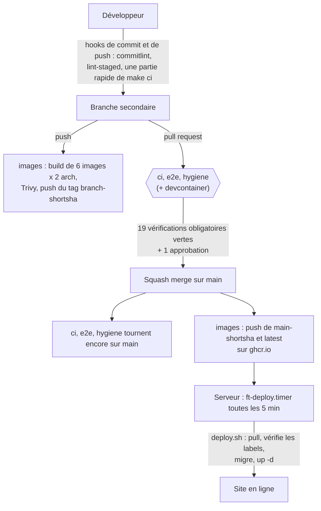

# CI/CD (Major custom, 2 points)

**Type :** Major (module custom). **Points :** 2. **Statut :** fait.

Chaque changement de l'app passe par le même chemin automatique. Un coéquipier ouvre une pull
request. GitHub lance 41 vérifications dessus, du message de commit jusqu'à un test complet dans le navigateur sur
le build de production, et le bouton de merge reste bloqué jusqu'à ce que les vérifications obligatoires passent
et qu'un autre coéquipier approuve. Après le merge, les images des containers sont construites pour deux
types de processeur, scannées pour trouver les failles de sécurité connues, et publiées. En quelques minutes, le
serveur trouve les nouvelles images et se met à jour tout seul, sans que personne ne se connecte dessus.

CI veut dire « continuous integration » (intégration continue) : vérifier chaque changement automatiquement. CD veut dire
« continuous delivery » (livraison continue) : livrer chaque changement accepté automatiquement.

## Ce que demande le sujet

Le module est une ligne du tableau Modules au choix de
[../subject/summary.md](../subject/summary.md) :

> | Major | Module sur mesure, conséquent et techniquement complexe, justifié dans le README (pourquoi ce choix, quelles difficultés, quelle valeur, pourquoi 2 points). Fonctionnalités triviales = refus |

Le PDF ([../../docs/subject/ft_transcendence.pdf](../../docs/subject/ft_transcendence.pdf), chapitre IV.10, Modules of
choice) le formule ainsi :

> Major: Implement a custom module that is not listed above.
>
> - The module must be substantial and demonstrate technical complexity.
> - You must provide proper justification in your README.md explaining:
>   - Why you chose this module.
>   - What technical challenges it addresses.
>   - How it adds value to your project.
>   - Why it deserves Major module status (2 points).
> - Taking shortcuts or implementing trivial features will result in rejection.
> - Be creative and think outside the box.
> - The module should be relevant to your project context.

On répond aux quatre questions plus bas, dans « Pourquoi on l'a choisi », « Les défis techniques »,
« Ce que ça apporte » et « Pourquoi il mérite sa taille ».

La CI/CD n'est pas dans la liste des modules du sujet. La section DevOps liste ELK, Prometheus et
Grafana, les microservices, et une page de health check avec des sauvegardes. Aucun d'eux ne build,
ne teste ni ne livre le code.

## Comment on y répond

Un module custom n'a pas de liste d'exigences fixe, donc ce tableau liste ce qu'on annonce et
où se trouve la preuve.

| Ce qu'on annonce                                                | Ce qu'on a construit                                                                                                                                                                                                                                                                                                                                                                                 | Où                                                                                                                                                                                                         |
| --------------------------------------------------------------- | ---------------------------------------------------------------------------------------------------------------------------------------------------------------------------------------------------------------------------------------------------------------------------------------------------------------------------------------------------------------------------------------------------- | ---------------------------------------------------------------------------------------------------------------------------------------------------------------------------------------------------------- |
| Chaque changement est vérifié avant de pouvoir être mergé       | Trois workflows tournent à chaque pull request et encore sur `main` après le merge : `ci`, `e2e`, `hygiene`. Un quatrième, `images`, tourne à chaque push sur n'importe quelle branche, donc ses jobs apparaissent aussi sur la pull request. Un cinquième, `devcontainer`, tourne quand les fichiers du container de développement changent. Sur la pull request #212, ça faisait 41 vérifications. | [`.github/workflows/`](../../.github/workflows)                                                                                                                                                            |
| Personne ne peut sauter les vérifications                       | Un ruleset GitHub sur `main` : pas de push direct, pas de force push, pas de suppression, merge en squash seulement, 1 review qui approuve, les approbations annulées à chaque nouveau push, chaque fil de review résolu, 19 vérifications nommées obligatoires et la branche à jour avec `main`. L'API indique `current_user_can_bypass: never`.                                                    | Ruleset `ci` (id 20536130), lu avec `gh api repos/VictorBro/ft_transcendence/rulesets/20536130`                                                                                                            |
| Les tests tournent dans le même environnement que la production | Les tests unitaires et la suite Supertest de NestJS tournent dans le stage `ci` du Dockerfile de chaque app, contre de vrais containers PostgreSQL et Redis                                                                                                                                                                                                                                          | Le job `unit-tests` dans [`ci.yml`](../../.github/workflows/ci.yml), le stage `ci` dans [`apps/api/Dockerfile`](../../apps/api/Dockerfile) et [`apps/web/Dockerfile`](../../apps/web/Dockerfile)           |
| Des tests navigateur sur le build de production                 | La stack compose de production démarre dans la CI, puis Playwright lance chaque spec sur Chromium, Firefox et WebKit, en 6 jobs en parallèle                                                                                                                                                                                                                                                         | [`e2e.yml`](../../.github/workflows/e2e.yml)                                                                                                                                                               |
| Les règles de rejet du sujet sont vérifiées par une machine     | Zéro erreur et zéro avertissement dans la console, de vraies pages légales, pas de `.env` commité                                                                                                                                                                                                                                                                                                    | [`e2e/tests/console.spec.ts`](../../e2e/tests/console.spec.ts), [`e2e/tests/legal.spec.ts`](../../e2e/tests/legal.spec.ts), le job `env-example` dans [`hygiene.yml`](../../.github/workflows/hygiene.yml) |
| Un historique propre et pas de secrets qui fuient               | gitleaks sur tout l'historique, commitlint sur chaque commit, une vérification du titre de pull request qui renomme les mauvais titres, une vérification de dérive des migrations Prisma                                                                                                                                                                                                             | [`hygiene.yml`](../../.github/workflows/hygiene.yml), [`scripts/pr-title.sh`](../../scripts/pr-title.sh), [`.github/commitlint.config.mjs`](../../.github/commitlint.config.mjs)                           |
| Des images pour deux types de processeur                        | 6 images (`api`, `web`, `tooling`, `prometheus`, `alertmanager`, `grafana`), chacune construite en natif sur `amd64` et sur `arm64`, puis réunies en une seule image multi-arch                                                                                                                                                                                                                      | [`images.yml`](../../.github/workflows/images.yml)                                                                                                                                                         |
| Les failles de sécurité connues sont signalées                  | Trivy scanne chaque image de production avant qu'elle soit poussée. Les résultats vont dans le log du job et dans l'onglet Security du dépôt                                                                                                                                                                                                                                                         | Les étapes Trivy dans [`images.yml`](../../.github/workflows/images.yml)                                                                                                                                   |
| Chaque build peut être retrouvé                                 | Tags : `<branch>-<shortsha>` sur une branche secondaire, `main-<shortsha>` et `latest` sur `main`, `X.Y.Z`, `X.Y`, `X` sur un tag `vX.Y.Z`                                                                                                                                                                                                                                                           | Le job `merge` dans [`images.yml`](../../.github/workflows/images.yml), [`../architecture/technical-plan.md`](../architecture/technical-plan.md) section 5                                                 |
| Deploy automatique                                              | Un timer systemd sur le serveur lance `deploy.sh` toutes les cinq minutes. Il fait le pull, les migrations et le redémarrage seulement quand une image a changé                                                                                                                                                                                                                                      | [`infra/deploy/`](../../infra/deploy)                                                                                                                                                                      |
| Retour en arrière                                               | Fixer `IMAGE_TAG` sur un ancien `main-<shortsha>` dans le `.env` du serveur                                                                                                                                                                                                                                                                                                                          | [`../operations/deployment.md`](../operations/deployment.md) « Redéployer »                                                                                                                                |
| Les mêmes vérifications avant le push                           | Les hooks git et `make ci` / `make all` lancent les mêmes scripts sur la machine du développeur                                                                                                                                                                                                                                                                                                      | [`.husky/`](../../.husky), [`Makefile`](../../Makefile)                                                                                                                                                    |

## Comment ça marche



### 1. Sur la machine du développeur

Trois hooks git dans [`.husky/`](../../.husky) tournent avant que quoi que ce soit arrive sur GitHub.
`commit-msg` lance commitlint avec la même config que la CI. `pre-commit` refuse un commit
sur `main` et formate les fichiers ajoutés. `pre-push` lance une partie rapide de `make ci`
(la version fixée de TypeScript, `.env.example`, les frontières entre apps, lint et typecheck). On peut
sauter un hook avec `--no-verify`, donc chacune de ces vérifications tourne aussi dans la CI.

`make ci` lance tout ce que le workflow `ci` lance, en natif. `make all` lance `make ci`,
puis démarre la stack de production, vérifie la stack de monitoring et lance Playwright sur Chromium. Le modèle de pull request
demande que `make all` soit vert
([`.github/pull_request_template.md`](../../.github/pull_request_template.md)).

### 2. À chaque pull request

Chaque workflow a un groupe `concurrency` par branche, donc un nouveau push annule l'ancien run
de la même pull request. Les événements push sont filtrés sur `main`, donc un commit de pull request
ne lance pas les mêmes vérifications deux fois.

- **[`ci.yml`](../../.github/workflows/ci.yml).** Le plan l'appelle « hybride »
  ([`technical-plan.md`](../architecture/technical-plan.md) section 5). Les vérifications qui ne font que
  lire des fichiers tournent directement sur le runner, parce qu'elles sont rapides : `format:check`, `lint`,
  `typecheck`, la version fixée TypeScript 6.0.3
  ([`scripts/assert-ts-version.sh`](../../scripts/assert-ts-version.sh)), la vérification que
  `apps/web` et `apps/api` compilent séparément
  ([`scripts/check-app-boundaries.sh`](../../scripts/check-app-boundaries.sh)), et la
  vérification de la config de monitoring
  ([`scripts/check-monitoring-config.sh`](../../scripts/check-monitoring-config.sh)).
  Les tests des deux apps tournent dans le stage Docker `ci` : les tests unitaires avec
  couverture pour `api` et `web`, et la suite Supertest contre des service containers PostgreSQL (pgvector) et
  Redis. Une couverture sous 60 % des lignes ou des fonctions fait échouer la commande de test
  (les `thresholds` dans chaque `vitest.config.mts`). `package tests` lance les tests de
  `packages/` en natif, puisqu'aucun runtime de container ne les change. Ensuite `build` fait le build de tout le
  workspace.
- **[`e2e.yml`](../../.github/workflows/e2e.yml).** Une matrice de 3 navigateurs fois 2
  parties. Chaque job démarre la stack de production avec
  `docker compose -f compose.yml -f compose.prod.yml up -d --build --wait --wait-timeout 300`, attend que
  Caddy réponde sur `/healthz`, applique les migrations avec `make db-ready`, et lance
  Playwright dans l'image de Playwright elle-même
  ([`scripts/playwright-in-image.sh`](../../scripts/playwright-in-image.sh)). Un job
  (Chromium, `rest`) vérifie aussi que Prometheus collecte chaque cible
  ([`scripts/check-monitoring.sh`](../../scripts/check-monitoring.sh)) et redémarre
  l'API sous une page ouverte ([`e2e/tests/restart.spec.ts`](../../e2e/tests/restart.spec.ts)).
  En cas d'échec, le job envoie le rapport Playwright et affiche les logs des containers. Un dernier
  job, `playwright (production stack)`, est celui que le ruleset exige : il échoue sauf si
  chaque job de la matrice a réussi.
- **[`hygiene.yml`](../../.github/workflows/hygiene.yml).** `gitleaks` scanne tout
  l'historique. `commitlint` vérifie chaque commit de la pull request. `pr title` vérifie le
  titre, parce que GitHub l'utilise comme sujet du commit de squash.
  [`scripts/pr-title.sh`](../../scripts/pr-title.sh) renomme un mauvais titre à partir du sujet du
  seul commit, ou à partir d'un nom de branche comme `ci/lint-pr-title`. `.env hygiene`
  échoue si un fichier `.env` est suivi par git, et
  [`scripts/check-env-example.sh`](../../scripts/check-env-example.sh) vérifie que
  `.env.example`, les fichiers compose et le code citent les mêmes variables, et que le
  modèle laisse vide chaque secret qu'un serveur exige.
  `prisma migration drift` rejoue les migrations dans une base de données jetable et échoue si
  elles ne correspondent pas à `schema.prisma`.
- **[`devcontainer.yml`](../../.github/workflows/devcontainer.yml).** Seulement quand
  `.devcontainer/`, `.nvmrc`, `package.json`, `compose.yml`, `compose.override.yml`,
  `.env.example` ou le workflow lui-même change.
  Il construit l'image de développement, vérifie Node et pnpm par rapport aux versions fixées du dépôt, la démarre
  en root et en `node`, et lance le script de vérification de l'hôte contre un faux daemon Docker
  rootless.

Tous les jobs qui ont besoin de Node partagent une étape de setup,
[`.github/actions/setup/action.yml`](../../.github/actions/setup/action.yml) : pnpm à partir de
`packageManager`, Node à partir de `.nvmrc`, un cache du store pnpm, et
`pnpm install --frozen-lockfile`.

### 3. Construire et publier les images

[`images.yml`](../../.github/workflows/images.yml) tourne à chaque push sur n'importe quelle branche, donc un
Dockerfile cassé se voit sur la pull request, pas après le merge.

1. **Build, 12 jobs.** Chacune des 6 images est construite sur un runner natif `ubuntu-24.04`
   (`amd64`) et un runner natif `ubuntu-24.04-arm` (`arm64`), avec un cache de build par
   image et par architecture.
2. **Scan.** Pour les images de production (`api`, `web` et les trois images de monitoring),
   le job charge d'abord l'image en local, puis Trivy la scanne pour trouver les problèmes CRITICAL et HIGH
   qui ont une correction. Les résultats vont dans le log sous forme de tableau et dans l'onglet Security en
   SARIF (une catégorie par image et par architecture).
3. **Push par digest.** Chaque job pousse son image sur `ghcr.io` sans tag, et passe le
   digest (le hash du contenu de l'image) au job suivant comme artifact.
4. **Merge, 6 jobs.** Un job par image réunit les deux digests dans une seule manifest list
   (un seul nom qui sert la bonne image à chaque processeur) avec
   `docker buildx imagetools create`, ajoute les tags, puis inspecte le résultat.

Chaque image porte le label `org.opencontainers.image.revision`, le commit à partir duquel elle a été
construite. Le deploy l'utilise.

### 4. Le deploy

Le serveur lance [`compose.deploy.yml`](../../compose.deploy.yml). Nos images y utilisent
le tag `${IMAGE_TAG:-latest}`, donc par défaut le serveur suit `main`.

[`infra/deploy/ft-deploy.timer`](../../infra/deploy/ft-deploy.timer) démarre
[`ft-deploy.service`](../../infra/deploy/ft-deploy.service) 3 minutes après le démarrage puis
toutes les 5 minutes, avec jusqu'à 60 secondes de retard aléatoire. Le service lance
[`deploy.sh`](../../infra/deploy/deploy.sh) :

1. `docker compose pull` de chaque image.
2. Lire le label `revision` de chacune de nos images. Si elles ne citent pas toutes le même
   commit, la release est encore en cours de publication : afficher `release still publishing` et
   s'arrêter.
3. Comparer les ids des images locales avec ceux enregistrés dans `.deployed` après le dernier deploy
   réussi. Si rien n'a changé, afficher `no change` et s'arrêter.
4. Lancer le service ponctuel `migrate` à partir de l'image `tooling`
   (`prisma migrate deploy`, puis le seed). S'il échoue, le script s'arrête et la
   stack qui tourne reste comme elle était.
5. `docker compose up -d`, puis enregistrer les nouveaux ids d'images dans `.deployed`, puis supprimer les
   anciennes images.

Le serveur fait le pull ; GitHub ne se connecte jamais au serveur. Donc il n'y a pas de clé SSH ni de mot de passe
de deploy stocké dans GitHub.

## Où est le code

| Chemin                                                                                                                            | Ce qu'il fait                                                                                                                                                         |
| --------------------------------------------------------------------------------------------------------------------------------- | --------------------------------------------------------------------------------------------------------------------------------------------------------------------- |
| [`.github/workflows/ci.yml`](../../.github/workflows/ci.yml)                                                                      | Format, lint, typecheck, version fixée de TypeScript, frontières entre apps, config de monitoring, tests unitaires et Supertest dans Docker, tests des paquets, build |
| [`.github/workflows/e2e.yml`](../../.github/workflows/e2e.yml)                                                                    | La stack de production plus Playwright sur 3 navigateurs, vérification du monitoring, test de redémarrage de l'API, le job de contrôle obligatoire                    |
| [`.github/workflows/hygiene.yml`](../../.github/workflows/hygiene.yml)                                                            | gitleaks, commitlint, titre de pull request, hygiène du `.env`, dérive Prisma                                                                                         |
| [`.github/workflows/images.yml`](../../.github/workflows/images.yml)                                                              | Build multi-arch, Trivy, push par digest, manifest lists et tags                                                                                                      |
| [`.github/workflows/devcontainer.yml`](../../.github/workflows/devcontainer.yml)                                                  | Construit et démarre le container de développement                                                                                                                    |
| [`.github/actions/setup/action.yml`](../../.github/actions/setup/action.yml)                                                      | L'étape partagée Node, pnpm et installation                                                                                                                           |
| [`.github/commitlint.config.mjs`](../../.github/commitlint.config.mjs)                                                            | Les règles des messages de commit utilisées par la CI et le hook `commit-msg`                                                                                         |
| [`.github/pull_request_template.md`](../../.github/pull_request_template.md)                                                      | Ce que chaque pull request doit dire et vérifier                                                                                                                      |
| [`.github/CODEOWNERS`](../../.github/CODEOWNERS)                                                                                  | Demande une review à toute l'équipe sur chaque chemin                                                                                                                 |
| [`.husky/`](../../.husky)                                                                                                         | Les hooks `commit-msg`, `pre-commit` et `pre-push`                                                                                                                    |
| [`scripts/`](../../scripts)                                                                                                       | Les scripts de vérification que la CI, les hooks et `make` partagent                                                                                                  |
| [`Makefile`](../../Makefile)                                                                                                      | `make ci` et `make all` : le pipeline sur un ordinateur portable                                                                                                      |
| [`apps/api/Dockerfile`](../../apps/api/Dockerfile), [`apps/web/Dockerfile`](../../apps/web/Dockerfile)                            | Le stage `ci` pour les tests, le stage `prod` qui est livré, le stage `build` de l'api qui devient `tooling`                                                          |
| [`infra/monitoring/*/Dockerfile`](../../infra/monitoring)                                                                         | Prometheus, Alertmanager et Grafana avec notre config dedans, donc une règle mergée sur `main` est déployée comme du code                                             |
| [`infra/deploy/deploy.sh`](../../infra/deploy/deploy.sh)                                                                          | Pull, vérification de la release, migration, redémarrage                                                                                                              |
| [`infra/deploy/ft-deploy.service`](../../infra/deploy/ft-deploy.service), [`ft-deploy.timer`](../../infra/deploy/ft-deploy.timer) | Lancent `deploy.sh` toutes les cinq minutes                                                                                                                           |
| [`compose.deploy.yml`](../../compose.deploy.yml)                                                                                  | Ce que le serveur fait tourner, avec `IMAGE_TAG`                                                                                                                      |

## Comment le montrer à la soutenance

Il te faut un coéquipier avec un accès en écriture au dépôt, et un accès SSH à un des deux
serveurs pour les étapes 9 et 10. Les deux font tourner le même timer : le principal, le VPS partagé derrière
<https://trans.vyantares.ch> (fichiers dans `~/ft_transcendence`), et la copie secondaire, l'instance Oracle
derrière <https://transcendence.dpdns.org> (fichiers dans `/home/ubuntu`), voir
[../operations/deployment.md](../operations/deployment.md) « Les deploys automatiques » et « Le principal,
derrière un autre reverse proxy ». Utilise le principal ; la copie marche de la même façon.

1. Fais un petit changement sans risque sur une branche. Le nom de la branche suit la règle `type/slug` :
   ```bash
   git switch main && git pull
   git switch -c docs/defence-demo
   # change one line in a doc
   git commit -am "docs: defence demo"
   git push -u origin docs/defence-demo
   ```
   Les hooks tournent pendant `commit` et `push`. Montre que `git commit` sur `main` est refusé.
2. Ouvre la pull request avec un titre que GitHub écrirait lui-même :
   `gh pr create --title "Defence demo" --body "Defence demo"`. Le job `pr title`
   la renomme en `docs: defence demo` (le sujet du commit). Montre le log du job, qui finit
   par `Renamed to: ...`.
3. Ouvre l'onglet **Checks** de la pull request, ou lance `gh pr checks <number>`. Montre les
   workflows qui tournent en parallèle : environ 40 vérifications.
4. Montre que le bouton de merge est bloqué. Ouvre **Settings > Rules > Rulesets > ci**, ou
   lance `gh api repos/VictorBro/ft_transcendence/rulesets/20536130`. Montre les 19
   vérifications obligatoires, l'unique approbation, le squash seulement, et `current_user_can_bypass: never`.
5. Ouvre le run `images` de la branche. Montre les 12 jobs `build ... (amd64/arm64)` et les
   6 jobs `manifest ...`. Ouvre un job `build api (amd64)` et l'étape **Trivy scan (log)** :
   le tableau des résultats.
6. Montre l'image que la branche a produite, sur les deux architectures :
   ```bash
   docker buildx imagetools inspect ghcr.io/victorbro/ft_transcendence/api:docs-defence-demo-<shortsha>
   ```
   La sortie liste `linux/amd64` et `linux/arm64`.
7. Ouvre un job `playwright (...)` du run `e2e`. Montre les étapes : démarrer la stack de
   production, attendre le proxy, appliquer les migrations, lancer la suite.
8. Demande à un coéquipier d'approuver, puis **Squash and merge**. Montre les quatre workflows qui redémarrent
   sur `main`, et le run `images` qui ajoute `main-<shortsha>` et `latest`. Un cinquième run,
   `pages build and deployment`, vient de GitHub lui-même : il publie `docs/` sur GitHub Pages.
9. Sur le serveur, quelques minutes plus tard :
   ```bash
   journalctl -u ft-deploy.service -n 50
   ```
   Cherche `deploying <sha>` avec le commit de merge. Ou lance-le tout de suite avec
   `sudo systemctl start ft-deploy.service`. Puis montre quel commit le serveur a :
   ```bash
   docker image inspect -f '{{index .Config.Labels "org.opencontainers.image.revision"}}' \
     ghcr.io/victorbro/ft_transcendence/api:latest
   ```
10. Sur ta propre machine, `git fetch && git rev-parse origin/main` affiche le même commit.
    Un changement de doc ne se voit pas sur la page. Pour voir aussi le changement dans le navigateur, change
    plutôt un texte visible à l'étape 1, puis ouvre le site du serveur que tu as utilisé.

S'il n'y a pas le temps d'attendre un run, ouvre plutôt la dernière pull request mergée (par exemple
[#212](https://github.com/VictorBro/ft_transcendence/pull/212)) et ses runs sur `main`
dans l'onglet **Actions**.

## Les tests qui le prouvent

Le pipeline est testé en le faisant tourner : chaque pull request est un test du pipeline. Voici les
vérifications qui prouvent que le pipeline lui-même fait son travail.

| Test                                                                                       | Ce qu'il vérifie                                                                                                                                    |
| ------------------------------------------------------------------------------------------ | --------------------------------------------------------------------------------------------------------------------------------------------------- |
| [`e2e/tests/console.spec.ts`](../../e2e/tests/console.spec.ts)                             | Sur le build de production : zéro erreur, zéro avertissement, zéro exception non attrapée et zéro requête échouée dans la console, sur chaque route |
| [`e2e/tests/legal.spec.ts`](../../e2e/tests/legal.spec.ts)                                 | `/privacy` et `/terms` répondent 200 avec un vrai contenu                                                                                           |
| [`e2e/tests/smoke.spec.ts`](../../e2e/tests/smoke.spec.ts)                                 | La stack de production démarrée par le pipeline sert l'app, l'API et les routes de santé                                                            |
| [`e2e/tests/restart.spec.ts`](../../e2e/tests/restart.spec.ts)                             | Un vrai redémarrage de l'API sous une page ouverte, lancé une fois après la suite                                                                   |
| [`scripts/check-monitoring.sh`](../../scripts/check-monitoring.sh)                         | Après la suite : Prometheus collecte chaque cible, chaque règle est en bonne santé, Alertmanager est trouvé                                         |
| `playwright (production stack)` dans [`e2e.yml`](../../.github/workflows/e2e.yml)          | Échoue sauf si chacun des 6 jobs navigateur a réussi                                                                                                |
| « Inspect the published manifest » dans [`images.yml`](../../.github/workflows/images.yml) | L'image multi-arch existe sous son nouveau tag après le job de merge                                                                                |
| [`devcontainer.yml`](../../.github/workflows/devcontainer.yml)                             | L'image de développement se construit, a les versions fixées de Node et pnpm, et démarre en root et en `node`                                       |

L'historique des runs, tiré de `gh run list` le 2026-11-22, en comptant depuis le premier run le
2026-08-07 :

| Workflow | Runs | Succès | Échecs | Annulés |
| -------- | ---- | ------ | ------ | ------- |
| `ci`     | 624  | 548    | 31     | 45      |
| `e2e`    | 624  | 527    | 32     | 65      |
| `images` | 682  | 621    | 2      | 59      |

La plupart des runs annulés sont d'anciens runs remplacés par un push plus récent sur la même branche. Sur le
merge de #212 (commit `e0ba88c`), `hygiene` a pris environ 1 minute, `ci` et `images` environ
3,5 minutes, et `e2e` environ 10,5 minutes.

## Pourquoi on l'a choisi

- **Les règles de rejet du sujet sont faciles à casser et faciles à rater.** Un seul
  avertissement dans la console, une page légale manquante ou un `.env` commité peuvent faire échouer tout le projet. Un
  relecteur ne peut pas voir un avertissement de console dans un diff. Donc on a fait vérifier ces règles par une machine sur
  le build de production, à chaque changement, sur trois navigateurs.
- **Cinq personnes poussent sur un seul dépôt.** Sans contrôle, `main` casse pour tout le monde.
  Le ruleset fait de « testé et relu » une règle que GitHub impose, pas une habitude.
- **Les commits sont notés.** Le sujet note les commits de chaque membre avec des messages
  clairs. commitlint, la vérification du titre de pull request et les merges en squash seulement gardent
  l'historique de `main` lisible.
- **L'app tourne sur de vrais serveurs.** Elle tourne sur <https://trans.vyantares.ch>, le principal,
  et sur <https://transcendence.dpdns.org>, une copie secondaire (voir [custom-cloud-deploy.md](custom-cloud-deploy.md)). La mettre à jour à la main après chaque merge
  serait lent et finirait mal. La CD fait de `main` et du site en ligne la même chose.

## Les défis techniques

Chacun de ces points est un problème qu'on a rencontré, et le commentaire dans le fichier qui le résout
l'explique.

1. **Deux types de processeur sans émulation.** Construire des images `arm64` sur une machine
   `amd64` avec QEMU (un émulateur) est lent, et le commentaire dans `images.yml` dit qu'il
   « occasionally miscompile[s] native addons » (compile parfois mal les addons natifs ; l'api utilise `argon2`, un addon natif).
   On construit sur des runners natifs de chaque type. Puis un nouveau problème : si chaque job mettait un tag sur sa
   propre image, le dernier job à finir aurait le tag, et la moitié des machines récupéreraient
   la mauvaise architecture. Donc les jobs de build poussent seulement par digest, passent les digests comme
   artifacts (un job de matrice ne peut pas passer d'outputs), et un job séparé les réunit et met le tag
   une seule fois.
2. **Une release à moitié publiée.** Les 6 jobs de manifest tournent en parallèle, donc le serveur peut
   récupérer une nouvelle `api` à côté d'un ancien `tooling`. `deploy.sh` lit le label de commit de chaque
   image et attend qu'ils soient d'accord. Il enregistre « deployed » seulement après un
   `up -d` réussi, donc un deploy raté est réessayé au tick suivant au lieu d'être marqué comme
   fait. Il migre avant de redémarrer, et s'arrête si une migration échoue, avec l'ancienne
   stack qui tourne toujours.
3. **Déployer sans clé de deploy.** La façon habituelle, c'est que GitHub Actions se connecte au
   serveur en SSH. Ça met dans GitHub une clé qui peut tout lancer sur le serveur. On a choisi
   l'autre façon : le serveur récupère des images publiques sur `ghcr.io`. Le prix, c'est jusqu'à cinq
   minutes de retard et un serveur qui doit gérer tous les cas tout seul.
4. **Des tests dans le même environnement que la production, mais rapides.** Les tests tournent dans le
   stage `ci` du Dockerfile, donc ils utilisent le Node et les bibliothèques système de l'image. Dans un
   `docker run`, `127.0.0.1` est le container lui-même, pas le runner où écoute le service de
   base de données, donc le job lance le container avec `--network host`. Les vérifications qui ne font que
   lire des fichiers restent en natif, puisque Docker ne leur apporte rien.
5. **Une suite navigateur qui tient dans le temps.** Trois navigateurs, chacun contre sa propre
   stack de production. Le `--shard` de Playwright coupe selon le nombre de tests, ce qui mettait presque
   tous les tests lents dans une moitié. On coupe plutôt par fichier (`E2E_PART` : `lesson.spec.ts`
   seul, puis le reste ; voir [`e2e/playwright.config.ts`](../../e2e/playwright.config.ts)).
   `POST /auth/signup` et `POST /auth/login` ont une limite de requêtes par adresse, et chaque
   worker d'un job arrive sur Caddy depuis la même adresse, donc les workers partagent un seul budget
   et réservent chaque requête dans un log partagé au lieu de se battre jusqu'à un `429`
   ([`e2e/support/signup-budget.ts`](../../e2e/support/signup-budget.ts)). Playwright tourne dans sa propre image, parce que
   installer les paquets système de WebKit depuis le miroir du runner prenait parfois assez de temps
   pour que le job dépasse son délai.
6. **Une vérification obligatoire qui ne peut pas mentir.** Dans GitHub, un job sauté compte comme réussi. Avec
   une matrice de 6 jobs, exiger chacun par son nom est fragile. Donc un seul job de contrôle tourne avec
   `if: always()` et échoue sauf si toute la matrice a réussi. Le ruleset exige
   ce job.
7. **La chaîne d'approvisionnement.** En mars 2026, 76 des 77 tags de `aquasecurity/trivy-action`
   ont été force-pushés vers des commits malveillants (commentaire dans `images.yml`, et
   [`../operations/versions.md`](../operations/versions.md)). On fixe cette action par
   hash de commit et on fixe la version du scanner. Trivy récupère sa base de données avec le token du job,
   donc les limites de requêtes ne ressemblent pas à des failles de sécurité. Le scan signale et ne
   bloque pas, parce qu'un nouvel avis publié demain rendrait rouge la pull request verte
   d'hier sans aucun changement.
8. **Une automatisation sûre sur du texte écrit par les utilisateurs.** Le job `pr title` renomme les pull requests, donc il a
   un accès en écriture. Le titre est un texte que n'importe qui peut écrire, donc il est passé par une
   variable d'environnement et jamais collé dans le script shell, ce qui permettrait une injection
   shell.
9. **De petits pièges trouvés et corrigés.** `pnpm --filter ... exec` cachait le code de sortie 2 de Prisma
   (dérive) derrière un 1, donc le job de dérive fait plutôt un `cd` dans `apps/api`. Relancer le
   job du titre rejoue l'ancien titre, donc le workflow écoute aussi `edited`. Les pushes depuis
   un fork ne peuvent pas écrire de paquets, donc un fork fait le build mais ne pousse pas (`PUSH` dans
   `images.yml`).

## Ce que ça apporte

- **`main` marche toujours.** 87 pull requests ont été mergées dans `main` au 2026-11-22. Chaque commit sur
  `main` après le premier est une pull request en squash. Le ruleset a été créé le
  2026-08-07, juste après la base du projet (#2), et depuis il n'autorise aucun push direct.
- **Les règles de rejet sont testées, pas espérées.** Le contrôle de la console, les pages légales
  et la règle du `.env` tournent à chaque changement, sur le build que l'évaluateur va lancer.
- **Un merge arrive sur le site en ligne sans personne sur le serveur.** Environ 4 minutes
  d'`images`, puis au plus 5 minutes jusqu'au prochain tick du timer. Ça couvre aussi la
  config de monitoring : une nouvelle règle d'alerte mergée sur `main` est déployée comme du code.
- **Chaque release peut être retrouvée, et on peut revenir aux récentes.** Chaque commit de `main` a une
  image `main-<shortsha>`. Fixer `IMAGE_TAG` dessus dans le `.env` du serveur, à la main, bloque le serveur
  sur cette version ou le fait revenir en arrière. Avec le fichier compose actuel, ça marche jusqu'au
  merge du monitoring de #129 ; les tags plus anciens demandent le fichier compose de ce commit
  ([`deployment.md`](../operations/deployment.md) « Redéployer »). Le schéma de la base ne revient
  pas en arrière : les migrations vont seulement vers l'avant.
- **Les mêmes images tournent sur les deux types de processeur.** Un seul nom d'image sert les machines `amd64` et
  `arm64`, donc le serveur peut être de l'un ou l'autre type sans changement.
- **Les nouveaux coéquipiers ont un retour rapide, en local.** Les hooks et `make all` lancent les mêmes
  scripts que la CI, donc la plupart des problèmes sont trouvés avant un push.

## Pourquoi il mérite sa taille

Une CI triviale, c'est un workflow qui lance `npm test`. Ce module est un pipeline qui va de la
machine du développeur jusqu'au serveur en ligne :

- **5 workflows et 1 action partagée**, plus **12 scripts** dans [`scripts/`](../../scripts)
  partagés par la CI, `make` et **3 hooks git**.
- **41 vérifications** sur une pull request typique (#212), dont le ruleset en **exige 19**.
- **Une stack de production complète démarrée 6 fois par run**, pour **3 moteurs de navigateur**.
- **18 jobs d'images par push** : 6 images sur 2 architectures, puis 6 manifest lists.
  Un scan de sécurité avec les résultats suivis dans l'onglet Security.
- **Un agent de deploy** (`deploy.sh` avec un service et un timer systemd) qui gère une release
  encore en cours de publication, les migrations ratées et les nouveaux essais, sans aucun identifiant dans
  GitHub.
- **Il tourne depuis le début du projet :** plus de 600 runs chacun pour `ci`, `e2e`
  et `images` depuis le 2026-08-07.

Il est aussi utile pour ce projet en particulier. Le sujet rejette le projet pour un
avertissement dans la console ou une page légale manquante, et note l'historique des commits. Ce pipeline
vérifie exactement ces choses à chaque changement.

## Limites et choix

- **Trivy signale, il ne bloque pas.** Un nouvel avis peut apparaître sans aucun changement dans
  notre code. Bloquer rendrait rouges d'anciennes pull requests vertes et arrêterait le push des images. Les
  résultats sont dans l'onglet Security. L'image `tooling` n'est pas scannée : elle fait seulement les migrations et le seed
  ([`../operations/versions.md`](../operations/versions.md)).
- **Tous les builds d'images ne sont pas obligatoires.** Le ruleset exige `build api` et
  `build web` sur les deux architectures. Les builds de `tooling` et du monitoring, les jobs de manifest
  et `monitoring config` tournent à chaque pull request mais ne sont pas dans la liste
  obligatoire. `devcontainer` tourne seulement pour certains chemins, donc il ne peut pas être obligatoire.
- **Pas encore de tags de release.** Les tags `vX.Y.Z` sont prévus dans `images.yml`, mais aucun tag de
  release n'a été poussé. Le serveur suit `latest`, et `main-<shortsha>` est la version
  vers laquelle on revient en arrière.
- **Les vieilles images s'accumulent.** Chaque push sur n'importe quelle branche publie des images. Un nettoyage
  programmé des images sans tag et des tags dont la branche n'existe plus est encore un `TODO` à la fin de
  `images.yml`.
- **Certains fichiers du serveur sont copiés à la main.** Un changement de `compose.deploy.yml`, de
  `compose.deploy.monitoring.yml` ou de `Caddyfile.prod` n'est pas déployé par le timer : il
  faut un `scp` et un redémarrage ([`../operations/deployment.md`](../operations/deployment.md)
  « Les deploys automatiques »). Seules les images bougent automatiquement.
- **La review est obligatoire, les code owners non.** CODEOWNERS demande toute l'équipe sur chaque
  chemin, et le ruleset demande une approbation de n'importe qui. « Require review from Code
  Owners » est désactivé (`require_code_owner_review: false`). Le fichier CODEOWNERS garde en
  commentaire un plan avec des responsables nommés pour `.github/`, `scripts/`, `infra/` et d'autres chemins.
- **Jusqu'à 5 minutes de retard.** C'est le prix d'un deploy par pull sans clé de deploy.

## Qui l'a construit

| Membre  | GitHub                                                                | Ce qu'il a construit                                                                                                                                                                                                                                                                                                                                                                                                                                                                                                                                                                               | Issues et PRs                                                                                                                                                                                                                                                                                                                                                                                                                                                                                                                                                                                                                                                                                                                                 |
| ------- | --------------------------------------------------------------------- | -------------------------------------------------------------------------------------------------------------------------------------------------------------------------------------------------------------------------------------------------------------------------------------------------------------------------------------------------------------------------------------------------------------------------------------------------------------------------------------------------------------------------------------------------------------------------------------------------- | --------------------------------------------------------------------------------------------------------------------------------------------------------------------------------------------------------------------------------------------------------------------------------------------------------------------------------------------------------------------------------------------------------------------------------------------------------------------------------------------------------------------------------------------------------------------------------------------------------------------------------------------------------------------------------------------------------------------------------------------- |
| Victor  | [VictorBro](https://github.com/VictorBro)                             | Presque tout le module. Les quatre premiers workflows et l'action de setup partagée dans la base du projet ; les hooks git, la vérification des frontières entre apps et la vérification du titre de pull request ; les vérifications de format et de dérive Prisma ; la stack de déploiement et l'image `tooling` ; le deploy automatique (`deploy.sh` et le timer) ; les images de monitoring dans `images.yml` ; un job e2e par navigateur ; Playwright dans sa propre image ; le workflow `devcontainer`. 15 des 28 commits sur `main` qui touchent `.github/`, `scripts/` et `infra/deploy/`. | [#2](https://github.com/VictorBro/ft_transcendence/pull/2), [#23](https://github.com/VictorBro/ft_transcendence/pull/23), [#29](https://github.com/VictorBro/ft_transcendence/pull/29) (son commit dans cette PR), [#65](https://github.com/VictorBro/ft_transcendence/pull/65), [#66](https://github.com/VictorBro/ft_transcendence/pull/66), [#130](https://github.com/VictorBro/ft_transcendence/pull/130), [#131](https://github.com/VictorBro/ft_transcendence/pull/131), [#189](https://github.com/VictorBro/ft_transcendence/pull/189), [#198](https://github.com/VictorBro/ft_transcendence/pull/198), [#200](https://github.com/VictorBro/ft_transcendence/pull/200), [#210](https://github.com/VictorBro/ft_transcendence/pull/210) |
| Bastian | [bastian-schnitzler](https://github.com/bastian-schnitzler)           | Firefox et WebKit dans la matrice `e2e`, et une règle commitlint qui ignore les commits écrits par Copilot Autofix.                                                                                                                                                                                                                                                                                                                                                                                                                                                                                | [#159](https://github.com/VictorBro/ft_transcendence/issues/159), [#169](https://github.com/VictorBro/ft_transcendence/pull/169), [#114](https://github.com/VictorBro/ft_transcendence/pull/114)                                                                                                                                                                                                                                                                                                                                                                                                                                                                                                                                              |
| Endrit  | [VYAntares](https://github.com/VYAntares)                             | L'étape de migration de l'e2e charge maintenant aussi la banque de questions (`make db-ready`), de nouvelles variables du serveur dans `infra/deploy/.env.example`, et de nouvelles variables connues de `scripts/check-env-example.sh`.                                                                                                                                                                                                                                                                                                                                                           | [#58](https://github.com/VictorBro/ft_transcendence/pull/58), [#69](https://github.com/VictorBro/ft_transcendence/pull/69), [#143](https://github.com/VictorBro/ft_transcendence/pull/143), [#178](https://github.com/VictorBro/ft_transcendence/pull/178), [#206](https://github.com/VictorBro/ft_transcendence/pull/206)                                                                                                                                                                                                                                                                                                                                                                                                                    |
| Anaïs   | [avarrett](https://github.com/avarrett) (commits sous le nom ninisse) | De petits changements venus avec ses fonctionnalités : `ci.yml`, `scripts/assert-ts-version.sh`, `scripts/check-env-example.sh` et `infra/deploy/.env.example`.                                                                                                                                                                                                                                                                                                                                                                                                                                    | [#42](https://github.com/VictorBro/ft_transcendence/pull/42), [#104](https://github.com/VictorBro/ft_transcendence/pull/104), [#190](https://github.com/VictorBro/ft_transcendence/pull/190)                                                                                                                                                                                                                                                                                                                                                                                                                                                                                                                                                  |
| Luca    | [luca-mattei](https://github.com/luca-mattei)                         | De petits changements venus avec ses fonctionnalités : une variable dans `ci.yml`, et de nouvelles variables du serveur dans `infra/deploy/.env.example`.                                                                                                                                                                                                                                                                                                                                                                                                                                          | [#141](https://github.com/VictorBro/ft_transcendence/pull/141), [#201](https://github.com/VictorBro/ft_transcendence/pull/201)                                                                                                                                                                                                                                                                                                                                                                                                                                                                                                                                                                                                                |

Le nombre de commits vient de `git shortlog -sn --no-merges origin/main -- .github
infra/deploy scripts` le 2026-11-22 (Endrit commit sous le nom « EA »). Chaque membre utilise le
pipeline : toutes ses pull requests sont passées par là.
