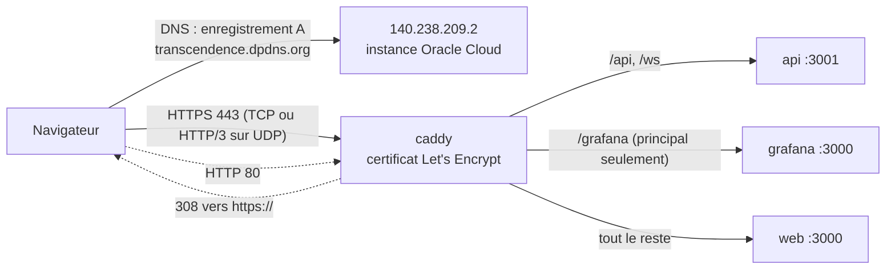

# Déploiement cloud avec DNS et Let's Encrypt (Minor custom, 1 point)

**Type :** Minor (module custom). **Points :** 1. **Statut :** fait.

L'app ne tourne pas seulement sur un ordinateur portable. Elle tourne sur des serveurs publics, sous de vrais
noms de domaine, avec des certificats de Let's Encrypt (une autorité de certification
gratuite que tous les navigateurs acceptent). N'importe qui sur internet peut ouvrir
<https://trans.vyantares.ch>, le déploiement principal, et voir un cadenas vert, sans avertissement à passer.
Ce serveur fait aussi tourner le monitoring, et un autre serveur web y occupe déjà les ports HTTPS.
Une copie secondaire tourne sur une instance Oracle Cloud qu'on a mise en place, à
<https://transcendence.dpdns.org>, derrière son propre pare-feu, où notre propre Caddy obtient le certificat.
Cette copie est la preuve de ce module. Elle tourne sans monitoring : la petite VM gratuite n'a pas assez
de mémoire pour ça.

## Ce que demande le sujet

Le module est une ligne du tableau Modules au choix de
[../subject/summary.md](../subject/summary.md) :

> | Type  | Module                                                                                                                                                                                         |
> | ----- | ---------------------------------------------------------------------------------------------------------------------------------------------------------------------------------------------- |
> | Major | Module sur mesure, conséquent et techniquement complexe, justifié dans le README (pourquoi ce choix, quelles difficultés, quelle valeur, pourquoi 2 points). Fonctionnalités triviales = refus |
> | Minor | Pareil, en plus petit, demande quand même une justification                                                                                                                                    |

Le Minor s'appuie sur le Major ("Same as the major module"), donc les deux sont cités plus bas.

Le PDF ([../../docs/subject/ft_transcendence.pdf](../../docs/subject/ft_transcendence.pdf), chapitre IV.10, Modules of
choice) le formule ainsi :

> Major: Implement a custom module that is not listed above.
>
> - The module must be substantial and demonstrate technical complexity.
> - You must provide proper justification in your README.md explaining:
>   - Why you chose this module.
>   - What technical challenges it addresses.
>   - How it adds value to your project.
>   - Why it deserves Major module status (2 points).
> - Taking shortcuts or implementing trivial features will result in rejection.
> - Be creative and think outside the box.
> - The module should be relevant to your project context.

> Minor: Same as the major module but smaller in scope and less complex.
>
> - Must still demonstrate technical skill and creativity.
> - Should add meaningful value to your project.
> - Requires justification in README.md (similar to Major, but for 1 point).

Les règles du README (chapitre VI, Readme Requirements) ajoutent, pour la section Modules :

> - Modules:
>   - List of all chosen modules (Major and Minor).
>   - Point calculation (Major = 2pts, Minor = 1pt).
>   - Justification for each module choice, especially for custom "Modules of choice".
>   - How each module was implemented.
>   - Which team member(s) worked on each module.

La partie obligatoire (chapitre III.3, Technical requirements) dit déjà : « Any connection to the
backend, from a browser, from a script, from an external API, etc., must use HTTPS. »
On respecte cette règle sur chaque machine avec l'autorité de certification locale
de Caddy ([`infra/caddy/Caddyfile`](../../infra/caddy/Caddyfile), `local_certs`). Ce
module, c'est ce qui vient en plus : un serveur public, un nom public, et un certificat que le
navigateur accepte sans qu'on le lui dise.

## Comment on y répond

Un module custom n'a pas de liste d'exigences fixe, donc ce tableau liste ce qu'on annonce et
où se trouve la preuve.

| Ce qu'on annonce                                                              | Ce qu'on a construit                                                                                                                                                                                                                                                                                                                                           | Où                                                                                                                                                                                                                                                                                                                                       |
| ----------------------------------------------------------------------------- | -------------------------------------------------------------------------------------------------------------------------------------------------------------------------------------------------------------------------------------------------------------------------------------------------------------------------------------------------------------- | ---------------------------------------------------------------------------------------------------------------------------------------------------------------------------------------------------------------------------------------------------------------------------------------------------------------------------------------- |
| Un serveur dans un cloud public                                               | L'instance Oracle Cloud de la copie secondaire (Ubuntu 24.04) dans la région `eu-zurich-1`, configurée avec les réglages du runbook et pilotée avec l'outil en ligne de commande OCI, avec Docker installé au premier démarrage par cloud-init                                                                                                                 | [`../operations/deployment.md`](../operations/deployment.md) sections 1 et 2                                                                                                                                                                                                                                                             |
| Un pare-feu qui ouvre seulement ce qui est nécessaire                         | La security list du cloud ouvre 22/tcp (SSH, pour l'équipe), 80/tcp, 443/tcp et 443/udp. Rien d'autre : Grafana, Prometheus et Alertmanager ne sont jamais ouverts (3000, 9090, 9093)                                                                                                                                                                          | [`../operations/deployment.md`](../operations/deployment.md) section 2                                                                                                                                                                                                                                                                   |
| De vrais noms de domaine                                                      | Des enregistrements `A` : `transcendence.dpdns.org` vers `140.238.209.2`, TTL 300, pour la copie Oracle, et `trans.vyantares.ch` vers le VPS partagé, pour le principal                                                                                                                                                                                        | [`../operations/deployment.md`](../operations/deployment.md) section 4, et « Le principal, derrière un autre reverse proxy »                                                                                                                                                                                                             |
| Un certificat de Let's Encrypt, obtenu et renouvelé sans étape manuelle       | Sur la copie Oracle, notre Caddy l'obtient tout seul pour `SITE_DOMAIN`, avec `ACME_EMAIL` comme adresse de contact, et le stocke dans le volume `caddy-data`. Sur le principal, c'est le proxy placé devant qui le fait                                                                                                                                       | [`infra/caddy/Caddyfile.prod`](../../infra/caddy/Caddyfile.prod), [`compose.deploy.yml`](../../compose.deploy.yml)                                                                                                                                                                                                                       |
| HTTPS seulement                                                               | Le HTTP simple répond `308 Permanent Redirect` vers `https://`. HSTS (un header qui dit au navigateur d'utiliser seulement HTTPS pendant un an) est envoyé dans chaque réponse                                                                                                                                                                                 | `Strict-Transport-Security` dans [`Caddyfile.prod`](../../infra/caddy/Caddyfile.prod)                                                                                                                                                                                                                                                    |
| Un serveur qui n'a pas besoin d'une copie du dépôt                            | Trois fichiers sur l'hôte. Chaque image est récupérée depuis le registre public `ghcr.io`, donc il n'y a ni build ni connexion au registre sur le serveur                                                                                                                                                                                                      | [`compose.deploy.yml`](../../compose.deploy.yml) (commentaire en haut)                                                                                                                                                                                                                                                                   |
| Des secrets de production qui ne peuvent pas retomber sur une valeur publique | `SESSION_SECRET`, `POSTGRES_PASSWORD`, `LLM_PROVIDER` et, avec le monitoring, les deux clés Grafana n'ont pas de valeur par défaut : compose refuse de démarrer sans eux. Le seul modèle les laisse tous vides, et une vérification d'hygiène échoue si l'un d'eux reçoit une valeur. `deploy.sh` refuse aussi les valeurs de dev et de CI que ce dépôt publie | `${...:?...}` dans [`compose.deploy.yml`](../../compose.deploy.yml) et [`compose.deploy.monitoring.yml`](../../compose.deploy.monitoring.yml), [`.env.example`](../../.env.example), la vérification 5 de [`scripts/check-env-example.sh`](../../scripts/check-env-example.sh), [`infra/deploy/deploy.sh`](../../infra/deploy/deploy.sh) |
| L'hôte principal, derrière un autre reverse proxy                             | Un fichier overlay : notre Caddy ne publie aucun port et reçoit les requêtes du proxy de l'hôte, qui a le certificat                                                                                                                                                                                                                                           | [`compose.deploy.proxy.yml`](../../compose.deploy.proxy.yml), [`deployment.md`](../operations/deployment.md) « Le principal, derrière un autre reverse proxy »                                                                                                                                                                           |

## Comment ça marche

### Le chemin d'une requête

C'est une requête vers la copie Oracle, où chaque étape est à nous. Sur le principal, le proxy placé devant
sur l'hôte passe avant notre Caddy (voir plus bas).



1. **DNS.** Le navigateur demande `transcendence.dpdns.org` et reçoit un seul enregistrement `A`, l'adresse
   publique de l'instance Oracle. Il n'y a pas d'enregistrement `AAAA`, ni `www`, ni `MX`,
   exprès ([`deployment.md`](../operations/deployment.md) section 4).
2. **Le pare-feu du cloud.** La security list d'Oracle laisse entrer seulement 22/tcp (SSH),
   80/tcp, 443/tcp et 443/udp. Sur l'instance, Docker publie seulement les ports de Caddy. On ne touche pas au
   `iptables` de l'instance : Docker publie les ports via la chaîne `FORWARD`, et
   vider les règles avec la stack lancée casse le réseau des containers (section 2).
3. **Caddy.** Le service `caddy` dans [`compose.deploy.yml`](../../compose.deploy.yml)
   (image `caddy:2.11.9-alpine`) est le seul container avec des ports publiés : `80:80`,
   `443:443` et `443:443/udp`. Le port UDP sert à HTTP/3 : le site en ligne répond
   avec `alt-svc: h3=":443"`.
4. **Routing.** [`Caddyfile.prod`](../../infra/caddy/Caddyfile.prod) a un seul site,
   `{$SITE_DOMAIN}`. Il envoie `/api` et `/ws` à l'`api` NestJS, `/grafana` à
   Grafana sur le principal (la copie Oracle, sans monitoring, répond 503), et le reste au
   container `web` Next.js. Il ajoute aussi les headers de sécurité (`X-Frame-Options DENY`,
   `X-Content-Type-Options nosniff`, une `Referrer-Policy`, une `Permissions-Policy` et
   HSTS) et retire le header `Server` des réponses HTTPS.

### Le certificat

- L'adresse du site dans `Caddyfile.prod` est un vrai nom (`{$SITE_DOMAIN}`), et les options
  globales mettent `email {$ACME_EMAIL}`. Avec ces deux lignes, Caddy utilise ACME (le
  protocole que parle Let's Encrypt) pour prouver qu'il contrôle le nom et obtenir un certificat.
  Pas de `certbot`, pas de tâche cron, pas de script à nous : le
  [HTTPS automatique](https://caddyserver.com/docs/automatic-https) de Caddy fait la demande et
  le renouvellement.
- Caddy prouve qu'il contrôle le nom en répondant à un défi de Let's Encrypt sur le port
  80 ou 443. C'est pour ça que l'enregistrement DNS doit pointer vers le serveur **avant** que la stack
  démarre : une vérification ratée compte quand même dans la limite de Let's Encrypt
  ([`deployment.md`](../operations/deployment.md) section 4, et le commentaire de `SITE_DOMAIN`
  dans [`.env.example`](../../.env.example)).
- Le certificat et le compte ACME sont gardés dans le volume `caddy-data`, monté sur
  `/data`. Le commentaire dans `compose.deploy.yml` donne la raison : « Lose it and every
  restart asks the CA again, which is rate limited to a handful per domain per week. » (si on le perd, chaque
  redémarrage redemande à l'autorité, qui n'en accepte que quelques-uns par domaine et par semaine.)
- Le fichier de dev [`infra/caddy/Caddyfile`](../../infra/caddy/Caddyfile) utilise
  `local_certs` à la place. Son commentaire dit pourquoi : « there is no public domain to validate » (il n'y a pas de domaine public à valider). Le haut de
  `Caddyfile.prod` liste les quatre différences entre les deux fichiers : le vrai domaine,
  le certificat Let's Encrypt, HSTS, et l'adresse du visiteur retrouvée à travers un
  proxy placé devant.

Les deux noms publics ont un certificat Let's Encrypt qui dure 90 jours. Sur
`trans.vyantares.ch`, le principal, c'est le proxy placé devant sur l'hôte qui le demande et le renouvelle (voir
plus bas). Sur `transcendence.dpdns.org`, la copie Oracle, c'est notre Caddy. Ni le dépôt ni
[`deployment.md`](../operations/deployment.md) n'ont d'étape pour demander ou renouveler un
certificat à la main. Les étapes de la soutenance montrent les dates du certificat en ligne.

### L'hôte principal, derrière un autre reverse proxy

Le déploiement principal tourne sur un VPS Infomaniak partagé, avec le monitoring. Ce VPS fait déjà
tourner `caddy-docker-proxy`, qui occupe 80 et 443 pour plusieurs projets et route selon des labels Docker. [`compose.deploy.proxy.yml`](../../compose.deploy.proxy.yml)
adapte notre stack à ça :

- `ports: !reset []` : notre Caddy ne publie rien.
- `SITE_DOMAIN: http://${SITE_DOMAIN}` : notre Caddy sert du HTTP simple sur l'étape qui vient du
  proxy placé devant. Le commentaire du fichier explique pourquoi : « an https site here would redirect that
  hop to https and loop. » (un site https ici redirigerait cette étape vers https et tournerait en boucle.)
- Deux labels, `caddy` et `caddy.reverse_proxy`, disent au proxy placé devant d'envoyer le nom
  à notre Caddy, qui rejoint son réseau (`PROXY_NETWORK`, par défaut `web`). C'est le proxy placé devant
  qui obtient le certificat.
- `CADDY_TRUSTED_PROXIES: private_ranges` : notre Caddy croit le `X-Forwarded-For` du proxy
  placé devant, donc `{client_ip}` est le visiteur et pas le proxy. Sans ça,
  tous les visiteurs partageraient une seule limite de requêtes dans l'API et un seul blocage de connexion dans Grafana.
  C'est sûr seulement parce que ce Caddy ne publie aucun port.

Le principal montre les deux étapes : ses réponses contiennent deux fois `via: 1.1 Caddy`.
[`infra/deploy/deploy.sh`](../../infra/deploy/deploy.sh) ajoute l'overlay tout seul
quand le fichier est à côté de `compose.deploy.yml`, et l'overlay de monitoring de la même façon.

### Où ce module s'arrête et où commence la CI/CD

Les deux modules custom partagent des fichiers, donc la limite entre eux est tracée ici une fois pour toutes.

| Ce module (déploiement cloud)                                                                                                                                        | Le module CI/CD ([custom-ci-cd.md](custom-ci-cd.md))                                     |
| -------------------------------------------------------------------------------------------------------------------------------------------------------------------- | ---------------------------------------------------------------------------------------- |
| L'instance Oracle, cloud-init, le pare-feu, l'IP                                                                                                                     | Les workflows dans [`.github/workflows/`](../../.github/workflows)                       |
| L'enregistrement DNS                                                                                                                                                 | Construire, scanner et publier les images sur `ghcr.io` (`images.yml`)                   |
| Caddy, `Caddyfile.prod`, le certificat Let's Encrypt, HSTS                                                                                                           | Le deploy automatique : `deploy.sh`, `ft-deploy.service`, `ft-deploy.timer`              |
| `compose.deploy.yml`, `compose.deploy.monitoring.yml` et `compose.deploy.proxy.yml` : ce qui tourne sur le serveur, avec quels secrets et quelles limites de mémoire | Les tags d'images (`latest`, `main-<sha>`) et comment une release est bloquée ou annulée |

Ce module compte le premier deploy manuel (les trois fichiers et les trois commandes `docker
compose` de [`deployment.md`](../operations/deployment.md) section 5). Tout ce
qui se passe sans personne, après un merge, appartient à la CI/CD.

## Où est le code

| Chemin                                                                           | Ce qu'il fait                                                                                                                                                                                     |
| -------------------------------------------------------------------------------- | ------------------------------------------------------------------------------------------------------------------------------------------------------------------------------------------------- |
| [`compose.deploy.yml`](../../compose.deploy.yml)                                 | La stack du serveur : récupère les images publiées, ne fait jamais de build ; Caddy avec les ports 80, 443 et 443/udp et le volume `caddy-data` ; les secrets obligatoires                        |
| [`compose.deploy.monitoring.yml`](../../compose.deploy.monitoring.yml)           | Overlay pour un hôte qui fait tourner le monitoring : les sept services et leurs limites de mémoire                                                                                               |
| [`compose.deploy.proxy.yml`](../../compose.deploy.proxy.yml)                     | Overlay pour un hôte où un autre reverse proxy occupe 80 et 443                                                                                                                                   |
| [`infra/caddy/Caddyfile.prod`](../../infra/caddy/Caddyfile.prod)                 | La config Caddy de production : le domaine, l'email ACME, HSTS et les headers de sécurité, les routes, les proxies de confiance                                                                   |
| [`infra/caddy/Caddyfile`](../../infra/caddy/Caddyfile)                           | La config de dev, avec `local_certs`, pour comparer                                                                                                                                               |
| [`.env.example`](../../.env.example)                                             | Le seul modèle de `.env`, pour un checkout comme pour un serveur. Sa section serveur a `SITE_DOMAIN`, `ACME_EMAIL`, `IMAGE_TAG`, `PROXY_NETWORK`, `COMPOSE_PROJECT_NAME` ; chaque secret est vide |
| [`scripts/align-env.sh`](../../scripts/align-env.sh)                             | Réécrit un `.env` existant dans l'ordre et avec les commentaires du modèle, en gardant chaque valeur                                                                                              |
| [`docs/operations/deployment.md`](../operations/deployment.md)                   | Le runbook : les deux hôtes, OCI CLI, l'instance, cloud-init, l'IP, le DNS, le premier deploy, la mémoire, le monitoring sur un serveur, le principal derrière un autre proxy                     |
| [`scripts/check-monitoring-config.sh`](../../scripts/check-monitoring-config.sh) | Valide les deux Caddyfiles et les trois façons de déployer (voir les tests)                                                                                                                       |

## Comment le montrer à la soutenance

Depuis n'importe quelle machine avec un accès à internet. Les commandes ne font que lire. Les étapes 1 à 3 marchent sur
les deux noms publics : mets `HOST=transcendence.dpdns.org` (la copie secondaire sur l'instance Oracle, où c'est
notre propre Caddy qui a le certificat) ou `HOST=trans.vyantares.ch` (le principal, sur le VPS partagé, où c'est
le proxy placé devant qui l'a). Montre d'abord la copie, puisque son certificat est celui que notre Caddy a
obtenu lui-même, puis le principal.

1. **L'enregistrement DNS.**

   ```bash
   dig "$HOST" A +noall +answer
   ```

   Il affiche un enregistrement `A` avec l'adresse de l'hôte ; pour `transcendence.dpdns.org`, c'est
   `transcendence.dpdns.org. 300 IN A 140.238.209.2`. Ensuite `dig +short AAAA "$HOST"`
   n'affiche rien : il y a seulement l'enregistrement `A`. Sans `dig`,
   `getent ahostsv4 "$HOST"` donne l'adresse.

2. **Le certificat.**

   ```bash
   echo | openssl s_client -connect "$HOST:443" -servername "$HOST" 2>/dev/null \
     | openssl x509 -noout -issuer -subject -dates -ext subjectAltName
   ```

   L'émetteur est `O=Let's Encrypt`, le sujet est `CN=` le nom, et de `notBefore` à
   `notAfter` il y a 90 jours. La même chose avec curl :

   ```bash
   curl -sv -o /dev/null "https://$HOST/" 2>&1 | grep -A6 'Server certificate'
   ```

   Il affiche le sujet, les dates de début et d'expiration, l'émetteur Let's Encrypt et
   `SSL certificate verify ok.`

3. **HTTPS seulement.**

   ```bash
   curl -sI "http://$HOST/"
   curl -sI "https://$HOST/"
   ```

   Le premier répond `308 Permanent Redirect` vers `https://`. Le second affiche
   `strict-transport-security: max-age=31536000; includeSubDomains`, `via: 1.1 Caddy`
   et `alt-svc: h3=":443"`. Sur le principal, `trans.vyantares.ch`, `via: 1.1 Caddy` apparaît deux fois : le
   proxy placé devant, puis le nôtre. Ouvre le site dans un navigateur et clique sur le cadenas : pas d'avertissement, et
   le certificat vient de Let's Encrypt.

4. **La config derrière.** Ouvre [`Caddyfile.prod`](../../infra/caddy/Caddyfile.prod) :
   montre `email {$ACME_EMAIL}`, le site `{$SITE_DOMAIN}` et le header HSTS. Ouvre
   [`compose.deploy.yml`](../../compose.deploy.yml) : montre les trois ports et le
   volume `caddy-data`. C'est toute la configuration du certificat. Ouvre
   [`compose.deploy.proxy.yml`](../../compose.deploy.proxy.yml) pour montrer en quoi le principal
   est différent : pas de ports, du HTTP simple derrière le proxy placé devant, les deux labels.

5. **Les serveurs** (un membre de l'équipe avec la clé SSH). Sur la copie Oracle :

   ```bash
   ssh ubuntu@140.238.209.2
   ls -a                                     # compose.deploy.yml, Caddyfile, .env among others
   docker compose -f compose.deploy.yml ps
   docker compose -f compose.deploy.yml exec caddy find /data/caddy/certificates -name '*.crt'
   docker compose -f compose.deploy.yml logs caddy | grep -i certificate
   ```

   `ps` montre Caddy comme le seul service avec des ports publiés, et aucun service de
   monitoring. `find` montre le certificat que notre Caddy a stocké dans son volume. Sur le
   principal, le VPS partagé, les fichiers sont dans `~/ft_transcendence`, et
   `docker compose -f compose.deploy.yml -f compose.deploy.monitoring.yml -f compose.deploy.proxy.yml ps`
   montre les sept services de monitoring à côté de l'app, et aucun port publié,
   puisque le proxy placé devant occupe 80 et 443
   ([`deployment.md`](../operations/deployment.md) « Le principal, derrière un autre reverse
   proxy »).

6. **Le côté cloud** (en option, il faut une session OCI, voir
   [`deployment.md`](../operations/deployment.md) section 1) : la commande qui liste les instances
   à la section 2 montre l'instance. Ses règles d'entrée sont celles de la section 2 : 22/tcp,
   80/tcp, 443/tcp et 443/udp.

## Les tests qui le prouvent

Il n'y a pas de test unitaire pour un enregistrement DNS ou un certificat. Le site en ligne est la preuve
(étapes 1 à 3 plus haut). Ce qui peut être vérifié avant un deploy est vérifié dans la CI.

| Test                                                                                        | Ce qu'il vérifie                                                                                                                                                                                                                                                                                                                                                                                                                                       |
| ------------------------------------------------------------------------------------------- | ------------------------------------------------------------------------------------------------------------------------------------------------------------------------------------------------------------------------------------------------------------------------------------------------------------------------------------------------------------------------------------------------------------------------------------------------------ |
| [`scripts/check-monitoring-config.sh`](../../scripts/check-monitoring-config.sh), section 5 | `caddy validate` sur `Caddyfile` et `Caddyfile.prod` avec l'image Caddy à version fixée, et encore sur `Caddyfile.prod` avec les valeurs que donne l'overlay du proxy (site `http://`, `CADDY_TRUSTED_PROXIES=private_ranges`)                                                                                                                                                                                                                         |
| même script, section 7                                                                      | `compose.deploy.yml` se résout seul, sans clé Grafana et sans service de monitoring, avec `compose.deploy.monitoring.yml`, et avec les deux overlays. Dans chaque stack de deploy sans l'overlay du proxy, seul `caddy` publie des ports, et seulement 80 et 443. Derrière un proxy, aucun service ne publie de port, et `caddy` rejoint le réseau du proxy avec son label de site. Chaque service de chaque stack de deploy garde les limites de logs |
| même script, `PINNED_SERVICES`                                                              | Les images `caddy`, `db`, `redis` et des exporters dans les fichiers de deploy ont les mêmes versions que dans `compose.yml`                                                                                                                                                                                                                                                                                                                           |
| [`scripts/check-env-example.sh`](../../scripts/check-env-example.sh), vérifications 3 et 5  | Chaque variable que lisent les fichiers de deploy est dans `.env.example`, et chacune qu'ils exigent avec `:?` y est vide, donc un serveur démarré sur une copie du modèle s'arrête au lieu de tourner avec une valeur publiée                                                                                                                                                                                                                         |

Le premier script tourne dans le job `monitoring config` de
[`.github/workflows/ci.yml`](../../.github/workflows/ci.yml), et dans `make`
([`Makefile`](../../Makefile)). Le second tourne dans
[`.github/workflows/hygiene.yml`](../../.github/workflows/hygiene.yml), dans `make` et dans le
hook `pre-push`.

## Pourquoi on l'a choisi

- **Le sujet demande HTTPS, et un certificat local ne le prouve qu'à moitié.** Sur un
  ordinateur portable, notre HTTPS utilise l'autorité de certification de Caddy, qu'il faut dire à chaque navigateur
  d'accepter ([`infra/caddy/Caddyfile`](../../infra/caddy/Caddyfile)). Sur le serveur
  public, l'évaluateur, le téléphone d'un coéquipier ou n'importe quel visiteur reçoit un certificat que le
  navigateur accepte déjà.
- **Une plateforme pour apprendre des langues est faite pour être utilisée.** Une adresse publique permet à l'équipe
  de tester sur de vrais appareils et de vrais réseaux, et permet à n'importe qui d'ouvrir l'app sans cloner le
  dépôt.
- **Il complète le travail du module CI/CD.** La CI/CD publie des images ; ce module est
  l'endroit où elles tournent. Sans serveur ni domaine, les images publiées n'ont nulle part
  où aller.

## Les défis techniques

- **Un tout petit serveur.** La copie Oracle tourne sur une petite instance gratuite. Le modèle que le runbook
  met en place est `VM.Standard.E2.1.Micro` : 1 Go de RAM et une partie d'un seul cœur partagé. Le serveur en
  ligne montre 954 Mio de RAM et 2 vCPU (mesurés le 2026-11-27). Le modèle plus grand `VM.Standard.A1.Flex` est
  « usually out of host capacity » (en général sans place disponible). L'app prend environ 450 Mo et le monitoring ajoute
  environ 330 à 450 Mo selon l'estimation, plus que cette VM ne peut donner. On a répondu avec un overlay
  ([`compose.deploy.monitoring.yml`](../../compose.deploy.monitoring.yml)) que la copie
  laisse de côté, pour faire tourner l'app seule, pendant que le principal le fait tourner. Là, chaque service de
  monitoring a un `mem_limit` strict (800 Mo en tout), et Prometheus et Grafana reçoivent
  `cpu_shares: 256` pour qu'ils laissent la place à l'app. Un fichier de swap de 2 Go couvre le reste
  ([`deployment.md`](../operations/deployment.md), « Mémoire »). Le module CI/CD construit
  les images pour `amd64` et `arm64`
  ([`images.yml`](../../.github/workflows/images.yml)), donc les deux modèles peuvent les faire tourner.
- **Une autorité de certification avec des limites.** Let's Encrypt n'accepte que quelques
  certificats par domaine et par semaine. Deux règles nous protègent : l'enregistrement DNS doit marcher
  avant le premier démarrage, et le certificat vit dans un volume nommé pour qu'un redémarrage
  ne le redemande pas.
- **Une adresse qui peut changer.** Oracle donne une IP éphémère, qui est libérée quand
  l'instance s'arrête, et ne peut pas la transformer sur place en IP réservée. Le runbook
  donne la commande qui montre l'IP actuelle, et les deux solutions : réserver une nouvelle
  adresse, ou mettre à jour l'enregistrement `A` (section 3). Le TTL de 300 secondes garde un changement
  court.
- **Un cloud-init qui échoue sans rien dire.** Si `#cloud-config` n'est pas la première ligne, le
  fichier « is silently ignored » (est ignoré sans message), et l'instance démarre sans Docker (section 2).
- **Un serveur sans copie du dépôt.** `compose.yml` a des sections `build:` qui ont besoin du
  code source, donc il ne peut pas servir de base sur le serveur. `compose.deploy.yml` est
  autonome et récupère tout. Aucun secret de production n'a de valeur de secours, et le
  mot de passe de la base de données doit être en hexadécimal, parce qu'un `/` venant du base64 casse `DATABASE_URL`.
  Le serveur et un checkout partagent un seul `.env.example`, donc il laisse chaque secret vide :
  un checkout retombe sur ses valeurs locales, un serveur refuse de démarrer.
- **Un hôte où les ports HTTPS sont déjà pris.** Sur le VPS partagé du principal, notre Caddy ne peut pas écouter sur
  80 et 443, et une deuxième couche HTTPS tournerait en boucle. L'overlay transforme notre Caddy en
  simple backend HTTP et fait confiance seulement aux plages privées, donc l'adresse du visiteur arrive quand même
  aux limites de requêtes de l'API et au blocage de Grafana. Un deuxième piège là-bas : un checkout
  du dépôt sur le même hôte partagerait le nom de projet compose et ses volumes,
  base de données comprise. Donc chaque serveur décommente `COMPOSE_PROJECT_NAME=ft_transcendence_prod`
  dans la section serveur de `.env.example`, et nos deux hôtes partagent un seul `.env`, à part `SITE_DOMAIN`.
- **Un monitoring qui doit rester privé sur un serveur public.** On arrive à Grafana seulement
  via Caddy sur `/grafana`, son chemin de métriques est refusé avec `404`, et le site de métriques
  de Caddy lui-même (`:2020`) n'est pas publié ([`Caddyfile.prod`](../../infra/caddy/Caddyfile.prod)).

## Ce que ça apporte

- L'évaluateur peut ouvrir l'app sur n'importe quel appareil, avec un certificat accepté, sur
  <https://trans.vyantares.ch>, le principal, et sur la copie,
  <https://transcendence.dpdns.org>.
- On dit au navigateur d'utiliser seulement HTTPS (HSTS), et les headers de sécurité sont dans chaque
  réponse du site public.
- HTTP/3 marche, parce que 443/udp est ouvert et publié.
- Un nouveau serveur a besoin de trois fichiers et de trois commandes, et d'un fichier de plus pour faire
  tourner le monitoring. Les mêmes fichiers tournent sur deux hôtes très
  différents : le principal sur un VPS partagé derrière un autre proxy, avec le monitoring, et la copie
  sur une instance cloud vide, sans.
- Le module de monitoring voit du vrai trafic, pas seulement du trafic de test, parce que le principal
  le fait tourner en public, toujours actif, depuis l'overlay de monitoring.

## Pourquoi il mérite sa taille

C'est un **Minor**, pas un Major, et on annonce seulement 1 point pour lui.

Ce qui en fait plus qu'une fonctionnalité triviale :

- Une vraie infrastructure en dehors du dépôt : un compte cloud, une instance, un pare-feu, une zone
  DNS, et un certificat accepté par tous les navigateurs. Tout ça est en ligne et vérifiable
  de l'extérieur en une minute (voir les étapes de la soutenance).
- Deux cibles de déploiement qui marchent différemment : une où notre Caddy gère le TLS, une où
  il ne doit pas le faire.
- Des contraintes pour lesquelles on a dû concevoir une solution, chacune avec sa réponse dans les fichiers : 1 Go de RAM,
  les limites d'ACME, une IP éphémère, pas de copie du dépôt sur le serveur, des secrets sans valeur
  par défaut, l'adresse du visiteur à travers deux proxies.

Pourquoi ce n'est pas un Major :

- La partie la plus dure du certificat, le protocole ACME et le renouvellement, est faite par
  Caddy. Notre travail, c'est la config autour, pas un client de certificats.
- Il n'y a presque pas de code applicatif dedans. C'est de la configuration, des fichiers compose et un
  runbook.
- Les parties qui sont techniquement plus dures et entièrement automatiques (construire, scanner et
  publier des images multi-arch, et le deploy automatique par pull) sont annoncées par le
  module CI/CD, et on ne les compte pas deux fois.

## Limites et choix

- **Pas de bascule.** Si le principal s'arrête, `trans.vyantares.ch` est en panne jusqu'à son retour.
  La copie sur `transcendence.dpdns.org` est séparée, avec sa propre base de données et sans monitoring,
  pas une sauvegarde. Si son instance Oracle s'arrête, son IP peut changer.
- **L'IP est éphémère.** On a choisi de ne pas en réserver une, parce qu'OCI ne peut pas la convertir sur
  place et qu'une IP réservée est une autre adresse. La solution, c'est de mettre à jour l'enregistrement `A`.
- **IPv4 seulement.** Il n'y a pas d'enregistrement `AAAA`.
- **Rien dans notre monitoring ne surveille la date d'expiration du certificat.** On compte sur
  le renouvellement de Caddy et sur le contact `ACME_EMAIL`. Le blackbox exporter teste les
  containers en HTTP simple dans Docker, pas le nom public en HTTPS
  ([`prometheus.yml`](../../infra/monitoring/prometheus/prometheus.yml)).
- **Les changements des fichiers du serveur sont manuels.** Un changement de `compose.deploy.yml`, de
  `compose.deploy.monitoring.yml` ou de `Caddyfile.prod` demande `scp`, `up -d`, et un redémarrage de
  Caddy, parce que Caddy lit sa config seulement au démarrage
  ([`deployment.md`](../operations/deployment.md), « Les deploys automatiques »).
- **L'instance n'est pas décrite en code.** Le runbook donne un tableau de réglages et
  le fichier cloud-init ; il n'y a pas de Terraform ni d'autre infrastructure-as-code pour
  la reconstruire en une commande.
- **Sur le principal, le certificat n'est pas le nôtre.** C'est le proxy placé devant qui le demande, et
  `ACME_EMAIL` est toujours obligatoire mais pas utilisé là-bas.

## Qui l'a construit

| Membre  | GitHub                                                      | Ce qu'il a construit                                                                                                                                                                                                                                                                                                                                                                                                            | Issues et PRs                                                                                                                                                                                                                                                                                                              |
| ------- | ----------------------------------------------------------- | ------------------------------------------------------------------------------------------------------------------------------------------------------------------------------------------------------------------------------------------------------------------------------------------------------------------------------------------------------------------------------------------------------------------------------- | -------------------------------------------------------------------------------------------------------------------------------------------------------------------------------------------------------------------------------------------------------------------------------------------------------------------------- |
| Victor  | [VictorBro](https://github.com/VictorBro)                   | `compose.deploy.yml`, `Caddyfile.prod` avec Let's Encrypt et HSTS, le `.env.example` du serveur, et le runbook Oracle Cloud. Puis la route `/grafana` et les limites de mémoire du serveur, et l'overlay pour l'hôte derrière un autre reverse proxy, avec la correction des proxies de confiance pour l'adresse du visiteur. Plus tard, de nouvelles versions d'images et les variables de limites de requêtes sur le serveur. | [#65](https://github.com/VictorBro/ft_transcendence/pull/65), [#66](https://github.com/VictorBro/ft_transcendence/pull/66), [#130](https://github.com/VictorBro/ft_transcendence/pull/130), [#131](https://github.com/VictorBro/ft_transcendence/pull/131), [#198](https://github.com/VictorBro/ft_transcendence/pull/198) |
| Endrit  | [VYAntares](https://github.com/VYAntares)                   | A rendu `LLM_PROVIDER` obligatoire dans `compose.deploy.yml`, pour que le serveur n'hérite jamais d'un provider d'IA par défaut. A limité la taille des logs des containers sur le serveur et mis en place leur rotation (`x-logging`).                                                                                                                                                                                         | [#69](https://github.com/VictorBro/ft_transcendence/pull/69), [#206](https://github.com/VictorBro/ft_transcendence/pull/206)                                                                                                                                                                                               |
| Luca    | [luca-mattei](https://github.com/luca-mattei)               | L'étape de seed dans le service `migrate`, et les limites de discussion passées à l'api.                                                                                                                                                                                                                                                                                                                                        | [#123](https://github.com/VictorBro/ft_transcendence/pull/123), [#201](https://github.com/VictorBro/ft_transcendence/pull/201)                                                                                                                                                                                             |
| Bastian | [bastian-schnitzler](https://github.com/bastian-schnitzler) | Le réglage `keepalive 4s` sur les routes `/api` et `/ws` de `Caddyfile.prod`, plus court que le délai keep-alive de Node.                                                                                                                                                                                                                                                                                                       | [#192](https://github.com/VictorBro/ft_transcendence/pull/192)                                                                                                                                                                                                                                                             |

Tiré de `git log --follow` sur `compose.deploy.yml`, `infra/caddy/Caddyfile.prod`,
`compose.deploy.proxy.yml` et `infra/deploy/.env.example`, et de `gh pr view` pour les
pull requests. Anaïs ([avarrett](https://github.com/avarrett), commits sous le nom ninisse) a seulement changé
des commentaires dans ces fichiers ([#104](https://github.com/VictorBro/ft_transcendence/pull/104)).
