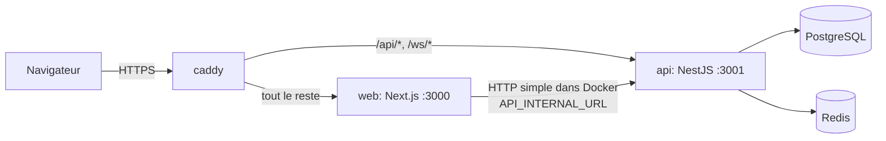

# Framework pour le frontend et le backend (Major, 2 points)

**Type :** Major. **Points :** 2. **Statut :** fait.

L'app est construite sur deux frameworks. La partie que tu vois dans le navigateur est faite avec
Next.js (un framework basé sur React). La partie qui contient les règles et les données est
faite avec NestJS (un framework pour les serveurs Node.js).

## Ce que demande le sujet

Le module est une ligne du tableau des modules Web de
[../subject/summary.md](../subject/summary.md) :

> | Major | Framework pour le frontend et le backend (un framework full-stack compte pour les deux si tu utilises son frontend et son backend) |

Le PDF ([../../docs/subject/ft_transcendence.pdf](../../docs/subject/ft_transcendence.pdf), chapitre IV, Web) le formule ainsi :

> Major: Use a framework for both the frontend and backend.
>
> - Use a frontend framework (React, Vue, Angular, Svelte, etc.).
> - Use a backend framework (Express, NestJS, Django, Flask, Ruby on Rails, etc.).
> - Full-stack frameworks (Next.js, Nuxt.js, SvelteKit) count as both if you use both their
>   frontend and backend capabilities.

Le PDF dit aussi ce qu'est un framework, au chapitre III.3, Technical requirements :

> What is a Framework? For this project, a framework is defined as a comprehensive tool that
> provides:
>
> - A structured architecture and conventions for organizing code.
> - Built-in features for common tasks (routing, state management, etc.).
> - A complete ecosystem of tools and libraries.
>
> Examples:
>
> - Frontend frameworks: React, Vue, Angular, Svelte, Next.js (these are frameworks).
> - Backend frameworks: Express, Fastify, NestJS, Django, Flask, Ruby on Rails.
> - Not frameworks: jQuery (library), Lodash (utility library), Axios (HTTP client).
>
> Note: React is considered a framework in this context due to its ecosystem and architectural
> patterns, even though it is technically a library.

## Comment on y répond

| Le sujet demande                                                                         | Ce qu'on a construit                                                                                                                                                 | Où                                                                                            |
| ---------------------------------------------------------------------------------------- | -------------------------------------------------------------------------------------------------------------------------------------------------------------------- | --------------------------------------------------------------------------------------------- |
| Un framework frontend                                                                    | Next.js 16 avec l'App Router, sur React 19. Chaque page est une page Next.js.                                                                                        | [`apps/web/package.json`](../../apps/web/package.json), [`apps/web/app/`](../../apps/web/app) |
| Un framework backend                                                                     | NestJS 11. Chaque route de l'API est une méthode dans un controller NestJS.                                                                                          | [`apps/api/package.json`](../../apps/api/package.json), [`apps/api/src/`](../../apps/api/src) |
| Un framework full-stack compte pour les deux, si tu utilises son frontend et son backend | On ne s'en sert pas comme preuve. On ne compte pas Next.js comme notre backend : NestJS est le backend. Next.js fait seulement le rendu des pages et appelle NestJS. | [`../architecture/overview.md`](../architecture/overview.md), section 1                       |

Les deux frameworks sont cités comme frameworks dans la liste du sujet lui-même, donc aucun des deux
n'a besoin d'être défendu.

## Comment ça marche

Deux apps séparées tournent dans deux containers. Un troisième container, Caddy (un serveur web),
est le seul ouvert vers l'extérieur. Il décide où va chaque requête, selon son
chemin. Donc le navigateur voit une seule adresse (une seule « origin »), et il n'y a pas de
configuration cross-origin (CORS) à écrire.

Les routes sont dans [`infra/caddy/Caddyfile`](../../infra/caddy/Caddyfile). Les
containers sont dans [`compose.yml`](../../compose.yml).

La règle que l'équipe suit est écrite dans
[`../architecture/overview.md`](../architecture/overview.md) : « NestJS possède toute
la logique métier et l'accès aux données. Next.js fait seulement la présentation et le SSR. » Le code
la respecte : aucun fichier de `apps/web` n'utilise Prisma (la bibliothèque de base de données), et il n'y a
pas de server actions (`'use server'`) dans `apps/web`.

### Le frontend : Next.js

- **Pages.** Chaque page est un fichier `page.tsx` sous
  [`apps/web/app/[locale]/`](../../apps/web/app). Il y en a 22. Aucune ne commence
  par `'use client'`, donc elles font toutes leur rendu sur le serveur. Les parties qui réagissent aux
  clics (formulaires, le lecteur de leçons, le chat) sont des client components dans leurs propres
  fichiers.
- **Fonctionnalités intégrées qu'on utilise :** le routing basé sur les fichiers, les groupes de routes comme `(main)`,
  `(dashboard)` et `(messages)`, un segment dynamique `[locale]` pour la langue,
  des layouts partagés, une page d'erreur par langue
  ([`error.tsx`](../../apps/web/app/[locale]/error.tsx)), une page not-found,
  `generateMetadata` pour les titres des pages, et des route handlers pour les health checks (vérifications de santé)
  ([`apps/web/app/healthz/`](../../apps/web/app/healthz)).
- **Le hook de requête.** [`apps/web/proxy.ts`](../../apps/web/proxy.ts) tourne avant
  chaque page. Il ajoute la langue dans l'URL (avec `next-intl`) et garde le dernier
  cours ouvert dans un cookie.
- **Build.** [`apps/web/next.config.ts`](../../apps/web/next.config.ts) met
  `output: 'standalone'`, donc l'image de production contient seulement ce dont Next.js a besoin pour
  tourner.

### Le backend : NestJS

- **Modules.** [`apps/api/src/app.module.ts`](../../apps/api/src/app.module.ts)
  réunit les modules de fonctionnalités (auth, users, friends, messages, courses,
  placement, lessons, la gateway WebSocket, health, metrics). Il y a 16 fichiers de module
  sous `apps/api/src/`.
- **Controllers.** Il y a 10 controllers, par exemple
  [`friends.controller.ts`](../../apps/api/src/friends/friends.controller.ts). Chaque
  route est une méthode avec un décorateur comme `@Get()` ou `@Post('requests/:userId')`.
- **Injection de dépendances.** NestJS construit chaque service et le donne aux classes
  qui le demandent. Par exemple,
  [`llm.module.ts`](../../apps/api/src/llm/llm.module.ts) construit le provider d'IA
  une seule fois au démarrage à partir des réglages, et les autres modules le demandent par son nom. C'est
  ce qui permet aux tests de mettre un faux provider à la place.
- **Fonctionnalités intégrées qu'on utilise :**
  - un guard sur chaque route, `AuthGuard`
    ([`auth.guard.ts`](../../apps/api/src/auth/auth.guard.ts)), enregistré pour
    toute l'app dans [`auth.module.ts`](../../apps/api/src/auth/auth.module.ts). Une
    route est privée sauf si elle est marquée `@Public()`.
  - un pipe de validation pour chaque body de requête
    ([`validation.pipe.ts`](../../apps/api/src/validation.pipe.ts)), avec des schemas
    Zod.
  - un exception filter qui transforme chaque erreur en code d'erreur
    ([`error-code.filter.ts`](../../apps/api/src/error-code.filter.ts)).
  - des limites de requêtes avec `@nestjs/throttler`, réglées dans `app.module.ts`.
  - des gateways WebSocket avec `@nestjs/websockets` et socket.io, sur le chemin `/ws`
    ([`socket.gateway.ts`](../../apps/api/src/gateway/socket.gateway.ts)).
  - une page OpenAPI faite avec `@nestjs/swagger`, servie sur `/api/docs`.
- **Une seule configuration pour l'app et les tests.** `configureApp()` dans
  [`app.setup.ts`](../../apps/api/src/app.setup.ts) met le préfixe global `/api`,
  la session, le pipe, le filter et la page Swagger. À la fois
  [`main.ts`](../../apps/api/src/main.ts) et les tests Supertest l'appellent, donc les
  tests passent par le même chemin de requête que la production.

### Comment les deux se parlent

Il y a deux chemins, et les deux arrivent aux mêmes routes NestJS.

1. **Depuis le serveur Next.js, pendant qu'il fait le rendu d'une page.**
   [`apps/web/lib/api.ts`](../../apps/web/lib/api.ts) est « the only place apps/web
   talks to NestJS » (le seul endroit où apps/web parle à NestJS, d'après son propre commentaire). Il appelle `http://api:3001` par le réseau
   Docker (`API_INTERNAL_URL`), transmet le cookie du navigateur et l'adresse du
   visiteur, et vérifie la réponse avec un schema Zod. Un 401 veut dire « déconnecté » ; tout
   autre échec veut dire « l'API n'est pas disponible » (une page peut aussi demander qu'un 404
   veuille dire « introuvable »), donc un redémarrage ne déconnecte jamais personne. [`apps/web/lib/session.ts`](../../apps/web/lib/session.ts) l'utilise pour charger
   l'utilisateur connecté.
2. **Depuis le navigateur, après le chargement de la page.**
   [`apps/web/lib/api-client.ts`](../../apps/web/lib/api-client.ts) envoie
   des requêtes same-origin vers `/api/...` (par exemple `/api/auth/login` dans
   [`auth-client.ts`](../../apps/web/lib/auth-client.ts)). Caddy les passe à
   NestJS. Le client WebSocket dans
   [`tab-socket.ts`](../../apps/web/components/tab-socket.ts) se connecte à `/ws`
   de la même façon.

Les deux apps partagent la forme de leurs données via
[`packages/shared`](../../packages/shared/package.json) (« Zod contracts shared by
@ft/api and @ft/web: one schema, validated on both sides »). Par exemple, le formulaire
d'inscription vérifie `SignUpFormSchema` dans le navigateur, et l'API vérifie
`CreateUserSchema`, que `SignUpFormSchema` étend
([`user.ts`](../../packages/shared/src/schemas/user.ts),
[`auth.dto.ts`](../../apps/api/src/auth/auth.dto.ts)).

## Où est le code

| Chemin                                                                         | Ce qu'il fait                                                              |
| ------------------------------------------------------------------------------ | -------------------------------------------------------------------------- |
| [`apps/web/`](../../apps/web)                                                  | L'app Next.js : pages, layouts, composants                                 |
| [`apps/web/app/[locale]/`](../../apps/web/app)                                 | Toutes les pages, un dossier par route                                     |
| [`apps/web/proxy.ts`](../../apps/web/proxy.ts)                                 | Tourne avant chaque page : préfixe de langue et cookie du cours            |
| [`apps/web/next.config.ts`](../../apps/web/next.config.ts)                     | Les réglages de Next.js : build standalone, plugin `next-intl`             |
| [`apps/web/lib/api.ts`](../../apps/web/lib/api.ts)                             | Les appels côté serveur de Next.js vers NestJS                             |
| [`apps/web/lib/api-client.ts`](../../apps/web/lib/api-client.ts)               | Les appels du navigateur vers `/api/...`                                   |
| [`apps/web/lib/session.ts`](../../apps/web/lib/session.ts)                     | Charge l'utilisateur connecté pour une page (`currentUser`, `requireUser`) |
| [`apps/web/app/healthz/`](../../apps/web/app/healthz)                          | Route handlers Next.js : santé du web, et si le web peut joindre l'API     |
| [`apps/api/`](../../apps/api)                                                  | L'app NestJS                                                               |
| [`apps/api/src/main.ts`](../../apps/api/src/main.ts)                           | Démarre NestJS sur le port 3001                                            |
| [`apps/api/src/app.module.ts`](../../apps/api/src/app.module.ts)               | Le module racine : réunit chaque module de fonctionnalité                  |
| [`apps/api/src/app.setup.ts`](../../apps/api/src/app.setup.ts)                 | Préfixe global, session, validation, filter d'erreurs, Swagger             |
| [`apps/api/src/validation.pipe.ts`](../../apps/api/src/validation.pipe.ts)     | Valide les bodies et les paramètres de route avec Zod                      |
| [`apps/api/src/error-code.filter.ts`](../../apps/api/src/error-code.filter.ts) | Fait que chaque réponse d'erreur contient un code d'erreur                 |
| [`apps/api/src/auth/auth.guard.ts`](../../apps/api/src/auth/auth.guard.ts)     | Le guard qui protège chaque route par défaut                               |
| [`packages/shared/`](../../packages/shared)                                    | Les schemas Zod et les types utilisés par les deux apps                    |
| [`infra/caddy/Caddyfile`](../../infra/caddy/Caddyfile)                         | Envoie `/api` et `/ws` à NestJS, `/grafana` à Grafana, le reste à Next.js  |
| [`compose.yml`](../../compose.yml)                                             | Les containers `caddy`, `web` et `api`                                     |

## Comment le montrer à la soutenance

1. Lance l'app avec `make run` (ou `make`, qui lance aussi toutes les vérifications avant). À
   la fin, il affiche l'adresse de l'app et l'adresse de la doc de l'API.
2. Ouvre [`apps/web/package.json`](../../apps/web/package.json) et
   [`apps/api/package.json`](../../apps/api/package.json). Montre `next` et `react`
   dans le premier, `@nestjs/core` et les autres paquets `@nestjs/*` dans le second.
3. Ouvre <https://localhost/>. Tu es envoyé vers un chemin avec une langue dedans, comme
   `/en`. Cette page est rendue par Next.js.
4. Ouvre <https://localhost/api/docs>. C'est la page Swagger que NestJS construit
   à partir de ses controllers. Montre le groupe `friends` ou `auth`.
5. Ouvre <https://localhost/healthz/upstream>. Il répond
   `{"status":"ok","service":"web","upstream":"api"}`. C'est une route Next.js qui
   vient de joindre NestJS par le réseau interne.
6. Ouvre <https://localhost/api/health>. Il répond avec `"service":"api"` : cette
   fois NestJS répond directement, via Caddy.
7. Ouvre les outils de développement du navigateur, onglet Network. Va sur
   <https://localhost/en/signup>, remplis le formulaire et clique sur **Create account**.
   Montre que la requête est `POST /api/auth/signup` sur la même adresse
   (`localhost`), et que tu arrives sur `/en/onboarding`.
8. Dans le code, montre une route de bout en bout : la page
   [`profile/page.tsx`](<../../apps/web/app/[locale]/(main)/profile/page.tsx>) (un
   server component qui appelle `requireUser()`), puis
   [`session.ts`](../../apps/web/lib/session.ts) et
   [`api.ts`](../../apps/web/lib/api.ts), puis `@Get('me')` dans
   [`auth.controller.ts`](../../apps/api/src/auth/auth.controller.ts).

Si la stack ne tourne pas sur le port 443, utilise l'adresse que `make` affiche
(`https://localhost:<HTTPS_PORT>`), comme l'explique le README.

## Les tests qui le prouvent

| Test                                                                                   | Ce qu'il vérifie                                                                                                                                                                                                                                                 |
| -------------------------------------------------------------------------------------- | ---------------------------------------------------------------------------------------------------------------------------------------------------------------------------------------------------------------------------------------------------------------- |
| [`e2e/tests/smoke.spec.ts`](../../e2e/tests/smoke.spec.ts)                             | Sur la stack de production : la page d'accueil s'affiche ; `/healthz` et `/api/health` répondent ; « web reaches api over the internal network » (`/healthz/upstream`) ; « the OpenAPI document is served behind the same origin » ; un chemin inconnu donne 404 |
| [`apps/api/test/app.e2e-spec.ts`](../../apps/api/test/app.e2e-spec.ts)                 | Démarre la vraie app NestJS avec `configureApp()` et Supertest : `/api/health` correspond au schema partagé, et `/api/docs-json` est servi                                                                                                                       |
| [`apps/api/test/error-codes.e2e-spec.ts`](../../apps/api/test/error-codes.e2e-spec.ts) | Le pipe et le filter : les bodies invalides, les routes inconnues, les plantages et les limites de requêtes répondent tous avec un code d'erreur                                                                                                                 |
| [`apps/api/src/auth/auth.guard.spec.ts`](../../apps/api/src/auth/auth.guard.spec.ts)   | Le guard global : une route `@Public` passe, une route sans session est refusée                                                                                                                                                                                  |
| [`apps/web/lib/api.test.ts`](../../apps/web/lib/api.test.ts)                           | Le client côté serveur : construction de l'URL, transmission du cookie et de l'adresse, 401 lu comme déconnecté, 429, 500 et les délais dépassés lus comme indisponible                                                                                          |
| [`apps/web/lib/api-client.test.ts`](../../apps/web/lib/api-client.test.ts)             | Le client du navigateur : credentials same-origin, bodies JSON et FormData, vérifications par schema, erreurs réseau transformées en codes                                                                                                                       |
| [`apps/web/lib/session.test.ts`](../../apps/web/lib/session.test.ts)                   | `currentUser` et `requireUser` : redirection vers `/login` sur un 401, lève une erreur (sans rediriger) quand l'API est en panne                                                                                                                                 |

La suite Supertest de NestJS tourne dans la CI dans
[`.github/workflows/ci.yml`](../../.github/workflows/ci.yml) (`test:e2e`). La
suite Playwright, avec le smoke test, tourne dans
[`.github/workflows/e2e.yml`](../../.github/workflows/e2e.yml).

## Limites et choix

- **Deux frameworks, pas un seul framework full-stack.** Next.js pourrait aussi être un backend.
  On a choisi de garder toutes les règles et les données dans NestJS, pour que « quelle partie possède quoi »
  ait une réponse en une phrase
  ([`../architecture/overview.md`](../architecture/overview.md), section 1). Le
  prix est une étape en plus : le rendu d'une page appelle NestJS par le réseau au lieu de
  lire la base de données directement.
- **Next.js utilise seulement une petite partie de son côté serveur.** Il a des route handlers
  seulement pour les health checks (`/healthz`, `/healthz/api`, `/healthz/upstream`) et pas de
  server actions. C'est voulu, et c'est pour ça qu'on annonce le module avec
  NestJS et pas avec la règle « full-stack counts as both ».
- **Pourquoi NestJS.** Le tableau de la stack dans le README donne la raison : l'injection de dépendances
  rend le provider d'IA facile à remplacer dans les tests, et NestJS vient avec des guards,
  des pipes de validation, des gateways WebSocket et Swagger.
- **Une seule origin grâce à Caddy.** Comme le navigateur ne parle qu'à une seule adresse, le
  cookie de session reste first-party et il n'y a pas de configuration CORS. Le prix, c'est que
  Caddy doit connaître chaque chemin qui appartient à NestJS (`/api` et `/ws`).

## Qui l'a construit

| Membre  | GitHub                                                                | Ce qu'il a construit                                                                                                                                                                                                                                                        | Issues et PRs                                                                                                                                                                      |
| ------- | --------------------------------------------------------------------- | --------------------------------------------------------------------------------------------------------------------------------------------------------------------------------------------------------------------------------------------------------------------------- | ---------------------------------------------------------------------------------------------------------------------------------------------------------------------------------- |
| Victor  | [VictorBro](https://github.com/VictorBro)                             | La base du projet : l'app Next.js, l'app NestJS, le paquet partagé, Caddy et compose. Puis le premier health check relié à la base de données, et les pages d'auth avec le branchement de la session entre les deux apps. 14 commits dans `apps/web` et 14 dans `apps/api`. | [#2](https://github.com/VictorBro/ft_transcendence/pull/2), [#3](https://github.com/VictorBro/ft_transcendence/pull/3), [#5](https://github.com/VictorBro/ft_transcendence/pull/5) |
| Bastian | [bastian-schnitzler](https://github.com/bastian-schnitzler)           | Les clients d'API génériques : `apiGet` pour le rendu serveur de Next.js, et `clientGet`, `clientPost`, `clientPut`, `clientPatch`, `clientDelete` pour le navigateur, avec leurs tests. 7 commits dans `apps/web` et 8 dans `apps/api`.                                    | [#45](https://github.com/VictorBro/ft_transcendence/issues/45), [#57](https://github.com/VictorBro/ft_transcendence/pull/57)                                                       |
| Endrit  | [VYAntares](https://github.com/VYAntares)                             | Le contrat des codes d'erreur dans NestJS : `ErrorCodeFilter` et le pipe de validation basé sur les codes, pour que chaque réponse d'erreur contienne un code que le navigateur traduit. 11 commits dans `apps/web` et 16 dans `apps/api` (sous les noms EA et VYAntares).  | [#108](https://github.com/VictorBro/ft_transcendence/issues/108), [#126](https://github.com/VictorBro/ft_transcendence/pull/126)                                                   |
| Anaïs   | [avarrett](https://github.com/avarrett) (commits sous le nom ninisse) | Des fonctionnalités construites sur les deux frameworks : 4 commits dans `apps/web` et 8 dans `apps/api`.                                                                                                                                                                   |                                                                                                                                                                                    |
| Luca    | [luca-mattei](https://github.com/luca-mattei)                         | Des fonctionnalités construites sur les deux frameworks : 9 commits dans `apps/web` et 6 dans `apps/api`.                                                                                                                                                                   |                                                                                                                                                                                    |

Le nombre de commits vient de `git shortlog -sn --no-merges main -- apps/web` et
`-- apps/api`. Les pull requests sont fusionnées en squash, donc un commit correspond en général à une pull
request.
