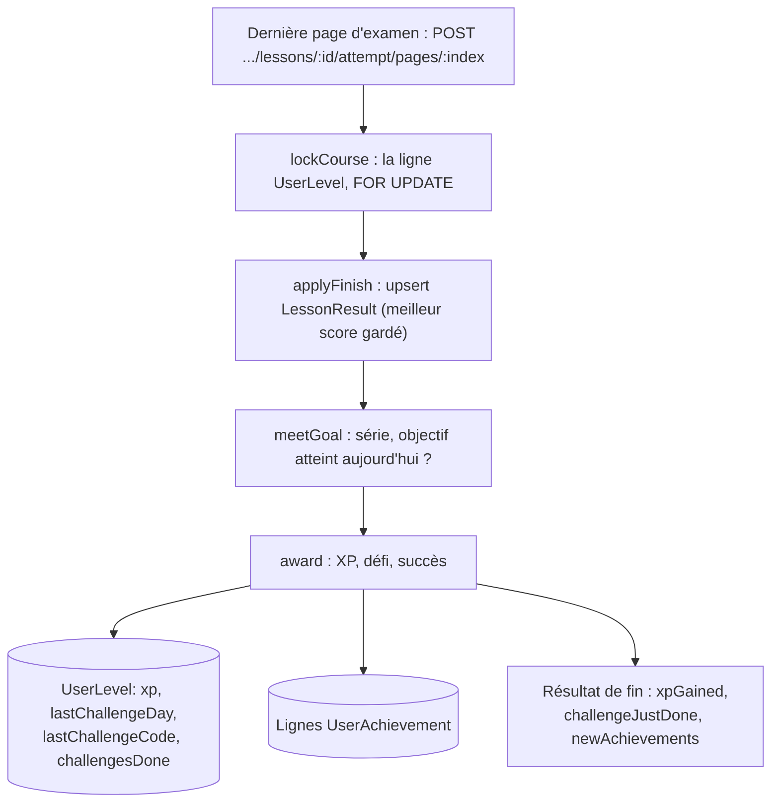

# Gamification (Minor, 1 point)

**Type :** Minor. **Points :** 1. **Statut :** fait.

Les apprenants gagnent des points (XP) avec leurs leçons et montent en rang, reçoivent un petit défi chaque jour, et
collectionnent 16 succès. Tout est stocké par cours (une langue pour un apprenant), et la
page du cours, les résultats des leçons et une page des succès l'affichent.

## Ce que demande le sujet

Le module est une ligne du tableau Jeu et expérience utilisateur de
[../subject/summary.md](../subject/summary.md) :

> | Minor | Gamification : ≥3 parmi succès / badges / classements / XP / défis du jour / récompenses, sauvegardés, avec un retour visuel |

Le PDF ([../../docs/subject/ft_transcendence.pdf](../../docs/subject/ft_transcendence.pdf), chapitre IV, Gaming
and user experience) le formule comme ceci :

> Minor: A gamification system to reward users for their actions.
>
> - Implement at least 3 of the following: achievements, badges, leaderboards, XP/level system,
>   daily challenges, rewards
> - System must be persistent (stored in database)
> - Visual feedback for users (notifications, progress bars, etc.)
> - Clear rules and progression mechanics
>
> While this is a Minor module (1 point), implementing a complete gamification system can be
> substantial. Focus on quality over quantity—three well-implemented features are better than six
> poorly done ones.

**Ce module sans jeu.** Il est dans le chapitre jeu (IV.6), et notre produit est une
app pour apprendre des langues, pas un jeu. Le sujet lui-même le propose pour des apps comme la nôtre. Au
chapitre V.6, « Specialized Projects », il liste :

> Language Learning Platform: Lessons, exercises, progress tracking, and peer practice.
>
> - Suggested modules: User interaction, Gamification, Multiple languages, Voice integration,
>   Analytics dashboard

Il propose aussi la Gamification pour deux autres apps qui ne sont pas des jeux : le « Fitness Tracker » (V.5)
et la « Forum Platform » (V.3).

La règle du sujet sur les dépendances ne le cite pas. Au chapitre IV, « Important - Module
Dependencies and Evaluation », il dit :

> Gaming modules (AI Opponent, Tournament, Game customization, Spectator mode, Multiplayer 3+,
> Add another game) require that at least one game be implemented first.

Et dans le PDF, les modules Tournament, Game customization et Spectator autour de lui finissent chacun par
« This module requires you to have implemented at least one game ». Le module Gamification n'a pas
cette phrase. Ses propres mots, « reward users for their actions » (récompenser les utilisateurs pour leurs actions), vont avec n'importe quelle app. Donc on l'annonce, et
les « actions des utilisateurs » sont finir des leçons et atteindre l'objectif du jour. C'est notre lecture du
sujet. L'équipe a noté que ça doit être confirmé avec le staff avant la soutenance
([README.md](README.md#la-gamification-en-dehors-dun-jeu), « La gamification en dehors d'un jeu »).

## Comment on y répond

| Le sujet demande                      | Ce qu'on a construit                                                                                                                                                                                                                                                                                                                          | Où                                                                                                                                                                                                                                                              |
| ------------------------------------- | --------------------------------------------------------------------------------------------------------------------------------------------------------------------------------------------------------------------------------------------------------------------------------------------------------------------------------------------- | --------------------------------------------------------------------------------------------------------------------------------------------------------------------------------------------------------------------------------------------------------------- |
| Au moins 3 des six fonctionnalités    | Trois : **XP avec des rangs** (le « XP/level system » du sujet), **défis du jour** (un par jour parmi six), et **succès** (16). Les badges, les classements et les récompenses ne sont pas construits.                                                                                                                                        | [`packages/shared/src/schemas/gamification.ts`](../../packages/shared/src/schemas/gamification.ts), [`apps/api/src/lessons/gamification.rules.ts`](../../apps/api/src/lessons/gamification.rules.ts)                                                            |
| Stocké dans la base de données        | Quatre colonnes sur la ligne de cours `UserLevel` (`xp`, `lastChallengeDay`, `lastChallengeCode`, `challengesDone`) et une table `UserAchievement`, une ligne par succès gagné. Écrit dans la même transaction que le résultat de la leçon.                                                                                                   | [`apps/api/prisma/schema.prisma`](../../apps/api/prisma/schema.prisma), [`migration.sql`](../../apps/api/prisma/migrations/20261107184854_add_gamification/migration.sql), [`apps/api/src/lessons/gamification.ts`](../../apps/api/src/lessons/gamification.ts) |
| Retour visuel                         | Des barres de progression pour le rang, pour chaque succès et pour toute la liste ; une carte XP sur les résultats de la leçon avec chaque nouveau succès ; une liste « New today » et une carte « Today's challenge » avec une marque **Done** sur la page du cours.                                                                         | [`apps/web/components/gamification.tsx`](../../apps/web/components/gamification.tsx), [`achievements/page.tsx`](<../../apps/web/app/[locale]/(dashboard)/learn/[lang]/achievements/page.tsx>)                                                                   |
| Des règles et une progression claires | Un panneau **How it works** sur la page des succès liste les XP de chaque action, les XP où commence chaque rang, les six défis et les règles des succès. Les montants d'XP, les seuils des rangs et la note de réussite qui y sont affichés viennent des constantes partagées que l'API utilise. Chaque carte de succès dit sa propre règle. | [`achievements/page.tsx`](<../../apps/web/app/[locale]/(dashboard)/learn/[lang]/achievements/page.tsx>) (`HowItWorks`), [`apps/web/lib/achievements.ts`](../../apps/web/lib/achievements.ts)                                                                    |

## Comment ça marche

### Les trois fonctionnalités et leurs règles

Tous les nombres sont des constantes dans
[`packages/shared/src/schemas/gamification.ts`](../../packages/shared/src/schemas/gamification.ts),
donc l'API et les pages web lisent les mêmes valeurs.

- **XP.** Finir une leçon rapporte `LESSON_XP` (10), une fois par leçon et par jour, plus chaque point qu'elle
  ajoute au meilleur score de cette leçon. Atteindre l'objectif du jour rapporte `GOAL_XP` (20). Faire le défi
  du jour rapporte `CHALLENGE_XP` (30). Les XP ne baissent jamais. Exemple tiré des tests : une première fin
  à 80 rapporte 90 ; la même leçon refaite le même jour à 95 rapporte 15, et à 60 rapporte 0.
- **Rangs.** Passer du rang n au rang n + 1 coûte n × `RANK_STEP` (100) XP, donc les rangs commencent à 0,
  100, 300, 600, 1000... `rankOf()` transforme un total d'XP en rang et en bornes de sa barre. Le
  code dit « rank », jamais « level », parce que « level » veut déjà dire le niveau CECRL (A1 à C2).
- **Le défi du jour.** Un parmi six : finir une leçon de grammaire, de vocabulaire, d'expressions du quotidien ou de lecture ;
  avoir 90 % ou plus ; ou finir une leçon de plus que l'objectif du jour. Un défi de type de leçon
  est proposé seulement quand le niveau du cours a une leçon prête de ce type. `challengeFor()` choisit
  le défi à partir d'un hash de l'id du cours et du jour, donc le même cours et le même jour donnent toujours
  le même défi, et il n'y a besoin ni de table ni de tâche à minuit pour le stocker. Une fois fait, le code sous lequel il
  a été fait est enregistré (`lastChallengeCode`), donc un changement de niveau plus tard dans la journée ne le
  change pas.
- **Succès.** 16, en quatre groupes : **Lessons** (première leçon, 10, 25 et 50 leçons réussies),
  **Streaks** (3, 7, 30 et 100 jours d'affilée), **Challenges** (10 et 50 faits) et **Levels**
  (A1 à C2 terminés). Chacun est gagné une fois et gardé pour toujours, même si un niveau reçoit plus tard des leçons
  et que sa barre baisse.

Les règles sont des fonctions pures dans
[`gamification.rules.ts`](../../apps/api/src/lessons/gamification.rules.ts) : pas d'horloge, pas de
base de données, pas de hasard. C'est ce qui permet à
[`gamification.rules.spec.ts`](../../apps/api/src/lessons/gamification.rules.spec.ts) de tester chaque
règle sans base de données.

### Ce qui se passe quand une leçon se termine

1. Le serveur note la leçon lui-même à partir des réponses qu'il a stockées, donc aucun navigateur ne peut envoyer un score
   ([`attempts.service.ts`](../../apps/api/src/lessons/attempts.service.ts)).
2. Dans une seule transaction, `applyFinish()` dans
   [`lessons.service.ts`](../../apps/api/src/lessons/lessons.service.ts) enregistre le résultat, appelle
   `meetGoal()`, puis appelle `award()` dans
   [`gamification.ts`](../../apps/api/src/lessons/gamification.ts).
3. `award()` vérifie si cette fin fait le défi du jour pour la première fois, additionne les
   XP, et les écrit comme un ajout sur la ligne du cours. Il compte ensuite ce que lisent les succès
   (leçons finies et réussies, meilleure série, défis faits, la progression du niveau), demande à
   `earned()` lesquels sont atteints, et stocke les nouveaux avec `createMany`.
4. La ligne du cours est verrouillée (`FOR UPDATE`, dans [`goal.ts`](../../apps/api/src/lessons/goal.ts))
   pendant toute la transaction, donc deux fins au même moment ne peuvent pas donner le défi deux fois.
   La clé primaire `(userLevelId, code)` de `UserAchievement` stocke aussi un code une seule fois.
5. La réponse contient `xpGained`, `challengeJustDone` et `newAchievements`, et la page des résultats
   les affiche.

Baisser l'objectif du jour peut aussi valider la journée. Donc `setGoal()` dans
[`courses.service.ts`](../../apps/api/src/courses/courses.service.ts) (`PATCH /api/courses/:lang`)
appelle aussi `award()`, sous le même verrou : il peut rapporter `GOAL_XP` et un succès de série.

### Ce que l'apprenant lit

- `GET /api/courses/:lang/today` renvoie `xp` (total, rang et bornes de la barre), `challenge` (code et
  `done`) et `earnedToday` (les codes gagnés pendant ce jour du cours).
- `GET /api/courses/:lang/achievements` renvoie les 16 succès, dans l'ordre du catalogue, chacun avec
  le jour où il a été gagné (ou null) et sa barre de progression (`current`, `target`). Les deux routes sont dans
  [`lessons.controller.ts`](../../apps/api/src/lessons/lessons.controller.ts).

L'API envoie seulement des codes. Les pages web les traduisent, à partir des messages `Gamification` dans
[`apps/web/messages/en.json`](../../apps/web/messages/en.json) et les autres langues. Toutes les
vues de gamification sont des server components sans state, donc elles marchent avec JavaScript désactivé. Les
pages du cours et des succès se rechargent sur l'événement socket `course:updated` (`RefreshOn`), donc une
leçon finie dans un autre onglet apparaît.

## Où est le code

| Chemin                                                                                                                                                                 | Ce qu'il fait                                                                                                          |
| ---------------------------------------------------------------------------------------------------------------------------------------------------------------------- | ---------------------------------------------------------------------------------------------------------------------- |
| [`packages/shared/src/schemas/gamification.ts`](../../packages/shared/src/schemas/gamification.ts)                                                                     | Les prix en XP, `RANK_STEP`, les six `CHALLENGES`, les 16 `ACHIEVEMENTS`, et les schemas Zod de ce que renvoie l'API   |
| [`apps/api/src/lessons/gamification.rules.ts`](../../apps/api/src/lessons/gamification.rules.ts)                                                                       | Les règles pures : `xpForFinish`, `rankOf`, `possibleChallenges`, `challengeFor`, `challengeMet`, `progress`, `earned` |
| [`apps/api/src/lessons/gamification.ts`](../../apps/api/src/lessons/gamification.ts)                                                                                   | `award()` : charge ce que lisent les règles et écrit ce qu'elles décident, dans la transaction de l'appelant           |
| [`apps/api/src/lessons/lessons.service.ts`](../../apps/api/src/lessons/lessons.service.ts)                                                                             | `applyFinish()` appelle `award()` ; `today()` et `achievements()` lisent l'état stocké                                 |
| [`apps/api/src/courses/courses.service.ts`](../../apps/api/src/courses/courses.service.ts)                                                                             | `setGoal()` : un objectif plus bas qui valide la journée appelle `award()`                                             |
| [`apps/api/src/lessons/lessons.controller.ts`](../../apps/api/src/lessons/lessons.controller.ts)                                                                       | `GET /api/courses/:lang/achievements`                                                                                  |
| [`apps/api/prisma/schema.prisma`](../../apps/api/prisma/schema.prisma)                                                                                                 | Les colonnes de gamification sur `UserLevel`, et `UserAchievement`                                                     |
| [`apps/api/prisma/migrations/20261107184854_add_gamification/`](../../apps/api/prisma/migrations/20261107184854_add_gamification/migration.sql)                        | La migration qui les ajoute                                                                                            |
| [`apps/web/components/gamification.tsx`](../../apps/web/components/gamification.tsx)                                                                                   | `RankLine`, `ChallengeCard`, `NewToday`, `FinishXp`, `DoneMark`                                                        |
| [`apps/web/app/[locale]/(dashboard)/learn/[lang]/achievements/page.tsx`](<../../apps/web/app/[locale]/(dashboard)/learn/[lang]/achievements/page.tsx>)                 | La page des succès : les 16 cartes en quatre groupes, et le panneau **How it works**                                   |
| [`apps/web/app/[locale]/(dashboard)/learn/[lang]/page.tsx`](<../../apps/web/app/[locale]/(dashboard)/learn/[lang]/page.tsx>)                                           | La page du cours : les nouveautés du jour sous le titre ; le rang et le défi du jour dans les cartes de côté           |
| [`apps/web/app/[locale]/(dashboard)/learn/[lang]/lessons/[id]/results/page.tsx`](<../../apps/web/app/[locale]/(dashboard)/learn/[lang]/lessons/[id]/results/page.tsx>) | Les résultats de la leçon : la carte XP en haut                                                                        |
| [`apps/web/lib/achievements.ts`](../../apps/web/lib/achievements.ts)                                                                                                   | Charge les succès, et remplit les nombres de chaque règle à partir des constantes partagées                            |
| [`apps/web/lib/xp-breakdown.ts`](../../apps/web/lib/xp-breakdown.ts)                                                                                                   | Sépare les XP d'une fin en lignes leçon, objectif et défi                                                              |

## Comment le montrer à la soutenance

La stack doit tourner (`make run`, ou `make` pour lancer toutes les vérifications avant). L'app est sur
`https://localhost` ; si le port 443 n'était pas libre, utilise l'adresse que `make run` affiche.

**Un nouvel apprenant (XP, défi, premier succès)**

1. Ouvre `https://localhost/en/signup`, crée un compte, choisis **Français** sous « Language to learn », choisis un
   « Daily goal », et clique sur **Next**. Clique sur **I already know my level**, choisis **A0** (un débutant, donc
   le cours est le français A1) et clique sur **Start learning**.
2. Sur la page du cours (`/en/learn/fr`), montre la colonne de côté. Sa carte **Your rank** montre
   « Rank 1 · 0 of 100 XP » avec une barre vide, et le lien **Achievements and rules**. En dessous,
   il y a la carte **Today's challenge** avec sa règle et « +30 XP ». Dans une fenêtre étroite, ces
   cartes sont derrière le bouton **My course** en haut à gauche (#220).
3. Ouvre une des leçons du jour, clique sur **Start the lesson**, passe les pages et l'examen, et
   clique sur **Finish the exam**.
4. En haut des résultats, une carte affiche « +N XP » avec une ligne **Lesson**, puis **New achievement**
   avec **First lesson**, puis la nouvelle ligne de rang. Si la leçon a aussi fait le défi ou atteint
   l'objectif du jour, la carte a des lignes **Challenge done** et **Daily goal reached** avec leurs XP.
5. Clique sur **Back to course**. La barre de rang a bougé, et **New today** affiche **First lesson**. Si
   le défi a été fait, sa carte affiche **Done**.
6. Clique sur **Achievements and rules**. La page affiche « 1 of 16 earned », quatre groupes (**Lessons**,
   **Streaks**, **Challenges**, **Levels**), la carte **First lesson** en vert avec « Earned on »
   et la date, et les autres cartes grisées, chacune avec sa barre de progression.
   Sur le côté, **How it works** liste les XP de chaque action et les XP où commence chaque rang.

**C'est stocké dans la base de données**

7. Lance `make studio` et ouvre l'adresse qu'il affiche. Dans `UserLevel`, la ligne française de l'apprenant a
   `xp` rempli. Dans `UserAchievement`, il y a une ligne `firstLesson` pour ce cours, avec son `day`.
8. Recharge la page des succès, ou déconnecte-toi et reconnecte-toi : le même état revient de la
   base de données.

**Un apprenant avec plus d'historique (en option)**

Si `DEMO_PASSWORD` est défini dans `.env`, le seed construit des apprenants de démo
([`.env.example`](../../.env.example), [`demo.data.ts`](../../apps/api/src/demo/demo.data.ts)).
Ils sont rejoués à travers les vrais services, donc ils ont gagné leurs XP et leurs succès avec les mêmes
règles. Connecte-toi sur `https://localhost/en/login` avec `demo-eva@example.com` : son français A1 est
terminé, donc `/en/learn/fr/achievements` affiche **A1 complete** comme gagné. `demo-ben@example.com`
a une série de 12 jours.

## Les tests qui le prouvent

| Test                                                                                                         | Ce qu'il vérifie                                                                                                                                                                                                                                                                                                                                                                                                                                                      |
| ------------------------------------------------------------------------------------------------------------ | --------------------------------------------------------------------------------------------------------------------------------------------------------------------------------------------------------------------------------------------------------------------------------------------------------------------------------------------------------------------------------------------------------------------------------------------------------------------- |
| [`apps/api/src/lessons/gamification.rules.spec.ts`](../../apps/api/src/lessons/gamification.rules.spec.ts)   | Chaque règle : les XP d'une fin et d'une leçon refaite, les seuils des rangs (rang 2 à 100, rang 3 à 300), le défi est le même pour un cours et un jour, se répartit sur les six codes, ne choisit jamais un type sans leçon prête, et son hash est figé ; `challengeMet` (89 ne valide pas score90, 90 oui) ; `earned` et `progress` pour les séries, les comptes et les niveaux                                                                                     |
| [`packages/shared/src/schemas/gamification.test.ts`](../../packages/shared/src/schemas/gamification.test.ts) | Six codes de défi, seize codes de succès dans un ordre fixe, un par niveau CECRL, les prix en XP, et les schemas qui refusent une barre qui dépasse sa fin ou un total hors de son rang                                                                                                                                                                                                                                                                               |
| [`apps/api/test/gamification.e2e-spec.ts`](../../apps/api/test/gamification.e2e-spec.ts)                     | La vraie API sur une base de données : le défi est donné une seule fois quand deux dernières pages arrivent ensemble ; `GOAL_XP` une seule fois ; une leçon refaite avec un score plus bas ne rapporte rien ; streak7 et levelA1 viennent seulement de la bonne fin ; la liste des succès avec les jours où ils ont été gagnés ; un défi fait garde son code après un changement de niveau ; les succès sont supprimés avec l'utilisateur ; la route est dans Swagger |
| [`e2e/tests/gamification.spec.ts`](../../e2e/tests/gamification.spec.ts)                                     | Dans le navigateur : une première fin affiche ses XP, **First lesson** et le rang sur les résultats, la page du cours et la page des succès ; faire le défi affiche **Done** et atteint le rang 2 ; un clic ouvre les règles ; les deux pages s'affichent sans JavaScript                                                                                                                                                                                             |
| [`apps/web/lib/xp-breakdown.test.ts`](../../apps/web/lib/xp-breakdown.test.ts)                               | La somme des lignes de la carte XP fait bien `xpGained`                                                                                                                                                                                                                                                                                                                                                                                                               |
| [`apps/web/lib/messages.test.ts`](../../apps/web/lib/messages.test.ts)                                       | Chaque code de succès et de défi a un titre et une règle dans les messages                                                                                                                                                                                                                                                                                                                                                                                            |

## Limites et choix

- **Trois fonctionnalités, pas six.** Pas de badges, pas de classements, pas de récompenses
  ([../architecture/product.md](../architecture/product.md)). Le sujet en demande trois et dit que
  trois bien faites valent mieux que six mal faites.
- **Pas de jeu.** Le module est annoncé sur une app sans jeu, comme expliqué plus haut. Ça doit être
  confirmé avec le staff avant la soutenance.
- **Par cours, pas par utilisateur.** Les XP, le défi et les succès appartiennent à un cours. Un
  apprenant avec le français et l'allemand a deux rangs et deux séries de succès.
- **Le défi est calculé, pas stocké.** Seuls le jour où il a été fait et son code sont enregistrés. Un
  changement de niveau avant qu'il soit fait peut changer le défi du jour, parce que le choix dépend
  des types de leçons prêtes du niveau.
- **Les succès de niveau suivent les leçons prêtes.** « A1 complete » lit les leçons qu'on peut
  jouer aujourd'hui. Tant qu'un niveau n'a que quelques leçons écrites, le succès peut être gagné sur
  celles-là, et une leçon ajoutée plus tard ne le reprend pas (commentaire sur `earned()` dans
  [`gamification.rules.ts`](../../apps/api/src/lessons/gamification.rules.ts)).
- **Le retour est dans la page, pas dans une pop-up.** La carte XP fait partie de la page des résultats, ce n'est pas un toast. On n'annonce pas le module de notifications
  ([README.md](README.md#non-annoncés)).
- **Les anciennes tentatives.** Une tentative finie avant que les récompenses existent (#95) n'a rien rapporté. Ses
  résultats n'affichent pas de lignes d'XP, seulement que l'objectif a été atteint (`EARNED_NOTHING` dans
  [`attempts.service.ts`](../../apps/api/src/lessons/attempts.service.ts), `legacyGoal` dans
  [`xp-breakdown.ts`](../../apps/web/lib/xp-breakdown.ts)).

## Qui l'a construit

| Membre | GitHub                                                                  | Ce qu'il a construit                                                                                                                                                                                                                                                                                                  | Issues et PRs                                                                                                                                                                                                                                                                                                                                                                                                       |
| ------ | ----------------------------------------------------------------------- | --------------------------------------------------------------------------------------------------------------------------------------------------------------------------------------------------------------------------------------------------------------------------------------------------------------------- | ------------------------------------------------------------------------------------------------------------------------------------------------------------------------------------------------------------------------------------------------------------------------------------------------------------------------------------------------------------------------------------------------------------------- |
| Anaïs  | [avarrett](https://github.com/avarrett) (commits sous le nom `ninisse`) | Tout le module : les constantes, les schemas et les règles pures ; les colonnes de la base de données, `UserAchievement` et `award()` dans les transactions de fin et d'objectif, avec les tests e2e de l'API ; les parties de la page du cours, la carte XP des résultats, la page des succès et le test Playwright. | [#132](https://github.com/VictorBro/ft_transcendence/pull/132) (ferme [#94](https://github.com/VictorBro/ft_transcendence/issues/94)), [#180](https://github.com/VictorBro/ft_transcendence/pull/180) (ferme [#95](https://github.com/VictorBro/ft_transcendence/issues/95)), [#199](https://github.com/VictorBro/ft_transcendence/pull/199) (ferme [#97](https://github.com/VictorBro/ft_transcendence/issues/97)) |
| Victor | [VictorBro](https://github.com/VictorBro)                               | A écrit les trois issues qui décrivent la fonctionnalité.                                                                                                                                                                                                                                                             | [#94](https://github.com/VictorBro/ft_transcendence/issues/94), [#95](https://github.com/VictorBro/ft_transcendence/issues/95), [#97](https://github.com/VictorBro/ft_transcendence/issues/97)                                                                                                                                                                                                                      |
