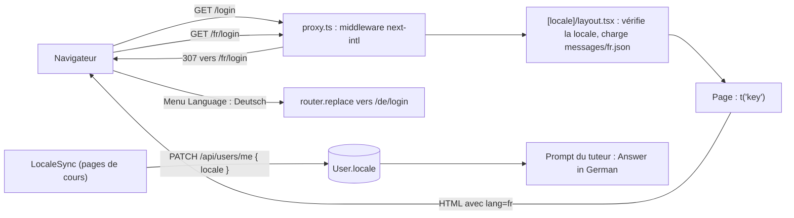

# Internationalisation : au moins 3 langues (Minor, 1 point)

**Type :** Minor. **Points :** 1. **Statut :** terminé.

Tout le site peut se lire en anglais, en français ou en allemand. Un menu dans le header change la
langue, et l'adresse de la page change avec elle : `/en/...`, `/fr/...` ou `/de/...`. Le
serveur retient aussi la langue d'un utilisateur connecté, pour que le tuteur IA réponde dans cette langue.

## Ce que demande le sujet

Le module est une ligne Minor dans le tableau Accessibility and Internationalization de
[../subject/summary.md](../subject/summary.md) :

> i18n with ≥3 complete languages, language switcher, all text translatable

Le PDF ([../../docs/subject/ft_transcendence.pdf](../../docs/subject/ft_transcendence.pdf), chapitre IV,
Accessibility and Internationalization) le formule ainsi :

> Minor: Support for multiple languages (at least 3 languages).
>
> - Implement i18n (internationalization) system.
> - At least 3 complete language translations.
> - Language switcher in the UI.
> - All user-facing text must be translatable.

Aucune règle de dépendance du sujet ne s'applique à ce module.

## Comment on y répond

| Ce que demande le sujet                                    | Ce qu'on a construit                                                                                                                                                                                                                                                                                                                                                                                                                                                                                                                                                     | Où                                                                                                                                                                                                                                                                    |
| ---------------------------------------------------------- | ------------------------------------------------------------------------------------------------------------------------------------------------------------------------------------------------------------------------------------------------------------------------------------------------------------------------------------------------------------------------------------------------------------------------------------------------------------------------------------------------------------------------------------------------------------------------ | --------------------------------------------------------------------------------------------------------------------------------------------------------------------------------------------------------------------------------------------------------------------- |
| Gérer au moins 3 langues                                   | Anglais (`en`), français (`fr`) et allemand (`de`). La liste est à un seul endroit, `SUPPORTED_LOCALES`. Le routage et les vérifications de l'API l'utilisent, et la colonne `User.locale` de la base est un enum avec les trois mêmes valeurs. Un test unitaire échoue si la liste a un jour moins de trois entrées.                                                                                                                                                                                                                                                    | [locale.ts](../../packages/shared/src/schemas/locale.ts), [schemas.test.ts](../../packages/shared/src/schemas/schemas.test.ts), [schema.prisma](../../apps/api/prisma/schema.prisma) (`enum Locale`)                                                                  |
| Mettre en place un système i18n                            | La bibliothèque `next-intl` (version 4.15.1). Chaque page est sous un dossier `[locale]`, donc la langue est la première partie de chaque adresse. Un middleware (du code qui tourne avant chaque page) choisit la langue et redirige une adresse qui n'en a pas. Les pages lisent leur texte avec `t('key')` depuis un catalogue, jamais depuis du texte écrit dans le composant.                                                                                                                                                                                       | [package.json](../../apps/web/package.json), [i18n/routing.ts](../../apps/web/i18n/routing.ts), [i18n/request.ts](../../apps/web/i18n/request.ts), [proxy.ts](../../apps/web/proxy.ts), [[locale]/layout.tsx](../../apps/web/app/[locale]/layout.tsx)                 |
| Au moins 3 traductions complètes                           | Trois catalogues avec les mêmes 587 textes en 37 groupes. Un test unitaire échoue si un catalogue a une clé que les autres n'ont pas, si un texte est vide, ou si un code d'erreur ou un succès n'a pas de texte. Les deux pages légales sont écrites en entier dans chaque langue, dans des fichiers séparés.                                                                                                                                                                                                                                                           | [messages/en.json](../../apps/web/messages/en.json), [fr.json](../../apps/web/messages/fr.json), [de.json](../../apps/web/messages/de.json), [messages.test.ts](../../apps/web/lib/messages.test.ts), [lib/legal-content/](../../apps/web/lib/legal-content/index.ts) |
| Sélecteur de langue dans l'interface                       | Un menu **Language** (un `<select>` natif) dans le header de chaque groupe de pages : les pages principales (accueil, connexion, profil, amis, pages légales), les pages de cours et les pages de messages. Un visiteur le voit dans la ligne du header. Un utilisateur connecté le trouve derrière le bouton menu du header (#220). Il montre la langue actuelle, et chaque langue est nommée dans sa propre langue (English, Français, Deutsch). En choisir une garde l'utilisateur sur la même page, dans la nouvelle langue.                                         | [language-switcher.tsx](../../apps/web/components/language-switcher.tsx), [header-nav.tsx](../../apps/web/components/header-nav.tsx), [dashboard-nav.tsx](../../apps/web/components/dashboard-nav.tsx), [header-menu.tsx](../../apps/web/components/header-menu.tsx)  |
| Tout texte visible par l'utilisateur doit être traduisible | Chaque page, bouton, libellé, aide de formulaire, libellé pour lecteur d'écran et titre d'onglet vient des catalogues. L'API n'envoie jamais de phrase : elle envoie un code d'erreur, et le navigateur transforme le code en phrase dans la langue du lecteur. Les consignes et objectifs des leçons sont stockés dans les trois langues et affichés dans la langue de l'interface. Deux choses restent en anglais : la page affichée quand tout le site n'arrive pas à charger, et le slogan dessiné dans l'image du logo. Voir [Limites et choix](#limites-et-choix). | [error-message.ts](../../apps/web/lib/error-message.ts), [errors.ts](../../packages/shared/src/schemas/errors.ts), [localized.ts](../../apps/web/lib/localized.ts), [global-error.tsx](../../apps/web/app/global-error.tsx)                                           |

Les quatre premiers points sont entièrement remplis. Le dernier est rempli pour chaque texte qu'un
utilisateur voit en usage normal, avec les deux petites exceptions citées plus haut.

## Comment ça marche

1. **L'adresse porte la langue.** Chaque route commence par la langue, l'anglais aussi
   (`localePrefix: 'always'` dans [routing.ts](../../apps/web/i18n/routing.ts)). On peut partager un
   lien vers une page en français, et deux onglets peuvent montrer deux langues.
2. **Le middleware choisit une langue pour une adresse qui n'en a pas.** [proxy.ts](../../apps/web/proxy.ts)
   lance le middleware next-intl. Il pose un cookie `NEXT_LOCALE` avec la langue de la page que
   l'utilisateur visite. La fois suivante, une requête vers `/login` est redirigée (HTTP 307) vers la
   langue retenue, par exemple `/fr/login`. Sans le cookie, le commentaire dans
   [locale.ts](../../packages/shared/src/schemas/locale.ts) dit que le middleware lit le header
   `Accept-Language` du navigateur, et revient à l'anglais (`DEFAULT_LOCALE`) sinon. `/api`,
   `/healthz` et les fichiers avec un point (comme `favicon.ico`) ne passent pas par le middleware.
3. **Le layout vérifie la langue et charge le texte.**
   [[locale]/layout.tsx](../../apps/web/app/[locale]/layout.tsx) refuse une langue qui n'est pas
   dans la liste (`/es/login` donne une 404), met `<html lang>` à la vraie langue, et donne le
   catalogue à `NextIntlClientProvider`, pour que les composants client puissent traduire aussi. Le
   titre de l'onglet et la description de la page viennent du catalogue (`generateMetadata`).
   [i18n/request.ts](../../apps/web/i18n/request.ts) charge `messages/<locale>.json`, et utilise
   l'anglais si la langue est inconnue.
4. **Les pages demandent le texte par clé.** Les pages serveur appellent `getTranslations('Group')`, les
   composants client appellent `useTranslations('Group')`. Les dates utilisent aussi la langue du
   lecteur, par exemple `toLocaleDateString(locale)` sur la page de profil.
5. **Les erreurs voyagent sous forme de codes.** L'API et les vérifications de formulaire envoient un code comme
   `auth.invalidCredentials`. [error-message.ts](../../apps/web/lib/error-message.ts) est le seul
   endroit où un code devient une phrase, depuis le groupe `Errors`. Un code inconnu affiche une phrase
   générale dans la langue du lecteur, jamais du texte anglais dans une page en français.
6. **Les longs textes légaux sont mis à part.** La Privacy Policy et les Terms of Service sont de longs textes.
   Le layout envoie tout le catalogue au navigateur, donc ces deux
   documents sont dans [lib/legal-content/](../../apps/web/lib/legal-content/index.ts) (`en.ts`,
   `fr.ts`, `de.ts`) et ne sont chargés que par leurs propres pages.
7. **Le texte des leçons en trois langues.** Les objectifs des leçons, les titres de sections et les consignes sont
   stockés en version anglaise, française et allemande. `pick()` dans
   [localized.ts](../../apps/web/lib/localized.ts) montre celle de la langue de l'interface. La
   langue que l'apprenant étudie n'est bien sûr pas traduite : c'est la leçon.
8. **Le serveur retient la langue (#211).** Sur les pages de cours,
   [locale-sync.tsx](../../apps/web/components/locale-sync.tsx) compare la langue de la page avec
   le `User.locale` stocké. Quand elles sont différentes, il envoie un seul `PATCH /api/users/me { locale }`. Le
   tuteur de discussion lit ensuite `user.locale` et reçoit la consigne "Answer in German, the language of the
   learner's interface" ([discussion-prompt.ts](../../apps/api/src/lessons/discussion-prompt.ts)).
   Quand une leçon commence, le navigateur envoie aussi la langue de l'interface, ce qui fixe la
   "langue maternelle" de la tentative : la langue de ses textes d'aide. C'est la langue de l'interface,
   ou l'anglais (le français sur le cours d'anglais) quand l'interface est dans la langue apprise
   ([motherTongue.ts](../../packages/shared/src/lessons/player/motherTongue.ts)).

## Où est le code

| Chemin                                                                                                                                                                                                     | Ce qu'il fait                                                                                                                      |
| ---------------------------------------------------------------------------------------------------------------------------------------------------------------------------------------------------------- | ---------------------------------------------------------------------------------------------------------------------------------- |
| [packages/shared/src/schemas/locale.ts](../../packages/shared/src/schemas/locale.ts)                                                                                                                       | `SUPPORTED_LOCALES = ['en', 'fr', 'de']`, `DEFAULT_LOCALE`, `LocaleSchema`. La seule liste que toutes les autres parties lisent    |
| [apps/web/i18n/routing.ts](../../apps/web/i18n/routing.ts)                                                                                                                                                 | Routage next-intl : les langues, la langue par défaut, un préfixe sur chaque adresse                                               |
| [apps/web/i18n/request.ts](../../apps/web/i18n/request.ts)                                                                                                                                                 | Charge le catalogue de la langue de la requête                                                                                     |
| [apps/web/i18n/navigation.ts](../../apps/web/i18n/navigation.ts)                                                                                                                                           | `Link`, `useRouter`, `usePathname` qui gardent la langue actuelle                                                                  |
| [apps/web/proxy.ts](../../apps/web/proxy.ts)                                                                                                                                                               | Lance le middleware next-intl sur chaque requête de page                                                                           |
| [apps/web/next.config.ts](../../apps/web/next.config.ts)                                                                                                                                                   | Ajoute le plugin next-intl au build Next.js                                                                                        |
| [apps/web/app/[locale]/layout.tsx](../../apps/web/app/[locale]/layout.tsx)                                                                                                                                 | Refuse une langue inconnue, met `<html lang>`, le titre et la description traduits, passe le catalogue au navigateur               |
| [apps/web/messages/en.json](../../apps/web/messages/en.json), [fr.json](../../apps/web/messages/fr.json), [de.json](../../apps/web/messages/de.json)                                                       | Les trois catalogues : tous les textes de l'interface                                                                              |
| [apps/web/lib/legal-content/](../../apps/web/lib/legal-content/index.ts)                                                                                                                                   | La Privacy Policy et les Terms of Service dans chaque langue                                                                       |
| [apps/web/components/language-switcher.tsx](../../apps/web/components/language-switcher.tsx)                                                                                                               | Le menu **Language**                                                                                                               |
| [apps/web/components/header-menu.tsx](../../apps/web/components/header-menu.tsx)                                                                                                                           | Le bouton menu du header d'un utilisateur connecté. Il contient le sélecteur de cours, le menu **Language** et les liens du compte |
| [apps/web/components/locale-sync.tsx](../../apps/web/components/locale-sync.tsx)                                                                                                                           | Enregistre la langue de l'interface dans `User.locale`                                                                             |
| [apps/web/lib/error-message.ts](../../apps/web/lib/error-message.ts)                                                                                                                                       | Transforme un code d'erreur en phrase dans la langue du lecteur                                                                    |
| [apps/web/lib/localized.ts](../../apps/web/lib/localized.ts)                                                                                                                                               | `pick()` et `pickNative()` : choisissent la bonne langue dans un texte stocké en trois langues                                     |
| [apps/web/app/[locale]/error.tsx](../../apps/web/app/[locale]/error.tsx), [not-found.tsx](../../apps/web/app/[locale]/not-found.tsx), [[...rest]/page.tsx](../../apps/web/app/[locale]/[...rest]/page.tsx) | La page d'erreur et la page 404 traduites                                                                                          |
| [apps/api/prisma/schema.prisma](../../apps/api/prisma/schema.prisma)                                                                                                                                       | `User.locale` (`enum Locale { en fr de }`, par défaut `en`)                                                                        |
| [packages/shared/src/schemas/user.ts](../../packages/shared/src/schemas/user.ts)                                                                                                                           | `locale` dans les schemas d'inscription et de mise à jour du profil, vérifié par l'API                                             |
| [apps/api/src/lessons/discussion-prompt.ts](../../apps/api/src/lessons/discussion-prompt.ts)                                                                                                               | Dit au tuteur de répondre dans la langue de l'utilisateur, et lui donne le texte de la leçon dans cette langue                     |

## Comment le montrer à la soutenance

Lance la stack avec `make run`. Elle affiche l'adresse, `https://localhost`.

**1. Trois langues et le sélecteur.**

1. Ouvre `https://localhost`. L'adresse devient `https://localhost/en` (ou la langue de ton
   navigateur, s'il est en français ou en allemand).
2. Dans le header, ouvre le menu **Language** et choisis **Français**. L'adresse devient
   `/fr` et le titre dit "Apprends une langue avec un tuteur qui s'adapte à toi !". Le menu
   s'appelle maintenant **Langue**.
3. Choisis **Deutsch**. L'adresse devient `/de` et le titre dit "Lerne eine Sprache mit
   einem Tutor, der sich dir anpasst!". Le menu s'appelle maintenant **Sprache** et nomme toujours chaque
   langue dans sa propre langue.
4. Appuie sur le bouton retour du navigateur : il n'annule pas le changement de langue (le sélecteur remplace
   l'adresse au lieu d'en ajouter une).

**2. La langue reste quand tu te déplaces.**

1. Dans le menu **Sprache**, choisis à nouveau **Français** : l'adresse devient `/fr` et le cookie
   `NEXT_LOCALE` retient maintenant le français. Clique sur **politique de confidentialité** dans le footer. Tu arrives sur `/fr/privacy` :
   toute la politique est en français, le titre de l'onglet aussi.
2. Tape `https://localhost/login` dans la barre d'adresse, sans langue. Tu es envoyé vers
   `/fr/login`, parce que le cookie `NEXT_LOCALE` retient le français.
3. Ouvre `https://localhost/de/terms` : les Terms of Service en allemand ("Nutzungsbedingungen").
4. Ouvre `https://localhost/es/login`. L'espagnol n'est pas géré, donc le serveur répond avec une
   page 404, pas une page à moitié traduite.

**3. Les messages d'erreur sont traduits aussi.**

1. Ouvre `https://localhost/de/login`. Tape n'importe quelle adresse email et un mauvais mot de passe, puis clique sur
   **Anmelden**.
2. L'erreur dit "E-Mail-Adresse oder Passwort ist falsch". L'API a seulement envoyé le code
   `auth.invalidCredentials` ; c'est le navigateur qui a choisi la phrase en allemand.

**4. Chaque texte vient des catalogues.**

1. Montre [apps/web/messages/](../../apps/web/messages/en.json) : trois fichiers avec les mêmes clés.
2. Lance le test des catalogues depuis la racine du dépôt :
   `pnpm --filter @ft/shared run build && pnpm --filter @ft/web exec vitest run lib/messages.test.ts`
   (`make test` lance tous les tests unitaires). Il vérifie, pour chaque langue,
   que les clés sont les mêmes qu'en anglais, qu'aucun texte n'est vide, et que chaque code d'erreur et chaque succès
   a un texte.
3. Ouvre n'importe quelle page dans les DevTools : `<html lang="fr">` sur une page en français.

**5. En option : le serveur connaît la langue.**

1. Ouvre `https://localhost/en/signup` (la partie 3 a laissé le navigateur en allemand) et inscris-toi. Termine l'onboarding : choisis une langue et un objectif
   quotidien, clique sur **Next**, clique sur **I already know my level**, choisis un niveau, puis **Start
   learning**. Tu arrives sur la page du cours, `/en/learn/<lang>`.
2. Clique sur le bouton menu à droite du header (trois traits). Dans son menu **Language**,
   choisis **Deutsch**.
3. Dans le même navigateur, ouvre `https://localhost/api/auth/me`. Le JSON montre `"locale":"de"`.
4. Avec un vrai fournisseur de LLM configuré, ouvre l'étape de discussion d'une leçon et pose une question : le tuteur
   répond en allemand.

## Les tests qui le prouvent

| Test                                                                                                                      | Ce qu'il vérifie                                                                                                                                                                                          |
| ------------------------------------------------------------------------------------------------------------------------- | --------------------------------------------------------------------------------------------------------------------------------------------------------------------------------------------------------- |
| [e2e/tests/i18n.spec.ts](../../e2e/tests/i18n.spec.ts) : "the document declares its language"                             | `/en`, `/fr` et `/de` mettent chacun le bon `<html lang>`, et le titre de l'onglet est traduit sur `/fr/privacy` et `/de/terms`                                                                           |
| [e2e/tests/i18n.spec.ts](../../e2e/tests/i18n.spec.ts) : "an unsupported locale answers 404"                              | `/es/login` répond 404                                                                                                                                                                                    |
| [e2e/tests/i18n.spec.ts](../../e2e/tests/i18n.spec.ts) : "content follows the locale"                                     | La page d'accueil en français et en allemand, et les pages légales dans leur propre langue, pas le repli en anglais                                                                                       |
| [e2e/tests/i18n.spec.ts](../../e2e/tests/i18n.spec.ts) : "language switcher"                                              | Choisir **fr** change l'adresse et le contenu ; le menu montre la langue actuelle avec son libellé traduit                                                                                                |
| [e2e/tests/i18n.spec.ts](../../e2e/tests/i18n.spec.ts) : "locale persistence"                                             | Le cookie `NEXT_LOCALE` est posé, `/login` redirige (307) vers `/fr/login`, et un clic dans le footer reste en français                                                                                   |
| [e2e/tests/locale.spec.ts](../../e2e/tests/locale.spec.ts) : "locale sync"                                                | Un passage à l'allemand est enregistré dans `User.locale` avec une seule requête ; un enregistrement raté est retenté à la page suivante ; un enregistrement que le serveur refuse (400) n'est pas répété |
| [apps/web/lib/messages.test.ts](../../apps/web/lib/messages.test.ts)                                                      | Pour `en`, `fr` et `de` : exactement les mêmes clés, chaque code d'erreur traduit, chaque succès et chaque défi avec un titre et une règle, aucun texte vide                                              |
| [apps/web/lib/legal.test.ts](../../apps/web/lib/legal.test.ts)                                                            | Pour chaque langue qui a un texte légal : les deux documents existent avec des slugs uniques et gardent les ancres de sections anglaises                                                                  |
| [apps/web/lib/localized.test.ts](../../apps/web/lib/localized.test.ts)                                                    | `pick()` lit la langue de l'interface, l'anglais pour toute autre                                                                                                                                         |
| [packages/shared/src/schemas/schemas.test.ts](../../packages/shared/src/schemas/schemas.test.ts) : "locale"               | Au moins trois langues ; une valeur inconnue est refusée                                                                                                                                                  |
| [apps/api/src/lessons/discussion-prompt.spec.ts](../../apps/api/src/lessons/discussion-prompt.spec.ts)                    | Le prompt du tuteur nomme la langue dans laquelle répondre, et donne chaque texte d'aide seulement dans la langue de l'interface                                                                          |
| [packages/shared/src/lessons/player/plan.test.ts](../../packages/shared/src/lessons/player/plan.test.ts) : "motherTongue" | La langue maternelle d'une tentative de leçon est la langue de l'interface, ou une autre quand l'interface est dans la langue apprise                                                                     |

Les tests e2e tournent dans la CI sur Chromium, Firefox et WebKit
([e2e.yml](../../.github/workflows/e2e.yml)). Pour lancer les deux fichiers i18n sur une stack qui tourne :
`pnpm --filter @ft/e2e run test:e2e tests/i18n.spec.ts tests/locale.spec.ts --project=chromium`.

## Limites et choix

- **Deux textes anglais restent.**
  - [global-error.tsx](../../apps/web/app/global-error.tsx) n'est affiché que quand le layout qui
    charge le catalogue échoue. Lui demander une traduction échouerait une deuxième fois, donc il est
    écrit en anglais exprès. Toute erreur dans une page utilise à la place la page traduite
    [[locale]/error.tsx](../../apps/web/app/[locale]/error.tsx).
  - Le logo de la page d'accueil ([logo.webp](../../apps/web/public/logo.webp)) a le slogan "Learn
    languages. Transcend boundaries." dessiné dans l'image. Son texte `alt` est traduit, mais
    les mots dans l'image ne le sont pas. La PR #26 le signalait déjà.
- **Certains textes sont les mêmes dans les trois langues, exprès.** Le nom du produit
  `ft_transcendence`, les noms des langues dans le menu (chacune dans sa propre langue), et
  des formats courts comme `+{xp} XP`. Ils viennent quand même des catalogues.
- **Des outils, pas des pages.** La documentation de l'API sur `/api/docs` (Swagger) et Grafana sont des
  outils pour développeurs, et ne sont qu'en anglais.
- **Pas de langue de droite à gauche.** Le RTL est un module séparé qu'on ne revendique pas.
- **Le reste de la suite e2e n'utilise que l'anglais.** Toutes les autres specs sont fixées sur `/en`, pour que
  leurs vérifications voient toujours le même texte ([routes.ts](../../e2e/support/routes.ts)).
  [i18n.spec.ts](../../e2e/tests/i18n.spec.ts) et [locale.spec.ts](../../e2e/tests/locale.spec.ts)
  sont les endroits où le français et l'allemand sont testés.
- **`User.locale` n'est enregistré que depuis les pages de cours.** `LocaleSync` est dans le layout des cours.
  L'inscription n'envoie pas de langue, donc un nouveau compte est stocké en `en` jusqu'à sa première page
  de cours. Un changement de langue sur les pages de profil ou de messages est enregistré à la page de cours suivante.
- **Le tuteur suit la langue enregistrée, pas l'onglet** (#211). Avec deux onglets dans deux langues,
  il répond dans celle enregistrée en dernier. Un changement de langue au milieu d'une leçon change la
  langue du tuteur, mais pas les textes d'aide de cette tentative : ils gardent la langue maternelle fixée au
  début.
- **Une langue inconnue donne une 404, pas un repli.** `/es/...` aurait pu montrer l'anglais, mais une
  404 est plus claire qu'une page dans la mauvaise langue.

## Qui l'a construit

| Membre  | GitHub                                     | Ce qu'il a construit                                                                                                                                                                                                                                                                                         | Issues et PRs                                                 |
| ------- | ------------------------------------------ | ------------------------------------------------------------------------------------------------------------------------------------------------------------------------------------------------------------------------------------------------------------------------------------------------------------ | ------------------------------------------------------------- |
| Luca    | `luca-mattei`                              | Le module lui-même : next-intl, les routes `[locale]`, `proxy.ts`, les trois catalogues, le menu **Language**, les pages légales en français et en allemand, le test des catalogues et `i18n.spec.ts`. Puis `LocaleSync`, qui enregistre la langue de l'interface dans `User.locale`, avec `locale.spec.ts`. | #26, #212 (ferme #211)                                        |
| Victor  | `VictorBro`                                | A rangé la base i18n : le header commun avec le sélecteur, le footer légal, les layouts. Puis a affiché le libellé **Language** à côté du menu sur les écrans plus larges.                                                                                                                                   | #27, #64 (ferme #51)                                          |
| Endrit  | `VYAntares` (commits en tant que `EA`)     | A réécrit le catalogue français pour tutoyer les apprenants. A fait envoyer par l'API un code d'erreur dans chaque message d'erreur, pour que le navigateur puisse le traduire. A replié le header d'un utilisateur connecté, avec le menu **Language**, derrière un seul bouton menu.                       | #125 (ferme #106), #126 (ferme #108), #220                    |
| Anaïs   | `avarrett` (commits en tant que `ninisse`) | A ajouté les textes de la gamification dans les trois langues, et le test des catalogues qui vérifie que chaque succès et chaque défi a un titre et une règle.                                                                                                                                               | #199 (ferme #97)                                              |
| Bastian | `bastian-schnitzler`                       | A ajouté les textes de la page de leçon dans les trois langues, et corrigé la formulation sur des pages déjà livrées.                                                                                                                                                                                        | #192 (ferme #146), #197 (ferme #147, #149), #173 (ferme #153) |

Chaque membre a ajouté les textes de ses propres fonctionnalités dans les trois catalogues : `git shortlog -sn
HEAD -- apps/web/messages/` liste les cinq.
