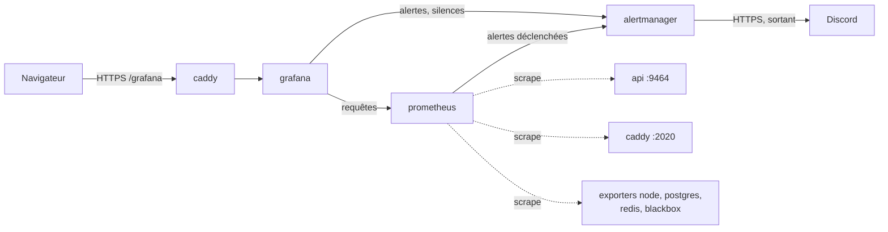

# Système de monitoring avec Prometheus et Grafana (Major, 2 points)

**Type :** Major. **Points :** 2. **Statut :** terminé.

L'app se mesure elle-même tout le temps. Prometheus (un programme qui stocke des nombres dans
le temps) récupère des mesures depuis l'app, les bases de données et le serveur. Grafana (un
programme qui dessine des graphiques) les affiche sur quatre dashboards, derrière une connexion. Quand
quelque chose se passe mal, une règle d'alerte se déclenche et un message peut partir vers un salon Discord.

Ce fichier dit ce qu'on a construit et pourquoi ça répond au sujet. Le guide complet (chaque
panneau, chaque règle, chaque réglage, comment les changer) est
[../operations/monitoring.md](../operations/monitoring.md).

## Ce que demande le sujet

Dans la liste des modules, section DevOps (voir [../subject/summary.md](../subject/summary.md)
et le chapitre IV de [../../docs/subject/ft_transcendence.pdf](../../docs/subject/ft_transcendence.pdf)) :

> Major | Prometheus + Grafana monitoring: exporters, custom dashboards, alerting rules,
> secured access

Il y a donc cinq choses à montrer : Prometheus, des exporters, nos propres dashboards, des règles
d'alerte, et un accès protégé.

## Comment on y répond

| Ce que demande le sujet  | Ce qu'on a construit                                                                                                                                                                                                                                                                                                                                                                                                                                                                                                  | Où                                                                                                                                                                                                                           |
| ------------------------ | --------------------------------------------------------------------------------------------------------------------------------------------------------------------------------------------------------------------------------------------------------------------------------------------------------------------------------------------------------------------------------------------------------------------------------------------------------------------------------------------------------------------- | ---------------------------------------------------------------------------------------------------------------------------------------------------------------------------------------------------------------------------- |
| Prometheus               | Prometheus 3.13.5 (la ligne LTS). Il lit 10 cibles toutes les 30 s, vérifie les règles toutes les 30 s, et garde 15 jours ou 1 Go de données.                                                                                                                                                                                                                                                                                                                                                                         | [`prometheus.yml`](../../infra/monitoring/prometheus/prometheus.yml), [`Dockerfile`](../../infra/monitoring/prometheus/Dockerfile)                                                                                           |
| Exporters                | Quatre exporters : node (le serveur : CPU, mémoire, disque), postgres, redis, et blackbox (il appelle `/healthz` et `/healthz/upstream` de web et la page de santé de Grafana depuis l'extérieur). L'API et Caddy publient aussi leurs propres métriques : l'API a 18 métriques à elle dans `metrics.ts`, plus 3 jauges remplies quand Prometheus demande (les comptes et la banque de questions, lus dans la base de données, et les utilisateurs connectés, comptés en mémoire), plus celles de Node.js par défaut. | [`compose.yml`](../../compose.yml), [`apps/api/src/metrics/`](../../apps/api/src/metrics)                                                                                                                                    |
| Dashboards personnalisés | Quatre dashboards qu'on a écrits nous-mêmes, avec 79 panneaux en tout : Overview (18), API (17), Learning (18), Infrastructure (26). Ils sont chargés depuis le dépôt quand Grafana démarre.                                                                                                                                                                                                                                                                                                                          | [`grafana/dashboards/`](../../infra/monitoring/grafana/dashboards), [`dashboards.yml`](../../infra/monitoring/grafana/provisioning/dashboards/dashboards.yml)                                                                |
| Règles d'alerte          | 25 règles dans 6 groupes (availability, api, learning, stores, host, monitoring) : 7 critical, 18 warning. 10 tests unitaires tournent avec `promtool`. Alertmanager regroupe les alertes et les poste sur Discord.                                                                                                                                                                                                                                                                                                   | [`alerts.yml`](../../infra/monitoring/prometheus/rules/alerts.yml), [`alerts.test.yml`](../../infra/monitoring/prometheus/tests/alerts.test.yml), [`alertmanager.yml`](../../infra/monitoring/alertmanager/alertmanager.yml) |
| Accès sécurisé           | Grafana est le seul service de monitoring qu'on peut atteindre, sur `/grafana`, et seulement avec sa connexion. Pas d'inscription, pas d'accès anonyme, pas de mot de passe par défaut, un blocage après 5 mauvais mots de passe en 5 minutes depuis une même adresse. Prometheus, Alertmanager, les exporters et le port des métriques de l'API n'ont aucune route depuis l'extérieur et ne publient aucun port.                                                                                                     | [`grafana.ini`](../../infra/monitoring/grafana/grafana.ini), [`entrypoint.sh`](../../infra/monitoring/grafana/entrypoint.sh), [`Caddyfile`](../../infra/caddy/Caddyfile)                                                     |

### Pourquoi ça vaut 2 points

- **Les dashboards parlent de notre app, pas seulement de la machine.** À côté du CPU et de
  la mémoire, ils montrent les connexions par résultat, la latence par route d'API, les événements
  WebSocket, les examens de placement, la banque de questions par niveau, et les appels au modèle d'IA.
  L'API les compte elle-même
  ([`metrics.ts`](../../apps/api/src/metrics/metrics.ts)).
- **Les règles d'alerte sont testées.** Chaque règle critical a un test qui prouve qu'elle
  se déclenche, et certains tests prouvent qu'une règle reste silencieuse quand elle doit (par exemple
  "Low RAM with free swap stays quiet").
- **L'accès est fermé par défaut, et vérifié.** Un script fait échouer la CI si un service
  autre que Caddy publie un port dans la stack de production ou du serveur, et un test Playwright vérifie la connexion, le
  401 pour les lectures anonymes et le 404 pour les chemins des métriques.
- **Ça tourne aussi en production.** Les trois mêmes images tournent sur le serveur
  ([`compose.deploy.yml`](../../compose.deploy.yml)), donc l'app déployée est
  surveillée, pas seulement un ordinateur portable.

## Comment ça marche

Prometheus va chercher ("scrape") des nombres sur chaque cible à travers le réseau Docker
interne. Grafana les demande à Prometheus pour dessiner ses panneaux. Prometheus vérifie les
règles et envoie les alertes déclenchées à Alertmanager, qui les transmet à Discord. Le
navigateur n'atteint jamais que Grafana, à travers Caddy.



- **Les métriques de l'API.** L'API sert `GET /metrics` sur son propre port, 9464, depuis
  un petit serveur `node:http` en dehors de NestJS
  ([`metrics-server.ts`](../../apps/api/src/metrics/metrics-server.ts), démarré dans
  [`main.ts`](../../apps/api/src/main.ts)). Caddy n'a aucune route vers lui, donc
  `/api/metrics` n'existe pas. Un middleware chronomètre chaque requête par route
  ([`http-metrics.middleware.ts`](../../apps/api/src/metrics/http-metrics.middleware.ts)).
  `MetricsCollector` lit le nombre d'utilisateurs et la taille de la banque de questions
  dans la base de données, au plus une fois par minute
  ([`metrics.collector.ts`](../../apps/api/src/metrics/metrics.collector.ts)).
- **Les métriques de Caddy** sont sur un deuxième site, `http://:2020`, que seul le réseau
  interne peut atteindre ([`Caddyfile`](../../infra/caddy/Caddyfile)).
- **La config est dans les images.** Les Dockerfiles de Prometheus, Alertmanager et Grafana
  copient dedans la config, les règles et les dashboards. Donc un ordinateur portable, la CI et le
  serveur font tourner les mêmes règles et les mêmes dashboards. Les dashboards ne peuvent pas être enregistrés depuis le
  navigateur (`allowUiUpdates: false`) : le dépôt est la source de vérité.
- **Grafana montre aussi les règles.** Ses sources de données
  ([`datasources.yml`](../../infra/monitoring/grafana/provisioning/datasources/datasources.yml))
  incluent Alertmanager, donc la page Alerting liste les 25 règles, les alertes et
  les silences derrière la connexion. C'est pour ça que Prometheus et Alertmanager n'ont pas besoin
  de route à eux.
- **Le webhook Discord est un secret.** Il n'existe que dans `.env`, sous le nom
  `DISCORD_WEBHOOK_URL`. L'entrypoint d'Alertmanager l'écrit dans un fichier en mémoire
  et la config lit ce fichier. Quand il est vide, Alertmanager charge
  [`silent.yml`](../../infra/monitoring/alertmanager/silent.yml) et n'envoie rien.
- **Quand ça tourne.** `make`, `make up` et le serveur font toujours tourner le monitoring. `make dev`
  le laisse éteint pour garder les ordinateurs portables légers ; `make monitoring-up` l'allume
  ([`compose.override.yml`](../../compose.override.yml), profil `monitoring`).

## Où est le code

| Chemin                                                                                                         | Ce qu'il fait                                                                                                          |
| -------------------------------------------------------------------------------------------------------------- | ---------------------------------------------------------------------------------------------------------------------- |
| [`infra/monitoring/prometheus/prometheus.yml`](../../infra/monitoring/prometheus/prometheus.yml)               | Les 8 jobs de scrape (7 cibles simples et le job blackbox avec 3 sondes), les intervalles, la rétention                |
| [`infra/monitoring/prometheus/rules/alerts.yml`](../../infra/monitoring/prometheus/rules/alerts.yml)           | Les 25 règles d'alerte                                                                                                 |
| [`infra/monitoring/prometheus/tests/alerts.test.yml`](../../infra/monitoring/prometheus/tests/alerts.test.yml) | Les 10 tests unitaires des règles                                                                                      |
| [`infra/monitoring/alertmanager/`](../../infra/monitoring/alertmanager)                                        | Le routage vers Discord, les inhibitions, le repli silencieux, le modèle de message, l'entrypoint qui cache le webhook |
| [`infra/monitoring/grafana/grafana.ini`](../../infra/monitoring/grafana/grafana.ini)                           | Les réglages de sécurité de Grafana                                                                                    |
| [`infra/monitoring/grafana/entrypoint.sh`](../../infra/monitoring/grafana/entrypoint.sh)                       | Refuse de démarrer avec un mot de passe vide, le mot de passe `admin`, ou une clé secrète vide                         |
| [`infra/monitoring/grafana/provisioning/`](../../infra/monitoring/grafana/provisioning)                        | Les deux sources de données et le dossier des dashboards                                                               |
| [`infra/monitoring/grafana/dashboards/`](../../infra/monitoring/grafana/dashboards)                            | Les quatre dashboards en JSON                                                                                          |
| [`apps/api/src/metrics/metrics.ts`](../../apps/api/src/metrics/metrics.ts)                                     | Chaque métrique de l'API, dans le registre propre à l'API                                                              |
| [`apps/api/src/metrics/metrics-server.ts`](../../apps/api/src/metrics/metrics-server.ts)                       | L'écoute interne sur le port 9464                                                                                      |
| [`apps/api/src/metrics/http-metrics.middleware.ts`](../../apps/api/src/metrics/http-metrics.middleware.ts)     | Chronomètre chaque requête HTTP par méthode, route et statut                                                           |
| [`apps/api/src/metrics/metrics.collector.ts`](../../apps/api/src/metrics/metrics.collector.ts)                 | Les utilisateurs, les utilisateurs actifs et la banque de questions, lus quand Prometheus fait son scrape              |
| [`compose.yml`](../../compose.yml), [`compose.deploy.yml`](../../compose.deploy.yml)                           | Les sept services de monitoring, sans port publié                                                                      |
| [`infra/caddy/Caddyfile`](../../infra/caddy/Caddyfile)                                                         | `/grafana` vers Grafana, 404 pour `/grafana/metrics`, le site de métriques `:2020`                                     |
| [`scripts/check-monitoring-config.sh`](../../scripts/check-monitoring-config.sh)                               | Vérifications statiques : config, règles, tests, routes, dashboards, ports publiés                                     |
| [`scripts/check-monitoring.sh`](../../scripts/check-monitoring.sh)                                             | Vérifications en direct sur une stack qui tourne : cibles up, règles en bonne santé, séries présentes                  |
| [`Makefile`](../../Makefile)                                                                                   | `monitoring-up`, `monitoring-check`, et `env-file`, qui écrit les secrets de Grafana dans `.env`                       |

## Comment le montrer à la soutenance

1. Lance `make`. Il fait toutes les vérifications, démarre la stack de production, puis
   `make monitoring-check` et les tests Playwright. L'étape `run` affiche l'adresse de Grafana et la ligne
   pour lire le mot de passe.
2. Relance `make monitoring-check` tout seul. Il montre chaque cible up, chaque
   règle en bonne santé et un Alertmanager trouvé.
3. Lis le mot de passe avec `grep GRAFANA_ADMIN_PASSWORD .env`. Ouvre
   <https://localhost/grafana> (ou `https://localhost:<HTTPS_PORT>/grafana` quand
   `HTTPS_PORT` n'est pas 443) et connecte-toi en tant que `admin`. Il n'y a pas d'autre compte.
4. La page d'accueil est le dashboard **Overview** : chaque stat "Is it up" est verte, et
   il y a du trafic venant du passage de Playwright. Ouvre **Dashboards**, dossier
   `ft_transcendence` : montre **Learning** (la banque de questions du seed par niveau) et
   **API** (les requêtes et la latence par route).
5. Ouvre **Alerting** et montre les 25 règles, regroupées comme dans `alerts.yml`.
6. Montre ce qui est fermé, depuis un terminal :

   ```bash
   curl -sk -o /dev/null -w '%{http_code}\n' https://localhost/grafana/api/search    # 401
   curl -sk -o /dev/null -w '%{http_code}\n' https://localhost/grafana/metrics       # 404
   curl -sk -o /dev/null -w '%{http_code}\n' https://localhost/api/metrics           # 404
   docker ps --format '{{.Names}}\t{{.Ports}}'                                       # only caddy publishes ports
   ```

7. Déclenche une alerte : `docker compose stop api`. Sous **Alerting**, `ApiDown`
   passe en pending, puis en firing après environ une minute. Avec `DISCORD_WEBHOOK_URL` défini,
   Discord reçoit "[FIRING:1] ApiDown".
8. `docker compose start api`. L'alerte se résout en une ou deux minutes, et
   Discord reçoit le message "[RESOLVED]".

Un petit changement en direct : modifie un seuil ou un `for` dans `alerts.yml` et son test, lance
`./scripts/check-monitoring-config.sh` et `make up`, et montre la nouvelle règle sous
**Alerting**. Les autres vérifications pour la démo sont dans la section 8 de
[../operations/monitoring.md](../operations/monitoring.md).

## Les tests qui le prouvent

| Test                                                                                                           | Ce qu'il vérifie                                                                                                                                                                                                                                                                                                                                                                         |
| -------------------------------------------------------------------------------------------------------------- | ---------------------------------------------------------------------------------------------------------------------------------------------------------------------------------------------------------------------------------------------------------------------------------------------------------------------------------------------------------------------------------------- |
| [`infra/monitoring/prometheus/tests/alerts.test.yml`](../../infra/monitoring/prometheus/tests/alerts.test.yml) | 10 tests `promtool` : `ApiDown` se déclenche après une minute et pas avant, le taux d'erreur a besoin de vrai trafic, les échecs de réapprovisionnement de la fixture restent silencieux, une RAM faible avec du swap libre reste silencieuse, et les autres règles critical se déclenchent après leur minute                                                                            |
| [`scripts/check-monitoring-config.sh`](../../scripts/check-monitoring-config.sh)                               | `promtool check config` et `promtool test rules`, `amtool check-config` sur les deux configs d'Alertmanager et la route Discord, `caddy validate`, des vérifications sur le JSON des dashboards, et seulement Caddy qui publie des ports dans les stacks de production et du serveur. Tourne dans [`ci.yml`](../../.github/workflows/ci.yml) (job `monitoring config`) et dans `make ci` |
| [`scripts/check-monitoring.sh`](../../scripts/check-monitoring.sh)                                             | Sur une stack qui tourne : chaque cible up, chaque règle en bonne santé, un Alertmanager trouvé, chaque série de `REQUIRED_SERIES` présente. Tourne dans [`e2e.yml`](../../.github/workflows/e2e.yml) et dans `make`                                                                                                                                                                     |
| [`e2e/tests/monitoring.spec.ts`](../../e2e/tests/monitoring.spec.ts)                                           | À travers Caddy : "an anonymous visitor only gets the login page", "the Grafana API refuses anonymous reads", "sign-up is off", "metrics endpoints stay internal", "the four dashboards are provisioned", "Prometheus feeds Grafana"                                                                                                                                                     |
| [`apps/api/test/metrics.e2e-spec.ts`](../../apps/api/test/metrics.e2e-spec.ts)                                 | Le vrai pipeline NestJS : une requête est comptée sous le modèle de sa route, jamais son URL ; "serves no metrics at /api/metrics" ; la banque et les comptes sont collectés au moment du scrape                                                                                                                                                                                         |
| [`apps/api/src/metrics/*.spec.ts`](../../apps/api/src/metrics)                                                 | Les tests unitaires de l'écoute, du middleware, du collecteur (il garde ses dernières valeurs quand la base de données échoue ou bloque) et des séries qui doivent exister à 0 dès le début                                                                                                                                                                                              |

## Limites et choix

- **Pas de logs.** Ce module parle des métriques. Il n'y a ni ELK ni Loki ;
  `docker compose logs` est l'outil pour les logs.
- **Rien ne surveille Prometheus.** Si Prometheus ou Alertmanager s'arrête, aucune alerte
  ne se déclenche et Grafana affiche "No data". La réponse habituelle est un "dead man's switch"
  en dehors du serveur, qu'on n'a pas construit.
- **Pas de mémoire par container.** On n'a pas ajouté cAdvisor : il demande des privilèges en plus,
  casse sur un Docker rootless multi-utilisateurs et coûte du CPU sur un cœur partagé. Chaque processus
  scrapé donne sa propre mémoire, et `docker stats` couvre le reste.
- **Web n'a pas d'endpoint de métriques.** Toute route de web serait publique à travers Caddy, donc
  l'exporter blackbox vérifie web depuis l'extérieur à la place.
- **Grafana partage l'adresse de l'app.** Il est servi sur `/grafana` sur la même
  origine, derrière le même certificat. Le prix à payer : une faille dans l'un pourrait agir
  avec la session de l'autre dans le même navigateur. Un sous-domaine séparé enlèverait
  ce risque.
- **La config est intégrée à l'image, pas montée.** Le serveur n'a pas de copie du dépôt, donc la config va
  dans les images. Le prix : modifier la config en dev demande un nouveau build, ce que
  `make monitoring-up` fait.
- **Un deploy lent peut déclencher `ApiDown` une fois**, quand la nouvelle API met plus d'une
  minute à démarrer.

Ces limites viennent de la section 10 de
[../operations/monitoring.md](../operations/monitoring.md).

## Qui l'a construit

| Membre | GitHub                                                                | Ce qu'il a construit                                                                                                                                                                                                                                                                                                           | Issues et PRs                                                                                                                                                                                                                                                    |
| ------ | --------------------------------------------------------------------- | ------------------------------------------------------------------------------------------------------------------------------------------------------------------------------------------------------------------------------------------------------------------------------------------------------------------------------ | ---------------------------------------------------------------------------------------------------------------------------------------------------------------------------------------------------------------------------------------------------------------- |
| Victor | [VictorBro](https://github.com/VictorBro)                             | Tout le module : Prometheus, Alertmanager, Grafana et les exporters, les quatre dashboards, les 25 règles et leurs tests, l'écoute des métriques de l'API, les vérifications et le guide. Plus tard, la vérification des ports publiés pour un déploiement derrière un autre proxy (#131), les métriques et panneaux WebSocket (dans #181, co-écrite par Endrit), et de nouvelles versions des images de monitoring. | [#129](https://github.com/VictorBro/ft_transcendence/issues/129), [#130](https://github.com/VictorBro/ft_transcendence/pull/130), [#131](https://github.com/VictorBro/ft_transcendence/pull/131), [#181](https://github.com/VictorBro/ft_transcendence/pull/181), [#198](https://github.com/VictorBro/ft_transcendence/pull/198) |
| Luca   | [luca-mattei](https://github.com/luca-mattei)                         | La métrique de discussion des leçons (`ft_llm_discussion_limited_total`) et son panneau sur le dashboard Learning.                                                                                                                                                                                                             | [#201](https://github.com/VictorBro/ft_transcendence/pull/201)                                                                                                                                                                                                   |
| Anaïs  | [avarrett](https://github.com/avarrett) (commits en tant que ninisse) | La métrique des tentatives de leçon, `ft_lesson_attempts_total`.                                                                                                                                                                                                                                                               | [#190](https://github.com/VictorBro/ft_transcendence/pull/190)                                                                                                                                                                                                   |

D'après `git log --no-merges` sur `infra/monitoring`, `apps/api/src/metrics`, les deux
scripts `check-monitoring` et `e2e/tests/monitoring.spec.ts`. Les pull requests sont
fusionnées en squash, donc un commit correspond en général à une pull request.
