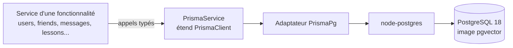

# ORM pour la base de données (Minor, 1 point)

**Type :** Minor. **Points :** 1. **Statut :** terminé.

Un ORM (object-relational mapper) est une bibliothèque qui permet au code de lire et d'écrire dans la base de données
avec des appels de fonction normaux et des objets typés, au lieu d'écrire du SQL à la main. On utilise
[Prisma 7](../../apps/api/package.json) dans le backend (`apps/api`) pour parler à PostgreSQL.

## Ce que demande le sujet

Le module est une ligne du tableau Web de
[../subject/summary.md](../subject/summary.md) :

> | Minor | ORM pour la base de données |

Le PDF ([../../docs/subject/ft_transcendence.pdf](../../docs/subject/ft_transcendence.pdf), chapitre IV, Web) le formule ainsi :

> Minor: Use an ORM for the database.

Le sujet ne donne pas de règle en plus pour ce module. Deux règles de la partie obligatoire touchent le même
code, donc ce fichier montre aussi comment l'ORM aide pour elles. Le chapitre III.3, Technical
requirements, dit :

> The database must have a clear schema and well-defined relations.

Le chapitre III.2, General requirements, dit :

> Multi-user Support (Mandatory): Your website must support multiple users simultaneously. This
> is a core requirement of the project. Users should be able to interact with the application at
> the same time without conflicts or performance issues. This includes:
>
> - Multiple users can be logged in and active at the same time.
> - Concurrent actions by different users are handled properly.
> - Real-time updates are reflected across all connected users when applicable.
> - No data corruption or race conditions occur with simultaneous user actions.

## Comment on y répond

| Ce que demande le sujet                                                 | Ce qu'on a construit                                                                                                                                                                                                                                                                                                                                                                                                  | Où                                                                                                                                                                      |
| ----------------------------------------------------------------------- | --------------------------------------------------------------------------------------------------------------------------------------------------------------------------------------------------------------------------------------------------------------------------------------------------------------------------------------------------------------------------------------------------------------------- | ----------------------------------------------------------------------------------------------------------------------------------------------------------------------- |
| Un ORM                                                                  | Prisma 7.10.1 : l'outil en ligne de commande `prisma`, le client généré `@prisma/client`, et l'adaptateur PostgreSQL `@prisma/adapter-pg`, toujours à la même version.                                                                                                                                                                                                                                                | [apps/api/package.json](../../apps/api/package.json), [../operations/versions.md](../operations/versions.md)                                                            |
| Pour la base de données                                                 | Chaque table est un `model` dans un seul fichier de schema. L'api atteint la base de données à travers un seul service, `PrismaService`, que chaque fonctionnalité qui a besoin de la base injecte. Le schema de la base n'est changé que par des migrations que Prisma écrit à partir de ce fichier. Trois petites requêtes sont du SQL brut envoyé par le même client (voir [Limites et choix](#limites-et-choix)). | [schema.prisma](../../apps/api/prisma/schema.prisma), [prisma.service.ts](../../apps/api/src/prisma/prisma.service.ts), [migrations/](../../apps/api/prisma/migrations) |
| Schema clair, relations bien définies (partie obligatoire)              | 12 models et 9 enums. Chaque relation nomme sa clé étrangère et ce qui se passe à la suppression (`Cascade` ou `Restrict`). Les clés uniques et les index sont déclarés dans le schema.                                                                                                                                                                                                                               | [schema.prisma](../../apps/api/prisma/schema.prisma)                                                                                                                    |
| Pas de corruption de données ni de race conditions (partie obligatoire) | Les écritures qui doivent se faire ensemble tournent dans une transaction Prisma (`$transaction`). Les contraintes d'unicité attrapent deux requêtes qui se font la course, et le code transforme l'erreur Prisma en une erreur HTTP claire.                                                                                                                                                                          | [Transactions](#transactions-et-race-conditions) plus bas                                                                                                               |

## Comment ça marche

### Du schema à la base de données

1. Un développeur modifie [schema.prisma](../../apps/api/prisma/schema.prisma).
2. `make migrate-new NAME=<what_changed>` lance `prisma migrate dev`, qui écrit un nouveau fichier
   SQL dans [prisma/migrations/](../../apps/api/prisma/migrations) et l'applique, puis lance
   `db:generate` pour reconstruire le client ([Makefile](../../Makefile)). Le fichier SQL est commité
   avec le changement de schema. Il y a 15 migrations aujourd'hui, de `20260807022236_init_user` à
   `20261118210619_add_message_unread_index`.
3. `prisma generate` écrit un client TypeScript typé dans `apps/api/src/generated/prisma`. Il
   n'est pas commité ([apps/api/.gitignore](../../apps/api/.gitignore)). Il est reconstruit dans
   l'image Docker ([apps/api/Dockerfile](../../apps/api/Dockerfile)) et quand le container de dev
   démarre ([compose.override.yml](../../compose.override.yml)).
4. Chaque environnement applique les migrations commitées avec `prisma migrate deploy` : `make migrate`
   en local, le service `migrate` sur le serveur ([compose.deploy.yml](../../compose.deploy.yml)),
   et le job de tests de l'api dans la CI ([.github/workflows/ci.yml](../../.github/workflows/ci.yml)).
5. Le seed ([prisma/seed.ts](../../apps/api/prisma/seed.ts)) charge ensuite la banque de questions et les
   leçons avec des appels Prisma `upsert` (insérer ou mettre à jour), donc il peut tourner à chaque deploy.

[prisma.config.ts](../../apps/api/prisma.config.ts) dit à l'outil en ligne de commande où sont le schema,
les migrations et le seed, et lit la chaîne de connexion dans `DATABASE_URL`.

### D'une requête à la base de données

- [prisma.service.ts](../../apps/api/src/prisma/prisma.service.ts) est le seul endroit où le client
  est créé. Il refuse de démarrer si `DATABASE_URL` est vide. Dans `onModuleInit`, il appelle
  `$connect()` puis lance `SELECT 1`. Avec `@prisma/adapter-pg`, `$connect()` construit seulement un
  `pg.Pool`, qui n'ouvre aucune connexion avant sa première requête, donc c'est le `SELECT 1` qui
  atteint Postgres. Une mauvaise adresse arrête donc l'api avant qu'elle écoute (#221, corrigé par #222).
- Le générateur `prisma-client` de Prisma 7 fait un client sans moteur de requêtes à lui. Il a besoin d'un
  adaptateur pour atteindre la base de données, donc le service passe `new PrismaPg({ connectionString })`.
- [prisma.module.ts](../../apps/api/src/prisma/prisma.module.ts) est marqué `@Global()`, donc chaque
  module de fonctionnalité peut injecter `PrismaService` sans l'importer de nouveau.
- Seule l'api a un client Prisma. L'app web reçoit ses données à travers l'api
  ([../architecture/overview.md](../architecture/overview.md), « La règle qui explique tout le reste »),
  et [scripts/check-app-boundaries.sh](../../scripts/check-app-boundaries.sh) échoue si une app
  compile le code de l'autre.

### Ce que l'ORM nous apporte dans le code

- **Des requêtes typées.** Un mauvais nom de colonne ou un mauvais type est une erreur de compilation. Certains fichiers construisent leurs
  types à partir de la requête elle-même, par exemple `Prisma.LessonGetPayload<{ select: typeof LESSON_SELECT }>`
  dans [course-lookup.ts](../../apps/api/src/lessons/course-lookup.ts) et
  `Prisma.MessageWhereInput` dans [messages.service.ts](../../apps/api/src/messages/messages.service.ts).
- **La pagination sans SQL.** L'historique du chat est lu du plus récent au plus ancien, une page à la fois, avec
  `findMany`, `orderBy` sur `createdAt` et `id`, et `take`
  ([messages.service.ts](../../apps/api/src/messages/messages.service.ts)).
- **Les relations et les suppressions dans le schema.** Par exemple, supprimer un `User` supprime ses amitiés
  et ses messages (`onDelete: Cascade`), mais une `Lesson` qui a des résultats ne peut pas être supprimée
  (`onDelete: Restrict` sur `LessonResult`).

### Transactions et race conditions

| Où                                                                                                     | Ce qui tourne ensemble                                                                                                                 | Pourquoi                                                                                                                                           |
| ------------------------------------------------------------------------------------------------------ | -------------------------------------------------------------------------------------------------------------------------------------- | -------------------------------------------------------------------------------------------------------------------------------------------------- |
| [messages.service.ts](../../apps/api/src/messages/messages.service.ts) `send`                          | Faire l'upsert de la conversation, puis créer le message.                                                                              | Un message n'existe jamais sans sa conversation, et l'ordre des conversations (`lastMessageAt`) bouge avec lui.                                    |
| [two-factor.service.ts](../../apps/api/src/auth/two-factor.service.ts) `issueRecoveryCodes`, `disable` | Supprimer les anciens codes de récupération et créer les nouveaux ; ou effacer le secret et supprimer les codes.                       | Les deux changements sont enregistrés, ou aucun : les nouveaux codes remplacent les anciens, et désactiver la 2FA enlève les codes avec le secret. |
| [courses.service.ts](../../apps/api/src/courses/courses.service.ts) `setGoal`                          | Verrouiller le cours, changer l'objectif, définir la langue active, donner de l'XP.                                                    | Un changement d'objectif et une fin de leçon au même moment ne peuvent pas valider deux fois la même journée.                                      |
| [courses.service.ts](../../apps/api/src/courses/courses.service.ts) `write`                            | Changer le niveau, définir la langue active.                                                                                           | Les deux lignes sont mises à jour ensemble.                                                                                                        |
| [attempts.service.ts](../../apps/api/src/lessons/attempts.service.ts) `start`, `submit`                | Verrouiller le cours, tenir la ligne de la leçon `FOR SHARE`, lire et écrire la tentative, et à la dernière page enregistrer le score. | Deux démarrages en parallèle font une seule tentative. Deux dernières pages en parallèle font une seule fin.                                       |
| [prisma/seed.ts](../../apps/api/prisma/seed.ts)                                                        | Faire l'upsert de chaque leçon, et supprimer les tentatives pas finies des leçons dont le contenu a changé.                            | Une tentative ne pointe jamais vers un contenu qui a changé sous ses pieds.                                                                        |

Le verrou du cours est `lockCourse` dans [goal.ts](../../apps/api/src/lessons/goal.ts). Son commentaire
dit pourquoi c'est du SQL brut : "Prisma has no FOR UPDATE".

Certaines courses sont attrapées par la base de données plutôt que par un verrou. Prisma signale une contrainte d'unicité
cassée par l'erreur `P2002`, une ligne manquante par `P2025` et une clé étrangère cassée par `P2003`. Le code
attrape ces codes et répond avec une erreur claire :

- Inscription avec un email ou un display name déjà pris : `409 auth.identityTaken`
  ([auth.service.ts](../../apps/api/src/auth/auth.service.ts)). Le commentaire explique pourquoi il ne
  vérifie pas avant : "a SELECT before INSERT still races another signup".
- Deux demandes d'ami qui se croisent : la deuxième relit et accepte la première
  ([friends.service.ts](../../apps/api/src/friends/friends.service.ts)).
- Un display name déjà pris lors de la modification du profil
  ([users.service.ts](../../apps/api/src/users/users.service.ts)).

D'autres écritures mettent la vérification dans le `where` d'un `updateMany` et lisent le `count`, donc la
vérification et l'écriture sont une seule instruction. Un code de récupération n'est marqué utilisé que tant que `usedAt`
est `null`, et la configuration et l'activation de la 2FA n'écrivent que tant que `totpEnabledAt` est `null`
([two-factor.service.ts](../../apps/api/src/auth/two-factor.service.ts), [#219](https://github.com/VictorBro/ft_transcendence/pull/219)).

### Les vérifications qui gardent le schema et les migrations d'accord

| Vérification  | Ce qu'elle fait                                                                                                                                                                                                             | Où elle tourne                                                                                                                                                     |
| ------------- | --------------------------------------------------------------------------------------------------------------------------------------------------------------------------------------------------------------------------- | ------------------------------------------------------------------------------------------------------------------------------------------------------------------ |
| Prisma drift  | `prisma migrate diff --from-migrations ... --to-schema ... --exit-code` rejoue chaque migration dans une base vide et compare le résultat avec `schema.prisma`. Elle échoue si quelqu'un a changé le schema sans migration. | Job `prisma-drift` dans [hygiene.yml](../../.github/workflows/hygiene.yml), et [scripts/check-prisma-drift.sh](../../scripts/check-prisma-drift.sh) dans `make ci` |
| Prisma format | Formate une copie du schema avec `prisma format` et la compare avec le vrai fichier.                                                                                                                                        | [scripts/check-prisma-format.sh](../../scripts/check-prisma-format.sh) dans `make ci`                                                                              |

## Où est le code

| Chemin                                                                                                                                       | Ce qu'il fait                                                                                      |
| -------------------------------------------------------------------------------------------------------------------------------------------- | -------------------------------------------------------------------------------------------------- |
| [apps/api/prisma/schema.prisma](../../apps/api/prisma/schema.prisma)                                                                         | Les 12 models, les 9 enums, les relations, les clés uniques et les index.                          |
| [apps/api/prisma/migrations/](../../apps/api/prisma/migrations)                                                                              | Les 15 migrations SQL générées par Prisma, et `migration_lock.toml`.                               |
| [apps/api/prisma.config.ts](../../apps/api/prisma.config.ts)                                                                                 | La config de Prisma 7 : chemin du schema, chemin des migrations, commande du seed, `DATABASE_URL`. |
| [apps/api/prisma/seed.ts](../../apps/api/prisma/seed.ts)                                                                                     | Charge la banque de questions et les leçons avec des upserts, dans une transaction chacune.        |
| [apps/api/src/prisma/prisma.service.ts](../../apps/api/src/prisma/prisma.service.ts)                                                         | Le seul client Prisma, avec l'adaptateur pg, la connexion et la déconnexion, et `ping()`.          |
| [apps/api/src/prisma/prisma.module.ts](../../apps/api/src/prisma/prisma.module.ts)                                                           | Rend `PrismaService` disponible pour chaque module.                                                |
| [apps/api/src/lessons/goal.ts](../../apps/api/src/lessons/goal.ts)                                                                           | `lockCourse` : le verrou `FOR UPDATE` utilisé dans les transactions.                               |
| [apps/api/src/lessons/attempts.service.ts](../../apps/api/src/lessons/attempts.service.ts)                                                   | Les tentatives de leçon : transactions interactives et verrou `FOR SHARE`.                         |
| [apps/api/src/health/health.service.ts](../../apps/api/src/health/health.service.ts)                                                         | `/api/health` donne l'état et la latence de la base de données à partir de `ping()`.               |
| [Makefile](../../Makefile)                                                                                                                   | `migrate`, `migrate-new`, `seed`, `db-ready`, `studio`, `reset-db`.                                |
| [scripts/check-prisma-drift.sh](../../scripts/check-prisma-drift.sh), [scripts/check-prisma-format.sh](../../scripts/check-prisma-format.sh) | Les deux vérifications du schema.                                                                  |

## Comment le montrer à la soutenance

La stack doit tourner : `make run` la démarre, et `make` (la cible par défaut, `all`) fait d'abord toutes les vérifications. L'app est sur `https://localhost`. Si le port 443 n'était pas libre, utilise l'adresse que `make run` affiche.

1. **Le schema.** Ouvre [apps/api/prisma/schema.prisma](../../apps/api/prisma/schema.prisma).
   Montre un model avec des relations, par exemple `Friendship` (deux relations vers `User`, toutes les deux
   `onDelete: Cascade`) ou `LessonResult` (`onDelete: Restrict`).
2. **Les migrations.** Lance `ls apps/api/prisma/migrations` et ouvre un `migration.sql`, par
   exemple `20261116224104_add_messages`. Explique que Prisma l'a écrit à partir du schema.
3. **Un client, un endroit.** Ouvre
   [apps/api/src/prisma/prisma.service.ts](../../apps/api/src/prisma/prisma.service.ts) : l'adaptateur
   `PrismaPg`, et `$connect()` puis `SELECT 1` dans `onModuleInit` (c'est la requête qui atteint
   Postgres, voir #221).
4. **Une requête typée.** Ouvre [apps/api/src/auth/auth.service.ts](../../apps/api/src/auth/auth.service.ts),
   `signUp` : `this.prisma.user.create(...)`, et le catch de `P2002`.
5. **Voir les données.** Lance `make studio` et ouvre `http://127.0.0.1:5555`. C'est Prisma Studio, une
   vue web de la base de données. Il n'écoute que sur cette machine, parce qu'il n'a pas de connexion.
6. **Écrire par l'app, lire dans Studio.** Dans le navigateur, ouvre `https://localhost/en/signup`.
   Remplis **Email**, **Display name**, **Password** et **Confirm password**, puis clique sur
   **Create account**. Dans Studio, ouvre le model `User` et recharge : la nouvelle ligne est là, avec un
   hash argon2 dans `passwordHash`, pas le mot de passe.
7. **Une contrainte d'unicité en action.** Dans une fenêtre privée, ouvre de nouveau la page d'inscription et utilise le
   même email avec un autre display name. Le formulaire affiche "That email or display name is already taken". C'est la
   clé unique de la base de données, attrapée sous forme d'erreur Prisma `P2002`.
8. **La base de données est vérifiée en direct.** Ouvre `https://localhost/api/health`. La liste `dependencies`
   contient `{ "name": "database", "status": "ok", "latencyMs": ... }`, mesuré par le `ping()` de Prisma.

Appuie sur Ctrl+C pour arrêter Studio.

## Les tests qui le prouvent

| Test                                                                       | Ce qu'il vérifie                                                                                                                                                                                                                                                                                                                                |
| -------------------------------------------------------------------------- | ----------------------------------------------------------------------------------------------------------------------------------------------------------------------------------------------------------------------------------------------------------------------------------------------------------------------------------------------- |
| [prisma.service.spec.ts](../../apps/api/src/prisma/prisma.service.spec.ts) | Le service appelle `$connect()` et lance une requête au démarrage, et `$disconnect()` à l'arrêt ; "fails the start when DATABASE_URL points at nothing" utilise un vrai pool contre un port fermé, sans mock ; `ping` lance une requête et donne la latence ; un `ping` qui échoue rejette, et c'est l'appelant qui décide ce que ça veut dire. |
| [health.service.spec.ts](../../apps/api/src/health/health.service.spec.ts) | Le rapport de santé dit `down` sans lever d'erreur quand la sonde de la base échoue, et `degraded` quand elle est lente.                                                                                                                                                                                                                        |
| [test/auth.e2e-spec.ts](../../apps/api/test/auth.e2e-spec.ts)              | "refuses a duplicate email with 409" : la clé unique sur `User.email`.                                                                                                                                                                                                                                                                          |
| [test/seed.e2e-spec.ts](../../apps/api/test/seed.e2e-spec.ts)              | Les upserts du seed : "running it twice leaves the same row count and id (idempotent upsert)", "refuses to delete a lesson that has a result (Restrict)", "fails on an invalid lesson, names its id and the issue, and writes nothing".                                                                                                         |
| [test/finish.e2e-spec.ts](../../apps/api/test/finish.e2e-spec.ts)          | "meets the day once when two finishes arrive at the same time" : le test tient lui-même la ligne du cours, puis laisse partir deux requêtes ensemble, pour prouver que `lockCourse` marche.                                                                                                                                                     |
| [test/attempts.e2e-spec.ts](../../apps/api/test/attempts.e2e-spec.ts)      | "makes one attempt of two parallel starts, a first one and a retake" et "gives one finish for two parallel last submits".                                                                                                                                                                                                                       |
| [test/friends.e2e-spec.ts](../../apps/api/test/friends.e2e-spec.ts)        | "at once: one gets in, the other accepts it" (le nouvel essai sur `P2002`), et "deleting an account takes its requests with it" (`onDelete: Cascade`).                                                                                                                                                                                          |
| [e2e/tests/smoke.spec.ts](../../e2e/tests/smoke.spec.ts)                   | "health endpoints report ok" : sur la stack de production, `/api/health` liste la base de données comme `ok`.                                                                                                                                                                                                                                   |
| Job `prisma-drift` dans [hygiene.yml](../../.github/workflows/hygiene.yml) | Les migrations et `schema.prisma` disent la même chose.                                                                                                                                                                                                                                                                                         |

Les tests e2e de l'api (`apps/api/test/`) tournent sur un vrai PostgreSQL. La CI lance d'abord
`prisma migrate deploy` dessus, puis les tests
([.github/workflows/ci.yml](../../.github/workflows/ci.yml)).

## Limites et choix

- **Trois requêtes en SQL brut.** `SELECT 1` pour la vérification de santé
  ([prisma.service.ts](../../apps/api/src/prisma/prisma.service.ts)), `FOR UPDATE` sur la ligne du cours
  ([goal.ts](../../apps/api/src/lessons/goal.ts)) et `FOR SHARE` sur la ligne de la leçon
  ([attempts.service.ts](../../apps/api/src/lessons/attempts.service.ts)). Prisma n'a pas de fonction
  pour verrouiller des lignes. Les trois utilisent le template tagué `$queryRaw` du client Prisma, et les deux verrous
  tournent dans des transactions Prisma. Aucun `$queryRawUnsafe` ni `$executeRawUnsafe` n'est utilisé nulle part dans `apps/api`.
- **Les erreurs sont reconnues par leur code.** Les services lisent `error.code` (`P2002`, `P2025`, `P2003`)
  au lieu de vérifier la classe de l'erreur Prisma.
- **Le client généré n'est pas commité.** Il est reconstruit à chaque endroit qui en a besoin, dans
  l'architecture cible de l'image Docker. L'image de production n'a ni l'outil en ligne de commande Prisma ni
  les migrations : une image d'outillage séparée (l'étape `build` de
  [apps/api/Dockerfile](../../apps/api/Dockerfile)) lance `migrate deploy` et le seed.
- **pgvector est installé mais pas utilisé.** L'image de la base de données est `pgvector/pgvector`, mais aucune
  migration ne crée de colonne vector. [../operations/versions.md](../operations/versions.md) dit que
  `CREATE EXTENSION IF NOT EXISTS vector` ira dans la première migration qui en aura besoin.
- **Prisma 7, pas 8.** Le tag `latest` de npm pointe vers une release candidate 8.0, donc on fixe 7.10.1
  ([../operations/versions.md](../operations/versions.md)).
- **Prisma Studio est seulement pour un usage local.** `make studio` le publie seulement sur `127.0.0.1`, parce
  qu'il donne un accès complet en lecture et en écriture sans connexion.

## Qui l'a construit

D'après `git log --follow` sur les fichiers Prisma et `gh pr view` sur chaque pull request.

| Membre  | GitHub                                     | Ce qu'il a construit                                                                                                                                                                                                                                                                                | Issues et PRs                           |
| ------- | ------------------------------------------ | --------------------------------------------------------------------------------------------------------------------------------------------------------------------------------------------------------------------------------------------------------------------------------------------------- | --------------------------------------- |
| Victor  | `VictorBro`                                | Prisma dans la base du projet (`prisma.config.ts`, `make studio`, la première version du job de drift) ; `PrismaService` avec l'adaptateur pg, la première migration et la vérification de santé de la base ; les tables de la 2FA ; les tables des amitiés, du dernier jour actif et des messages. | #2, #3 (ferme #1), #5, #189, #193, #200 |
| Anaïs   | `avarrett` (commits en tant que `ninisse`) | `check-prisma-drift.sh` et `check-prisma-format.sh` ; les tables des cours et de la banque de questions ; la langue active ; la table `LessonAttempt` et le verrou `FOR SHARE` ; les colonnes de la gamification et `UserAchievement`.                                                              | #29, #60, #190, #180                    |
| Luca    | `luca-mattei`                              | La colonne du fuseau horaire ; les tables des leçons ; `lockCourse` et son verrou `FOR UPDATE`.                                                                                                                                                                                                     | #109, #123, #141                        |
| Endrit  | `VYAntares` (commits en tant que `EA`)     | Le seed : les upserts de la banque de questions et l'entrée du seed dans `prisma.config.ts`, puis les leçons à partir des plans, la colonne du contenu des leçons, et les apprenants de démo.                                                                                                       | #58, #140, #142, #143                   |
| Bastian | `bastian-schnitzler`                       | La colonne `Lesson.ready`, remplie par le seed.                                                                                                                                                                                                                                                     | #171                                    |
