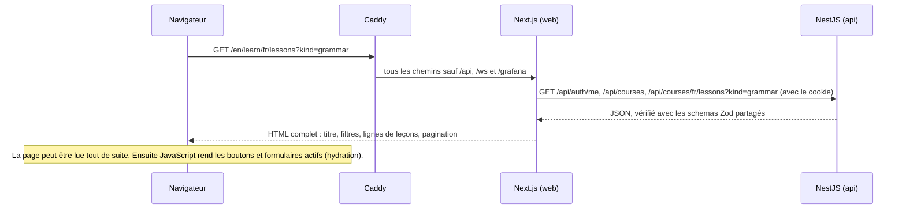

# Server-Side Rendering (SSR) (Minor, 1 point)

**Type :** Minor. **Points :** 1. **Statut :** terminé.

Le serveur construit chaque page avant de l'envoyer. Le navigateur reçoit une page HTML complète avec le
texte, les leçons et les données de l'utilisateur déjà dedans, pas une page vide qui se remplit toute seule
plus tard. Tu peux le voir avec JavaScript désactivé : les pages montrent toujours leur contenu.

## Ce que demande le sujet

Le module est une ligne du tableau Web de [../subject/summary.md](../subject/summary.md) :

> | Minor | Server-Side Rendering (SSR) |

Le PDF ([../subject/ft_transcendence.pdf](../../subject/ft_transcendence.pdf), chapitre IV, Web)
le formule ainsi :

> Minor: Server-Side Rendering (SSR) for improved performance and SEO.

Aucune règle de dépendance du sujet ne s'applique à ce module. Il repose sur le module
framework ([framework.md](framework.md)) : Next.js est l'outil qui fait le rendu sur le serveur.

## Comment on y répond

| Ce que demande le sujet         | Ce qu'on a construit                                                                                                                                                                                                                                                                                                                                                                                                                                                                                              | Où                                                                                                                                                                                                                                                                                                                      |
| ------------------------------- | ----------------------------------------------------------------------------------------------------------------------------------------------------------------------------------------------------------------------------------------------------------------------------------------------------------------------------------------------------------------------------------------------------------------------------------------------------------------------------------------------------------------- | ----------------------------------------------------------------------------------------------------------------------------------------------------------------------------------------------------------------------------------------------------------------------------------------------------------------------- |
| Rendu côté serveur              | Les 22 pages sont des server components Next.js : aucun `page.tsx` ne commence par `'use client'`. Les pages qui montrent des données les chargent sur le serveur, depuis NestJS, pendant leur rendu : la session, les cours, les leçons du jour, les amis, la liste des leçons. Le HTML qui sort du serveur contient déjà ces données. 16 des pages mettent `dynamic = 'force-dynamic'`, donc elles sont rendues de nouveau à chaque requête, pour l'utilisateur qui demande.                                    | [`apps/web/app/[locale]/`](../../../apps/web/app), [`lib/session.ts`](../../../apps/web/lib/session.ts), [`lib/api.ts`](../../../apps/web/lib/api.ts), [`lib/lessons.ts`](../../../apps/web/lib/lessons.ts), [`lib/friends.ts`](../../../apps/web/lib/friends.ts), [`lib/courses.ts`](../../../apps/web/lib/courses.ts) |
| Pour de meilleures performances | Le premier HTML a déjà le contenu, donc le navigateur peut dessiner la page avant que du JavaScript tourne. Il n'a pas besoin d'appeler l'API lui-même avant de pouvoir montrer les données. Le serveur parle à NestJS par le réseau Docker interne. Seules les parties qui réagissent aux clics sont des client components, dans leurs propres fichiers. On n'a pas de mesure de performance à montrer ; voir [Limites et choix](#limites-et-choix).                                                             | [`lib/api.ts`](../../../apps/web/lib/api.ts) (`API_INTERNAL_URL`), [`lessons/page.tsx`](<../../../apps/web/app/[locale]/(dashboard)/learn/[lang]/lessons/page.tsx>)                                                                                                                                                     |
| Pour un meilleur SEO            | Chaque page a un `<title>` fait sur le serveur, dans la langue de la page. 18 pages définissent le leur avec `generateMetadata` ; les autres reçoivent le nom du site depuis le layout racine. Le layout racine définit aussi la `description` du site et `<html lang>`. Les pages publiques (accueil, connexion, inscription, privacy, terms) sont du HTML complet pour un moteur de recherche. [`robots.txt`](../../../apps/web/public/robots.txt) autorise le site et laisse `/healthz` et `/grafana` de côté. | [`[locale]/layout.tsx`](../../../apps/web/app/[locale]/layout.tsx), [`privacy/page.tsx`](<../../../apps/web/app/[locale]/(main)/privacy/page.tsx>), [`apps/web/public/robots.txt`](../../../apps/web/public/robots.txt)                                                                                                 |

## Comment ça marche

1. **La requête arrive chez Next.js.** Caddy envoie chaque chemin sauf `/api`, `/ws` et `/grafana` au
   container `web` ([`infra/caddy/Caddyfile`](../../../infra/caddy/Caddyfile)).
   [`proxy.ts`](../../../apps/web/proxy.ts) ajoute la langue à l'URL si elle manque.
2. **Le layout et la page tournent sur le serveur.** Ce sont des server components `async`. Le
   layout racine [`[locale]/layout.tsx`](../../../apps/web/app/[locale]/layout.tsx) vérifie la
   langue et charge le catalogue de textes. Une page demande ensuite ses données. Par exemple, la
   page de toutes les leçons
   [`lessons/page.tsx`](<../../../apps/web/app/[locale]/(dashboard)/learn/[lang]/lessons/page.tsx>)
   appelle `requireCourses()` puis `loadLessonPage()`.
3. **Les données viennent de NestJS.** [`lib/api.ts`](../../../apps/web/lib/api.ts) fait chaque appel
   du serveur Next.js vers NestJS. Il appelle `http://api:3001` (ou `API_INTERNAL_URL`),
   transmet le cookie du navigateur et l'adresse du visiteur, met `cache: 'no-store'`, et
   vérifie la réponse avec un schema Zod. Un 401 envoie le visiteur vers `/login`. Tout autre échec
   lève une erreur, donc la page d'erreur s'affiche et personne n'est déconnecté par un redémarrage.
4. **Une seule lecture de la session par rendu.** `loadSession()` dans
   [`lib/session.ts`](../../../apps/web/lib/session.ts) est enveloppé dans le `cache` de React, donc le
   layout et la page partagent un seul appel à `/api/auth/me`. `currentUser()` est pour les pages que tout le monde
   peut voir ; `requireUser()` est pour les pages qui ont besoin d'un utilisateur connecté.
5. **Le titre est fait sur le serveur aussi.** `generateMetadata` lit le bon catalogue et
   renvoie le titre. Le layout racine ajoute `| ft_transcendence` avec un modèle, donc l'onglet de
   la page de toutes les leçons dit "All lessons | ft_transcendence". Certains titres viennent des données :
   une page de profil a pour titre le display name de la personne
   ([`users/[id]/page.tsx`](<../../../apps/web/app/[locale]/(main)/users/[id]/page.tsx>)), une page de
   leçon le titre de la leçon.
6. **Jamais de cache entre utilisateurs.** Une page qui lit la session met
   `export const dynamic = 'force-dynamic'`, avec un commentaire qui dit pourquoi, par exemple "Renders one
   specific person's friends, so it must never be prerendered or cached"
   ([`friends/page.tsx`](<../../../apps/web/app/[locale]/(main)/friends/page.tsx>)). Les six pages
   qui ne l'ont pas sont les pages de connexion, d'inscription, privacy et terms, la page not-found qui attrape tout et
   l'ancienne redirection `/dashboard`.
7. **JavaScript arrive en dernier.** Le navigateur affiche le HTML, puis React fait l'hydration (il attache les
   gestionnaires de clics). Les parties interactives sont de petits client components à côté de la page : le
   formulaire de filtres en direct, les sélecteurs de niveau et d'objectif, le lecteur de leçon, le chat. Quand les données du
   serveur changent à cause d'un autre utilisateur, un client component appelle `router.refresh()`, et le
   serveur refait le rendu de la page ([`refresh-on.tsx`](../../../apps/web/components/refresh-on.tsx)).

### Les pages construites pour marcher sans JavaScript

Certaines pages ont été construites pour que le HTML du serveur suffise tout seul :

- **La page de toutes les leçons** est un simple `<form method="get">`. Les filtres, le tri et les pages sont des
  paramètres d'URL, les liens de pages sont de vrais liens, et un bouton **Apply** s'affiche dans `<noscript>`.
  Voir [advanced-search.md](advanced-search.md).
- **La page du cours** (`/en/learn/fr`) montre les leçons du jour, la barre de progression, le rang et
  le défi du jour dans le HTML.
- **La page de leçon et ses résultats** s'affichent sans JavaScript. La page de résultats a une partie
  par ancre (`#part-1`, `#part-2`...), et les liens entre les parties marchent sans JavaScript.
- **La page des succès** liste les 16 succès et les règles.

## Où est le code

| Chemin                                                                                                                                          | Ce qu'il fait                                                                                                 |
| ----------------------------------------------------------------------------------------------------------------------------------------------- | ------------------------------------------------------------------------------------------------------------- |
| [`apps/web/app/[locale]/`](../../../apps/web/app)                                                                                               | Les 22 pages, en server components                                                                            |
| [`apps/web/app/[locale]/layout.tsx`](../../../apps/web/app/[locale]/layout.tsx)                                                                 | Layout racine : `<html lang>`, le modèle de titre et la description, le catalogue de textes                   |
| [`apps/web/lib/api.ts`](../../../apps/web/lib/api.ts)                                                                                           | Les appels côté serveur vers NestJS : `apiGet`, `apiFind`, transmission du cookie et de l'adresse, `no-store` |
| [`apps/web/lib/session.ts`](../../../apps/web/lib/session.ts)                                                                                   | `loadSession` (en cache pour un rendu), `currentUser`, `requireUser`                                          |
| [`apps/web/lib/courses.ts`](../../../apps/web/lib/courses.ts)                                                                                   | `requireCourses`, `findCourse` : les cours dont une page a besoin                                             |
| [`apps/web/lib/lessons.ts`](../../../apps/web/lib/lessons.ts)                                                                                   | `loadToday` et `loadLessonPage`, lus sur le serveur                                                           |
| [`apps/web/lib/friends.ts`](../../../apps/web/lib/friends.ts)                                                                                   | `requireFriends`, `searchUsers`, `loadProfile`, lus sur le serveur                                            |
| [`apps/web/app/[locale]/(dashboard)/learn/[lang]/page.tsx`](<../../../apps/web/app/[locale]/(dashboard)/learn/[lang]/page.tsx>)                 | La page du cours : les cours et les leçons du jour chargés sur le serveur                                     |
| [`apps/web/app/[locale]/(dashboard)/learn/[lang]/lessons/page.tsx`](<../../../apps/web/app/[locale]/(dashboard)/learn/[lang]/lessons/page.tsx>) | La page de toutes les leçons : lit sa recherche depuis l'URL sur le serveur                                   |
| [`apps/web/components/refresh-on.tsx`](../../../apps/web/components/refresh-on.tsx)                                                             | Demande au serveur de refaire le rendu de la page quand un événement en direct arrive                         |
| [`apps/web/public/robots.txt`](../../../apps/web/public/robots.txt)                                                                             | Dit aux moteurs de recherche quoi indexer                                                                     |

## Comment le montrer à la soutenance

1. Lance l'app avec `make run` (ou `make`) et ouvre `https://localhost`.
2. **La page publique dans le HTML.** Ouvre `view-source:https://localhost/en` (ou clic droit,
   **View Page Source**). Cherche "Learn a language with a tutor that adapts to you!" : le
   titre est dans le HTML envoyé par le serveur. Montre aussi `<html lang="en"`, le `<title>` et la
   `<meta name="description"`.
3. Crée un compte sur `/en/signup` : remplis **Email**, **Display name**, **Password** et
   **Confirm password**, puis clique sur **Create account**. Tu arrives sur `/en/onboarding`.
4. Sous "Language to learn", choisis **Français**, choisis un "Daily goal", et clique sur **Next**. Clique sur
   **I already know my level**, choisis **A0**, et clique sur **Start learning**. Tu arrives sur la
   page du cours, `/en/learn/fr`. L'onglet dit "French course | ft_transcendence".
5. **Une page connectée dans le HTML.** Ouvre `view-source:https://localhost/en/learn/fr/lessons`.
   Cherche le titre d'une ligne de leçon : il est là, avec le lien vers sa page de leçon. Le
   serveur a fait le rendu de cette liste pour cet utilisateur.
6. **Désactive JavaScript.** Dans Chrome : ouvre les outils de développement, appuie sur Ctrl+Shift+P (Cmd+Shift+P
   sur Mac), tape "Disable JavaScript" et appuie sur Entrée. Garde les outils de développement ouverts : le
   réglage ne dure que tant qu'ils sont ouverts. (Firefox : `about:config`, mets
   `javascript.enabled` à `false`.)
7. Recharge `/en/learn/fr`. Les leçons du jour, la progression, la ligne du rang et "Today's
   challenge" sont toujours là. Clique sur **Achievements and rules** : la page des succès s'affiche.
8. Va sur `/en/learn/fr/lessons`. Coche **Grammar**, mets **Direction** sur **Descending**, et
   clique sur **Apply**. L'URL a maintenant `kind=grammar` et `dir=desc`, et la liste suit. Clique sur
   **Clear filters**, puis sur **2** dans la pagination sous la liste : la page 2 s'ouvre. Tout ça a tourné sur le
   serveur.
9. Ouvre une leçon de la liste : la page de leçon montre son titre. Ce qui a besoin de JavaScript est
   dit plus bas.
10. Réactive JavaScript (la même commande, "Enable JavaScript").

## Les tests qui le prouvent

| Test                                                                                    | Ce qu'il vérifie                                                                                                                                                                                                                        |
| --------------------------------------------------------------------------------------- | --------------------------------------------------------------------------------------------------------------------------------------------------------------------------------------------------------------------------------------- |
| [`e2e/tests/today.spec.ts`](../../../e2e/tests/today.spec.ts)                           | "the page renders the proposal without JavaScript" : le HTML brut de la page du cours contient la barre de progression et un lien vers chaque leçon du jour                                                                             |
| [`e2e/tests/lessons.spec.ts`](../../../e2e/tests/lessons.spec.ts)                       | Avec `javaScriptEnabled: false` : "without JavaScript, the form still filters and the pager still pages", et "without JavaScript, the phone sheet applies its boxes". Aussi "a direct load renders exactly the view in its URL"         |
| [`e2e/tests/roadmap.spec.ts`](../../../e2e/tests/roadmap.spec.ts)                       | "the all lessons page: the Passed filter, page 2 by URL, and no JavaScript" : la liste s'affiche sans JavaScript, avec la leçon réussie marquée **Passed**. Un autre test lit le HTML brut d'une leçon de lecture après un rechargement |
| [`e2e/tests/lesson.spec.ts`](../../../e2e/tests/lesson.spec.ts)                         | "plays from the lesson page to the results, which stay" : sans JavaScript, la page de leçon montre son titre et **See your results**, et la page de résultats montre "Your results" et chaque réponse                                   |
| [`e2e/tests/lesson-regressions.spec.ts`](../../../e2e/tests/lesson-regressions.spec.ts) | "results fragments select one part across navigation and without JavaScript" : les liens `#part-N` de la page de résultats, avec JavaScript désactivé                                                                                   |
| [`e2e/tests/gamification.spec.ts`](../../../e2e/tests/gamification.spec.ts)             | "both pages render without JavaScript" : la page du cours montre le rang et le défi, et la page des succès montre 16 succès et "How it works"                                                                                           |
| [`e2e/tests/legal.spec.ts`](../../../e2e/tests/legal.spec.ts)                           | Les pages privacy et terms répondent 200 avec `text/html` et un vrai document dans le HTML brut                                                                                                                                         |
| [`e2e/tests/i18n.spec.ts`](../../../e2e/tests/i18n.spec.ts)                             | "the tab title is translated", et chaque locale met `lang` sur `<html>`                                                                                                                                                                 |
| [`apps/web/lib/session.test.ts`](../../../apps/web/lib/session.test.ts)                 | La lecture de la session côté serveur : cookies et adresse transmis, redirection vers `/login` sur un 401, erreur levée (pas de redirection) quand l'API est en panne                                                                   |
| [`apps/web/lib/api.test.ts`](../../../apps/web/lib/api.test.ts)                         | Le client API côté serveur utilisé par chaque rendu de page                                                                                                                                                                             |

Les tests Playwright tournent dans [`.github/workflows/e2e.yml`](../../../.github/workflows/e2e.yml),
sur le build de production.

## Limites et choix

- **Toutes les fonctionnalités ne marchent pas sans JavaScript.** L'inscription, la connexion, démarrer et jouer
  une leçon, le test de placement et le chat sont des client components : ils envoient leurs requêtes
  depuis le navigateur (gestionnaires `onSubmit` ou `onClick`), et le chat a besoin d'un WebSocket. Les pages
  autour viennent quand même du serveur, avec leur contenu et leur titre.
- **Pas de cache entre les requêtes.** Chaque page qui lit la session est rendue à chaque
  requête (`force-dynamic`), et chaque appel à l'API utilise `cache: 'no-store'`. Ça garde les données d'un utilisateur
  hors de la page d'un autre. Le prix est un rendu, et quelques appels à l'API, par affichage de page.
- **Pas de chiffres de performance.** On n'a pas mesuré les temps de chargement face à une version uniquement côté client. Ce
  qu'on affirme est ce que le sujet dit du SSR : le premier HTML contient déjà le contenu.
- **Le SEO est basique.** Des titres, une description, `lang` et `robots.txt`. Il n'y a pas de sitemap, pas de
  liens `hreflang` entre les trois langues, et pas de balises Open Graph. La plupart des pages demandent un
  compte, donc elles ne sont de toute façon pas faites pour les moteurs de recherche.
- **Le HTML transporte aussi le catalogue de textes.** Le layout racine passe tout le catalogue de
  la langue de la page aux client components. C'est pour ça que les tests e2e vérifient ce qui est affiché
  avec des locators par rôle, et pas en cherchant une phrase dans le HTML brut (le commentaire dans
  [`gamification.spec.ts`](../../../e2e/tests/gamification.spec.ts) le dit).

## Qui l'a construit

| Membre  | GitHub                                                                | Ce qu'il a construit                                                                                                                                                                      | Issues et PRs                                                                                                                                                                                                                                        |
| ------- | --------------------------------------------------------------------- | ----------------------------------------------------------------------------------------------------------------------------------------------------------------------------------------- | ---------------------------------------------------------------------------------------------------------------------------------------------------------------------------------------------------------------------------------------------------- |
| Victor  | [VictorBro](https://github.com/VictorBro)                             | La base Next.js avec les server components, la lecture de la session côté serveur (`lib/session.ts`), la page du cours, et les pages d'amis chargées sur le serveur.                      | [#2](https://github.com/VictorBro/ft_transcendence/pull/2), [#5](https://github.com/VictorBro/ft_transcendence/pull/5), [#64](https://github.com/VictorBro/ft_transcendence/pull/64), [#189](https://github.com/VictorBro/ft_transcendence/pull/189) |
| Bastian | [bastian-schnitzler](https://github.com/bastian-schnitzler)           | `apiGet`, le client API générique côté serveur. La page de l'objectif quotidien et son test view-source. La page de leçon, le lecteur et les résultats, avec leurs tests sans JavaScript. | [#57](https://github.com/VictorBro/ft_transcendence/pull/57), [#186](https://github.com/VictorBro/ft_transcendence/pull/186), [#192](https://github.com/VictorBro/ft_transcendence/pull/192)                                                         |
| Luca    | [luca-mattei](https://github.com/luca-mattei)                         | Le layout racine sous `[locale]` avec les titres traduits. La page de toutes les leçons sous forme de simple formulaire GET qui marche sans JavaScript, avec ses tests.                   | [#26](https://github.com/VictorBro/ft_transcendence/pull/26), [#87](https://github.com/VictorBro/ft_transcendence/issues/87), [#196](https://github.com/VictorBro/ft_transcendence/pull/196)                                                         |
| Anaïs   | [avarrett](https://github.com/avarrett) (commits en tant que ninisse) | Les pages de gamification (rang, défi, succès) en server components, et leur test sans JavaScript.                                                                                        | [#199](https://github.com/VictorBro/ft_transcendence/pull/199)                                                                                                                                                                                       |
| Endrit  | [VYAntares](https://github.com/VYAntares)                             | Les tests e2e de la feuille de route, dont la liste de toutes les leçons sans JavaScript et la vérification du HTML brut d'une leçon de lecture.                                          | [#202](https://github.com/VictorBro/ft_transcendence/pull/202)                                                                                                                                                                                       |
