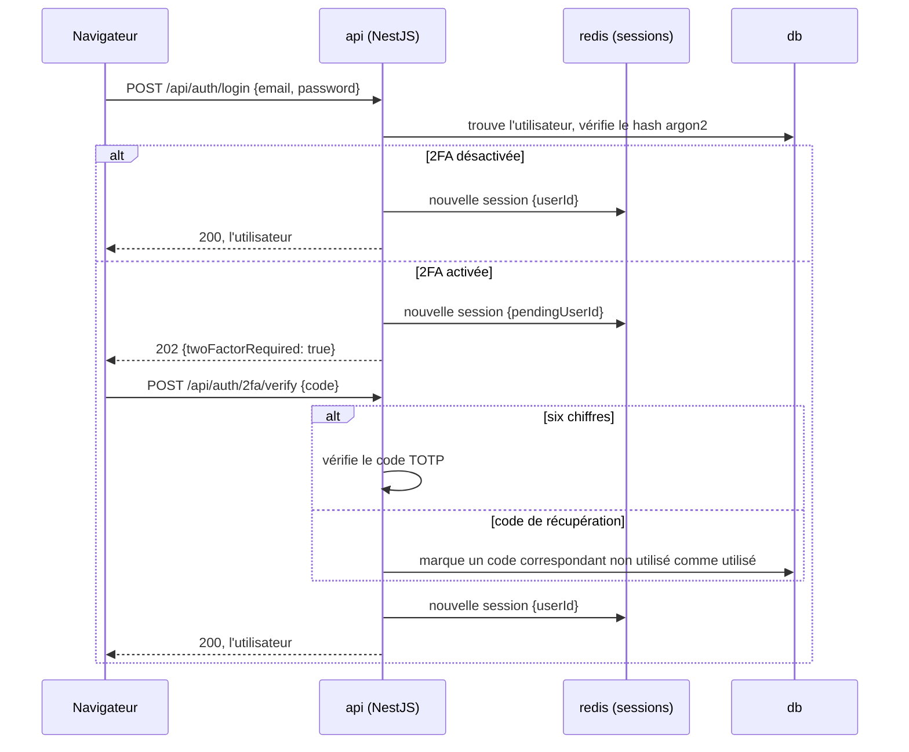

# 2FA complète (Minor, 1 point)

**Type :** Minor. **Points :** 1. **Statut :** terminé.

L'authentification à deux facteurs (2FA) veut dire qu'une personne a besoin de deux choses pour se connecter : son mot de passe, et
un code à six chiffres venant d'une app d'authentification sur son téléphone. Le code change toutes les 30 secondes.
Donc un mot de passe volé ne suffit pas, à lui seul, pour entrer dans le compte. Si le téléphone est perdu, la
personne peut se connecter à la place avec un des dix codes de récupération à usage unique.

## Ce que demande le sujet

Le module est une ligne du tableau User Management modules de
[../subject/summary.md](../subject/summary.md) :

> | Minor | Complete 2FA |

Le PDF ([../../docs/subject/ft_transcendence.pdf](../../docs/subject/ft_transcendence.pdf), chapitre IV, User
Management) le formule ainsi :

> Minor: Implement a complete 2FA (Two-Factor Authentication) system for the users.

La partie obligatoire (chapitre III.3, Technical requirements) dit que la 2FA n'y est pas demandée,
et qu'elle peut venir d'un module :

> - Your application must have a basic user management system. Users must be able to sign up
>   and log in securely:
>   - At minimum: email and password authentication with proper security (hashed passwords,
>     salted, etc.).
>   - Additional authentication methods (OAuth, 2FA, etc.) can be implemented via modules.

Le sujet ne donne pas plus de détails. On lit "complete" comme toute la vie d'un second facteur : un
utilisateur peut l'activer, il est demandé à chaque connexion, il y a un moyen d'entrer quand le téléphone est perdu,
et l'utilisateur peut le désactiver de nouveau. Les lignes ci-dessous suivent cette lecture. Une règle de la
partie obligatoire s'applique aussi à chaque formulaire, donc elle a une ligne aussi :

> - All forms and user inputs must be properly validated in both the frontend and backend.

## Comment on y répond

| Ce que demande le sujet                                                       | Ce qu'on a construit                                                                                                                                                                                                                                                                                                                                                                                                                                                                                                                                                                                                                                      | Où                                                                                                                                                                                                                                                                |
| ----------------------------------------------------------------------------- | --------------------------------------------------------------------------------------------------------------------------------------------------------------------------------------------------------------------------------------------------------------------------------------------------------------------------------------------------------------------------------------------------------------------------------------------------------------------------------------------------------------------------------------------------------------------------------------------------------------------------------------------------------- | ----------------------------------------------------------------------------------------------------------------------------------------------------------------------------------------------------------------------------------------------------------------- |
| Un second facteur                                                             | TOTP (time-based one-time password, mot de passe à usage unique basé sur le temps, le standard qu'utilisent Google Authenticator et les apps du même genre) : SHA-1, 6 chiffres, un nouveau code toutes les 30 secondes. Le serveur accepte le code de l'intervalle de 30 secondes actuel et d'un intervalle de chaque côté, pour les horloges un peu décalées. Construit avec la bibliothèque `otpauth`.                                                                                                                                                                                                                                                 | [two-factor.service.ts](../../apps/api/src/auth/two-factor.service.ts)                                                                                                                                                                                            |
| L'activer                                                                     | Deux étapes. `POST /api/auth/2fa/setup` stocke un nouveau secret et le renvoie avec un QR code. Le facteur n'est pas encore actif. `POST /api/auth/2fa/enable` ne l'active que quand l'utilisateur envoie un code valide, ce qui prouve que l'app a été bien configurée. Donc une configuration abandonnée, ou un secret mal tapé, ne peut bloquer personne. Tant que la 2FA est activée, les deux routes répondent `409` avec `twoFactor.alreadyEnabled` : pour changer d'app, l'utilisateur désactive d'abord la 2FA, avec le mot de passe ([#219](https://github.com/VictorBro/ft_transcendence/pull/219)).                                                                                                                                                                                                                                                                                              | [two-factor.service.ts](../../apps/api/src/auth/two-factor.service.ts) (`beginEnrolment`, `confirmEnrolment`), [auth.controller.ts](../../apps/api/src/auth/auth.controller.ts)                                                                                   |
| Un QR code à scanner                                                          | Le serveur dessine le QR code (avec `qrcode-generator`) et l'envoie comme image dans le JSON (une URL `data:`). La page montre aussi le secret en texte, pour les apps qui ne savent pas scanner.                                                                                                                                                                                                                                                                                                                                                                                                                                                         | [two-factor.service.ts](../../apps/api/src/auth/two-factor.service.ts) (`qrDataUrl`), [two-factor-panel.tsx](../../apps/web/app/%5Blocale%5D/%28main%29/settings/2fa/two-factor-panel.tsx)                                                                        |
| Demandé à la connexion                                                        | Quand la 2FA est activée, un bon mot de passe ne connecte pas l'utilisateur. `POST /api/auth/login` répond `202` avec `{ twoFactorRequired: true }` et met l'id de l'utilisateur sous une clé de session séparée, `pendingUserId`. Le guard qui protège chaque route ne lit que `userId`, donc une connexion à moitié faite n'ouvre rien. `POST /api/auth/2fa/verify` vérifie le code et seulement ensuite démarre la vraie session.                                                                                                                                                                                                                      | [auth.controller.ts](../../apps/api/src/auth/auth.controller.ts), [session.d.ts](../../apps/api/src/auth/session.d.ts), [auth.guard.ts](../../apps/api/src/auth/auth.guard.ts), [login-form.tsx](../../apps/web/app/%5Blocale%5D/%28main%29/login/login-form.tsx) |
| Un moyen d'entrer quand le téléphone est perdu                                | Dix codes de récupération, créés quand la 2FA est activée et montrés une seule fois. Chacun a 20 caractères en quatre groupes de cinq (`xxxxx-xxxxx-xxxxx-xxxxx`), pris dans un alphabet sans caractères qui se ressemblent (pas de `i`, `l`, `o`, `0`, `1`). L'étape de connexion accepte soit un code à six chiffres, soit un code de récupération. Chaque code de récupération marche une fois.                                                                                                                                                                                                                                                        | [two-factor.service.ts](../../apps/api/src/auth/two-factor.service.ts) (`issueRecoveryCodes`, `consumeRecoveryCode`), [two-factor.ts](../../packages/shared/src/schemas/two-factor.ts)                                                                            |
| Des codes de récupération gardés en sécurité                                  | La base de données ne garde qu'un hash SHA-256 de chaque code, dans la table `RecoveryCode`, jamais le code lui-même. Un code est marqué comme utilisé dans la même instruction SQL qui le trouve, donc deux connexions au même moment ne peuvent pas utiliser toutes les deux le même code.                                                                                                                                                                                                                                                                                                                                                              | [schema.prisma](../../apps/api/prisma/schema.prisma) (`RecoveryCode`), [migration](../../apps/api/prisma/migrations/20260809004816_two_factor/migration.sql)                                                                                                      |
| La désactiver                                                                 | `DELETE /api/auth/2fa` redemande le mot de passe, pas seulement une session valide, pour qu'un navigateur resté ouvert ne suffise pas. Il efface le secret et supprime les codes de récupération dans une seule transaction. C'est le seul moyen de désactiver la 2FA : la configuration et l'activation sont refusées tant que la 2FA est activée.                                                                                                                                                                                                                                                                             | [auth.controller.ts](../../apps/api/src/auth/auth.controller.ts) (`disableTwoFactor`), [two-factor.service.ts](../../apps/api/src/auth/two-factor.service.ts) (`disable`)                                                                                         |
| Les codes ne peuvent pas être devinés vite                                    | Chaque route qui vérifie un code ou un mot de passe (`login`, `2fa/verify`, `2fa/enable`, `DELETE 2fa`) autorise 5 essais par minute par adresse IP (`LOGIN_LIMIT_PER_MINUTE`). Ensuite l'API répond `429`.                                                                                                                                                                                                                                                                                                                                                                                                                                               | [auth.controller.ts](../../apps/api/src/auth/auth.controller.ts), [rate-limits.ts](../../apps/api/src/throttler/rate-limits.ts), [../operations/deployment.md](../operations/deployment.md)                                                                       |
| (Partie obligatoire) Formulaires validés dans le navigateur et sur le serveur | Un seul ensemble de schemas Zod dans `@ft/shared` vérifie les champs de code des deux côtés : `TotpCodeSchema` (six chiffres), `RecoveryCodeSchema` (tirets et espaces enlevés, puis 20 lettres ou chiffres) et `SecondFactorSchema` (l'un ou l'autre). Le formulaire "désactiver" utilise `DisableTwoFactorSchema` (le mot de passe, de 1 à 128 caractères). L'API les applique avec `nestjs-zod`, et le formulaire de connexion, le formulaire de configuration et le formulaire de désactivation les appliquent avant d'envoyer quoi que ce soit ([#218](https://github.com/VictorBro/ft_transcendence/pull/218) pour le formulaire de désactivation). | [two-factor.ts](../../packages/shared/src/schemas/two-factor.ts), [auth.dto.ts](../../apps/api/src/auth/auth.dto.ts), [two-factor-panel.tsx](../../apps/web/app/%5Blocale%5D/%28main%29/settings/2fa/two-factor-panel.tsx)                                        |

## Comment ça marche

### Les données

Deux colonnes sur `User` et une table ([schema.prisma](../../apps/api/prisma/schema.prisma)) :

| Champ                   | Sens                                                                                                  |
| ----------------------- | ----------------------------------------------------------------------------------------------------- |
| `User.totpSecret`       | Le secret TOTP, en base32. Défini quand la configuration commence.                                    |
| `User.totpEnabledAt`    | Quand la 2FA a été activée. `null` veut dire que la 2FA est désactivée, même si un secret est stocké. |
| `RecoveryCode.codeHash` | Le hash SHA-256 d'un code de récupération. Unique.                                                    |
| `RecoveryCode.usedAt`   | Quand le code a été utilisé. `null` veut dire qu'il peut encore servir.                               |

Les lignes `RecoveryCode` sont supprimées avec leur utilisateur (`onDelete: Cascade`). La route `GET /api/auth/2fa`
résume tout ça sous la forme `{ enabled, enrolmentPending, recoveryCodesRemaining }`.

### L'activer

1. L'utilisateur ouvre `/settings/2fa` et clique sur **Set up**.
2. `POST /api/auth/2fa/setup` fabrique un nouveau secret de 20 octets et l'enregistre dans `totpSecret`, mais
   seulement si la 2FA est désactivée : la condition `totpEnabledAt: null` est dans la même écriture. Si la 2FA
   est activée, il répond `409` et n'envoie aucun secret. Sinon il renvoie le secret, le lien `otpauth://` et
   l'image du QR. Le libellé du QR est l'email de l'utilisateur, l'émetteur est `ft_transcendence`.
3. L'utilisateur scanne le QR code avec son app et tape le code qu'elle affiche.
4. `POST /api/auth/2fa/enable` vérifie le code avec le secret stocké. Il répond `409` si la 2FA est
   déjà activée. Si le code est bon, il remplit `totpEnabledAt`, mais seulement si le secret est encore
   celui qu'il a vérifié et que la 2FA est encore désactivée. Si une autre requête a changé ça entre-temps,
   il n'active rien (`409` ou `400 twoFactor.setupFirst`). Ensuite il supprime les anciens codes de
   récupération, en crée dix nouveaux, et les renvoie en clair. C'est la seule fois où le serveur les envoie.
5. La session reçoit un nouvel id, et les connexions WebSocket de l'ancien id sont fermées. L'utilisateur
   reste connecté.

### Se connecter

- Le formulaire de connexion affiche un deuxième formulaire avec un champ **Authentication code** quand il reçoit le
  `202`. Le formulaire a sa propre `key` React, donc le navigateur ne réutilise pas le champ du mot de passe pour le
  champ du code ([login-form.tsx](../../apps/web/app/%5Blocale%5D/%28main%29/login/login-form.tsx)).
- `verifySecondFactor` essaie d'abord la saisie comme code TOTP si elle fait six chiffres. Sinon il
  enlève les espaces et les tirets, la met en minuscules, et cherche un code de récupération non utilisé avec le
  même hash.
- Un mauvais code répond `401` avec le code d'erreur `twoFactor.invalidCode`. Un appel à
  `/2fa/verify` sans connexion en attente répond `401` avec `auth.passwordFirst`. L'app web transforme
  ces codes en une phrase dans la langue de la page (anglais, français ou allemand).
- Chaque étape reçoit un id de session tout neuf (`session.regenerate`). Ça empêche la fixation de session, où
  un attaquant place un id de session avant la connexion et l'utilise après. Voir
  [../architecture/overview.md](../architecture/overview.md), section 3, pour la même connexion
  suivie à travers Caddy et Redis.

La page de réglages ne montre **Set up** que quand elle sait que la 2FA est désactivée. Pendant que
`GET /api/auth/2fa` charge, elle affiche "Checking two factor authentication…". Si cet appel échoue, elle
affiche une erreur et **Try again**, jamais **Set up**. Si la configuration ou l'activation répond `409` (la
2FA a été activée dans un autre onglet), la page ferme le formulaire de configuration et recharge l'état.

### La désactiver

L'utilisateur tape son mot de passe et clique sur **Turn off**. `DELETE /api/auth/2fa` vérifie le
mot de passe avec argon2, puis met `totpSecret` et `totpEnabledAt` à `null` et supprime tous les
codes de récupération dans une seule transaction. La réactiver commence toujours avec un nouveau secret.

### Monitoring

L'API compte les réponses de `POST /api/auth/2fa/verify` avec le statut `401`, et le dashboard Grafana API
a un panneau "2FA failures". L'alerte `SignInFailuresSpike` compte ensemble les connexions et
les vérifications 2FA ratées ou freinées (`401` ou `429`). Voir [../operations/monitoring.md](../operations/monitoring.md) et
[metrics.ts](../../apps/api/src/metrics/metrics.ts).

## Où est le code

| Chemin                                                                                                                                                                        | Ce qu'il fait                                                                                                                           |
| ----------------------------------------------------------------------------------------------------------------------------------------------------------------------------- | --------------------------------------------------------------------------------------------------------------------------------------- |
| [apps/api/src/auth/two-factor.service.ts](../../apps/api/src/auth/two-factor.service.ts)                                                                                      | Secret TOTP, QR code, vérification du code, codes de récupération, activation et désactivation                                          |
| [apps/api/src/auth/auth.controller.ts](../../apps/api/src/auth/auth.controller.ts)                                                                                            | Les routes : `login` (la branche `202`), `2fa/verify`, `GET 2fa`, `2fa/setup`, `2fa/enable`, `DELETE 2fa` ; les nouveaux ids de session |
| [apps/api/src/auth/auth.service.ts](../../apps/api/src/auth/auth.service.ts)                                                                                                  | `validateCredentials` dit si la 2FA est activée ; `verifyPassword` pour la désactiver                                                   |
| [apps/api/src/auth/session.d.ts](../../apps/api/src/auth/session.d.ts)                                                                                                        | Les deux clés de session, `userId` et `pendingUserId`                                                                                   |
| [apps/api/src/auth/auth.guard.ts](../../apps/api/src/auth/auth.guard.ts)                                                                                                      | Le guard global ; il ne lit que `userId`                                                                                                |
| [apps/api/src/auth/auth.dto.ts](../../apps/api/src/auth/auth.dto.ts)                                                                                                          | Enveloppe les schemas partagés pour que NestJS valide les bodies et que Swagger les documente                                           |
| [apps/api/src/throttler/rate-limits.ts](../../apps/api/src/throttler/rate-limits.ts), [throttle-by-ip.decorator.ts](../../apps/api/src/throttler/throttle-by-ip.decorator.ts) | La limite de 5 par minute par adresse IP                                                                                                |
| [apps/api/prisma/schema.prisma](../../apps/api/prisma/schema.prisma)                                                                                                          | `User.totpSecret`, `User.totpEnabledAt`, le model `RecoveryCode`                                                                        |
| [apps/api/prisma/migrations/20260809004816_two_factor/](../../apps/api/prisma/migrations/20260809004816_two_factor/migration.sql)                                             | La migration qui les a ajoutés                                                                                                          |
| [packages/shared/src/schemas/two-factor.ts](../../packages/shared/src/schemas/two-factor.ts)                                                                                  | Les schemas Zod des codes et des réponses, partagés par le navigateur et l'API                                                          |
| [apps/web/app/[locale]/(main)/settings/2fa/page.tsx](../../apps/web/app/%5Blocale%5D/%28main%29/settings/2fa/page.tsx)                                                        | La page de réglages ; envoie un visiteur déconnecté vers `/login`                                                                       |
| [apps/web/app/[locale]/(main)/settings/2fa/two-factor-panel.tsx](../../apps/web/app/%5Blocale%5D/%28main%29/settings/2fa/two-factor-panel.tsx)                                | Configurer, scanner, confirmer, les codes de récupération, désactiver                                                                   |
| [apps/web/app/[locale]/(main)/login/login-form.tsx](../../apps/web/app/%5Blocale%5D/%28main%29/login/login-form.tsx)                                                          | L'étape du mot de passe et l'étape du code                                                                                              |
| [apps/web/app/[locale]/(main)/profile/page.tsx](../../apps/web/app/%5Blocale%5D/%28main%29/profile/page.tsx)                                                                  | La section **Security**, avec le lien vers la page de réglages                                                                          |
| [apps/web/lib/auth-client.ts](../../apps/web/lib/auth-client.ts)                                                                                                              | Les appels du navigateur aux routes 2FA                                                                                                 |
| [apps/web/messages/en.json](../../apps/web/messages/en.json)                                                                                                                  | Les textes (`TwoFactorPage`, `TwoFactorPanel`, `LoginForm`, `Errors.twoFactor`), aussi dans `fr.json` et `de.json`                      |

## Comment le montrer à la soutenance

Tu as besoin d'une app d'authentification sur un téléphone (n'importe quelle app qui scanne les QR codes `otpauth://`). Les routes
de connexion autorisent 5 essais par minute par adresse IP, donc fais les étapes calmement : si la page dit
"Too many attempts. Try again in a minute", attends une minute.

1. Lance l'app avec `make run` (ou `make all`) et ouvre l'adresse qu'elle affiche,
   `https://localhost`.
2. Crée un nouveau compte sur `/en/signup` : remplis **Email**, **Display name**, **Password** et
   **Confirm password**, puis clique sur **Create account**. Tu arrives sur `/en/onboarding`.
3. Ouvre `/en/profile`. Sous **Security**, clique sur **Two factor authentication**. La page
   `/en/settings/2fa` dit "Two factor authentication is off."
4. Clique sur **Set up**. La page montre "Scan this code", un QR code, et en dessous "Cannot scan it?
   Enter this key by hand:" avec le secret.
5. Scanne le QR code avec le téléphone. L'app montre `ft_transcendence` et l'email.
6. Pour montrer qu'un mauvais code est refusé : tape `000000` dans **Code from your app** et clique sur
   **Turn on**. La page dit "That code is not valid", et la 2FA reste désactivée.
7. Tape le code de l'app et clique sur **Turn on**. La page montre "Save your recovery codes"
   et dix codes. Copie-en deux, puis clique sur **I have saved them**. La page dit maintenant "Two
   factor authentication is on. 10 recovery codes left."
8. Pour montrer que seuls des hashes sont stockés, ouvre un shell sur la base de données avec `make shell SERVICE=db` et
   lance `psql -U ft -d ft_transcendence -c 'select "codeHash", "usedAt" from "RecoveryCode";'`.
   Tu vois des hashes de 64 caractères, pas les codes que tu as copiés.
9. Ouvre le menu du header et clique sur **Sign out**. Va sur `/en/login`, tape l'email et le mot de passe, et clique sur **Sign in**.
   Tu n'es pas encore connecté : la page demande "Enter the six digit code from your authenticator
   app, or one of your recovery codes."
10. En option : dans un nouvel onglet, ouvre `https://localhost/api/auth/me`. Il répond `401`, parce qu'une
    connexion à moitié faite n'est pas une connexion.
11. Tape le code de l'app dans **Authentication code** et clique sur **Verify**. Tu arrives sur
    `/en/onboarding`, connecté.
12. Déconnecte-toi et reconnecte-toi, mais cette fois tape un des codes de récupération (avec ou sans
    les tirets) et clique sur **Verify**. Ça marche. Sur `/en/settings/2fa`, la page dit maintenant "9
    recovery codes left."
13. Déconnecte-toi, reconnecte-toi, et tape de nouveau le même code de récupération. La page dit "That code is not
    valid" : chaque code marche une fois.
14. Connecte-toi avec le code de l'app. Sur `/en/settings/2fa`, tape un mauvais mot de passe dans **Confirm your
    password to turn it off** et clique sur **Turn off** : "Incorrect password". Tape le bon
    mot de passe : la page dit "Two factor authentication is off." Déconnecte-toi et reconnecte-toi : le
    mot de passe suffit de nouveau.

Les routes de l'API sont aussi listées dans Swagger sur `https://localhost/api/docs`, sous `auth`.

## Les tests qui le prouvent

Lance les tests unitaires avec `make test`, les tests de l'API contre une vraie base de données et Redis avec
`make ci`, et les tests navigateur avec `make test-e2e`.

| Test                                                                                               | Ce qu'il vérifie                                                                                                                                                                                                                                                                                                                                                                                                                                                                                                                                                                                                                                         |
| -------------------------------------------------------------------------------------------------- | -------------------------------------------------------------------------------------------------------------------------------------------------------------------------------------------------------------------------------------------------------------------------------------------------------------------------------------------------------------------------------------------------------------------------------------------------------------------------------------------------------------------------------------------------------------------------------------------------------------------------------------------------------- |
| [apps/api/src/auth/two-factor.service.spec.ts](../../apps/api/src/auth/two-factor.service.spec.ts) | La configuration stocke un secret sans rien activer ; la configuration et la confirmation sont refusées avec `409` tant que la 2FA est activée (#216) ; la confirmation refuse avant la configuration et refuse un mauvais code ; un vrai code active la 2FA et crée les codes de récupération ; un secret remplacé après la vérification n'active rien ; deux confirmations en même temps ne créent qu'un seul ensemble de codes ; un code est refusé quand la 2FA n'a jamais été activée ; un code de récupération marche avec ou sans tirets ; un code de récupération déjà utilisé est refusé                                                                                                                                                                                                                                                                                             |
| [apps/api/src/auth/auth.service.spec.ts](../../apps/api/src/auth/auth.service.spec.ts)             | "reports an enrolled second factor" : `validateCredentials` dit quand la 2FA est activée                                                                                                                                                                                                                                                                                                                                                                                                                                                                                                                                                                 |
| [apps/api/src/auth/auth.controller.spec.ts](../../apps/api/src/auth/auth.controller.spec.ts)       | Un nouvel id de session, et les sockets de l'ancien id fermés, lors d'une connexion qui a encore besoin d'un code, à l'étape du code, et quand la 2FA est activée ou désactivée ; les codes de récupération sont quand même renvoyés si l'id de session ne peut pas être changé                                                                                                                                                                                                                                                                                                                                                                          |
| [apps/api/test/two-factor.e2e-spec.ts](../../apps/api/test/two-factor.e2e-spec.ts)                 | Le parcours complet de l'API sur de vrais Postgres et Redis : la configuration renvoie un QR, `000000` est refusé, un vrai code l'active et renvoie 10 codes ; la connexion s'arrête à `202` et cette session reçoit `401` sur `/api/auth/me` ; l'étape du code donne un nouveau cookie de session ; `/2fa/verify` sans connexion en attente est refusé ; un code de récupération marche une fois et plus jamais ensuite ; la configuration et l'activation répondent `409` tant que la 2FA est activée, et l'ancien code de l'app et les codes de récupération marchent encore ; la désactivation demande le bon mot de passe, puis une connexion avec le mot de passe seul répond `200` ; ensuite, la configuration et l'activation remarchent avec un nouveau secret                                                                                                                       |
| [apps/api/test/gateway.e2e-spec.ts](../../apps/api/test/gateway.e2e-spec.ts)                       | "a 2FA change replaces the session and its sockets" : activer la 2FA ferme l'ancien WebSocket, et l'ancien cookie ne peut plus en ouvrir un                                                                                                                                                                                                                                                                                                                                                                                                                                                                                                              |
| [packages/shared/src/schemas/schemas.test.ts](../../packages/shared/src/schemas/schemas.test.ts)   | "validation messages" : une mauvaise saisie pour `SecondFactorSchema`, `EnableTwoFactorSchema` ou `DisableTwoFactorSchema` donne un code d'erreur qu'on peut traduire, pas le texte anglais par défaut de Zod                                                                                                                                                                                                                                                                                                                                                                                                                                            |
| [e2e/tests/auth.spec.ts](../../e2e/tests/auth.spec.ts)                                             | Dans un vrai navigateur : "offers two factor enrolment with a scannable QR" ; "offers no setup when the 2FA status cannot be read" (la page affiche une erreur et **Try again**, pas **Set up**) ; "a signed-out visitor is sent to the login page" ; "enrols in 2FA, then signs in with the code" (le test lit le secret sur la page, joue le rôle de l'app, active la 2FA et voit l'écran des codes de récupération, se déconnecte, vérifie que le champ du code est vide, et se connecte avec un code) ; "checks the turn-off password in the browser before sending it" (un mot de passe vide affiche "Enter your password" et n'envoie aucune requête, [#218](https://github.com/VictorBro/ft_transcendence/pull/218)). La CI les lance sur Chromium, Firefox et WebKit. |
| [e2e/support/routes.ts](../../e2e/support/routes.ts)                                               | `/en/settings/2fa` est dans la liste des pages que les vérifications du navigateur visitent en tant qu'utilisateur connecté, par exemple la vérification de la console ([console.spec.ts](../../e2e/tests/console.spec.ts)), qui échoue sur tout ce que la console du navigateur signale                                                                                                                                                                                                                                                                                                                                                                 |

## Limites et choix

- **Des sessions, pas des JWT.** Une connexion est une session dans Redis avec un cookie opaque. Ça donne à
  l'état "mot de passe fait, code encore demandé" un endroit sûr où vivre (`pendingUserId`), et une session
  peut être terminée tout de suite. C'était la raison donnée dans la PR #5.
- **SHA-256 pour les codes de récupération, argon2 pour les mots de passe.** Les mots de passe sont choisis par des gens, donc ils
  ont besoin d'un hash lent. Les codes de récupération sont aléatoires (20 caractères pris dans un alphabet de 31 caractères, environ
  99 bits), donc un hash rapide suffit, et une connexion trouve le code avec une seule recherche indexée au lieu
  de dix vérifications lentes. À noter : le commentaire au-dessus de `RecoveryCode` dans `schema.prisma` et le texte de
  la PR #5 disent "160 bits" ; le vrai chiffre d'après le code est d'environ 99 bits, ce qui reste beaucoup trop
  pour être deviné.
- **Le secret TOTP est stocké en clair** dans `User.totpSecret`. Le serveur a besoin du secret
  lui-même pour vérifier les codes, donc il ne peut pas être hashé. Il n'est pas chiffré non plus : quelqu'un qui peut
  lire la base de données peut fabriquer des codes valides.
- **Un code TOTP peut être utilisé plus d'une fois** tant qu'il est valide (environ 30 à 90 secondes, avec la
  fenêtre d'un intervalle de chaque côté). Le serveur ne stocke pas le dernier code utilisé. La limite de 5 par minute
  par adresse s'applique quand même.
- **Pas de route pour fabriquer de nouveaux codes de récupération.** Quand un utilisateur les a tous utilisés, le seul moyen d'en avoir
  de nouveaux est de désactiver puis réactiver la 2FA. `issueRecoveryCodes` remplace déjà tout l'ensemble,
  mais aucune route ne l'appelle seul.
- **Activer la 2FA ne déconnecte pas les autres appareils.** Seule la session actuelle reçoit un nouvel id.
  Les sessions déjà ouvertes dans d'autres navigateurs restent valides jusqu'à leur fin.
- **Changer d'app d'authentification demande le mot de passe.** Il n'y a pas de route "remplacer mon app". Tant que
  la 2FA est activée, `POST /api/auth/2fa/setup` et `POST /api/auth/2fa/enable` répondent `409`
  (`twoFactor.alreadyEnabled`). L'utilisateur désactive la 2FA avec le mot de passe, puis la configure de nouveau.
  Avant [#219](https://github.com/VictorBro/ft_transcendence/pull/219), la configuration désactivait la 2FA avec une
  session seule ([#216](https://github.com/VictorBro/ft_transcendence/issues/216)).
- **Configurer la 2FA ne demande pas le mot de passe.** Sur un compte sans 2FA, une session suffit pour
  lancer la configuration et l'activer.
- **La limite des codes est par adresse IP, pas par compte.** Quelqu'un qui a déjà le mot de passe et
  peut changer d'adresse peut continuer à deviner les codes d'un compte.
- **Une connexion à moitié faite dure aussi longtemps qu'une session.** La session `pendingUserId` utilise la même
  durée de vie de cookie qu'une session complète (7 jours, renouvelée à chaque requête, `SESSION_TTL_MS` dans
  [app.setup.ts](../../apps/api/src/app.setup.ts)). Le code reste obligatoire pour la terminer.
- **TOTP seulement.** Pas de codes par email ou par SMS, et pas de passkeys.
- **Pas de réinitialisation du mot de passe**, avec ou sans 2FA. Un utilisateur qui perd à la fois le téléphone et les codes
  de récupération ne peut plus revenir dans son compte.

## Qui l'a construit

D'après `git log --follow` sur les fichiers de la 2FA et `gh pr view` sur chaque pull request.

| Membre  | GitHub                                 | Ce qu'il a construit                                                                                                                                                                                                                                                                                                                                                                                            | Issues et PRs                               |
| ------- | -------------------------------------- | --------------------------------------------------------------------------------------------------------------------------------------------------------------------------------------------------------------------------------------------------------------------------------------------------------------------------------------------------------------------------------------------------------------- | ------------------------------------------- |
| Victor  | `VictorBro`                            | Tout le module : `TwoFactorService`, les routes 2FA et l'étape de connexion `202`, les deux clés de session, la table `RecoveryCode` et sa migration, les schemas partagés, le formulaire de connexion et la page de réglages, et les tests 2FA dans l'API et dans le navigateur. Plus tard : la limite par adresse (`ThrottleByIp`), et la fermeture des WebSockets de l'ancienne session quand la 2FA change. | #4, #5, #21 (fusionnée dans #20), #27, #181 |
| Luca    | `luca-mattei`                          | A déplacé les pages de connexion et de 2FA sous `[locale]` et traduit leurs textes en anglais, français et allemand ; le service envoie maintenant des codes d'erreur au lieu de phrases en anglais, avec le test "validation messages".                                                                                                                                                                        | #26                                         |
| Endrit  | `VYAntares` (commits en tant que `EA`) | A déplacé les pages de connexion et de 2FA dans le layout commun `(main)` ; a donné un code d'erreur à chaque règle des schemas 2FA, pour qu'un champ manquant soit aussi traduit. Plus tard : le mot de passe de désactivation vérifié dans le navigateur, et la configuration et l'activation refusées tant que la 2FA est activée.                                                                                                                                                                                                                              | #20, #126, #216, #217, #218, #219 |
| Bastian | `bastian-schnitzler`                   | La page de réglages charge maintenant l'état de la 2FA par le client API partagé, qui vérifie la réponse avec `TwoFactorStatusSchema`.                                                                                                                                                                                                                                                                          | #57                                         |
