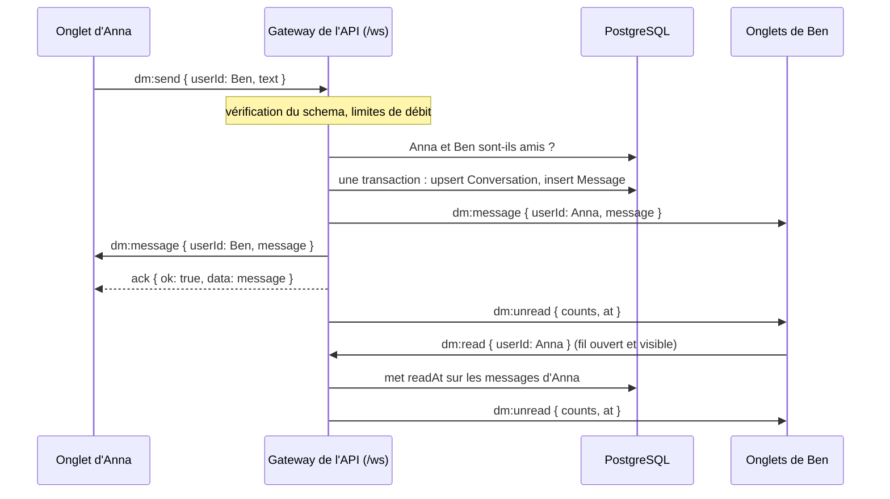

# Interaction entre utilisateurs : chat de base, profils et amis (Major, 2 points)

**Type :** Major. **Points :** 2. **Statut :** terminé.

Les apprenants peuvent s'ajouter comme amis, ouvrir la page de profil des autres, et envoyer des messages
privés à un ami. Les messages arrivent en direct, sont stockés, et affichent un nombre de non-lus dans le header.

## Ce que demande le sujet

Le module est une ligne du tableau Web modules de [../subject/summary.md](../subject/summary.md) :

> | Major | User interaction: basic **chat** + **profiles** + **friends** |

Le même fichier ajoute une règle à son sujet :

> - Advanced chat requires the basic chat from the "User interaction" module.

On ne revendique pas Advanced chat, donc ce fichier ne couvre que le chat de base.

Une règle de la partie obligatoire s'applique aussi à la zone de chat :

> - All forms and inputs validated **both frontend and backend**.

### En quoi il diffère de la gestion standard des utilisateurs

Deux parties de ce module comptent aussi pour [Standard user management](./user-management.md) : le
système d'amis et la page de profil publique. On le dit clairement. Le code est le même, et les deux
modules l'utilisent pour des choses différentes :

| Partie         | Standard user management l'utilise pour                   | Ce module l'utilise pour                                                                                              |
| -------------- | --------------------------------------------------------- | --------------------------------------------------------------------------------------------------------------------- |
| Amis           | La liste d'amis et le statut en ligne de chaque ami       | Qui peut écrire à qui : seuls les amis peuvent envoyer un message                                                     |
| Page de profil | Montrer les données d'un utilisateur (nom, avatar, cours) | Atteindre un autre apprenant : depuis la recherche, une liste ou une conversation, puis **Add friend** ou **Message** |
| Chat           | N'en fait pas partie                                      | Tout : seul ce module l'a                                                                                             |

La modification du profil, l'envoi de l'avatar et le statut en ligne n'appartiennent qu'à
[user-management.md](./user-management.md). Le chat n'appartient qu'à ce module.

## Comment on y répond

| Ce que demande le sujet                              | Ce qu'on a construit                                                                                                                                                                                                                                                                                                                                                                                                                                                                                                                                     | Où                                                                                                                                                                                                                                                                                                                    |
| ---------------------------------------------------- | -------------------------------------------------------------------------------------------------------------------------------------------------------------------------------------------------------------------------------------------------------------------------------------------------------------------------------------------------------------------------------------------------------------------------------------------------------------------------------------------------------------------------------------------------------- | --------------------------------------------------------------------------------------------------------------------------------------------------------------------------------------------------------------------------------------------------------------------------------------------------------------------- |
| Chat de base                                         | La page **Messages** (`/chat`) : une conversation privée par paire d'amis. Des messages texte de 1 à 1 000 caractères, stockés dans la base de données, livrés en direct par la connexion WebSocket aux deux personnes et à tous leurs onglets ouverts. L'historique survit à un rechargement et peut être remonté page par page avec **Load earlier messages**. Chaque conversation affiche son nombre de non-lus, et le header affiche le total. Seuls les amis peuvent envoyer. Le chat est en tête-à-tête : il n'y a pas de conversations de groupe. | [chat/page.tsx](<../../../apps/web/app/[locale]/(messages)/chat/page.tsx>), [chat-thread.tsx](<../../../apps/web/app/[locale]/(messages)/chat/chat-thread.tsx>), [messages.service.ts](../../../apps/api/src/messages/messages.service.ts), [messages.gateway.ts](../../../apps/api/src/messages/messages.gateway.ts) |
| Profils                                              | `/users/<id>` : la page que tout apprenant connecté voit pour un autre apprenant, avec son display name, son avatar, ses cours, son niveau et sa série, et le bon bouton d'ami. Chaque nom dans une liste mène à cette page, comme le nom en haut d'une conversation.                                                                                                                                                                                                                                                                                    | [users/[id]/page.tsx](<../../../apps/web/app/[locale]/(main)/users/[id]/page.tsx>), [users.service.ts](../../../apps/api/src/users/users.service.ts)                                                                                                                                                                  |
| Amis                                                 | La page **Friends** (`/friends`) : recherche par display name, une liste "Recently active", envoyer, accepter, refuser et annuler des demandes, retirer un ami. Chaque ami a un bouton **Message** qui ouvre la conversation. L'autre personne voit chaque changement sans rechargement.                                                                                                                                                                                                                                                                 | [friends/page.tsx](<../../../apps/web/app/[locale]/(main)/friends/page.tsx>), [friends.service.ts](../../../apps/api/src/friends/friends.service.ts), [friends.controller.ts](../../../apps/api/src/friends/friends.controller.ts)                                                                                    |
| Saisies validées des deux côtés (partie obligatoire) | La zone de message et le serveur vérifient le texte avec le même schema Zod (un ensemble de règles pour les données), `MessageTextSchema` de `@ft/shared` : espaces retirés aux bouts, de 1 à 1 000 caractères, pas de caractère NUL. Le serveur le vérifie encore avant que le moindre handler tourne.                                                                                                                                                                                                                                                  | [packages/shared/src/schemas/message.ts](../../../packages/shared/src/schemas/message.ts), [packages/shared/src/events/socket.ts](../../../packages/shared/src/events/socket.ts), [socket.gateway.ts](../../../apps/api/src/gateway/socket.gateway.ts)                                                                |

## Comment ça marche

### Amis

- Une ligne `Friendship` par paire d'utilisateurs, avec un statut : `pending` (une demande) ou `accepted` (une
  amitié) ([schema.prisma](../../../apps/api/prisma/schema.prisma)). Sa clé, `pairKey`, est faite des
  deux ids d'utilisateurs, le plus petit en premier ([pair.ts](../../../apps/api/src/friends/pair.ts)). Donc A vers B
  et B vers A partagent une seule clé, et deux demandes qui se croisent ne peuvent pas créer deux lignes.
- Les routes sont dans [friends.controller.ts](../../../apps/api/src/friends/friends.controller.ts). Elles
  nomment toujours l'autre utilisateur, jamais un id de ligne, donc une ligne qui ne te concerne pas ne peut pas être
  atteinte :

  | Route                                       | Ce qu'elle fait                                                                                 |
  | ------------------------------------------- | ----------------------------------------------------------------------------------------------- |
  | `GET /api/friends`                          | Tes amis (chacun avec `online`), les demandes que tu as reçues, les demandes que tu as envoyées |
  | `POST /api/friends/requests/:userId`        | Envoie une demande. Si l'autre t'a déjà demandé, ça accepte sa demande. Limité à 10 par minute. |
  | `POST /api/friends/requests/:userId/accept` | Accepte sa demande                                                                              |
  | `DELETE /api/friends/requests/:userId`      | Refuse sa demande, ou annule la tienne                                                          |
  | `DELETE /api/friends/:userId`               | Retire un ami                                                                                   |

- Refuser, annuler et retirer suppriment la ligne. Une demande refusée peut être envoyée de nouveau.
- Après chaque changement, `FriendsService` envoie `friend:request`, `friend:accepted` ou `friend:removed`
  par le WebSocket aux deux utilisateurs ([friends.service.ts](../../../apps/api/src/friends/friends.service.ts)).
  La page des amis, la page de profil et la page des messages écoutent ces événements et rechargent
  leurs données ([refresh-on.tsx](../../../apps/web/components/refresh-on.tsx)).
- Pour trouver des gens : `GET /api/users?q=` cherche dans les display names, et `GET /api/users/recently-active`
  liste les apprenants qui ont ouvert l'app dans les 7 derniers jours. Les deux sont expliqués dans
  [user-management.md](./user-management.md).

### Profils

- `/users/<id>` ([users/[id]/page.tsx](<../../../apps/web/app/[locale]/(main)/users/[id]/page.tsx>))
  appelle `GET /api/users/:id`. L'API n'envoie que les champs publics : id, display name, avatar, et pour
  chaque cours la langue, le niveau et la série en cours. L'email, le fuseau horaire et les réglages 2FA
  ne quittent jamais le serveur.
- La page montre une action qui dépend de ta relation avec cette personne : **Add friend** ;
  "Request sent" avec **Cancel request** ; "Request received" avec **Accept** et **Decline** ;
  "Already friends" avec **Message** et **Remove**. Sur ton propre id, elle montre **Edit profile**.
- **Remove** demande d'abord, dans une boîte de dialogue : "Remove {name} from your friends?" avec **Cancel** et
  **Remove** ([friend-buttons.tsx](../../../apps/web/components/friend-buttons.tsx)).
- La page a besoin d'une session. Un id inconnu, ou un texte qui n'est pas un id, donne une page 404.

### Chat

**Envoyer.** Les messages sont envoyés par le WebSocket, pas par HTTP.

1. La zone **Write a message** ([chat-thread.tsx](<../../../apps/web/app/[locale]/(messages)/chat/chat-thread.tsx>))
   vérifie le texte avec `MessageTextSchema`. Entrée envoie, Shift+Entrée commence une nouvelle ligne. La zone est
   en lecture seule jusqu'à ce que le serveur réponde, donc un seul message est envoyé à la fois.
2. Le navigateur émet `dm:send { userId, text }` et attend jusqu'à 10 secondes la réponse, le
   "ack" (accusé de réception) ([send-message.ts](../../../apps/web/lib/send-message.ts)). Si le socket n'est pas connecté,
   l'envoi échoue tout de suite avec "Could not reach the server", et le texte reste dans la zone.
3. Sur le serveur, la vérification du gateway (`screen` dans
   [socket.gateway.ts](../../../apps/api/src/gateway/socket.gateway.ts)) tourne avant tout handler. Elle
   analyse le payload avec `DmSendSchema` et refuse un événement inconnu, un mauvais payload ou plus de
   20 événements du même nom en 10 secondes sur un même socket. Un refus répond à l'ack avec un code d'erreur,
   par exemple `message.tooLong`.
4. `MessagesService.send` ([messages.service.ts](../../../apps/api/src/messages/messages.service.ts))
   autorise 30 messages par minute par compte, tous onglets confondus. Ensuite il vérifie que les deux utilisateurs
   sont amis (`areFriends` dans [friend-ids.ts](../../../apps/api/src/friends/friend-ids.ts)). Un
   inconnu, une demande en attente ou soi-même reçoit `message.notFriends` : "Only friends can message
   each other".
5. Dans une seule transaction de base de données, il crée ou met à jour la ligne `Conversation` et insère la
   ligne `Message`.
6. Il envoie `dm:message` aux rooms des deux utilisateurs (une room est le groupe de tous les sockets d'un utilisateur). Donc
   l'autre personne le voit, et les autres onglets de l'expéditeur aussi. Le fil ignore un message qu'il
   affiche déjà, par son id ([thread.ts](../../../apps/web/lib/thread.ts)).
7. Il renvoie le message stocké comme ack, et la zone se vide.

**Lire l'historique.** L'historique est lu par HTTP
([messages.controller.ts](../../../apps/api/src/messages/messages.controller.ts)) :

| Route                                             | Ce qu'elle fait                                                                                                       |
| ------------------------------------------------- | --------------------------------------------------------------------------------------------------------------------- |
| `GET /api/conversations`                          | Tes conversations, le dernier message en premier, chacune avec l'autre utilisateur et son nombre de non-lus           |
| `GET /api/conversations/:userId/messages?cursor=` | Une page de 50 messages avec cet utilisateur, du plus ancien au plus récent. Avec `cursor`, la page avant ce message. |

- Les pages sont découpées par `(createdAt, id)`, donc deux messages envoyés dans la même milliseconde ne tombent jamais
  entre deux pages. Un curseur qui n'est pas un message de cette paire donne 400.
- Lire ne demande pas d'amitié. Après qu'un ami a été retiré, les deux personnes peuvent encore lire l'ancienne
  conversation, mais aucune ne peut écrire. Le fil affiche alors "Only friends can message each other.
  You can still read this conversation." à la place de la zone.
- Chaque requête est construite à partir de ton propre id et de l'id de l'autre utilisateur, donc tu ne peux jamais atteindre une
  conversation dont tu ne fais pas partie.

**Les nombres de non-lus.**

- `Message.readAt` est vide jusqu'à ce que l'autre utilisateur lise le message. Il n'est jamais envoyé au
  navigateur, donc l'expéditeur ne voit pas quand un message a été lu.
- `dm:unread { counts, at }` contient le nombre de non-lus de chaque conversation
  ([unread.ts](../../../apps/api/src/messages/unread.ts)). C'est toujours l'état complet, jamais une
  différence à ajouter. Le serveur l'envoie quand un onglet se connecte, au destinataire après chaque message, et
  à chaque onglet du lecteur après chaque lecture. `at` est l'heure du comptage, donc un onglet garde le
  plus récent, quel que soit l'ordre d'arrivée ([lib/unread.ts](../../../apps/web/lib/unread.ts)).
- Quand un fil est ouvert, que l'onglet est visible et qu'il y a quelque chose de non lu, la page envoie
  `dm:read { userId }`. Le serveur remplit `readAt` et envoie un nouveau comptage. Les lectures sont limitées par compte
  à la limite générale de l'API : 100 par minute sauf si `RATE_LIMIT_PER_MINUTE` dans `.env` la change
  (`READ_LIMIT_PER_MINUTE` dans [messages.service.ts](../../../apps/api/src/messages/messages.service.ts)).
- Le lien **Messages** du header affiche le total dans un badge, et 99+ au-dessus de 99
  ([unread-badge.tsx](../../../apps/web/components/unread-badge.tsx),
  [session-nav.tsx](../../../apps/web/components/session-nav.tsx)). Un lecteur d'écran entend le nombre
  exact, par exemple "1 unread message".

**Après une connexion perdue.** Chaque fois que le socket se connecte, le fil ouvert redemande la page
la plus récente et la fusionne par id (`catchUp` dans [thread.ts](../../../apps/web/lib/thread.ts)). Un message
envoyé pendant que l'onglet était hors ligne apparaît quand la connexion revient.

**La page.** `/chat` liste les conversations à gauche et celle qui est ouverte à droite.
`/chat?with=<userId>` ouvre une conversation. Sur un téléphone, la page montre la liste ou la
conversation, avec un lien **All messages** pour revenir. Un ami ouvert avant le premier message est
listé en haut. Les amis dans la liste ont un point de présence en ligne. Les heures sont affichées dans le fuseau horaire du compte.

Plus de détails sur le gateway, les rooms et les événements du socket sont dans
[../architecture/realtime.md](../architecture/realtime.md), section 3, et dans
[websockets.md](./websockets.md).

## Où est le code

| Chemin                                                                                                                                                                                      | Ce qu'il fait                                                                                                                                                                                   |
| ------------------------------------------------------------------------------------------------------------------------------------------------------------------------------------------- | ----------------------------------------------------------------------------------------------------------------------------------------------------------------------------------------------- |
| [apps/api/src/messages/messages.service.ts](../../../apps/api/src/messages/messages.service.ts)                                                                                             | Envoyer (amis seulement, limite de débit, une transaction, événements vers les deux rooms), marquer comme lu, lister les conversations, paginer l'historique.                                   |
| [apps/api/src/messages/messages.gateway.ts](../../../apps/api/src/messages/messages.gateway.ts)                                                                                             | Les handlers du socket pour `dm:send` (avec réponse par ack) et `dm:read`.                                                                                                                      |
| [apps/api/src/messages/messages.controller.ts](../../../apps/api/src/messages/messages.controller.ts)                                                                                       | `GET /api/conversations` et `GET /api/conversations/:userId/messages`.                                                                                                                          |
| [apps/api/src/messages/unread.ts](../../../apps/api/src/messages/unread.ts)                                                                                                                 | Le nombre de non-lus par conversation, envoyé aussi par le gateway à la connexion.                                                                                                              |
| [apps/api/src/friends/](../../../apps/api/src/friends)                                                                                                                                      | Les demandes d'ami et la liste d'amis ; `pairKey` ; `areFriends` et `friendIds`.                                                                                                                |
| [apps/api/src/users/](../../../apps/api/src/users)                                                                                                                                          | La recherche d'utilisateurs, les apprenants récemment actifs, le profil public.                                                                                                                 |
| [apps/api/src/gateway/socket.gateway.ts](../../../apps/api/src/gateway/socket.gateway.ts)                                                                                                   | Vérifie la session à la connexion, met le socket dans la room de son utilisateur, vérifie et limite chaque événement venant du navigateur.                                                      |
| [apps/api/prisma/schema.prisma](../../../apps/api/prisma/schema.prisma)                                                                                                                     | Les tables `Friendship`, `Conversation` et `Message`. Les migrations sont `add_messages` et `add_message_unread_index` dans [apps/api/prisma/migrations/](../../../apps/api/prisma/migrations). |
| [packages/shared/src/schemas/message.ts](../../../packages/shared/src/schemas/message.ts)                                                                                                   | `MessageTextSchema`, `MESSAGE_MAX_LENGTH` (1 000), `MESSAGE_PAGE_SIZE` (50), les formes des réponses.                                                                                           |
| [packages/shared/src/events/socket.ts](../../../packages/shared/src/events/socket.ts)                                                                                                       | Les noms des événements du socket et le schema de chaque payload, partagés par le navigateur et l'API.                                                                                          |
| [apps/web/app/[locale]/(messages)/chat/](<../../../apps/web/app/[locale]/(messages)/chat>)                                                                                                  | La page **Messages** : la liste des conversations et le fil avec sa zone de message.                                                                                                            |
| [apps/web/app/[locale]/(main)/friends/page.tsx](<../../../apps/web/app/[locale]/(main)/friends/page.tsx>)                                                                                   | La page **Friends**.                                                                                                                                                                            |
| [apps/web/app/[locale]/(main)/users/[id]/page.tsx](<../../../apps/web/app/[locale]/(main)/users/[id]/page.tsx>)                                                                             | La page de profil publique.                                                                                                                                                                     |
| [apps/web/components/friend-buttons.tsx](../../../apps/web/components/friend-buttons.tsx), [apps/web/components/message-link.tsx](../../../apps/web/components/message-link.tsx)            | Les boutons d'ami, et le bouton **Message** vers une conversation.                                                                                                                              |
| [apps/web/components/tab-socket.ts](../../../apps/web/components/tab-socket.ts)                                                                                                             | Le socket unique de l'onglet : envoie `dm:send` et `dm:read`, garde les nombres de non-lus.                                                                                                     |
| [apps/web/lib/send-message.ts](../../../apps/web/lib/send-message.ts), [apps/web/lib/thread.ts](../../../apps/web/lib/thread.ts), [apps/web/lib/unread.ts](../../../apps/web/lib/unread.ts) | L'envoi et son ack ; comment les nouveaux messages et les pages rejoignent le fil ; le stockage des non-lus et le texte du badge.                                                               |
| [apps/web/components/unread-badge.tsx](../../../apps/web/components/unread-badge.tsx), [apps/web/components/session-nav.tsx](../../../apps/web/components/session-nav.tsx)                  | Le badge des non-lus, et le header avec **Friends** et **Messages**.                                                                                                                            |

## Comment le montrer à la soutenance

La stack doit tourner : `make run` la démarre, et `make` (la cible par défaut, `all`) fait d'abord toutes les
vérifications. L'app est sur `https://localhost`. Si le port 443 n'était pas libre, utilise l'adresse que
`make run` affiche. Tu as besoin de deux utilisateurs, donc utilise deux fenêtres de navigateur qui ne partagent pas les cookies : une
fenêtre normale (fenêtre 1) et une fenêtre privée (fenêtre 2).

**Amis et profils**

1. Dans la fenêtre 1, ouvre `https://localhost/en/signup`. Remplis **Email**, **Display name**,
   **Password** et **Confirm password**, puis clique sur **Create account**. Fais la même chose dans la fenêtre 2
   avec un autre utilisateur.
2. Dans la fenêtre 1, clique sur **Friends** dans le header. Le deuxième utilisateur est sous **Recently active**. Tu
   peux aussi taper une partie de son nom (au moins 3 caractères) dans **Search by display name** et
   cliquer sur **Search**.
3. Clique sur son nom. Sa page de profil (`/users/<id>`) montre son nom, son avatar et **Courses**.
   Clique sur **Add friend** : la page affiche "Request sent" et **Cancel request**.
4. Dans la fenêtre 2, ouvre **Friends**. Sous **Requests received**, clique sur **Accept**. La fenêtre 1 passe
   à "Already friends" avec **Message** et **Remove**, sans rechargement.

**Chat**

5. Dans la fenêtre 1, clique sur **Message**. La page **Messages** s'ouvre avec la conversation et "No
   messages yet."
6. Dans la fenêtre 2, ouvre n'importe quelle page, par exemple **Friends**.
7. Dans la fenêtre 1, tape un message dans **Write a message** et appuie sur Entrée. Il apparaît dans le fil.
   Dans la fenêtre 2, sans rechargement, le lien **Messages** du header affiche un badge avec 1.
8. Dans la fenêtre 2, clique sur **Messages**, puis sur le nom du premier utilisateur. Le message est là, et le
   badge disparaît.
9. Réponds depuis la fenêtre 2. Utilise Shift+Entrée pour une deuxième ligne, puis clique sur **Send**. La réponse s'affiche dans
   la fenêtre 1 tout de suite.
10. Recharge l'une ou l'autre fenêtre : toute la conversation est toujours là.
11. Validation : dans la fenêtre 1, colle un texte de plus de 1 000 caractères et appuie sur Entrée. La page
    affiche "A message is limited to 1,000 characters" et n'envoie rien. Envoie seulement des espaces : "Write a
    message first".
12. Clique sur le nom de l'utilisateur en haut de la conversation : ça ouvre sa page de profil.
13. Pour montrer l'API : ouvre `https://localhost/api/conversations` dans la fenêtre 1. Il liste la
    conversation avec son nombre `unread`. Les routes sont aussi listées dans Swagger sur
    `https://localhost/api/docs`, sous `messages` et `friends`.

**Seuls les amis peuvent écrire**

14. Sur le profil du deuxième utilisateur dans la fenêtre 1, clique sur **Remove**, puis sur **Remove** dans la boîte de dialogue.
15. Ouvre **Messages** dans la fenêtre 2 et la conversation. Les anciens messages sont toujours là, mais la
    zone a disparu : "Only friends can message each other. You can still read this conversation."

## Les tests qui le prouvent

| Test                                                                                                                                                                                                                                                                                                                       | Ce qu'il vérifie                                                                                                                                                                                                                                                                                                                                                                                                                                                                                                                                                                                                                                                                                                                                                                   |
| -------------------------------------------------------------------------------------------------------------------------------------------------------------------------------------------------------------------------------------------------------------------------------------------------------------------------- | ---------------------------------------------------------------------------------------------------------------------------------------------------------------------------------------------------------------------------------------------------------------------------------------------------------------------------------------------------------------------------------------------------------------------------------------------------------------------------------------------------------------------------------------------------------------------------------------------------------------------------------------------------------------------------------------------------------------------------------------------------------------------------------- |
| [e2e/tests/messages.spec.ts](../../../e2e/tests/messages.spec.ts)                                                                                                                                                                                                                                                          | Deux navigateurs : "a message arrives live, is counted, is read by opening the thread, and stays" ; "a friend written to for the first time is listed, as the open conversation" ; "a long thread scrolls in its own pane on a desktop, and the screens fit a phone" (avec la limite de 1 000 caractères refusée avant l'envoi) ; "in German, the header fits a phone with a count, which the conversation clears" ; "a message sent while the socket was down arrives when it is back" ; "a thread with an ex-friend stays readable, without a box" ; "a message shows its time in Paris, as sent and as rendered".                                                                                                                                                               |
| [e2e/tests/friends.spec.ts](../../../e2e/tests/friends.spec.ts)                                                                                                                                                                                                                                                            | "a request shows up live, is accepted, and both lists follow" ; "a stranger found by search is added from their profile, then visited as a friend" ; "a profile needs a session" ; "an unknown or malformed profile is a 404".                                                                                                                                                                                                                                                                                                                                                                                                                                                                                                                                                     |
| [apps/api/test/messages.e2e-spec.ts](../../../apps/api/test/messages.e2e-spec.ts)                                                                                                                                                                                                                                          | Contre une vraie base de données et Redis : "refuses both routes without a session" ; 400 pour un mauvais id d'utilisateur ou un mauvais curseur ; "pages the history back from the newest, each page oldest first, with no overlap" ; "a stranger, a pending request and yourself cannot send, and nothing is stored" ; "a friend's message reaches the recipient and every tab of the sender, and is counted" ; le nombre de non-lus à la connexion, après un message et après une lecture ; l'ordre de la liste des conversations ; "answers the ack of an event it refuses, never app:error as well, and stores nothing" ; "refuses a send past the budget of a minute, from any tab of the account" ; "after unfriending, both still read the history, and neither can send". |
| [apps/api/test/friends.e2e-spec.ts](../../../apps/api/test/friends.e2e-spec.ts)                                                                                                                                                                                                                                            | La recherche et les récemment actifs ; "a request reaches both users, is accepted, then removed, and a stranger hears none of it" ; les demandes refusées et annulées ; deux demandes qui se croisent ; "limits sending to 10 a minute per account".                                                                                                                                                                                                                                                                                                                                                                                                                                                                                                                               |
| [apps/api/test/users.e2e-spec.ts](../../../apps/api/test/users.e2e-spec.ts)                                                                                                                                                                                                                                                | Le profil public : "shows the public fields and nothing else", "answers 404 for an unknown id and 400 for a malformed one".                                                                                                                                                                                                                                                                                                                                                                                                                                                                                                                                                                                                                                                        |
| [apps/api/src/messages/messages.service.spec.ts](../../../apps/api/src/messages/messages.service.spec.ts), [apps/api/src/messages/unread.spec.ts](../../../apps/api/src/messages/unread.spec.ts)                                                                                                                           | L'envoi dans une seule transaction, les événements vers les deux rooms, les limites de débit, la lecture, la pagination par curseur, la liste des conversations ; le nombre de non-lus par conversation.                                                                                                                                                                                                                                                                                                                                                                                                                                                                                                                                                                           |
| [apps/api/src/friends/friends.service.spec.ts](../../../apps/api/src/friends/friends.service.spec.ts)                                                                                                                                                                                                                      | `pairKey`, l'envoi, l'acceptation d'une demande croisée, le tri des listes, le statut en ligne de chaque ami.                                                                                                                                                                                                                                                                                                                                                                                                                                                                                                                                                                                                                                                                      |
| [packages/shared/src/events/socket.test.ts](../../../packages/shared/src/events/socket.test.ts)                                                                                                                                                                                                                            | "direct messages" : les schemas des payloads, "sends trimmed text of 1 to 1,000 characters", et les cas refusés (vide, seulement des espaces, trop long, pas du texte, un NUL).                                                                                                                                                                                                                                                                                                                                                                                                                                                                                                                                                                                                    |
| [apps/web/lib/thread.test.ts](../../../apps/web/lib/thread.test.ts), [apps/web/lib/send-message.test.ts](../../../apps/web/lib/send-message.test.ts), [apps/web/lib/unread.test.ts](../../../apps/web/lib/unread.test.ts), [apps/web/lib/conversations-client.test.ts](../../../apps/web/lib/conversations-client.test.ts) | La fusion des messages et des pages dans le fil ; l'envoi et son ack ; le stockage des non-lus et le badge 99+ ; les requêtes de l'historique.                                                                                                                                                                                                                                                                                                                                                                                                                                                                                                                                                                                                                                     |

Comment les lancer : `make test` lance les tests unitaires. Les tests e2e de l'API
(`pnpm --filter @ft/api run test:e2e`) ont besoin d'une vraie base de données et de Redis, et tournent dans `make ci`.
`make test-e2e` lance Playwright sur la stack de production, et `make playwright-all` le lance sur
Chromium, Firefox et WebKit, comme la CI.

## Limites et choix

- **Partagé avec la gestion standard des utilisateurs.** Le système d'amis et la page de profil publique comptent
  pour les deux modules. Seul le chat est nouveau dans ce module. Voir
  [En quoi il diffère de la gestion standard des utilisateurs](#en-quoi-il-diffère-de-la-gestion-standard-des-utilisateurs).
- **En tête-à-tête seulement.** Une conversation se fait entre deux personnes. Il n'y a ni conversations de groupe ni
  salons. La table `Conversation` a deux colonnes d'utilisateur et pas de liste de membres.
- **Du texte seulement.** Pas d'images ni de fichiers. Un message ne peut pas être modifié ni
  supprimé.
- **Seuls les amis peuvent envoyer.** Ça empêche des inconnus d'écrire à quelqu'un. Après qu'un ami a été
  retiré, l'ancienne conversation reste lisible par les deux, comme le dit la politique de confidentialité
  ([lib/legal-content/en.ts](../../../apps/web/lib/legal-content/en.ts)).
- **Pas de blocage, pas d'indicateur de saisie, pas d'accusés de lecture.** Ça appartient au module Advanced chat,
  qu'on ne revendique pas. Retirer un ami est le moyen d'arrêter les messages. L'heure de lecture est stockée,
  seulement pour compter les messages non lus, et l'expéditeur ne la voit jamais.
- **Pas de notifications en dehors de l'app.** Le badge des non-lus dans le header est le seul signal. Il n'y a
  ni email ni notification push.
- **Les messages sont gardés tant que les deux comptes existent.** Supprimer l'un des comptes supprime la
  conversation (les relations sont en cascade). Il n'y a pas encore de bouton de suppression de compte ; voir
  [user-management.md](./user-management.md).
- **Un renvoi peut s'afficher deux fois.** Si l'ack n'arrive pas en 10 secondes, la page dit que l'envoi a échoué,
  mais le serveur a peut-être stocké le message. L'envoyer de nouveau l'affiche alors deux fois
  ([send-message.ts](../../../apps/web/lib/send-message.ts)).
- **Une seule instance de l'API.** Les rooms des sockets vivent dans la mémoire du processus de l'API, donc tous les utilisateurs doivent être
  sur la même instance ([../architecture/realtime.md](../architecture/realtime.md), "One API instance").

## Qui l'a construit

D'après `git log --follow` sur les fichiers ci-dessus et `gh pr view` sur chaque pull request.

| Membre | GitHub                                 | Ce qu'il a construit                                                                                                                                                                                                                                                                                                                                                                          | Issues et PRs                                                              |
| ------ | -------------------------------------- | --------------------------------------------------------------------------------------------------------------------------------------------------------------------------------------------------------------------------------------------------------------------------------------------------------------------------------------------------------------------------------------------- | -------------------------------------------------------------------------- |
| Victor | `VictorBro`                            | Le gateway WebSocket sur lequel tourne le chat ; les amis, les événements d'amis et la page des amis ; la recherche d'utilisateurs ; la page de profil publique et "Recently active" ; les messages directs : les tables `Conversation` et `Message`, les routes REST, `dm:send`, `dm:read` et `dm:unread`, la page **Messages**, le badge des non-lus, les boutons **Message** et les tests. | #181 (ferme #154), #189 (ferme #155), #193 (ferme #156), #200 (ferme #158) |
| Endrit | `VYAntares` (commits en tant que `EA`) | Le statut en ligne, que montrent la liste d'amis, la page de profil et la liste des conversations : `PresenceService`, les événements de présence, et `online` sur chaque ami dans `GET /api/friends`.                                                                                                                                                                                        | #195 (ferme #157)                                                          |
