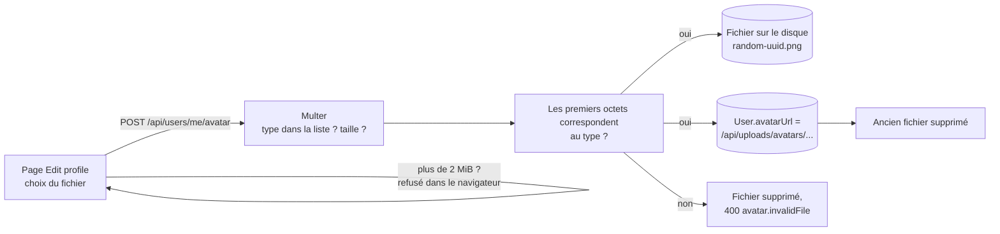
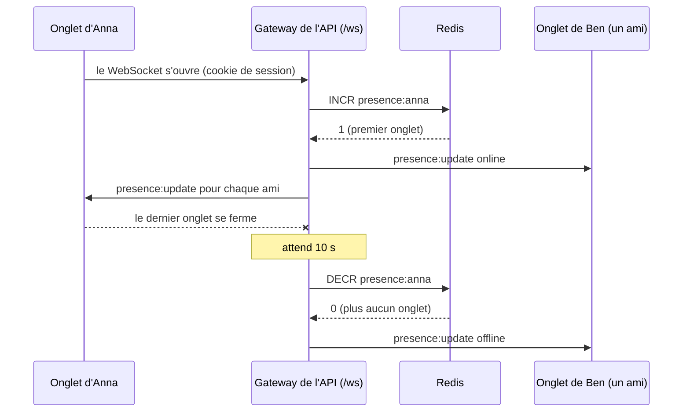

# Gestion standard des utilisateurs (Major, 2 points)

**Type :** Major. **Points :** 2. **Statut :** terminé.

Chaque utilisateur a un profil qu'il peut modifier, une image (un avatar) qu'il peut envoyer ou retirer, et une
liste d'amis. Les amis voient le statut en ligne des uns des autres, en direct. Tout utilisateur connecté peut ouvrir
la page de profil d'un autre utilisateur.

## Ce que demande le sujet

Le module est une ligne du tableau User Management modules de
[../subject/summary.md](../subject/summary.md) :

> | Major | Standard user management: profile editing, avatar upload (with default), friends + online status, profile page |

Le PDF ([../../docs/subject/ft_transcendence.pdf](../../docs/subject/ft_transcendence.pdf), chapitre IV, User
Management) le formule ainsi :

> Major: Standard user management and authentication.
>
> - Users can update their profile information.
> - Users can upload an avatar (with a default avatar if none provided).
> - Users can add other users as friends and see their online status.
> - Users have a profile page displaying their information.

Deux règles de la partie obligatoire (chapitre III.3, Technical requirements) s'appliquent au même code :

> - Your application must have a basic user management system. Users must be able to sign up
>   and log in securely:
>   - At minimum: email and password authentication with proper security (hashed passwords,
>     salted, etc.).
>   - Additional authentication methods (OAuth, 2FA, etc.) can be implemented via modules.
> - All forms and user inputs must be properly validated in both the frontend and backend.

L'inscription et la connexion font partie de la partie obligatoire, pas de ce module, donc ce fichier n'en parle pas.

## Comment on y répond

| Ce que demande le sujet                                 | Ce qu'on a construit                                                                                                                                                                                                                                                                                                                                                                                                          | Où                                                                                                                                                                                                                                                                                            |
| ------------------------------------------------------- | ----------------------------------------------------------------------------------------------------------------------------------------------------------------------------------------------------------------------------------------------------------------------------------------------------------------------------------------------------------------------------------------------------------------------------- | --------------------------------------------------------------------------------------------------------------------------------------------------------------------------------------------------------------------------------------------------------------------------------------------- |
| Modification du profil                                  | La page **Edit profile** change le display name et l'avatar (ligne suivante). La langue de l'interface et le fuseau horaire sont enregistrés sur la même route, `PATCH /api/users/me`, mais par l'app elle-même, pas par un formulaire : la langue quand une page d'apprentissage s'ouvre dans une autre langue que celle enregistrée (le tuteur des leçons répond dans `User.locale`), le fuseau horaire depuis le navigateur. L'email et le mot de passe ne sont pas sur cette page (voir [Limites et choix](#limites-et-choix)). | [profile-form.tsx](<../../apps/web/app/[locale]/(main)/profile/edit/profile-form.tsx>), [users.controller.ts](../../apps/api/src/users/users.controller.ts), [locale-sync.tsx](../../apps/web/components/locale-sync.tsx), [time-zone-sync.tsx](../../apps/web/components/time-zone-sync.tsx) |
| Envoi de l'avatar                                       | Sur la même page : **Upload avatar** (ou **Change avatar**) et **Remove avatar**. PNG, JPEG ou WebP, 2 MiB au maximum. Le navigateur vérifie d'abord la taille. Le serveur vérifie le type, la taille et les premiers octets du fichier. L'ancien fichier est supprimé quand il est remplacé ou retiré.                                                                                                                       | [profile-form.tsx](<../../apps/web/app/[locale]/(main)/profile/edit/profile-form.tsx>), [users.controller.ts](../../apps/api/src/users/users.controller.ts), [users.service.ts](../../apps/api/src/users/users.service.ts)                                                                    |
| Avec un avatar par défaut                               | Un utilisateur sans avatar a un cercle avec la première lettre de son display name. La couleur vient du nom, donc la même personne a toujours la même couleur. Il est dessiné dans la page (SVG), donc il n'y a pas de fichier image à perdre.                                                                                                                                                                                | [avatar.tsx](../../apps/web/components/avatar.tsx), [lib/avatar.ts](../../apps/web/lib/avatar.ts)                                                                                                                                                                                             |
| Amis                                                    | La page **Friends** : recherche par display name, une liste "Recently active", envoyer, accepter, refuser et annuler des demandes, retirer un ami. L'autre utilisateur voit chaque changement sans rechargement.                                                                                                                                                                                                              | [friends/page.tsx](<../../apps/web/app/[locale]/(main)/friends/page.tsx>), [friends.service.ts](../../apps/api/src/friends/friends.service.ts)                                                                                                                                                |
| Statut en ligne                                         | Un point vert ou gris à côté de chaque ami : sur la liste d'amis, sur sa page de profil et dans les messages. Il change en direct par la connexion WebSocket. Seuls les amis le voient.                                                                                                                                                                                                                                       | [presence.service.ts](../../apps/api/src/presence/presence.service.ts), [socket.gateway.ts](../../apps/api/src/gateway/socket.gateway.ts), [presence-dot.tsx](../../apps/web/components/presence-dot.tsx)                                                                                     |
| Page de profil                                          | Deux pages. `/profile` est ta propre page : display name, email, date d'inscription, avatar, et des liens vers **Edit profile** et **Two factor authentication**. `/users/<id>` est la page que voit tout utilisateur connecté : display name, avatar, les cours avec leur niveau et leur série, le point en ligne pour un ami, et les boutons d'ami.                                                                         | [profile/page.tsx](<../../apps/web/app/[locale]/(main)/profile/page.tsx>), [users/[id]/page.tsx](<../../apps/web/app/[locale]/(main)/users/[id]/page.tsx>)                                                                                                                                    |
| Formulaires validés des deux côtés (partie obligatoire) | Le formulaire du display name et l'API utilisent le même schema Zod (un ensemble de règles pour les données) de `@ft/shared` : `UpdateProfileSchema`. La limite de 2 MiB, `MAX_AVATAR_BYTES`, est partagée aussi.                                                                                                                                                                                                             | [packages/shared/src/schemas/user.ts](../../packages/shared/src/schemas/user.ts)                                                                                                                                                                                                              |

## Comment ça marche

### Modification du profil

1. La page **Edit profile** ([profile/edit/page.tsx](<../../apps/web/app/[locale]/(main)/profile/edit/page.tsx>))
   est rendue sur le serveur avec l'utilisateur connecté. Un visiteur sans session est envoyé vers la
   page de connexion.
2. Sur **Save changes**, le formulaire vérifie le display name avec `UpdateProfileSchema` : de 3 à 32
   caractères, seulement des lettres, des chiffres, le point, le tiret bas et le tiret. Ensuite il envoie
   `PATCH /api/users/me` ([lib/auth-client.ts](../../apps/web/lib/auth-client.ts)).
3. L'API vérifie encore le body avec le même schema (`UpdateProfileDto` dans
   [auth.dto.ts](../../apps/api/src/auth/auth.dto.ts)). Le schema n'accepte que `displayName`,
   `locale` et `timeZone`, et au moins l'un des trois. L'email, le rôle et l'avatar n'y sont pas, exprès :
   changer l'email ou le rôle n'est pas une modification de profil, et un appelant qui pourrait choisir le
   chemin de l'avatar pourrait faire supprimer par le serveur le fichier d'un autre utilisateur.
4. `UsersService.updateProfile` écrit la ligne avec Prisma. Si le display name est déjà pris,
   la clé unique sur `User.displayName` échoue et l'API répond 409 avec le code
   `auth.displayNameTaken`. Le navigateur affiche "That display name is already taken".
5. Il n'y a pas de `PATCH /api/users/:id`. Un utilisateur ne peut changer que son propre profil, parce que la route
   prend l'utilisateur dans la session, pas dans l'adresse.

### Envoi de l'avatar et l'avatar par défaut



- Le choix de fichier accepte `image/png`, `image/jpeg` et `image/webp`. Un fichier de plus de 2 MiB est
  refusé dans le navigateur avec "File is too large. Maximum size is 2 MiB."
- Sur le serveur ([users.controller.ts](../../apps/api/src/users/users.controller.ts)), Multer (la
  bibliothèque d'envoi de fichiers qu'utilise NestJS) ne garde que ces trois types et s'arrête à 2 MiB. Ensuite l'API
  lit les 12 premiers octets du fichier et vérifie qu'ils correspondent au type annoncé par le navigateur.
  Un PDF renommé en `.png` est supprimé et refusé. Chaque refus répond avec le code
  `avatar.invalidFile`, que le navigateur affiche comme "That file could not be used as an avatar. Try
  a PNG, JPEG or WebP."
- Le nom du fichier est un nouvel UUID aléatoire, et l'extension vient du type, jamais du nom
  donné par l'utilisateur.
- Le fichier va dans le dossier nommé par `AVATAR_STORAGE_DIR`. L'API ne démarre pas s'il n'est pas
  défini ([app.setup.ts](../../apps/api/src/app.setup.ts)). Dans Docker, c'est `/data/avatars`, sur le
  volume `avatars-data`, donc les fichiers survivent à un redémarrage ([compose.yml](../../compose.yml),
  [compose.deploy.yml](../../compose.deploy.yml)).
- L'API sert le dossier sur `/api/uploads/avatars/` et stocke ce chemin relatif dans
  `User.avatarUrl`. Elle ne stocke jamais une adresse complète construite à partir de la requête.
- Quand l'avatar est remplacé ou retiré (`DELETE /api/users/me/avatar`), `UsersService` supprime
  l'ancien fichier. Il prend le nom du fichier dans la ligne de l'utilisateur lui-même, et seulement dans le dossier des avatars.
- Quand `avatarUrl` est vide, le composant `Avatar` ([avatar.tsx](../../apps/web/components/avatar.tsx))
  dessine l'avatar par défaut : un cercle avec la première lettre du display name, dans une couleur calculée
  à partir du nom ([lib/avatar.ts](../../apps/web/lib/avatar.ts)). L'avatar s'affiche dans le menu du header,
  sur les deux pages de profil, et dans chaque liste d'utilisateurs.

### Amis

Les amis sont partagés avec le module [User interaction](user-interaction.md), qui les explique
en entier. En bref :

- Une ligne `Friendship` par paire d'utilisateurs, avec un statut `pending` ou `accepted`
  ([schema.prisma](../../apps/api/prisma/schema.prisma)). La clé est faite des deux ids, le plus petit
  en premier, donc deux demandes qui se croisent ne peuvent pas créer deux lignes.
- Les routes sont dans [friends.controller.ts](../../apps/api/src/friends/friends.controller.ts) :
  `GET /api/friends`, `POST /api/friends/requests/:userId` (envoyer, ou accepter si l'autre t'a déjà
  demandé), `POST /api/friends/requests/:userId/accept`, `DELETE /api/friends/requests/:userId`
  (refuser ou annuler), `DELETE /api/friends/:userId` (retirer). L'envoi est limité à 10 par minute.
- Pour trouver des gens : `GET /api/users?q=` cherche dans les display names (une partie du nom, majuscules ou minuscules, 20
  résultats au maximum), et `GET /api/users/recently-active` liste jusqu'à 20 utilisateurs qui ont ouvert l'app
  dans les 7 derniers jours et qui ne sont pas déjà liés à toi
  ([users.service.ts](../../apps/api/src/users/users.service.ts)).
- Après chaque changement, l'API envoie `friend:request`, `friend:accepted` ou `friend:removed` par
  le WebSocket aux deux utilisateurs. Les pages les écoutent et se rechargent
  ([refresh-on.tsx](../../apps/web/components/refresh-on.tsx)).

### Statut en ligne



- Chaque page connectée ouvre une connexion WebSocket vers `/ws`. Le gateway
  ([socket.gateway.ts](../../apps/api/src/gateway/socket.gateway.ts)) ne l'accepte qu'avec une
  session valide.
- `PresenceService` ([presence.service.ts](../../apps/api/src/presence/presence.service.ts)) garde
  un compteur par utilisateur dans Redis, `presence:<id>` : le nombre de connexions ouvertes. La première
  met l'utilisateur en ligne.
- Quand une connexion se ferme, le service attend 10 secondes (`PRESENCE_GRACE_MS`) avant de baisser le
  compteur. Un rechargement de page ouvre une nouvelle connexion pendant ce temps, donc les amis ne voient pas l'utilisateur
  partir et revenir.
- `presence:update` ne va qu'aux amis de l'utilisateur. Quand un onglet se connecte, il reçoit aussi le
  statut actuel de chaque ami, parce que la page peut avoir quelques instants de retard.
- `GET /api/friends` ajoute `online: true` ou `false` à chaque ami, lu dans les mêmes compteurs,
  donc la page est juste dès le premier affichage.
- Dans le navigateur, `PresenceDot` ([presence-dot.tsx](../../apps/web/components/presence-dot.tsx))
  affiche vert pour en ligne et gris pour hors ligne, et se met à jour sans rechargement. Un lecteur d'écran dit
  "Online" ou "Offline".
- Au démarrage, l'API supprime tous les compteurs `presence:*`, parce qu'aucune connexion ne survit à un redémarrage.

Le côté WebSocket est expliqué dans [websockets.md](websockets.md) et dans
[../architecture/realtime.md](../architecture/realtime.md), section 3.

### Les pages de profil

- `/profile` ([profile/page.tsx](<../../apps/web/app/[locale]/(main)/profile/page.tsx>)) affiche les
  données de l'utilisateur connecté, lues dans la session : display name, email, date "Joined", avatar,
  **Edit profile**, et la partie **Security** avec le lien vers l'authentification à deux facteurs.
- `/users/<id>` ([users/[id]/page.tsx](<../../apps/web/app/[locale]/(main)/users/[id]/page.tsx>))
  appelle `GET /api/users/:id`. L'API n'envoie que les champs publics : id, display name, avatar, et
  pour chaque cours la langue, le niveau et la série en cours
  ([users.service.ts](../../apps/api/src/users/users.service.ts),
  [public-user.ts](../../apps/api/src/users/public-user.ts)). L'email, le fuseau horaire et les réglages 2FA
  ne quittent jamais le serveur. La page ajoute le bon bouton selon ta relation avec cette personne :
  **Add friend**, **Cancel request**, **Accept** / **Decline**, ou **Message** et **Remove**. Sur
  ton propre id, elle montre **Edit profile** à la place.
- La page a besoin d'une session. Un id inconnu, ou un texte qui n'est pas un id, donne une page 404.
- Chaque nom dans une liste (résultats de recherche, demandes, amis, récemment actifs) mène à la page
  `/users/<id>` de cet utilisateur ([user-row.tsx](../../apps/web/components/user-row.tsx)).
- Ce que voient les autres utilisateurs est écrit dans la politique de confidentialité
  ([lib/legal-content/en.ts](../../apps/web/lib/legal-content/en.ts)), affichée sur `/privacy`.

## Où est le code

| Chemin                                                                                                                                                                                                                       | Ce qu'il fait                                                                                                                                        |
| ---------------------------------------------------------------------------------------------------------------------------------------------------------------------------------------------------------------------------- | ---------------------------------------------------------------------------------------------------------------------------------------------------- |
| [apps/api/src/users/users.controller.ts](../../apps/api/src/users/users.controller.ts)                                                                                                                                       | Les routes : recherche, récemment actifs, profil public, `PATCH /api/users/me`, envoi et retrait de l'avatar, et la vérification du type de fichier. |
| [apps/api/src/users/users.service.ts](../../apps/api/src/users/users.service.ts)                                                                                                                                             | Lit et écrit la ligne `User` ; stocke et supprime les fichiers d'avatar ; construit le profil public avec la série de chaque cours.                  |
| [apps/api/src/users/public-user.ts](../../apps/api/src/users/public-user.ts)                                                                                                                                                 | Les trois colonnes qu'un autre utilisateur peut voir : `id`, `displayName`, `avatarUrl`.                                                             |
| [apps/api/src/users/active-day.ts](../../apps/api/src/users/active-day.ts)                                                                                                                                                   | Le jour UTC stocké dans `lastActiveDay`, et la fenêtre de 7 jours pour "Recently active".                                                            |
| [apps/api/src/presence/presence.service.ts](../../apps/api/src/presence/presence.service.ts)                                                                                                                                 | Le compteur de connexions par utilisateur dans Redis, le délai de grâce de 10 s, `isOnline`.                                                         |
| [apps/api/src/gateway/socket.gateway.ts](../../apps/api/src/gateway/socket.gateway.ts)                                                                                                                                       | Vérifie la session à la connexion, enregistre `lastActiveDay`, envoie `presence:update` aux amis.                                                    |
| [apps/api/src/friends/](../../apps/api/src/friends)                                                                                                                                                                          | Les demandes d'ami et la liste d'amis, avec le statut en ligne de chaque ami.                                                                        |
| [apps/api/src/app.setup.ts](../../apps/api/src/app.setup.ts)                                                                                                                                                                 | `AVATAR_STORAGE_DIR` (obligatoire) et la route statique `/api/uploads/avatars`.                                                                      |
| [packages/shared/src/schemas/user.ts](../../packages/shared/src/schemas/user.ts)                                                                                                                                             | `DisplayNameSchema`, `UpdateProfileSchema`, `PublicProfileSchema`, `MAX_AVATAR_BYTES`, partagés par le navigateur et l'API.                          |
| [apps/web/app/[locale]/(main)/profile/](<../../apps/web/app/[locale]/(main)/profile>)                                                                                                                                        | Ta propre page de profil et la page **Edit profile** avec son formulaire.                                                                            |
| [apps/web/app/[locale]/(main)/users/[id]/page.tsx](<../../apps/web/app/[locale]/(main)/users/[id]/page.tsx>)                                                                                                                 | La page de profil publique.                                                                                                                          |
| [apps/web/app/[locale]/(main)/friends/](<../../apps/web/app/[locale]/(main)/friends>)                                                                                                                                        | La page des amis et son formulaire de recherche.                                                                                                     |
| [apps/web/components/avatar.tsx](../../apps/web/components/avatar.tsx), [apps/web/lib/avatar.ts](../../apps/web/lib/avatar.ts)                                                                                               | L'avatar, et l'avatar dessiné par défaut.                                                                                                            |
| [apps/web/components/presence-dot.tsx](../../apps/web/components/presence-dot.tsx), [apps/web/components/tab-socket.ts](../../apps/web/components/tab-socket.ts), [apps/web/lib/presence.ts](../../apps/web/lib/presence.ts) | Le point en ligne, et la carte en direct de l'onglet qui dit qui est en ligne.                                                                       |
| [apps/web/components/session-nav.tsx](../../apps/web/components/session-nav.tsx), [apps/web/components/header-menu.tsx](../../apps/web/components/header-menu.tsx)                                                                                                                                             | Les liens du compte dans le menu du header : ton avatar et ton nom mènent à `/profile`, puis **Friends**, **Messages** et **Sign out**.                                                                             |
| [apps/web/lib/auth-client.ts](../../apps/web/lib/auth-client.ts)                                                                                                                                                             | `updateProfile`, `uploadAvatar`, `removeAvatar` : les appels du navigateur vers l'API.                                                               |

## Comment le montrer à la soutenance

La stack doit tourner : `make run` la démarre, et `make` (la cible par défaut, `all`) fait d'abord toutes les
vérifications. L'app est sur `https://localhost`. Si le port 443 n'était pas libre, utilise l'adresse que
`make run` affiche. Tu as besoin de deux utilisateurs, donc utilise deux fenêtres de navigateur qui ne partagent pas les cookies : une
fenêtre normale et une fenêtre privée.

**Modification du profil et avatar (fenêtre 1)**

1. Ouvre `https://localhost/en/signup`. Remplis **Email**, **Display name**, **Password** et
   **Confirm password**, puis clique sur **Create account**. L'app ouvre la page d'onboarding.
2. Ouvre le menu du header (le bouton en haut à droite) et clique sur ton display name. La page **Profile** montre ton nom, ton email, la date "Joined"
   et l'avatar par défaut : un cercle coloré avec ta première lettre.
3. Clique sur **Edit profile**. Change **Display name** en `ab` et clique sur **Save changes** : le formulaire
   affiche "Display name needs at least 3 characters". Maintenant tape un nouveau nom valide et clique sur **Save
   changes**. Tu reviens sur **Profile** avec le nouveau nom, et le menu du header l'affiche aussi.
4. La validation se fait aussi sur le serveur : dans un terminal, envoie un nom court directement à l'API, sans
   le formulaire. Copie d'abord le cookie `ft.sid` depuis les outils de développement du navigateur.
   ```sh
   curl -k -X PATCH https://localhost/api/users/me \
     -H 'Content-Type: application/json' -H 'Cookie: ft.sid=<value>' \
     -d '{"displayName":"ab"}'
   ```
   La réponse est 400 avec le code `displayName.tooShort`.
5. De retour sur **Edit profile**, clique sur **Upload avatar** et choisis un PNG, JPEG ou WebP de moins de 2 MiB.
   L'image remplace le cercle, sur la page et dans le menu du header. Le lien dit maintenant **Change avatar**.
6. Choisis un fichier qui n'est pas une image, par exemple un PDF. La page affiche "That file could not be
   used as an avatar. Try a PNG, JPEG or WebP." Choisis une image de plus de 2 MiB : "File is too large.
   Maximum size is 2 MiB."
7. Clique sur **Remove avatar**. Le cercle par défaut revient.

**Amis, page de profil et statut en ligne (les deux fenêtres)**

8. Dans la fenêtre privée, inscris un deuxième utilisateur de la même façon.
9. Dans la fenêtre 1, ouvre le menu du header et clique sur **Friends**. Le deuxième utilisateur est sous **Recently active**.
   Tu peux aussi taper une partie de son nom (au moins 3 caractères) dans **Search by display name**
   et cliquer sur **Search**.
10. Clique sur son nom. Sa page de profil (`/users/<id>`) montre son nom, son avatar et
    **Courses**. Clique sur **Add friend** : la page affiche "Request sent" et **Cancel request**.
11. Dans la fenêtre privée, ouvre **Friends**. Sous **Requests received**, clique sur **Accept**. La fenêtre 1
    passe à "Already friends" avec **Message** et **Remove**, sans rechargement.
12. Dans la fenêtre 1, ouvre **Friends**. Sous **Your friends**, le deuxième utilisateur a un point vert.
    Un lecteur d'écran le lit comme "Online".
13. Ferme la fenêtre privée. Environ 10 secondes plus tard, le point dans la fenêtre 1 devient gris ("Offline"),
    sans rechargement. Ouvre de nouveau une fenêtre privée, connecte-toi avec le deuxième utilisateur et ouvre n'importe quelle page :
    le point redevient vert.
14. Pour montrer que l'API garde privés les champs privés, ouvre `https://localhost/api/users/<id>` dans la
    fenêtre 1, avec l'id de la barre d'adresse : seuls `id`, `displayName`, `avatarUrl` et
    `courses` reviennent. Pas d'email.
15. Les routes sont aussi listées dans Swagger, la page de documentation de l'API :
    `https://localhost/api/docs`, sous `users` et `friends`.

## Les tests qui le prouvent

| Test                                                                                                                                   | Ce qu'il vérifie                                                                                                                                                                                                                                                                                                                                                                                                                 |
| -------------------------------------------------------------------------------------------------------------------------------------- | -------------------------------------------------------------------------------------------------------------------------------------------------------------------------------------------------------------------------------------------------------------------------------------------------------------------------------------------------------------------------------------------------------------------------------- |
| [e2e/tests/avatar.spec.ts](../../e2e/tests/avatar.spec.ts)                                                                             | "uploads, renders, and removes again" : l'avatar par défaut est dessiné, un PNG envoyé est renvoyé par le serveur et se décode vraiment, **Remove avatar** ramène l'avatar par défaut. "refuses a file that is not an image". "a signed out visitor cannot reach the edit page".                                                                                                                                                 |
| [e2e/tests/auth.spec.ts](../../e2e/tests/auth.spec.ts)                                                                                 | "saves a profile edit and shows it in the header" : **Edit profile**, nouveau **Display name**, **Save changes**, le nouveau nom sur la page et dans le menu du header.                                                                                                                                                                                                                                                                  |
| [e2e/tests/locale.spec.ts](../../e2e/tests/locale.spec.ts) | "stores the language the switcher picks, once" dans `User.locale` ; "retries on the next page when the PATCH fails" ; "does not retry a locale the server rejects". |
| [e2e/tests/friends.spec.ts](../../e2e/tests/friends.spec.ts)                                                                           | "a stranger found by search is added from their profile, then visited as a friend" ; "a request shows up live, is accepted, and both lists follow" ; "a friend's dot goes grey when they leave and green when they come back" (deux navigateurs, le délai de grâce de 10 s) ; "a profile needs a session" ; "an unknown or malformed profile is a 404".                                                                          |
| [apps/api/test/users.e2e-spec.ts](../../apps/api/test/users.e2e-spec.ts)                                                               | Avatars : "stores a relative path and serves the file back", "deletes the previous file when the avatar is replaced", "rejects a file whose bytes are not the type it claims, and keeps nothing", "rejects an oversized file with a code, not a sentence", "will not let the profile patch set an avatar url". Profil : "shows the public fields and nothing else", "answers 404 for an unknown id and 400 for a malformed one". |
| [apps/api/test/friends.e2e-spec.ts](../../apps/api/test/friends.e2e-spec.ts)                                                           | La recherche et les récemment actifs ; "a request reaches both users, is accepted, then removed, and a stranger hears none of it" ; "a friend hears you come online, and someone who only sent you a request does not".                                                                                                                                                                                                          |
| [apps/api/src/users/users.service.spec.ts](../../apps/api/src/users/users.service.spec.ts)                                             | Les fichiers d'avatar : chemin relatif, ancien fichier supprimé, "never unlinks outside the storage directory". Un display name déjà pris devient un conflit. La série sur le profil public utilise le jour du propriétaire.                                                                                                                                                                                                     |
| [apps/api/src/presence/presence.service.spec.ts](../../apps/api/src/presence/presence.service.spec.ts)                                 | Le compteur : en ligne à la première connexion seulement, hors ligne seulement après le délai de grâce, pas de clignotement quand un onglet revient, remise à zéro au démarrage.                                                                                                                                                                                                                                                 |
| [apps/api/src/gateway/socket.gateway.spec.ts](../../apps/api/src/gateway/socket.gateway.spec.ts)                                       | "SocketGateway presence" : qui est prévenu quand un utilisateur se connecte ou part.                                                                                                                                                                                                                                                                                                                                             |
| [apps/web/lib/avatar.test.ts](../../apps/web/lib/avatar.test.ts), [apps/web/lib/presence.test.ts](../../apps/web/lib/presence.test.ts) | La lettre et la couleur de l'avatar par défaut ; la carte de l'onglet qui dit qui est en ligne.                                                                                                                                                                                                                                                                                                                                  |
| [packages/shared/src/schemas/schemas.test.ts](../../packages/shared/src/schemas/schemas.test.ts)                                       | Les schemas des utilisateurs, dont "keeps the email out of the public projection".                                                                                                                                                                                                                                                                                                                                               |

Comment les lancer : `make test` lance les tests unitaires. Les tests e2e de l'API
(`pnpm --filter @ft/api run test:e2e`) ont besoin d'une vraie base de données et de Redis, et tournent dans `make ci`.
`make test-e2e` lance Playwright sur la stack de production, et `make playwright-all` le lance sur
Chromium, Firefox et WebKit, comme la CI.

## Limites et choix

- **La modification du profil est réduite.** Le formulaire ne change que le display name et l'avatar. L'email
  et le mot de passe ne peuvent pas être changés, et il n'y a pas de réinitialisation du mot de passe. La suppression du compte et l'export
  des données n'ont pas de bouton : la politique de confidentialité dit d'écrire à l'adresse de contact. Changer
  l'email est laissé de côté exprès ([user.ts](../../packages/shared/src/schemas/user.ts),
  `UpdateProfileSchema`) : c'est un changement d'identité, pas une modification de profil.
- **Partagé avec l'interaction entre utilisateurs.** Le système d'amis et la page de profil publique comptent aussi pour
  [user-interaction.md](user-interaction.md). Ce module ajoute le chat. La modification du profil,
  l'avatar et le statut en ligne ne sont revendiqués qu'ici.
- **Pas de modification des autres utilisateurs.** Il n'y a pas de `PATCH /api/users/:id`. Modifier le profil
  de quelqu'un d'autre appartient au module des permissions avancées, qu'on ne revendique pas.
- **Le profil public ne montre ni XP ni succès.** Il montre les cours, les niveaux et les séries. Les
  données de gamification existent, mais elles ne sont pas encore sur cette page.
- **Le statut en ligne est réservé aux amis.** Quelqu'un qui t'a seulement envoyé une demande, ou un inconnu sur
  ton profil, ne voit aucun point. Il n'y a pas d'état "absent" ni d'heure "vu pour la dernière fois". C'est un choix
  de confidentialité, écrit dans la politique de confidentialité.
- **10 secondes pour passer hors ligne.** Un ami qui ferme son dernier onglet reste affiché en ligne pendant 10
  secondes, pour qu'un rechargement ne ressemble pas à un départ.
- **Une seule instance de l'API.** Les compteurs vivent dans Redis, mais au démarrage l'API les efface tous, ce qui
  n'est juste que s'il y a une seule instance de l'API
  ([presence.service.ts](../../apps/api/src/presence/presence.service.ts)).
- **Les avatars sont publics pour quiconque a l'adresse.** Le nom du fichier est un UUID aléatoire, donc il ne peut pas
  être deviné, mais la route ne demande pas de session. La politique de confidentialité le dit.
- **Pas de redimensionnement d'image.** Le fichier est stocké tel qu'il a été envoyé, jusqu'à 2 MiB, et le navigateur le met à l'échelle.

## Qui l'a construit

D'après `git log --follow` sur les fichiers ci-dessus et `gh pr view` sur chaque pull request.

| Membre | GitHub                                     | Ce qu'il a construit                                                                                                                                                                                                                                                              | Issues et PRs                                               |
| ------ | ------------------------------------------ | --------------------------------------------------------------------------------------------------------------------------------------------------------------------------------------------------------------------------------------------------------------------------------- | ----------------------------------------------------------- |
| Victor | `VictorBro`                                | La première page de profil et `PATCH /api/users/me` avec la règle du display name ; les amis et la page des amis ; la recherche d'utilisateurs ; la page de profil publique et `GET /api/users/:id` ; "Recently active" et `lastActiveDay` ; le point en ligne dans les messages. | #5, #189 (ferme #155), #193 (ferme #156), #200 (ferme #158) |
| Anaïs  | `avarrett` (commits en tant que `ninisse`) | L'envoi et le retrait de l'avatar : la route d'envoi et ses vérifications, le stockage et la suppression des fichiers, la page **Edit profile** et son formulaire, l'avatar dessiné par défaut, et le test e2e de l'avatar.                                                       | #42 (ferme #11)                                             |
| Endrit | `VYAntares` (commits en tant que `EA`)     | Le statut en ligne : `PresenceService` et le compteur Redis avec le délai de grâce, les événements de présence du gateway, `isOnline` dans la liste d'amis, le `PresenceDot`, et le test e2e à deux navigateurs. Plus tard : le menu du header, et les pages de profil mises en page pour les téléphones.                                                                  | #195 (ferme #157), #220                                     |
| Luca   | `luca-mattei`                              | Le fuseau horaire et la langue de l'interface enregistrés sur l'utilisateur par `PATCH /api/users/me` ; la page de profil mise en page pour les écrans de téléphone.                                                                                                              | #109 (ferme #78), #212 (ferme #211), #75 (ferme #68)        |
