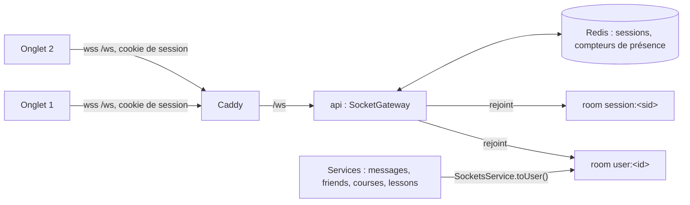
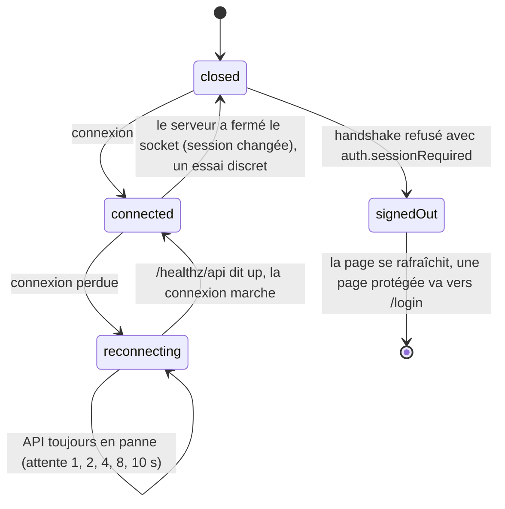

# Fonctionnalités temps réel avec WebSockets (Major, 2 points)

**Type :** Major. **Points :** 2. **Statut :** terminé.

Chaque onglet de navigateur d'un utilisateur connecté garde une connexion en direct ouverte vers le serveur. Par elle,
le serveur pousse les changements au moment où ils arrivent : un nouveau message, une demande d'ami, un ami
qui passe en ligne, ou un réglage de cours changé dans un autre onglet. Personne n'a besoin de recharger la page.

## Ce que demande le sujet

Le module est une ligne du tableau Web modules de [../subject/summary.md](../subject/summary.md) :

> | Major | Real-time features via WebSockets or similar (updates across clients, graceful dis/reconnect, efficient broadcasting) |

La partie obligatoire demande aussi ceci, et la même connexion y aide :

> - **Multi-user simultaneous support**: concurrent logins, concurrent actions handled correctly,
>   real-time updates propagated, no data corruption or race conditions.

## Comment on y répond

| Ce que demande le sujet                                  | Ce qu'on a construit                                                                                                                                                                                                                                                                                                                                                                                                                                                                                                                        | Où                                                                                                                                                                                                                                                                                                               |
| -------------------------------------------------------- | ------------------------------------------------------------------------------------------------------------------------------------------------------------------------------------------------------------------------------------------------------------------------------------------------------------------------------------------------------------------------------------------------------------------------------------------------------------------------------------------------------------------------------------------- | ---------------------------------------------------------------------------------------------------------------------------------------------------------------------------------------------------------------------------------------------------------------------------------------------------------------- |
| Fonctionnalités temps réel avec WebSockets ou équivalent | Un serveur socket.io (une bibliothèque WebSocket) dans l'API NestJS, sur le chemin `/ws`. Il n'utilise que le transport WebSocket, jamais le long-polling. Caddy envoie `/ws` à l'API.                                                                                                                                                                                                                                                                                                                                                      | [socket.gateway.ts](../../../apps/api/src/gateway/socket.gateway.ts), [Caddyfile](../../../infra/caddy/Caddyfile)                                                                                                                                                                                                |
| Mises à jour entre clients                               | Huit événements serveur. Quatre fonctionnalités en direct les utilisent : les messages directs et les nombres de non-lus, les demandes d'ami, le statut en ligne des amis, et les changements de cours qui s'affichent dans les autres onglets de l'utilisateur. L'action d'une personne s'affiche sur l'écran de l'autre personne, et dans tous ses propres onglets ouverts, sans rechargement.                                                                                                                                            | [packages/shared/src/events/socket.ts](../../../packages/shared/src/events/socket.ts), [messages.service.ts](../../../apps/api/src/messages/messages.service.ts), [friends.service.ts](../../../apps/api/src/friends/friends.service.ts), [courses.service.ts](../../../apps/api/src/courses/courses.service.ts) |
| Connexion propre                                         | Un socket est vérifié quand il s'ouvre : même cookie de session que le site, même origine, un compte qui existe encore. Un socket refusé ne se connecte jamais, et le navigateur n'affiche aucune erreur. À la connexion, le serveur envoie un état tout neuf : où en est chaque ami et ce qui n'est pas lu.                                                                                                                                                                                                                                | [socket.gateway.ts](../../../apps/api/src/gateway/socket.gateway.ts), [session-io.adapter.ts](../../../apps/api/src/gateway/session-io.adapter.ts)                                                                                                                                                               |
| Déconnexion et reconnexion propres                       | L'onglet réessaie avec une attente qui grandit (1, 2, 4, 8, puis 10 secondes). Avant chaque essai, il demande au serveur web si l'API est up, donc un serveur en panne ne provoque aucune erreur dans la console. Un libellé **Reconnecting…** s'affiche pendant l'attente. Une fois revenu, la page récupère ce qu'elle a manqué. Un ami qui recharge la page ne clignote pas hors ligne : le passage hors ligne n'est envoyé que 10 secondes après la fermeture de son dernier onglet. Se déconnecter ferme les sockets de cette session. | [tab-socket.ts](../../../apps/web/components/tab-socket.ts), [reconnect.ts](../../../apps/web/lib/reconnect.ts), [connection-status.tsx](../../../apps/web/components/connection-status.tsx), [presence.service.ts](../../../apps/api/src/presence/presence.service.ts)                                          |
| Diffusion efficace                                       | Chaque événement va dans une room (un groupe nommé de sockets) pour un utilisateur, `user:<id>`, jamais à tout le monde. Le seul moyen d'envoyer pour le reste de l'API est `SocketsService.toUser()`, qui s'adresse à un utilisateur. Le statut en ligne ne va qu'aux amis. Les événements sont petits : la plupart ne portent qu'un id ou une langue, et la page lit le reste elle-même. Les événements entrants sont limités par socket et vérifiés avec un schema.                                                                      | [sockets.service.ts](../../../apps/api/src/gateway/sockets.service.ts), [socket.gateway.ts](../../../apps/api/src/gateway/socket.gateway.ts)                                                                                                                                                                     |

Les trois points sont remplis. "Efficient broadcasting" est rempli en envoyant chaque événement seulement aux personnes
qu'il concerne. On ne diffuse pas à beaucoup d'utilisateurs à la fois, parce qu'aucune fonctionnalité n'en a besoin. Voir
[Limites et choix](#limites-et-choix).

## Comment ça marche

### Une connexion par onglet

1. **L'onglet ouvre le socket.** `ConnectionStatus` est dans le header de chaque page connectée
   et appelle `connectSocket()`. Le socket vit au niveau du module dans
   [tab-socket.ts](../../../apps/web/components/tab-socket.ts), pas dans un composant React. Donc passer
   d'une page à l'autre, ou changer la langue de l'interface, garde le même socket.
2. **Le serveur le vérifie.** Avant que le socket soit accepté, un middleware socket.io dans
   [socket.gateway.ts](../../../apps/api/src/gateway/socket.gateway.ts) (`authenticate`) :
   - lit la session avec le même middleware express-session que les routes REST
     ([session-io.adapter.ts](../../../apps/api/src/gateway/session-io.adapter.ts),
     [app.setup.ts](../../../apps/api/src/app.setup.ts)). Le cookie est le seul identifiant ;
   - refuse une page venant d'une autre origine (`sameOrigin`) ;
   - refuse une session qui a déjà 20 sockets (`SESSION_SOCKET_LIMIT`) ;
   - refuse un compte qui n'existe plus ;
   - fait rejoindre au socket deux rooms, `user:<id>` et `session:<sid>`, et vérifie encore une fois que la
     session existe toujours, au cas où une déconnexion aurait eu lieu pendant le handshake.

   Chaque refus est le code `auth.sessionRequired` (ou `server.rateLimited` pour trop de sockets,
   `server.unexpected` en cas d'échec). Le navigateur voit une connexion refusée, pas une erreur HTTP.

3. **Le serveur envoie un état complet.** Juste après la connexion, le nouveau socket seul reçoit un
   `presence:update` par ami, puis un `dm:unread` avec tous les nombres de non-lus (`arrived()`).
4. **Les services envoient des événements après leur écriture en base.** Par exemple, après qu'un message est stocké,
   `MessagesService.send()` appelle `toUser()` deux fois : une fois pour le destinataire, une fois pour l'expéditeur, pour que
   les autres onglets de l'expéditeur l'affichent aussi.

### Les événements

La liste est dans [packages/shared/src/events/socket.ts](../../../packages/shared/src/events/socket.ts).
L'API et l'app web l'importent toutes les deux, donc les noms et les payloads ne peuvent pas diverger.

| Événement                                                          | Sens                    | Envoyé quand                                                                                                                | Envoyé à                                                           | Ce que fait la page                                                                                         |
| ------------------------------------------------------------------ | ----------------------- | --------------------------------------------------------------------------------------------------------------------------- | ------------------------------------------------------------------ | ----------------------------------------------------------------------------------------------------------- |
| `course:updated { lang }`                                          | serveur vers navigateur | L'objectif quotidien ou le niveau change, ou une tentative de leçon se termine                                              | La room de l'utilisateur lui-même                                  | La page du cours et la page des succès rechargent leurs données depuis le serveur                           |
| `friend:request`, `friend:accepted`, `friend:removed` `{ userId }` | serveur vers navigateur | Une demande est envoyée, acceptée, refusée, annulée, ou un ami est retiré                                                   | Les deux utilisateurs                                              | `/friends`, `/users/<id>` et `/chat` rechargent leurs données                                               |
| `presence:update { userId, status, at }`                           | serveur vers navigateur | Le premier onglet d'un ami s'ouvre, ou 10 s après la fermeture de son dernier onglet. Aussi une fois par ami à la connexion | La room de chaque ami. À la connexion, seulement le nouveau socket | Le point vert ou gris change                                                                                |
| `dm:message { userId, message }`                                   | serveur vers navigateur | Un message est stocké                                                                                                       | Les deux utilisateurs                                              | Le fil l'ajoute. La liste des conversations la remonte en haut                                              |
| `dm:unread { counts, at }`                                         | serveur vers navigateur | Après un message, après une lecture, et à la connexion                                                                      | Un utilisateur                                                     | Les badges de non-lus se mettent à jour                                                                     |
| `app:error { code }`                                               | serveur vers navigateur | Un événement client est refusé et est arrivé sans ack                                                                       | Ce socket seulement                                                | Rien n'est affiché                                                                                          |
| `dm:send { userId, text }`                                         | navigateur vers serveur | L'utilisateur appuie sur **Send**                                                                                           |                                                                    | Le serveur répond avec un ack (une réponse à cet événement précis) : le message stocké, ou un code d'erreur |
| `dm:read { userId }`                                               | navigateur vers serveur | Un fil ouvert a des messages non lus et l'onglet est visible                                                                |                                                                    | Le serveur les marque comme lus et envoie `dm:unread`                                                       |

La plupart des événements serveur ne portent qu'un id ou une langue, pas les données elles-mêmes. La page demande ensuite
au serveur la page à jour (`router.refresh()` dans
[refresh-on.tsx](../../../apps/web/components/refresh-on.tsx)). Donc il y a une seule source de vérité,
l'API REST. Les messages sont l'exception : `dm:message` porte le message, parce que les messages sont
fréquents et qu'un rechargement complet coûte plusieurs appels à l'API
([conversation-list.tsx](<../../../apps/web/app/[locale]/(messages)/chat/conversation-list.tsx>)).

### Chaque événement entrant est vérifié

Les vérifications que NestJS fait sur chaque requête HTTP (ses guards et pipes globaux) ne tournent pas pour les événements
du socket, donc le gateway vérifie lui-même chaque événement, avant tout handler (`screen()` dans
[socket.gateway.ts](../../../apps/api/src/gateway/socket.gateway.ts)) :

- **Une limite de débit par socket :** 20 événements de chaque nom par 10 secondes (`EVENT_LIMIT`,
  `EVENT_WINDOW_MS`). Les noms d'événements inconnus partagent un seul budget.
- **Une limite de taille :** 16 Ko par message (`maxHttpBufferSize`).
- **Une vérification de schema :** le payload est analysé avec le schema Zod (un ensemble de règles pour les données) de cet
  événement, `CLIENT_EVENT_SCHEMAS`. Un événement inconnu n'a pas de schema et est refusé.
- **Un refus n'est jamais un crash.** Il reçoit une réponse avec un code d'erreur : par l'ack quand il y en
  a un, sinon avec `app:error` à ce socket seulement.
- Les erreurs levées dans un handler vont dans
  [socket-exception.filter.ts](../../../apps/api/src/gateway/socket-exception.filter.ts), qui répond
  de la même façon.

En plus de ça, chaque compte peut envoyer 30 messages par minute (`SEND_LIMIT_PER_MINUTE`) sur tous ses
sockets, dans [messages.service.ts](../../../apps/api/src/messages/messages.service.ts).

### Déconnexion et reconnexion

Les règles sont dans [reconnect.ts](../../../apps/web/lib/reconnect.ts) et la boucle est dans
[tab-socket.ts](../../../apps/web/components/tab-socket.ts) :

- **La reconnexion propre à socket.io est désactivée.** Notre boucle la remplace, donc rien n'essaie de se connecter pendant que l'API est
  en panne.
- **Backoff (attente croissante) :** 1, 2, 4, 8, puis 10 secondes, chacune décalée d'un quart dans un sens ou dans l'autre, pour que beaucoup d'onglets
  ne réessaient pas tous au même moment (`backoffMs`).
- **Pas d'erreur dans la console.** Une connexion WebSocket ratée est une erreur de la console du navigateur que le code ne peut pas cacher.
  Donc avant chaque essai, l'onglet demande `/healthz/api` au serveur web, qui répond toujours 200
  avec `{ "api": "up" }` ou `{ "api": "down" }`
  ([apps/web/app/healthz/api/route.ts](../../../apps/web/app/healthz/api/route.ts)). Il ne se connecte
  que quand l'API est up.
- **Un état visible :** `ConnectionStatus` affiche **Reconnecting…** en bas de la page pendant que
  l'onglet se reconnecte ([connection-status.tsx](../../../apps/web/components/connection-status.tsx),
  `Connection.reconnecting` dans [en.json](../../../apps/web/messages/en.json)).
- **Rattraper le retard.** Les événements envoyés pendant que l'onglet était absent sont perdus, donc après chaque reconnexion :
  `RefreshOn` recharge la page une fois ; le fil de chat ouvert récupère les messages les plus récents et les fusionne
  par id ([chat-thread.tsx](<../../../apps/web/app/[locale]/(messages)/chat/chat-thread.tsx>)) ;
  les états de présence et de non-lus envoyés à la connexion remettent les points et les badges à jour.
- **Pas d'envoi hors ligne.** Un message envoyé sans connexion échoue tout de suite avec
  `network.unreachable` ("Could not reach the server"), au lieu d'être mis en file d'attente et livré bien
  plus tard ([send-message.ts](../../../apps/web/lib/send-message.ts)).
- **Déconnecté ailleurs.** Quand le handshake est refusé avec `auth.sessionRequired`, l'onglet
  rafraîchit la page, et une page qui a besoin d'une session envoie l'utilisateur vers `/login`. Donc une déconnexion dans
  un autre onglet se voit ici aussi.
- **Firefox :** `closeOnBeforeunload: true` ferme le socket proprement quand la page se décharge, donc
  Firefox n'affiche pas de connexion interrompue.

Côté serveur :

- **Les sockets se terminent avec leur session.** `SocketsService.closeSession()` ferme tous les sockets d'un
  id de session. [auth.controller.ts](../../../apps/api/src/auth/auth.controller.ts) l'appelle à la déconnexion,
  et à chaque changement d'id de session : inscription, connexion, vérification 2FA, activation et désactivation de la 2FA.
  Toutes les 60 secondes, le gateway ferme aussi les sockets dont la session a expiré dans Redis
  (`closeEndedSessions`).
- **Le statut en ligne survit à un rechargement.** [presence.service.ts](../../../apps/api/src/presence/presence.service.ts)
  garde un compteur des sockets ouverts par utilisateur dans Redis (`presence:<id>`). Le premier socket met
  l'utilisateur en ligne. Un socket fermé n'est retiré du compteur qu'après 10 secondes (`PRESENCE_GRACE_MS`). Un
  rechargement ouvre son nouveau socket pendant ce temps, donc les amis ne voient rien changer.
- **Un redémarrage repart à zéro.** Aucun socket ne survit à un redémarrage de l'API, donc au démarrage les compteurs de présence sont
  supprimés (`onApplicationBootstrap`). Les onglets ouverts se reconnectent tout seuls.

### Métriques

Le gateway compte son travail pour Prometheus
([apps/api/src/metrics/metrics.ts](../../../apps/api/src/metrics/metrics.ts)) :

- `ft_ws_connections` : les connexions WebSocket ouvertes.
- `ft_ws_events_total{direction, event, outcome}` : les événements entrants et sortants, avec `ok`, `invalid` ou
  `rate_limited`.

Le dashboard Grafana **API** a une ligne **WebSocket** avec les panneaux **Open connections** et
**Events** ([api.json](../../../infra/monitoring/grafana/dashboards/api.json)). Voir
[../operations/monitoring.md](../operations/monitoring.md).

## Où est le code

| Chemin                                                                                                                                                                                                                                                                                                                    | Ce qu'il fait                                                                                                                                                                                                |
| ------------------------------------------------------------------------------------------------------------------------------------------------------------------------------------------------------------------------------------------------------------------------------------------------------------------------- | ------------------------------------------------------------------------------------------------------------------------------------------------------------------------------------------------------------ |
| [packages/shared/src/events/socket.ts](../../../packages/shared/src/events/socket.ts)                                                                                                                                                                                                                                     | Les noms des événements, leurs schemas Zod et leurs types, et `userRoom()`. Partagé par l'API et l'app web                                                                                                   |
| [apps/api/src/gateway/socket.gateway.ts](../../../apps/api/src/gateway/socket.gateway.ts)                                                                                                                                                                                                                                 | Le gateway : les vérifications du handshake, les rooms, l'état envoyé à la connexion, la présence à la connexion et à la déconnexion, la vérification de chaque événement entrant, le nettoyage des sessions |
| [apps/api/src/gateway/sockets.service.ts](../../../apps/api/src/gateway/sockets.service.ts)                                                                                                                                                                                                                               | `toUser()`, le seul moyen d'envoyer à un utilisateur, et `closeSession()`                                                                                                                                    |
| [apps/api/src/gateway/session-io.adapter.ts](../../../apps/api/src/gateway/session-io.adapter.ts)                                                                                                                                                                                                                         | Donne à socket.io le même middleware de session qu'Express                                                                                                                                                   |
| [apps/api/src/gateway/socket-exception.filter.ts](../../../apps/api/src/gateway/socket-exception.filter.ts)                                                                                                                                                                                                               | Transforme une erreur dans un handler en code d'erreur pour le client                                                                                                                                        |
| [apps/api/src/messages/messages.gateway.ts](../../../apps/api/src/messages/messages.gateway.ts)                                                                                                                                                                                                                           | Les handlers de `dm:send` et `dm:read`                                                                                                                                                                       |
| [apps/api/src/presence/presence.service.ts](../../../apps/api/src/presence/presence.service.ts)                                                                                                                                                                                                                           | Le compteur de sockets par utilisateur dans Redis et le délai de grâce de 10 secondes                                                                                                                        |
| [apps/api/src/messages/messages.service.ts](../../../apps/api/src/messages/messages.service.ts), [friends.service.ts](../../../apps/api/src/friends/friends.service.ts), [courses.service.ts](../../../apps/api/src/courses/courses.service.ts), [attempts.service.ts](../../../apps/api/src/lessons/attempts.service.ts) | Là où les événements sont envoyés, après chaque écriture                                                                                                                                                     |
| [apps/api/src/auth/auth.controller.ts](../../../apps/api/src/auth/auth.controller.ts)                                                                                                                                                                                                                                     | Ferme les sockets d'une session à la déconnexion et quand l'id de session change                                                                                                                             |
| [apps/web/components/tab-socket.ts](../../../apps/web/components/tab-socket.ts)                                                                                                                                                                                                                                           | Le socket unique de l'onglet, son état, la boucle de nouvel essai, les stockages de présence et de non-lus, et les hooks qu'utilisent les pages                                                              |
| [apps/web/lib/reconnect.ts](../../../apps/web/lib/reconnect.ts)                                                                                                                                                                                                                                                           | Les règles de reconnexion : le backoff, quoi faire après une déconnexion ou un refus, la sonde de l'API                                                                                                      |
| [apps/web/components/connection-status.tsx](../../../apps/web/components/connection-status.tsx)                                                                                                                                                                                                                           | Ouvre le socket sur les pages connectées et affiche **Reconnecting…**                                                                                                                                        |
| [apps/web/components/refresh-on.tsx](../../../apps/web/components/refresh-on.tsx)                                                                                                                                                                                                                                         | Recharge les données d'une page à un événement, et une fois après chaque reconnexion                                                                                                                         |
| [apps/web/components/presence-dot.tsx](../../../apps/web/components/presence-dot.tsx), [unread-badge.tsx](../../../apps/web/components/unread-badge.tsx)                                                                                                                                                                  | Le point en ligne et le badge des non-lus, mis à jour en direct                                                                                                                                              |
| [apps/web/lib/send-message.ts](../../../apps/web/lib/send-message.ts)                                                                                                                                                                                                                                                     | `dm:send` avec son ack et un timeout de 10 secondes                                                                                                                                                          |
| [apps/web/app/healthz/api/route.ts](../../../apps/web/app/healthz/api/route.ts)                                                                                                                                                                                                                                           | La sonde que l'onglet interroge avant chaque nouvel essai                                                                                                                                                    |
| [infra/caddy/Caddyfile](../../../infra/caddy/Caddyfile)                                                                                                                                                                                                                                                                   | Envoie `/ws` et `/ws/*` vers l'API                                                                                                                                                                           |

La conception est aussi décrite dans [../architecture/realtime.md](../architecture/realtime.md),
sections 1 et 3.

## Comment le montrer à la soutenance

Lance la stack avec `make run`. Elle affiche l'adresse, `https://localhost`. Utilise deux fenêtres de navigateur
avec des cookies séparés (par exemple une fenêtre normale et une fenêtre privée), pour pouvoir être deux personnes.

**1. Un changement dans un onglet s'affiche dans un autre onglet (même utilisateur).**

1. Dans la fenêtre A, clique sur **Create account** et inscris-toi en tant qu'utilisateur A.
2. Sur la page d'onboarding, choisis une langue et un objectif quotidien et clique sur **Next**. Clique sur **I already
   know my level**, choisis un niveau, puis **Start learning**. Tu arrives sur la page du cours,
   `/en/learn/<lang>`.
3. Ouvre la même page du cours dans un deuxième onglet de la fenêtre A.
4. Dans le premier onglet, change **Daily goal** dans le bloc **This course**.
5. Le deuxième onglet montre la nouvelle valeur sans rechargement. Fais la même chose avec **Level** et **Save**.

**2. Des mises à jour en direct entre deux personnes.**

1. Dans la fenêtre B, inscris-toi en tant qu'utilisateur B.
2. Les deux utilisateurs ouvrent **Friends** (`/friends`).
3. L'utilisateur A tape le display name de B dans **Search by display name**, clique sur **Search**, puis sur **Add
   friend**.
4. Sur l'écran de B, A apparaît sous **Requests received** sans rechargement. B clique sur **Accept**.
   Les deux listes montrent l'autre personne sous **Your friends**, avec un point vert (**Online**).
5. L'utilisateur A clique sur **Message** à côté de B. L'utilisateur B ouvre **Messages** (`/chat`).
6. A tape dans **Write a message** et clique sur **Send**. Le message apparaît tout de suite chez B, et
   le lien **Messages** du header de B affiche un badge rouge de non-lus jusqu'à ce que B ouvre la conversation.

**3. Déconnexion et reconnexion.**

1. Ferme la fenêtre B. Après environ 10 secondes, le point de B sur la page **Friends** de A devient gris
   (**Offline**). Une fenêtre privée oublie ses cookies quand elle se ferme, donc ouvre une nouvelle fenêtre
   privée, clique sur **Sign in** et connecte-toi en tant qu'utilisateur B : le point chez A redevient vert.
2. Recharge la page de B : le point chez A reste vert (le délai de grâce de 10 secondes).
3. Avec A sur la page du cours, redémarre l'API depuis la racine du dépôt :
   `docker compose restart --no-deps api` (la commande que lance
   [restart.spec.ts](../../../e2e/tests/restart.spec.ts)).
4. Un libellé **Reconnecting…** apparaît en bas de la page de A, puis disparaît quand l'API est
   revenue. La console du navigateur (DevTools) ne montre aucune erreur. A est toujours connecté, et un changement d'objectif
   depuis un autre onglet s'affiche de nouveau.
5. Clique sur **Sign out** dans un onglet de A. Les autres onglets de A perdent leur socket, et une page qui a besoin d'une
   session les envoie vers la page de connexion.

**4. En option : les métriques.** Ouvre Grafana sur `https://localhost/grafana` (utilisateur `admin`, mot de passe :
`grep GRAFANA_ADMIN_PASSWORD .env`, comme `make run` l'affiche). Ouvre le dashboard **API**, ligne
**WebSocket** : **Open connections** monte et descend avec les onglets.

## Les tests qui le prouvent

| Test                                                                                                                                                                                                                   | Ce qu'il vérifie                                                                                                                                                                                                                                                                                                                                                                                                    |
| ---------------------------------------------------------------------------------------------------------------------------------------------------------------------------------------------------------------------- | ------------------------------------------------------------------------------------------------------------------------------------------------------------------------------------------------------------------------------------------------------------------------------------------------------------------------------------------------------------------------------------------------------------------- |
| [e2e/tests/live.spec.ts](../../../e2e/tests/live.spec.ts) : "a goal changed in one tab shows in the other", "a level changed in one tab shows in the other"                                                            | Deux onglets d'un même compte : un changement dans l'un s'affiche dans l'autre, sans erreur dans la console                                                                                                                                                                                                                                                                                                         |
| [e2e/tests/restart.spec.ts](../../../e2e/tests/restart.spec.ts) : "an open page reconnects after an API restart, silently"                                                                                             | Un vrai redémarrage de l'API : **Reconnecting…** s'affiche, un nouveau socket se connecte, l'utilisateur reste connecté, les mises à jour en direct remarchent, pas d'erreur dans la console. Tourne seul après la suite, sur Chromium (`E2E_RESTART=1`, `make playwright`)                                                                                                                                         |
| [e2e/tests/friends.spec.ts](../../../e2e/tests/friends.spec.ts) : "a request shows up live, is accepted, and both lists follow", "a friend's dot goes grey when they leave and green when they come back"              | Deux personnes : les événements d'amis et le statut en ligne, sans rechargement                                                                                                                                                                                                                                                                                                                                     |
| [e2e/tests/messages.spec.ts](../../../e2e/tests/messages.spec.ts) : "a message arrives live, is counted, is read by opening the thread, and stays", "a message sent while the socket was down arrives when it is back" | Les messages en direct et les nombres de non-lus, et le rattrapage après une connexion perdue                                                                                                                                                                                                                                                                                                                       |
| [apps/api/test/gateway.e2e-spec.ts](../../../apps/api/test/gateway.e2e-spec.ts)                                                                                                                                        | Avec une vraie base de données et Redis : le handshake refuse l'absence de session, un cookie falsifié, une autre origine et un 21e socket ; les sockets se ferment à la déconnexion, à une nouvelle connexion, à l'expiration et à un changement de 2FA ; `course:updated` n'atteint que les sockets de l'utilisateur ; un événement inconnu reçoit `app:error` et le socket reste connecté ; la limite par socket |
| [apps/api/test/messages.e2e-spec.ts](../../../apps/api/test/messages.e2e-spec.ts), [friends.e2e-spec.ts](../../../apps/api/test/friends.e2e-spec.ts)                                                                   | Un message atteint le destinataire et chaque onglet de l'expéditeur ; un ami apprend que tu passes en ligne, et quelqu'un qui t'a seulement envoyé une demande ne l'apprend pas ; un inconnu ne reçoit aucun événement d'ami                                                                                                                                                                                        |
| [apps/api/src/gateway/socket.gateway.spec.ts](../../../apps/api/src/gateway/socket.gateway.spec.ts)                                                                                                                    | Les tests unitaires du handshake, de la vérification des événements (inconnu, invalide, inondation, ack), de la présence à la connexion et à la déconnexion, de l'état des non-lus et du nettoyage des sessions                                                                                                                                                                                                     |
| [apps/api/src/gateway/sockets.service.spec.ts](../../../apps/api/src/gateway/sockets.service.spec.ts)                                                                                                                  | Les envois ne vont qu'à la room de l'utilisateur ; `closeSession` ferme les sockets de cette session et ceux de personne d'autre                                                                                                                                                                                                                                                                                    |
| [apps/api/src/presence/presence.service.spec.ts](../../../apps/api/src/presence/presence.service.spec.ts)                                                                                                              | Le délai de grâce : hors ligne seulement après lui, pas de deuxième "online" sur un rechargement, un compteur ne reste jamais sous zéro, la remise à zéro au démarrage                                                                                                                                                                                                                                              |
| [apps/api/src/gateway/socket-exception.filter.spec.ts](../../../apps/api/src/gateway/socket-exception.filter.spec.ts)                                                                                                  | Une erreur de handler devient un ack ou un `app:error` avec un code                                                                                                                                                                                                                                                                                                                                                 |
| [apps/web/lib/reconnect.test.ts](../../../apps/web/lib/reconnect.test.ts)                                                                                                                                              | Les valeurs du backoff, ce qui se passe après chaque type de déconnexion, la sonde de l'API                                                                                                                                                                                                                                                                                                                         |
| [apps/web/lib/send-message.test.ts](../../../apps/web/lib/send-message.test.ts), [presence.test.ts](../../../apps/web/lib/presence.test.ts), [unread.test.ts](../../../apps/web/lib/unread.test.ts)                    | L'envoi avec un ack et un timeout, la carte de présence de l'onglet, les états des non-lus qui arrivent dans le désordre                                                                                                                                                                                                                                                                                            |
| [packages/shared/src/events/socket.test.ts](../../../packages/shared/src/events/socket.test.ts)                                                                                                                        | Aucun événement n'utilise un nom réservé par socket.io ; chaque événement entrant a un schema ; les schemas des payloads                                                                                                                                                                                                                                                                                            |

Comment les lancer : `make test` lance les tests unitaires. Les tests e2e de l'API ont besoin d'une vraie base de données et de Redis,
et tournent dans `make ci`. `make test-e2e` lance Playwright sur la stack de production, puis le
test de redémarrage. `make playwright-all` lance Playwright sur Chromium, Firefox et WebKit, comme la CI.

## Limites et choix

- **Une seule instance de l'API.** Les rooms vivent dans la mémoire du processus de l'API. Avec deux copies de l'API, un événement
  envoyé par l'une manquerait un utilisateur connecté à l'autre. Il faudrait pour ça l'adaptateur Redis de socket.io,
  qu'on n'a pas ajouté (`InterServerEvents` est vide dans
  [socket.ts](../../../packages/shared/src/events/socket.ts)). La remise à zéro de la présence au démarrage suppose aussi
  une seule instance. Le projet fait tourner un seul container d'API, donc ça suffit.
- **Pas de diffusion à tout le monde.** C'est voulu : `SocketsService` ne peut s'adresser qu'à un utilisateur. Aucune fonctionnalité
  n'envoie la même chose à tous les utilisateurs. "Efficient broadcasting" veut dire ici que chaque événement n'atteint que
  les personnes qu'il concerne.
- **Les événements manqués hors ligne ne sont pas rejoués.** Il n'y a pas de file d'événements. À la place, la page
  recharge ses données après chaque reconnexion, et le chat récupère ses messages les plus récents.
- **Les messages ne sont pas mis en file d'attente hors ligne.** Un envoi sans connexion échoue tout de suite. Si l'ack
  n'arrive pas en 10 secondes, la page dit que l'envoi a échoué, mais le serveur a peut-être stocké
  le message, donc l'envoyer de nouveau peut l'afficher deux fois
  ([send-message.ts](../../../apps/web/lib/send-message.ts)).
- **Un rechargement, pas un correctif.** La plupart des événements font recharger à la page ses données depuis le serveur. Ça coûte
  quelques appels à l'API, mais il n'y a qu'une seule source de vérité.
- **Deux états seulement :** en ligne et hors ligne. Il n'y a pas de statut "absent".
- **La discussion de leçon n'utilise pas le socket.** Elle envoie la réponse du tuteur en streaming par
  Server-Sent Events sur un `POST` normal, parce que c'est un apprenant et une réponse
  ([../architecture/realtime.md](../architecture/realtime.md), section 1). Elle fait partie du module
  LLM, pas de celui-ci.
- **Partagé avec d'autres modules.** Le chat appartient à
  [user-interaction.md](./user-interaction.md) et le statut en ligne à
  [user-management.md](./user-management.md). Ce module revendique la couche temps réel en dessous :
  la connexion, les rooms, la reconnexion et les mises à jour en direct.

## Qui l'a construit

D'après `git log --follow` sur les fichiers ci-dessus et `gh pr view` sur chaque pull request.

| Membre  | GitHub                                     | Ce qu'il a construit                                                                                                                                                                                                                                                                                                                                                                                                                                                                                                                                                                                                  | Issues et PRs                                                              |
| ------- | ------------------------------------------ | --------------------------------------------------------------------------------------------------------------------------------------------------------------------------------------------------------------------------------------------------------------------------------------------------------------------------------------------------------------------------------------------------------------------------------------------------------------------------------------------------------------------------------------------------------------------------------------------------------------------- | -------------------------------------------------------------------------- |
| Victor  | `VictorBro`                                | Le gateway et les vérifications de son handshake, les rooms, `SocketsService`, la vérification des événements entrants, la fermeture des sockets avec leur session, le nettoyage des sessions, les métriques, `course:updated`, le socket de l'onglet avec sa boucle de reconnexion, **Reconnecting…**, `RefreshOn`, la sonde `/healthz/api`, et les tests e2e en direct et de redémarrage. Puis les événements d'amis, la mise à jour du jour d'activité à la connexion, et les événements des messages directs (`dm:send`, `dm:read`, `dm:message`, `dm:unread`) avec `MessagesGateway` et `SocketExceptionFilter`. | #181 (ferme #154), #189 (ferme #155), #193 (ferme #156), #200 (ferme #158) |
| Endrit  | `VYAntares` (commits en tant que `EA`)     | Le statut en ligne : `PresenceService` avec ses compteurs Redis et son délai de grâce, `presence:update` vers les amis, l'état envoyé à la connexion, et la carte de présence de l'onglet.                                                                                                                                                                                                                                                                                                                                                                                                                            | #195 (ferme #157)                                                          |
| Anaïs   | `avarrett` (commits en tant que `ninisse`) | Une leçon terminée envoie `course:updated`, avec son test e2e de l'API.                                                                                                                                                                                                                                                                                                                                                                                                                                                                                                                                               | #190 (ferme #145)                                                          |
| Bastian | `bastian-schnitzler`                       | A adapté le test e2e à deux onglets au nouveau sélecteur de niveau de la page du cours.                                                                                                                                                                                                                                                                                                                                                                                                                                                                                                                               | #186 (ferme #86)                                                           |
