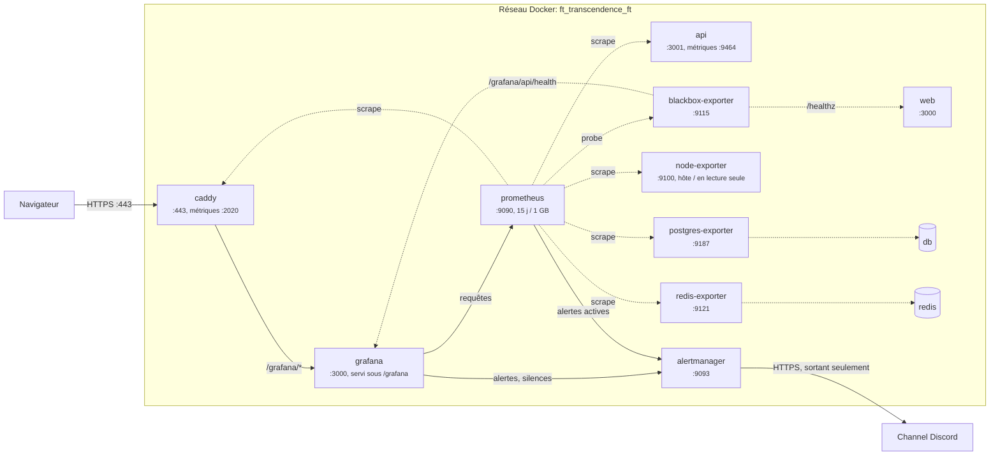

# Monitoring

Le module Majeur "Monitoring system with Prometheus and Grafana" : Prometheus collecte les métriques
de l'app, des stores (bases de données) et de l'hôte, Grafana les montre sur quatre dashboards derrière son propre
login, et des règles d'alerte postent sur Discord à travers Alertmanager.
Documents liés : [architecture/overview.md](../architecture/overview.md) (où il se place dans la stack),
[operations/deployment.md](deployment.md) (le serveur), [operations/versions.md](versions.md) (la source des images et la branche LTS de Prometheus).

| Le sujet demande                      | Ici                                                                                                       |
| ------------------------------------- | --------------------------------------------------------------------------------------------------------- |
| Prometheus qui collecte des métriques | 8 jobs de scrape (7 cibles uniques, plus les 3 probes du job blackbox), toutes les 30 s (section 1)       |
| Des exporters et des intégrations     | les exporters node, postgres, redis et blackbox ; les métriques propres à Caddy et à l'API (section 5)    |
| Des dashboards Grafana personnalisés  | Overview, API, Learning, Infrastructure, provisionnés depuis le dépôt (section 3)                         |
| Des règles d'alerte                   | 25 règles, testées unitairement avec promtool, routées vers Discord (section 4)                           |
| Un accès sécurisé à Grafana           | seulement le login de Grafana, pas d'inscription, pas d'accès anonyme, rien d'autre de publié (section 6) |

---

## 1. Ce qui tourne et où

Sept services rejoignent le réseau `ft`. Aucun ne publie de port.

| Service             | Image                                             | Rôle                                                                       | Port (interne)              | `mem_limit` |
| ------------------- | ------------------------------------------------- | -------------------------------------------------------------------------- | --------------------------- | ----------- |
| `prometheus`        | construite depuis `infra/monitoring/prometheus`   | scrape chaque cible, évalue les règles, envoie les alertes à Alertmanager  | 9090                        | 256m        |
| `alertmanager`      | construite depuis `infra/monitoring/alertmanager` | regroupe, inhibe et route les alertes vers Discord                         | 9093                        | 64m         |
| `grafana`           | construite depuis `infra/monitoring/grafana`      | dashboards ; vues en lecture seule des règles, des alertes et des silences | 3000, servi sous `/grafana` | 320m        |
| `node-exporter`     | upstream                                          | CPU, mémoire, swap, charge et disque racine de l'hôte                      | 9100                        | 48m         |
| `postgres-exporter` | upstream                                          | Postgres up, connexions, transactions, cache, taille, deadlocks            | 9187                        | 48m         |
| `redis-exporter`    | upstream                                          | Redis up, mémoire, clients, commandes, état de l'AOF, sessions stockées    | 9121                        | 32m         |
| `blackbox-exporter` | upstream                                          | sonde `/healthz` et `/healthz/upstream` de web, et la santé de Grafana     | 9115                        | 32m         |

Deux services existants gagnent un listener interne, et aucun port publié :

| Service | Listener | Sert                                                                                                      |
| ------- | -------- | --------------------------------------------------------------------------------------------------------- |
| `api`   | `:9464`  | seulement `GET /metrics`, depuis un simple serveur `node:http` en dehors de Nest (`apps/api/src/metrics`) |
| `caddy` | `:2020`  | les métriques des requêtes de Caddy, sur un site à part. L'API d'admin sur `:2019` reste sur loopback     |

Prometheus a 10 cibles dans 8 jobs : 7 jobs avec une cible chacun, plus le job blackbox et ses 3 probes. Il les
scrape et évalue les règles toutes les 30 s, et garde 15 jours ou 1 GB de données, selon la limite atteinte
en premier.



### Quand il tourne

| Stack                                       | Fichiers                               | Monitoring                                                                                                                                                               |
| ------------------------------------------- | -------------------------------------- | ------------------------------------------------------------------------------------------------------------------------------------------------------------------------ |
| `make dev`                                  | `compose.yml` + `compose.override.yml` | éteint : l'override met les sept services derrière le profil `monitoring`, pour que les laptops restent légers, et `make dev` supprime ceux que `make` a laissés tourner |
| `make monitoring-up`                        | les mêmes, avec `--profile monitoring` | allumé, construit depuis `infra/monitoring/*`                                                                                                                            |
| `make`, `make up`, e2e.yml, les évaluateurs | `-f compose.yml -f compose.prod.yml`   | toujours allumé : l'override n'est pas chargé, donc il n'y a pas de profil                                                                                               |
| Le serveur                                  | `compose.deploy.yml`                   | toujours allumé, images tirées depuis GHCR                                                                                                                               |

### Où vit la config

| Config                                                          | Dans                                      | Arrive dans le container par                      |
| --------------------------------------------------------------- | ----------------------------------------- | ------------------------------------------------- |
| `prometheus.yml`, `rules/alerts.yml`                            | `infra/monitoring/prometheus/`            | un `COPY` dans son Dockerfile                     |
| `alertmanager.yml`, `silent.yml`, `templates/`, `entrypoint.sh` | `infra/monitoring/alertmanager/`          | un `COPY` dans son Dockerfile                     |
| `grafana.ini`, `provisioning/`, `dashboards/`, `entrypoint.sh`  | `infra/monitoring/grafana/`               | un `COPY` dans son Dockerfile                     |
| L'URL racine, les secrets de Grafana, le webhook Discord        | `.env`                                    | `environment:` de compose                         |
| La route `/grafana` et le site `:2020`                          | `infra/caddy/Caddyfile`, `Caddyfile.prod` | le bind mount existant, le `Caddyfile` du serveur |

Intégrée dans les images plutôt que montée en bind mount, parce que le serveur n'a pas de checkout et contient exactement trois fichiers
(operations/deployment.md). images.yml publie les trois images avec le même label de révision que `api` et
`web`, donc `deploy.sh` déploie un changement de règle ou de dashboard comme n'importe quel changement de code, et le dev, la CI et
le serveur font tourner la même config. Le prix à payer : une modification de config en dev demande une reconstruction, que
`make monitoring-up` fait en quelques secondes.

---

## 2. Ouvrir Grafana

| Depuis                           | URL                                                                                                                                                   | Mot de passe                                        |
| -------------------------------- | ----------------------------------------------------------------------------------------------------------------------------------------------------- | --------------------------------------------------- |
| Ton navigateur                   | <https://localhost/grafana> (`https://localhost:<HTTPS_PORT>/grafana` quand `HTTPS_PORT` dans `.env` n'est pas 443, comme sur toutes les machines 42) | `grep GRAFANA_ADMIN_PASSWORD .env`                  |
| Un terminal dans le devcontainer | `https://caddy/grafana`                                                                                                                               | le même                                             |
| Le serveur                       | <https://transcendence.dpdns.org/grafana>                                                                                                             | `grep GRAFANA_ADMIN_PASSWORD ~/.env` sur le serveur |

L'utilisateur est `admin`. Il n'y a pas d'autre compte et pas d'inscription.

`make`, `make up` et `make monitoring-up` lancent d'abord `make env-file`. Il crée `.env` à partir de
`.env.example` s'il n'existe pas, et écrit 48 caractères hex aléatoires dans
`GRAFANA_ADMIN_PASSWORD` et `GRAFANA_SECRET_KEY` quand ils sont vides. Il ne change jamais une valeur
déjà définie. Le `.env` du serveur se remplit à la main (operations/deployment.md).

### Le mot de passe est appliqué une seule fois

Grafana utilise `GRAFANA_ADMIN_PASSWORD` seulement quand le volume `grafana-data` est créé. Changer
`.env` plus tard ne change rien tant que tu ne fais pas de reset. Modifie `.env`, lance `make up` (ou
`make monitoring-up`) pour que grafana soit recréé avec la nouvelle valeur, puis :

```bash
docker compose exec grafana sh -c 'grafana cli --homepath /usr/share/grafana admin reset-admin-password "$GF_SECURITY_ADMIN_PASSWORD"'
```

Les guillemets simples sont voulus : c'est le container qui remplace la variable, donc `.env` reste la seule source et
le mot de passe n'arrive jamais dans l'historique de ton shell. Sur le serveur, utilise
`docker compose -f compose.deploy.yml exec grafana ...`. En local, `make clean` marche aussi, en
supprimant `grafana-data` avec tous les autres volumes.

`GRAFANA_SECRET_KEY` remplace la clé fournie avec Grafana, qui est publiée dans son code source. Définis-la
une seule fois : la changer plus tard casse tout ce que Grafana a chiffré.

### Trouver ton chemin

- **Home** est le dashboard Overview. **Dashboards**, dossier `ft_transcendence`, contient les quatre.
- **Alerting** liste les 25 règles Prometheus avec leur état, les alertes que garde Alertmanager, et
  ses silences. Choisis la source de données Alertmanager en haut des pages des alertes et des silences.
  Un silence créé là rend aussi Discord muet.
- **Explore** interroge Prometheus directement, pour tout ce qu'aucun panel ne montre.

Les dashboards sont provisionnés : tu peux modifier un panel dans le navigateur, mais l'enregistrement est refusé
("Cannot save provisioned dashboard"). Le dépôt est la source de vérité (section 7).

---

## 3. Les dashboards

Chaque dashboard se rafraîchit toutes les 30 s, s'ouvre sur les 6 dernières heures, et partage le curseur entre
les panels. Overview et API marquent chaque redémarrage de l'API avec une annotation "Deploys" : le stat Version
ne peut pas le faire, parce que sur le serveur la version est toujours `latest`.

### Overview (`ft-overview`, le dashboard d'accueil)

Est-ce que l'app est en marche, et est-ce que quelque chose brûle.

| Ligne    | Panels                                                                                                                                      |
| -------- | ------------------------------------------------------------------------------------------------------------------------------------------- |
| Is it up | API, Web, Web to API, Postgres, Redis, Caddy (Up en vert, Down en rouge) ; cibles down ; version en cours                                   |
| Traffic  | requêtes à travers Caddy par statut ; ratio de 5xx de l'API ; latence de l'API p50, p95 et p99 ; connectés en ce moment ; sessions stockées |
| Alerts   | alertes actives ; alertes en attente                                                                                                        |
| Host     | mémoire utilisée ; disque utilisé sur `/` ; CPU occupé                                                                                      |

Les panels de latence laissent de côté `static`, `unmatched` et `/api/health` : les health checks sont fréquents
et rapides, et tireraient les percentiles vers le bas.

### API (`ft-api`)

Comment se comporte l'API NestJS, route par route. Variable : `route` (choix multiple).

| Ligne     | Panels                                                                                                                                                                                       |
| --------- | -------------------------------------------------------------------------------------------------------------------------------------------------------------------------------------------- |
| Traffic   | requêtes par route ; réponses par statut ; requêtes en cours                                                                                                                                 |
| Latency   | p95 par route ; heatmap de latence ; les 10 routes les plus lentes sur la dernière heure                                                                                                     |
| Auth      | connexions par résultat (200 connecté, 202 deuxième facteur demandé, 401 mauvais identifiants, 429 limité) ; inscriptions sur 24 h ; échecs 2FA ; requêtes limitées (rate-limited) par route |
| Runtime   | lag p99 de l'event loop ; RSS et heap ; CPU ; temps de GC par type ; redémarrages sur la dernière heure                                                                                      |
| WebSocket | connexions ouvertes ; événements par direction, événement et résultat                                                                                                                        |

### Learning (`ft-learning`)

Ce que font les apprenants, et si la banque de questions suit. Variable : `lang` (choix multiple).

| Ligne         | Panels                                                                                                                                                                                                 |
| ------------- | ------------------------------------------------------------------------------------------------------------------------------------------------------------------------------------------------------ |
| People        | comptes ; connectés sur les 5 dernières minutes ; sessions stockées                                                                                                                                    |
| Placement     | examens par heure par événement (started, completed, quit) ; taux de complétion sur 24 h ; questions servies par source ; niveaux dont le stock s'est vidé sur la dernière heure                       |
| Question bank | questions par niveau et par source ; les 10 cases les plus pauvres, cases vides comprises ; réapprovisionnements par résultat ; échecs de réapprovisionnement par raison ; questions générées sur 24 h |
| LLM           | fournisseur et modèle ; appels par résultat ; latence p95 ; tokens par heure ; discussion de leçon : ses appels par résultat et ses messages refusés par une limite                                    |

"Questions served by source" (questions servies par source) montre `written`, `generated` et `seen_fallback`. Le dernier, c'est un
apprenant qui a vu toutes les questions de ce niveau et en reçoit une ancienne à nouveau.

**Lesson discussion** (#150), le dernier panel de la ligne LLM, met deux séries sur un seul graphe par
`$__rate_interval` :

| Série                | Requête                                                                                             | Se lit comme                                                                                                                                                                                          |
| -------------------- | --------------------------------------------------------------------------------------------------- | ----------------------------------------------------------------------------------------------------------------------------------------------------------------------------------------------------- |
| `{{outcome}}`        | `sum by (outcome) (increase(ft_llm_requests_total{purpose="lesson-discussion"}[$__rate_interval]))` | Les réponses du tuteur qui ont atteint Gemini, selon comment elles se sont terminées : `ok`, ou la raison de l'échec que l'apprenant a vue comme un événement d'erreur `llm.*`                        |
| `refused: {{limit}}` | `sum by (limit) (increase(ft_llm_discussion_limited_total[$__rate_interval]))`                      | Les messages qui ont reçu un 429 avant tout appel au LLM : `user_minute` ou `user_day` (un apprenant trop rapide, `llm.tooManyMessages`), `global_minute` (tout le monde ensemble, `llm.rateLimited`) |

Un `global_minute` constant veut dire que le budget de la clé partagée est trop petit pour le trafic : augmente
`LLM_DISCUSSION_GLOBAL_PER_MINUTE` seulement si le quota de la clé le permet ([operations/deployment.md](deployment.md)
§5). `rate_limited` parmi les résultats veut dire que Google a refusé malgré notre propre limite, donc la nôtre est réglée
au-dessus du quota de la clé. Un apprenant qui ferme la page au milieu d'une réponse n'apparaît dans aucune des deux : aucun résultat n'est
compté pour un stream annulé.

Avec `LLM_PROVIDER=fixture`, le défaut partout où les évaluateurs lancent le projet, la ligne LLM affiche "fixture"
et aucun appel, et les échecs de réapprovisionnement apparaissent comme `llm_disabled`. Un panel texte en haut de la ligne
le dit, pour que les graphes vides ne donnent pas l'impression d'être cassés.

### Infrastructure (`ft-infrastructure`)

L'hôte, les stores, Caddy, et la stack de monitoring elle-même.

| Ligne      | Panels                                                                                                                                                                   |
| ---------- | ------------------------------------------------------------------------------------------------------------------------------------------------------------------------ |
| Host       | CPU par mode (y compris `steal`, qui compte sur un cœur partagé) ; charge comparée aux cœurs ; mémoire et swap utilisés ; disque libre sur `/` ; disque occupé           |
| Postgres   | connexions comparées à `max_connections` ; connexions par état ; transactions et rollbacks par seconde ; ratio de hits du cache ; taille de la base ; deadlocks sur 24 h |
| Redis      | mémoire ; commandes par seconde ; clients ; clés ; ratio de hits ; dernière écriture de l'AOF                                                                            |
| Caddy      | requêtes par statut ; time to first byte p95 ; requêtes en cours (un WebSocket ouvert compte pendant toute sa vie)                                                       |
| Monitoring | chaque cible, up ou down ; durée de scrape par job ; séries actives ; taille de la TSDB sur le disque ; mémoire par processus ; notifications envoyées et en échec       |

"Memory per process" (mémoire par processus) couvre seulement les processus que Prometheus scrape : l'API, Caddy, Prometheus,
Alertmanager et les exporters. Grafana, web et le serveur Postgres n'y sont pas, et Redis a
son propre panel. `docker stats` couvre le reste.

---

## 4. Les alertes

Prometheus évalue `infra/monitoring/prometheus/rules/alerts.yml` toutes les 30 s et envoie les
alertes actives à Alertmanager. Alertmanager les regroupe par nom, applique les inhibitions ci-dessous, et poste
sur Discord quand `DISCORD_WEBHOOK_URL` est défini. Sans webhook, il charge `silent.yml` et n'envoie
rien. Dans les deux cas, Grafana montre chaque règle et chaque alerte derrière son login.

Deux niveaux de gravité. **critical** : les apprenants voient une panne. **warning** : dégradé, ou sur le point de l'être.

### Les règles

| #   | Groupe       | Alerte                      | Se déclenche quand                                                                               | Durée | Gravité  |
| --- | ------------ | --------------------------- | ------------------------------------------------------------------------------------------------ | ----- | -------- |
| 1   | availability | `ApiDown`                   | Prometheus n'arrive pas à scraper l'API                                                          | 1m    | critical |
| 2   | availability | `WebDown`                   | la probe `/healthz` de web échoue                                                                | 1m    | critical |
| 3   | availability | `WebCannotReachApi`         | la probe `/healthz/upstream` de web échoue : web n'arrive pas à joindre l'API                    | 2m    | warning  |
| 4   | availability | `PostgresDown`              | Postgres refuse les connexions (`pg_up` vaut 0)                                                  | 1m    | critical |
| 5   | availability | `RedisDown`                 | Redis est down (`redis_up` vaut 0)                                                               | 1m    | critical |
| 6   | availability | `GrafanaDown`               | la probe de santé de Grafana échoue                                                              | 5m    | warning  |
| 7   | availability | `TargetDown`                | une autre cible ne peut pas être scrapée                                                         | 5m    | warning  |
| 8   | api          | `ApiErrorRateHigh`          | plus de 5 % des requêtes de l'API répondent 5xx, avec au moins 3 requêtes par minute             | 5m    | critical |
| 9   | api          | `ApiLatencyHigh`            | la latence p95 de l'API dépasse 1 s, health checks exclus                                        | 10m   | warning  |
| 10  | api          | `ApiRestarting`             | l'API a redémarré deux fois ou plus en 15 minutes                                                | 0m    | warning  |
| 11  | api          | `ApiEventLoopBlocked`       | le lag p99 de l'event loop dépasse 500 ms                                                        | 5m    | warning  |
| 12  | api          | `SignInFailuresSpike`       | plus de 20 connexions et vérifications 2FA en échec (401) ou limitées (429) par minute           | 5m    | warning  |
| 13  | learning     | `QuestionRestocksFailing`   | plus de 3 échecs de réapprovisionnement en 15 minutes, `llm_disabled` exclu                      | 5m    | warning  |
| 14  | learning     | `LlmErrorRateHigh`          | plus de la moitié des appels au LLM sur 15 minutes échouent                                      | 15m   | warning  |
| 15  | learning     | `PlacementPoolExhausted`    | un apprenant n'a plus eu de questions pour une langue et un niveau dans les 30 dernières minutes | 0m    | warning  |
| 16  | stores       | `PostgresConnectionsHigh`   | Postgres dépasse 80 % de `max_connections`                                                       | 5m    | warning  |
| 17  | stores       | `PostgresDeadlocks`         | Postgres a détecté un deadlock dans les 10 dernières minutes                                     | 0m    | warning  |
| 18  | stores       | `RedisAofWriteFailing`      | Redis n'arrive pas à écrire son AOF, donc les sessions ne sont pas sauvegardées                  | 1m    | critical |
| 19  | host         | `HostMemoryLow`             | moins de 10 % de la RAM et du swap ensemble est disponible                                       | 5m    | critical |
| 20  | host         | `HostDiskAlmostFull`        | moins de 15 % de `/` est libre                                                                   | 10m   | warning  |
| 21  | host         | `HostDiskFullSoon`          | selon la tendance des 6 dernières heures, `/` sera plein dans moins d'un jour                    | 30m   | warning  |
| 22  | host         | `HostCpuSaturated`          | le CPU dépasse 90 %, idle, iowait et steal exclus                                                | 15m   | warning  |
| 23  | monitoring   | `AlertNotificationsFailing` | Alertmanager n'a pas réussi à livrer à Discord dans les 15 dernières minutes                     | 0m    | warning  |
| 24  | monitoring   | `AlertmanagerUnreachable`   | Prometheus n'a aucun Alertmanager à qui envoyer                                                  | 5m    | warning  |
| 25  | monitoring   | `RuleEvaluationFailing`     | une règle n'a pas pu être évaluée dans les 10 dernières minutes                                  | 0m    | warning  |

Chaque règle porte un `summary` d'une ligne, qui devient le message Discord, et une `description`
qui dit quoi vérifier en premier. Les tests unitaires dans
`infra/monitoring/prometheus/tests/alerts.test.yml` tournent avec `promtool test rules` dans la CI. Chaque
règle critical a un test de déclenchement, parce que c'est elle qui poste sur Discord toutes les heures.

Pourquoi certaines règles ont cette forme :

- **13** exclut `llm_disabled` : le fournisseur fixture fait échouer chaque réapprovisionnement exprès, et c'est
  le défaut là où les évaluateurs lancent le projet.
- **14 et 15** lisent des séries que l'API crée à 0 au démarrage (section 5), donc le premier échec compte.
  Avec la fixture, la règle 14 n'a aucune série et ne se déclenche jamais.
- **19** compte le swap. L'OOM killer agit quand la RAM et le swap sont tous les deux épuisés, et le serveur de 1 GB est
  censé rester près de 90 % de RAM avec un fichier de swap. Une règle sur la RAM seule posterait une alerte critical
  toutes les heures alors que tout va bien. Sans swap (laptops, CI), les deux reviennent au même.
- **Aucune ne devrait se déclencher pendant un `make` normal.** La suite Playwright produit quelques 401,
  pas 20 par minute pendant 5 minutes, et chaque règle basée sur un taux attend 5 minutes ou plus.

### Le routage

| Réglage           | Valeur                 | Pourquoi                                                                                                           |
| ----------------- | ---------------------- | ------------------------------------------------------------------------------------------------------------------ |
| Regroupé par      | `alertname`            | un message par type de problème                                                                                    |
| `group_wait`      | 30 s                   | le premier message attend le reste de son groupe                                                                   |
| `group_interval`  | 1 m                    | une alerte résolue n'est envoyée qu'au tick suivant : une courte panne dit qu'elle est finie en une minute ou deux |
| `repeat_interval` | 4 h, 1 h pour critical | une panne se répète toutes les heures jusqu'à ce qu'elle soit réparée ou mise en silence                           |

Les inhibitions, pour qu'une cause envoie un seul message : tant que `ApiDown` est actif, `WebCannotReachApi` et les alertes
de taux d'erreur, de latence, de redémarrage et d'event loop de l'API sont muettes. Tant que `PostgresDown` ou
`RedisDown` est actif, `ApiErrorRateHigh`, `ApiLatencyHigh` et `QuestionRestocksFailing` sont muettes.
Grafana les montre quand même ; seul Discord reste silencieux. Les inhibitions sont seulement dans `alertmanager.yml` :
sans webhook, `silent.yml` n'en a aucune, donc les groupes d'alertes de Grafana montrent aussi les alertes muettes
comme actives.

Après `docker compose stop api`, `ApiDown` arrive sur Discord en environ 2 à 2,5 minutes : jusqu'à 30 s
avant le scrape raté, jusqu'à 30 s avant l'évaluation, la minute du `for`, et les 30 s de `group_wait`. Le
message de résolution suit `docker compose start api` en environ 1 à 2 minutes.

### Le webhook Discord

Le webhook est un identifiant secret : toute personne qui a l'URL peut poster dans le channel. Donc :

- Il vit seulement dans `.env`, sous le nom `DISCORD_WEBHOOK_URL`. Les deux modèles le laissent vide, et rien dans
  le dépôt n'en contient un vrai.
- Alertmanager ne remplace jamais les variables d'environnement dans sa config (issue upstream #504), donc
  l'entrypoint de l'image écrit la variable dans un fichier sur un tmpfs, en mode 0600, la supprime, et la
  config lit le fichier avec `webhook_url_file`. Elle n'arrive jamais sur un volume.
- Vide veut dire `silent.yml`, et le log du container dit
  `alertmanager: DISCORD_WEBHOOK_URL is empty, alerts are not sent anywhere`. Ça ne veut jamais dire une
  notification en échec par alerte.
- Garde-le vide sur un laptop, pour que `make` ne poste pas ses lancements de test à l'équipe. Définis-le sur le
  serveur.
- Comme toutes les valeurs de `.env`, il est visible par toute personne qui peut lancer `docker inspect` sur l'hôte.

Pour en créer un dans Discord : Server Settings, Integrations, Webhooks, New Webhook, choisis le channel,
Copy Webhook URL. Puis ajoute-le dans `.env` (sur le serveur, avec la ligne `read -rs` de
operations/deployment.md, pour qu'il reste hors de l'historique de ton shell) et lance `make up`, `make monitoring-up`, ou
sur le serveur `docker compose -f compose.deploy.yml up -d`. Compose recrée alertmanager parce que
son environnement a changé.

### Tester qu'une alerte arrive sur Discord

1. **Le webhook est chargé.** `docker compose logs alertmanager` ne dit pas "alerts are not
   sent anywhere".
2. **Le routage, hors ligne.** Ceci affiche `discord`. La CI lance la même vérification sur le fichier.

   ```bash
   docker compose exec alertmanager amtool config routes test \
     --config.file=/etc/alertmanager/alertmanager.yml --verify.receivers=discord \
     alertname=ApiDown severity=critical
   ```

3. **Une alerte synthétique, à travers Alertmanager.** Un message "[FIRING:1] DiscordTest" arrive après
   30 s. Elle se résout toute seule après 5 minutes, et un message vert "[RESOLVED]" suit.

   ```bash
   docker compose exec alertmanager amtool --alertmanager.url=http://127.0.0.1:9093 \
     alert add DiscordTest severity=warning \
     --annotation=summary="Test from $(whoami)" --annotation=description="amtool, safe to ignore"
   ```

4. **Une vraie alerte, depuis un scrape.** `docker compose stop api`. Sous Alerting, `ApiDown` passe
   en attente (pending), puis active (firing) après une minute, et Discord reçoit "[FIRING:1] ApiDown" en environ
   2,5 minutes. `docker compose start api`, et "[RESOLVED]" suit en 1 à 2 minutes.
   Dans les 15 minutes qui suivent `make`, "[FIRING:1] ApiRestarting" suit aussi : le test Playwright
   de redémarrage a déjà redémarré l'API une fois, et ce démarrage est le deuxième.
5. **La santé de la livraison.** Sur Infrastructure, "Notifications sent and failed" montre les échecs pour
   `discord` à plat sur 0. Une mauvaise URL déclenche `AlertNotificationsFailing`, qui apparaît dans Grafana,
   avec un label `reason` comme `authError`, `rateLimited` ou `clientError`.

Ensuite, vide à nouveau la variable si c'était un laptop.

---

## 5. Référence des métriques

### Les métriques de l'application (api)

Les labels sont toujours bornés : jamais un id d'utilisateur, un email, un id de session, un id de leçon ou une URL brute.

| Métrique                               | Type                     | Labels                                                                                                                                                                                                                                | Enregistrée dans                                                                                                                                                                                                                                          |
| -------------------------------------- | ------------------------ | ------------------------------------------------------------------------------------------------------------------------------------------------------------------------------------------------------------------------------------- | --------------------------------------------------------------------------------------------------------------------------------------------------------------------------------------------------------------------------------------------------------- |
| `http_request_duration_seconds`        | histogram, 5 ms à 10 s   | `method` (les 7 habituelles, sinon `OTHER`) ; `route` (le modèle Express avec son préfixe, comme `/api/courses/:lang/lessons/:id`, sinon `static` en dessous de 400 ou `unmatched`) ; `status_code` (`499` quand le client est parti) | le middleware `httpMetrics`, le premier dans `configureApp`                                                                                                                                                                                               |
| `http_requests_in_flight`              | gauge                    | aucun                                                                                                                                                                                                                                 | le même middleware                                                                                                                                                                                                                                        |
| `ft_llm_requests_total`                | counter                  | `provider`, `model`, `purpose`, `outcome` (`ok`, `unreachable`, `rate_limited`, `http_error`, `blocked`, `incomplete`, `invalid`)                                                                                                     | `GeminiProvider.generateStructured` et `GeminiProvider.streamText`. `purpose` vaut `question-batch:<category>` ou `lesson-discussion`. Un stream compte `ok` seulement quand toute la réponse est passée ; un apprenant qui part ne compte aucun résultat |
| `ft_llm_request_duration_seconds`      | histogram, 0,5 s à 90 s  | `provider`, `model`, `purpose`                                                                                                                                                                                                        | les mêmes, un stream de sa requête à son dernier morceau                                                                                                                                                                                                  |
| `ft_llm_tokens_total`                  | counter                  | `provider`, `model`, `purpose`, `type` (`prompt`, `output`, `total`)                                                                                                                                                                  | les mêmes, à partir de l'utilisation que Gemini indique                                                                                                                                                                                                   |
| `ft_llm_discussion_limited_total`      | counter                  | `limit` (`user_minute`, `user_day`, `global_minute`)                                                                                                                                                                                  | `countMessage` (discussion-limits.ts), un message de discussion de leçon refusé avant tout appel au LLM                                                                                                                                                   |
| `ft_llm_provider_info`                 | gauge, toujours 1        | `provider`, `model` (`none` pour la fixture et pour `disabled`)                                                                                                                                                                       | `createLlmProvider`                                                                                                                                                                                                                                       |
| `ft_question_restocks_total`           | counter                  | `lang`, `level`, `category`, `status` (`busy`, `cooling`, `filled`, `empty`, `failed`)                                                                                                                                                | `QuestionStockService`                                                                                                                                                                                                                                    |
| `ft_question_restock_failures_total`   | counter                  | `category`, `reason` (`llm`, `llm_disabled`, `other`)                                                                                                                                                                                 | le même, quand un remplissage lève une erreur                                                                                                                                                                                                             |
| `ft_question_restock_inserted_total`   | counter                  | `lang`, `level`, `category`                                                                                                                                                                                                           | le même, les lignes insérées                                                                                                                                                                                                                              |
| `ft_question_restock_duration_seconds` | histogram, 0,5 s à 120 s | `category`                                                                                                                                                                                                                            | le même, de l'appel au LLM à l'insertion                                                                                                                                                                                                                  |
| `ft_question_bank_questions`           | gauge, lue au scrape     | `lang`, `level`, `category`, `source` (`written`, `generated`)                                                                                                                                                                        | `MetricsCollector`, en cache 60 s. Les 54 cases (3 langues, 6 niveaux, 3 catégories), chacune avec les deux sources : 108 séries, les vides à 0                                                                                                           |
| `ft_placement_draws_total`             | counter                  | `lang`, `level`, `category`, `source` (`written`, `generated`, `seen_fallback`)                                                                                                                                                       | `PlacementQuestionService`                                                                                                                                                                                                                                |
| `ft_placement_pool_exhausted_total`    | counter                  | `lang`, `level`                                                                                                                                                                                                                       | le même, quand il ne reste aucune question                                                                                                                                                                                                                |
| `ft_placement_exams_total`             | counter                  | `lang`, `event` (`started`, `completed`, `quit`)                                                                                                                                                                                      | `PlacementService`                                                                                                                                                                                                                                        |
| `ft_lesson_attempts_total`             | counter                  | `lang`, `event` (`started`, `completed`)                                                                                                                                                                                              | `AttemptsService` : une nouvelle tentative (un nouvel essai aussi), sa dernière page verrouillée. Aucun panel ne la lit encore (section 5, "Lire les métriques des leçons")                                                                               |
| `ft_users`                             | gauge, lue au scrape     | aucun                                                                                                                                                                                                                                 | `MetricsCollector`, en cache 60 s                                                                                                                                                                                                                         |
| `ft_active_users`                      | gauge, lue au scrape     | aucun                                                                                                                                                                                                                                 | les utilisateurs connectés vus par `AuthGuard` dans les 5 dernières minutes                                                                                                                                                                               |
| `ft_ws_connections`                    | gauge                    | aucun                                                                                                                                                                                                                                 | `SocketGateway`, seulement les sockets acceptés                                                                                                                                                                                                           |
| `ft_ws_events_total`                   | counter                  | `direction` (`in`, `out`) ; `event` (un nom connu, sinon `unknown`) ; `outcome` (`ok`, `invalid`, `rate_limited`)                                                                                                                     | `SocketGateway` (in, le `app:error` qu'il répond, et les instantanés `presence:update` et `dm:unread` que reçoit un nouveau socket) et `SocketsService.toUser` (out)                                                                                      |
| `ft_app_info`                          | gauge, toujours 1        | `version` (`APP_VERSION`)                                                                                                                                                                                                             | `main.ts`                                                                                                                                                                                                                                                 |
| Les défauts de Node                    | divers                   | aucun                                                                                                                                                                                                                                 | `collectDefaultMetrics` : lag de l'event loop, heap, GC, `process_*`                                                                                                                                                                                      |

Elles sont toutes dans le registry propre à l'API, donc rien de ce qu'enregistre une dépendance ne fuit dans le
scrape. La plupart sont définies dans `apps/api/src/metrics/metrics.ts`. Les trois gauges lues au scrape
(`ft_question_bank_questions`, `ft_users`, `ft_active_users`) sont définies dans
`apps/api/src/metrics/metrics.collector.ts`, parce qu'elles ont besoin de Prisma. Les sessions sont comptées par
redis-exporter, pas par l'API, donc l'API ne parcourt jamais Redis.

`increase()` ne peut pas voir le premier incrément d'un counter quand la série naît à 1. Donc chaque ensemble de
labels qu'une alerte ou un panel lit existe à 0 dès le départ : `ft_placement_exams_total` et
`ft_lesson_attempts_total` pour chaque langue et chaque événement ; `ft_placement_draws_total`, `ft_question_restocks_total` et
`ft_question_restock_inserted_total` pour chaque case de la banque, par source ou par statut ;
`ft_placement_pool_exhausted_total` pour chaque langue et chaque niveau ;
`ft_question_restock_failures_total` pour chaque catégorie et chaque raison ; `ft_llm_discussion_limited_total`
pour chaque limite ; `ft_llm_requests_total` et
`ft_llm_tokens_total` pour chaque purpose, chaque résultat et chaque type de token du modèle Gemini configuré ;
`ft_ws_events_total` pour chaque événement serveur qui sort et chaque événement client (et `unknown`)
qui entre, par résultat ;
et `http_request_duration_seconds` pour les résultats que lit la ligne Auth (`POST` inscription 201,
connexion 200, 202, 401 et 429, 2FA 401). Toutes les autres routes et tous les autres statuts naissent avec leur première
requête, donc un panel rate cette seule requête après chaque démarrage de l'API. C'est pareil pour l'histogram de durée
du LLM, où ça décale seulement un percentile.

Une gauge collectée qui échoue ou qui prend plus de 3 s (Postgres a un raté ou se bloque) écrit un avertissement dans le log et
garde sa dernière valeur, et un scrape ne lance jamais une deuxième requête tant qu'une autre tourne encore. Elle ne fait
jamais échouer ni bloquer tout le scrape, ce qui transformerait "Postgres a eu un raté" en "l'API est
down".

### Lire les métriques des leçons

Quatre métriques couvrent la boucle des leçons du Milestone 2. Aucune ne porte un utilisateur, un id de leçon ou un
id de tentative.

| Question                                           | Requête (Explore, ou un panel)                                                                                                    | Notes                                                                                                                                                                                                             |
| -------------------------------------------------- | --------------------------------------------------------------------------------------------------------------------------------- | ----------------------------------------------------------------------------------------------------------------------------------------------------------------------------------------------------------------- |
| Combien de leçons sont commencées et finies ?      | `sum by (lang, event) (increase(ft_lesson_attempts_total[1h]))`                                                                   | `started` compte chaque nouvelle tentative, nouvel essai compris ; reprendre une tentative en cours ne compte rien. `completed` compte les tentatives dont la dernière page s'est verrouillée, réussies ou ratées |
| Combien de tentatives commencées se terminent ?    | `sum(increase(ft_lesson_attempts_total{event="completed"}[24h])) / sum(increase(ft_lesson_attempts_total{event="started"}[24h]))` | Un taux de complétion approximatif : une tentative commencée tard hier et finie aujourd'hui fausse un jour. Aucun panel de dashboard ne le montre encore ; c'est seulement dans Explore                           |
| Est-ce que le tuteur répond ?                      | `sum by (outcome) (increase(ft_llm_requests_total{purpose="lesson-discussion"}[1h]))`                                             | Le panel Lesson discussion. Vide avec la fixture, où aucune série Gemini n'existe                                                                                                                                 |
| Est-ce que les apprenants atteignent les limites ? | `sum by (limit) (increase(ft_llm_discussion_limited_total[1h]))`                                                                  | Même panel, `refused: …`. Existe à 0 pour chaque limite dès le départ, avec n'importe quel fournisseur                                                                                                            |
| Combien coûte le tuteur ?                          | `sum(increase(ft_llm_tokens_total{purpose="lesson-discussion", type="total"}[24h]))`                                              | Les tokens tels que Gemini les indique ; le panel Tokens per hour montre chaque purpose                                                                                                                           |

`LlmErrorRateHigh` (règle 14) couvre aussi la discussion : elle lit chaque purpose de
`ft_llm_requests_total`. Aucune règle ne surveille `ft_lesson_attempts_total` ni les limites de discussion : un
apprenant refusé est informé du temps à attendre, c'est le comportement voulu, pas un incident.

### Exporters et intégrations

| Source              | Ce que lisent les dashboards et les règles                                                                                                                                                                                                                                                                                                                                                                                                                                                                               |
| ------------------- | ------------------------------------------------------------------------------------------------------------------------------------------------------------------------------------------------------------------------------------------------------------------------------------------------------------------------------------------------------------------------------------------------------------------------------------------------------------------------------------------------------------------------ |
| Prometheus lui-même | `up`, durées de scrape, séries actives, taille de la TSDB, échecs d'évaluation des règles, Alertmanagers trouvés                                                                                                                                                                                                                                                                                                                                                                                                         |
| Alertmanager        | alertes gardées, notifications envoyées et en échec par intégration                                                                                                                                                                                                                                                                                                                                                                                                                                                      |
| Caddy               | durée des requêtes, time to first byte et requêtes en cours par code de statut. Pas de label de chemin. Chaque requête filtre sur `handler="subroute"`, le seul compteur par requête sur le site de l'app : Caddy 2.11 compte une requête une fois par route, sous son premier handler, et `scripts/check-monitoring.sh` échoue si cette série disparaît après une mise à jour. Un WebSocket ouvert est une requête en cours pendant toute sa vie, et sa durée de vie arrive dans l'histogram de durée quand il se ferme |
| node-exporter       | CPU par mode, charge, mémoire et swap, taille et espace libre du système de fichiers racine, temps d'I/O disque                                                                                                                                                                                                                                                                                                                                                                                                          |
| postgres-exporter   | `pg_up`, backends, `max_connections`, connexions par état, commits et rollbacks, hits et lectures du cache, deadlocks, taille de la base                                                                                                                                                                                                                                                                                                                                                                                 |
| redis-exporter      | `redis_up`, mémoire, clients, commandes, clés, hits et misses du keyspace, état de la dernière écriture de l'AOF, sessions stockées (`redis_keys_count{key="sess:*"}`)                                                                                                                                                                                                                                                                                                                                                   |
| blackbox-exporter   | `probe_success`, durée et code de statut pour chaque probe                                                                                                                                                                                                                                                                                                                                                                                                                                                               |
| Grafana             | pas scrapé : son `/metrics` est désactivé (section 6). Sa santé est une probe blackbox                                                                                                                                                                                                                                                                                                                                                                                                                                   |

web n'a pas d'endpoint de métriques : toute route de web serait publique à travers la route attrape-tout de Caddy. Il est
sondé depuis l'extérieur de son processus à la place.

---

## 6. Ce qui est exposé, et pourquoi

Les règles que suit cette installation :

1. **Seul caddy publie des ports** (80, 443, 443/udp). Aucun service de monitoring, ni
   `api:9464` ni `caddy:2020`, n'a jamais d'entrée `ports:`. En dev, db et redis publient aussi un
   port sur loopback (`compose.override.yml`). `scripts/check-monitoring-config.sh` vérifie ça sur
   la config résolue de quatre stacks : dev, l'overlay de prod, le serveur, et le serveur derrière
   un autre reverse proxy, où aucun service ne publie de port.
2. **Caddy route seulement `/grafana` et `/grafana/*` vers la stack de monitoring.** Prometheus et
   Alertmanager n'ont pas de login à eux, donc ils n'ont pas de route non plus. Grafana montre leurs
   règles, alertes et silences derrière son login.
3. **`/grafana/metrics` est refusé deux fois** : l'endpoint de métriques de Grafana est désactivé dans `grafana.ini`,
   et Caddy répond 404 pour ce chemin avant de faire suivre au proxy.
4. **`/api/metrics` n'existe pas.** Le listener de métriques de l'API est en dehors du préfixe de Nest,
   des guards, du throttler, des sessions et de Swagger. Un test Supertest et un test Playwright vérifient le 404.
5. **Les scrapes sont en http simple dans le réseau**, ce que le sujet autorise (chapitre III.3) : "Connections
   inside the backend itself (e.g., web server and database, software inside your container(s))
   can be without encryption" (les connexions à l'intérieur du backend, par exemple entre le serveur web et la base, peuvent ne pas être chiffrées)
   ([subject/summary.md](../subject/summary.md)).

### Les réglages de sécurité de Grafana

Tous dans `infra/monitoring/grafana/grafana.ini`, intégré dans l'image, donc le dev, la CI et le serveur
font tourner les mêmes.

| Réglage                                                        | Valeur                                                                                                                             | Pourquoi                                                                                                                                              |
| -------------------------------------------------------------- | ---------------------------------------------------------------------------------------------------------------------------------- | ----------------------------------------------------------------------------------------------------------------------------------------------------- |
| Mot de passe admin                                             | depuis `.env` ; l'entrypoint refuse un mot de passe vide ou `admin`                                                                | Grafana ignore une variable `GF_` vide et garderait sinon `admin`/`admin`                                                                             |
| `allow_sign_up`, `allow_org_create`                            | false                                                                                                                              | l'admin est le seul compte                                                                                                                            |
| `[auth.anonymous] enabled`                                     | false                                                                                                                              | aucune vue sans login                                                                                                                                 |
| Protection contre la force brute                               | 5 échecs en 5 minutes verrouillent cette IP client pendant 5 minutes, jamais le nom d'utilisateur                                  | un verrou sur `admin` laisserait n'importe qui bloquer le seul compte ; Caddy écrase `X-Real-IP`, donc l'IP ne peut pas être falsifiée avec un header |
| `cookie_secure`, `cookie_samesite`                             | true, lax                                                                                                                          | le navigateur ne parle qu'en https ; lax pour qu'un lien depuis une alerte Discord s'ouvre déjà connecté                                              |
| Durée de session                                               | 1 jour d'inactivité, 7 jours au maximum                                                                                            | c'est une console d'admin                                                                                                                             |
| `allow_embedding`                                              | false                                                                                                                              | pas d'intégration dans une frame, comme le reste du site                                                                                              |
| Dashboards publics, snapshots                                  | désactivés                                                                                                                         | les deux sont lisibles sans login                                                                                                                     |
| `[metrics] enabled`                                            | false                                                                                                                              | sans authentification, et ce serait public sous `/grafana/metrics`                                                                                    |
| Plugins                                                        | 12 sources de données intégrées inutilisées désactivées, pas d'installation depuis l'interface, pas de téléchargement au démarrage | 60 MiB de mémoire en moins, et l'image reste la source de vérité                                                                                      |
| Statistiques d'usage, vérifications de mise à jour, actualités | désactivées                                                                                                                        | aucun appel vers l'extérieur                                                                                                                          |
| `min_refresh_interval`                                         | 30 s                                                                                                                               | un rafraîchissement automatique toutes les 5 s chargerait un serveur à cœur partagé                                                                   |
| `secret_key`                                                   | `GRAFANA_SECRET_KEY` depuis `.env`                                                                                                 | celle par défaut est publiée dans le code source de Grafana                                                                                           |

Grafana est servi depuis la même origine que l'app, derrière le même certificat et les mêmes headers de
sécurité de Caddy. Le compromis : une XSS dans l'un des deux pourrait agir avec la session de l'autre dans le
même navigateur. Le risque reste petit grâce à un Grafana à jour, pas d'intégration en frame, des cookies lax, pas d'accès
anonyme et un seul compte. Si ça devient important un jour, la solution est un sous-domaine `grafana.<site>`.

### Le vérifier à la main

Sur la stack que `make` a lancée (`-k` : le certificat vient de la CA locale de Caddy). Dans le
devcontainer, utilise `https://caddy` au lieu de `https://localhost`. Depuis l'hôte, ajoute
`:<HTTPS_PORT>` quand il n'est pas 443, comme sur chaque machine de 42 (section 2) :

```bash
curl -sk https://localhost/grafana/api/health                                     # 200, "database": "ok"
curl -sk -o /dev/null -w '%{http_code}\n' https://localhost/grafana/api/search    # 401
curl -sk -o /dev/null -w '%{http_code}\n' https://localhost/grafana/metrics       # 404
curl -sk -o /dev/null -w '%{http_code}\n' https://localhost/api/metrics           # 404
curl -sk -o /dev/null -w '%{http_code}\n' https://localhost/grafana/login \
  -H 'Content-Type: application/json' -d '{"user":"admin","password":"admin"}'    # 401
docker ps --format '{{.Names}}\t{{.Ports}}'                                       # only caddy has a ->
```

Le dernier `curl` est un login raté, donc il compte pour le verrouillage de ton IP : lance-le une fois, pas
cinq.
`/grafana/api/health` est le seul JSON public. Il donne la version de Grafana, que la page de login
montre aussi.

---

## 7. Le modifier

### Ajouter une métrique de l'app

1. Définis-la dans `apps/api/src/metrics/metrics.ts`, avec des labels bornés.
2. Enregistre-la là où ça se passe.
3. Ajoute une spec.
4. Ajoute-la au tableau de la section 5.

### Ajouter ou modifier un panel

1. `make monitoring-up`, puis modifie le panel dans Grafana. Il ne peut pas être enregistré là-bas, et c'est
   voulu.
2. Export, Export as JSON, dans le modèle **Classic** (pas les formats de ressource v1 ou v2 que Grafana
   propose aussi), avec "Export the dashboard to use in another instance" **désactivé**.
3. Remplace le fichier dans `infra/monitoring/grafana/dashboards/`, en gardant `"id": null` et l'uid.
4. `make format`, puis `make monitoring-up` pour reconstruire, et vérifie-le.
5. Si le panel lit une métrique qu'une stack saine au repos a toujours, ajoute-la à `REQUIRED_SERIES`
   dans `scripts/check-monitoring.sh`.

Conventions : chaque source de données est `{"type": "prometheus", "uid": "prometheus"}` (ou
`alertmanager`), pas de `__inputs`, un uid qui commence par `ft-`, des taux sur `$__rate_interval`. Un ratio dont le
numérateur n'existe qu'après un événement (5xx, échecs) s'écrit `(sum(...) or vector(0)) /
sum(...)`, pour qu'une stack saine affiche 0 % au lieu de "No data". La vérification statique impose les
trois premières.

### Ajouter une alerte

1. Ajoute la règle dans `infra/monitoring/prometheus/rules/alerts.yml`, avec `severity`, un `summary`
   d'une ligne et une `description`.
2. Ajoute un test dans `infra/monitoring/prometheus/tests/alerts.test.yml` : au moins un test de déclenchement pour
   une règle critical. promtool compare les annotations exactement, donc copie-les mot pour mot.
3. Si sa métrique existe toujours sur une stack saine au repos, ajoute-la à `REQUIRED_SERIES` dans
   `scripts/check-monitoring.sh`.
4. `./scripts/check-monitoring-config.sh`, puis `make monitoring-up` et `make monitoring-check`.
5. Ajoute-la au tableau de la section 4.

### Les vérifications

| Vérification                                           | Tourne dans                             | Prouve                                                                                                                                                                                                                                                                                                                                                                                                          |
| ------------------------------------------------------ | --------------------------------------- | --------------------------------------------------------------------------------------------------------------------------------------------------------------------------------------------------------------------------------------------------------------------------------------------------------------------------------------------------------------------------------------------------------------- |
| `scripts/check-monitoring-config.sh`                   | ci.yml (`monitoring config`), `make ci` | promtool sur la config et les règles, les tests unitaires des règles, amtool sur les deux configs d'Alertmanager et la route Discord, `caddy validate` sur les deux Caddyfiles, le lint des dashboards, les deux entrypoints dans l'image fixée, la règle d'exposition sur quatre stacks (section 6), et les mêmes images et commandes caddy, db, redis et exporters dans `compose.yml` et `compose.deploy.yml` |
| `scripts/check-monitoring.sh`, `make monitoring-check` | e2e.yml, `make`                         | chaque cible up, chaque règle saine, un Alertmanager trouvé, chaque probe qui réussit, et chaque série qu'une règle ou un panel lit présente. Une métrique mal écrite ne rend pas une règle malsaine ; elle ne correspond simplement à rien, sans rien dire, et seule cette vérification le voit                                                                                                                |
| `e2e/tests/monitoring.spec.ts`                         | e2e.yml, `make`                         | Grafana à travers Caddy : login seulement, pas d'inscription, 401 pour les lectures anonymes, 404 pour les deux chemins de métriques, les quatre dashboards provisionnés, des données de l'API et de la banque seedée                                                                                                                                                                                           |

La vérification statique utilise les validateurs fournis dans les images fixées, donc la vérification et le runtime
sont d'accord sur la syntaxe. Elle n'affiche jamais une config compose résolue : elle contiendrait ton `.env`.

---

## 8. Démo pour l'évaluation

1. `make`. Son étape `run` affiche l'URL de Grafana et comment lire le mot de passe.
2. `make monitoring-check` affiche les 10 cibles up, chaque règle saine et un Alertmanager.
3. Ouvre <https://localhost/grafana> et connecte-toi en `admin`. Overview montre chaque stat en vert, la
   version, et le trafic du lancement Playwright. Learning montre la banque de questions seedée par niveau.
4. Montre ce qui n'est pas accessible : les lignes `curl` de la section 6.
5. `docker compose stop api`. En environ 1,5 minute, les alertes actives d'Overview et Alerting
   montrent `ApiDown`, avec `WebCannotReachApi` muet sur Discord. Si un webhook est défini, Discord reçoit
   le message.
6. `docker compose start api`. L'alerte se résout, et Discord reçoit le message de résolution en
   environ 1 à 2 minutes. Dans les 15 minutes qui suivent l'étape 1, `ApiRestarting` (warning) se
   déclenche aussi quand l'API revient : le test Playwright de redémarrage l'a déjà redémarrée une
   fois, et ce démarrage est le deuxième.

Pour "une petite modification en direct" : change un seuil ou un `for` dans `alerts.yml` et son test, lance
`./scripts/check-monitoring-config.sh` et `make up`, et montre la règle modifiée sous Alerting.

---

## 9. Dépannage

**grafana s'arrête avec "GRAFANA_ADMIN_PASSWORD is empty or the default".** L'entrypoint refuse un
mot de passe vide, `admin`, ou une clé secrète vide. Lance `make env-file`, qui écrit les deux dans
`.env`, ou définis-les là, puis redémarre.

**Compose dit "run make, which writes one into .env, or set GRAFANA_ADMIN_PASSWORD".** L'overlay de prod
exige les deux clés de Grafana. `make env-file`, ou n'importe quelle cible `make` qui lance la stack.

**Le hook pre-push (`check-env-example.sh`) indique que `GRAFANA_ADMIN_PASSWORD`,
`GRAFANA_SECRET_KEY` ou `DISCORD_WEBHOOK_URL` manque.** Ton `.env` est plus ancien qu'eux.
`make env-file` ajoute les trois.

**Le login refuse le mot de passe de `.env`.** Grafana en a appliqué un plus ancien quand `grafana-data`
a été créé : fais un reset (section 2). La suite Playwright s'arrête au premier refus avec "does not
match grafana-data" plutôt que de verrouiller ton IP. Après 5 échecs, attends 5 minutes.

**`/grafana` répond 502 avec `make dev`.** Le profil monitoring est éteint, donc `grafana` ne se
résout pas. `make monitoring-up`.

**`/grafana` affiche la 404 de l'app web, ou la cible `caddy` est down.** caddy tourne encore avec le
Caddyfile d'avant le monitoring : Caddy le lit seulement au démarrage, et compose ne recrée pas
caddy pour un changement dans un fichier monté en bind mount. `docker compose restart caddy`, une fois.
`check-monitoring.sh` affiche la même astuce.

**node-exporter ne démarre pas (Docker Desktop, un daemon rootless qui refuse le bind).** Son
seul bind sur l'hôte est `/:/rootfs:ro`. Le daemon rootless des clusters 42 l'accepte. Si une machine
le refuse, la solution de secours est de retirer ce bind dans `compose.yml` :
le CPU, la mémoire, la charge et les I/O disque viennent toujours du propre `/proc` du container, et seuls les panels et les règles
du disque racine sont perdus. Sur Docker Desktop, l'hôte est la VM Linux, pas le laptop, et
la VM peut n'avoir aucun système de fichiers `/` à signaler, ce pour quoi `check-monitoring.sh` donne seulement un avertissement.

**Un panel affiche "No data".** Les métriques nées d'un événement n'existent qu'après l'événement : la ligne LLM avec
la fixture, les 5xx avant une erreur. Pour tout le reste : `make monitoring-check` donne le nom de la série manquante.

**Une icône d'info sur les panels Postgres.** Prometheus 3 signale que les counters de postgres-exporter
n'ont pas le suffixe `_total`. Sans conséquence : les valeurs sont justes.

**Rien n'arrive sur Discord.** `docker compose logs alertmanager` : "alerts are not sent anywhere"
veut dire que le webhook est vide dans l'environnement qu'a reçu alertmanager. Sinon, regarde
`AlertNotificationsFailing` et le panel "Notifications sent and failed" sur Infrastructure,
dont le label `reason` dit pourquoi.

**Des containers redémarrent sur le serveur, ou `HostMemoryLow` se déclenche.** La mémoire. `free -m` et
`docker stats --no-stream`, puis [operations/deployment.md](deployment.md), section Mémoire. Chaque service de monitoring
a un `mem_limit` strict, donc un service qui s'emballe est tué (OOM-killed) et redémarré au lieu que le noyau
choisisse l'app.

---

## 10. Ce qui n'est pas couvert

- **Les logs.** Pas d'ELK ni de Loki : `docker compose logs` est l'outil de logs.
- **Rien ne surveille Prometheus.** Si Prometheus ou Alertmanager s'arrête, aucune alerte ne se déclenche, et
  Grafana affiche "No data". La solution habituelle est une alerte toujours active, vérifiée par un dead man's switch
  (un système qui alerte quand il ne reçoit plus de signal) en dehors du serveur.
- **Un deploy lent peut déclencher `ApiDown` une fois.** deploy.sh recrée l'API, et un démarrage de Nest de plus d'une
  minute sur le cœur partagé dure plus longtemps que le `for`.
- **La mémoire par container.** Pas de cAdvisor : il a besoin de privilèges et des cgroups de l'hôte, plante sur
  un Docker rootless multi-utilisateur, et coûte beaucoup de CPU sur un cœur partagé. Chaque processus scrapé indique
  sa propre mémoire, et `docker stats` couvre le reste.
