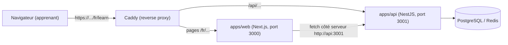
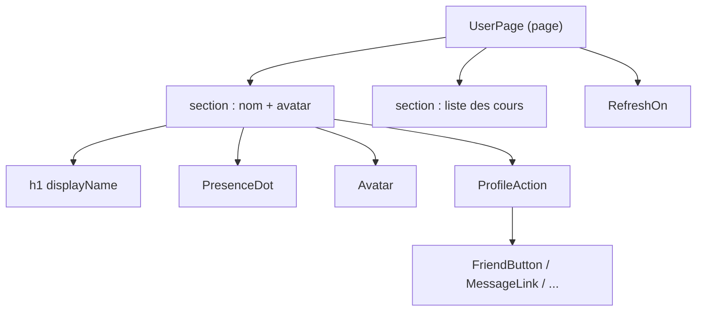
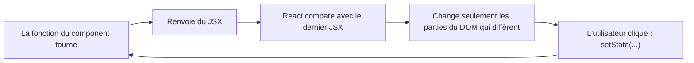
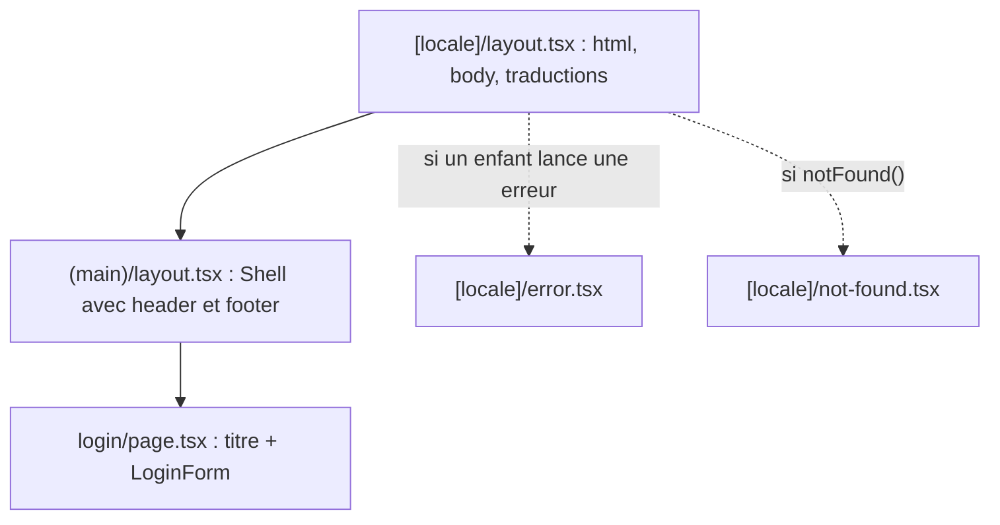
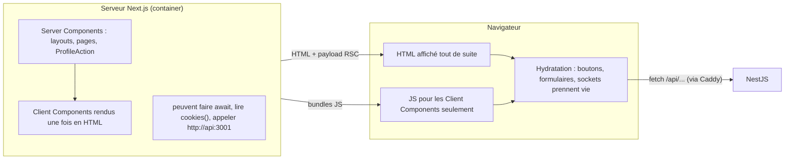
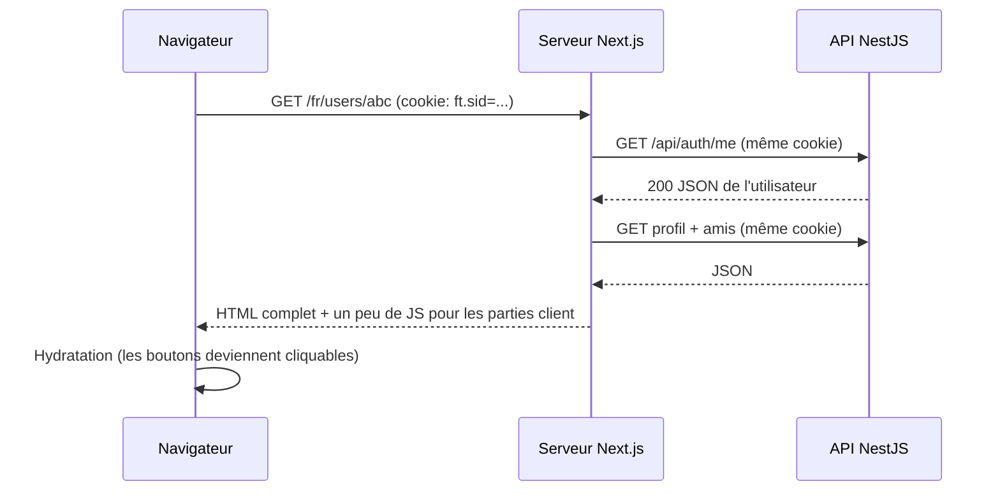
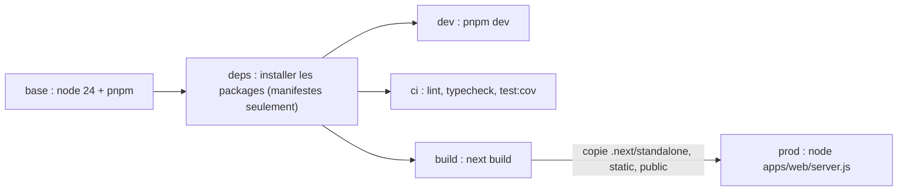

# Chapitre 1 — React et Next.js depuis zéro

Dans ce chapitre :

- Ce qu'est un frontend, et ce que font HTML, CSS et JavaScript dans le navigateur
- React : JSX, components, props, state, effects, et tous les autres hooks que l'app utilise
- Le rendu, les listes et les keys, les événements et les formulaires
- Next.js : l'App Router, les Server Components et les Client Components, le rendu côté serveur, les données sur le serveur, la navigation
- Tailwind CSS et TypeScript dans React
- Une carte du dossier `apps/web`, et chaque fichier de config qu'il contient

Aucune connaissance de React n'est nécessaire. Chaque idée vient avec un petit exemple tiré du vrai code de `apps/web`.

---

## 1. Ce qu'est un frontend

L'app a deux programmes qui se parlent :

- Le **backend** (`apps/api`, NestJS) garde les données : utilisateurs, cours, leçons, messages. Il répond aux requêtes HTTP avec du JSON.
- Le **frontend** (`apps/web`, Next.js) est ce que l'apprenant voit : les pages, les boutons, les formulaires. Il demande les données au backend et les transforme en écrans.

Un restaurant est une bonne image. La cuisine (l'API) prépare les plats. La salle (l'app web) est l'endroit où les clients s'assoient, lisent le menu et commandent. Le serveur porte les commandes entre les deux. La salle ne cuisine jamais : la `description` dans [package.json](../../apps/web/package.json) le dit clairement : _"Next.js frontend: presentation and SSR only, all domain logic lives in @ft/api"_ (frontend Next.js : uniquement présentation et SSR, toute la logique métier vit dans @ft/api).



Caddy est la porte d'entrée. Il envoie les requêtes `/api/...` à NestJS et tout le reste à Next.js. Next.js appelle aussi l'API lui-même, depuis le serveur, par le réseau Docker interne (voir [lib/api.ts](../../apps/web/lib/api.ts), `DEFAULT_API_INTERNAL_URL = 'http://api:3001'`).

### HTML, CSS et JavaScript dans le navigateur

Un navigateur ne comprend que trois langages :

| Langage         | Rôle                                                                     | Analogie de la maison         |
| --------------- | ------------------------------------------------------------------------ | ----------------------------- |
| HTML            | La structure : titres, paragraphes, boutons, formulaires                 | Les murs et les pièces        |
| CSS             | L'apparence : couleurs, tailles, espacements, mise en page               | La peinture et les meubles    |
| JavaScript (JS) | Le comportement : réagir à un clic, charger des données, changer la page | L'électricité et la plomberie |

Le navigateur lit le HTML et construit le **DOM** (Document Object Model) : un arbre d'objets, un par élément HTML. JavaScript peut changer le DOM, et le navigateur redessine l'écran. Faire ça à la main (`document.createElement`, `element.textContent = ...`) devient vite le bazar dans une grosse app. React règle ce problème.

---

## 2. Ce qu'est React

React est une bibliothèque JavaScript pour construire des interfaces à partir de **components** (composants). Tu décris _à quoi_ l'écran doit ressembler pour les données actuelles, et React calcule _comment_ changer le DOM pour que ça corresponde.

Pense aux LEGO. Chaque component est une brique. Les petites briques (un bouton, un avatar) s'emboîtent pour faire des briques plus grandes (un formulaire, un header), et celles-ci s'emboîtent pour faire une page entière. Tu construis chaque brique une fois et tu la réutilises partout.



C'est le vrai arbre de la page de profil d'un utilisateur, [users/[id]/page.tsx](<../../apps/web/app/[locale]/(main)/users/[id]/page.tsx>).

### JSX

Un component est une fonction qui renvoie du **JSX**. Le JSX ressemble à du HTML, mais il vit dans du JavaScript. Un outil de build le transforme en simples appels de fonction. Voici la page 404, [not-found.tsx](../../apps/web/app/[locale]/not-found.tsx) :

```tsx
export default async function LocaleNotFound() {
  const t = await getTranslations('NotFoundPage');
  const home = (await currentUser()) === null ? '/' : '/learn';

  return (
    <Shell brand={<Wordmark href={home} />} footer={<LegalFooter />}>
      <div className="flex flex-col items-center gap-4 py-24 text-center">
        <h1 className="text-3xl font-semibold tracking-tight">{t('heading')}</h1>
        <p className="max-w-md text-slate-400">{t('intro')}</p>
        <Link
          href={home}
          className="mt-2 rounded-full bg-indigo-700 px-6 py-2 text-sm font-semibold text-white transition-colors hover:bg-indigo-800"
        >
          {t('goHome')}
        </Link>
      </div>
    </Shell>
  );
}
```

Il est `async` parce qu'il lit la session avant de dessiner : les liens d'un lecteur connecté
mènent à `/learn`, ceux d'un visiteur à `/`. Les components async et `getTranslations` sont
expliqués dans la section 3.

Les règles du JSX à connaître :

- Les balises en minuscules (`div`, `h1`, `p`) sont de vrais éléments HTML. Les balises avec une majuscule (`Shell`, `Link`) sont des components.
- `{ ... }` ouvre une « fenêtre JavaScript » : `{t('heading')}` met le résultat d'un appel de fonction dans la page.
- L'attribut HTML `class` s'écrit `className` (parce que `class` est un mot réservé en JS), et `for` s'écrit `htmlFor`.
- Un component renvoie un seul élément racine. Pour en renvoyer plusieurs sans enveloppe, utilise un **fragment** `<>...</>` (tu le verras dans `ProfileAction` dans la page utilisateur).
- Renvoyer `null` veut dire « ne rien dessiner ». [time-zone-sync.tsx](../../apps/web/components/time-zone-sync.tsx) renvoie `null` : il fait seulement un travail, il n'affiche rien.
- Les conditions utilisent du JS normal : `cond ? <A /> : <B />` ou `cond ? <A /> : null`.

### Components et props

Les **props** (propriétés) sont les entrées d'un component, comme les arguments d'une fonction. Un parent les passe comme des attributs, et l'enfant les reçoit dans un seul objet. Pour l'enfant, elles sont en lecture seule.

Le meilleur exemple est [components/shell.tsx](../../apps/web/components/shell.tsx), le cadre dans lequel chaque page s'affiche :

```tsx
export interface ShellProps {
  /** Left of the account nav: the wordmark, leading home or into the app. */
  brand: ReactNode;
  /** Right of it. Omitted where there is no session to report. */
  nav?: ReactNode;
  // ...
  fill?: boolean;
  footer: ReactNode;
  children: ReactNode;
}

export function Shell({ brand, nav, fill = false, footer, children }: ShellProps) {
  return (
    <div className={`flex min-h-dvh flex-col ${fill ? 'lg:h-dvh' : ''}`}>
      <header className="border-b border-slate-800">
```

Et un parent qui l'utilise, [(main)/layout.tsx](<../../apps/web/app/[locale]/(main)/layout.tsx>) :

```tsx
export default async function MainLayout({ children }: { children: ReactNode }) {
  const user = await currentUser();

  return (
    <Shell
      brand={<Wordmark href={user === null ? '/' : '/learn'} />}
      nav={<HeaderNav />}
      footer={<LegalFooter />}
    >
      {children}
    </Shell>
  );
}
```

À remarquer :

- Une prop peut être une chaîne, un nombre, une fonction, ou même du JSX (`brand={<Wordmark ... />}`). `ReactNode` est le type TypeScript pour « tout ce que React peut dessiner ».
- `await currentUser()` lit la session sur le serveur (section 3). La valeur de `href` en dépend : `/learn` pour un utilisateur connecté, `/` pour un visiteur.
- `children` est une prop spéciale : tout ce que tu mets _entre_ la balise ouvrante et la balise fermante.
- `fill = false` est une valeur par défaut. `nav?` veut dire que la prop est optionnelle.
- L'interface `ShellProps` est la façon dont TypeScript type les props (plus de détails dans la section 5).

### Le state avec `useState`

Les props viennent du parent. Le **state** (état) est la mémoire propre du component : une valeur qui peut changer avec le temps, comme « le bouton est-il occupé ? ». Quand le state change, React redessine le component avec la nouvelle valeur.

Un **hook** est une fonction dont le nom commence par `use`. Les hooks permettent à un component de se brancher sur des fonctionnalités de React (mémoire, effets de bord...). `useState` est le premier. Tiré de [log-out-button.tsx](../../apps/web/components/log-out-button.tsx) :

```tsx
export function LogOutButton() {
  const router = useRouter();
  const t = useTranslations('LogOutButton');
  const [pending, setPending] = useState(false);

  async function onClick() {
    setPending(true);
    try {
      await logOut();
      closeSocket();
      // Home rather than the current page, which may well have needed the
      // session that just ended.
      router.replace('/');
      router.refresh();
    } finally {
      setPending(false);
    }
  }

  return (
    <button type="button" onClick={() => void onClick()} disabled={pending} className={MENU_ROW}>
      <MenuIcon name="signOut" />
      {pending ? t('signingOut') : t('signOut')}
    </button>
  );
}
```

`useState(false)` renvoie une paire : la valeur actuelle (`pending`) et un setter (`setPending`). Appeler `setPending(true)` ne change pas `pending` sur place. Ça demande à React de relancer `LogOutButton()`, et dans ce nouveau passage `pending` vaut `true`, donc le bouton affiche "Signing out..." (« Déconnexion... ») et il est désactivé.

Les règles des hooks (vérifiées par ESLint, voir section 7) : appelle les hooks seulement au premier niveau d'un component ou d'un autre hook, jamais dans un `if` ou une boucle. Le commentaire dans [refresh-on.tsx](../../apps/web/components/refresh-on.tsx) montre que l'app respecte ça : _"One component per event: a hook cannot run in a loop."_ (un component par événement : un hook ne peut pas tourner dans une boucle).

### Le rendu et le re-rendu

« Faire le rendu » (render) veut dire que React appelle ta fonction de component pour obtenir son JSX. Ça arrive :

1. La première fois que le component apparaît (il est **monté**, mount).
2. Chaque fois que son state change.
3. Chaque fois que son parent refait un rendu (et lui repasse donc ses props).



React garde une copie légère du dernier résultat et compare le nouveau avec. Il ne touche au DOM que là où quelque chose a vraiment changé. C'est pour ça que tu peux écrire « dessine tout à partir des données actuelles » et quand même avoir une page rapide.

`reactStrictMode: true` dans [next.config.ts](../../apps/web/next.config.ts) fait que React, en développement seulement, fait le rendu des components et lance les effects deux fois exprès, pour trouver les bugs où le code ne supporte pas d'être relancé.

### Les effects avec `useEffect`

Le rendu doit être « pur » : calculer du JSX à partir des props et du state, rien d'autre. Le travail qui touche le monde extérieur (timers, appels réseau, APIs du navigateur, sockets) va dans un **effect** (effet). `useEffect(fn, deps)` lance `fn` _après_ que React a dessiné l'écran, et le relance seulement quand une valeur de la liste `deps` change.

[time-zone-sync.tsx](../../apps/web/components/time-zone-sync.tsx) lit le fuseau horaire du navigateur et l'enregistre s'il est différent de celui stocké :

```tsx
  useEffect(() => {
    // Older browsers may not resolve a zone: there is nothing to send then.
    const timeZone = Intl.DateTimeFormat().resolvedOptions().timeZone;
    if (!timeZone || timeZone === storedTimeZone || inFlight.current || rejected.current) {
      return;
    }

    inFlight.current = true;
    // A failure needs no message: the next page tries again, unless it was a 400.
    void updateProfile({ timeZone }).then((result) => {
      inFlight.current = false;
      if (result.ok) {
        router.refresh();
      } else if (result.status === 400) {
        rejected.current = true;
      }
    });
  }, [storedTimeZone, router, pathname]);
```

Le fuseau horaire n'existe que dans le navigateur, donc ce code ne peut pas tourner pendant le rendu serveur : un effect est le bon endroit. Les deps `[storedTimeZone, router, pathname]` veulent dire « relance quand l'une de ces valeurs change », donc il réessaie après chaque changement de page.

Un effect peut renvoyer une fonction de **cleanup** (nettoyage). React l'appelle avant le passage suivant et quand le component disparaît (il est **démonté**, unmount). [exam-timer.tsx](<../../apps/web/app/[locale]/(dashboard)/learn/[lang]/lessons/[id]/play/exam-timer.tsx>) démarre un timer et l'arrête dans le cleanup :

```tsx
  useEffect(() => {
    if (ranOut) return;
    const interval = setInterval(() => {
      const now = Math.max(0, Math.ceil((deadline - Date.now()) / 1000));
      setSeconds(now);
      if (now === 0) {
        clearInterval(interval);
        zero();
      }
    }, 250);
    return () => clearInterval(interval);
  }, [deadline, ranOut]);
```

### Les autres hooks utilisés dans l'app

Une recherche dans `apps/web` (`app`, `components`, `lib`) trouve ces hooks. Chaque ligne dit à quoi il sert et donne un vrai endroit où il est utilisé.

| Hook                   | Vient de                            | Ce qu'il fait                                                                                    | Vrai exemple                                                                                                           |
| ---------------------- | ----------------------------------- | ------------------------------------------------------------------------------------------------ | ---------------------------------------------------------------------------------------------------------------------- |
| `useState`             | react                               | Mémoire du component qui déclenche un re-rendu                                                   | `pending` dans [log-out-button.tsx](../../apps/web/components/log-out-button.tsx)                                      |
| `useEffect`            | react                               | Lancer des effets de bord après le rendu, avec cleanup                                           | [time-zone-sync.tsx](../../apps/web/components/time-zone-sync.tsx)                                                     |
| `useRef`               | react                               | Mémoire qui ne déclenche **pas** de re-rendu ; peut aussi tenir un élément du DOM                | `inFlight`, `rejected` dans time-zone-sync ; `wasAway` dans [refresh-on.tsx](../../apps/web/components/refresh-on.tsx) |
| `useId`                | react                               | Un id unique, le même sur le serveur et dans le navigateur                                       | la paire label/input dans [form.tsx](../../apps/web/components/form.tsx)                                               |
| `useMemo`              | react                               | Retenir une valeur calculée jusqu'à ce que ses deps changent                                     | `keep` dans [player.tsx](<../../apps/web/app/[locale]/(dashboard)/learn/[lang]/lessons/[id]/play/player.tsx>)          |
| `useCallback`          | react                               | Retenir une fonction jusqu'à ce que ses deps changent                                            | `show` et `hold` dans player.tsx                                                                                       |
| `useTransition`        | react                               | Marquer une mise à jour comme « pas urgente » et obtenir un drapeau `pending`                    | [friend-search.tsx](<../../apps/web/app/[locale]/(main)/friends/friend-search.tsx>)                                    |
| `useLayoutEffect`      | react                               | Comme `useEffect`, mais tourne avant que le navigateur dessine                                   | garder la position du scroll dans [chat-thread.tsx](<../../apps/web/app/[locale]/(messages)/chat/chat-thread.tsx>)     |
| `useSyncExternalStore` | react                               | Lire une valeur qui vit hors de React et refaire le rendu quand elle change                      | état du socket, compteurs de non-lus dans [tab-socket.ts](../../apps/web/components/tab-socket.ts)                     |
| `useEffectEvent`       | react                               | Une fonction qu'un effect peut appeler, qui voit toujours les dernières props, sans être une dep | `zero` dans exam-timer.tsx                                                                                             |
| `useRouter`            | next-intl (via `@/i18n/navigation`) | Aller sur une autre page ou rafraîchir les données du serveur depuis le code                     | `router.replace('/')` dans log-out-button.tsx                                                                          |
| `usePathname`          | next-intl (via `@/i18n/navigation`) | Le chemin actuel de l'URL (sans la locale)                                                       | déclencheur dans time-zone-sync.tsx                                                                                    |
| `useSearchParams`      | next/navigation                     | Lire la partie `?a=b` de l'URL                                                                   | [live-form.tsx](<../../apps/web/app/[locale]/(dashboard)/learn/[lang]/lessons/live-form.tsx>)                          |
| `useTranslations`      | next-intl                           | Obtenir la fonction `t()` pour une partie du catalogue de textes                                 | presque tous les components                                                                                            |
| `useLocale`            | next-intl                           | La langue actuelle (`en`, `fr`, `de`)                                                            | [language-switcher.tsx](../../apps/web/components/language-switcher.tsx)                                               |
| `useFormatter`         | next-intl                           | Formater les dates et les nombres dans la langue actuelle                                        | l'heure des messages dans [chat-thread.tsx](<../../apps/web/app/[locale]/(messages)/chat/chat-thread.tsx>)             |

`useActionState`, `useOptimistic`, `useFormStatus` et `use()` ne sont **pas** utilisés dans cette app.

L'app écrit aussi ses propres hooks (un hook personnalisé est juste une fonction qui commence par `use` et qui appelle d'autres hooks). Ceux qui sont partagés : `useServerEvent`, `useSocketStatus`, `useUnreadCounts`, `useUnreadTotal`, `useUnread`, `useFriendOnline` dans [tab-socket.ts](../../apps/web/components/tab-socket.ts), `useScrollLock` dans [scroll-lock.ts](../../apps/web/components/scroll-lock.ts), `useErrorMessage` dans [lib/error-message.ts](../../apps/web/lib/error-message.ts), et `useCourseSave` dans [lib/use-course-save.ts](../../apps/web/lib/use-course-save.ts). Les chapitres 3 et 4 les expliquent. Quelques autres sont posés à côté du code qui les utilise (les pages et le lecteur de leçon, le chat, les boutons d'amis).

Quelques mots de plus sur les moins courants :

**`useRef`** est une boîte avec un champ `.current`. Changer `.current` ne refait pas de rendu. Dans [refresh-on.tsx](../../apps/web/components/refresh-on.tsx), il retient « le socket était-il absent avant ? » entre deux rendus :

```tsx
  const seen = useRef(false);
  const wasAway = useRef(false);

  // Once, however many events: one refresh per reconnect.
  useEffect(() => {
    if (status === 'connected' && wasAway.current) router.refresh();
    if (status === 'connected') seen.current = true;
    wasAway.current = seen.current && status !== 'connected';
  }, [status, router]);
```

Il peut aussi pointer vers un élément du DOM : `const form = useRef<HTMLFormElement>(null)` dans live-form.tsx, puis `<form ref={form}>`.

**`useSyncExternalStore(subscribe, getSnapshot, getServerSnapshot)`** relie React à un store qui n'est pas du state React. Ici, le store est rempli par la connexion socket, qui existe une seule fois par onglet du navigateur :

```tsx
export function useSocketStatus(): SocketStatus {
  return useSyncExternalStore(
    subscribe,
    () => status,
    () => 'closed',
  );
}
```

La troisième fonction donne la valeur utilisée sur le serveur, où il n'y a pas de socket : `'closed'`.

**`useEffectEvent`** règle un petit problème. Dans exam-timer.tsx, l'effect doit appeler `onZero`, une prop. Si `onZero` était dans les deps, le timer redémarrerait à chaque fois que le parent passe une nouvelle fonction. `const zero = useEffectEvent(onZero)` donne une fonction stable qui appelle toujours le dernier `onZero`.

**`useTransition`** renvoie `[pending, startTransition]`. Le travail lancé dans `startTransition` (ici une navigation) est « pas urgent », donc la page reste réactive, et `pending` vaut `true` jusqu'à ce qu'il soit fini.

### Les listes et les keys

Pour dessiner une liste, utilise la méthode de tableau `.map()` pour transformer chaque élément en JSX. Chaque élément a besoin d'une prop `key` : une valeur unique parmi ses frères et stable dans le temps. Tiré de la page utilisateur :

```tsx
          <ul className="divide-y divide-slate-800">
            {profile.courses.map((course) => (
              <li key={course.lang} className="flex flex-wrap items-baseline gap-x-3 py-3">
                <span className="font-medium">{languageName(course.lang)}</span>
                <span className="text-sm text-slate-300">{course.level ?? t('noLevel')}</span>
```

La key est comme un badge avec un nom. Quand la liste change, React utilise les badges pour savoir quel `<li>` est lequel, pour pouvoir déplacer, ajouter ou enlever le bon au lieu de tout redessiner. Utilise un id venant des données (`course.lang`, un id d'utilisateur), pas l'index du tableau, quand l'ordre peut changer.

Une key peut aussi servir exprès à _réinitialiser_ un component : une nouvelle key veut dire « c'est un autre component, repars de zéro ». Le formulaire de connexion fait ça (commentaire : _"Distinct key from the password form"_ (key différente de celle du formulaire de mot de passe) dans [login-form.tsx](<../../apps/web/app/[locale]/(main)/login/login-form.tsx>)).

### Les événements

Tu passes une fonction à une prop d'événement : `onClick`, `onSubmit`, `onChange`, `onKeyDown`... React l'appelle avec un objet **event** (événement). Passe la fonction, ne l'appelle pas : `onClick={reset}`, pas `onClick={reset()}`. Tiré de [error.tsx](../../apps/web/app/[locale]/error.tsx) :

```tsx
          <button
            type="button"
            onClick={reset}
            className="rounded-full bg-indigo-700 px-6 py-2 font-semibold text-white transition-colors hover:bg-indigo-800"
          >
            {t('tryAgain')}
          </button>
```

### Les formulaires

Un `<form>` du navigateur, quand il est envoyé, recharge normalement la page. L'app empêche ça avec `event.preventDefault()` et traite les données en JavaScript. Les champs sont lus avec `FormData`, la façon standard du navigateur de lire les valeurs d'un formulaire par leur `name`. Tiré de [friend-search.tsx](<../../apps/web/app/[locale]/(main)/friends/friend-search.tsx>) :

```tsx
  function submit(event: FormEvent<HTMLFormElement>) {
    event.preventDefault();
    const q = new FormData(event.currentTarget).get('q');
    // ...
    const parsed = UserSearchQuerySchema.safeParse({ q });
    if (!parsed.success) {
      setError(errorMessage(parsed.error.issues[0].message));
      return;
    }
    setError(null);
    startTransition(() => router.replace({ pathname: '/friends', query: { q: parsed.data.q } }));
  }

  return (
    <form role="search" onSubmit={submit} className="flex flex-col gap-3">
      <Field
        label={t('searchLabel')}
        type="search"
        name="q"
        defaultValue={query}
        autoComplete="off"
      />
      <FormError message={error} />
      <SubmitButton pending={pending}>{t('search')}</SubmitButton>
    </form>
  );
```

Le modèle suivi par les formulaires de texte libre de l'app (connexion, inscription, profil, recherche...) :

1. `preventDefault()`, lire `FormData`.
2. Valider avec le **même schema Zod que celui de l'API** (venant de `@ft/shared`), pour que les erreurs évidentes ne quittent jamais la page. Les sélecteurs (cours, niveau, objectif) sautent cette étape : ils ne proposent que des valeurs valides, et l'API valide ce qu'ils envoient. Les réponses tapées du lecteur de leçon sont un troisième cas : ce sont des inputs contrôlés (`value` plus `onChange`) sans vérification Zod dans la page, et le `maxLength={300}` de chacun ([controls.tsx](../../apps/web/components/lesson/controls.tsx), [vocabulary.tsx](../../apps/web/components/lesson/kinds/vocabulary.tsx)) reprend la limite d'`AnswerSchema` dans `@ft/shared` (`text: z.string().max(300)`), pour que le navigateur ne puisse pas envoyer un texte que l'API refuserait.
3. Appeler l'API depuis le navigateur (fonctions dans `lib/*-client.ts`) ou changer l'URL.
4. Afficher les erreurs avec `FormError`, afficher « en cours » avec `SubmitButton pending`.

Les inputs sont **non contrôlés** (uncontrolled) : ils gardent leur propre valeur et le code la lit à l'envoi (`defaultValue` donne la première valeur). Un input **contrôlé** (controlled) serait `value={state}` plus `onChange={...}` pour mettre à jour le state à chaque touche.

Les pièces de formulaire partagées vivent dans [components/form.tsx](../../apps/web/components/form.tsx) : `Field` (un label lié à un input avec `useId`, pour les lecteurs d'écran), `FormError` (`role="alert"` pour que l'erreur soit annoncée), `SubmitButton`, et des chaînes de classes pour les boutons.

---

## 3. Ce que Next.js ajoute à React

React tout seul ne fait que dessiner des components. Un vrai site a aussi besoin de : URLs et pages, un serveur qui envoie le premier HTML, du chargement de données, un build pour la production, des images, des métadonnées (`<title>`), des pages d'erreur. **Next.js** est un framework autour de React qui donne tout ça. Si React, ce sont les briques LEGO, Next.js est la boîte avec le livret d'instructions, la plaque de base et les bacs de rangement.

| Besoin                                                   | React seul                                   | Next.js                                |
| -------------------------------------------------------- | -------------------------------------------- | -------------------------------------- |
| Associer des URLs à des pages                            | Tu ajoutes une bibliothèque de routing       | Les dossiers dans `app/` sont des URLs |
| Premier HTML venant du serveur                           | Non (page blanche jusqu'au chargement du JS) | Oui, rendu côté serveur                |
| Lire les cookies / appeler l'API avant d'envoyer la page | Non                                          | Server Components                      |
| Pages d'erreur et 404                                    | Tu les construis                             | `error.tsx`, `not-found.tsx`           |
| Build et serveur de production                           | Tu le configures                             | `next build`, `next start`             |

L'app utilise Next.js **16** avec l'**App Router** (le dossier `app/`).

### L'App Router : les dossiers sont des URLs

Chaque dossier dans `app/` est un morceau de l'URL. Un dossier devient une page visible seulement s'il contient un fichier `page.tsx`.

```
app/
├── global-error.tsx            last-resort error page
├── globals.css                 global styles (Tailwind)
├── lesson.css                  lesson player styles (imported by globals.css)
├── icon.svg                    the favicon (Next picks it up by name)
├── healthz/route.ts            GET /healthz  (a route handler, no page)
├── healthz/api/route.ts        GET /healthz/api
├── healthz/upstream/route.ts   GET /healthz/upstream
└── [locale]/                   /en, /fr, /de   (dynamic segment)
    ├── layout.tsx              <html> and <body> for every page
    ├── error.tsx               error page for everything inside
    ├── not-found.tsx           404 page
    ├── [...rest]/page.tsx      catch-all: any unknown path -> 404
    ├── (main)/                 route group: not in the URL
    │   ├── layout.tsx
    │   ├── page.tsx            /fr
    │   ├── login/page.tsx      /fr/login
    │   └── users/[id]/page.tsx /fr/users/abc123
    ├── (dashboard)/
    │   └── learn/[lang]/lessons/[id]/play/page.tsx   /fr/learn/de/lessons/x/play
    └── (messages)/chat/page.tsx                      /fr/chat
```

Les noms de fichiers spéciaux que Next.js connaît :

| Fichier            | Rôle                                                                                                                    | Dans cette app                                                                          |
| ------------------ | ----------------------------------------------------------------------------------------------------------------------- | --------------------------------------------------------------------------------------- |
| `page.tsx`         | Le contenu d'une URL                                                                                                    | Beaucoup, par ex. [login/page.tsx](<../../apps/web/app/[locale]/(main)/login/page.tsx>) |
| `layout.tsx`       | Un cadre autour de toutes les pages en dessous. Il reste à l'écran quand tu passes d'une de ces pages à une autre       | [[locale]/layout.tsx](../../apps/web/app/[locale]/layout.tsx), plus un par route group  |
| `error.tsx`        | Affiché quand quelque chose en dessous lance une erreur. Doit être un Client Component. Reçoit `reset()` pour réessayer | [[locale]/error.tsx](../../apps/web/app/[locale]/error.tsx)                             |
| `global-error.tsx` | Affiché quand le layout racine lui-même lance une erreur. A son propre `<html>`                                         | [global-error.tsx](../../apps/web/app/global-error.tsx)                                 |
| `not-found.tsx`    | Affiché quand le code appelle `notFound()`                                                                              | [[locale]/not-found.tsx](../../apps/web/app/[locale]/not-found.tsx)                     |
| `loading.tsx`      | Affiché pendant le chargement d'une page                                                                                | **Pas utilisé** dans cette app                                                          |
| `route.ts`         | Un endpoint HTTP (GET, POST...) au lieu d'une page                                                                      | [healthz/route.ts](../../apps/web/app/healthz/route.ts)                                 |

Les layouts s'emboîtent comme des poupées russes. Pour `/fr/login`, Next.js construit :



Les modèles de noms de dossiers :

- **Route group `(name)`** (groupe de routes) : les parenthèses veulent dire « ce dossier ne fait pas partie de l'URL ». Il sert seulement à regrouper des pages pour qu'elles partagent un layout. `(main)`, `(dashboard)` et `(messages)` ont chacun leur propre `layout.tsx` avec un header différent (les trois utilisent le même `LegalFooter`), mais `/fr/login` ne contient pas `main`.
- **Segment dynamique `[name]`** : correspond à n'importe quel morceau de l'URL et le donne à la page comme param. `[locale]` correspond à `fr`, `[id]` à un id d'utilisateur, `[lang]` à une langue de cours.
- **Catch-all `[...name]`** (attrape-tout) : correspond à un ou plusieurs morceaux. [[...rest]/page.tsx](../../apps/web/app/[locale]/[...rest]/page.tsx) attrape chaque chemin inconnu et appelle `notFound()`, pour que le visiteur voie la 404 traduite au lieu de celle de Next, en anglais :

```tsx
export default function CatchAllPage() {
  notFound();
}
```

Une page lit ses params sous forme de **Promise** (Next.js 15+), donc elle fait `await` dessus. Tiré de la page utilisateur :

```tsx
export default async function UserPage({ params }: { params: Promise<{ id: string }> }) {
  // First, so an anonymous visitor gets /login and not a 404.
  const me = await requireUser();

  const { id } = await params;
  // The API would answer 400, which reads as an outage rather than a wrong address.
  if (!UserIdSchema.safeParse(id).success) {
    notFound();
  }
```

Une page ou un layout peut aussi exporter :

- `generateMetadata()` ou `metadata` : le `<title>` et la description. La page de connexion utilise `generateMetadata` pour que le titre de l'onglet soit traduit.
- `generateStaticParams()` : la liste des valeurs de param à construire à l'avance. Le layout racine renvoie les trois locales.
- `export const dynamic = 'force-dynamic'` : « toujours faire le rendu à chaque requête, ne jamais mettre en cache ». Utilisé sur les pages dont le contenu dépend de qui demande, et sur les routes de santé (health). Sur les pages, il dit ce qui est déjà vrai : lire le cookie de session (`cookies()`, appelé par `currentUser()` et par la nav de chaque layout de groupe) rend à lui seul une route dynamique. Sur les routes de santé, c'est aussi une sécurité : depuis Next.js 15, un route handler `GET` s'exécute déjà à chaque requête, sauf s'il choisit d'être mis en cache (`force-static`).
- `viewport` : les réglages du viewport mobile (layout racine).

Le chapitre 2 passe en revue chaque fichier de `app/` en détail.

### Server Components et Client Components

C'est l'idée la plus importante du Next.js moderne. Chaque component tourne dans l'un de deux endroits :

- Un **Server Component** tourne seulement sur le serveur (le container Next.js). Il peut être `async`, peut faire `await` sur des données, peut lire les cookies et les variables d'environnement secrètes. Son code n'est **jamais** envoyé au navigateur. Il ne peut pas utiliser de state, d'effects ou de gestionnaires d'événements, parce qu'il n'y a pas de navigateur là-bas, ni d'utilisateur pour cliquer.
- Un **Client Component** est marqué avec `'use client'` en haut de son fichier. Son rendu est fait une fois sur le serveur aussi (pour produire le premier HTML), puis son code est envoyé au navigateur, où il devient interactif : state, effects, `onClick`, APIs du navigateur.

**Par défaut, chaque component est un Server Component.** Tu ajoutes `'use client'` seulement là où tu as besoin d'interactivité. 58 fichiers de l'app l'ont (formulaires, boutons, le socket, le lecteur de leçon). Les pages et les layouts sont surtout des Server Components.

Analogie : un Server Component est une photo imprimée au magasin et qu'on te donne. Un Client Component est une petite machine qu'on te donne avec son mode d'emploi (le JavaScript), pour qu'elle puisse encore bouger dans tes mains.



L'**hydratation** (hydration) est l'étape où React, dans le navigateur, prend le HTML envoyé par le serveur et y attache les gestionnaires d'événements et le state, pour qu'il devienne interactif. Le HTML du serveur et le premier rendu du navigateur doivent correspondre. Le layout racine utilise `suppressHydrationWarning` sur `<html>` seulement, parce que les extensions du navigateur y ajoutent des attributs (voir le commentaire dans [[locale]/layout.tsx](../../apps/web/app/[locale]/layout.tsx)).

Comment les deux sortes se mélangent, avec la page utilisateur comme exemple :

- `UserPage` est un Server Component (`async`, pas de `'use client'`). Il appelle `requireUser()`, `loadProfile(id)` et `requireFriends()` sur le serveur.
- Il affiche `PresenceDot` et `FriendButton`, qui sont des Client Components (ils doivent changer sans rechargement). Il leur passe des données simples en props : `userId`, `online`.
- Les props passées du serveur au client doivent être **sérialisables** (chaînes, nombres, objets simples, tableaux, JSX). Tu ne peux pas passer une fonction d'un Server Component à un Client Component.
- Un Client Component ne peut pas importer un Server Component, mais il peut en recevoir un comme `children` ou comme autre prop JSX. C'est pour ça que [shell.tsx](../../apps/web/components/shell.tsx) prend `nav` en prop au lieu d'afficher lui-même la nav de session : le commentaire dit que ça garde le Shell utilisable depuis l'error boundary, qui est un Client Component.

Comment savoir lequel est lequel en lisant un fichier :

| Indice                                    | Server                    | Client |
| ----------------------------------------- | ------------------------- | ------ |
| `'use client'` en haut                    | non                       | oui    |
| component `async function`                | oui                       | non    |
| `getTranslations` (de `next-intl/server`) | oui                       | non    |
| `useTranslations`                         | oui (non async) ou client | oui    |
| `useState`, `useEffect`, `onClick`        | non                       | oui    |
| `cookies()`, `headers()`                  | oui                       | non    |

Note : un component sans `'use client'` qui est _importé par_ un fichier Client Component tourne aussi dans le navigateur. `'use client'` marque une frontière : tout ce qui est importé en dessous part dans le navigateur.

### Le rendu côté serveur (SSR) et pourquoi

Le **SSR** (server-side rendering) veut dire que le serveur fait tourner les components et envoie du HTML prêt. L'autre façon (React seul) envoie une page vide plus du JavaScript, et le navigateur construit la page lui-même.

Pourquoi cette app fait le rendu sur le serveur :

- **Rapidité du premier affichage** : l'apprenant voit le contenu tout de suite, avant que le JavaScript ne charge.
- **Vérification de la session avant d'afficher quoi que ce soit** : le serveur lit le cookie de session, demande à l'API « qui est-ce ? », et redirige vers `/login` avant qu'un seul octet protégé ne soit envoyé.
- **Les moteurs de recherche et les lecteurs d'écran** reçoivent du vrai HTML.
- **Moins de JavaScript dans le navigateur** : les Server Components n'envoient pas de code.



### Charger les données sur le serveur, avec les cookies

Un Server Component peut simplement faire `await` sur une fonction qui appelle l'API. L'astuce, c'est que l'API a besoin du **cookie de session** du visiteur, mais l'appel vient du serveur Next.js, pas du navigateur. Donc le serveur copie le cookie de la requête entrante dans sa propre requête. C'est fait à un seul endroit, [lib/api.ts](../../apps/web/lib/api.ts) :

```ts
export async function fetchWithRequestHeaderAndIP<R>(
  fetcher: (options: FetchSessionOptions) => Promise<R>,
): Promise<R> {
  const store = await cookies();
  const cookie = store
    .getAll()
    .map(({ name, value }) => `${name}=${value}`)
    .join('; ');

  // ...
  const forwardedFor = (await headers()).get('x-forwarded-for');

  return fetcher({
    baseUrl: process.env.API_INTERNAL_URL,
    cookie,
    forwardedFor: forwardedFor ?? undefined,
  });
}
```

`cookies()` et `headers()` viennent de `next/headers` et ne marchent que sur le serveur, pendant une requête. Le fetch lui-même utilise `cache: 'no-store'` pour que les données d'un visiteur ne soient jamais mises en cache pour un autre.

Ensuite, [lib/session.ts](../../apps/web/lib/session.ts) l'enveloppe pour les pages :

```ts
export const loadSession = cache(async function loadSession(): Promise<SessionResult> {
  return fetchWithRequestHeaderAndIP(fetchSession);
});
```

`cache` (de React) retient le résultat pendant **un seul** rendu serveur, donc le layout et la page peuvent tous les deux demander la session et l'API n'est appelée qu'une fois. `requireUser()` redirige ensuite vers `/login` sur un 401, et **lance une erreur** (ce qui affiche `error.tsx`) si l'API est en panne, pour qu'une panne ne ressemble jamais à une déconnexion. Le chapitre 4 couvre cette couche en détail.

Les deux façons dont l'app parle à l'API :

| Depuis                                    | Comment                                                                                                  | Fichiers                                              |
| ----------------------------------------- | -------------------------------------------------------------------------------------------------------- | ----------------------------------------------------- |
| Server Components (lecture pour une page) | `http://api:3001`, cookie copié à la main                                                                | `lib/api.ts`, `lib/session.ts`, `lib/friends.ts`, ... |
| Client Components (formulaires, boutons)  | `fetch('/api/...')` depuis le navigateur, en passant par Caddy ; le navigateur envoie le cookie lui-même | `lib/api-client.ts`, `lib/*-client.ts`                |

### Server actions : pas utilisées

Next.js a des **server actions** (des fonctions marquées `'use server'` qu'un formulaire peut appeler directement sur le serveur). Cette app n'en a **aucune**. La raison est écrite en haut de [lib/auth-client.ts](../../apps/web/lib/auth-client.ts) : _"These run in the page rather than through a server action because the session cookie is set by the API's response, and Caddy serves both origins as one, so the browser's own request carries and receives it with nothing to relay."_ (Elles tournent dans la page plutôt que via une server action parce que le cookie de session est posé par la réponse de l'API, et Caddy sert les deux origines comme une seule, donc la propre requête du navigateur l'envoie et le reçoit sans rien à relayer.)

### Les route handlers

Un fichier `route.ts` répond directement en HTTP, sans React. [healthz/route.ts](../../apps/web/app/healthz/route.ts) est le health check de Docker :

```ts
export const dynamic = 'force-dynamic';

export function GET() {
  return NextResponse.json({ status: 'ok', service: 'web' });
}
```

### La navigation : `Link` et le router

- `<Link href="/friends">` est un `<a>` plus malin. Next.js charge la nouvelle page en arrière-plan et remplace seulement ce qui a changé : les layouts restent à l'écran, rien ne se recharge.
- `useRouter()` fait la même chose depuis le code : `router.push(url)` (ajoute à l'historique), `router.replace(url)` (remplace l'entrée actuelle de l'historique), `router.refresh()` (demande au serveur de refaire le rendu de la page actuelle avec des données fraîches, en gardant le state côté client).
- `redirect(url)` et `notFound()` (de `next/navigation`) sont pour les Server Components : ils arrêtent le rendu et envoient le visiteur ailleurs. L'app appelle `redirect('/login')` sans locale : le navigateur demande alors `/login`, et `proxy.ts` remet la locale (chapitre 2).

L'app n'importe **pas** `Link`, `useRouter` et `usePathname` directement depuis `next`. Elle utilise des copies qui connaissent la locale, dans [i18n/navigation.ts](../../apps/web/i18n/navigation.ts), donc `href="/friends"` devient `/fr/friends` tout seul :

```ts
import { createNavigation } from 'next-intl/navigation';
import { routing } from './routing';

// Lightweight wrappers around Next.js' navigation
// APIs that consider the routing configuration
export const { Link, redirect, usePathname, useRouter, getPathname } = createNavigation(routing);
```

`router.refresh()` est beaucoup utilisé : après la connexion, après la déconnexion, après un événement du socket ([refresh-on.tsx](../../apps/web/components/refresh-on.tsx)). C'est la façon dont le client dit « les données ont changé, donne-moi un nouveau rendu serveur ».

---

## 4. Tailwind CSS

Tailwind est un framework CSS fait de toutes petites classes toutes prêtes. Chaque classe fait une seule chose : `p-4` ajoute du padding, `text-sm` fait du petit texte, `bg-slate-950` peint un fond sombre, `flex` active flexbox. Tu construis l'apparence en empilant des classes dans `className`, au lieu d'écrire un fichier CSS à part.

Analogie : au lieu de mélanger ta propre peinture pour chaque mur, tu as une boîte d'autocollants avec des étiquettes (« rouge », « grande marge », « arrondi ») et tu en colles plusieurs sur chaque élément.

Lecture d'une vraie liste de classes tirée de [not-found.tsx](../../apps/web/app/[locale]/not-found.tsx) :

```
mt-2 rounded-full bg-indigo-700 px-6 py-2 text-sm font-semibold text-white transition-colors hover:bg-indigo-800
```

| Classe                             | Signification                            |
| ---------------------------------- | ---------------------------------------- |
| `mt-2`                             | margin-top 0.5rem                        |
| `rounded-full`                     | coins complètement arrondis (une pilule) |
| `bg-indigo-700`                    | fond indigo                              |
| `px-6 py-2`                        | padding horizontal / vertical            |
| `text-sm font-semibold text-white` | texte petit, semi-gras, blanc            |
| `hover:bg-indigo-800`              | fond plus foncé **au survol**            |

Les préfixes sont des conditions : `hover:`, `focus-visible:`, `disabled:`, et les tailles d'écran `sm:`, `lg:` (à partir de cette largeur) ou `max-sm:` (en dessous). La page utilisateur utilise `max-sm:flex-col-reverse` pour mettre le nom sous l'avatar sur les téléphones.

L'app utilise **Tailwind 4**, qui se configure en CSS, pas dans un `tailwind.config.js` (il n'y en a pas). La configuration est dans [app/globals.css](../../apps/web/app/globals.css) :

```css
@import 'tailwindcss';
@import './lesson.css';

/* Tailwind 4 resolves `dark:` through prefers-color-scheme unless told
   otherwise. The layouts put `dark` on <html> to pin the app to one palette,
   so the variant has to follow that class or the two disagree: body stays
   dark while every `dark:` utility switches off on a light OS. */
@custom-variant dark (&:where(.dark, .dark *));

/* Tailwind 4 is CSS-first: there is no tailwind.config.js. Source detection is
   declared explicitly so class scanning does not depend on the working
   directory the build happens to run from inside the container. */
@source '.';

@source '../components';

/* @ft/ui is source only: its classes are scanned from there. */
@source '../../../packages/ui/src';
```

- `@import 'tailwindcss'` charge Tailwind.
- `@source` liste les dossiers où Tailwind cherche les noms de classes. Seules les classes qu'il y trouve finissent dans le CSS final.
- `@custom-variant dark` fait que `dark:` suit la classe `dark` sur `<html>` (l'app est toujours en sombre).
- `@theme { ... }` (plus bas) ajoute des animations sur mesure pour le lecteur de leçon.

Tailwind tourne comme un plugin **PostCSS** (PostCSS est un outil qui transforme le CSS pendant le build), voir [postcss.config.mjs](#postcssconfigmjs) plus bas. Le chapitre 2 couvre `globals.css` et `lesson.css` en entier.

---

## 5. TypeScript dans React

Tous les fichiers sont en `.ts` / `.tsx` (TypeScript, `.tsx` = TypeScript avec du JSX). TypeScript vérifie les types avant que le code ne tourne. Dans React, l'usage principal est de **typer les props**. Trois styles apparaissent dans l'app :

Type en ligne, pour les petits components ([unread-badge.tsx](../../apps/web/components/unread-badge.tsx)) :

```tsx
export function UnreadBadge({ count }: { count: number | undefined }) {
```

Une `interface` nommée, quand les props sont nombreuses ou documentées (`ShellProps` dans shell.tsx, montré plus haut).

Étendre les attributs HTML, pour qu'un component accepte toutes les props normales d'un `<input>` plus les siennes ([form.tsx](../../apps/web/components/form.tsx)) :

```tsx
type FieldProps = InputHTMLAttributes<HTMLInputElement> & {
  label: string;
  hint?: string;
};

export function Field({ label, hint, ...input }: FieldProps) {
```

`...input` rassemble toutes les autres props (`name`, `type`, `defaultValue`...) et `{...input}` les transmet au vrai `<input>`.

Autres types courants :

- `ReactNode` : tout ce qui peut être dessiné (pour `children`).
- `FormEvent<HTMLFormElement>`, `KeyboardEvent` : objets d'événement.
- `useState<string | null>(null)` : un state qui est une chaîne ou null.
- `useRef<HTMLFormElement>(null)` : une ref vers un élément de formulaire.
- `Promise<{ id: string }>` : les `params` d'une page dynamique.
- `Metadata`, `Viewport`, `NextConfig` : types venant de `next`.

Les types de données partagés avec l'API (`PublicUser`, `SessionUser`, `Language`...) et les schemas Zod viennent de `@ft/shared`, donc le web et l'API sont d'accord sur la forme de chaque JSON.

---

## 6. Carte des dossiers de `apps/web`

```
apps/web/
├── app/                 Routes: pages, layouts, error pages, CSS (chapter 2, 5-8)
├── components/          Shared React components (chapter 3)
│   └── lesson/          The lesson player pieces (chapter 7)
├── lib/                 Plain TypeScript: API calls, session, helpers, + *.test.ts (chapter 4)
│   └── legal-content/   Privacy and terms texts, kept out of the catalogue
├── i18n/                next-intl setup: routing.ts, request.ts, navigation.ts (chapter 2)
├── messages/            Translation catalogues: en.json, fr.json, de.json (chapter 2)
├── public/              Static files served as-is: logo.webp, robots.txt
├── coverage/            Generated test coverage report (not source)
├── proxy.ts             Next.js middleware: locale prefix + course cookie (chapter 2)
├── package.json         Scripts and dependencies
├── next.config.ts       Next.js settings
├── tsconfig.json        TypeScript settings
├── postcss.config.mjs   Tailwind via PostCSS
├── eslint.config.mjs    Lint rules
├── vitest.config.mts    Test runner settings
├── next-env.d.ts        Next.js type references (generated)
├── Dockerfile           Container build stages
├── .dockerignore        Reference copy of the ignore rules
└── Dockerfile.dockerignore   The ignore rules Docker really uses
```

Les dossiers générés que tu peux ignorer : `.next/` (résultat du build et cache de dev), `.turbo/` (cache de Turborepo), `node_modules/`, `tsconfig.tsbuildinfo` (cache incrémental de TypeScript).

| Dossier              | Ce qu'on y met                                                                                                               | Règle simple                                       |
| -------------------- | ---------------------------------------------------------------------------------------------------------------------------- | -------------------------------------------------- |
| `app/`               | Un dossier par morceau d'URL ; les fichiers à côté d'un `page.tsx` qui ne servent qu'à cette page (par ex. `login-form.tsx`) | « Où est la page de cette URL ? »                  |
| `components/`        | Les components utilisés par plusieurs pages                                                                                  | « Est-ce réutilisé ? »                             |
| `lib/`               | La logique sans JSX, facile à tester en tests unitaires                                                                      | « Est-ce que je peux le tester sans navigateur ? » |
| `i18n/`, `messages/` | Les langues                                                                                                                  | « Est-ce que ça concerne la traduction ? »         |
| `public/`            | Les fichiers que le navigateur charge par URL, par ex. `/logo.webp`                                                          | « Est-ce qu'il lui faut une URL fixe ? »           |

**`public/`** : tout ce qui est ici est servi à la racine du site. `logo.webp` est le logo (déjà à la bonne taille, parce que l'optimiseur d'images est désactivé, voir next.config). [robots.txt](../../apps/web/public/robots.txt) dit aux moteurs de recherche d'ignorer `/healthz` et `/grafana` :

```
User-agent: *
Allow: /
Disallow: /healthz
Disallow: /grafana
```

**`coverage/`** : écrit par `pnpm test:cov` (`lcov.info` et un rapport HTML dans `lcov-report/`). C'est un résultat, pas du code source, et il est ignoré par Docker. Le chapitre 9 l'explique.

---

## 7. Les fichiers de config

### package.json

[package.json](../../apps/web/package.json) nomme le package `@ft/web` (un workspace dans le monorepo pnpm).

Les scripts (à lancer avec `pnpm <name>` dans `apps/web`) :

| Script         | Commande                                                 | Ce qu'il fait                                                                                                           |
| -------------- | -------------------------------------------------------- | ----------------------------------------------------------------------------------------------------------------------- |
| `dev`          | `next dev -H 0.0.0.0 -p 3000`                            | Serveur de développement avec rechargement à chaud. `0.0.0.0` pour qu'il soit joignable depuis l'extérieur du container |
| `build`        | `next build`                                             | Build de production dans `.next/`                                                                                       |
| `start`        | `next start -H 0.0.0.0 -p 3000`                          | Lancer un build de production (l'image Docker utilise `server.js` à la place)                                           |
| `lint`         | `eslint .`                                               | Vérifier le style du code et les règles React                                                                           |
| `format:check` | `prettier --check . --ignore-path ../../.prettierignore` | Vérifier le formatage, avec la liste d'exclusions de tout le repo                                                       |
| `typecheck`    | `next typegen && tsc --noEmit`                           | Générer les types des routes de Next, puis vérifier les types sans écrire de fichiers                                   |
| `test`         | `vitest run`                                             | Lancer les tests unitaires une fois                                                                                     |
| `test:cov`     | `vitest run --coverage`                                  | Pareil, avec un rapport de couverture                                                                                   |

Les dépendances (envoyées en production) :

| Package                        | Pourquoi                                                                                               |
| ------------------------------ | ------------------------------------------------------------------------------------------------------ |
| `next` 16                      | Le framework                                                                                           |
| `react`, `react-dom` 19        | React lui-même ; `react-dom` le dessine dans le DOM du navigateur                                      |
| `next-intl`                    | Les traductions et le routing qui connaît la locale                                                    |
| `@ft/shared`                   | Types et schemas Zod partagés avec l'API                                                               |
| `@ft/ui`                       | Petit package d'UI partagé (source TypeScript, par ex. `ProgressBar`)                                  |
| `react-markdown`, `remark-gfm` | Afficher les réponses en Markdown du tuteur IA (GFM = GitHub-flavoured Markdown : tableaux, listes...) |
| `socket.io-client`             | Connexion en temps réel avec l'API (chat, présence, mises à jour en direct)                            |
| `zod`                          | Valider les données (formulaires et réponses de l'API)                                                 |

Les dépendances de dev (outils seulement) : `typescript`, `@types/*` (types pour Node et React), `eslint` + `@ft/eslint-config`, `prettier`, `tailwindcss` + `@tailwindcss/postcss`, `vitest` + `@vitest/coverage-v8` + `vite`, `@ft/tsconfig`.

### next.config.ts

[next.config.ts](../../apps/web/next.config.ts) contient les réglages de Next.js :

```ts
const nextConfig: NextConfig = {
  // The prod Docker stage ships .next/standalone and nothing else.
  output: 'standalone',
  // pnpm workspace: tracing has to start at the repo root, or the symlinked
  // dependencies never make it into the standalone bundle.
  outputFileTracingRoot: workspaceRoot,
  turbopack: {
    root: workspaceRoot,
  },
  allowedDevOrigins: ['ft-transcendence.test', 'localhost'],
  // @ft/ui ships TypeScript source, not a build, so Next compiles it.
  transpilePackages: ['@ft/ui'],
  reactStrictMode: true,
  poweredByHeader: false,
  images: { unoptimized: true },
  agentRules: false,
};

export default withNextIntl(nextConfig);
```

| Réglage                                   | Signification                                                                                                                                      |
| ----------------------------------------- | -------------------------------------------------------------------------------------------------------------------------------------------------- |
| `output: 'standalone'`                    | Le build produit un `server.js` autonome avec seulement les fichiers dont il a besoin, pour une petite image Docker                                |
| `outputFileTracingRoot`, `turbopack.root` | Partir de la racine du repo (deux dossiers plus haut), pour que les packages liés par pnpm soient trouvés                                          |
| `allowedDevOrigins`                       | Les noms d'hôtes autorisés à charger les fichiers du serveur de dev                                                                                |
| `transpilePackages: ['@ft/ui']`           | Compiler `@ft/ui` depuis la source                                                                                                                 |
| `reactStrictMode`                         | Vérifications en plus en dev (double rendu)                                                                                                        |
| `poweredByHeader: false`                  | Ne pas envoyer le header `X-Powered-By: Next.js`                                                                                                   |
| `images: { unoptimized: true }`           | Pas de serveur de redimensionnement d'images ; le commentaire explique qu'un redimensionnement bloqué a un jour figé toutes les pages avec le logo |
| `agentRules: false`                       | Empêcher `next dev` de modifier `AGENTS.md`                                                                                                        |
| `withNextIntl(...)`                       | Enveloppe la config pour que next-intl puisse trouver `i18n/request.ts`                                                                            |

### tsconfig.json

[tsconfig.json](../../apps/web/tsconfig.json) étend la config partagée `@ft/tsconfig/nextjs.json` (qui règle `jsx: "preserve"` pour que Next compile le JSX lui-même, `moduleResolution: "bundler"`, `noEmit`, le plugin `next`, et les types du DOM). Il ajoute :

- `paths: { "@/*": ["./*"] }` : l'alias `@/`. `import { Field } from '@/components/form'` veut dire `apps/web/components/form`, quelle que soit la profondeur du dossier.
- `include` : tous les fichiers `.ts`, `.mts`, `.tsx`, `next-env.d.ts`, et `.next/types/**/*.ts` (les fichiers de routes typées que Next génère ; le commentaire explique pourquoi `.next` n'est pas exclu).

### postcss.config.mjs

[postcss.config.mjs](../../apps/web/postcss.config.mjs) a un seul plugin, l'intégration PostCSS de Tailwind 4 :

```js
/** Tailwind 4 ships its PostCSS integration as a separate package. */
const config = {
  plugins: {
    '@tailwindcss/postcss': {},
  },
};
```

### eslint.config.mjs

[eslint.config.mjs](../../apps/web/eslint.config.mjs) fait deux lignes : il ré-exporte la config partagée `@ft/eslint-config/next` ([packages/eslint-config/next.js](../../packages/eslint-config/next.js)). Cette config partagée ajoute les règles « core web vitals » de Next.js et les règles des hooks React : `rules-of-hooks` (erreur : pas de hooks dans un `if` ou une boucle) et `exhaustive-deps` (avertissement : la liste de deps d'un effect doit nommer chaque valeur qu'il utilise). Elle ignore `.next/` et `next-env.d.ts`.

### vitest.config.mts

[vitest.config.mts](../../apps/web/vitest.config.mts) configure Vitest, le lanceur de tests. En bref : les tests tournent dans un environnement Node (pas de DOM de navigateur ; les components sont testés avec `renderToStaticMarkup`), les fichiers de test sont `lib/**/*.test.ts` et `components/**/*.test.tsx`, l'alias `@` est copié depuis tsconfig, le JSX est compilé pour les tests, et la couverture mesure seulement `lib/`, avec un minimum de 60 % des lignes et des fonctions. Le chapitre 9 couvre les tests.

### next-env.d.ts

`next-env.d.ts` est généré par Next.js, et le [.gitignore](../../.gitignore) de la racine le garde hors de git. Il charge les types globaux de Next (par exemple pour que `import logo from './x.webp'` passe la vérification de types) et les types de routes générés. Ne le modifie pas ; le fichier le dit lui-même.

### Dockerfile

Le [Dockerfile](../../apps/web/Dockerfile) construit le container web. Son contexte de build est la **racine du repository** (`docker build -f apps/web/Dockerfile --target prod .`), parce que pnpm a besoin du lockfile et du manifeste de chaque workspace. Il a plusieurs **stages** (étapes ; un stage est une étape du build, qui peut réutiliser une étape précédente) :



| Stage   | Rôle                                                                                                                                                                                                                                                                |
| ------- | ------------------------------------------------------------------------------------------------------------------------------------------------------------------------------------------------------------------------------------------------------------------- |
| `base`  | Image Node 24 slim, pnpm installé, télémétrie désactivée                                                                                                                                                                                                            |
| `deps`  | Copie seulement les fichiers `package.json` et le lockfile, puis `pnpm install`. Modifier un component ne refait pas cette étape lente                                                                                                                              |
| `dev`   | Serveur de développement (la source est montée par-dessus)                                                                                                                                                                                                          |
| `ci`    | Build `@ft/shared`, puis lance `lint`, `typecheck`, `test:cov`                                                                                                                                                                                                      |
| `build` | Build `@ft/web` et ses dépendances de workspace, avec un cache pour `.next/cache`                                                                                                                                                                                   |
| `prod`  | Une image Node neuve avec seulement le résultat standalone, `static/` et `public/`. npm/corepack enlevés, tourne en tant qu'utilisateur `node` sous `tini` (un tout petit processus init qui gère les signaux). Un `HEALTHCHECK` appelle `/healthz` toutes les 30 s |

### .dockerignore et Dockerfile.dockerignore

Les deux listent ce que Docker ne doit pas copier dans le build (`node_modules`, `.next`, `coverage`, `.env`, `.git`, `docs`...). Un seul est vraiment utilisé :

- [Dockerfile.dockerignore](../../apps/web/Dockerfile.dockerignore) est celui qui s'applique : BuildKit lit d'abord `<dockerfile name>.dockerignore` à côté du Dockerfile. Il est obligatoire : sans `**/node_modules`, le `COPY . .` des stages `ci` et `build` écraserait les packages tout juste installés avec ceux de la machine hôte.
- [.dockerignore](../../apps/web/.dockerignore) est une copie de référence avec les mêmes règles, pour les gens qui lisent le dossier. Docker ne le lit jamais, parce que le contexte est la racine du repo. Les deux doivent rester synchronisés.

---

## Idées clés à retenir

- Un **component** est une fonction qui renvoie du JSX ; les **props** viennent du parent, le **state** (`useState`) est la mémoire propre du component, et changer le state refait son rendu.
- Les **effects** (`useEffect`) servent au travail hors de React (timers, APIs du navigateur, réseau), tournent après le rendu, et peuvent faire un cleanup. Les hooks ne sont appelés qu'au premier niveau.
- Les listes utilisent `.map()` avec une `key` stable ; les événements prennent une fonction (`onClick={fn}`) ; les formulaires utilisent `preventDefault()`, `FormData` et les schemas Zod partagés.
- Dans l'**App Router**, les dossiers sont des URLs : `page.tsx` est une page, `layout.tsx` enveloppe des pages, `(group)` n'est pas dans l'URL, `[x]` est un param, `[...x]` attrape le reste.
- Les components sont des **Server Components par défaut**. `'use client'` est nécessaire pour le state, les effects et les événements. Le code serveur peut faire `await`, lire les cookies et appeler l'API ; son code n'arrive jamais au navigateur.
- Les pages sont **rendues sur le serveur** avec le cookie du visiteur copié dans l'appel à l'API (`lib/api.ts`), puis **hydratées** dans le navigateur. Les formulaires appellent l'API depuis le navigateur. Il n'y a pas de server actions.
- Utilise `Link` et `useRouter` de `@/i18n/navigation` pour que les URLs gardent leur locale. Le code serveur utilise `redirect` de `next/navigation`, et `proxy.ts` ajoute la locale. `router.refresh()` demande un nouveau rendu serveur.
- Le style, c'est **Tailwind 4**, configuré dans `app/globals.css` (pas de `tailwind.config.js`).
- `output: 'standalone'` plus le `Dockerfile` multi-stage donnent une petite image de production qui lance `node apps/web/server.js`.

---

Précédent : aucun · Suivant : [02-routing-layouts-i18n.md](02-routing-layouts-i18n.md) · [Retour à l'index](README.md)
