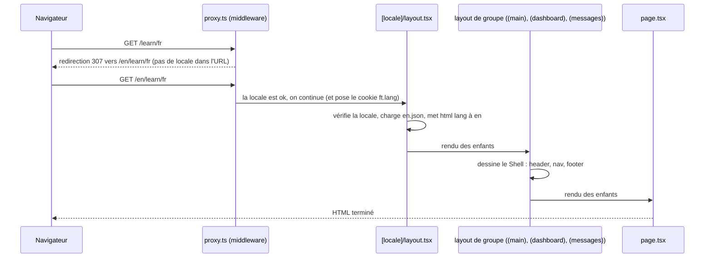
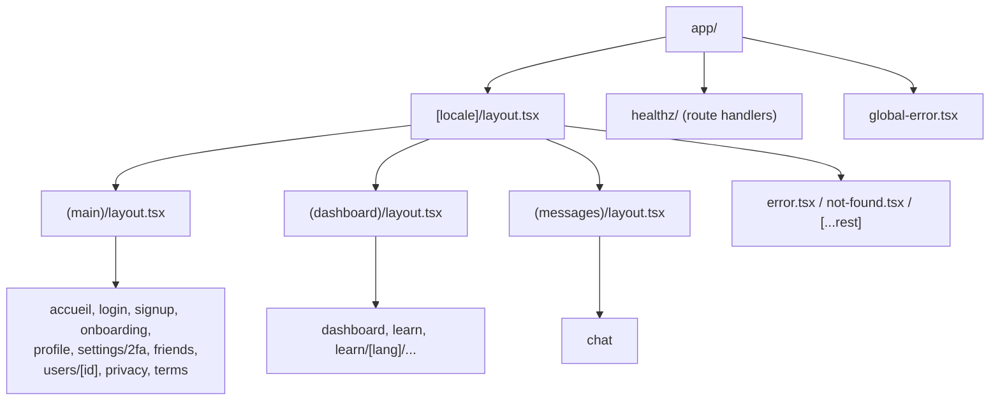
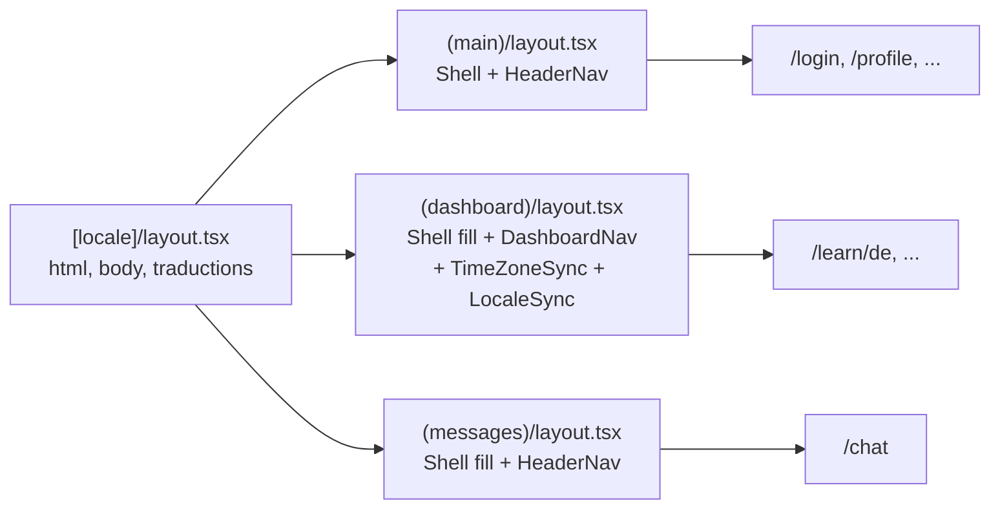
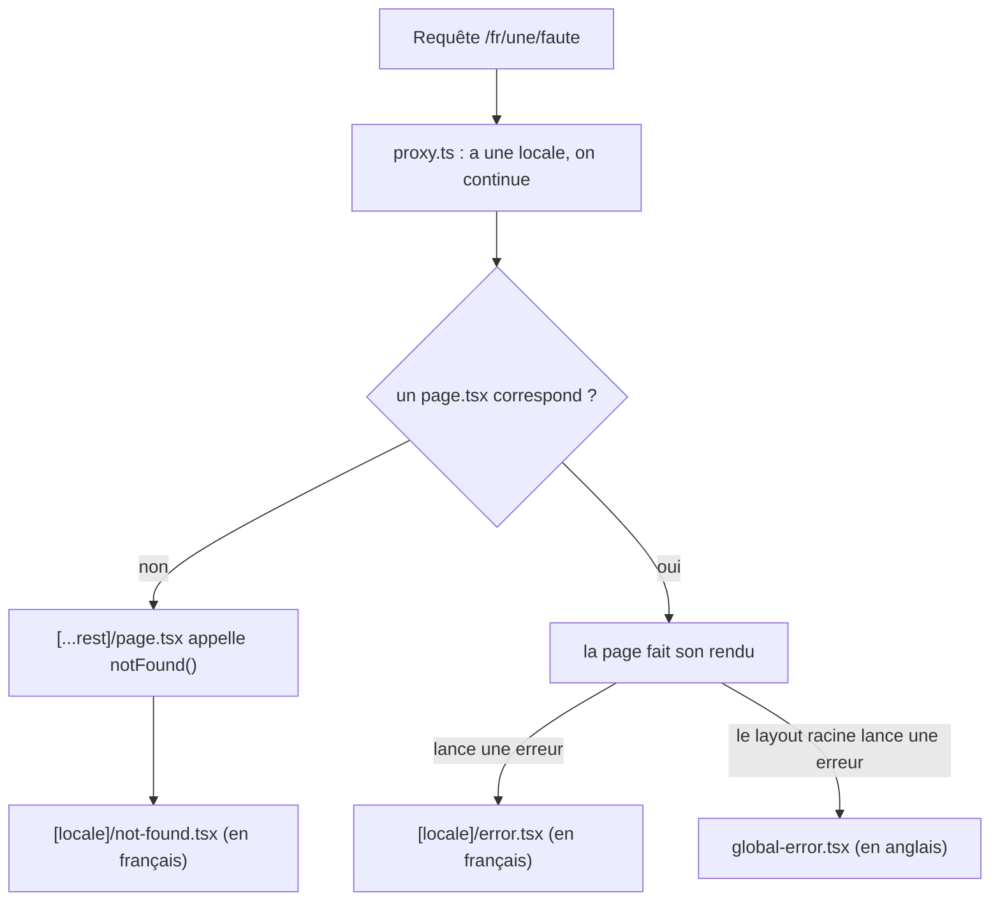
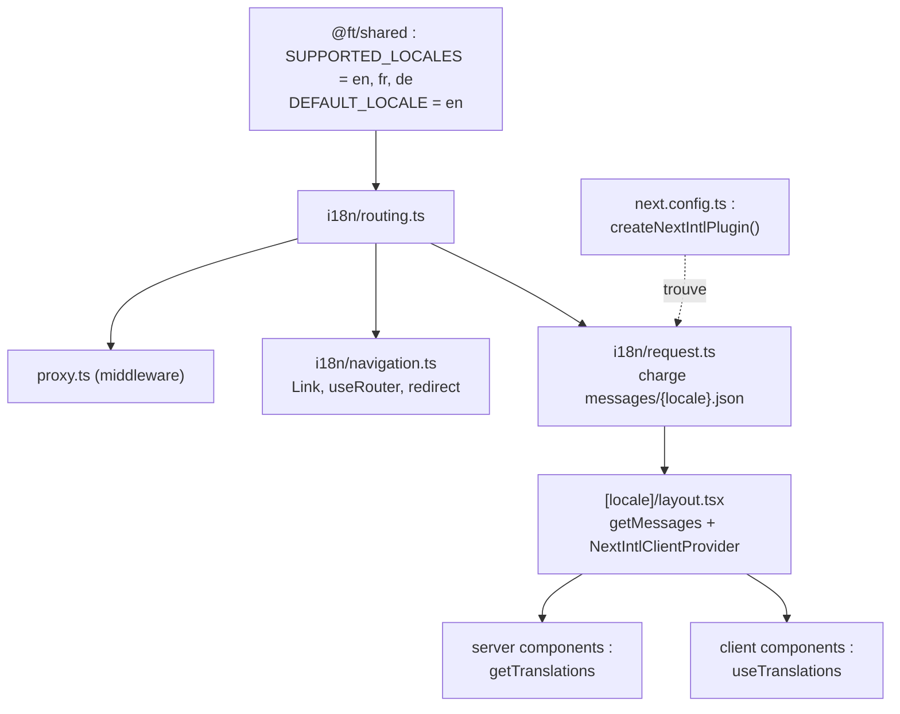
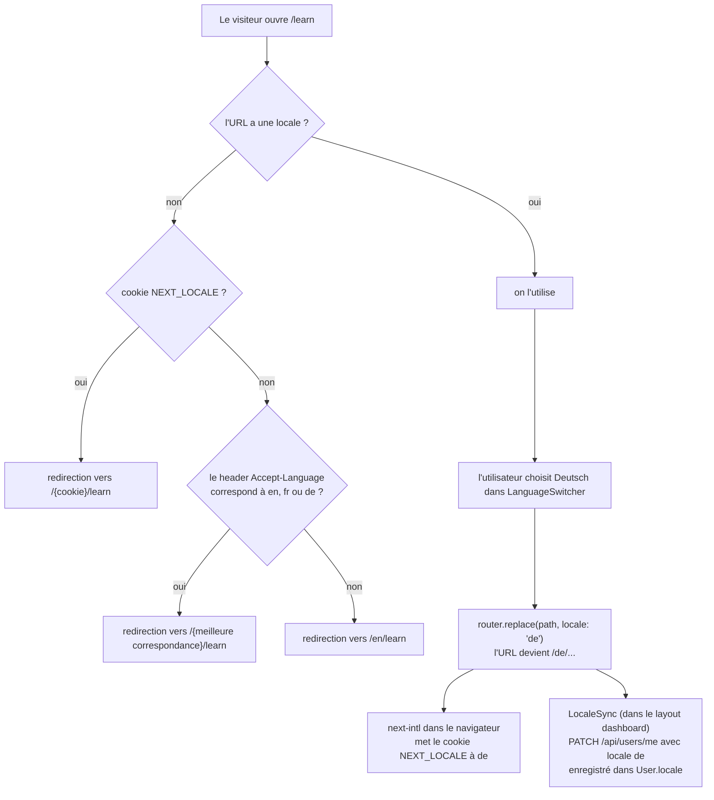

# Chapitre 2 — Routing, layouts et langues

Dans ce chapitre :

- Ce qui se passe, étape par étape, quand le navigateur demande une page
- Ce que fait `proxy.ts` avant qu'une page ne tourne
- La liste complète des URLs et le fichier qui dessine chacune
- Les layouts, les route groups, et pourquoi il y a trois groupes
- Les pages d'erreur, la page 404 et les routes de health check
- Les fichiers CSS et l'icône de l'onglet
- Comment l'app parle trois langues (anglais, français, allemand) avec `next-intl`

---

## 1. La vue d'ensemble : la vie d'une requête de page

Pense à un hôtel. Un client (le navigateur) arrive à la porte. Le portier (`proxy.ts`) regarde
quelle langue parle le client et l'envoie au bon étage (`/en`, `/fr`, `/de`).
À cet étage, le bâtiment lui-même (le layout `[locale]`) fournit les murs et la lumière.
Ensuite, une aile de l'étage (un layout de route group) ajoute ses propres meubles : un header et un footer.
Enfin, la chambre (le `page.tsx`) est ce pour quoi le client est venu.



Les mots importants :

- **Route** : une URL à laquelle l'app répond, comme `/en/login`.
- **Middleware** : du code qui tourne sur le serveur _avant_ que Next.js choisisse la page. Il peut rediriger,
  réécrire ou ajouter des cookies. Dans Next.js 16, le fichier s'appelle `proxy.ts` (les anciennes versions l'appelaient
  `middleware.ts`).
- **Layout** : un component qui enveloppe chaque page en dessous de lui dans l'arbre des dossiers. Il reste à
  l'écran quand tu passes d'une page à une autre qui le partagent.
- **Page** : le fichier `page.tsx` qui dessine une URL.

Chaque URL visible par l'utilisateur dans cette app commence par une langue : `/en/...`, `/fr/...` ou `/de/...`.

---

## 2. `proxy.ts` : le portier

Fichier : [proxy.ts](../../apps/web/proxy.ts)

```ts
import createMiddleware from 'next-intl/middleware';
import type { NextRequest } from 'next/server';

import { routing } from '@/i18n/routing';
import { COURSE_COOKIE, courseHomeLang } from '@/lib/course-path';

const intl = createMiddleware(routing);

/**
 * next-intl's middleware, plus the cookie /learn reads to know which course to
 * open. Written here because a server component cannot set one during a render.
 */
export default function proxy(request: NextRequest) {
  const response = intl(request);
  const lang = courseHomeLang(request.nextUrl.pathname);

  if (lang !== null) {
    response.cookies.set(COURSE_COOKIE, lang, {
      path: '/',
      httpOnly: true,
      sameSite: 'lax',
      maxAge: 60 * 60 * 24 * 365,
    });
  }

  return response;
}
```

Ligne par ligne :

| Ligne                                      | Ce qu'elle fait                                                                                                                                                                                                                                                                                                                                    |
| ------------------------------------------ | -------------------------------------------------------------------------------------------------------------------------------------------------------------------------------------------------------------------------------------------------------------------------------------------------------------------------------------------------- |
| `createMiddleware(routing)`                | Construit le middleware de langue de `next-intl` à partir de nos réglages de routing (voir section 7). C'est fait une seule fois, quand le fichier se charge.                                                                                                                                                                                      |
| `const response = intl(request)`           | Lance le middleware `next-intl`. Si l'URL n'a pas de locale (`/login`), il en choisit une et **redirige** vers `/en/login` (ou `/fr/login`...). Si l'URL en a déjà une, il laisse la requête continuer. Il ajoute aussi des headers `Link: <...>; hreflang="fr"`, pour que les moteurs de recherche trouvent les versions dans les autres langues. |
| `courseHomeLang(pathname)`                 | Vient de [lib/course-path.ts](../../apps/web/lib/course-path.ts). Renvoie `"de"` pour `/en/learn/de` (une page d'accueil de cours) et `null` pour tout le reste, y compris pour les pages plus profondes comme `/en/learn/de/lessons`.                                                                                                             |
| `response.cookies.set(COURSE_COOKIE, ...)` | Enregistre le cookie `ft.lang` = le cours que l'apprenant vient d'ouvrir. Il dure un an (`maxAge` en secondes). `httpOnly` veut dire que le JavaScript du navigateur ne peut pas le lire.                                                                                                                                                          |
| `return response`                          | Transmet la réponse (peut-être modifiée).                                                                                                                                                                                                                                                                                                          |

**Pourquoi poser le cookie ici ?** Le commentaire le dit : _"a server component cannot set one during a
render"_ (un server component ne peut pas en poser un pendant un rendu). La page `/learn` (sans langue) lit ce cookie pour rouvrir le dernier
cours. Seuls les middlewares, les route handlers et les server actions peuvent écrire des cookies, donc c'est le middleware
qui le fait.

**Pourquoi seulement la page d'accueil exacte du cours ?** Le commentaire dans `course-path.ts` l'explique : Next.js
fait du _prefetch_ sur les liens (il les charge à l'avance en arrière-plan). Une page de cours affiche des liens vers
`/learn/de/lessons/...`. Avec une correspondance plus large, un lien que l'apprenant a seulement _vu_ changerait le
cookie.

La deuxième partie est la `config` :

```ts
export const config = {
  // Match all pathnames except for
  // - … if they start with `/api`, `/trpc`, `/_next` or `/_vercel`
  // - … the ones containing a dot (e.g. `favicon.ico`)
  // Exclude /healthz: it's a machine health-check endpoint (used by Docker and
  // e2e smoke tests), not a user-facing page. It has no locale-prefixed version,
  // so letting the middleware redirect it would 404 and mark the container unhealthy.
  matcher: '/((?!api|trpc|_next|_vercel|healthz|.*\\..*).*)',
};
```

`matcher` est une expression régulière qui dit _quelles_ URLs passent par le middleware. La
partie `(?!...)` veut dire « qui ne commence pas par ». Donc celles-ci évitent le portier :

- `/api/...` — va à l'API NestJS, pas à Next.js.
- `/_next/...` — les propres fichiers JavaScript et CSS de Next.js.
- tout ce qui contient un point, comme `/icon.svg` — les fichiers statiques.
- `/healthz...` — les health checks (section 5). Ils n'ont pas de version par langue, donc une redirection
  vers `/en/healthz` répondrait 404 et Docker croirait que le container est malade.

---

## 3. L'arbre des routes

Dans l'App Router, **les dossiers sont des URLs**. Certains noms de dossiers sont spéciaux :

| Nom de dossier   | Signification                                                                                                                                     | Exemple                            |
| ---------------- | ------------------------------------------------------------------------------------------------------------------------------------------------- | ---------------------------------- |
| `[locale]`       | Un **segment dynamique** : correspond à n'importe quelle valeur, et la page la reçoit dans `params.locale`.                                       | `/fr/...` donne `locale = "fr"`    |
| `[lang]`, `[id]` | Même idée.                                                                                                                                        | `/en/learn/de` donne `lang = "de"` |
| `[...rest]`      | Un **catch-all** (attrape-tout) : correspond à un ou plusieurs segments de n'importe quel type.                                                   | `/en/a/b/c`                        |
| `(main)`         | Un **route group** : le nom entre parenthèses n'est _pas_ dans l'URL. Il sert seulement à regrouper des fichiers pour qu'ils partagent un layout. | `(main)/login` est `/en/login`     |

```
apps/web/app/
├── global-error.tsx          last-chance error page (English only)
├── globals.css               global styles (Tailwind)
├── lesson.css                lesson player styles
├── icon.svg                  the tab icon
├── healthz/
│   ├── route.ts              GET /healthz
│   ├── api/route.ts          GET /healthz/api
│   └── upstream/route.ts     GET /healthz/upstream
└── [locale]/
    ├── layout.tsx            root layout: <html>, translations
    ├── error.tsx             translated error page
    ├── not-found.tsx         translated 404 page
    ├── [...rest]/page.tsx    any unknown URL -> 404
    ├── (main)/               layout.tsx + home, login, signup, profile, friends...
    ├── (dashboard)/          layout.tsx + dashboard, learn/...
    └── (messages)/           layout.tsx + chat
```



### Chaque URL et sa page

`/{locale}` veut dire `/en`, `/fr` ou `/de`. Les chemins sont sous `apps/web/app/[locale]/`.

| URL                                           | Fichier                                                                                                                   | Groupe      | Note                                                     |
| --------------------------------------------- | ------------------------------------------------------------------------------------------------------------------------- | ----------- | -------------------------------------------------------- |
| `/{locale}`                                   | [(main)/page.tsx](<../../apps/web/app/[locale]/(main)/page.tsx>)                                                          | (main)      | Accueil (page d'arrivée)                                 |
| `/{locale}/login`                             | [(main)/login/page.tsx](<../../apps/web/app/[locale]/(main)/login/page.tsx>)                                              | (main)      | Connexion                                                |
| `/{locale}/signup`                            | [(main)/signup/page.tsx](<../../apps/web/app/[locale]/(main)/signup/page.tsx>)                                            | (main)      | Créer un compte                                          |
| `/{locale}/onboarding`                        | [(main)/onboarding/page.tsx](<../../apps/web/app/[locale]/(main)/onboarding/page.tsx>)                                    | (main)      | Choisir un cours et un niveau                            |
| `/{locale}/profile`                           | [(main)/profile/page.tsx](<../../apps/web/app/[locale]/(main)/profile/page.tsx>)                                          | (main)      | Mon profil (connecté)                                    |
| `/{locale}/profile/edit`                      | [(main)/profile/edit/page.tsx](<../../apps/web/app/[locale]/(main)/profile/edit/page.tsx>)                                | (main)      | Modifier le nom et l'avatar                              |
| `/{locale}/settings/2fa`                      | [(main)/settings/2fa/page.tsx](<../../apps/web/app/[locale]/(main)/settings/2fa/page.tsx>)                                | (main)      | Réglages de la connexion à deux facteurs                 |
| `/{locale}/friends`                           | [(main)/friends/page.tsx](<../../apps/web/app/[locale]/(main)/friends/page.tsx>)                                          | (main)      | Amis et demandes                                         |
| `/{locale}/users/{id}`                        | [(main)/users/[id]/page.tsx](<../../apps/web/app/[locale]/(main)/users/[id]/page.tsx>)                                    | (main)      | Le profil d'un autre utilisateur                         |
| `/{locale}/privacy`                           | [(main)/privacy/page.tsx](<../../apps/web/app/[locale]/(main)/privacy/page.tsx>)                                          | (main)      | Politique de confidentialité                             |
| `/{locale}/terms`                             | [(main)/terms/page.tsx](<../../apps/web/app/[locale]/(main)/terms/page.tsx>)                                              | (main)      | Conditions d'utilisation                                 |
| `/{locale}/dashboard`                         | [(dashboard)/dashboard/page.tsx](<../../apps/web/app/[locale]/(dashboard)/dashboard/page.tsx>)                            | (dashboard) | Redirige seulement vers `/learn`                         |
| `/{locale}/learn`                             | [(dashboard)/learn/page.tsx](<../../apps/web/app/[locale]/(dashboard)/learn/page.tsx>)                                    | (dashboard) | Redirige vers le dernier cours (lit le cookie `ft.lang`) |
| `/{locale}/learn/{lang}`                      | [(dashboard)/learn/[lang]/page.tsx](<../../apps/web/app/[locale]/(dashboard)/learn/[lang]/page.tsx>)                      | (dashboard) | Accueil du cours                                         |
| `/{locale}/learn/{lang}/achievements`         | [.../achievements/page.tsx](<../../apps/web/app/[locale]/(dashboard)/learn/[lang]/achievements/page.tsx>)                 | (dashboard) | Succès (achievements)                                    |
| `/{locale}/learn/{lang}/placement`            | [.../placement/page.tsx](<../../apps/web/app/[locale]/(dashboard)/learn/[lang]/placement/page.tsx>)                       | (dashboard) | Examen de placement                                      |
| `/{locale}/learn/{lang}/lessons`              | [.../lessons/page.tsx](<../../apps/web/app/[locale]/(dashboard)/learn/[lang]/lessons/page.tsx>)                           | (dashboard) | Liste des leçons et recherche                            |
| `/{locale}/learn/{lang}/lessons/{id}`         | [.../lessons/[id]/page.tsx](<../../apps/web/app/[locale]/(dashboard)/learn/[lang]/lessons/[id]/page.tsx>)                 | (dashboard) | Page de départ d'une leçon                               |
| `/{locale}/learn/{lang}/lessons/{id}/play`    | [.../lessons/[id]/play/page.tsx](<../../apps/web/app/[locale]/(dashboard)/learn/[lang]/lessons/[id]/play/page.tsx>)       | (dashboard) | Lecteur de leçon                                         |
| `/{locale}/learn/{lang}/lessons/{id}/results` | [.../lessons/[id]/results/page.tsx](<../../apps/web/app/[locale]/(dashboard)/learn/[lang]/lessons/[id]/results/page.tsx>) | (dashboard) | Résultats de la leçon                                    |
| `/{locale}/chat`                              | [(messages)/chat/page.tsx](<../../apps/web/app/[locale]/(messages)/chat/page.tsx>)                                        | (messages)  | Messages                                                 |
| `/{locale}/anything-else`                     | [[...rest]/page.tsx](../../apps/web/app/[locale]/[...rest]/page.tsx)                                                      | aucun       | Affiche la page 404                                      |

Les routes qui ne sont pas des pages (pas de langue, pas de layout) :

| URL                 | Fichier                                                                   | Réponse                                          |
| ------------------- | ------------------------------------------------------------------------- | ------------------------------------------------ |
| `/healthz`          | [healthz/route.ts](../../apps/web/app/healthz/route.ts)                   | `{"status":"ok","service":"web"}`                |
| `/healthz/api`      | [healthz/api/route.ts](../../apps/web/app/healthz/api/route.ts)           | `{"api":"up"}` ou `{"api":"down"}`, toujours 200 |
| `/healthz/upstream` | [healthz/upstream/route.ts](../../apps/web/app/healthz/upstream/route.ts) | 200, ou 503 quand l'API est injoignable          |
| `/icon.svg`         | [icon.svg](../../apps/web/app/icon.svg)                                   | L'icône de l'onglet                              |

Les autres fichiers `.tsx` dans ces dossiers (comme `login-form.tsx`) ne sont pas des routes. Seuls
`page.tsx`, `layout.tsx`, `route.ts` et quelques autres noms spéciaux ont un sens pour Next.js.
Les autres sont des components normaux posés à côté de la page qui les utilise. Les chapitres 5 à 8 les
expliquent.

---

## 4. Les layouts

### 4.1 `app/[locale]/layout.tsx` : le layout racine

Fichier : [app/[locale]/layout.tsx](../../apps/web/app/[locale]/layout.tsx)

C'est le **layout racine** (root layout) : le plus extérieur, celui qui dessine `<html>` et `<body>`. D'habitude, une
app Next.js l'a dans `app/layout.tsx`. Ici, il est _dans_ `[locale]`, exprès. Le commentaire
dit pourquoi : _"`<html lang>` must name the language actually rendered, and only a layout behind the
[locale] segment can read it as a plain param."_ (`<html lang>` doit nommer la langue vraiment affichée, et seul un layout derrière le segment [locale] peut la lire comme un simple param.) `lang="fr"` compte pour les lecteurs d'écran et les
moteurs de recherche.

Il exporte quatre choses :

**`viewport`** — dit aux téléphones d'utiliser la largeur de l'appareil (pas de page de bureau dézoomée).

**`generateStaticParams()`** — renvoie `[{locale:'en'},{locale:'fr'},{locale:'de'}]`. Il dit à
Next.js quelles valeurs `[locale]` peut avoir, pour qu'il puisse les préparer au moment du build. En pratique,
aucune page des trois groupes n'est construite à l'avance : chaque layout de groupe affiche `HeaderNav` ou
`DashboardNav`, qui lisent le cookie de session, et lire les cookies rend une route dynamique.

**`generateMetadata()`** — donne le `<title>` et la description de la page, traduits :

```tsx
  const { locale } = await params;
  const t = await getTranslations({ locale, namespace: 'Layout' });

  // A proper noun, so the three catalogues carry the same string. It still
  // comes from a catalogue: the module is graded on no user-facing text being
  // hardcoded, not on every string differing between languages.
  const productName = t('productName');

  return {
    title: {
      default: productName,
      template: `%s | ${productName}`,
    },
    description: t('description'),
    applicationName: productName,
  };
```

`template` veut dire : quand une page met son propre titre, comme `"Sign in"`, l'onglet affiche
`"Sign in | ft_transcendence"`. Le nom du produit est le même dans les trois fichiers, mais il
vient quand même d'un fichier de traduction, parce que les règles du projet disent qu'aucun texte visible par l'utilisateur ne peut être
écrit directement dans le code.

**Le component de layout** lui-même :

```tsx
  const { locale } = await params;

  // A URL like /es/login matches this segment before anything else can reject
  // it. Without this the render would continue with an unknown locale and
  // next-intl would answer every key with its own path.
  if (!hasLocale(routing.locales, locale)) {
    notFound();
  }

  setRequestLocale(locale);
  const messages = await getMessages();

  return (
    // Extensions like Dark Reader stamp attributes on <html> before React
    // hydrates, which otherwise logs a mismatch an evaluator would read as a
    // console gate failure. This covers that one element, not its children, so
    // a real mismatch anywhere inside still reports.
    <html lang={locale} suppressHydrationWarning className="dark">
      <body className="bg-slate-950 font-sans text-slate-100 antialiased">
        <NextIntlClientProvider locale={locale} messages={messages}>
          {children}
        </NextIntlClientProvider>
      </body>
    </html>
  );
```

Étape par étape :

1. `params` est une Promise dans Next.js 16, donc on fait `await` dessus.
2. `hasLocale` vérifie la valeur. `/es/login` correspondrait à `[locale]` avec `"es"`. Cette langue n'est
   pas prise en charge, donc `notFound()` affiche la 404.
3. `setRequestLocale(locale)` dit à `next-intl` quelle est la langue de ce rendu.
4. `getMessages()` charge tout le fichier de traduction (voir `i18n/request.ts` plus bas).
5. `NextIntlClientProvider` rend les traductions disponibles pour les **client components** dans le
   navigateur (les server components les lisent directement). Comme tout le fichier part dans le navigateur,
   les longs textes juridiques en sont tenus à l'écart (ils vivent dans `lib/legal-content`).
6. `className="dark"` fixe l'app sur une palette sombre. `suppressHydrationWarning` cache un
   avertissement connu : les extensions du navigateur comme Dark Reader ajoutent des attributs à `<html>` avant que React
   démarre, et React se plaindrait. Ça couvre seulement cet élément-là.
7. Il importe aussi `../globals.css` — donc chaque page a les styles.

### 4.2 Les route groups : pourquoi trois layouts ?

Le site a trois sortes d'écrans, et ils ont besoin d'un cadre un peu différent :

| Groupe        | Pages                            | Le logo mène à | Côté droit du header                        | `fill` | En plus                                                         |
| ------------- | -------------------------------- | -------------- | ------------------------------------------- | ------ | --------------------------------------------------------------- |
| `(main)`      | accueil, compte, amis, juridique | `/`            | `HeaderNav`                                 | non    | —                                                               |
| `(dashboard)` | dashboard, learn, leçons         | `/learn`       | `DashboardNav` (avec le sélecteur de cours) | oui    | `TimeZoneSync`, `LocaleSync`, emplacement pour le menu du cours |
| `(messages)`  | chat                             | `/learn`       | `HeaderNav`                                 | oui    | —                                                               |

`fill` veut dire « fixer le cadre à la hauteur de l'écran » (à partir des grands écrans). Les panneaux de la page
défilent alors à l'intérieur, et le header et le footer restent en place. Une page de type document (comme les conditions d'utilisation) ne
veut pas ça : elle est longue et tu défiles jusqu'au footer.

Sans route groups, on ne pourrait avoir qu'un seul layout par niveau de dossier, et toutes ces pages sont
au même niveau (`/en/login`, `/en/learn`, `/en/chat`). Un groupe est un dossier avec un nom entre
parenthèses : il ajoute un layout mais **pas** de morceau d'URL.



Les trois utilisent le même component `Shell` et le même `LegalFooter`. `HeaderNav` et `DashboardNav` affichent
le sélecteur de langue et les liens du compte. Pour un utilisateur connecté, ils replient tout ça dans
`HeaderMenu` : un seul bouton de menu, sur toutes les tailles d'écran, avec le nombre de non-lus dessus. Un visiteur
voit les éléments sur une seule ligne à la place. Le chapitre 3 les explique.

**[(main)/layout.tsx](<../../apps/web/app/[locale]/(main)/layout.tsx>)** — le cadre de la vitrine et
du compte :

```tsx
export default function MainLayout({ children }: { children: ReactNode }) {
  return (
    <Shell brand={<Wordmark />} nav={<HeaderNav />} footer={<LegalFooter />}>
      {children}
    </Shell>
  );
}
```

**[(messages)/layout.tsx](<../../apps/web/app/[locale]/(messages)/layout.tsx>)** — le même, mais
avec `fill` et le logo qui mène à `/learn`. Le commentaire explique pourquoi il n'a pas de sélecteur de cours :
aucun cours n'est ouvert ici, et le sélecteur coûte un appel à l'API à chaque rendu. La page de chat
refait souvent son rendu (à chaque événement d'ami), donc ce coût s'accumulerait.

**[(dashboard)/layout.tsx](<../../apps/web/app/[locale]/(dashboard)/layout.tsx>)** — le cadre
des cours :

```tsx
export default async function DashboardLayout({ children }: { children: ReactNode }) {
  // Only reads the session: the pages decide what a signed-out visitor gets.
  const user = await currentUser();

  return (
    <>
      {user ? <TimeZoneSync storedTimeZone={user.timeZone} /> : null}
      {user ? <LocaleSync storedLocale={user.locale} /> : null}
      <Shell
        brand={
          <>
            <Wordmark href="/learn" />
            {/* The course page puts its My course button here, below lg. */}
            <div id={COURSE_MENU_SLOT} className="contents" />
          </>
        }
        nav={<DashboardNav />}
        fill
        footer={<LegalFooter />}
      >
        {children}
      </Shell>
    </>
  );
}
```

- `currentUser()` (de `lib/session.ts`, chapitre 4) renvoie l'utilisateur connecté ou `null`.
  Le layout ne redirige pas : chaque page décide.
- `TimeZoneSync` et `LocaleSync` n'affichent rien. Ils enregistrent le fuseau horaire du navigateur et la
  langue de l'interface dans le profil de l'utilisateur (chapitre 3).
- Le `<div id="course-menu-slot">` vide est un trou dans le header. Sur les petits écrans, la page du cours
  y met son bouton "My course" (« Mon cours ») avec un _portal_ React (une façon de dessiner un component à
  un autre endroit de la page). `className="contents"` rend le div invisible pour la mise en page.

---

## 5. Les pages d'erreur, la 404 et les route handlers

Next.js utilise des noms de fichiers spéciaux pour les erreurs :

| Fichier                       | Quand il s'affiche                                           | Traduit ?                 |
| ----------------------------- | ------------------------------------------------------------ | ------------------------- |
| `[locale]/error.tsx`          | Une page sous `[locale]` lance une erreur pendant le rendu   | Oui                       |
| `[locale]/not-found.tsx`      | Une page appelle `notFound()`                                | Oui                       |
| `[locale]/[...rest]/page.tsx` | Aucune route ne correspond à l'URL ; il appelle `notFound()` | (affiche celle du dessus) |
| `global-error.tsx`            | Le layout racine lui-même lance une erreur                   | Non, anglais              |



### `[locale]/error.tsx`

Fichier : [error.tsx](../../apps/web/app/[locale]/error.tsx)

Un fichier d'erreur doit être un **client component** (`'use client'`), parce qu'il reçoit une fonction `reset`
qui réessaie le rendu dans le navigateur.

```tsx
export default function LocaleErrorBoundary({ reset }: { error: Error; reset: () => void }) {
  const t = useTranslations('ErrorPage');

  return (
    <Shell brand={<Wordmark />} footer={<LegalFooter />}>
      ...
          <button type="button" onClick={reset} ...>
            {t('tryAgain')}
          </button>
          <Link href="/" ...>
            {t('goHome')}
          </Link>
      ...
    </Shell>
  );
}
```

Le commentaire dit quand cette page s'affiche le plus souvent : `requireUser()` lance une erreur quand l'API est
injoignable. C'est voulu : une API lente ou en train de redémarrer ne doit pas ressembler à une déconnexion, donc le cookie
de session reste et l'utilisateur peut simplement faire "Try again" (« Réessayer »). Il n'y a pas de nav de compte ici (`nav` n'est pas
passé), parce que c'est justement la lecture de la session qui a échoué.

### `[locale]/not-found.tsx` et `[...rest]/page.tsx`

Fichiers : [not-found.tsx](../../apps/web/app/[locale]/not-found.tsx),
[[...rest]/page.tsx](../../apps/web/app/[locale]/[...rest]/page.tsx)

`not-found.tsx` dessine la 404 traduite, avec un lien "Go home" (« Retour à l'accueil ») et le footer juridique. Il n'a pas de
nav de compte : lire les cookies ferait de chaque 404 un rendu dynamique (non mis en cache).

Mais Next.js n'utilise ce fichier que quand une page _appelle_ `notFound()`. Une URL qui ne correspond à rien
tomberait sur la 404 par défaut de Next.js, qui est au-dessus de `[locale]`, donc en anglais et
sans liens juridiques. Le catch-all règle ça :

```tsx
export default function CatchAllPage() {
  notFound();
}
```

`[...rest]` correspond à chaque URL sous `/{locale}/` qu'aucune autre route ne prend. Comme `proxy.ts`
ajoute d'abord une locale à chaque URL, toutes les adresses inconnues finissent ici, puis sur la 404
traduite.

### `global-error.tsx`

Fichier : [global-error.tsx](../../apps/web/app/global-error.tsx)

C'est la seule page d'erreur au-dessus de `[locale]`. Elle attrape les erreurs du layout racine — le layout
qui charge les traductions. Donc elle ne peut pas utiliser les traductions (ça échouerait une deuxième fois), et
elle ne peut pas utiliser `Shell` (qui lit les traductions). Elle est en anglais, et elle dessine ses propres
`<html>` et `<body>`, parce qu'elle _remplace_ tout le document. Elle importe `globals.css` elle-même
pour la même raison.

### `healthz/*` : les route handlers

Un **route handler** est un fichier `route.ts`. Au lieu d'une page React, il exporte des fonctions nommées
d'après les méthodes HTTP (`GET`, `POST`...) et renvoie une réponse brute, souvent du JSON. C'est comme une toute petite
API dans l'app web.

```ts
// app/healthz/route.ts
export const dynamic = 'force-dynamic';

export function GET() {
  return NextResponse.json({ status: 'ok', service: 'web' });
}
```

`dynamic = 'force-dynamic'` veut dire « lance ça à chaque requête », ne réponds jamais avec une copie faite au
moment du build. Un health check doit dire la vérité _maintenant_.

| Route                                                             | Qui l'appelle                                                 | Pourquoi                                                                                                                                                               |
| ----------------------------------------------------------------- | ------------------------------------------------------------- | ---------------------------------------------------------------------------------------------------------------------------------------------------------------------- |
| [/healthz](../../apps/web/app/healthz/route.ts)                   | Le `HEALTHCHECK` de Docker                                    | « Le serveur web est-il vivant ? » Pas sous `/api`, parce que Caddy envoie `/api` à NestJS.                                                                            |
| [/healthz/api](../../apps/web/app/healthz/api/route.ts)           | Le socket de l'onglet, avant chaque nouvel essai (chapitre 3) | Interroge l'API avec `pingApi`. Toujours 200 avec `{api:'up'}` ou `{api:'down'}`, parce que le navigateur affiche chaque réponse 5xx comme une erreur dans la console. |
| [/healthz/upstream](../../apps/web/app/healthz/upstream/route.ts) | Prometheus et l'alerte blackbox                               | Même ping, mais répond **503** quand l'API est injoignable, pour que le monitoring le voie.                                                                            |

Le commentaire de `upstream` explique pourquoi elle existe : les pages normales affichent une vue déconnectée quand l'API
est en panne, exprès. Donc un `API_INTERNAL_URL` faux afficherait quand même des pages valides et rien
n'échouerait. Cette route rend ce problème visible. Ce n'est pas une lecture de session, parce qu'un appelant
qui aurait atteint sa propre limite de requêtes (rate limit) verrait alors une API en bonne santé comme « down ».

---

## 6. Le CSS et l'icône

### `globals.css`

Fichier : [globals.css](../../apps/web/app/globals.css)

Importé une fois par le layout racine (et par `global-error.tsx`). Il utilise **Tailwind CSS 4** : tu
écris de petits noms de classes comme `px-4 text-slate-100` dans le JSX, et Tailwind construit le CSS pour
les classes qu'il trouve.

```css
@import 'tailwindcss';
@import './lesson.css';

/* Tailwind 4 resolves `dark:` through prefers-color-scheme unless told
   otherwise. The layouts put `dark` on <html> to pin the app to one palette,
   so the variant has to follow that class or the two disagree: body stays
   dark while every `dark:` utility switches off on a light OS. */
@custom-variant dark (&:where(.dark, .dark *));

/* Tailwind 4 is CSS-first: there is no tailwind.config.js. Source detection is
   declared explicitly so class scanning does not depend on the working
   directory the build happens to run from inside the container. */
@source '.';

@source '../components';

/* @ft/ui is source only: its classes are scanned from there. */
@source '../../../packages/ui/src';
```

- `@import 'tailwindcss'` charge Tailwind. Tailwind 4 n'a pas de `tailwind.config.js` : les réglages
  vivent dans le CSS.
- `@custom-variant dark` fait que les classes `dark:` suivent la classe `dark` sur `<html>`, pas le réglage
  du système d'exploitation. Sans ça, un utilisateur avec un OS en mode clair aurait un body sombre mais des utilitaires
  `dark:` clairs.
- `@source` liste les dossiers où Tailwind cherche les noms de classes : `app/`, `components/` et le
  `packages/ui/src` partagé. C'est explicite pour que le build ne dépende pas du dossier depuis lequel il tourne.
- `@theme { ... }` ajoute deux animations pour le lecteur de leçon (`animate-lesson-slide`,
  `animate-lesson-flash`). Une règle `prefers-reduced-motion` les rend presque instantanées pour les utilisateurs
  qui demandent moins de mouvement à leur OS.
- `@layer base` règle `color-scheme: dark` (pour que les contrôles de formulaire et les barres de défilement soient sombres aussi),
  le défilement fluide et un texte plus joli.
- `@layer utilities` ajoute les animations de fusée de la page d'onboarding (`animate-liftoff`,
  `animate-launch`, `animate-twinkle`).

### `lesson.css`

Fichier : [lesson.css](../../apps/web/app/lesson.css)

Environ 1 200 lignes de CSS simple pour les pages de leçon, importées par `globals.css`. La première ligne
dit qu'il suit les maquettes du prototype. Il utilise des noms de classes normaux (`.lesson-view`, `.lesson-layout`,
`.lesson-sidebar`, `.lesson-timeline`, `.lesson-task`, `.lesson-results-banner`...) parce que les
écrans de leçon ont une grille précise, plus facile à écrire en CSS. Quelques règles utilisent `:has()` pour
élargir le shell seulement quand une leçon est à l'écran :

```css
main:has(.lesson-view) {
  max-width: 1320px;
}
```

Il cache aussi la question de lecture pendant que le texte est ouvert (`data-skim="reading"`). Le chapitre 7
explique le lecteur de leçon.

### `icon.svg`

Fichier : [icon.svg](../../apps/web/app/icon.svg)

Un fichier nommé `icon.svg` dans `app/` est pris par Next.js comme icône d'onglet (favicon) de chaque
page ; Next ajoute lui-même la balise `<link rel="icon">`. C'est un carré bleu arrondi avec trois lignes
blanches.

---

## 7. L'internationalisation (i18n)

L'**internationalisation** veut dire construire l'app pour qu'elle puisse afficher son texte dans plusieurs langues.
On l'écrit **i18n** : « i », puis 18 lettres, puis « n ». Une **locale** est un code de langue comme
`en`, `fr` ou `de`. Un **catalogue de messages** est un fichier avec tous les textes de l'app, dans une seule
langue.

Analogie : le code est une pièce de théâtre, et chaque catalogue est une traduction du texte. Les
acteurs (les components) ne connaissent pas les répliques par cœur ; ils lisent la réplique avec le bon numéro
(`HomePage.headline`) dans le texte de la langue du soir.

L'app utilise la bibliothèque **next-intl**. Ses pièces :



### `i18n/routing.ts`

Fichier : [routing.ts](../../apps/web/i18n/routing.ts)

```ts
export const routing = defineRouting({
  // A list of all locales that are supported
  locales: SUPPORTED_LOCALES,

  // Used when no locale matches
  defaultLocale: DEFAULT_LOCALE,

  // Prefix even the default locale, so no route is ambiguous about the language
  // it renders and every href carries one.
  localePrefix: 'always',
});
```

La liste des langues vient du package partagé
([packages/shared/src/schemas/locale.ts](../../packages/shared/src/schemas/locale.ts)) :
`['en', 'fr', 'de']`, par défaut `'en'`. C'est le seul endroit où cette liste existe : le modèle utilisateur de l'API
l'utilise aussi.

`localePrefix: 'always'` veut dire que les pages en anglais sont `/en/login`, pas juste `/login`. Chaque URL dit
sa langue.

### `i18n/request.ts`

Fichier : [request.ts](../../apps/web/i18n/request.ts)

```ts
export default getRequestConfig(async ({ requestLocale }) => {
  const requested = await requestLocale;
  const locale = hasLocale(routing.locales, requested) ? requested : routing.defaultLocale;

  return {
    locale,
    messages: (await import(`../messages/${locale}.json`)).default,
  };
});
```

`next-intl` appelle ça sur le serveur pour chaque requête, pour connaître la langue et le catalogue.
La ligne `createNextIntlPlugin()` dans `next.config.ts` est ce qui dit à `next-intl` où se trouve ce fichier.
Le commentaire explique la vérification : `requestLocale` peut être n'importe quoi (ou rien). Une valeur inconnue
arriverait jusqu'à l'`import` et ferait planter ("file not found", fichier introuvable), donc on se rabat sur l'anglais à la place.

### `i18n/navigation.ts`

Fichier : [navigation.ts](../../apps/web/i18n/navigation.ts)

```ts
export const { Link, redirect, usePathname, useRouter, getPathname } = createNavigation(routing);
```

Ils remplacent les versions de Next.js. Ils ajoutent la locale actuelle à ta place :
`<Link href="/login">` sur une page en français va vers `/fr/login`. `usePathname()` renvoie le chemin
_sans_ la locale (`/login`). `router.replace(pathname, { locale: 'de' })` change de
langue. Les components de cette app importent `Link`, `useRouter` et `usePathname` depuis
`@/i18n/navigation`, pas depuis `next/link` ou `next/navigation`. Le `redirect` de ce fichier n'est pas
utilisé : le code serveur appelle `redirect('/login')` de `next/navigation`, sans locale, et
`proxy.ts` ajoute la locale à la requête suivante.

### `messages/en.json`, `fr.json`, `de.json`

Fichiers : [en.json](../../apps/web/messages/en.json), [fr.json](../../apps/web/messages/fr.json),
[de.json](../../apps/web/messages/de.json)

Chaque fichier est un seul objet JSON. Les clés du premier niveau sont des **namespaces** (espaces de noms) : en général un par component ou
par page. À l'intérieur, il y a les clés. Les trois fichiers ont les mêmes 37 namespaces et les mêmes clés.

| Namespace                         | Clés                        | Utilisé par                                       |
| --------------------------------- | --------------------------- | ------------------------------------------------- |
| `SessionNav`                      | 4                           | nav du compte, bouton du menu                     |
| `LanguageSwitcher`                | 4                           | sélecteur de langue                               |
| `Layout`                          | 2                           | nom du produit, meta description                  |
| `Footer`                          | 2                           | footer juridique                                  |
| `HomePage`                        | 5                           | page d'arrivée                                    |
| `Languages`                       | 3                           | noms des langues                                  |
| `CourseSwitcher`                  | 3                           | sélecteur de cours                                |
| `Course`                          | 34                          | page du cours                                     |
| `LessonStatus`                    | 4                           | états des leçons (à faire, fait...)               |
| `Onboarding`                      | 17                          | page d'onboarding                                 |
| `Level`                           | 8                           | choix du niveau                                   |
| `MessagesPage`                    | 12                          | chat, badge des non-lus                           |
| `ErrorPage`                       | 4                           | `error.tsx`                                       |
| `NotFoundPage`                    | 4                           | `not-found.tsx`                                   |
| `LoginPage`, `LoginForm`          | 1, 8                        | connexion                                         |
| `SignUpPage`, `SignUpForm`        | 1, 9                        | inscription                                       |
| `Form`                            | 1                           | texte partagé des formulaires                     |
| `Errors`                          | 19 (18 groupes + `unknown`) | les codes d'erreur de l'API sous forme de phrases |
| `LogOutButton`                    | 2                           | déconnexion                                       |
| `Connection`                      | 1                           | la pastille "Reconnecting…" (« Reconnexion… »)    |
| `LegalArticle`                    | 1                           | confidentialité et conditions                     |
| `ProfilePage`, `ProfileForm`      | 7, 8                        | profil                                            |
| `FriendsPage`                     | 24                          | amis                                              |
| `UserPage`                        | 4                           | la page d'un autre utilisateur                    |
| `TwoFactorPage`, `TwoFactorPanel` | 2, 17                       | réglages 2FA                                      |
| `Placement`                       | 30                          | examen de placement                               |
| `Lesson`                          | 125                         | lecteur de leçon                                  |
| `Genders`                         | 3                           | genres grammaticaux                               |
| `LessonKinds`                     | 4                           | grammaire, vocabulaire...                         |
| `Gamification`                    | 42                          | XP, rangs, succès                                 |
| `Topics`                          | 13                          | sujets de grammaire                               |
| `Themes`                          | 14                          | thèmes de vocabulaire                             |
| `Lessons`                         | 35                          | page de la liste des leçons                       |

Un petit morceau de `en.json` :

```json
  "NotFoundPage": {
    "title": "Page not found",
    "heading": "Page not found",
    "intro": "That address does not exist. It may have moved, or the link that brought you here may be out of date.",
    "goHome": "Go home"
  },
```

Les textes peuvent avoir des **placeholders** (emplacements) au format ICU, comme
`"{count, plural, one {# unread message} other {# unread messages}}"` : la bonne forme est
choisie selon le nombre. Ils peuvent aussi avoir des **balises** pour du texte enrichi, comme celles du footer :
`"... <privacy>Privacy Policy</privacy> and <terms>Terms of Service</terms>."` (le chapitre 3 montre
comment elles deviennent des liens).

Le test [lib/messages.test.ts](../../apps/web/lib/messages.test.ts) vérifie que `fr.json` et
`de.json` ont exactement les mêmes clés que `en.json`, qu'aucun texte n'est vide, et que chaque code d'erreur de l'API
et chaque succès a une traduction.

### Comment un component obtient un texte

Dans un **server component** (async), utilise `getTranslations` de `next-intl/server` :

```tsx
// app/[locale]/(main)/page.tsx
import { getTranslations } from 'next-intl/server';

export default async function HomePage() {
  const user = await currentUser();
  const t = await getTranslations('HomePage');
  // ... t('headline'), t('startNow') ...
```

Dans un **client component**, ou un server component non async, utilise le hook `useTranslations` :

```tsx
// app/[locale]/error.tsx  ('use client')
const t = useTranslations('ErrorPage');
// ...
<h1>{t('heading')}</h1>
```

`t('heading')` cherche `ErrorPage.heading` dans le catalogue actuel. Avec une valeur :
`t('unread', { count })`. Dans le navigateur, les textes viennent de `NextIntlClientProvider` dans le layout
racine ; sur le serveur, ils viennent de `i18n/request.ts`.

### Comment la locale est choisie et gardée



1. **L'URL gagne.** `/fr/...` est en français, toujours. Rien ne lit `User.locale` pour choisir la
   langue d'une page.
2. Sans locale dans l'URL, le middleware `next-intl` regarde son cookie `NEXT_LOCALE` (la
   dernière langue utilisée), puis le header `Accept-Language` du navigateur, puis la valeur par défaut `en`, et
   redirige. `NEXT_LOCALE` est un cookie de session : il n'a pas de `maxAge`, donc il disparaît quand le
   navigateur se ferme. Au chargement d'une page (pas pendant un prefetch), le middleware l'écrit aussi : quand la
   langue de l'URL diffère de celle du cookie, ou, sans cookie, de la langue du navigateur.
3. **Changer de langue** : le select `LanguageSwitcher` appelle
   `router.replace(pathname, { locale })`. L'app ouvre le même chemin dans la nouvelle langue avec une
   navigation côté client (pas de rechargement complet ; le layout racine refait son rendu), et `next-intl` écrit
   `NEXT_LOCALE` dans le navigateur. `replace` (pas `push`) pour que le
   bouton Retour n'annule pas un changement de langue.
4. **Prévenir le serveur** : [LocaleSync](../../apps/web/components/locale-sync.tsx), seulement dans le
   layout `(dashboard)`, enregistre la langue de l'URL dans `User.locale` (`PATCH /api/users/me`
   avec `{ locale }`) quand elle diffère de celle stockée. Une seule requête part à la fois. Un
   échec est réessayé à la page suivante ; un `400` n'est pas réessayé. L'API en a besoin parce que le
   tuteur des leçons répond dans la langue de l'interface de l'apprenant. L'inscription n'envoie pas de locale,
   donc un nouveau compte commence avec `en` jusqu'à sa première page du dashboard. Un changement fait sur une page
   `(main)` ou `(messages)` est enregistré à la page du dashboard suivante. Le chapitre 3 montre le code.

---

## Idées clés à retenir

- Chaque URL de page commence par une locale (`/en`, `/fr`, `/de`) ; `proxy.ts` l'ajoute quand elle manque et
  enregistre aussi le dernier cours ouvert dans le cookie `ft.lang`. L'URL décide de la langue ;
  `LocaleSync` la copie seulement dans `User.locale` pour le tuteur.
- Les dossiers sont des URLs. `[x]` est une partie dynamique, `[...x]` attrape tout, `(x)` est un groupe qui
  ajoute un layout mais pas de morceau d'URL.
- Le layout racine vit dans `[locale]/layout.tsx` pour que `<html lang>` soit juste ; il charge le
  catalogue et le donne aux client components.
- Trois groupes, trois layouts : `(main)` pour les documents, `(dashboard)` et `(messages)` fixés à
  l'écran. Tous utilisent le même `Shell`.
- `error.tsx` et `not-found.tsx` sont traduits ; `[...rest]` envoie les URLs inconnues vers cette 404 ;
  `global-error.tsx` est le dernier recours, en anglais.
- Les fichiers `route.ts` sont de petits endpoints JSON : les trois checks `/healthz` pour Docker, le socket
  de l'onglet et le monitoring.
- Styles : Tailwind 4 dans `globals.css`, du CSS simple pour les leçons dans `lesson.css`.
- Traductions : `getTranslations` sur le serveur, `useTranslations` dans le client, des clés regroupées par
  namespace dans `messages/*.json` ; les liens et le router viennent de `@/i18n/navigation`, les redirections serveur
  de `next/navigation` (le middleware ajoute la locale).

---

Précédent : [Chapitre 1 — React et Next.js](01-react-and-nextjs.md) · Suivant : [Chapitre 3 — La coque de l'app](03-shell-components.md) · [Retour à l'index](README.md)
