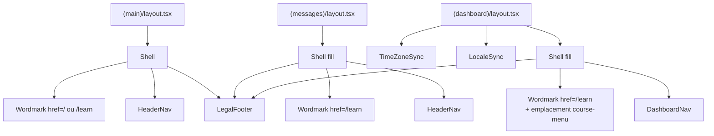
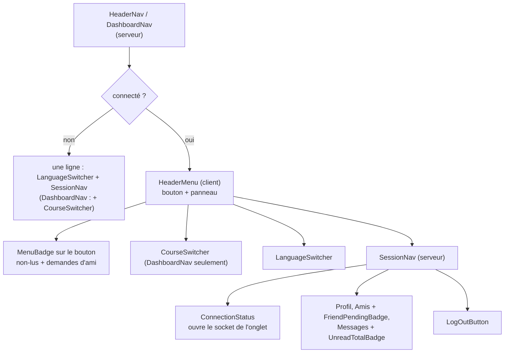
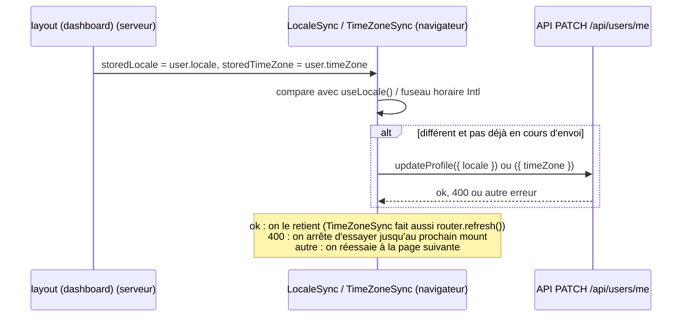
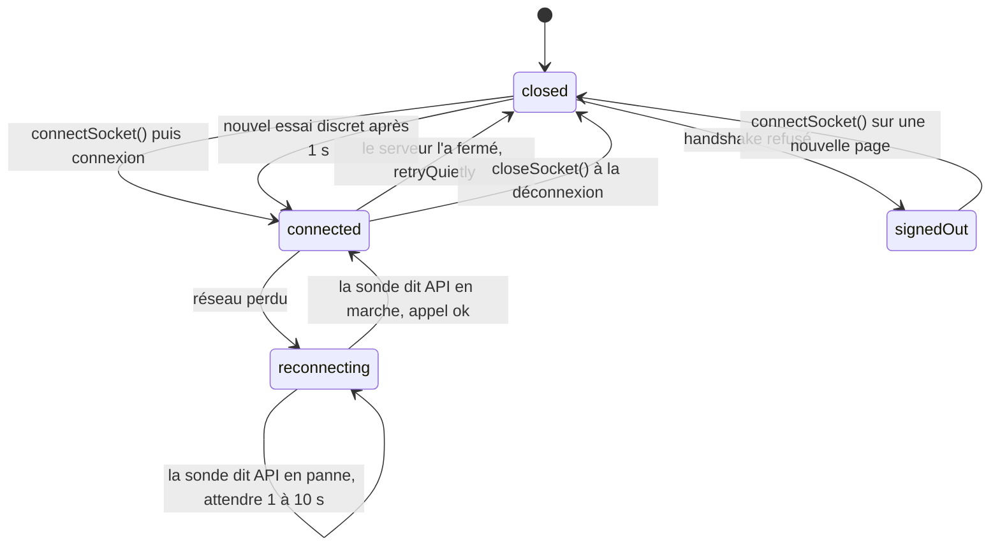
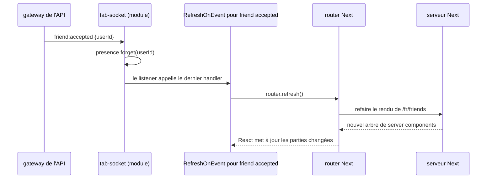

# Chapitre 3 — Le shell de l'app et les helpers partagés

Dans ce chapitre :

- Ce qu'est le « shell » : le cadre (header, menu, footer) autour de chaque page
- Quel layout dessine quelle partie (un arbre de composants)
- Le header : `HeaderNav`, `DashboardNav`, `HeaderMenu`, `SessionNav` et leurs petites parties
- Les petits helpers invisibles : `LocaleSync`, `TimeZoneSync`, `useScrollLock`
- La connexion en direct : **un socket par onglet du navigateur** (`tab-socket.ts`, `lib/reconnect.ts`)
- Comment `RefreshOn` refait le rendu d'une page quand le serveur envoie un événement
- Les badges des messages non lus et des demandes d'ami, et la pastille « Reconnecting… » (« Reconnexion… »)

---

## 1. Vue d'ensemble

Pense à un cadre photo. Tu changes souvent la photo (la page), mais le cadre (le shell) reste le
même. Dans cette app, le cadre c'est : un header avec le logo à gauche et un menu à droite, la
page au milieu, et un petit footer légal en bas.

Le chapitre 2 a montré les trois layouts de groupe. Chacun construit le cadre avec le même
composant `Shell` et lui donne des parties différentes :



Et dans la nav (le côté droit du header) :



Deux sortes de composants se mélangent ici (voir chapitre 1) :

- Les **server components** (`HeaderNav`, `DashboardNav`, `SessionNav`, `Shell`, `LegalFooter`)
  tournent sur le serveur. Ils peuvent lire le cookie de session, donc le premier HTML montre déjà
  le bon menu.
- Les **client components** (`'use client'` : `HeaderMenu`, `LanguageSwitcher`, `LogOutButton`,
  `ConnectionStatus`...) tournent dans le navigateur. Ils ont besoin de clics, de state ou du socket.

Un server component peut passer un server component comme `children` à un client component. C'est
comme ça que `HeaderMenu` (client) contient `SessionNav` (serveur).

Les fichiers de ce chapitre sont dans [apps/web/components](../../apps/web/components). On suit
l'ordre de l'écran : cadre, header, menu, helpers, puis le socket.

---

## 2. `shell.tsx` : le cadre

Fichier : [shell.tsx](../../apps/web/components/shell.tsx) — exporte `Shell`, `ShellProps` et
`Wordmark`.

Le commentaire dit que les groupes ne diffèrent que sur quatre points, et les quatre sont des props :
ce qui est à gauche de la nav (`brand`), le footer (`footer`), si le cadre est fixé à l'écran
(`fill`), et la page elle-même (`children`). Donc le markup du header, l'espace sur les côtés et la
largeur max sont écrits une seule fois. La nav (`nav`) est aussi une prop, pour une autre raison
(voir plus bas).

```tsx
export function Shell({ brand, nav, fill = false, footer, children }: ShellProps) {
  return (
    <div className={`flex min-h-dvh flex-col ${fill ? 'lg:h-dvh' : ''}`}>
      <header className="border-b border-slate-800">
        <div
          className={`${CONTAINER} relative z-50 flex flex-wrap items-center justify-between gap-x-4 gap-y-3 py-2.5`}
        >
          {brand}
          {nav}
        </div>
      </header>

      {/*
        `min-h-0` is what makes `fill` work, from `lg` where the frame is
        pinned. A flex child defaults to min-height:auto, which refuses to
        shrink below its content, so a tall page pushes the footer off the
        screen and the panes' lg:overflow-y-auto never gets a box to scroll in.
        Setting it here means a page can size itself to the pane with h-full and
        own its own scrolling. `flex flex-col` is for the pages that fill this
        box with a single pane and centre inside it. A pane that scrolls also
        needs `relative`: an sr-only label is absolutely positioned, and with
        no positioned ancestor it escapes the pane and makes the whole page
        scroll, header and footer included.
      */}
      <main
        className={`${CONTAINER} flex-1 ${fill ? 'flex min-h-0 flex-col pt-5 pb-4' : 'py-8 sm:py-12'}`}
      >
        {children}
      </main>

      {footer}
    </div>
  );
}
```

- `min-h-dvh` : au moins la hauteur de l'écran (`dvh` = « dynamic viewport height », correct sur
  les téléphones où la barre d'adresse apparaît et disparaît).
- `fill` ajoute `lg:h-dvh` : à partir des grands écrans (`lg`), exactement la hauteur de l'écran.
  Les panneaux de la page défilent alors à l'intérieur. En dessous de `lg`, les panneaux s'empilent
  et toute la page défile ; fixer la hauteur les écraserait sur un téléphone.
- `min-h-0` sur `<main>` : un long commentaire l'explique. Par défaut, un enfant flex ne peut pas
  devenir plus petit que son contenu, donc une page haute pousserait le footer hors de l'écran et les
  panneaux internes ne défileraient jamais. `min-h-0` enlève cette limite.
- `relative z-50` sur la ligne du header : `HeaderMenu` place son panneau et son fond sombre par
  rapport à cette ligne (section 4).
- `CONTAINER` = `mx-auto w-full max-w-6xl px-4 sm:px-6` : centré, largeur max, espace sur les côtés.

**Pourquoi `nav` est une prop et pas dans Shell ?** `SessionNav` lit les cookies. `Shell` est aussi
utilisé par `error.tsx`, un client component qui ne peut pas lire la session. Il ne passe pas de
`nav`. Donc `Shell` lui-même ne charge aucune donnée.

`Wordmark` est le nom du produit sous forme de lien vers l'accueil :

```tsx
export function Wordmark({ href = '/' }: { href?: '/' | '/learn' }) {
  const t = useTranslations('Layout');

  return (
    // Below lg the course page's My course button takes its place.
    <Link
      href={href}
      className="text-base font-semibold tracking-tight text-slate-100 max-lg:[:root:has([data-course-menu-button])_&]:hidden"
    >
      {t('productName')}
    </Link>
  );
}
```

L'« accueil » est `/learn` dans l'app. Sur les pages marketing et la 404, il suit la session :
`/learn` pour un utilisateur connecté, `/` pour un visiteur. Ainsi, un apprenant connecté n'est pas
renvoyé sur la landing page. La longue classe veut dire : sur les petits écrans, _si la
page contient un `[data-course-menu-button]`_, cacher le wordmark. La page du cours met ce bouton
dans l'emplacement course-menu (voir `lib/course-menu-slot.ts` plus bas), donc le bouton prend la
place du logo.

### `lib/course-menu-slot.ts`

Fichier : [course-menu-slot.ts](../../apps/web/lib/course-menu-slot.ts)

```ts
export const COURSE_MENU_SLOT = 'course-menu-slot';
```

Une seule chaîne : l'`id` du `<div>` vide que le layout `(dashboard)` met dans le header. Le menu du
cours (`learn/[lang]/course-menu.tsx`, chapitre 6) le trouve avec
`document.getElementById(COURSE_MENU_SLOT)` et y dessine son bouton avec `createPortal`.
**Pourquoi un fichier à part ?** Une constante exportée depuis un fichier `'use client'` arrive dans
un server component comme une « client reference », pas comme la chaîne. Le layout est un server
component, donc la constante vit dans un module simple que les deux peuvent importer.

---

## 3. La nav du header : `HeaderNav` et `DashboardNav`

### `header-nav.tsx`

Fichier : [header-nav.tsx](../../apps/web/components/header-nav.tsx) — utilisé par `(main)` et
`(messages)`.

```tsx
export async function HeaderNav() {
  const user = await currentUser();
  const items = (
    <>
      <LanguageSwitcher />
      <SessionNav />
    </>
  );

  if (user === null) {
    return <div className="flex min-w-0 flex-wrap items-center gap-x-4 gap-y-2">{items}</div>;
  }
  // Signed in only, so a visitor costs no extra call.
  return <HeaderMenu requests={await friendPending()}>{items}</HeaderMenu>;
}
```

Un server component. Les mêmes éléments dans les deux cas, mais emballés différemment :

- **Visiteur** (pas connecté) : le choix de langue, « Sign in » (« Se connecter »), « Create
  account » (« Créer un compte ») sur une ligne. Les mettre dans un menu cacherait « Sign in ».
- **Connecté** : tout va dans le `HeaderMenu` (un bouton qui ouvre un panneau). Il reçoit
  `requests`, le nombre de demandes d'ami en attente, de `friendPending()`
  ([lib/friends.ts](../../apps/web/lib/friends.ts), `GET /api/friends/pending`). Donc le nombre est
  dans le premier HTML, avant tout socket. `friendPending()` renvoie `undefined` quand l'API ne
  peut pas répondre : le badge attend alors le socket, et la page n'échoue pas.

`currentUser()` est mis en cache pour un rendu (React `cache`, chapitre 4), donc le layout, cette
nav et `SessionNav` partagent une seule lecture de session. `friendPending()` est mis en cache de
la même façon : le bouton du menu et la ligne Amis ne demandent qu'une fois.

### `dashboard-nav.tsx`

Fichier : [dashboard-nav.tsx](../../apps/web/components/dashboard-nav.tsx) — utilisé par
`(dashboard)`.

```tsx
export async function DashboardNav() {
  const [user, result] = await Promise.all([currentUser(), loadCourses()]);
  const courses = result.status === 'ok' ? result.data.courses : [];
  const items = (
    <>
      {courses.length > 0 ? <CourseSwitcher courses={courses} /> : null}
      <LanguageSwitcher />
      <SessionNav />
    </>
  );
  ...
```

`HeaderNav` plus le `CourseSwitcher` (la liste des cours de l'apprenant ; chapitre 6). C'est un
composant à part parce que dans `(main)` il chargerait les cours pour des visiteurs anonymes, et
dans `(messages)` aucun cours n'est ouvert. `Promise.all` lance les deux requêtes en même temps.
Si l'utilisateur est connecté, il finit comme `HeaderNav` : `<HeaderMenu requests={await friendPending()}>`.

---

## 4. `header-menu.tsx` : le bouton du menu et le panneau

Fichier : [header-menu.tsx](../../apps/web/components/header-menu.tsx) — un client component,
exporte `HeaderMenu`.

Il range les liens de l'utilisateur connecté derrière un seul bouton (un « hamburger » ☰ qui devient
✕), sur toutes les tailles d'écran. Quand il est ouvert, un panneau apparaît sous le header (pleine
largeur sur téléphone, une colonne de 20rem à droite à partir de `sm`), et un fond sombre couvre la
page.

```tsx
  // Open for the page it was opened on: following a link closes it, since the
  // header stays mounted across a navigation.
  const [openOn, setOpenOn] = useState<string | null>(null);
  const open = openOn === pathname;
  useScrollLock(open);
```

Une astuce maligne : le state n'est pas `true/false` mais _le chemin où le menu a été ouvert_. Le
layout (et donc ce header) reste à l'écran quand tu cliques sur un lien. Quand le chemin change,
`openOn` n'est plus égal à `pathname`, donc `open` devient `false` — le menu se ferme tout seul,
sans code en plus.

Comment il se ferme :

- **Clic à l'extérieur** — un effet ajoute un listener `pointerdown` sur le document tant qu'il est
  ouvert. Si le clic n'est ni dans le bouton ni dans le panneau, il se ferme. La fonction de cleanup
  enlève le listener.
- **Touche Échap** — `onKeyDown` le ferme et rend le focus au bouton (bien pour les utilisateurs du
  clavier).
- **Nouveau clic sur le bouton**.

```tsx
      <div
        ref={panel}
        id={panelId}
        data-header-menu
        onKeyDown={onKeyDown}
        className={`${open ? '' : 'invisible'} absolute top-full right-4 left-4 mt-2 ...`}
      >
        {children}
      </div>
```

- `aria-expanded` et `aria-controls={panelId}` sur le bouton disent aux lecteurs d'écran qu'il ouvre
  ce panneau. `useId()` crée un id unique.
- **Pourquoi `invisible` et pas `display:none` ?** `SessionNav` dessine la pastille fixe
  « Reconnecting… » _dans_ ce panneau. Avec `invisible`, un enfant peut quand même être affiché avec
  `visible`. Pour la même raison, le panneau n'a ni `transform` ni `filter` : ils changeraient
  l'endroit où un enfant `fixed` est placé.
- `data-header-menu` permet aux enfants de changer leur apparence quand ils sont dans le menu : la
  variante Tailwind `in-data-header-menu:` (utilisée par `LanguageSwitcher` et `CourseSwitcher`).
- Le bouton affiche `<MenuBadge requests={requests} />` dans son coin : les messages non lus plus
  les demandes d'ami en attente, donc tu les vois sans ouvrir le menu (section 11). `requests` est
  le nombre rendu par le serveur.
- Le fond sombre est `fixed inset-0 -z-10` : dans le contexte d'empilement `z-50` du header, donc il
  assombrit la page alors que le wordmark et le bouton restent clairs.

### `scroll-lock.ts`

Fichier : [scroll-lock.ts](../../apps/web/components/scroll-lock.ts) — exporte le hook
`useScrollLock(locked)`.

Quand un menu est ouvert, un glissement du doigt sur la page sombre derrière ne doit pas la faire
défiler.

```ts
/** How many open overlays hold the lock: the two header menus may overlap a moment. */
let holders = 0;

/**
 * Stops the page from scrolling while an overlay is open, so a swipe on the
 * dimmed page behind a menu does not move it. The scrollbar's width goes to
 * padding while it is hidden, so a desktop page does not shift sideways.
 */
export function useScrollLock(locked: boolean): void {
  useEffect(() => {
    if (!locked) return;
    const root = document.documentElement;
    if (holders === 0) {
      const scrollbar = window.innerWidth - root.clientWidth;
      root.style.overflow = 'hidden';
      if (scrollbar > 0) document.body.style.paddingRight = `${scrollbar}px`;
    }
    holders += 1;
    return () => {
      holders -= 1;
      if (holders === 0) {
        root.style.overflow = '';
        document.body.style.paddingRight = '';
      }
    };
  }, [locked]);
}
```

- `overflow: hidden` sur `<html>` empêche le défilement.
- Cacher la barre de défilement ferait sauter la page sur le côté sur ordinateur, donc sa largeur est
  ajoutée en padding.
- `holders` compte les overlays ouverts (le menu du header et le menu du cours peuvent se
  chevaucher un instant). Seul le dernier qui se ferme débloque.

### `menu-icon.tsx`

Fichier : [menu-icon.tsx](../../apps/web/components/menu-icon.tsx) — exporte `MenuIcon` et
`MENU_ROW`.

`MenuIcon` dessine une petite icône SVG d'après son nom : `course`, `language`, `friends`,
`messages`, `signOut`. Chacune est dans une boîte de 24px, donc le texte de chaque ligne commence au
même endroit. Les icônes sont `aria-hidden` (décoratives) : le texte de la ligne dit déjà ce que
c'est.

`MENU_ROW` est une chaîne de classes Tailwind pour une ligne du menu : pleine largeur, au moins 44px
de haut (`min-h-11`, une taille confortable pour un doigt), une couleur au survol et un anneau de
focus. `SessionNav` et `LogOutButton` l'utilisent, donc toutes les lignes se ressemblent.

---

## 5. `session-nav.tsx` : qui est connecté

Fichier : [session-nav.tsx](../../apps/web/components/session-nav.tsx) — un server component,
exporte `SessionNav`.

Le commentaire : c'est un server component, donc le premier affichage sait déjà qui est connecté. Le
faire dans le navigateur montrerait un instant les liens « déconnecté » à chaque chargement de page.

```tsx
export async function SessionNav() {
  const user = await currentUser();
  const t = await getTranslations('SessionNav');

  if (user === null) {
    return (
      <nav aria-label={t('accountNav')} className="flex items-center gap-4 text-sm">
        <Link href="/login" className="underline underline-offset-4">
          {t('signIn')}
        </Link>
        <Link href="/signup" className="underline underline-offset-4">
          {t('createAccount')}
        </Link>
      </nav>
    );
  }
```

Si l'utilisateur est connecté, il renvoie :

1. `<ConnectionStatus />` — ouvre la connexion en direct de l'onglet (section 8).
2. Un `<nav>` avec : l'avatar et le nom affiché (lien vers `/profile`, le nom est coupé avec
   `truncate` parce qu'un nom de 32 lettres sans espace casserait la ligne), « Friends » (« Amis »)
   avec le `FriendPendingBadge` à la fin, « Messages » avec le `UnreadTotalBadge` à la fin, une
   ligne, et `LogOutButton`. Le badge Amis part de `friendPending()`, le même appel en cache que
   celui du bouton du menu.

**Pourquoi `ConnectionStatus` est ici ?** `SessionNav` est dans le header de chaque shell, mais
jamais sur une page d'erreur ou la 404. Et seule la branche « connecté » l'affiche. Donc le socket
s'ouvre exactement sur les pages où l'utilisateur est connecté.

### `log-out-button.tsx`

Fichier : [log-out-button.tsx](../../apps/web/components/log-out-button.tsx) — client component.

```tsx
  async function onClick() {
    setPending(true);
    try {
      await logOut();
      closeSocket();
      // Home rather than the current page, which may well have needed the
      // session that just ended.
      router.replace('/');
      router.refresh();
    } finally {
      setPending(false);
    }
  }
```

1. `logOut()` (de `lib/auth-client.ts`, chapitre 4) demande à l'API de terminer la session.
2. `closeSocket()` ferme la connexion en direct (section 8). Sinon sa nouvelle tentative discrète
   rappellerait le serveur depuis la page anonyme.
3. `router.replace('/')` va à l'accueil ; `router.refresh()` refait le rendu des server components,
   donc le header affiche « Sign in ».
4. `pending` affiche « Signing out… » (« Déconnexion… ») et désactive le bouton pendant ce temps.
   `finally` le remet à zéro même si quelque chose échoue.

---

## 6. `language-switcher.tsx`

Fichier : [language-switcher.tsx](../../apps/web/components/language-switcher.tsx) — client
component.

```tsx
export function LanguageSwitcher() {
  const pathname = usePathname();
  const router = useRouter();
  const locale = useLocale();
  const t = useTranslations('LanguageSwitcher');

  return (
    <label className="...">
      <MenuIcon name="language" className="hidden in-data-header-menu:flex" />
      <span className="sr-only ...">{t('label')}</span>
      <select
        value={locale}
        // replace, not push: back should not undo a language change.
        onChange={(event) => router.replace(pathname, { locale: event.target.value })}
        className="..."
      >
        {SUPPORTED_LOCALES.map((option) => (
          <option key={option} value={option}>
            {t(option)}
          </option>
        ))}
      </select>
    </label>
  );
}
```

- Un vrai `<select>`, par choix : l'usage au clavier, le support des lecteurs d'écran et le
  sélecteur du téléphone sont offerts gratuitement.
- `usePathname()` et `useRouter()` viennent de `@/i18n/navigation` (chapitre 2) : le chemin est
  sans la locale, et `router.replace(pathname, { locale })` ouvre la même page dans la nouvelle
  langue.
- Les options viennent de `SUPPORTED_LOCALES` (`en`, `fr`, `de`), et leurs noms du catalogue
  (`LanguageSwitcher.en` = "English"...).
- Les classes `in-data-header-menu:` : dans le menu, afficher l'icône et le libellé comme une ligne
  entière ; en dehors, le libellé est seulement pour les lecteurs d'écran (`sr-only`) sur les petits
  écrans.
- Le commentaire dit que plus rien ne pointe vers les autres langues, mais les moteurs de recherche
  les trouvent quand même grâce aux headers `hreflang` envoyés par le middleware dans `proxy.ts`.

---

## 7. Helpers invisibles : `LocaleSync`, `TimeZoneSync`, `LegalFooter`

`LocaleSync` et `TimeZoneSync` sont rendus par le layout `(dashboard)` pour un utilisateur connecté.
Ils **n'affichent rien** (`return null`). Ils lancent seulement un effet : si la valeur du navigateur
est différente de celle enregistrée dans le profil, envoyer un `PATCH` à l'API.

Seul le layout `(dashboard)` les affiche. Donc une langue choisie sur une page `(main)` ou
`(messages)` (profil, amis, chat) est enregistrée dans `User.locale` à la prochaine page
`(dashboard)` (`/learn`...).



### `time-zone-sync.tsx`

Fichier : [time-zone-sync.tsx](../../apps/web/components/time-zone-sync.tsx)

Le serveur a besoin du fuseau horaire de l'apprenant pour savoir quand « aujourd'hui » commence
(objectifs du jour, séries).

```tsx
  useEffect(() => {
    // Older browsers may not resolve a zone: there is nothing to send then.
    const timeZone = Intl.DateTimeFormat().resolvedOptions().timeZone;
    if (!timeZone || timeZone === storedTimeZone || inFlight.current || rejected.current) {
      return;
    }

    inFlight.current = true;
    // A failure needs no message: the next page tries again, unless it was a 400.
    void updateProfile({ timeZone }).then((result) => {
      inFlight.current = false;
      if (result.ok) {
        router.refresh();
      } else if (result.status === 400) {
        rejected.current = true;
      }
    });
  }, [storedTimeZone, router, pathname]);
```

- `Intl.DateTimeFormat().resolvedOptions().timeZone` donne par exemple `"Europe/Paris"`. Il est
  envoyé exactement comme le navigateur le donne : une version « nettoyée » (`Europe/Kyiv` →
  `Europe/Kiev`) ne serait jamais égale, et chaque page enverrait un nouveau PATCH.
- `useRef` garde des valeurs entre les rendus _sans_ provoquer de nouveau rendu. `inFlight` empêche
  un deuxième PATCH pendant qu'un autre est en route. `rejected` arrête les nouvelles tentatives après
  un 400 (l'API a refusé la valeur elle-même ; la même valeur reviendrait).
- `pathname` est dans la liste des dépendances seulement comme **déclencheur** : le layout reste monté
  d'une page à l'autre, donc c'est comme ça qu'un PATCH raté a une nouvelle chance à la page suivante.
- En cas de succès, `router.refresh()` refait le rendu de la page sur le serveur, maintenant avec le
  fuseau enregistré (le serveur calcule la journée de l'apprenant à partir de lui).

### `locale-sync.tsx`

Fichier : [locale-sync.tsx](../../apps/web/components/locale-sync.tsx)

Le même modèle pour la langue de l'interface. L'API en a besoin parce que le tuteur des leçons répond
dans cette langue.

```tsx
  const stored = useRef(storedLocale);
  ...
  useEffect(() => {
    if (locale === stored.current || inFlight.current || rejected.current) {
      return;
    }

    inFlight.current = true;
    // A failure needs no message: the next page tries again, unless it was a 400.
    void updateProfile({ locale }).then((result) => {
      inFlight.current = false;
      if (result.ok) {
        stored.current = result.data.locale;
      } else if (result.status === 400) {
        rejected.current = true;
      }
    });
  }, [locale, pathname]);
```

Différence avec `TimeZoneSync` : pas de `router.refresh()`, parce qu'aucune page n'affiche
`User.locale`. Donc le layout continuerait à passer l'ancien `storedLocale`. C'est pour ça que la
dernière valeur enregistrée est gardée dans un ref (`stored`), sinon chaque page renverrait le PATCH.

### `legal-footer.tsx`

Fichier : [legal-footer.tsx](../../apps/web/components/legal-footer.tsx)

Le petit footer avec les liens Privacy (confidentialité) et Terms (conditions), le même dans chaque
shell.

```tsx
  const link = (href: string) => (chunks: ReactNode) => (
    <Link href={href} className="underline underline-offset-4 hover:text-slate-300">
      {chunks}
    </Link>
  );

  return (
    <footer className="shrink-0 px-6 pt-2 pb-3 text-center text-[11px] text-slate-500">
      <nav aria-label={t('legalNav')}>
        {t.rich('legalSentence', { privacy: link('/privacy'), terms: link('/terms') })}
      </nav>
    </footer>
  );
```

`t.rich` lit le texte `"... <privacy>Privacy Policy</privacy> and <terms>Terms of Service</terms>."`
et remplace chaque balise par la fonction donnée pour elle : les mots entre les balises (`chunks`)
deviennent le texte du lien. **Pourquoi une seule phrase avec des balises ?** L'ordre des mots et les
articles changent selon la langue. Coller des morceaux (« Check out our » + lien + « and » + lien)
imposerait l'ordre des mots anglais aux traducteurs.

---

## 8. La connexion en direct : un socket par onglet

### Théorie : c'est quoi un socket ?

Le HTTP normal, c'est comme envoyer des lettres : le navigateur demande, le serveur répond, fini. Le
serveur ne peut pas écrire en premier. Un **WebSocket**, c'est comme un appel téléphonique qui reste
ouvert : les deux côtés peuvent parler à tout moment. L'app utilise la bibliothèque **socket.io**
par-dessus. Le serveur (gateway NestJS, chapitre 9 de l'API) s'en sert pour pousser des événements
comme « un ami s'est connecté », « nouveau message », « ton cours a changé ».

L'adresse est `/ws`. Caddy (le serveur web devant) envoie `/ws` à l'API, pas à Next.js.

Les noms des événements sont partagés entre l'API et le web dans `@ft/shared` :

| Événement serveur                                     | Sens                                  |
| ----------------------------------------------------- | ------------------------------------- |
| `course:updated`                                      | Un cours a changé ; le relire         |
| `friend:request`, `friend:accepted`, `friend:removed` | La liste d'amis a changé              |
| `friend:pending`                                      | Combien de demandes d'ami t'attendent |
| `presence:update`                                     | Un ami s'est connecté ou déconnecté   |
| `dm:message`                                          | Un nouveau message privé              |
| `dm:unread`                                           | Le nombre de non-lus par conversation |
| `app:error`                                           | Une erreur venant du gateway          |

### Pourquoi « un socket par onglet », et pourquoi pas un provider React ?

Fichier : [tab-socket.ts](../../apps/web/components/tab-socket.ts)

La façon habituelle en React serait un composant « SocketProvider » près du haut de l'arbre. Le
commentaire explique pourquoi ça ne marche pas ici : les route groups se remontent quand tu passes de
l'un à l'autre, et le layout racine se remonte quand tu changes de langue. Chaque remontage fermerait
le socket et perdrait une nouvelle tentative en attente. Donc le socket vit dans le **scope du
module** : de simples variables en haut du fichier. Un module JavaScript est chargé une fois par
onglet, donc ces variables vivent aussi longtemps que l'onglet.

```ts
let tab: TabSocket | undefined;
let status: SocketStatus = 'closed';
let timer: ReturnType<typeof setTimeout> | undefined;
let attempt = 0;
// Bumped by every new owner of the socket, so a probe still out knows it lost.
let dial = 0;
const watchers = new Set<() => void>();
// Fed from the socket's own listeners, set up with it below, so no update is
// missed while no dot is on screen.
const presence = createPresenceMap();
// The same for the unread counts, so the account menu's badge is right on any page.
const unread = createUnreadStore();
// The same for friend requests waiting on this user, for the account menu's counts.
const pending = createPendingStore();
```

| Variable           | Contient                                                                                             |
| ------------------ | ---------------------------------------------------------------------------------------------------- |
| `tab`              | L'unique client socket.io, créé à la première utilisation                                            |
| `status`           | `'closed'`, `'connected'`, `'reconnecting'` ou `'signedOut'`                                         |
| `timer`, `attempt` | La nouvelle tentative en attente et combien ont échoué d'affilée                                     |
| `dial`             | Un compteur pour annuler une ancienne sonde (voir plus bas)                                          |
| `watchers`         | Les composants React qui veulent savoir quand `status` change                                        |
| `presence`         | Qui est en ligne (de [lib/presence.ts](../../apps/web/lib/presence.ts), chapitre 8)                  |
| `unread`           | Le nombre de non-lus par conversation (de [lib/unread.ts](../../apps/web/lib/unread.ts), chapitre 8) |
| `pending`          | Combien de demandes d'ami attendent cet utilisateur (aussi de `lib/unread.ts`)                       |

Rien ne tourne pendant le rendu serveur : le socket n'est créé que quand le code du navigateur appelle
`socket()` pour la première fois.

### Créer le socket

```ts
function socket(): TabSocket {
  if (tab === undefined) {
    const created: TabSocket = io({
      path: '/ws',
      // Never long-polling: an open poll keeps the e2e settle() waiting, and a
      // polled 502 is a console error.
      transports: ['websocket'],
      autoConnect: false,
      // Our own loop above instead, so nothing dials while the API is down.
      reconnection: false,
      // Firefox logs an interrupted connection when a page unloads with a
      // socket open. socket.io leaves this off.
      closeOnBeforeunload: true,
    });
    created.on('connect', () => {
      attempt = 0;
      // Every connect brings a full snapshot of the friends, and what the tab
      // heard before may be stale: a friend:removed missed while away would
      // otherwise keep an old entry above a fresh render.
      presence.clear();
      setStatus('connected');
    });
    created.on('disconnect', (reason) => follow(afterDisconnect(reason)));
    created.on('connect_error', (error) =>
      follow(afterConnectError(created.active, error.message)),
    );
    created.on(SERVER_EVENTS.PRESENCE_UPDATE, (update) => presence.apply(update));
    created.on(SERVER_EVENTS.FRIEND_REMOVED, ({ userId }) => presence.forget(userId));
    // A new friend: no presence:update comes for someone already online, so
    // the dot must start from the render RefreshOn makes on this event, which
    // carries their `online`. Forgotten, so no older entry can stand above it.
    created.on(SERVER_EVENTS.FRIEND_ACCEPTED, ({ userId }) => presence.forget(userId));
    created.on(SERVER_EVENTS.DM_UNREAD, (snapshot) => unread.apply(snapshot));
    created.on(SERVER_EVENTS.FRIEND_PENDING, (snapshot) => pending.apply(snapshot));
    tab = created;
  }
  return tab;
}
```

Les options, avec les raisons données dans les commentaires :

- `transports: ['websocket']` — jamais de « long-polling » (la solution de secours lente). Un poll
  ouvert fait attendre les tests e2e, et un 502 reçu en polling est une erreur dans la console.
- `autoConnect: false` — se connecter seulement quand on le demande.
- `reconnection: false` — la reconnexion propre à socket.io est coupée. Le fichier a sa propre
  boucle, qui vérifie d'abord que l'API est en marche.
- `closeOnBeforeunload: true` — fermer proprement quand la page se décharge (sinon Firefox affiche
  une erreur).

Les listeners : sur `connect`, remettre à zéro le compteur de tentatives et vider la map de présence
(chaque connexion apporte un état complet et neuf des amis). Les événements de présence, de non-lus
et de demandes d'ami vont directement dans leurs stores, donc rien n'est manqué même quand aucun composant n'écoute.

### Les règles : `lib/reconnect.ts`

Fichier : [reconnect.ts](../../apps/web/lib/reconnect.ts)

Les décisions sont des fonctions pures, gardées en dehors de `tab-socket.ts` pour pouvoir les tester
sans navigateur.

```ts
export type SocketStatus = 'closed' | 'connected' | 'reconnecting' | 'signedOut';
export type NextStep = 'stay' | 'retryQuietly' | 'reconnect' | 'signedOut';

export const RETRY_FIRST_MS = 1_000;
export const RETRY_MAX_MS = 10_000;

/** 1, 2, 4, 8, then 10 s, each spread by a quarter so tabs do not dial in step. */
export function backoffMs(attempt: number, random: () => number = Math.random): number {
  return Math.min(RETRY_MAX_MS, RETRY_FIRST_MS * 2 ** attempt) * (0.75 + random() / 2);
}

/**
 * The server closing the socket means the session ended or was replaced: one
 * quiet retry lets the handshake tell which. We closed it: nothing to do.
 * Anything else is a lost connection.
 */
export function afterDisconnect(reason: string): NextStep {
  if (reason === 'io client disconnect') return 'stay';
  if (reason === 'io server disconnect') return 'retryQuietly';
  return 'reconnect';
}

/**
 * A refused handshake is the one sign the session is over. socket.io marks it
 * by leaving the socket inactive; a dial that failed on the way stays active.
 */
export function afterConnectError(active: boolean, message: string): NextStep {
  return !active && message === 'auth.sessionRequired' ? 'signedOut' : 'reconnect';
}
```

- **Backoff** (attente croissante) : attendre 1 s, puis 2, 4, 8, puis 10 s max entre les essais.
  Chaque attente est modifiée au hasard de ±25 %, pour que beaucoup d'onglets ne réessaient pas tous
  au même moment après une panne.
- **`afterDisconnect`** : on l'a fermé nous-mêmes → `stay`. Le serveur l'a fermé (la session est
  finie ou a été remplacée) → un `retryQuietly`, et le handshake dira lequel des deux. Tout le reste
  (réseau perdu) → `reconnect`.
- **`afterConnectError`** : le serveur a refusé le handshake avec `auth.sessionRequired` et socket.io
  a marqué le socket comme inactif → `signedOut`. Sinon → `reconnect`.
- **`apiIsUp()`** : charge `/healthz/api` (chapitre 2), avec `cache: 'no-store'`, et vérifie la
  réponse avec un schema zod. Cette route répond toujours 200, donc la sonde elle-même n'affiche
  jamais d'erreur dans la console.

Le test [lib/reconnect.test.ts](../../apps/web/lib/reconnect.test.ts) vérifie les valeurs du
backoff et leur écart, chaque raison de déconnexion, chaque erreur de connexion, et `apiIsUp` quand
l'API est en marche, en panne, avec un body bizarre, une requête ratée, et qu'il n'utilise jamais une
réponse en cache.

### La boucle de nouvelles tentatives

```ts
// Ends the pending retry, and the probe of one already under way.
function cancelRetry(): void {
  clearTimeout(timer);
  dial += 1;
}

// A failed WebSocket dial is a console error no code can hide, so a retry
// dials only once web says the API answers.
async function probeThenDial(): Promise<void> {
  const mine = dial;
  const up = await apiIsUp();
  // A newer dial owns the socket: dialing again would open a second server
  // socket, and a 'down' would mark a live one reconnecting.
  if (mine !== dial) return;
  if (up) {
    socket().connect();
    return;
  }
  setStatus('reconnecting');
  retryAfter(backoffMs(attempt++));
}

function retryAfter(ms: number): void {
  cancelRetry();
  timer = setTimeout(() => void probeThenDial(), ms);
}

function follow(step: NextStep): void {
  if (step === 'reconnect') {
    setStatus('reconnecting');
    retryAfter(backoffMs(attempt++));
  } else if (step === 'retryQuietly') {
    setStatus('closed');
    retryAfter(RETRY_FIRST_MS);
  } else if (step === 'signedOut') {
    // The session is over: its counts must not outlive it on this tab.
    unread.clear();
    pending.clear();
    setStatus('signedOut');
  }
}
```

**Pourquoi sonder d'abord ?** Un appel WebSocket raté affiche une erreur dans la console qu'aucun code
ne peut cacher. Donc avant chaque nouvelle tentative, l'onglet demande au web « est-ce que l'API est
en marche ? » avec un fetch normal, et n'appelle que si c'est oui.

**À quoi sert `dial` ?** `apiIsUp()` prend du temps. Pendant ce temps, une autre partie a pu lancer
une nouvelle connexion (`connectSocket`, ou une tentative plus récente). `cancelRetry()` ajoute 1 à
`dial`. Quand l'ancienne sonde revient, `mine !== dial` lui dit qu'elle a perdu, donc elle ne fait
rien — pas de deuxième socket, et pas de faux « reconnecting ».



### Les fonctions publiques

| Export                                                             | Qui l'appelle                   | Ce qu'il fait                                                                                                                                                                                               |
| ------------------------------------------------------------------ | ------------------------------- | ----------------------------------------------------------------------------------------------------------------------------------------------------------------------------------------------------------- |
| `connectSocket()`                                                  | `ConnectionStatus`              | Appelle si pas connecté et pas déjà en train d'essayer (`active`). Annule une tentative en attente. Après `signedOut`, revient à `closed` pour qu'une nouvelle connexion dans le même onglet ait un socket. |
| `closeSocket()`                                                    | `LogOutButton`                  | Annule les tentatives, déconnecte, vide la présence, les non-lus et les demandes d'ami, statut `closed`.                                                                                                    |
| `useSocketStatus()`                                                | `ConnectionStatus`, `RefreshOn` | Hook : le statut actuel.                                                                                                                                                                                    |
| `useServerEvent(event, handler)`                                   | `RefreshOn`, chat               | Hook : écouter un événement serveur tant que le composant est à l'écran.                                                                                                                                    |
| `useFriendOnline(id, rendered)`                                    | points de présence (chapitre 8) | Cet ami est-il en ligne ?                                                                                                                                                                                   |
| `useUnreadCounts()`, `useUnreadTotal()`, `useUnread(id, rendered)` | badges, chat (chapitre 8)       | Nombres de non-lus.                                                                                                                                                                                         |
| `useFriendPending(rendered)`                                       | badges (section 11)             | Les demandes d'ami en attente : le dernier `friend:pending`, ou `rendered`, le nombre du serveur, jusqu'au premier.                                                                                         |
| `sendMessage(userId, text)`                                        | chat (chapitre 8)               | Envoie un message par le socket, via `lib/send-message.ts`.                                                                                                                                                 |
| `markRead(userId)`                                                 | fil du chat (chapitre 8)        | Dit « je l'ai lu », seulement quand on est connecté.                                                                                                                                                        |

**Comment les composants React voient-ils les variables du module ?** Avec `useSyncExternalStore`, un
hook React fait pour « un store en dehors de React » :

```ts
function subscribe(watch: () => void): () => void {
  watchers.add(watch);
  return () => watchers.delete(watch);
}

export function useSocketStatus(): SocketStatus {
  return useSyncExternalStore(
    subscribe,
    () => status,
    () => 'closed',
  );
}
```

Trois arguments : comment s'abonner (ajouter un callback à `watchers`), comment lire la valeur
maintenant, et la valeur pour le rendu serveur (`'closed'`). `setStatus()` change `status` et appelle
chaque watcher, et React refait le rendu des composants qui utilisent le hook. Les hooks de présence,
de non-lus et de demandes d'ami marchent de la même façon avec leurs propres stores.

`useServerEvent` utilise deux effets :

```ts
  const latest = useRef(handler);
  useEffect(() => {
    latest.current = handler;
  });
  useEffect(() => {
    const current = socket();
    const listener = (payload: Payload<E>) => latest.current(payload);
    // socket.io cannot resolve its listener type for a generic event name.
    current.on(event, listener as never);
    return () => {
      current.off(event, listener as never);
    };
  }, [event]);
```

Le premier garde le `handler` le plus récent dans un ref après chaque rendu. Le second ajoute un
listener pour l'événement, et l'enlève quand le composant part (le cleanup). Donc le listener n'est
pas rajouté à chaque rendu, mais il appelle toujours le dernier handler.

---

## 9. `connection-status.tsx` : ouvrir le socket et la pastille

Fichier : [connection-status.tsx](../../apps/web/components/connection-status.tsx)

```tsx
  const pathname = usePathname();
  // A page that mounts after a refusal was just rendered for a signed-in user:
  // only a refusal seen while mounted calls for a refresh.
  const previous = useRef(status);

  useEffect(() => connectSocket(), [pathname]);

  // The server refused this session: a guarded page then redirects to /login,
  // so a sign-out in another tab shows up here.
  useEffect(() => {
    if (status === 'signedOut' && previous.current !== 'signedOut') router.refresh();
    previous.current = status;
  }, [status, router]);

  return (
    // aria-live without role="status": announced when the pill appears, and the
    // course page keeps a single status role. Fixed, so the header never reflows.
    // `visible`, since it sits inside the header menu, which is invisible when closed.
    <div
```

1. **Ouvre le socket** au mount, et de nouveau à chaque changement de page (`pathname` comme
   déclencheur), pour qu'un socket refusé ait une nouvelle chance à la page suivante.
   `connectSocket()` ne fait rien si on est déjà connecté. Il ne **ferme jamais** le socket à
   l'unmount : passer d'un route group à un autre remonte `SessionNav`, et le socket doit survivre.
2. **Déconnecté ailleurs** : quand le statut _devient_ `signedOut` (par exemple tu t'es déconnecté
   dans un autre onglet), `router.refresh()` refait le rendu de la page ; une page protégée redirige
   alors vers `/login`. `previous` garantit que seul un changement vu pendant que le composant est
   monté le déclenche.
3. **La pastille** : pendant `reconnecting`, une petite pastille orange « Reconnecting… » flotte en
   bas de l'écran. Elle est `fixed`, donc le header ne bouge pas, et `visible`, donc elle s'affiche
   même dans le menu du header fermé (`invisible`). `aria-live="polite"` la fait annoncer par les
   lecteurs d'écran.

---

## 10. `refresh-on.tsx` : refaire le rendu sur les événements serveur

Fichier : [refresh-on.tsx](../../apps/web/components/refresh-on.tsx) — exporte `RefreshOn`.

Les pages de cette app sont surtout des server components : leurs données sont lues sur le serveur.
Quand un ami accepte ta demande, le serveur envoie `friend:accepted`, mais le HTML de la page est
ancien. `RefreshOn` règle ça : sur l'événement, il appelle `router.refresh()`. Ça demande au serveur
de refaire le rendu de la page actuelle et React met à jour seulement ce qui a changé. La page garde
sa position de défilement et son state client. C'est la même façon dont une page se met à jour après
les actions de l'utilisateur lui-même.

Utilisé sur ces pages :

| Page                                                           | Événements                                                                                    |
| -------------------------------------------------------------- | --------------------------------------------------------------------------------------------- |
| `learn/[lang]` (accueil du cours), `learn/[lang]/achievements` | `course:updated`                                                                              |
| `friends`, `users/[id]`, `chat`                                | `FRIEND_EVENTS` = `friend:request`, `friend:accepted`, `friend:removed` (de `lib/friends.ts`) |

```tsx
// dans app/[locale]/(dashboard)/learn/[lang]/page.tsx
<RefreshOn events={[SERVER_EVENTS.COURSE_UPDATED]} />
```

```tsx
export function RefreshOn({ events }: { events: readonly ServerEventName[] }) {
  const router = useRouter();
  const status = useSocketStatus();
  const seen = useRef(false);
  const wasAway = useRef(false);

  // Once, however many events: one refresh per reconnect.
  useEffect(() => {
    if (status === 'connected' && wasAway.current) router.refresh();
    if (status === 'connected') seen.current = true;
    wasAway.current = seen.current && status !== 'connected';
  }, [status, router]);

  return events.map((event) => <RefreshOnEvent key={event} event={event} />);
}

// One component per event: a hook cannot run in a loop.
function RefreshOnEvent({ event }: { event: ServerEventName }) {
  const router = useRouter();

  useServerEvent(event, () => router.refresh());
  return null;
}
```

Deux rôles :

1. **À chaque événement, rafraîchir.** Les hooks React ne doivent pas être appelés dans une boucle,
   donc il affiche un petit `RefreshOnEvent` par nom d'événement, et chacun appelle `useServerEvent`
   une fois.
2. **À la reconnexion, rafraîchir une fois.** Les événements envoyés pendant que l'onglet était
   déconnecté sont perdus. Donc une *re*connexion compte comme un événement. `seen` se souvient qu'on
   a été connecté une fois ; `wasAway` est vrai quand on était connecté puis qu'on a perdu la
   connexion. La _première_ connexion ne rafraîchit pas : la page vient d'être rendue.



---

## 11. `unread-badge.tsx`

Fichier : [unread-badge.tsx](../../apps/web/components/unread-badge.tsx) — exporte `UnreadBadge`,
`UnreadTotalBadge`, `FriendPendingBadge` et `MenuBadge`. Ils dessinent tous la même pastille
rouge :

```tsx
function CountBadge({ count, label }: { count: number; label: string }) {
  return (
    // inline-flex, so the underline of a link around it does not run through it.
    <span className="inline-flex h-5 min-w-5 shrink-0 items-center justify-center rounded-full bg-red-500 px-1.5 text-xs font-semibold text-white">
      <span aria-hidden>{badgeText(count)}</span>
      <span className="sr-only">{label}</span>
    </span>
  );
}

/** How many messages wait unread. */
export function UnreadBadge({ count }: { count: number | undefined }) {
  const t = useTranslations('MessagesPage');

  if (count === undefined || count === 0) return null;
  return <CountBadge count={count} label={t('unread', { count })} />;
}

/** Every conversation's, for the account menu's Messages link. */
export function UnreadTotalBadge() {
  return <UnreadBadge count={useUnreadTotal()} />;
}

/** Requests waiting on you, for the account menu's Friends link. */
export function FriendPendingBadge({ rendered }: { rendered: number | undefined }) {
  const t = useTranslations('FriendsPage');
  const count = useFriendPending(rendered);

  if (count === undefined || count === 0) return null;
  return <CountBadge count={count} label={t('pending', { count })} />;
}
```

- Un cercle rouge avec le nombre. Rien à 0, et rien tant que rien n'est connu (`undefined`), donc
  un « 0 » ne clignote jamais au premier affichage.
- L'œil voit `badgeText(count)` (`99+` au maximum, de `lib/unread.ts`). Un lecteur d'écran entend la
  phrase complète avec le nombre exact : `"3 unread messages"` (« 3 messages non lus », un pluriel
  ICU, chapitre 2).
- `UnreadTotalBadge` additionne toutes les conversations à partir du store des non-lus du socket de
  l'onglet. Il est sur la ligne « Messages ». Le chapitre 8 utilise `UnreadBadge` par conversation.
- `FriendPendingBadge` est sur la ligne « Friends » (« Amis ») : `"2 friend requests"`
  (« 2 demandes d'ami », `FriendsPage.pending`). Contrairement au nombre de non-lus, le serveur le
  rend : `rendered` vient de `friendPending()`, et `useFriendPending` le garde jusqu'au premier
  `friend:pending`. Le nombre reste jusqu'à ce que chaque demande soit acceptée, refusée ou annulée :
  ouvrir /friends ne le remet pas à zéro.

Le bouton du menu montre tout ce qu'il y a derrière lui dans un seul badge :

```tsx
export function MenuBadge({ requests: rendered }: { requests: number | undefined }) {
  const messages = useTranslations('MessagesPage');
  const friends = useTranslations('FriendsPage');
  const format = useFormatter();
  const unread = useUnreadTotal();
  const requests = useFriendPending(rendered);
  const total = menuTotal(unread, requests);

  if (total === undefined || total === 0) return null;
  const parts = [
    requests ? friends('pending', { count: requests }) : null,
    unread ? messages('unread', { count: unread }) : null,
  ].filter((part): part is string => part !== null);
  return <CountBadge count={total} label={format.list(parts)} />;
}
```

- Les chiffres sont la somme (`menuTotal` dans `lib/unread.ts` : `undefined` seulement tant
  qu'aucun des deux nombres n'est connu).
- Le texte pour le lecteur d'écran nomme chaque partie, reliées par `format.list` dans la langue de
  la page : `"1 friend request and 2 unread messages"` (« 1 demande d'ami et 2 messages non lus »).
  Sans demande, c'est exactement `"1 unread message"`, comme avant.
- Au premier affichage, seules les demandes d'ami sont connues : les messages non lus viennent
  toujours du socket seulement. Donc le nombre peut grandir un instant plus tard, quand `dm:unread`
  arrive.

Tests : [unread-badge.test.tsx](../../apps/web/components/unread-badge.test.tsx) rend les badges
comme le serveur (`renderToStaticMarkup`), en anglais, en français et en allemand.

---

## 12. À propos de `lib/clock.ts`

Fichier : [clock.ts](../../apps/web/lib/clock.ts)

```ts
/** m:ss, for a countdown: 45 is 0:45, 70 is 1:10. */
export function clock(seconds: number): string {
```

Il transforme des secondes en `m:ss`. Il n'est **pas** utilisé par le shell : seul le compte à
rebours des leçons (`components/lesson/countdown.tsx`) l'importe. Le chapitre 7 le montre en action.

---

## Idées clés à retenir

- Un seul `Shell` dessine le cadre pour chaque groupe ; les groupes changent seulement `brand`, `nav`,
  `footer` et `fill`. `Shell` ne charge rien, donc les pages d'erreur et la 404 peuvent l'utiliser.
- `HeaderNav` / `DashboardNav` sont des server components : un visiteur a une ligne de liens, un
  utilisateur connecté a le bouton et le panneau de `HeaderMenu`.
- `HeaderMenu` se souvient du chemin où il a été ouvert, donc il se ferme tout seul après une
  navigation ; `useScrollLock` empêche la page derrière de défiler.
- `LocaleSync` et `TimeZoneSync` n'affichent rien ; ils envoient un PATCH au profil quand la valeur du
  navigateur est différente, réessaient à la page suivante, et s'arrêtent après un 400.
- L'onglet a **un seul socket**, gardé dans des variables du module dans `tab-socket.ts`, pas dans un
  provider React, donc la navigation et les changements de langue ne le coupent pas.
- Les nouvelles tentatives attendent de 1 à 10 s avec un écart aléatoire, et demandent d'abord
  `/healthz/api`, donc une API en panne ne crée pas d'erreurs dans la console. Les règles vivent dans
  `lib/reconnect.ts` et ont des tests unitaires.
- React lit l'état du module grâce à `useSyncExternalStore` (`useSocketStatus`, hooks de non-lus, de
  demandes d'ami et de présence).
- `ConnectionStatus` (seulement dans le `SessionNav` connecté) ouvre le socket et affiche
  « Reconnecting… ».
- `RefreshOn` appelle `router.refresh()` sur des événements serveur choisis et une fois après une
  reconnexion, donc les pages rendues par le serveur restent à jour.

---

Précédent : [Chapitre 2 — Routing, layouts et langues](02-routing-layouts-i18n.md) · Suivant : [Chapitre 4 — Parler à l'API](04-talking-to-the-api.md) · [Retour à l'index](README.md)
