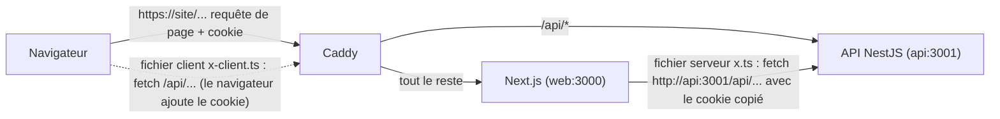
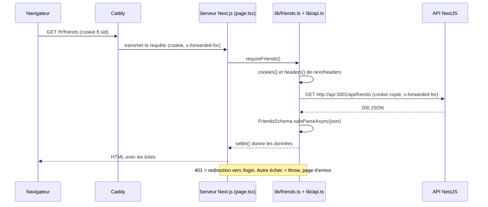
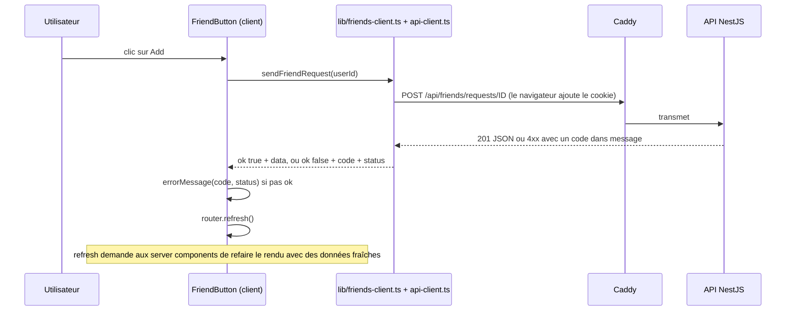

# Chapitre 4 — Comment l'app web parle à l'API

Dans ce chapitre :

- Ce que sont `fetch`, JSON et les cookies, et qui envoie le cookie : le navigateur ou le serveur Next.js.
- Pourquoi `apps/web/lib/` a deux sortes de fichiers : les fichiers serveur (`x.ts`) et les fichiers navigateur (`x-client.ts`).
- Comment une erreur voyage sous forme de code court (une entrée de `ERROR_CODES`) et devient une phrase dans la langue du lecteur.
- Chaque fichier de la couche API, dans l'ordre où l'app les utilise, en commençant par les deux fichiers de base
  [api.ts](../../apps/web/lib/api.ts) et [api-client.ts](../../apps/web/lib/api-client.ts).
- Un tableau de toutes les fonctions navigateur avec leur méthode HTTP et leur route d'API.

---

## Vue d'ensemble

### fetch et JSON

L'app web (Next.js) ne possède aucune donnée. Les utilisateurs, les cours, les leçons et les messages
vivent tous dans l'API NestJS (voir les chapitres sur l'API). Donc chaque page doit **demander à l'API**.

L'outil pour demander, c'est `fetch`. C'est une fonction intégrée au navigateur et à Node.js. Tu lui
donnes une URL et des options (méthode, headers, body), et elle te rend une `Response` :

```ts
const response = await fetch('/api/courses', { method: 'GET' });
const data = await response.json(); // read the body as JSON
```

**JSON** est le format texte que l'API et l'app web utilisent pour envoyer des données :
`{"lang":"fr","level":"A2"}`. `response.json()` retransforme ce texte en objet JavaScript.

Mais l'objet qui revient est « juste quelque chose ». TypeScript ne peut pas connaître sa forme. Donc
chaque appel de ce dossier vérifie la réponse avec un **schema Zod** de `@ft/shared` (un schema est une
description de la forme attendue ; `schema.safeParse(x)` dit « oui, ça correspond » ou « non »). Le même
schema est utilisé par l'API pour construire sa réponse, donc les deux côtés sont d'accord.

### Les cookies : qui les envoie ?

Quand tu te connectes, l'API répond avec un header `Set-Cookie`. Le cookie s'appelle `ft.sid` (id de
session). Il est `httpOnly` (le JavaScript de la page ne peut pas le lire) et `sameSite: 'lax'` (voir
`apps/api/src/app.setup.ts`). À partir de là, l'API sait qui tu es **seulement** si la requête porte ce
cookie.

Pense au cookie comme à un **ticket de vestiaire**. Tu le reçois à l'entrée (login), et tu dois le
montrer chaque fois que tu veux ton manteau (tes données).

Une requête vers l'API peut partir de deux endroits, et ils ne tiennent pas le ticket de la même façon :

| Où tourne le code                                                                 | Qui fait la requête  | Comment le cookie arrive                                                                                                                               |
| --------------------------------------------------------------------------------- | -------------------- | ------------------------------------------------------------------------------------------------------------------------------------------------------ |
| **Dans le navigateur** (un client component, après un clic)                       | le navigateur        | Le navigateur ajoute le cookie tout seul. La page et l'API partagent une seule adresse (Caddy), donc c'est une requête « same-origin » (même origine). |
| **Sur le serveur Next.js** (un server component, pendant qu'il construit le HTML) | le container Next.js | Le serveur n'a **pas** de cookie à lui. Il doit copier le cookie du visiteur depuis la requête entrante et le mettre sur sa propre requête vers l'API. |

C'est la raison des deux sortes de fichiers.



Caddy (le reverse proxy, la « porte d'entrée » du site) envoie chaque chemin qui commence par `/api` à
l'API (`/ws`, le socket en direct du chapitre 3, aussi), `/grafana` à Grafana, et tous les autres
chemins à Next.js (voir `infra/caddy/Caddyfile`). Donc :

- Depuis le **navigateur**, un fichier client appelle juste le chemin court `/api/courses`. Caddy fait
  le routage.
- Depuis le **serveur Next.js**, un fichier serveur appelle `http://api:3001/api/courses` directement par
  le réseau Docker interne. Il ne passe pas par Caddy.

### Deux sortes de fichiers dans `lib/`

```
apps/web/lib/
├── api.ts                 server base: fetchJson, apiGet, apiFind, settle, pingApi
├── session.ts             server: loadSession, currentUser, requireUser
├── courses.ts             server: loadCourses, requireCourses (+ pure helpers)
├── friends.ts             server: requireFriends, searchUsers, loadProfile ...
├── conversations.ts       server: requireConversations, loadMessagePage
├── lessons.ts             server: loadToday, loadLessonPage
│
├── api-client.ts          browser base: send, clientGet/Post/Put/Patch/Delete
├── auth-client.ts         browser: signUp, logIn, logOut, 2FA, avatar ...
├── courses-client.ts      browser: startCourse, setCourseLevel
├── friends-client.ts      browser: friend requests
├── conversations-client.ts browser: older messages
├── lesson-client.ts       browser: lesson attempts (+ tab memory, drafts)
├── discussion-client.ts   browser: tutor chat, streamed answer
├── placement-client.ts    browser: placement exam
│
├── error-message.ts       browser hook: code -> translated sentence
├── use-course-save.ts     browser hook: save a course setting
├── serial-queue.ts        helper: run writes one after another
└── localized.ts           helper: pick en / fr / de text
```

|                  | Fichier serveur `x.ts`                                             | Fichier navigateur `x-client.ts`                      |
| ---------------- | ------------------------------------------------------------------ | ----------------------------------------------------- |
| Tourne dans      | le serveur Next.js, pendant le rendu                               | le navigateur du visiteur                             |
| Utilisé par      | les server components (`page.tsx`, `layout.tsx`)                   | les client components (`'use client'`)                |
| Rôle typique     | **lire** les données pour construire la page                       | **écrire** après un clic (POST, PATCH, DELETE)        |
| Cookie           | copié à la main depuis `next/headers`                              | ajouté par le navigateur                              |
| Fichier de base  | [api.ts](../../apps/web/lib/api.ts)                                | [api-client.ts](../../apps/web/lib/api-client.ts)     |
| Type du résultat | `{ status: 'ok' \| 'signed-out' \| 'unavailable' \| 'not-found' }` | `{ ok: true, data }` ou `{ ok: false, code, status }` |
| En cas d'échec   | redirection vers `/login` ou throw (page d'erreur)                 | renvoie un code, le composant affiche un message      |

Un fichier serveur importe `next/headers`, qui ne marche que sur le serveur. Un fichier navigateur ne
doit pas l'importer. Les garder séparés empêche un client component d'embarquer du code serveur par
erreur.

### Les erreurs sont des codes, pas des phrases

L'API n'envoie jamais une phrase comme « Mot de passe trop court ». Elle envoie un **code** :
`password.tooShort`. Tous les codes vivent dans une seule liste, `ERROR_CODES`, dans
[packages/shared/src/schemas/errors.ts](../../packages/shared/src/schemas/errors.ts). Le fichier
explique pourquoi :

> a string rendered by the server cannot be re-rendered in the reader's language once it has crossed the wire.

(Une chaîne produite par le serveur ne peut plus être affichée dans la langue du lecteur une fois
qu'elle a traversé le réseau.)

Le seul endroit où un code devient une phrase humaine est la partie `Errors` de
`apps/web/messages/{en,fr,de}.json`.

```mermaid
flowchart LR
  A["API : CodeValidationPipe, le body échoue à PasswordSchema"] --> F["ErrorCodeFilter : le message est déjà un code, envoyé tel quel"]
  F --> J["Body JSON : { statusCode: 400, message: ['password.tooShort'] }"]
  J --> R["readCode(body) dans api-client.ts : le premier code"]
  R --> RES["{ ok: false, code: 'password.tooShort', status: 400 }"]
  RES --> H["useErrorMessage() dans error-message.ts"]
  H --> T["fr.json Errors.password.tooShort"]
  T --> S["Phrase affichée en français"]
```



Un code peut aussi venir du code de l'API elle-même, comme
`throw new BadRequestException('avatar.invalidFile')` : alors `message` est une seule chaîne, pas un
tableau. `readCode` lit les deux.

La couche navigateur invente aussi deux codes à elle : `network.unreachable` (la requête n'a jamais eu
de réponse) et `server.unexpected` (la réponse n'était pas celle qu'on attendait). Les deux sont aussi
dans `ERROR_CODES`.

---

## Séquence 1 : un server component charge des données avec le cookie de l'utilisateur

Exemple : la page des amis, `app/[locale]/(main)/friends/page.tsx`, appelle `requireFriends()`.



## Séquence 2 : un client component appelle l'API après un clic

Exemple : le bouton « Add friend » (« Ajouter en ami ») dans `components/friend-buttons.tsx`.



Après une écriture, le client ne modifie pas sa propre copie des données. Il appelle `router.refresh()`,
et les server components relisent (Séquence 1). Il y a une seule source de vérité : l'API.

---

## Le côté serveur

### `api.ts` — la base serveur

[api.ts](../../apps/web/lib/api.ts) est « le seul endroit où apps/web parle à NestJS » depuis le
serveur. Son commentaire du haut dit que Next.js fait « presentation and SSR only » (seulement la
présentation et le SSR ; SSR = server-side rendering : construire le HTML sur le serveur), donc rien ici
ne connaît les règles métier. Il construit une URL, appelle l'API et vérifie la réponse.

**Exports :** `DEFAULT_API_INTERNAL_URL`, `SESSION_PATH`, `HEALTH_PATH`, `DEFAULT_TIMEOUT_MS`, les types
`ApiRequestOptions`, `FetchSessionOptions`, `BaseResult`, `SessionResult`, `FindResult`, `PingResult`, et
les fonctions `settle`, `resolveApiBaseUrl`, `buildApiUrl`, `describeFetchError`,
`fetchWithRequestHeaderAndIP`, `fetchSession`, `apiGet`, `apiFind`, `pingApi`.

#### Trois réponses, pas deux

```ts
export type BaseResult<T> =
  { status: 'ok'; data: T } | { status: 'signed-out' } | { status: 'unavailable'; reason: string };

/**
 * Three answers, not two. "signed-out" is a verdict the API delivered (401);
 * "unavailable" is the absence of a verdict, and the caller must not read it as
 * one. Collapsing them is what turned a 429 or a restart into a logout.
 */
export type SessionResult = BaseResult<SessionUser>;

/** A 404 read as an answer, nothing there, rather than as a failure. */
export type FindResult<T> = BaseResult<T> | { status: 'not-found' };
```

C'est l'idée la plus importante du fichier. Si l'API redémarre, ou dit « trop de requêtes » (429), on ne
sait **pas** si le visiteur est connecté. Une ancienne version traitait ça comme « déconnecté » et
envoyait les gens sur la page de login sans raison. Maintenant :

- `signed-out` seulement pour un vrai **401**.
- `unavailable` pour tout le reste qui a mal tourné (timeout, 500, 429, mauvais JSON).
- `not-found` seulement quand l'appelant l'a demandé (un 404 veut dire « cette chose n'existe pas »).

#### `settle` — transformer un résultat en données pour une page

```ts
export function settle<T>(result: BaseResult<T>, what: string): T {
  if (result.status === 'signed-out') {
    redirect('/login');
  }

  // Thrown, since a redirect would read as a logout.
  if (result.status === 'unavailable') {
    throw new Error(`Could not load the ${what}: ${result.reason}`);
  }
  return result.data;
}
```

`redirect()` de `next/navigation` arrête le rendu et envoie le navigateur vers `/login`. Lancer une
erreur fait afficher à Next.js la page `error.tsx` la plus proche (chapitre 2). Le cookie de session est
gardé, donc un rechargement marche quand l'API est revenue.

#### Helpers d'URL

`resolveApiBaseUrl(raw)` reçoit la valeur de `API_INTERNAL_URL` ; si elle est absente ou vide, il prend `http://api:3001` à la place
(le nom du service Docker Compose), et il enlève les slashs à la fin. `buildApiUrl(base, path)` colle les
deux et ajoute le `/` du début s'il manque. `describeFetchError(error)` transforme une erreur en raison
courte, et nomme le cas du timeout : `'the request timed out'`.

#### `fetchWithRequestHeaderAndIP` — copier le ticket

```ts
export async function fetchWithRequestHeaderAndIP<R>(
  fetcher: (options: FetchSessionOptions) => Promise<R>,
): Promise<R> {
  const store = await cookies();
  const cookie = store
    .getAll()
    .map(({ name, value }) => `${name}=${value}`)
    .join('; ');

  // Passed through unchanged rather than appended to. ...
  const forwardedFor = (await headers()).get('x-forwarded-for');

  return fetcher({
    baseUrl: process.env.API_INTERNAL_URL,
    cookie,
    forwardedFor: forwardedFor ?? undefined,
  });
}
```

`cookies()` et `headers()` viennent de `next/headers`. Ils lisent la requête **entrante** du visiteur.
La fonction reconstruit un header `Cookie` (`name=value; name=value`) et prend aussi l'IP du visiteur
dans `x-forwarded-for` (mis par Caddy).

Pourquoi l'IP ? Sans elle, chaque appel côté serveur viendrait de la même adresse (le container web), et
le rate limiter de l'API compterait **tous les visiteurs comme une seule personne**. Le commentaire
explique pourquoi le header est passé sans changement : l'API fait confiance à un seul proxy et lit
l'adresse la plus à droite, donc ajouter l'adresse du container web casserait ça.

#### `fetchJson` — l'ouvrier privé

`fetchJson(schema, apiPath, options, urlParams, notFound)` n'est pas exporté. Tout passe par lui. La
partie principale :

```ts
    const url = new URL(buildApiUrl(baseUrl, apiPath));
    new URLSearchParams(urlParams).forEach((value, key) => url.searchParams.set(key, value));
    const response = await fetchImpl(url.toString(), {
      cache: 'no-store',
      headers: {
        accept: 'application/json',
        ...(cookie ? { cookie } : {}),
        ...(forwardedFor ? { 'x-forwarded-for': forwardedFor } : {}),
      },
      signal: AbortSignal.timeout(timeoutMs),
    });

    if (response.status === 401) {
      return { status: 'signed-out' };
    }

    if (notFound && response.status === 404) {
      return { status: 'not-found' };
    }
```

À remarquer :

- `cache: 'no-store'` : Next.js peut mettre en cache les résultats de `fetch`. Ici la réponse est
  personnelle (elle dépend du cookie), donc elle ne doit jamais être mise en cache ni partagée entre
  visiteurs.
- `AbortSignal.timeout(timeoutMs)` : abandonne après 10 secondes par défaut. Le commentaire sur
  `DEFAULT_TIMEOUT_MS` dit que 2 secondes c'était trop court : une API chargée affichait des pages
  d'erreur pour des requêtes qui auraient marché.
- Un chemin avec un `?` dedans est refusé : les paramètres de requête doivent aller dans `urlParams`,
  pour être encodés correctement.
- Un 204 (pas de body) est « unavailable » ici, parce qu'une lecture doit toujours renvoyer des données.
- Ensuite `schema.safeParseAsync(await response.json())`. Une mauvaise forme est « unavailable », pas un
  crash.
- Toute erreur lancée (réseau, timeout) est attrapée et devient `unavailable`.

`fetchImpl` est une option pour que les tests puissent passer un faux `fetch`.

#### Les lecteurs publics

```ts
export async function apiGet<Schema extends z.ZodType>(
  schema: Schema,
  apiPath: string,
  urlParams: Record<string, string> = {},
): Promise<BaseResult<z.infer<Schema>>> {
  return fetchWithRequestHeaderAndIP((options) => fetchJson(schema, apiPath, options, urlParams));
}
```

- `apiGet(schema, path, params)` : lire avec le cookie du visiteur. Donne un `BaseResult`.
- `apiFind(schema, path, params)` : pareil, mais un 404 donne `not-found`, pour que la page puisse
  afficher « rien ici » au lieu d'une page d'erreur. Utilisé par `loadProfile`, `lib/lesson.ts` et la
  page de placement.
- `fetchSession(options)` : `fetchJson(SessionUserSchema, '/api/auth/me', options)`. Il ne lit pas la
  requête lui-même ; [session.ts](../../apps/web/lib/session.ts) l'enveloppe.
- `pingApi(options)` : utilisé par `app/healthz/api` et `app/healthz/upstream` (chapitre 2). Il demande
  seulement « est-ce que le container web peut joindre l'API ? ». Toute réponse HTTP, même 500, compte
  comme `ok` ; seule une erreur réseau ou un timeout de 2 secondes donne `unreachable`.

Les appelants de `api.ts` : `session.ts`, `courses.ts`, `friends.ts`, `conversations.ts`, `lessons.ts`, et
aussi `lib/lesson.ts`, `lib/achievements.ts` et la page de placement (vus aux chapitres 6 et 7).

**Test :** [api.test.ts](../../apps/web/lib/api.test.ts) vérifie les helpers d'URL, le nom du timeout,
que `fetchSession`/`apiGet`/`apiFind` donnent `signed-out`, `not-found` et `unavailable` dans les bons
cas, `pingApi`, et `settle`.

### `session.ts` — qui est le visiteur ?

[session.ts](../../apps/web/lib/session.ts) répond à « qui est connecté ? » pour les server components.

```ts
export const loadSession = cache(async function loadSession(): Promise<SessionResult> {
  return fetchWithRequestHeaderAndIP(fetchSession);
});
```

`cache` de React **mémoïse** la fonction pour un rendu serveur (mémoïser = retenir la réponse, pour que
le deuxième appel ne tourne pas à nouveau). Le layout, le header et la page peuvent tous demander « qui
est-ce ? » et une seule requête part vers l'API. C'est par requête : aucun visiteur ne voit jamais la
réponse d'un autre visiteur.

Deux façons de l'utiliser :

```ts
export async function currentUser(): Promise<SessionUser | null> {
  const result = await loadSession();
  return result.status === 'ok' ? result.data : null;
}
```

`currentUser()` est pour les pages que **tout le monde** peut voir (la page d'accueil, le header). Si
l'API est en panne, la page affiche juste la version « déconnecté ». Rien n'est enlevé. Le commentaire
dit que c'est « the one place where collapsing the two failures is right » (le seul endroit où
confondre les deux échecs est correct).

`requireUser()` est pour les pages qui ont besoin d'un utilisateur (profil, réglages 2FA, chat). Il
redirige seulement sur `signed-out`, et lance une erreur sur `unavailable`, exactement comme `settle`.

Appelants : `app/[locale]/(main)/page.tsx`, les pages de profil, `settings/2fa`, `chat`, `users/[id]`, le
layout `(dashboard)`, et les composants de nav du chapitre 3 (`session-nav.tsx`, `header-nav.tsx`,
`dashboard-nav.tsx`).

**Test :** [session.test.ts](../../apps/web/lib/session.test.ts) vérifie que les cookies sont transmis
en un seul header, que l'IP est transmise sans changement, que `currentUser` se replie sur `null`, et que
`requireUser` redirige sur un 401 mais lance une erreur quand l'API est indisponible.

### `courses.ts` — les cours de l'apprenant

[courses.ts](../../apps/web/lib/courses.ts) est la moitié serveur de l'API des cours.

```ts
/** Memoised per request: the header and the page body both ask. */
export const loadCourses = cache(async function loadCourses(): Promise<BaseResult<Courses>> {
  return apiGet(CoursesSchema, '/api/courses');
});

/** requireUser for pages that need the courses: this read answers the session question too. */
export async function requireCourses(): Promise<Courses> {
  return settle(await loadCourses(), 'courses');
}
```

`/api/courses` a besoin d'une session, donc un 401 ici veut aussi dire « pas connecté ». C'est pour ça
que `requireCourses` peut remplacer `requireUser` : une requête au lieu de deux.

Il a aussi trois helpers purs (sans réseau) :

- `findCourse(courses, lang)` : le cours pour une langue, ou `null`.
- `resolveLandingLang(cookieLang, activeLang, courses)` : quel cours `/learn` doit ouvrir. D'abord la
  langue que ce navigateur a utilisée en dernier (un cookie), puis celle dont le serveur se souvient
  (`activeLang`, utile sur un deuxième appareil), puis le premier cours. Chacune est vérifiée dans la
  liste, donc une vieille valeur passe à la suivante.
- `landingPath(cookieLang, courses)` : l'URL finale : `/onboarding` s'il n'y a pas de cours,
  `/onboarding?lang=xx` si le cours n'a pas encore de niveau, sinon `/learn/xx`.

Appelants : les pages `/learn`, `onboarding/page.tsx`, `dashboard-nav.tsx`, `lib/lesson.ts`.

**Test :** [courses.test.ts](../../apps/web/lib/courses.test.ts) vérifie `findCourse`, l'ordre de
choix du cours (cookie, puis `activeLang`, puis le premier) et `landingPath`. Il teste aussi
`learnPathLang` et `courseHomeLang` de `lib/course-path.ts`.

### `friends.ts` — amis, recherche, profils

[friends.ts](../../apps/web/lib/friends.ts) est la moitié serveur de l'API des amis.

- `FRIEND_EVENTS` : les trois événements socket (`FRIEND_REQUEST`, `FRIEND_ACCEPTED`, `FRIEND_REMOVED`)
  qui doivent faire refaire le rendu d'une page d'amis. Les pages le passent au composant `RefreshOn`
  (chapitre 3).
- `requireFriends()` : `settle(apiGet(FriendsSchema, '/api/friends'))`. Tes amis, les demandes reçues et
  envoyées.
- `searchUsers(q)` : `GET /api/users?q=...`. Le commentaire dit qu'il est appelé seulement avec une
  recherche que `UserSearchQuerySchema` a déjà acceptée, donc un 400 ne peut pas arriver.
- `recentlyActive()` : `GET /api/users/recently-active`, des gens que tu pourrais ajouter.
- `loadProfile(id)` : mémoïsé avec `cache`, parce que `generateMetadata` (le titre de la page) et la page
  le demandent tous les deux. Il utilise `apiFind`, donc un utilisateur inconnu donne `not-found`, pas une
  page d'erreur.
- `relationTo(lists, userId)` : helper pur. Lit tes propres listes et dit `'friend'`, `'received'`,
  `'sent'` ou `'none'`. La page s'en sert pour choisir quel bouton afficher.

```ts
export function relationTo(lists: Friends, userId: string): Relation {
  const has = (users: PublicUser[]) => users.some((user) => user.id === userId);

  if (has(lists.friends)) return 'friend';
  if (has(lists.received)) return 'received';
  if (has(lists.sent)) return 'sent';
  return 'none';
}
```

Appelants : `friends/page.tsx`, `users/[id]/page.tsx`, `chat/page.tsx`.

**Test :** [friends.test.ts](../../apps/web/lib/friends.test.ts) vérifie `relationTo` pour chaque cas.

### `conversations.ts` — le chat au premier affichage

[conversations.ts](../../apps/web/lib/conversations.ts) a deux lecteurs, les deux passent par
`settle` :

- `requireConversations()` : `GET /api/conversations`, la liste sur `/chat`.
- `loadMessagePage(userId)` : `GET /api/conversations/:userId/messages`, la page de messages la plus
  récente pour le premier rendu d'un fil.

Les pages plus anciennes, et le rattrapage après une reconnexion, sont chargés plus tard dans le
navigateur par `conversations-client.ts`. Appelant : `app/[locale]/(messages)/chat/page.tsx`
(chapitre 8). Pas de fichier de test.

### `lessons.ts` — aujourd'hui et la liste des leçons

[lessons.ts](../../apps/web/lib/lessons.ts) n'utilise pas `settle`. Il gère le résultat à la main :

```ts
export async function loadToday(lang: Language): Promise<Today | 'signed-out'> {
  const result = await apiGet(TodaySchema, `/api/courses/${lang}/today`);

  if (result.status === 'unavailable') {
    throw new Error(`Could not load today's lessons: ${result.reason}`);
  }
  return result.status === 'signed-out' ? 'signed-out' : result.data;
}
```

La page du cours a déjà lu la session (via `requireCourses`). Donc un 401 ici veut dire « la session
s'est terminée entre les deux lectures ». La fonction renvoie la chaîne `'signed-out'` et laisse la page
décider quoi faire, au lieu de rediriger de l'intérieur.

- `loadToday(lang)` : `GET /api/courses/:lang/today`.
- `loadLessonPage(lang, query)` : `GET /api/courses/:lang/lessons` avec des paramètres de requête
  construits par `lessonQueryParams` de `lib/lesson-list.ts` (il enlève les valeurs par défaut pour que
  les liens restent courts).
- `lessonPath(lang, id)` : helper pur, donne `/learn/:lang/lessons/:id`.

Appelants : `learn/[lang]/page.tsx`, `today.tsx`, `lessons/page.tsx`, `lesson-list.tsx`, `lib/lesson.ts`.
Pas de fichier de test à lui.

---

## Le côté navigateur

### `api-client.ts` — la base navigateur

[api-client.ts](../../apps/web/lib/api-client.ts) est la moitié navigateur. Son commentaire du haut
donne la règle :

> Failures carry a code, never a sentence: the component that displays them turns it into text in the
> reader's language through useErrorMessage().

(Les échecs portent un code, jamais une phrase : le composant qui les affiche le transforme en texte dans
la langue du lecteur grâce à useErrorMessage().)

**Exports :** `JSON_HEADERS`, le type `ApiResult<T>`, `readCode`, `send`, `clientGet`, `clientPost`,
`clientPut`, `clientPatch`, `clientDelete`.

```ts
export type ApiResult<T> = { ok: true; data: T } | { ok: false; code: string; status: number };
```

Les fonctions navigateur ne lancent jamais d'erreur. L'appelant reçoit toujours un objet et vérifie
`result.ok`.

#### `readCode` — trouver le code dans un body d'erreur

```ts
export function readCode(body: unknown): string | null {
  if (typeof body === 'object' && body !== null && 'message' in body) {
    const { message } = body as { message: unknown };
    if (typeof message === 'string') {
      return message;
    }
    if (Array.isArray(message) && typeof message[0] === 'string') {
      return message[0];
    }
  }
  return null;
}
```

Les body d'erreur NestJS ressemblent à `{ statusCode: 400, message: ... }`. Le `message` est un code, ou
un tableau de codes quand une validation Zod a échoué (plusieurs champs faux). Le formulaire vérifie déjà
les mêmes règles avant d'envoyer, donc afficher le premier code suffit.

#### `send` — la seule fonction qui appelle `fetch`

```ts
  let response: Response;
  try {
    const query = new URLSearchParams(params).toString();
    const requestPath = path + (query ? `?${query}` : '');
    const headers = new Headers({ accept: 'application/json' });
    const isFormData = typeof FormData !== 'undefined' && init.body instanceof FormData;
    if (init.body !== undefined && !isFormData) {
      headers.set('content-type', 'application/json');
    }
    new Headers(init.headers).forEach((value, key) => headers.set(key, value));
    response = await fetch(requestPath, {
      ...init,
      credentials: 'same-origin',
      headers,
    });
  } catch {
    return { ok: false, code: 'network.unreachable', status: 0 };
  }
```

- Le chemin est relatif (`/api/...`), donc le navigateur l'envoie au même site. Caddy le route vers
  l'API.
- `credentials: 'same-origin'` dit au navigateur : ajoute les cookies de ce site. C'est toute l'histoire
  du cookie côté navigateur.
- `content-type: application/json` est mis seulement quand il y a un body qui n'est pas un `FormData`.
  Pour un envoi de fichier (`FormData`), le navigateur doit mettre le header lui-même, parce qu'il ajoute
  une valeur « boundary ».
- Si `fetch` lance une erreur (hors ligne, erreur DNS), le résultat est `network.unreachable` avec
  `status: 0`.

Ensuite la réponse est lue :

```ts
  let body: unknown;
  if (response.status !== 204) {
    try {
      body = await response.json();
    } catch {
      return { ok: false, code: 'server.unexpected', status: response.status };
    }
  }
  if (!response.ok) {
    return {
      ok: false,
      code: readCode(body) ?? 'server.unexpected',
      status: response.status,
    };
  }
```

Un 204 n'a pas de body, donc `body` reste `undefined`. Pour ce cas, les appelants passent `z.void()`
comme schema, qui accepte `undefined`. En cas de succès, le body passe par `schema.safeParseAsync`. S'il
ne correspond pas (ou si une vérification async lance une erreur), le résultat est `server.unexpected`.

#### Les cinq petits helpers

`clientGet(schema, path, params)`, `clientPost(schema, path, body, params)`, `clientPut`, `clientPatch`,
`clientDelete`. Chacun appelle juste `send` avec la bonne méthode. Le body passe par `serializeBody` :
`undefined` reste vide, `FormData` est passé tel quel, tout le reste passe par `JSON.stringify`.

Appelants : tous les fichiers `*-client.ts`, plus quelques composants qui l'appellent directement (par
exemple `goal-picker.tsx` appelle `clientPatch` sur `/api/courses/:lang`, et `two-factor-panel.tsx`
appelle `clientGet` sur `/api/auth/2fa`).

**Test :** [api-client.test.ts](../../apps/web/lib/api-client.test.ts) vérifie la validation par
schema, le mauvais JSON, l'échec réseau sous forme de code, le 204 avec un schema void, les paramètres de
requête, les body JSON contre `FormData`, et les headers.

### `error-message.ts` — le code devient une phrase

[error-message.ts](../../apps/web/lib/error-message.ts) est « le seul endroit où un code d'erreur
devient une phrase ». C'est un hook React, donc il a `'use client'`.

```ts
export function useErrorMessage(): (code: string, status?: number) => string {
  const t = useTranslations('Errors');

  return useCallback(
    (code, status = 0) => t(isErrorCode(code) ? code : 'unknown', { status }),
    [t],
  );
}
```

- `useTranslations('Errors')` (next-intl, chapitre 2) donne une fonction `t` qui lit la section
  `Errors` du fichier de la langue actuelle.
- `isErrorCode(code)` (de `@ft/shared`) vérifie que le code est dans `ERROR_CODES`. Sinon, on affiche la
  phrase `unknown` (« Something went wrong. Please try again. », « Une erreur est survenue. Réessaie. »)
  au lieu d'un texte serveur en anglais dans une page en français.
- `status` est toujours passé, parce que `server.unexpected` l'utilise : « The server answered HTTP
  {status} ».
- `useCallback` garde la même fonction entre les rendus, pour qu'on puisse l'utiliser dans les
  dépendances d'un effet.

Utilisation dans un composant :

```ts
const errorMessage = useErrorMessage();
// ...
setError(result.ok ? null : errorMessage(result.code, result.status));
```

Appelants : chaque formulaire et bouton qui écrit (login, inscription, profil, 2FA, onboarding, amis,
chat, examen de placement, lecteur de leçon...). Pas de fichier de test à lui, mais
`lib/messages.test.ts` vérifie que les clés `Errors` de chaque fichier de langue sont exactement la liste
`ERROR_CODES`.

### `auth-client.ts` — inscription, login, 2FA, profil

[auth-client.ts](../../apps/web/lib/auth-client.ts) explique pourquoi le login tourne dans le
navigateur et pas dans une server action Next.js :

> the session cookie is set by the API's response, and Caddy serves both origins as one, so the browser's
> own request carries and receives it with nothing to relay.

(Le cookie de session est posé par la réponse de l'API, et Caddy sert les deux origines comme une seule,
donc la propre requête du navigateur le porte et le reçoit sans rien à relayer.)

Si le serveur Next.js faisait le login, l'API poserait le cookie sur la réponse **du serveur**, et Next
devrait le recopier vers le navigateur. En le faisant dans le navigateur, le cookie arrive là où il doit
être.

Le login est le seul cas spécial. L'API répond **200** avec l'utilisateur, ou **202** avec
`{ twoFactorRequired: true }` quand un code 2FA est encore nécessaire :

```ts
const LoginResponseSchema = z.union([SessionUserSchema, TwoFactorRequiredSchema]);

/** The 202 branch of a login: password accepted, second factor still owed. */
export type LoginResult = ApiResult<SessionUser> | { ok: 'twoFactor' };

...

export async function logIn(input: unknown): Promise<LoginResult> {
  const result = await clientPost(LoginResponseSchema, '/api/auth/login', input);
  if (!result.ok) {
    return result;
  }
  return 'twoFactorRequired' in result.data ? { ok: 'twoFactor' } : { ok: true, data: result.data };
}
```

`z.union` accepte l'une ou l'autre forme. Ensuite la fonction regarde les données et renvoie une
troisième sorte de résultat, `{ ok: 'twoFactor' }`, pour que le formulaire de login sache qu'il faut
afficher le champ du code.

Les autres fonctions font une ligne chacune (voir le tableau plus bas). `uploadAvatar(file)` construit un
`FormData` avec le champ `avatar`. `removeAvatar()` revient à l'image par défaut. Les fonctions qui
reçoivent un 204 utilisent `z.void()`.

Appelants : `login-form.tsx`, `signup-form.tsx`, `profile-form.tsx`, `two-factor-panel.tsx`, et du
chapitre 3 `log-out-button.tsx`, `locale-sync.tsx`, `time-zone-sync.tsx` (ces deux-là appellent
`updateProfile`).

**Test :** [auth-client.test.ts](../../apps/web/lib/auth-client.test.ts) vérifie l'inscription, le
premier code d'un tableau de validation, le code d'erreur par défaut, le login 200 contre 202, l'échec réseau, et
les appels qui répondent 204.

### `courses-client.ts` — commencer un cours, choisir un niveau

[courses-client.ts](../../apps/web/lib/courses-client.ts) :

```ts
export function startCourse(input: unknown): Promise<ApiResult<Course>> {
  return clientPost(CourseSchema, '/api/courses', input);
}

/**
 * A level picked by hand. The level has one writer, CoursesService.setLevel:
 * this route calls it, and the placement exam calls it on the server.
 */
export function setCourseLevel(lang: Language, input: unknown): Promise<ApiResult<Course>> {
  return clientPatch(CourseSchema, `/api/courses/${lang}/level`, input);
}
```

« The level has one writer » (le niveau n'a qu'un seul auteur) : chaque changement de niveau finit dans
la même méthode de l'API, `CoursesService.setLevel`. Cette route l'appelle pour un niveau choisi à la
main ; l'examen de placement l'appelle directement quand il se termine (`placement.service.ts`), sans
passer par cette route.

Appelants : `onboarding/choose-course.tsx`, `onboarding/choose-level.tsx`, `start-level.tsx`,
`direct-level-picker.tsx`, `components/change-level.tsx`.

**Test :** [courses-client.test.ts](../../apps/web/lib/courses-client.test.ts) vérifie les deux
appels, la langue dans le chemin, les erreurs sous forme de codes, et une réponse qui n'est pas un cours.

### `friends-client.ts` — les demandes d'ami

[friends-client.ts](../../apps/web/lib/friends-client.ts) : quatre écritures, chacune nomme l'autre
utilisateur dans le chemin. `sendFriendRequest` renvoie un `FriendRequestResult` (il dit si la demande
est devenue une amitié tout de suite, quand l'autre personne t'avait déjà demandé). Les trois autres
répondent 204 (`z.void()`). `deleteFriendRequest` sert à la fois à **refuser** la sienne et à **annuler**
la tienne, parce que « there is at most one request between two people » (il y a au plus une demande
entre deux personnes).

Appelant : `components/friend-buttons.tsx` (voir Séquence 2). Après chaque écriture, il appelle
`router.refresh()`, même en cas d'échec, parce qu'un échec c'est « nearly always the other side moving
first » (presque toujours l'autre côté qui a bougé en premier). La seule exception est un échec réseau
(`status: 0`) : hors ligne, le refresh ne pourrait pas joindre le serveur non plus.

**Test :** [friends-client.test.ts](../../apps/web/lib/friends-client.test.ts) vérifie la méthode et le
chemin de chaque appel, le 204 comme succès, et les erreurs sous forme de codes.

### `conversations-client.ts` — plus de messages

[conversations-client.ts](../../apps/web/lib/conversations-client.ts) :

```ts
/** What the thread catches up with after a connect. */
export function fetchNewestMessages(userId: string): Promise<ApiResult<MessagePage>> {
  return clientGet(MessagePageSchema, messagesPath(userId));
}

/** The page before `cursor`, a page's nextCursor. */
export function fetchEarlierMessages(
  userId: string,
  cursor: string,
): Promise<ApiResult<MessagePage>> {
  return clientGet(MessagePageSchema, messagesPath(userId), { cursor });
}
```

Un **cursor** est un marque-page : l'API en donne un avec chaque page (`nextCursor`), et tu le renvoies
pour avoir la page d'avant. Appelant : `chat/chat-thread.tsx` (chapitre 8). L'envoi d'un message passe
par le WebSocket, pas par ici.

**Test :** [conversations-client.test.ts](../../apps/web/lib/conversations-client.test.ts) vérifie le
chemin sans et avec le cursor, et un échec sous forme de code.

### `lesson-client.ts` — tentatives de leçon, mémoire de l'onglet, brouillons

[lesson-client.ts](../../apps/web/lib/lesson-client.ts) a trois parties.

**1. Les routes de tentative.** Une « attempt » (tentative) est un passage complet dans une leçon.

- `startAttempt(lang, id, locale)` : `POST .../attempt` avec `{ locale }`. Commence, reprend ou
  recommence.
- `readAttempt(lang, id)` : `GET .../attempt`.
- `submitPage(lang, id, index, attemptId, answers)` : `POST .../attempt/pages/:index`.

**2. La mémoire de l'onglet.** Quand tu appuies sur Retour ou Suivant, Next.js affiche une page depuis le
cache de son router, **telle qu'elle a été rendue la première fois**. Cette vieille page peut montrer une
ancienne position dans la leçon. Donc le lecteur note, dans une `Map` en mémoire, la dernière tentative
qu'il a vue :

```ts
const seen = new Map<string, Seen>();

const key = (lang: Language, id: string) => `${lang}/${id}`;

export function rememberAttempt(lang: Language, id: string, view: AttemptView, at = Date.now()) {
  seen.set(key(lang, id), { view, at });
}
```

- `isStale(lang, id, rendered)` : la page rendue est-elle plus vieille que ce que cet onglet a vu ? Oui si
  l'id de la tentative est différent, ou si la position (index du cursor) est en retard. Alors la page
  relit la tentative.
- `newerAttempt(lang, id, rendered, renderedAt)` : choisit la plus récente des deux. Les tentatives ne
  font qu'avancer, donc dans une même tentative la position la plus loin gagne. Un id de tentative
  différent veut dire qu'on recommence : celle qui est rendue gagne.
- `forgetAttempt(lang, id)` : l'oublier, le serveur a une tentative plus récente.

`at` est gardé parce qu'une page d'examen compte son temps restant à partir du moment où la vue est
arrivée.

**3. Les brouillons.** Ce que l'apprenant a tapé mais pas encore envoyé est gardé dans `localStorage`,
pour qu'un rechargement le garde. Les clés ressemblent à `ft.lesson.drafts.<lang>.<id>.<attemptId>`.
`loadDrafts` supprime aussi les brouillons des autres tentatives de la même leçon, et vérifie chaque
réponse enregistrée avec Zod (le stockage pourrait contenir n'importe quoi). `saveDrafts`,
`clearDrafts`, `loadKept` et `saveKept` (de petites notes gardées à côté des brouillons, comme les lignes
déjà affichées d'un dialogue d'examen) complètent le tout. Chaque accès est dans un `try/catch` : le
stockage peut être désactivé ou plein, et la page doit quand même marcher.

Appelants : `lessons/[id]/lesson-actions.tsx` et `lessons/[id]/play/player.tsx` (chapitre 7).

**Test :** [lesson-client.test.ts](../../apps/web/lib/lesson-client.test.ts) vérifie les routes de
tentative et les codes, la mémoire de l'onglet (stale, forget, newer), et que les brouillons sont gardés
et effacés.

### `discussion-client.ts` — une réponse du tuteur en streaming

[discussion-client.ts](../../apps/web/lib/discussion-client.ts) est différent : il n'utilise pas
`send`, parce que la réponse n'est pas un seul body JSON. L'API la **streame** avec des Server-Sent
Events (SSE : le serveur garde la réponse ouverte et écrit de petits événements l'un après l'autre). Le
texte arrive morceau par morceau, comme quelqu'un qui tape.

Pourquoi pas l'`EventSource` du navigateur ? Le commentaire dit : « it only sends GET, with no body » (il
n'envoie que du GET, sans body). On a besoin d'un POST avec le message, donc on utilise `fetch` et on lit
le body à la main. Le format ressemble à ça :

```
event: delta
data: {"text":"…"}

event: done
data: {}
```

Chaque événement se termine par une ligne vide. Les lignes qui commencent par `:` sont des heartbeats
(signes de vie) et sont ignorées.

```ts
  const reader = response.body.getReader();
  // stream: a character cut between two pieces of the body waits for the rest.
  const decoder = new TextDecoder();
  let buffer = '';
  try {
    for (;;) {
      const { value, done } = await reader.read();
      if (done) return cut;
      buffer += decoder.decode(value, { stream: true });
      // A piece of the body can end in the middle of an event: the rest waits for the next one.
      let end: number;
      while ((end = buffer.indexOf('\n\n')) >= 0) {
        const event = readEvent(buffer.slice(0, end));
        buffer = buffer.slice(end + 2);
        if (event === null) continue;
        if (event.name === 'delta') onText(String(event.data.text ?? ''));
        else if (event.name === 'done') return { ok: true };
        else if (event.name === 'error') {
          return { ok: false, code: String(event.data.code ?? 'unknown'), status: response.status };
        }
      }
    }
```

- Le réseau donne des morceaux d'octets qui ne correspondent pas aux événements. Donc on les ajoute à
  `buffer` et on coupe à chaque `\n\n`. Ce qui reste attend le morceau suivant.
- `{ stream: true }` sur le décodeur : une lettre comme `é` prend deux octets et peut être coupée entre
  deux morceaux.
- `delta` donne un morceau de texte à `onText`. `done` termine avec `{ ok: true }`. `error` donne un code.
- Si le stream se termine sans `done`, la connexion a été coupée : `network.unreachable`.
- `signal` est le bouton Stop de l'apprenant (un `AbortController`). `reader.cancel()` dans `finally`
  ferme la réponse.

Si l'API refuse **avant** que le stream commence (400, 404, 409, 429), c'est une erreur JSON normale lue
avec `readCode`. Un 429 porte aussi `retryAfter` (les secondes à attendre), qui est transmis.

Appelant : `components/lesson/discussion.tsx` (chapitre 7).

**Test :** [discussion-client.test.ts](../../apps/web/lib/discussion-client.test.ts) vérifie la route,
des morceaux coupés n'importe où dans le body, du texte qui arrive avant la fin, un événement d'erreur, un
stream coupé, un 429 avec `retryAfter`, un refus avec et sans JSON, et un échec réseau.

### `placement-client.ts` — l'examen de placement

[placement-client.ts](../../apps/web/lib/placement-client.ts) : trois appels. `startPlacement(lang)` et
`submitPlacementAnswer(questionId, choice)` renvoient tous les deux un `PlacementState` (la question
suivante, ou le résultat). `choice` peut être `null` quand le compte à rebours est fini. `quitPlacement()`
supprime la session d'examen (204). Le schema vient de `lib/placement-schema.ts`.

Appelant : `learn/[lang]/placement/placement-exam.tsx` (chapitre 6). Le premier état au chargement de la
page est lu sur le serveur avec `apiFind(PlacementStateSchema, '/api/placement')`.

**Test :** [placement-client.test.ts](../../apps/web/lib/placement-client.test.ts) vérifie les body de
départ et de réponse (y compris `null`), le résultat final, les codes de conflit et d'onboarding, les
mauvais payloads, et l'échec réseau.

---

## Helpers

### `serial-queue.ts` — une écriture après l'autre

[serial-queue.ts](../../apps/web/lib/serial-queue.ts) est minuscule :

```ts
export function serialQueue() {
  let tail: Promise<unknown> = Promise.resolve();

  return function run<T>(task: () => Promise<T>): Promise<T> {
    const result = tail.then(task);
    tail = result.catch(() => undefined);
    return result;
  };
}
```

Analogie : une seule file d'attente à la poste. Chaque nouvelle tâche attend que la précédente soit
finie. Si l'apprenant clique sur « objectif 10 » puis « objectif 20 » très vite, les deux requêtes
arrivent au serveur dans cet ordre, donc la valeur finale est 20. `tail` avale les erreurs
(`catch(() => undefined)`) pour qu'une tâche ratée ne bloque pas les suivantes, mais `result` échoue
quand même pour son propre appelant.

**Test :** [serial-queue.test.ts](../../apps/web/lib/serial-queue.test.ts) vérifie qu'une tâche attend
la précédente, et qu'un échec n'arrête pas la tâche suivante.

### `use-course-save.ts` — enregistrer un réglage du cours

[use-course-save.ts](../../apps/web/lib/use-course-save.ts) est un hook client utilisé par
`GoalPicker`, `DirectLevelPicker` et `StartLevel`. Il assemble tout ce qui précède : la file, le message
d'erreur et le refresh.

```ts
  async function save(write: () => Promise<ApiResult<unknown>>): Promise<boolean> {
    inFlight.current += 1;
    setWriting(true);
    setError(null);
    try {
      const result = await run(write);
      if (!result.ok) {
        setError(errorMessage(result.code, result.status));
        return false;
      }
      setError(null);
      startRefresh(() => router.refresh());
      return true;
    } finally {
      inFlight.current -= 1;
      if (inFlight.current === 0) {
        setWriting(false);
      }
    }
  }

  return { pending: writing || refreshing, error, save };
```

- `useState(serialQueue)` : React appelle `serialQueue()` une fois et garde la même file pendant toute la
  vie du composant.
- `inFlight` compte les écritures encore en cours ; `writing` revient à `false` seulement quand toutes
  sont finies.
- `useTransition` donne `refreshing`, qui reste `true` jusqu'à ce que `router.refresh()` ait rendu la
  nouvelle page. Donc `pending` couvre à la fois l'écriture et le refresh, et un bouton ne peut pas
  envoyer deux fois le même enregistrement.
- `save` renvoie `true` ou `false`, pour que l'appelant puisse réafficher l'ancienne valeur quand
  l'écriture a échoué.

Exemple tiré de `goal-picker.tsx` :

```ts
    const saved = await save(() =>
      clientPatch(CourseSchema, `/api/courses/${lang}`, { dailyGoal: next }),
```

Pas de fichier de test à lui.

### `localized.ts` — choisir la bonne langue

[localized.ts](../../apps/web/lib/localized.ts) a deux fonctions pures pour le contenu qui vient de
l'API en plusieurs langues (les textes des leçons) :

```ts
/** A text in en, fr and de, read in the interface language; English for any other. */
export function pick(text: { en: string; fr: string; de: string }, locale: string): string {
  return locale === 'fr' || locale === 'de' ? text[locale] : text.en;
}
```

`pickNative(text, locale)` est pour les textes qui n'existent que dans certaines langues : la langue de
l'interface si elle est là, sinon la première de `en`, `fr`, `de`, sinon une chaîne vide. Appelants : les
pages de leçon et la plupart de `components/lesson/*` (chapitre 7).

**Test :** [localized.test.ts](../../apps/web/lib/localized.test.ts) vérifie les deux fonctions.

---

## Tous les appels navigateur : méthode et route

Tous les chemins passent par Caddy jusqu'à l'API. `:lang` est une langue de cours, `:id` un id de leçon,
`:userId` l'id d'un autre utilisateur.

| Fichier                 | Fonction                | Méthode | Route d'API                                           | Réponse en cas de succès                         |
| ----------------------- | ----------------------- | ------- | ----------------------------------------------------- | ------------------------------------------------ |
| auth-client.ts          | `signUp`                | POST    | `/api/auth/signup`                                    | `SessionUser`                                    |
| auth-client.ts          | `logIn`                 | POST    | `/api/auth/login`                                     | `SessionUser` (200) ou `twoFactorRequired` (202) |
| auth-client.ts          | `verifySecondFactor`    | POST    | `/api/auth/2fa/verify`                                | `SessionUser`                                    |
| auth-client.ts          | `logOut`                | POST    | `/api/auth/logout`                                    | 204                                              |
| auth-client.ts          | `updateProfile`         | PATCH   | `/api/users/me`                                       | `SessionUser`                                    |
| auth-client.ts          | `beginTwoFactorSetup`   | POST    | `/api/auth/2fa/setup`                                 | secret, URI otpauth, image QR                    |
| auth-client.ts          | `enableTwoFactor`       | POST    | `/api/auth/2fa/enable`                                | codes de récupération                            |
| auth-client.ts          | `disableTwoFactor`      | DELETE  | `/api/auth/2fa` (body : mot de passe)                 | 204                                              |
| auth-client.ts          | `uploadAvatar`          | POST    | `/api/users/me/avatar` (FormData)                     | `SessionUser`                                    |
| auth-client.ts          | `removeAvatar`          | DELETE  | `/api/users/me/avatar`                                | `SessionUser`                                    |
| courses-client.ts       | `startCourse`           | POST    | `/api/courses`                                        | `Course`                                         |
| courses-client.ts       | `setCourseLevel`        | PATCH   | `/api/courses/:lang/level`                            | `Course`                                         |
| friends-client.ts       | `sendFriendRequest`     | POST    | `/api/friends/requests/:userId`                       | `FriendRequestResult`                            |
| friends-client.ts       | `acceptFriendRequest`   | POST    | `/api/friends/requests/:userId/accept`                | 204                                              |
| friends-client.ts       | `deleteFriendRequest`   | DELETE  | `/api/friends/requests/:userId`                       | 204                                              |
| friends-client.ts       | `removeFriend`          | DELETE  | `/api/friends/:userId`                                | 204                                              |
| conversations-client.ts | `fetchNewestMessages`   | GET     | `/api/conversations/:userId/messages`                 | `MessagePage`                                    |
| conversations-client.ts | `fetchEarlierMessages`  | GET     | `/api/conversations/:userId/messages?cursor=...`      | `MessagePage`                                    |
| lesson-client.ts        | `startAttempt`          | POST    | `/api/courses/:lang/lessons/:id/attempt`              | `AttemptView`                                    |
| lesson-client.ts        | `readAttempt`           | GET     | `/api/courses/:lang/lessons/:id/attempt`              | `AttemptRead`                                    |
| lesson-client.ts        | `submitPage`            | POST    | `/api/courses/:lang/lessons/:id/attempt/pages/:index` | `PageResult`                                     |
| discussion-client.ts    | `sendDiscussion`        | POST    | `/api/courses/:lang/lessons/:id/discussion`           | stream SSE                                       |
| placement-client.ts     | `startPlacement`        | POST    | `/api/placement`                                      | `PlacementState`                                 |
| placement-client.ts     | `submitPlacementAnswer` | POST    | `/api/placement/answers`                              | `PlacementState`                                 |
| placement-client.ts     | `quitPlacement`         | DELETE  | `/api/placement`                                      | 204                                              |

Deux composants appellent `api-client.ts` directement, sans fichier `*-client.ts` :

| Fichier | Helper | Méthode | Route de l'API | Réponse en cas de succès |
|---|---|---|---|---|
| two-factor-panel.tsx | `clientGet` | GET | `/api/auth/2fa` | statut de la 2FA |
| goal-picker.tsx | `clientPatch` | PATCH | `/api/courses/:lang` (body : `dailyGoal`) | `Course` |

Et les lecteurs côté serveur, pour comparer (tous en GET, appelés depuis `http://api:3001`) :

| Fichier             | Fonction                      | Route d'API                           |
| ------------------- | ----------------------------- | ------------------------------------- |
| api.ts / session.ts | `fetchSession`, `loadSession` | `/api/auth/me`                        |
| api.ts              | `pingApi`                     | `/api/health`                         |
| courses.ts          | `loadCourses`                 | `/api/courses`                        |
| friends.ts          | `requireFriends`              | `/api/friends`                        |
| friends.ts          | `searchUsers`                 | `/api/users?q=...`                    |
| friends.ts          | `recentlyActive`              | `/api/users/recently-active`          |
| friends.ts          | `loadProfile`                 | `/api/users/:id` (404 = not-found)    |
| conversations.ts    | `requireConversations`        | `/api/conversations`                  |
| conversations.ts    | `loadMessagePage`             | `/api/conversations/:userId/messages` |
| lessons.ts          | `loadToday`                   | `/api/courses/:lang/today`            |
| lessons.ts          | `loadLessonPage`              | `/api/courses/:lang/lessons?...`      |

`lib/lesson.ts`, `lib/achievements.ts` et la page placement lisent aussi par `api.ts`. Les chapitres 6
et 7 les montrent.

---

## Idées clés à retenir

- L'app web ne possède aucune donnée. Les fichiers serveur (`x.ts`) **lisent** pour construire les pages ;
  les fichiers navigateur (`x-client.ts`) **écrivent** après un clic.
- Le navigateur ajoute le cookie `ft.sid` tout seul (`credentials: 'same-origin'`). Le serveur Next.js doit
  le copier depuis `next/headers` (`fetchWithRequestHeaderAndIP`), avec `x-forwarded-for` pour que les
  rate limits comptent chaque visiteur, et pas le container web.
- Chaque réponse est vérifiée avec un schema Zod de `@ft/shared`. Une mauvaise forme est un échec, jamais
  un crash.
- Les résultats serveur ont trois issues : `ok`, `signed-out` (seulement un 401 : aller sur `/login`) et
  `unavailable` (throw, page d'erreur, le cookie reste). Ne jamais traiter « l'API est en panne » comme
  « l'utilisateur est déconnecté ».
- `currentUser()` est pour les pages publiques (repli sur la vue déconnectée), `requireUser()` et
  `settle()` pour les pages privées.
- Les résultats navigateur sont `{ ok: true, data }` ou `{ ok: false, code, status }`. Ils ne lancent
  jamais d'erreur.
- Les erreurs voyagent sous forme de codes `ERROR_CODES`. `useErrorMessage()` est le seul endroit où un
  code devient une phrase, dans la langue du lecteur ; les codes inconnus deviennent `unknown`.
- Après une écriture, appelle `router.refresh()` : le serveur relit la vérité.
- `serialQueue` et `useCourseSave` gardent les écritures rapides dans l'ordre et bloquent les doubles
  clics.
- `sendDiscussion` lit une réponse streamée (SSE) à la main avec `fetch`, parce qu'`EventSource` ne peut
  pas faire de POST.

---

Précédent : [Chapitre 3 — Les composants du shell](03-shell-components.md) · Suivant : [Chapitre 5 — Les pages du compte](05-account-pages.md) · [Retour à l'index](README.md)
