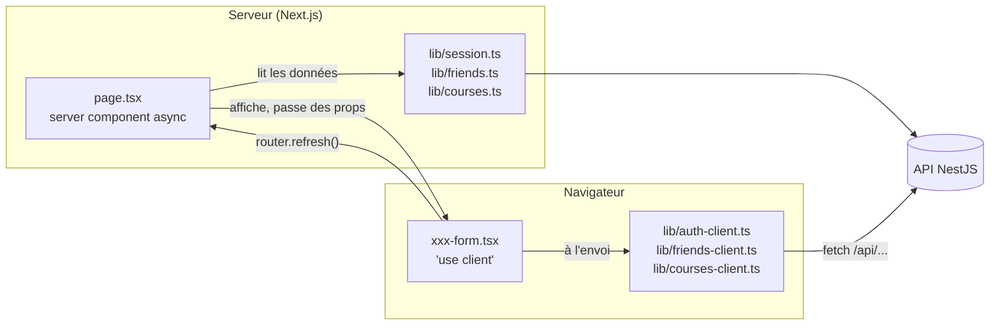
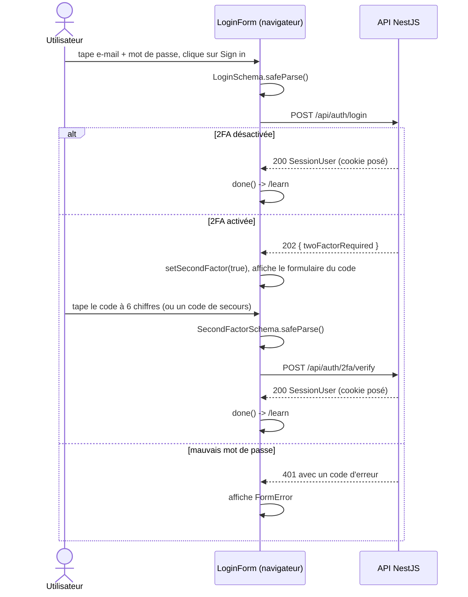
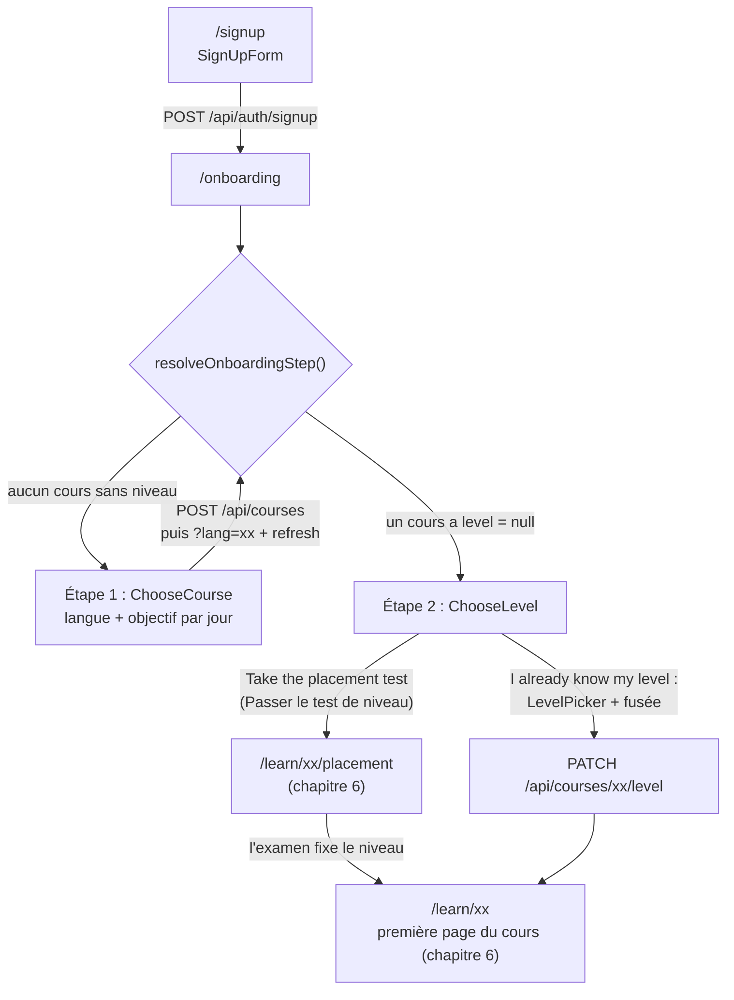
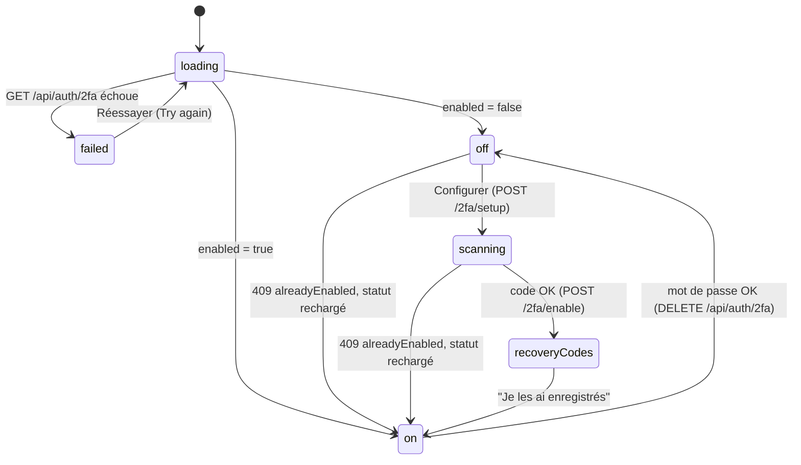
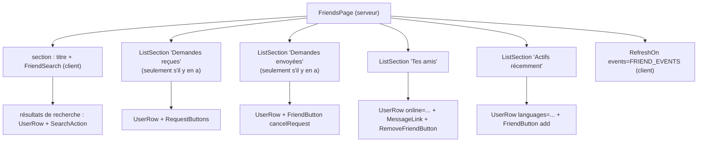

# Chapitre 5 — Les pages du compte et les pages sociales

Dans ce chapitre :

- Le route group `(main)` : les pages qui ne parlent pas des leçons. C'est-à-dire la page d'accueil, l'inscription, la connexion, l'onboarding (la prise en main au début), le profil, les réglages de double authentification, les amis, les profils des autres personnes et les pages légales.
- Pour chaque page : son URL, si c'est un server component ou un client component, les données qu'elle charge, ce que l'utilisateur peut faire, et quel appel à l'API elle fait.
- Les petits composants partagés qui servent à construire ces pages : les morceaux de formulaire, l'avatar, le drapeau, les boutons d'amis, les lignes d'utilisateur, le point "en ligne", le lien vers les messages et l'article légal.
- Les fichiers d'aide dans `lib/` qui contiennent la logique dont ces pages ont besoin : `onboarding.ts`, `avatar.ts`, `presence.ts`, `legal.ts` et `legal-content/`.

---

## Vue d'ensemble

Toutes les pages de ce chapitre sont dans un seul dossier :
[`apps/web/app/[locale]/(main)/`](<../../apps/web/app/[locale]/(main)/>). Le nom `(main)` a des parenthèses, c'est donc un **route group** (un groupe de routes) : il ne fait pas partie de l'URL. Tu peux lire comment marchent les route groups dans [02-routing-layouts-i18n.md](02-routing-layouts-i18n.md). Le dossier regroupe ces pages pour qu'elles partagent un seul layout, le "cadre vitrine et compte".

```
app/[locale]/(main)/
├── layout.tsx                 shell: wordmark + HeaderNav + LegalFooter
├── page.tsx                   /            home
├── login/                     /login
│   ├── page.tsx
│   └── login-form.tsx         (client)
├── signup/                    /signup
│   ├── page.tsx
│   └── signup-form.tsx        (client)
├── onboarding/                /onboarding
│   ├── page.tsx
│   ├── choose-course.tsx      (client) step 1
│   ├── choose-level.tsx       (client) step 2
│   └── rocket.tsx             the launch animation
├── profile/                   /profile
│   ├── page.tsx
│   └── edit/                  /profile/edit
│       ├── page.tsx
│       └── profile-form.tsx   (client)
├── settings/2fa/              /settings/2fa
│   ├── page.tsx
│   └── two-factor-panel.tsx   (client)
├── friends/                   /friends
│   ├── page.tsx
│   └── friend-search.tsx      (client)
├── users/[id]/page.tsx        /users/<id>
├── privacy/page.tsx           /privacy
└── terms/page.tsx             /terms
```

Chaque URL commence aussi par la langue, par exemple `/fr/login` ou `/en/friends`. C'est le segment `[locale]` du chapitre 2. Plus bas, les URL sont écrites sans lui.

### Un seul modèle pour presque toutes les pages

Presque toutes les pages ici sont construites de la même façon. Pense à un restaurant. La **page serveur** est la cuisine : elle prépare l'assiette (elle lit la session, charge les données depuis l'API, traduit les textes) et envoie du HTML fini. Le **formulaire client** est le serveur à ta table : il vit dans le navigateur, réagit quand tu tapes ou cliques, et apporte ta commande (un appel à l'API) à la cuisine.



1. `page.tsx` est un **server component async**. Il lit les données avec les helpers serveur du chapitre 4 (`requireUser`, `requireFriends`, `requireCourses`, ...).
2. Il affiche un client component (un fichier qui commence par `'use client'`) et lui passe les données en props.
3. Le client component vérifie ce qui a été saisi avec le **même schema Zod que l'API** (venant de `@ft/shared`), puis appelle une fonction `*-client.ts`.
4. Après une écriture, il appelle `router.refresh()`. Cela demande au serveur d'afficher la page à nouveau avec des données fraîches. Ainsi, le serveur reste le seul endroit qui connaît la vérité.

La plupart des pages ont aussi `export const dynamic = 'force-dynamic'`. Cela dit à Next.js : ne construis jamais cette page à l'avance et ne la mets jamais en cache, car elle montre les données d'une seule personne.

### Tableau récapitulatif

| URL                  | Fichier serveur                      | Partie client                  | Données chargées sur le serveur                         | Appels API depuis le navigateur                                                          |
| -------------------- | ------------------------------------ | ------------------------------ | ------------------------------------------------------- | ---------------------------------------------------------------------------------------- |
| `/`                  | `page.tsx`                           | aucune                         | `currentUser()`                                         | aucun                                                                                    |
| `/login`             | `login/page.tsx`                     | `LoginForm`                    | aucune                                                  | `POST /api/auth/login`, `POST /api/auth/2fa/verify`                                      |
| `/signup`            | `signup/page.tsx`                    | `SignUpForm`                   | aucune                                                  | `POST /api/auth/signup`                                                                  |
| `/onboarding`        | `onboarding/page.tsx`                | `ChooseCourse`, `ChooseLevel`  | `requireCourses()`                                      | `POST /api/courses`, `PATCH /api/courses/:lang/level`                                    |
| `/profile`           | `profile/page.tsx`                   | aucune                         | `requireUser()`                                         | aucun                                                                                    |
| `/profile/edit`      | `profile/edit/page.tsx`              | `ProfileForm`                  | `requireUser()`                                         | `PATCH /api/users/me`, `POST` / `DELETE /api/users/me/avatar`                            |
| `/settings/2fa`      | `settings/2fa/page.tsx`              | `TwoFactorPanel`               | `requireUser()`                                         | `GET /api/auth/2fa`, `POST .../2fa/setup`, `POST .../2fa/enable`, `DELETE /api/auth/2fa` |
| `/friends`           | `friends/page.tsx`                   | `FriendSearch`, boutons d'amis | `requireFriends()`, `searchUsers()`, `recentlyActive()` | endpoints des demandes d'amis                                                            |
| `/users/:id`         | `users/[id]/page.tsx`                | boutons d'amis, `PresenceDot`  | `requireUser()`, `loadProfile()`, `requireFriends()`    | endpoints des demandes d'amis                                                            |
| `/privacy`, `/terms` | `privacy/page.tsx`, `terms/page.tsx` | aucune                         | aucune (le texte est dans le code)                      | aucun                                                                                    |

---

## `layout.tsx` — le cadre de ce groupe

[layout.tsx](<../../apps/web/app/[locale]/(main)/layout.tsx>) est le layout dans lequel chaque page de `(main)` est dessinée. C'est un server component.

```tsx
/**
 * The marketing and account shell. Not `fill`: these are documents that may run
 * past the viewport, so the footer sits after the content rather than pinned.
 */
export default function MainLayout({ children }: { children: ReactNode }) {
  return (
    <Shell brand={<Wordmark />} nav={<HeaderNav />} footer={<LegalFooter />}>
      {children}
    </Shell>
  );
}
```

Il donne trois emplacements à `Shell` : le nom de l'app à gauche (`Wordmark`), les liens de l'en-tête (`HeaderNav`), et le pied de page avec les liens vers les pages légales (`LegalFooter`). Ces composants sont expliqués dans [03-shell-components.md](03-shell-components.md).

`HeaderNav` a deux formes. Un visiteur voit une seule ligne : le sélecteur de langue, "Sign in" (Se connecter) et "Create account" (Créer un compte). Un utilisateur connecté voit un seul bouton de menu (`HeaderMenu`). Il ouvre un panneau avec le sélecteur de langue, un lien vers `/profile` (avatar et nom), "Friends" (Amis), "Messages" et "Log out" (Se déconnecter). Le sélecteur de langue change la locale de l'URL. Ce layout ne l'enregistre pas : seul le layout `(dashboard)` affiche `LocaleSync`, qui la stocke dans `User.locale` (chapitre 6).

Le commentaire explique un choix. D'autres groupes (comme le tableau de bord) utilisent un shell `fill`, où la page remplit exactement l'écran et le pied de page est collé en bas. Ici, les pages sont des "documents" qui peuvent être plus longs que l'écran (la politique de confidentialité, par exemple), donc le pied de page vient simplement après le contenu.

---

## `page.tsx` — la page d'accueil (`/`)

[page.tsx](<../../apps/web/app/[locale]/(main)/page.tsx>) est un **server component** async. Il montre un titre, une courte intro, le logo et un gros bouton.

```tsx
// The call to action reads from the session, so this page is never prerendered:
// a build-time snapshot would send a signed-in visitor to /signup.
export const dynamic = 'force-dynamic';

export default async function HomePage() {
  const user = await currentUser();
  const t = await getTranslations('HomePage');
  ...
          <Link
            href={user ? '/learn' : '/signup'}
            ...
          >
            {user ? t('continueLearning') : t('startNow')}
          </Link>
```

- **Données :** `currentUser()` de [lib/session.ts](../../apps/web/lib/session.ts). Il renvoie l'utilisateur ou `null`. Il ne redirige jamais : la page d'accueil est pour tout le monde, donc si la vérification de session échoue, la page montre juste la version "non connecté".
- **Ce que l'utilisateur peut faire :** cliquer sur un bouton. Un visiteur connecté voit "Continue learning" (Continuer à apprendre) et va sur `/learn`. Un visiteur non connecté va sur `/signup`.
- **Pourquoi `force-dynamic` :** le commentaire le dit. Sans lui, Next.js pourrait construire la page une seule fois au moment du build, quand personne n'est connecté. Alors tout le monde verrait le bouton "Start now" (Commencer).

Le logo utilise le `<Image>` de Next avec `width={896}` (deux fois la plus grande taille à l'écran, pour qu'il reste net sur un écran retina) et `priority` (le charger en premier, c'est l'image principale). Les classes `flex-col-reverse ... lg:flex-row` mettent le logo au-dessus du texte sur les petits écrans et à droite sur les grands.

---

## Les morceaux de formulaire partagés — `components/form.tsx`

Avant les formulaires de connexion et d'inscription, il nous faut les petites pièces qui servent à les construire. [form.tsx](../../apps/web/components/form.tsx) est un fichier de **client component** (`'use client'`) qui exporte :

| Export                                                           | Ce que c'est                                                                                        |
| ---------------------------------------------------------------- | --------------------------------------------------------------------------------------------------- |
| `Field`                                                          | un label + un `<input>` + une aide facultative                                                      |
| `FormError`                                                      | une ligne d'erreur rouge, ou rien                                                                   |
| `SubmitButton`                                                   | le bouton d'envoi principal, qui affiche "Working..." (En cours...) pendant le travail              |
| `PRIMARY_BUTTON`, `SECONDARY_BUTTON`, `GO_BUTTON`, `WARN_BUTTON` | des chaînes de classes Tailwind, pour les liens et les boutons qui doivent ressembler à des boutons |

```tsx
export function Field({ label, hint, ...input }: FieldProps) {
  const id = useId();
  const hintId = hint ? `${id}-hint` : undefined;

  return (
    <div className="flex flex-col gap-2">
      <label htmlFor={id} className="text-sm font-medium">
        {label}
      </label>
      <input
        id={id}
        aria-describedby={hintId}
        className="..."
        {...input}
      />
      {hint ? (
        <p id={hintId} className="text-xs text-slate-400">
          {hint}
        </p>
      ) : null}
    </div>
  );
}
```

`Field` prend toutes les props normales d'un `<input>` (`name`, `type`, `autoComplete`, ...) plus un `label` et un `hint`. `useId()` est un hook React qui crée un id unique, pour que le `<label htmlFor>` pointe vers le bon input. Le commentaire dit pourquoi : les lecteurs d'écran annoncent ce lien, et le module d'accessibilité demande que chaque input ait un label. L'aide est reliée avec `aria-describedby`, donc un lecteur d'écran la lit aussi.

```tsx
/** role="alert" so a failed submit is announced, not just repainted. */
export function FormError({ message }: { message: string | null }) {
  if (message === null) {
    return null;
  }
  return (
    <p role="alert" className="text-sm text-red-400">
      {message}
    </p>
  );
}
```

`role="alert"` fait lire le message par un lecteur d'écran dès qu'il apparaît.

```tsx
export function SubmitButton({ pending, disabled = false, children }: {...}) {
  const t = useTranslations('Form');

  return (
    <button type="submit" disabled={pending || disabled} className={PRIMARY_BUTTON}>
      {pending ? t('working') : children}
    </button>
  );
}
```

Tant que `pending` est vrai, le bouton est désactivé (pas de double envoi) et son texte devient "Working". `disabled` seul sert pour un formulaire qui n'est pas encore complet : on ne peut pas cliquer sur le bouton, mais il n'affiche pas "Working".

Les constantes de classes partent toutes d'une seule chaîne `BUTTON`. Elle met `min-h-11` (44 px, "la largeur d'un pouce", la taille minimale d'une zone tactile) et un anneau de focus visible. Les quatre variantes ne changent que les couleurs : `PRIMARY` est plein, les autres n'ont qu'un contour, `GO` devient vert au survol, `WARN` devient rouge.

---

## L'inscription (`/signup`)

### `signup/page.tsx`

[signup/page.tsx](<../../apps/web/app/[locale]/(main)/signup/page.tsx>) est un petit **server component**. Il affiche un titre et `<SignUpForm />`. Il ne charge aucune donnée.

```tsx
export async function generateMetadata(): Promise<Metadata> {
  const t = await getTranslations('SignUpPage');

  return { title: t('heading') };
}
```

`generateMetadata` définit le titre de l'onglet du navigateur. C'est une fonction (et pas un objet `metadata` fixe) pour que le titre puisse être traduit dans la langue de la page. La page de connexion a un commentaire qui explique cela en détail.

### `signup/signup-form.tsx`

[signup-form.tsx](<../../apps/web/app/[locale]/(main)/signup/signup-form.tsx>) est un **client component**. Il a quatre champs : e-mail, nom affiché, mot de passe, confirmation du mot de passe.

```tsx
  async function onSubmit(event: React.FormEvent<HTMLFormElement>) {
    event.preventDefault();
    setPending(true);
    const form = new FormData(event.currentTarget);

    try {
      // Identical rules to the API's, from the same schema, which is what the
      // subject means by validating on both sides. The confirmation is the one
      // rule the server does not share, so it is stripped before sending.
      const parsed = SignUpFormSchema.safeParse({
        email: form.get('email'),
        displayName: form.get('displayName'),
        password: form.get('password'),
        confirmPassword: form.get('confirmPassword'),
      });
      if (!parsed.success) {
        setError(errorMessage(parsed.error.issues[0].message));
        return;
      }

      const { confirmPassword: _confirmPassword, ...credentials } = parsed.data;
      const result = await signUp(credentials);
      if (!result.ok) {
        setError(errorMessage(result.code, result.status));
        return;
      }

      // A new account has no course yet, so /learn would only redirect here.
      router.replace('/onboarding');
      router.refresh();
    } finally {
      setPending(false);
    }
  }
```

Étape par étape :

1. `event.preventDefault()` empêche le navigateur d'envoyer la page entière. On gère l'envoi en JavaScript.
2. `FormData` lit les valeurs des inputs grâce à leur `name`.
3. `SignUpFormSchema.safeParse(...)` vérifie les valeurs avec le schema Zod partagé. `safeParse` ne lance pas d'erreur : il renvoie `{ success, data }` ou `{ success: false, error }`. Le message d'erreur est un **code** (comme `password.tooShort`), et `errorMessage()` (la fonction que renvoie le hook `useErrorMessage()` de [lib/error-message.ts](../../apps/web/lib/error-message.ts), voir chapitre 4) le transforme en phrase dans la langue de la page. Seul le premier problème est affiché.
4. La valeur "confirmation du mot de passe" est retirée avant l'envoi, car l'API ne la connaît pas.
5. `signUp()` de [lib/auth-client.ts](../../apps/web/lib/auth-client.ts) envoie `POST /api/auth/signup`. L'API crée l'utilisateur et pose le cookie de session.
6. En cas de succès, on va sur `/onboarding`. `router.replace` (et pas `push`) veut dire que le bouton Retour ne ramènera pas au formulaire d'inscription. `router.refresh()` fait réafficher l'en-tête, maintenant connecté.
7. `finally` remet toujours `pending` à faux, même si quelque chose a lancé une erreur.

Le formulaire a `noValidate` : cela coupe les bulles d'erreur du navigateur, pour que l'utilisateur ne voie que nos messages traduits.

---

## La connexion (`/login`) et l'étape 2FA

### `login/page.tsx`

[login/page.tsx](<../../apps/web/app/[locale]/(main)/login/page.tsx>) est un **server component** comme la page d'inscription : un titre et `<LoginForm />`.

```tsx
// generateMetadata rather than a static export: the browser tab is the one piece
// of a page that keeps rendering after the locale segment is resolved, so a
// literal here would label a French page in English.
export async function generateMetadata(): Promise<Metadata> {
```

### `login/login-form.tsx`

[login-form.tsx](<../../apps/web/app/[locale]/(main)/login/login-form.tsx>) est un **client component** avec **deux étapes** dans un seul composant. Une variable de state `secondFactor` dit à quelle étape on est.



Le state :

```tsx
  const [secondFactor, setSecondFactor] = useState(false);
  const [error, setError] = useState<string | null>(null);
  const [pending, setPending] = useState(false);

  /** /learn reads the session on the server, which proves the cookie survived. */
  function done() {
    router.replace('/learn');
    router.refresh();
  }
```

Étape 1, le mot de passe :

```tsx
  async function submitPassword(form: FormData) {
    // The same schema the API applies, so the obvious mistakes never leave the page.
    const parsed = LoginSchema.safeParse({
      email: form.get('email'),
      password: form.get('password'),
    });
    if (!parsed.success) {
      setError(errorMessage(parsed.error.issues[0].message));
      return;
    }

    const result = await logIn(parsed.data);
    if (result.ok === 'twoFactor') {
      setSecondFactor(true);
      setError(null);
      return;
    }
    if (!result.ok) {
      setError(errorMessage(result.code, result.status));
      return;
    }
    done();
  }
```

`logIn()` dans `auth-client.ts` renvoie une de ces trois choses : un succès, un échec, ou la valeur spéciale `{ ok: 'twoFactor' }` quand l'API dit qu'un code est encore nécessaire (statut `202` avec `{ twoFactorRequired: true }`). Dans ce cas, le formulaire passe à l'étape 2.

Étape 2, le code : `submitCode` fait la même chose avec `SecondFactorSchema` et `verifySecondFactor(code)`, qui envoie `POST /api/auth/2fa/verify`. Un seul handler `onSubmit` choisit la bonne fonction :

```tsx
      await (secondFactor ? submitCode(form) : submitPassword(form));
```

Il y a un détail important dans l'affichage :

```tsx
  if (secondFactor) {
    return (
      // Distinct key from the password form. Both render a <form> holding
      // <Field>, so without it React reuses the password input's DOM node for
      // the code input and the typed password reappears, in clear text.
      <form key="second-factor" onSubmit={onSubmit} className="flex flex-col gap-6" noValidate>
```

React compare l'ancien arbre et le nouveau. Si les deux ont un `<form>` avec un `<Field>` au même endroit, React garde le même `<input>` dans la page et change seulement ses props. L'input garderait sa valeur : le mot de passe, maintenant affiché en clair dans le champ du code. Donner une `key` différente à chaque formulaire dit à React "c'est un nouveau formulaire", donc il jette les anciens inputs. Le champ du code utilise `autoComplete="one-time-code"` pour que les téléphones puissent le remplir depuis un SMS ou une app.

Après un succès, `done()` va sur `/learn`. Cette page lit la session sur le serveur. Si le cookie n'avait pas été enregistré, elle renverrait l'utilisateur vers `/login`, donc arriver sur `/learn` prouve que la connexion a marché.

---

## L'onboarding (`/onboarding`) — choisir un cours, puis un niveau

Après l'inscription, l'utilisateur n'a aucun cours. L'onboarding a deux étapes : choisir une langue et un objectif par jour, puis choisir un niveau (ou passer un test de placement).



L'idée clé : **l'étape n'est pas gardée dans le state React**. Elle est calculée sur le serveur à partir des cours de l'utilisateur, à chaque affichage de la page. Un cours avec `level: null` veut dire "étape 1 faite, étape 2 pas faite". Donc un rafraîchissement, le bouton Retour ou un test de placement abandonné au milieu ramènent tous l'utilisateur à la bonne étape, sans effort.

### `lib/onboarding.ts`

[onboarding.ts](../../apps/web/lib/onboarding.ts) contient cette décision sous forme de fonction pure (pas de React, pas de fetch), donc elle est facile à tester.

```ts
export type OnboardingStep =
  { step: 'chooseCourse'; preselected: Language | null } | { step: 'chooseLevel'; course: Course };

export function resolveOnboardingStep(
  courses: readonly Course[],
  wanted: Language | null = null,
): OnboardingStep {
  const course = courses.find((candidate) => candidate.lang === wanted);

  if (wanted !== null && course === undefined) {
    return { step: 'chooseCourse', preselected: wanted };
  }
  if (course?.level === null) {
    return { step: 'chooseLevel', course };
  }

  const unfinished = courses.findLast((candidate) => candidate.level === null);

  return unfinished === undefined
    ? { step: 'chooseCourse', preselected: null }
    : { step: 'chooseLevel', course: unfinished };
}
```

`wanted` vient de `?lang=` dans l'URL : le cours sur lequel l'utilisateur a cliqué.

| Situation                                              | Résultat                                                   |
| ------------------------------------------------------ | ---------------------------------------------------------- |
| `wanted` est une langue que l'utilisateur n'étudie pas | étape 1, avec cette langue déjà sélectionnée               |
| `wanted` est un cours sans niveau                      | étape 2 pour ce cours                                      |
| sinon, un cours n'a pas de niveau                      | étape 2 pour le **plus récent** de ces cours (`findLast`)  |
| sinon (chaque cours a un niveau)                       | étape 1, rien de sélectionné (ajout d'une nouvelle langue) |

Le type de retour est une **union discriminée** : le champ `step` dit à TypeScript quel autre champ existe. [onboarding.test.ts](../../apps/web/lib/onboarding.test.ts) teste chaque ligne de ce tableau.

### `onboarding/page.tsx`

[onboarding/page.tsx](<../../apps/web/app/[locale]/(main)/onboarding/page.tsx>) est un **server component** async, `force-dynamic`.

```tsx
export default async function OnboardingPage({
  searchParams,
}: {
  searchParams: Promise<{ lang?: string | string[] }>;
}) {
  const { courses, activeLang } = await requireCourses();
  // A hand-edited ?lang= is ignored rather than an error.
  const wanted = LanguageSchema.safeParse((await searchParams).lang);
  const step = resolveOnboardingStep(courses, wanted.success ? wanted.data : null);

  return (
    <div className="mx-auto flex w-full max-w-md flex-col gap-8">
      {step.step === 'chooseCourse' ? (
        <ChooseCourse
          // Remounts when ?lang= changes, since the preselection is only a starting value.
          key={step.preselected}
          studied={courses.map((course) => course.lang)}
          activeLang={activeLang}
          preselected={step.preselected}
        />
      ) : (
        <ChooseLevel course={step.course} />
      )}
    </div>
  );
}
```

- **Données :** `requireCourses()` de [lib/courses.ts](../../apps/web/lib/courses.ts) (`GET /api/courses`). Il redirige aussi un visiteur non connecté vers `/login`. Il donne la liste des cours et `activeLang`, le cours que l'utilisateur a utilisé en dernier.
- `searchParams` est une Promise dans cette version de Next.js, donc on l'attend avec `await`.
- `?lang=` est vérifié avec `LanguageSchema`. Une mauvaise valeur (`?lang=xyz`) est simplement ignorée.
- La page sert aussi à **ajouter une deuxième langue plus tard**. Le commentaire explique pourquoi elle n'est pas sous `/learn/[lang]` : le `[lang]` est justement ce que cette page choisit.

L'astuce `key={step.preselected}` : `ChooseCourse` utilise `preselected` seulement comme valeur de départ de son state. Si l'URL change, React garderait l'ancien state. Changer la `key` force React à créer un composant tout neuf.

### `onboarding/choose-course.tsx` — étape 1

[choose-course.tsx](<../../apps/web/app/[locale]/(main)/onboarding/choose-course.tsx>) est un **client component**. Il montre deux groupes de boutons radio : la langue (avec un drapeau) et l'objectif par jour (10, 30 ou 60 minutes).

```tsx
/** Typed against DailyGoal, so a value the schema drops stops compiling here. */
const DAILY_GOALS: readonly DailyGoal[] = [10, 30, 60];
...
  const available = LEARNABLE_LANGUAGES.filter((option) => !studied.includes(option));
  const locked = available.length === 0;
  // One language left means there is nothing to decide, so it starts selected.
  const [lang, setLang] = useState<Language | null>(
    preselected ?? (available.length === 1 ? available[0] : null),
  );
  const [dailyGoal, setDailyGoal] = useState<DailyGoal | null>(null);
```

- Les langues que l'utilisateur étudie déjà sont affichées mais **désactivées**.
- Si toutes les langues sont prises, `locked` est vrai : la page dit qu'il n'y a pas de nouvelle langue, et montre un lien pour revenir au cours actif.
- Les `<input>` radio ont `className="sr-only"` (cachés à l'écran mais toujours là pour le clavier et les lecteurs d'écran). Le `<label>` autour d'eux est stylé avec les variantes Tailwind `has-checked:` et `has-disabled:`, donc la case change de couleur quand son radio caché est coché.
- Le bouton "Next" (Suivant) est désactivé tant qu'une langue et un objectif ne sont pas choisis.

À l'envoi :

```tsx
      const result = await startCourse({ lang, dailyGoal });

      // A studied language cannot be picked, so course.alreadyStarted only
      // reaches here when a second tab started the same one first.
      if (!result.ok) {
        setError(errorMessage(result.code, result.status));
        return;
      }

      // A stale ?lang= would keep step one open when another language was picked.
      router.replace(`/onboarding?lang=${result.data.lang}`);
      // Without this the server never re-reads, and the page stays on step one.
      router.refresh();
```

`startCourse()` de [lib/courses-client.ts](../../apps/web/lib/courses-client.ts) envoie `POST /api/courses`. Le cours est enregistré **tout de suite**, sans niveau. C'est ce qui permet à l'étape 2 de survivre à un rafraîchissement. Ensuite la page se recharge avec `?lang=` mis sur le nouveau cours, et `resolveOnboardingStep` renvoie maintenant l'étape 2.

### `onboarding/choose-level.tsx` — étape 2

[choose-level.tsx](<../../apps/web/app/[locale]/(main)/onboarding/choose-level.tsx>) est un **client component**. Il reçoit le `course` en prop. Il montre le drapeau, le nom de la langue et l'objectif par jour, puis deux choix :

- **Take the placement test** (Passer le test de niveau) : un simple lien vers `/learn/<lang>/placement`, l'examen de placement (chapitre 6). C'est l'examen lui-même qui enregistre le niveau.
- **I already know my level** (Je connais déjà mon niveau) : ouvre le `LevelPicker` ([components/level-picker.tsx](../../apps/web/components/level-picker.tsx), expliqué au chapitre 6). L'utilisateur clique sur ce qu'il maîtrise déjà : `A0` (rien), `A1`, ... `C2`.

Le state a un type subtil :

```tsx
  const [picking, setPicking] = useState(false);
  // Three states, and the two empty-looking ones differ: undefined is nothing
  // picked yet, null is "I have mastered nothing", which is a real answer.
  const [mastered, setMastered] = useState<Level | null | undefined>(undefined);
  const [error, setError] = useState<string | null>(null);
  const [pending, setPending] = useState(false);
  const [launching, setLaunching] = useState(false);
```

À l'envoi, le niveau est enregistré et une animation de fusée se joue en même temps :

```tsx
    const animated = !prefersReducedMotion();
    setLaunching(animated);

    try {
      // Run together, so the launch costs nothing on a slow network.
      const [result] = await Promise.all([
        // The course is one past what they have mastered: the column holds what
        // we teach, never what they already know.
        setCourseLevel(course.lang, { level: nextLevel(mastered) }),
        new Promise((resolve) => setTimeout(resolve, animated ? LAUNCH_MS : 0)),
      ]);

      if (!result.ok) {
        // The rocket must not fly away from a level that was never saved.
        setLaunching(false);
        setError(errorMessage(result.code, result.status));
        return;
      }

      router.replace(`/learn/${course.lang}`);
      router.refresh();
```

- `nextLevel()` de [lib/level.ts](../../apps/web/lib/level.ts) transforme "maîtrisé" en "ce qu'il faut enseigner" : `A2` maîtrisé veut dire que le cours est `B1` ; rien de maîtrisé (`null`) veut dire `A1` ; `C2` reste `C2`.
- `setCourseLevel()` envoie `PATCH /api/courses/<lang>/level`. L'examen de placement n'appelle pas cet endpoint : l'API enregistre elle-même son niveau, avec la même méthode `CoursesService.setLevel()`. Donc le niveau n'a toujours qu'un seul endroit qui l'écrit.
- `Promise.all` attend à la fois l'appel à l'API et un minuteur de 1,5 s. Si le réseau est lent, l'utilisateur n'attend pas 1,5 s **de plus** : les deux tournent en même temps. `LAUNCH_MS` (1500) correspond aux keyframes `launch` dans `app/globals.css`.
- `prefersReducedMotion()` lit le réglage du système "réduire les animations". S'il est activé, il n'y a pas d'animation du tout et le minuteur est de 0 ms.
- En cas de succès, l'utilisateur arrive sur `/learn/<lang>`, la première page de son cours.

### `onboarding/rocket.tsx`

[rocket.tsx](<../../apps/web/app/[locale]/(main)/onboarding/rocket.tsx>) dessine la fusée en SVG inline, aux couleurs du wordmark (des dégradés du violet au bleu). Il n'a pas de `'use client'` et pas de state : c'est juste du markup.

```tsx
export function Rocket({ className, bob = true }: { className?: string; bob?: boolean }) {
  return (
    <span className={`inline-flex items-end ${className ?? 'h-7 w-7'}`} aria-hidden>
      <svg viewBox="0 0 24 28" className="h-full w-full">
        ...
        {/* The idle bob is for the inline rocket. During a launch the whole
            element travels, and a second animation would fade it out mid-flight. */}
        <g className={bob ? 'animate-liftoff motion-reduce:animate-none' : undefined}>
```

- `aria-hidden` : purement décoratif. Le commentaire en haut dit que le `SubmitButton` dit déjà aux lecteurs d'écran que quelque chose se passe ("Working").
- `bob` ajoute une petite animation de repos, de haut en bas. `ChooseLevel` passe `bob={false}` car là, toute la fusée s'envole avec `animate-launch`.
- Les flammes sont deux copies du tracé "étincelle" à quatre branches du logo (`SPARKLE`) avec `animate-twinkle`, la deuxième décalée de 300 ms.
- `motion-reduce:animate-none` arrête les animations pour les utilisateurs qui ont demandé moins de mouvement.

---

## Les avatars — `lib/avatar.ts` et `components/avatar.tsx`

Les pages profil et amis montrent des avatars, alors regardons-les d'abord.

[lib/avatar.ts](../../apps/web/lib/avatar.ts) a deux fonctions pures pour le **dessin de secours** (le cercle coloré avec une lettre, affiché quand il n'y a pas d'image envoyée). Elles sont dans `lib/` et pas dans le composant, pour que la suite de tests de lib puisse les tester sans DOM de navigateur.

```ts
/** Stable per name, so the same person keeps the same colour. */
export function avatarHue(name: string): number {
  let value = 0;
  for (const character of name) {
    value = (value * 31 + (character.codePointAt(0) ?? 0)) % 360;
  }
  return value;
}

export function avatarInitial(name: string): string {
  return [...name][0]?.toUpperCase() ?? '?';
}
```

- `avatarHue` est un tout petit hash : le même nom donne toujours le même nombre entre 0 et 359, utilisé comme teinte de couleur.
- `avatarInitial` utilise `[...name]` pour découper selon les vrais caractères (code points). `name[0]` couperait un emoji ou un caractère chinois en deux, car ils prennent deux "code units" dans les chaînes JavaScript.

[avatar.test.ts](../../apps/web/lib/avatar.test.ts) vérifie la majuscule, le cas de l'emoji, le secours `'?'` et que la teinte est stable.

[components/avatar.tsx](../../apps/web/components/avatar.tsx) est un composant sans `'use client'`, donc il peut tourner sur le serveur ou dans des client components.

```tsx
export function Avatar({ src, name, size }: { src: string | null; name: string; size: number }) {
  if (src !== null) {
    return (
      <Image
        src={src}
        alt=""
        width={size}
        height={size}
        className="rounded-full object-cover"
        style={{ width: size, height: size }}
      />
    );
  }

  // Drawn rather than a stored image: nothing to ship and nothing to 404.
  return (
    <svg width={size} height={size} viewBox="0 0 40 40" aria-hidden className="rounded-full">
      <circle cx="20" cy="20" r="20" fill={`hsl(${avatarHue(name)} 45% 32%)`} />
      <text x="20" y="20" textAnchor="middle" dominantBaseline="central" fontSize="18" fill="#fff">
        {avatarInitial(name)}
      </text>
    </svg>
  );
}
```

`alt=""` et `aria-hidden` : l'avatar est toujours à côté du nom de la personne, donc un lecteur d'écran ne ferait que répéter le nom.

---

## Ton profil (`/profile`)

[profile/page.tsx](<../../apps/web/app/[locale]/(main)/profile/page.tsx>) est un **server component** async, `force-dynamic`. Il n'a pas de partie client.

```tsx
export default async function ProfilePage() {
  const user = await requireUser();
  const locale = await getLocale();
  const t = await getTranslations('ProfilePage');
  const joinedDate = new Date(user.createdAt).toLocaleDateString(locale);
```

- **Données :** `requireUser()` (`GET /api/auth/me` via `loadSession`, chapitre 4). Un visiteur non connecté est redirigé vers `/login`.
- **Affiche :** le nom affiché, l'e-mail, la date de création du compte (mise en forme pour la langue de la page avec `toLocaleDateString(locale)`), et un avatar de 128 px.
- **Ce que l'utilisateur peut faire :** suivre deux liens : "Edit profile" (Modifier le profil, `/profile/edit`) et, dans une section "Security" (Sécurité), "Two factor authentication" (Double authentification, `/settings/2fa`).

Les classes `max-sm:flex-col-reverse` mettent l'avatar au-dessus du nom sur les téléphones.

---

## Modifier le profil (`/profile/edit`)

### `profile/edit/page.tsx`

[profile/edit/page.tsx](<../../apps/web/app/[locale]/(main)/profile/edit/page.tsx>) est un **server component**. Il appelle `requireUser()` et passe l'utilisateur à `<ProfileForm user={user} />`. Il affiche aussi un lien "Back to profile" (Retour au profil) et le `<h1>`.

```tsx
  // Heading here, not in ProfileForm, so the page has an h1 and the form stays a
  // form. One key feeds the link on /profile, this title and this heading.
```

### `profile/edit/profile-form.tsx`

[profile-form.tsx](<../../apps/web/app/[locale]/(main)/profile/edit/profile-form.tsx>) est un **client component** avec deux parties séparées :

```tsx
  // The avatar saves the moment it is picked, the name only on submit, so they
  // are kept apart: inside one form the button would look like it saved both.
```

**1. L'avatar.** Un input de fichier caché dans un `<label>` (pour que le texte du label soit le lien cliquable "Upload", Envoyer). Il accepte PNG, JPEG et WebP.

```tsx
  async function onAvatarChange(event: React.ChangeEvent<HTMLInputElement>) {
    const file = event.target.files?.[0];
    if (!file) {
      return;
    }
    event.target.value = '';

    if (file.size > MAX_AVATAR_BYTES) {
      setAvatarError(t('avatarTooLarge', { size: MAX_AVATAR_BYTES / 1024 ** 2 }));
      return;
    }

    setAvatarPending('upload');
    setAvatarError(null);
    try {
      const result = await uploadAvatar(file);
      if (!result.ok) {
        setAvatarError(errorMessage(result.code, result.status));
        return;
      }
      router.refresh();
    } finally {
      setAvatarPending(null);
    }
  }
```

- `event.target.value = ''` vide l'input, pour que choisir à nouveau le même fichier déclenche quand même `onChange`.
- La taille est d'abord vérifiée dans le navigateur, avec `MAX_AVATAR_BYTES` de `@ft/shared` (la même limite que l'API).
- `uploadAvatar(file)` envoie `POST /api/users/me/avatar` en `multipart/form-data`.
- `router.refresh()` réaffiche la page sur le serveur, donc le nouveau `user.avatarUrl` arrive et l'image change.

Un bouton "Remove" (Supprimer) apparaît seulement quand il y a un avatar. Il appelle `removeAvatar()` (`DELETE /api/users/me/avatar`).

`avatarPending` est un seul state avec trois valeurs (`'upload' | 'remove' | null`) et pas deux booléens. Le commentaire dit pourquoi : le label doit montrer **quelle** action est en cours ("Uploading..." ou "Removing...").

**2. Le nom affiché.** Un formulaire normal avec un seul `Field`, vérifié avec `UpdateProfileSchema`, enregistré avec `updateProfile()` (`PATCH /api/users/me`). En cas de succès :

```tsx
      setError(null);
      router.push('/profile');
      // The header greets the user by name, so it has to re-render too.
      router.refresh();
```

---

## Les réglages de double authentification (`/settings/2fa`)

La double authentification (2FA) veut dire : pour te connecter, il te faut ton mot de passe **et** un code à 6 chiffres donné par une app sur ton téléphone (comme Google Authenticator). Le code change toutes les 30 secondes. On appelle cela TOTP (time-based one-time password, un mot de passe à usage unique basé sur l'heure).

### `settings/2fa/page.tsx`

[settings/2fa/page.tsx](<../../apps/web/app/[locale]/(main)/settings/2fa/page.tsx>) est un **server component**. Il affiche seulement un titre et une intro, puis `<TwoFactorPanel />`.

```tsx
export default async function TwoFactorPage() {
  // requireUser first: the panel below decides what to show from the status, and
  // a signed-out visitor should land on /login rather than on an empty page.
  await requireUser();
```

### `settings/2fa/two-factor-panel.tsx`

[two-factor-panel.tsx](<../../apps/web/app/[locale]/(main)/settings/2fa/two-factor-panel.tsx>) est un **client component**. Contrairement aux autres pages, il charge ses propres données dans le navigateur, avec `useEffect` :

```tsx
/**
 * Not knowing is not "off" (#216): a page that showed Set up while the status
 * loaded, or after it failed, offered setup on an account whose 2FA was on.
 */
type Status = TwoFactorStatus | 'loading' | 'failed';

async function loadStatus(): Promise<Status> {
  const response = await clientGet(TwoFactorStatusSchema, '/api/auth/2fa');
  return response.ok ? response.data : 'failed';
}
...
  useEffect(() => {
    void loadStatus().then(setStatus);
  }, []);
```

`useEffect(..., [])` tourne une seule fois, après la première apparition du composant dans le navigateur. Le commentaire parle du bug #216, corrigé par la PR #219. Avant la correction, "chargement" et "échec" étaient traités comme "2FA désactivée", donc la page proposait "Set up" (Configurer) à un utilisateur qui avait déjà la 2FA activée. Et `POST /api/auth/2fa/setup` écrivait un nouveau secret avec la 2FA désactivée : un clic désactivait la 2FA sans le mot de passe. Maintenant le panneau a des états séparés, et l'API refuse setup et enable tant que la 2FA est activée (`409 twoFactor.alreadyEnabled`). Pour changer d'application, l'utilisateur désactive d'abord la 2FA, avec le mot de passe.

Le panneau montre un écran à la fois. L'ordre des tests `if` dans l'affichage donne la priorité :



| Écran              | Affiché quand            | Ce que fait l'utilisateur                                                             | Appel API                                             |
| ------------------ | ------------------------ | ------------------------------------------------------------------------------------- | ----------------------------------------------------- |
| Codes de secours   | `recoveryCodes !== null` | lit et enregistre les codes, clique sur "I have saved them" (Je les ai enregistrés)        | aucun                                                 |
| Scanner le QR code | `setup !== null`         | scanne l'image QR (ou tape le secret), entre un code                                  | `enableTwoFactor(code)` → `POST /api/auth/2fa/enable` |
| Chargement         | `status === 'loading'`   | attend                                                                                |                                                       |
| Échec              | `status === 'failed'`    | clique sur "Try again" (Réessayer)                                                          | `GET /api/auth/2fa` à nouveau                         |
| Activée            | `status.enabled`         | voit combien de codes de secours restent, tape le mot de passe, clique sur "Turn off" (Désactiver) | `disableTwoFactor(password)` → `DELETE /api/auth/2fa` |
| Désactivée         | sinon                    | clique sur "Set up" (Configurer)                                                      | `beginTwoFactorSetup()` → `POST /api/auth/2fa/setup`  |

Les codes de secours passent en premier car, comme le dit le commentaire, ils sont "shown once, never retrievable again" (affichés une fois, impossibles à récupérer ensuite). Ce sont des codes de secours pour un téléphone perdu.

`setup` contient `{ secret, otpauthUri, qrDataUrl }` venant de l'API. Le QR code arrive sous forme d'URL `data:` (l'image elle-même, encodée dans la chaîne), affichée avec `<Image>`.

Deux petits helpers gèrent les résultats :

```tsx
  function fail(result: ApiResult<unknown>) {
    setError(result.ok ? null : errorMessage(result.code, result.status));
    return result.ok;
  }

  /** The page was out of date: 2FA is on (another tab). Show what is true now. */
  async function staleOnConflict(result: ApiResult<unknown>) {
    if (!result.ok && result.code === 'twoFactor.alreadyEnabled') {
      setSetup(null);
      setStatus(await loadStatus());
    }
  }
```

Malgré son nom, `fail()` renvoie `true` quand l'appel a **réussi** ; il met ou efface le message d'erreur. `staleOnConflict` tourne après "Set up" et après le code : si la 2FA a été activée dans un autre onglet, l'API répond `409 twoFactor.alreadyEnabled`, et le panneau ferme l'écran du QR code et recharge le vrai statut.

Le code et le mot de passe sont d'abord vérifiés dans le navigateur avec `EnableTwoFactorSchema` et `DisableTwoFactorSchema` (de `@ft/shared`), donc un mot de passe vide est repéré avant toute requête (#217, PR #218). L'API vérifie à nouveau le mot de passe avant de désactiver la 2FA.

---

## Les composants des amis

La page des amis et la page d'un utilisateur sont construites à partir de quelques composants partagés. Les voici, du plus petit au plus grand.

### `lib/presence.ts` — qui est en ligne, d'après ce que l'onglet a entendu en dernier

[presence.ts](../../apps/web/lib/presence.ts) exporte `createPresenceMap()`. C'est un petit store : une `Map` qui va de l'id d'un utilisateur vers `true`/`false` (en ligne ou non), plus une liste d'"observateurs" à appeler quand quelque chose change.

```ts
export function createPresenceMap(): PresenceMap {
  const online = new Map<string, boolean>();
  const watchers = new Set<() => void>();
  const changed = () => {
    for (const watch of watchers) watch();
  };

  return {
    get: (userId) => online.get(userId),
    apply(update) {
      const next = update.status === 'online';
      if (online.get(update.userId) === next) return;
      online.set(update.userId, next);
      changed();
    },
    forget(userId) {
      if (online.delete(userId)) changed();
    },
    clear() {
      if (online.size === 0) return;
      online.clear();
      changed();
    },
    subscribe(watch) {
      watchers.add(watch);
      return () => {
        watchers.delete(watch);
      };
    },
  };
}
```

Qui l'utilise : [components/tab-socket.ts](../../apps/web/components/tab-socket.ts) (chapitre 3) crée **une seule** map pour tout l'onglet du navigateur. Quand le WebSocket reçoit `presence:update`, il appelle `apply` ; sur `friend:removed` et `friend:accepted`, `forget` (le point d'un nouvel ami part alors du nouveau rendu serveur) ; à la déconnexion ou à une nouvelle connexion, `clear`. La map n'appelle les observateurs que quand une valeur change vraiment, donc React ne réaffiche pas pour rien.

Pourquoi une map qui vit dans l'onglet, et pas dans une page ? Le commentaire le dit : Next.js peut restaurer une ancienne page depuis son cache quand tu appuies sur Retour. Cette ancienne page a été affichée avec d'anciennes valeurs "en ligne". La map se souvient de ce qui s'est passé pendant que la page n'était pas là. `get()` renvoie `undefined` pour un ami dont l'onglet n'a pas eu de nouvelles, et alors l'appelant utilise la valeur affichée par le serveur.

[presence.test.ts](../../apps/web/lib/presence.test.ts) vérifie : undefined avant toute nouvelle, le dernier statut gagne, les observateurs ne sont appelés que sur de vrais changements, `forget`, `clear`, et le désabonnement.

### `components/presence-dot.tsx` — le point vert ou gris

[presence-dot.tsx](../../apps/web/components/presence-dot.tsx) est un **client component**, car le point doit changer sans recharger la page.

```tsx
export function PresenceDot({ userId, online }: { userId: string; online: boolean }) {
  const t = useTranslations('FriendsPage');
  const live = useFriendOnline(userId, online);

  return (
    // role="img" with a label: a screen reader says "Online" or "Offline"
    // instead of a colour it cannot see. The ring, the page's own background,
    // sets the dot apart from the avatar it sits on. shrink-0: an empty flex
    // item may shrink to nothing, and a long name beside it would squeeze it
    // into a thin pill.
    <span
      role="img"
      aria-label={t(live ? 'online' : 'offline')}
      className={`size-3 shrink-0 rounded-full ring-2 ring-slate-950 ${live ? 'bg-green-500' : 'bg-slate-500'}`}
    />
  );
}
```

`useFriendOnline(userId, online)` (dans `tab-socket.ts`) lit la map de présence avec `useSyncExternalStore` et renvoie `heard ?? rendered` : la valeur en direct si l'onglet en a entendu une, sinon la valeur du serveur. `role="img"` avec un `aria-label` permet à un lecteur d'écran de dire "Online" (En ligne) ou "Offline" (Hors ligne) au lieu d'une couleur qu'il ne peut pas voir.

`AvatarWithDot` place un `Avatar` et, **seulement si `online` est donné**, un `PresenceDot` dans son coin en bas à droite. Pas de prop `online` veut dire pas de point. C'est voulu : seuls les amis ont le droit de voir quand tu es en ligne.

### `components/user-row.tsx` — une personne dans une liste

[user-row.tsx](../../apps/web/components/user-row.tsx) n'a pas de `'use client'` ; il est affiché par les pages serveur. Il montre un avatar (peut-être avec un point), le nom sous forme de lien vers `/users/<id>`, une ligne facultative de langues, puis ses `children` (les boutons).

```tsx
        {/* No prefetch: a list of people would cost a render each against the rate limit. */}
        <Link
          href={`/users/${user.id}`}
          prefetch={false}
          className="max-w-full self-start truncate underline underline-offset-4"
        >
          {user.displayName}
        </Link>
        {languages !== undefined && languages.length > 0 ? (
          <p className="truncate text-sm text-slate-400">
            {format.list(languages.map((lang) => t(lang)))}
          </p>
        ) : null}
```

- `prefetch={false}` : normalement, Next.js charge à l'avance les pages vers lesquelles il y a un lien. Pour une liste de 20 personnes, cela ferait 20 affichages serveur, chacun appelant l'API et comptant dans la limite de requêtes (rate limit).
- `format.list(...)` de next-intl relie les noms comme le fait la langue : "French and German" en anglais, "français et allemand" en français.
- Le conteneur des actions utilise `max-sm:basis-full` (sur téléphone, les boutons ont leur propre ligne sous le nom) et `sm:contents` (sur les écrans plus grands, le conteneur "disparaît" et les boutons se placent dans la ligne).

### `components/message-link.tsx`

[message-link.tsx](../../apps/web/components/message-link.tsx) est un lien stylé comme un bouton secondaire, vers `/chat?with=<userId>` (les pages de chat sont dans [08-chat.md](08-chat.md)). Son texte est juste "Message", sans le nom, pour qu'on ne le confonde jamais avec le lien du profil juste à côté. Il a aussi `prefetch={false}`, pour la même raison que `UserRow`.

### `components/friend-buttons.tsx` — ajouter, accepter, refuser, annuler, retirer

[friend-buttons.tsx](../../apps/web/components/friend-buttons.tsx) est un fichier de **client component**. Il exporte `FriendButton`, `RequestButtons` et `RemoveFriendButton`.

```tsx
type Action = 'add' | 'accept' | 'decline' | 'cancelRequest';

// A name rather than the function, since a server page renders these. The
// label is the FriendsPage key of the same name.
const ACTIONS = {
  add: { write: sendFriendRequest, style: PRIMARY_BUTTON },
  accept: { write: acceptFriendRequest, style: PRIMARY_BUTTON },
  decline: { write: deleteFriendRequest, style: SECONDARY_BUTTON },
  cancelRequest: { write: deleteFriendRequest, style: SECONDARY_BUTTON },
} satisfies Record<...>;
```

Un server component ne peut pas passer une **fonction** en prop à un client component (les fonctions ne peuvent pas être envoyées sur le réseau). Donc la page serveur passe un **nom** comme `action="add"`, et ce tableau transforme le nom en fonction et en style. Les fonctions d'écriture sont dans [lib/friends-client.ts](../../apps/web/lib/friends-client.ts) :

| Action                     | Fonction              | Appel API                                   |
| -------------------------- | --------------------- | ------------------------------------------- |
| `add`                      | `sendFriendRequest`   | `POST /api/friends/requests/:userId`        |
| `accept`                   | `acceptFriendRequest` | `POST /api/friends/requests/:userId/accept` |
| `decline`, `cancelRequest` | `deleteFriendRequest` | `DELETE /api/friends/requests/:userId`      |
| retirer                    | `removeFriend`        | `DELETE /api/friends/:userId`               |

Tous les boutons partagent un seul hook :

```tsx
function useFriendWrite() {
  const router = useRouter();
  const errorMessage = useErrorMessage();
  const [pending, startTransition] = useTransition();
  const [error, setError] = useState<string | null>(null);

  function run(write: () => Promise<ApiResult<unknown>>) {
    startTransition(async () => {
      const result = await write();
      // After an await, updates need their own transition to stay in this one.
      startTransition(() => {
        setError(result.ok ? null : errorMessage(result.code, result.status));
        // Offline, the refresh cannot reach the server either, and its failure
        // reloads the page over the message.
        if (result.ok || result.status !== 0) router.refresh();
      });
    });
  }
  return { pending, error, run };
}
```

`useTransition` est un hook React. `pending` reste `true` jusqu'à ce que le travail dans `startTransition` soit fini, **y compris** le `router.refresh()`. Donc l'ancien bouton reste désactivé jusqu'à l'arrivée de la nouvelle page, et on ne peut pas cliquer deux fois.

La page est rafraîchie **même quand l'appel échoue**. Le commentaire au-dessus du hook dit pourquoi : un échec veut presque toujours dire "l'autre personne a agi en premier" (par exemple, elle a annulé la demande que tu es en train d'accepter), et la page fraîche montre la nouvelle vérité. La seule exception est le statut `0` (pas de réseau) : là, le rafraîchissement échouerait aussi.

- `FriendButton` est un bouton pour une action.
- `RequestButtons` montre Accept (Accepter) et Decline (Refuser) avec **un seul** `useFriendWrite` partagé, pour qu'on ne puisse pas cliquer sur les deux en même temps.
- `RemoveFriendButton` demande d'abord, dans un `<dialog>` :

```tsx
      <dialog ref={dialog} aria-labelledby={questionId} className="...">
        <form method="dialog" className="flex flex-col gap-6">
          <p id={questionId} className="wrap-break-word">
            {t('removeConfirm', { name })}
          </p>
          <div className="grid grid-cols-2 gap-3">
            <button className={SECONDARY_BUTTON}>{t('cancel')}</button>
            <button type="button" onClick={remove} className="...">
              {t('remove')}
            </button>
          </div>
        </form>
      </dialog>
```

`showModal()` ouvre la boîte de dialogue HTML native. Le navigateur garde alors le focus du clavier à l'intérieur et la ferme avec Échap. `<form method="dialog">` veut dire que le bouton Cancel (Annuler) ferme la boîte sans JavaScript. Cancel vient en premier, donc il reçoit le focus : le choix sûr est celui par défaut.

`RowError` affiche une erreur sur sa propre ligne pleine largeur (`basis-full`) sous la ligne.

---

## La page des amis (`/friends`)

[friends/page.tsx](<../../apps/web/app/[locale]/(main)/friends/page.tsx>) est un **server component** async, `force-dynamic`.

```tsx
  // A hand-edited ?q= is ignored rather than an error; the form checks what is
  // typed. Empty means no search, since a valid query has 3 characters at least.
  const search = UserSearchQuerySchema.safeParse({ q: (await searchParams).q });
  const query = search.success ? search.data.q : '';
  const [lists, found, recent] = await Promise.all([
    requireFriends(),
    query === '' ? null : searchUsers(query),
    recentlyActive(),
  ]);
```

**Données** (toutes venant de [lib/friends.ts](../../apps/web/lib/friends.ts), chargées en parallèle avec `Promise.all`) :

| Helper             | Appel API                        | Donne                                                                                  |
| ------------------ | -------------------------------- | -------------------------------------------------------------------------------------- |
| `requireFriends()` | `GET /api/friends`               | `{ friends, received, sent }` ; redirige aussi vers `/login` si non connecté           |
| `searchUsers(q)`   | `GET /api/users?q=...`           | les personnes dont le nom correspond (seulement quand il y a une recherche)            |
| `recentlyActive()` | `GET /api/users/recently-active` | les personnes actives récemment avec qui tu n'as encore aucun lien, avec leurs langues |

La page a jusqu'à cinq sections :



**Ce que l'utilisateur peut faire :** chercher des personnes, ajouter quelqu'un, accepter ou refuser une demande, annuler une demande qu'il a envoyée, ouvrir un chat avec un ami, retirer un ami, ou cliquer sur un nom pour ouvrir son profil.

Seule la liste "Your friends" (Tes amis) passe `online={user.online}` à `UserRow`, donc seuls les amis ont un point de présence.

`ListSection` est un petit helper dans le même fichier. C'est une `<section>` nommée par son titre grâce à `aria-labelledby` (pour que les tests et les lecteurs d'écran la trouvent par son nom). Si la liste est vide et qu'un texte `empty` est donné, elle affiche ce texte à la place.

`SearchAction` choisit le bon bouton pour un résultat de recherche :

```tsx
/** A search row offers only what fits, so a 409 only ever comes from a race. */
async function SearchAction({ relation, userId }: { relation: Relation; userId: string }) {
  const t = await getTranslations('FriendsPage');

  if (relation === 'none') return <FriendButton action="add" userId={userId} />;
  if (relation === 'received') return <FriendButton action="accept" userId={userId} />;
  return (
    <span className="text-sm text-slate-400">
      {t(relation === 'sent' ? 'requestSent' : 'isFriend')}
    </span>
  );
}
```

`relationTo(lists, userId)` (dans `lib/friends.ts`) regarde dans tes trois listes et renvoie `'friend'`, `'received'`, `'sent'` ou `'none'`.

**Mises à jour en direct :** `<RefreshOn events={FRIEND_EVENTS} />` ([components/refresh-on.tsx](../../apps/web/components/refresh-on.tsx), chapitre 3) n'affiche rien. Il écoute sur le WebSocket de l'onglet les événements `friend:request`, `friend:accepted` et `friend:removed`, et appelle `router.refresh()` quand l'un d'eux arrive. Donc si quelqu'un t'envoie une demande, elle apparaît sur ta page d'amis sans recharger. Il rafraîchit aussi après la reconnexion du socket, car les événements envoyés pendant la coupure sont perdus.

### `friends/friend-search.tsx`

[friend-search.tsx](<../../apps/web/app/[locale]/(main)/friends/friend-search.tsx>) est un **client component** : un champ de recherche et un bouton.

```tsx
/** The query goes in the URL: the page renders the results, so a live refresh updates them too. */
export function FriendSearch({ query }: { query: string }) {
  ...
  function submit(event: FormEvent<HTMLFormElement>) {
    event.preventDefault();
    const q = new FormData(event.currentTarget).get('q');
    // An empty field clears the search rather than being too short.
    if (typeof q === 'string' && q.trim() === '') {
      setError(null);
      startTransition(() => router.replace('/friends'));
      return;
    }
    const parsed = UserSearchQuerySchema.safeParse({ q });
    if (!parsed.success) {
      setError(errorMessage(parsed.error.issues[0].message));
      return;
    }
    setError(null);
    startTransition(() => router.replace({ pathname: '/friends', query: { q: parsed.data.q } }));
  }
```

Il n'appelle **pas** l'API lui-même. Il change seulement l'URL en `/friends?q=...`. La page serveur lit alors `?q=`, appelle `searchUsers`, et affiche les résultats. Comme les résultats font partie de l'affichage serveur, un rafraîchissement par `RefreshOn` les met aussi à jour, et les textes des boutons restent justes.

- Un champ vide efface la recherche au lieu d'afficher "trop court".
- `useTransition` garde le bouton sur "Working" jusqu'à l'arrivée de la nouvelle page.
- La page affiche `<FriendSearch key={query} ...>` : quand l'URL change (par exemple, un clic sur le lien "Friends" du menu efface `?q=`), la nouvelle key remet le champ à jour.

---

## Le profil de quelqu'un (`/users/:id`)

[users/[id]/page.tsx](<../../apps/web/app/[locale]/(main)/users/[id]/page.tsx>) est un **server component** async, `force-dynamic`. `[id]` est un **segment dynamique** : n'importe quelle valeur dans l'URL arrive dans `params.id`.

```tsx
export default async function UserPage({ params }: { params: Promise<{ id: string }> }) {
  // First, so an anonymous visitor gets /login and not a 404.
  const me = await requireUser();

  const { id } = await params;
  // The API would answer 400, which reads as an outage rather than a wrong address.
  if (!UserIdSchema.safeParse(id).success) {
    notFound();
  }

  const [result, lists] = await Promise.all([loadProfile(id), requireFriends()]);
  if (result.status === 'signed-out') {
    redirect('/login');
  }

  if (result.status === 'unavailable') {
    throw new Error(`Could not load the profile: ${result.reason}`);
  }

  if (result.status === 'not-found') {
    notFound();
  }
```

L'ordre des vérifications compte :

1. `requireUser()` d'abord : un visiteur non connecté va sur `/login`, pas sur une page 404.
2. L'id est vérifié avec `UserIdSchema`. Un id mal formé affiche directement la page 404.
3. `loadProfile(id)` (`GET /api/users/:id`) et `requireFriends()` tournent en parallèle.
4. `loadProfile` utilise `apiFind` (chapitre 4), qui renvoie un statut : `ok`, `signed-out`, `not-found` ou `unavailable`. Chacun est géré : redirection, page 404, ou page d'erreur.

`loadProfile` est enveloppé dans le `cache()` de React. `generateMetadata` (qui met le nom de la personne comme titre de l'onglet) et la page l'appellent tous les deux avec le même id, mais l'API n'est appelée qu'une fois par requête. Le commentaire dans `generateMetadata` explique pourquoi il n'appelle pas `notFound()` lui-même : il pourrait entrer en course avec la redirection de la page vers `/login`.

**Affiche :** le nom, un point de présence (seulement si cette personne est ton ami), un avatar de 128 px, des boutons d'action, et une liste de ses cours avec la langue, le niveau et la série de jours (streak) (pas de série affichée à 0).

```tsx
  const relation = profile.id === me.id ? 'self' : relationTo(lists, profile.id);
  // Your friends list already says who is online. Anyone not in it, you
  // included, gets no dot: only a friend may see when you are online.
  const friend = lists.friends.find((user) => user.id === profile.id);
```

`ProfileAction` (dans le même fichier) choisit les boutons selon la relation :

| Relation   | Ce qui est affiché                                                         |
| ---------- | -------------------------------------------------------------------------- |
| `self`     | lien "Edit profile" (Modifier le profil)                                   |
| `none`     | "Add friend" (Ajouter en ami)                                               |
| `sent`     | "Request sent" (Demande envoyée) + "Cancel request" (Annuler la demande) |
| `received` | "Request received" (Demande reçue) + "Accept" / "Decline" (Accepter / Refuser) |
| `friend`   | "Already friends" (Déjà amis) + "Message" + "Remove" (Retirer)          |

Ce sont les mêmes composants que sur la page des amis, donc les appels à l'API sont les mêmes. La page a aussi `<RefreshOn events={FRIEND_EVENTS} />`, donc les boutons changent en direct quand l'autre personne agit.

---

## Les pages légales (`/privacy`, `/terms`)

Le sujet du projet rejette un projet sans politique de confidentialité ni conditions d'utilisation. Donc cette partie est construite pour être **testable**.

### `lib/legal.ts` — la forme d'un document légal

[legal.ts](../../apps/web/lib/legal.ts) :

```ts
/**
 * Legal pages are a subject rejection criterion, so their text is data rather
 * than JSX: a unit test can then assert the same length the CI gate asserts on
 * the rendered page, and the failure shows up before the browser run.
 */

export const LEGAL_MINIMUM_CHARACTERS = 1500;
```

Il exporte :

- `LEGAL_MINIMUM_CHARACTERS` (1500) : la longueur minimale que chaque document doit avoir.
- `PRIVACY_CONTACT_EMAIL` et `LEGAL_CONTACT_EMAIL` : des adresses sur le domaine réservé `.example`, car ce build scolaire n'a pas de vrai domaine. Elles sont ici une seule fois, pas dans chaque traduction, pour qu'on ne puisse pas faire de faute de frappe dans une langue.
- Les types `LegalSection` (`id`, `heading`, `paragraphs`) et `LegalDocument` (`slug`, `title`, `description`, `lastUpdated`, `intro`, `sections`). `lastUpdated` est une chaîne fixe : calculer une date au moment de l'affichage donnerait une valeur différente entre le serveur et le navigateur et casserait l'hydratation (chapitre 1).
- `legalDocumentText`, `legalDocumentLength`, `legalSectionIds` : des helpers qui assemblent tout le texte, le mesurent, et listent les ids des sections. Les tests les utilisent.

### `lib/legal-content/` — le texte en trois langues

[en.ts](../../apps/web/lib/legal-content/en.ts), [fr.ts](../../apps/web/lib/legal-content/fr.ts) et [de.ts](../../apps/web/lib/legal-content/de.ts) exportent chacun `privacyPolicy`, `termsOfService` et `legalDocuments` (une liste des deux). Le texte est de la simple donnée :

```ts
export const privacyPolicy: LegalDocument = {
  slug: 'privacy',
  title: 'Privacy Policy',
  description:
    'What ft_transcendence collects while you learn a language with it, why we collect it, what reaches Google Gemini, how long we keep it, and how to get it back or deleted.',
  lastUpdated: '2026-11-20',
  intro:
    'ft_transcendence is a language learning platform with an AI tutor. ...',
  sections: [
    {
      id: 'scope',
      heading: '1. Scope',
      paragraphs: [
```

La politique de confidentialité a 12 sections (champ d'application, données collectées, pourquoi, traitement par l'IA avec Google Gemini, durée de conservation, partage, cookies, tes droits, sécurité, âge, changements, contact). Les conditions en ont 11 (acceptation, conditions d'accès, usage acceptable, contenu de l'IA, ton contenu, amis et messages, disponibilité, résiliation, limites de responsabilité, droit applicable, contact). Les trois fichiers utilisent les **mêmes ids de section**, donc un lien comme `/fr/privacy#retention` marche dans toutes les langues.

[index.ts](../../apps/web/lib/legal-content/index.ts) est le registre :

```ts
const CATALOGUE: Partial<Record<Locale, LegalContent>> = { en, fr, de };

/** Locales with their own text. Drives the per-language assertions in legal.test.ts. */
export const TRANSLATED_LOCALES = Object.keys(CATALOGUE) as Locale[];

export function getLegalContent(locale: Locale): LegalContent {
  return CATALOGUE[locale] ?? en;
}
```

`getLegalContent` revient à l'anglais pour une langue sans texte. Le commentaire explique : afficher une 404 ou une page vide ferait échouer le sujet, donc un vrai texte dans une autre langue vaut mieux.

[legal.test.ts](../../apps/web/lib/legal.test.ts) vérifie chaque document : au moins 1500 caractères, des ids de section uniques, aucune section vide, une date fixe, les metadata présentes, et que chaque langue garde les ids de section anglais.

### `components/legal-article.tsx`

[legal-article.tsx](../../apps/web/components/legal-article.tsx) est un **server component** async qui dessine un `LegalDocument` :

```tsx
export async function LegalArticle({ doc }: { doc: LegalDocument }) {
  const t = await getTranslations('LegalArticle');

  return (
    <article className="flex flex-col gap-10 mx-auto max-w-prose">
      <header className="flex flex-col gap-4">
        <h1 className="text-3xl font-semibold tracking-tight">{doc.title}</h1>
        <p className="max-w-prose text-base leading-relaxed text-slate-300">{doc.intro}</p>
        <p className="text-sm text-slate-400">
          {t('lastUpdated')} <time dateTime={doc.lastUpdated}>{doc.lastUpdated}</time>
        </p>
      </header>

      {doc.sections.map((section) => (
        <section key={section.id} id={section.id} className="flex scroll-mt-8 flex-col gap-3">
```

Chaque section reçoit `id={section.id}`, donc les liens `#ancre` y sautent. `scroll-mt-8` laisse un peu d'espace au-dessus du titre après le saut.

### `privacy/page.tsx` et `terms/page.tsx`

[privacy/page.tsx](<../../apps/web/app/[locale]/(main)/privacy/page.tsx>) et [terms/page.tsx](<../../apps/web/app/[locale]/(main)/terms/page.tsx>) sont le même petit **server component**, un pour chaque document :

```tsx
type Props = { params: Promise<{ locale: Locale }> };

// generateMetadata, not a static `metadata` export: the title and description
// are part of the translated document, so they cannot be known before the
// locale segment is resolved.
export async function generateMetadata({ params }: Props): Promise<Metadata> {
  const { locale } = await params;
  const { privacyPolicy } = getLegalContent(locale);

  return { title: privacyPolicy.title, description: privacyPolicy.description };
}

export default async function PrivacyPage({ params }: Props) {
  const { locale } = await params;

  return <LegalArticle doc={getLegalContent(locale).privacyPolicy} />;
}
```

Ils lisent la `locale` dans l'URL, choisissent le document, et en tirent le titre de l'onglet et la description de la page. Ils n'ont besoin d'aucune session et n'appellent aucune API : tout le monde peut les lire, connecté ou non. Ils ne sont pas `force-dynamic`, car le contenu est le même pour chaque visiteur.

---

## `components/flag.tsx`

[flag.tsx](../../apps/web/components/flag.tsx) dessine un petit drapeau pour une langue qu'on peut apprendre (`fr`, `de`, `en`) en SVG inline. L'onboarding l'utilise pour les boutons de langue et à côté du nom du cours.

```tsx
export function Flag({ lang, className }: { lang: Language; className?: string }) {
  return (
    <svg
      viewBox="0 0 24 16"
      width="24"
      height="16"
      aria-hidden
      // A ring, not an SVG stroke: a stroke would thicken with the flag.
      className={`shrink-0 rounded-xs ring-1 ring-white/50 ${className ?? ''}`}
    >
      {FLAGS[lang]}
    </svg>
  );
}
```

`FLAGS` est un `Record<Language, ReactNode>` : TypeScript oblige à avoir un drapeau pour chaque langue. La France et l'Allemagne sont trois rectangles. Le drapeau du Royaume-Uni est simplifié (le commentaire dit que le vrai décalage des diagonales est invisible à cette taille). Le drapeau est `aria-hidden` car le nom de la langue est toujours à côté. La fine bordure blanche est un `ring` CSS, qui garde la même épaisseur quand le drapeau est dessiné plus grand (comme dans `ChooseLevel`, `h-13`).

---

## Les idées clés à retenir

- Chaque page de `(main)` partage un seul layout : wordmark, navigation de l'en-tête (un seul bouton de menu quand on est connecté), pied de page légal, et un pied de page qui vient après le contenu.
- La forme habituelle est une **page serveur** qui charge les données (`requireUser`, `requireCourses`, `requireFriends`) et un **formulaire client** qui valide avec le schema Zod partagé, appelle une fonction `*-client.ts`, puis appelle `router.refresh()`.
- `force-dynamic` est mis sur chaque page qui montre les données d'une personne, pour que Next.js ne la construise ni ne la mette en cache à l'avance.
- Le formulaire de connexion a deux étapes dans un seul composant. Les deux `<form>` ont des `key` différentes pour que le mot de passe n'apparaisse jamais dans le champ du code.
- L'étape de l'onboarding est **calculée à partir de l'API** (`resolveOnboardingStep`), pas gardée dans le state : un cours avec `level: null` veut dire "choisir un niveau ensuite". Cela survit aux rafraîchissements et aux examens abandonnés.
- Le panneau 2FA sépare "chargement" et "échec" de "désactivée" (bug #216), et montre les codes de secours en premier car ils ne sont affichés qu'une fois. L'API refuse setup et enable tant que la 2FA est activée (PR #219), donc seul le mot de passe peut la désactiver.
- Les boutons d'amis reçoivent un **nom** d'action de la page serveur, rafraîchissent la page après chaque écriture (même ratée), et restent désactivés jusqu'à l'arrivée de la page fraîche.
- La recherche d'amis écrit seulement `?q=` dans l'URL ; c'est la page serveur qui fait la recherche, donc les rafraîchissements en direct gardent des résultats justes.
- Seuls les amis voient un point de présence. Le point lit une map de présence commune à tout l'onglet, alimentée par le WebSocket, et revient à la valeur du serveur sinon.
- Le texte légal est de la donnée (`lib/legal-content/*`), avec les mêmes ids de section dans chaque langue, un secours en anglais, et des tests qui vérifient un minimum de 1500 caractères.

---

Précédent : [04-talking-to-the-api.md](04-talking-to-the-api.md) · Suivant : [06-learning-pages.md](06-learning-pages.md) · [Retour au sommaire](README.md)
