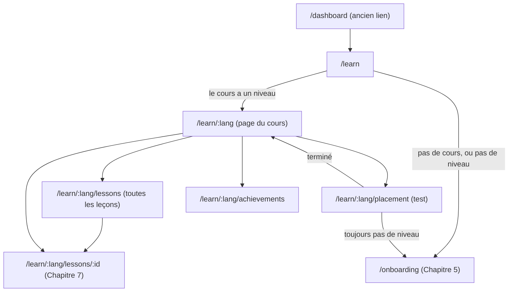
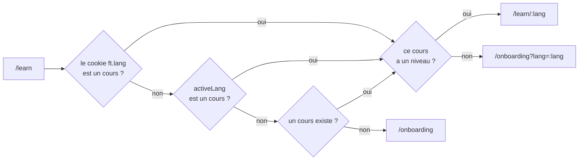
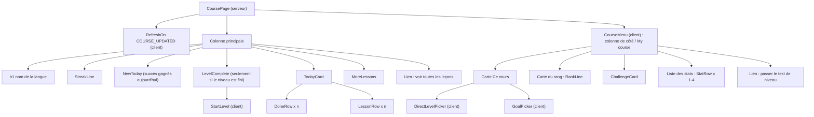
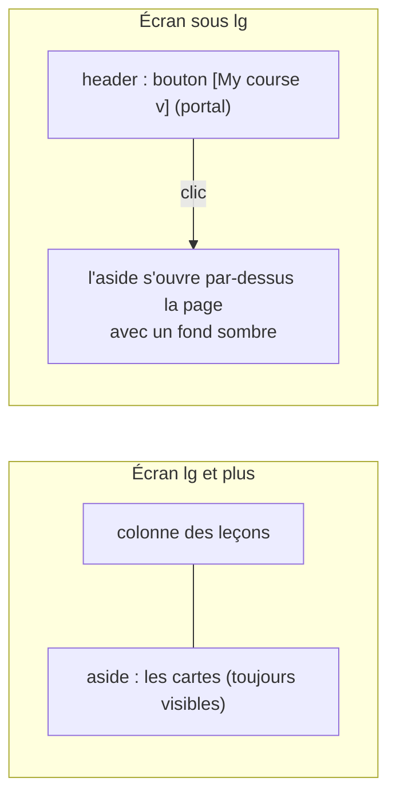
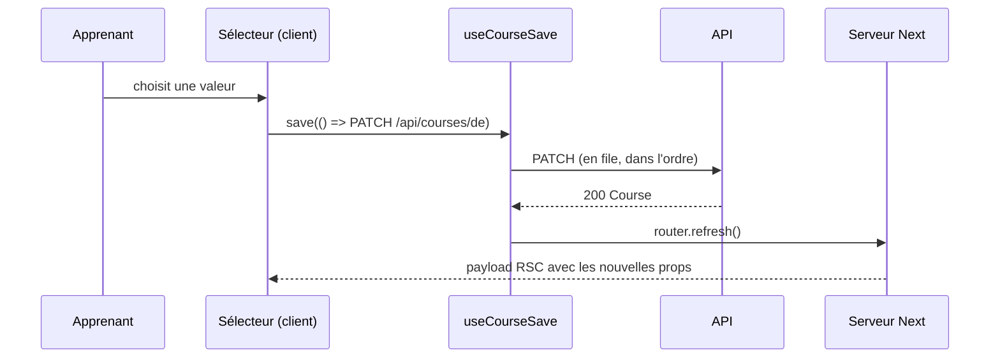
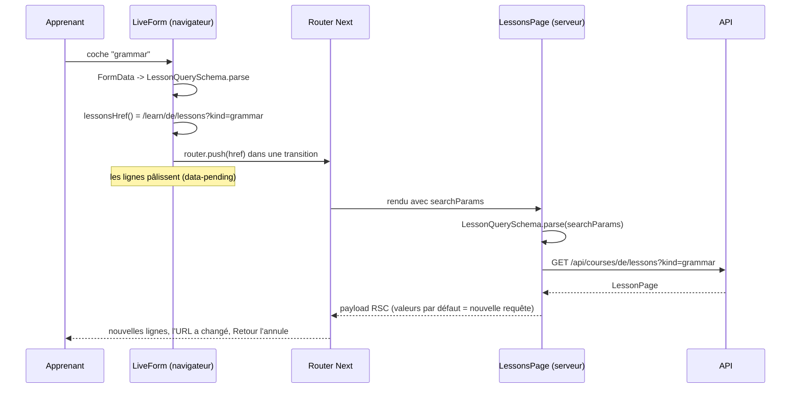
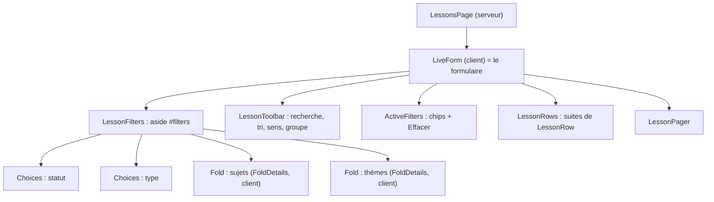
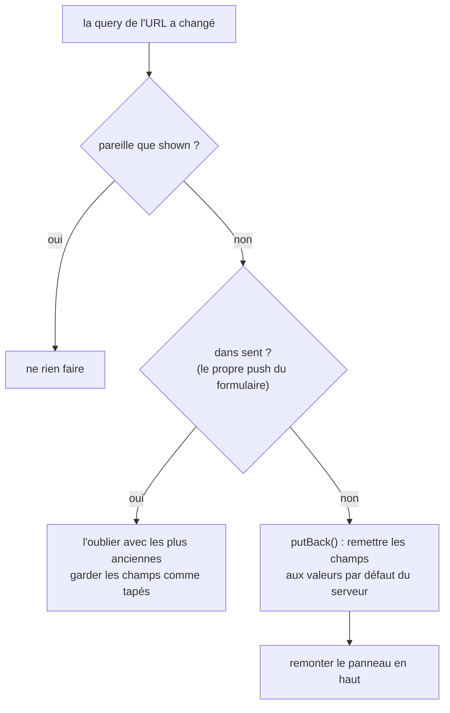
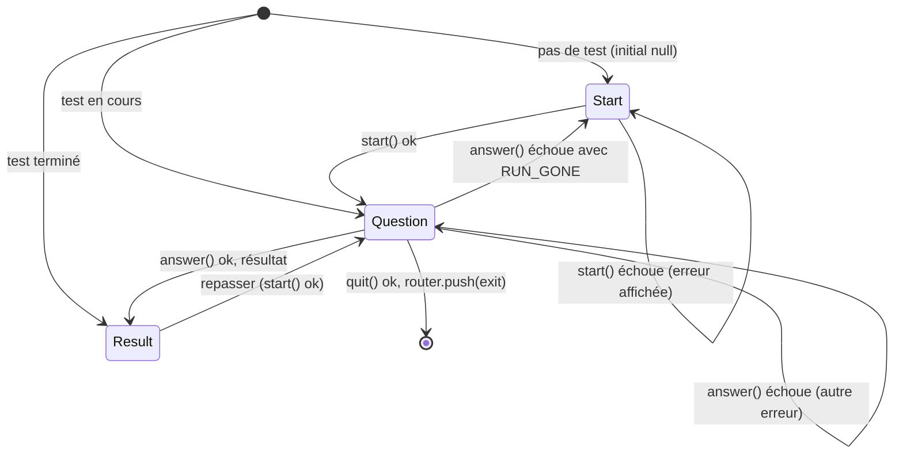

# Chapitre 6 — Les pages d'apprentissage : tableau de bord, cours et test de niveau

Dans ce chapitre :

- Le route group `(dashboard)` : son layout, et les anciennes pages d'entrée `/dashboard` et `/learn`.
- La page du cours `/learn/<lang>` : la carte Aujourd'hui, la série (streak), la colonne de côté (« My course »), les sélecteurs de niveau et d'objectif.
- La page des succès, avec ses règles.
- La page « toutes les leçons » : un formulaire de recherche dont les filtres vivent dans l'URL.
- Le test de niveau : une petite machine à états avec trois écrans.
- Les pièces partagées qu'elles utilisent : `CourseSwitcher`, `ChangeLevel`, `LevelPicker`, `gamification.tsx`, et les fichiers d'aide dans `lib/`.

Le lecteur de leçon lui-même (`learn/[lang]/lessons/[id]/**`) est dans le [Chapitre 7](07-lesson-player.md).

---

## 1. Vue d'ensemble

Imagine la page du cours comme l'accueil d'une salle de sport. Quand tu entres, l'accueil te dit
quoi faire **aujourd'hui** (ton objectif), montre ta **série** et ton **rang**, et a la liste de toutes
les machines (toutes les leçons). Il y a aussi une salle de test (le **test de niveau**) qui te dit à quel
niveau tu appartiens.

Voici les URL de ce chapitre. Elles sont toutes sous `app/[locale]/(dashboard)/`. Le dossier
`(dashboard)` est un **route group** (groupe de routes) : les parenthèses veulent dire « ce nom de dossier ne fait pas partie de
l'URL » (voir le [Chapitre 2](02-routing-layouts-i18n.md)). Il sert seulement à donner à ces pages un layout commun.

```
app/[locale]/(dashboard)/
├── layout.tsx                      la coque du cours (header, nav, footer)
├── dashboard/page.tsx              /dashboard        -> redirige vers /learn
└── learn/
    ├── page.tsx                    /learn            -> redirige vers le bon cours
    └── [lang]/
        ├── page.tsx                /learn/de         la page du cours
        ├── course-menu.tsx         colonne de côté / menu « My course »
        ├── today.tsx               carte Aujourd'hui, série, autres leçons, niveau terminé
        ├── direct-level-picker.tsx choix du niveau (A1..C2)
        ├── goal-picker.tsx         choix de l'objectif du jour (10/30/60 min)
        ├── start-level.tsx         bouton « Start A2 »
        ├── achievements/page.tsx   /learn/de/achievements
        ├── lessons/
        │   ├── page.tsx            /learn/de/lessons  (recherche + filtres)
        │   ├── live-form.tsx       le formulaire qui met à jour l'URL pendant la saisie
        │   ├── lesson-list.tsx     filtres, barre d'outils, chips, lignes, pagination
        │   ├── fold-details.tsx    un pli (<details>) pour les longues listes de filtres
        │   └── [id]/...            le lecteur de leçon (Chapitre 7)
        └── placement/
            ├── page.tsx            /learn/de/placement
            ├── placement-exam.tsx  la machine à états
            ├── start-screen.tsx
            ├── question-screen.tsx
            └── result-screen.tsx
```

Comment un apprenant passe de l'une à l'autre :



Deux sortes de composants apparaissent dans ce chapitre (voir le [Chapitre 1](01-react-and-nextjs.md)) :

| Sorte                                         | Où il tourne                                 | Utilisé ici pour                                                                                                               |
| --------------------------------------------- | -------------------------------------------- | ------------------------------------------------------------------------------------------------------------------------------ |
| **Server component** (pas de `'use client'`)  | Sur le serveur Next.js, une fois par requête | Les pages, la carte Aujourd'hui, les lignes de leçon, les cartes de gamification. Ils lisent l'API et envoient un payload RSC (du HTML au premier chargement). |
| **Client component** (`'use client'` en haut) | Aussi dans le navigateur                     | Tout ce qui réagit aux clics ou aux touches : les sélecteurs, le menu du cours, le formulaire live, le test de niveau.         |

Une règle que tu verras encore et encore : **le serveur affiche la vérité, le client envoie seulement un
changement puis demande au serveur d'afficher à nouveau** (`router.refresh()`). Donc la plupart du state vit dans la
base de données, pas dans React.

---

## 2. La coque : `(dashboard)/layout.tsx`

Fichier : [layout.tsx](<../../apps/web/app/[locale]/(dashboard)/layout.tsx>)

Chaque page de ce groupe est dessinée dans ce layout. C'est un server component (il est `async`).

```tsx
export default async function DashboardLayout({ children }: { children: ReactNode }) {
  // Only reads the session: the pages decide what a signed-out visitor gets.
  const user = await currentUser();

  return (
    <>
      {user ? <TimeZoneSync storedTimeZone={user.timeZone} /> : null}
      {user ? <LocaleSync storedLocale={user.locale} /> : null}
      <Shell
        brand={
          <>
            <Wordmark href="/learn" />
            {/* The course page puts its My course button here, below lg. */}
            <div id={COURSE_MENU_SLOT} className="contents" />
          </>
        }
        nav={<DashboardNav />}
        fill
        footer={<LegalFooter />}
      >
```

Ce qu'il fait :

- `currentUser()` lit la session. Le layout n'envoie **pas** le visiteur vers `/login` ; chaque page
  le fait elle-même (le commentaire dit pourquoi : « the pages decide », les pages décident).
- `TimeZoneSync` et `LocaleSync` sont de petits helpers du [Chapitre 3](03-shell-components.md). Ils
  gardent le fuseau horaire et la langue de l'interface de l'utilisateur dans la base de données en accord avec le navigateur.
- `Shell` est le cadre de la page (Chapitre 3). `fill` le fixe à la hauteur de l'écran à partir du breakpoint
  `lg` (un écran large), donc chaque panneau de page défile tout seul.
- `nav={<DashboardNav />}` est la nav du header avec le **sélecteur de cours** (section 9).
- Le `<div id={COURSE_MENU_SLOT}>` vide est un **slot** : une place vide dans le header. La page du
  cours y met plus tard son bouton « My course » (section 4.5). `className="contents"` rend le
  div lui-même invisible pour la mise en page, donc le bouton à l'intérieur se comporte comme un enfant direct du header.

### `lib/course-menu-slot.ts`

Fichier : [course-menu-slot.ts](../../apps/web/lib/course-menu-slot.ts)

```ts
/**
 * The header element the course page's My course button is portalled into.
 * Its own module: a constant exported from a 'use client' file reaches a
 * server component as a client reference, not as the string.
 */
export const COURSE_MENU_SLOT = 'course-menu-slot';
```

Une seule chaîne. Pourquoi un fichier à part ? Le layout (serveur) et `course-menu.tsx` (client) en ont tous les deux
besoin. Si la constante vivait dans le fichier `'use client'`, le serveur ne recevrait pas la chaîne,
seulement une « client reference » (un pointeur vers du code client). Un fichier simple sans `'use client'` donne
aux deux côtés la vraie chaîne.

---

## 3. Les pages d'entrée : `/dashboard` et `/learn`

### `dashboard/page.tsx`

Fichier : [dashboard/page.tsx](<../../apps/web/app/[locale]/(dashboard)/dashboard/page.tsx>)

```tsx
/** Kept so old links and bookmarks still land somewhere. */
export default function DashboardPage() {
  redirect('/learn');
}
```

L'app avait avant une page `/dashboard`. Maintenant elle fait seulement une redirection, donc les anciens favoris marchent encore.

### `learn/page.tsx`

Fichier : [learn/page.tsx](<../../apps/web/app/[locale]/(dashboard)/learn/page.tsx>)

```tsx
/** Reads the session, the courses and the ft.lang cookie on every request. */
export const dynamic = 'force-dynamic';

/** Where sign-in and the home links go. Renders nothing: it only picks the page. */
export default async function LearnPage() {
  const courses = await requireCourses();
  const cookieLang = (await cookies()).get(COURSE_COOKIE)?.value;

  redirect(landingPath(cookieLang, courses));
}
```

- `dynamic = 'force-dynamic'` dit à Next.js : ne mets jamais cette page en cache, construis-la à chaque requête
  (elle dépend de l'utilisateur et d'un cookie).
- `requireCourses()` (de `lib/courses.ts`, Chapitre 4) demande à l'API les cours de l'utilisateur. Si
  l'utilisateur n'est pas connecté, il l'envoie vers `/login`.
- Elle lit le cookie `ft.lang` : le dernier cours ouvert dans ce navigateur.
- `landingPath()` choisit où aller. Elle essaie, dans l'ordre : le cookie, puis `activeLang` (la
  mémoire du serveur, utile sur un deuxième appareil), puis le premier cours. Un cours sans niveau
  va vers `/onboarding?lang=..` ; aucun cours du tout va vers `/onboarding`.



### `lib/course-path.ts`

Fichier : [course-path.ts](../../apps/web/lib/course-path.ts)

```ts
/** The course last opened here. What NEXT_LOCALE is for the interface. */
export const COURSE_COOKIE = 'ft.lang';

/** Anchored on /learn: the locale prefix is a two-letter segment too. */
export function learnPathLang(pathname: string): string | null {
  return /\/learn\/([a-z]{2})(?:\/|$)/.exec(pathname)?.[1] ?? null;
}

/**
 * The course home and nothing under it. Next prefetches the links on a course
 * page, and those sit under /learn/<lang> too, so the looser match would let a
 * link the learner merely saw record itself as the course they opened.
 */
export function courseHomeLang(pathname: string): string | null {
  return /^\/(?:[a-z]{2}\/)?learn\/([a-z]{2})\/?$/.exec(pathname)?.[1] ?? null;
}
```

Trois exports :

| Export                 | Sens                                                                                                                                                                                   | Utilisé par                    |
| ---------------------- | -------------------------------------------------------------------------------------------------------------------------------------------------------------------------------------- | ------------------------------ |
| `COURSE_COOKIE`        | Le nom du cookie `ft.lang`. Comme `NEXT_LOCALE` garde la langue de l'interface, celui-ci garde la langue du cours.                                                                     | `learn/page.tsx`, `proxy.ts`   |
| `learnPathLang(path)`  | Le code du cours dans n'importe quelle URL `/learn/xx/...`, donc `/fr/learn/de/lessons` donne `de`. La regex commence à `/learn/` parce que la locale (`/fr`) fait aussi deux lettres. | `CourseSwitcher`               |
| `courseHomeLang(path)` | Seulement l'accueil du cours (`/learn/de` ou `/fr/learn/de`), rien en dessous.                                                                                                         | `proxy.ts`, qui pose le cookie |

Pourquoi deux regex ? `proxy.ts` (Chapitre 2) écrit le cookie quand tu ouvres l'accueil d'un cours. Next.js
**prefetch** les liens (il les charge en arrière-plan avant que tu cliques). Si le cookie était posé pour
n'importe quelle URL `/learn/de/...`, un lien que tu as seulement _vu_ pourrait changer ton « dernier cours ». La regex stricte
empêche ça. Le fichier « n'importe rien » : son commentaire dit que le middleware (`proxy.ts`) et un client
component (`CourseSwitcher`) le lisent tous les deux.

---

## 4. La page du cours : `learn/[lang]/page.tsx`

Fichier : [learn/[lang]/page.tsx](<../../apps/web/app/[locale]/(dashboard)/learn/[lang]/page.tsx>)

C'est la page principale de l'app. C'est un server component. D'abord, l'arbre de ce qu'elle dessine :



### 4.1 Les guards, dans l'ordre

```tsx
export default async function CoursePage({ params }: { params: Promise<{ lang: string }> }) {
  // First, so an anonymous visitor gets /login and not a 404 or onboarding.
  const { courses } = await requireCourses();

  const { lang } = await params;
  const t = await getTranslations('Course');
  const languageName = await getTranslations('Languages');

  // Not a learnable language is a wrong URL, not a course still to start.
  const parsed = LanguageSchema.safeParse(lang);
  if (!parsed.success) {
    notFound();
  }

  // Only this page, not a layout: placement below it must stay reachable.
  const course = findCourse(courses, parsed.data);
  if (course === null || course.level === null) {
    redirect(`/onboarding?lang=${parsed.data}`);
  }

  // Once, after the guard: a course that cannot open never asks for its day.
  const today = await loadToday(course.lang);
  if (today === 'signed-out') {
    redirect('/login');
  }
```

Un **guard** (garde) est une vérification en haut d'une page qui envoie le visiteur ailleurs quand la page
ne peut pas être affichée. L'ordre compte :

1. `requireCourses()` d'abord : un visiteur non connecté va vers `/login`, avant toute autre vérification.
2. `LanguageSchema.safeParse(lang)` : `lang` vient de l'URL, donc ça peut être n'importe quoi.
   `/learn/xx` n'est pas une langue, donc c'est une 404 (`notFound()`).
3. Pas de cours pour cette langue, ou un cours sans niveau : on va vers l'onboarding.
   Le commentaire dit pourquoi cette vérification est dans la page et pas dans un layout : la page du test de niveau est
   _sous_ `/learn/<lang>`, et un apprenant sans niveau doit quand même pouvoir l'atteindre.
4. `loadToday()` lit `GET /api/courses/:lang/today` (dans `lib/lessons.ts`). Si la session s'est terminée
   entre les deux lectures, la réponse est `'signed-out'` et on va vers `/login`.

`generateMetadata` construit le titre de l'onglet du navigateur (« German course »). Son commentaire explique pourquoi il
n'appelle **pas** `notFound()` : il pourrait entrer en course avec la redirection `/login` de la page, donc seule la page
décide de la 404.

### 4.2 Ce que contient `today`

`today` suit `TodaySchema` de `packages/shared`. En bref :

| Champ                            | Sens                                                                                         |
| -------------------------------- | -------------------------------------------------------------------------------------------- |
| `day`                            | Le jour de cours (une date comme `2026-03-03`)                                               |
| `target`, `met`                  | Combien de leçons l'objectif du jour demande, et si ce nombre est atteint                    |
| `done`, `proposed`, `extra`      | Les leçons finies aujourd'hui, celles proposées jusqu'à l'objectif, et d'autres après        |
| `streak`                         | `current`, `best`, et `today` (est-ce qu'aujourd'hui compte déjà ?)                          |
| `progress`                       | Les compteurs du niveau : `total`, `attempted`, `passed`, `needed`, `comingSoon`, `complete` |
| `levelAfter`                     | Le niveau suivant, ou `null` après C2                                                        |
| `xp`, `challenge`, `earnedToday` | Le rang et l'XP, le défi du jour, les succès gagnés aujourd'hui                              |

### 4.3 Les deux colonnes

```tsx
  const { progress } = today;
  // No ready lesson in the level: nothing to propose, so no goal to reach.
  const empty = progress.total === 0;

  return (
    <div className="flex h-full min-h-0 flex-col gap-6 lg:flex-row">
      {/* Any course's change, not only this one's: the switcher lists them all. */}
      <RefreshOn events={[SERVER_EVENTS.COURSE_UPDATED]} />
```

- `empty` : un niveau peut n'avoir encore aucune leçon prête. Alors la page montre seulement le message « Lessons for this level are on their way. »
  (les leçons de ce niveau arrivent) à la place de la carte Aujourd'hui, du défi, et des stats « tentées » et « réussies ».
- `RefreshOn` (Chapitre 3) écoute le socket. Quand le serveur dit `COURSE_UPDATED` (par
  exemple le niveau a changé dans un autre onglet), la page s'affiche à nouveau.

La colonne principale contient le titre, `StreakLine`, `NewToday`, puis, si ce n'est pas vide :
`LevelComplete` (seulement quand `progress.complete`), `TodayCard`, `MoreLessons`, et un lien « See all N
lessons » vers `/learn/<lang>/lessons`. Note le `prefetch={false}` sur ce lien : Next.js ne doit pas
charger la grosse liste juste parce que le lien est à l'écran.

La deuxième colonne est enveloppée dans `<CourseMenu>`. Elle contient cinq cartes :

1. **Ce cours** : `DirectLevelPicker` et `GoalPicker` (ce sont tous les deux des réglages du cours, donc ils sont ensemble).
2. **Rang** : `RankLine` de `gamification.tsx`.
3. **Défi** : `ChallengeCard` (caché quand `empty`).
4. **Stats** : une liste de `StatRow`.
5. Une carte avec un lien vers le **test de niveau**.

### 4.4 `StatRow` et `t.rich`

```tsx
              <StatRow icon="passed">
                {t.rich('passed', {
                  passed: progress.passed,
                  total: progress.total,
                  needed: progress.needed,
                  b: strong,
                })}
              </StatRow>
```

`t.rich` est la fonction de next-intl pour un message avec des balises dedans. Le texte du message dans
`messages/en.json` contient `Passed <b>{passed}</b> of {total}, {needed} needed`, et `b: strong`
dit « dessine `<b>` avec cette fonction » :

```tsx
/** A stat's number, set apart from the words around it. */
const strong = (chunks: ReactNode) => (
  <strong className="font-semibold text-slate-100 tabular-nums">{chunks}</strong>
);
```

`STAT_ICONS` associe chaque stat (`attempted`, `passed`, `comingSoon`, `streak`) à une couleur et à un chemin
SVG, et `StatRow` dessine l'icône puis le texte. La ligne « coming soon » (bientôt) ne s'affiche que quand certaines leçons
ne sont pas encore prêtes ; la ligne de la meilleure série s'affiche toujours. Donc la liste a de 1 à 4 lignes.

### 4.5 `course-menu.tsx` : une colonne, deux apparences

Fichier : [course-menu.tsx](<../../apps/web/app/[locale]/(dashboard)/learn/[lang]/course-menu.tsx>)

Sur un écran large (`lg` et plus), les cartes sont simplement une colonne à droite. Sur un téléphone, une colonne
sous toutes les leçons serait très longue, donc les cartes **se replient derrière un bouton « My course »** dans le
header, et s'ouvrent par-dessus la page comme un menu.



Le bouton est dessiné avec un **portal**. Un portal (`createPortal`) permet à un composant de dessiner une partie de son
HTML à un autre endroit de la page. Ici, le bouton est écrit dans `CourseMenu`, mais il apparaît
dans le slot du header de la section 2 :

```tsx
  const [slot, setSlot] = useState<HTMLElement | null>(null);
  // Open for the page it was opened on, as the account menu: a link closes it.
  const [openOn, setOpenOn] = useState<string | null>(null);
  const open = openOn === pathname;
  useScrollLock(open);

  useEffect(() => {
    setSlot(document.getElementById(COURSE_MENU_SLOT));
  }, []);
```

- `slot` commence à `null`. C'est seulement dans le navigateur, après le premier rendu (`useEffect`), qu'on peut trouver
  l'élément du header par son id. Avant ça, aucun bouton n'est dessiné.
- `openOn` garde le **chemin** sur lequel le menu a été ouvert, pas juste `true`. Quand l'apprenant
  suit un lien dans le menu, le chemin change, `open` devient `false`, et le menu se ferme
  tout seul. Pas besoin de code en plus.
- `useScrollLock(open)` (Chapitre 3) empêche la page derrière de défiler pendant que le menu est ouvert.

Un deuxième effet ferme le menu sur un clic à l'extérieur (`pointerdown` ni dans le bouton ni dans le panneau)
ou sur `Escape` (et remet alors le focus sur le bouton, pour les utilisateurs du clavier).

Le panneau lui-même est toujours dans le HTML. Les classes CSS font le reste :

```tsx
      <aside
        ref={panel}
        id={panelId}
        className={`${className} ${open ? '' : 'max-lg:hidden'} max-lg:fixed max-lg:top-16 max-lg:z-50 ...`}
      >
        {children}
      </aside>
```

`max-lg:` veut dire « seulement sous `lg` ». Donc sous `lg`, l'aside est caché sauf si `open`, et quand il est ouvert il
est `fixed` par-dessus la page. À partir de `lg`, aucune de ces classes ne s'applique, et c'est une colonne normale.

Encore un détail : le `Wordmark` du header (le nom de l'app, dans `shell.tsx`) se cache sous `lg`
tant qu'un `[data-course-menu-button]` existe dans la page (CSS `:has()`). Donc sur un téléphone, le bouton « My
course » prend la place du nom de l'app. Avant que le bouton soit monté, le nom s'affiche encore.

### 4.6 `today.tsx` : la carte Aujourd'hui et ses amis

Fichier : [today.tsx](<../../apps/web/app/[locale]/(dashboard)/learn/[lang]/today.tsx>)

Que des server components. Exports : `StreakLine`, `TodayCard`, `MoreLessons`, `LevelComplete`.

**`StreakLine`** choisit une phrase parmi trois :

```tsx
  if (streak.current === 0) {
    return <p className="text-slate-400">{t('streakStart')}</p>;
  }
  return (
    <p className="text-slate-400">
      {t(streak.today ? 'streakToday' : 'streakKeep', { count: streak.current })}
    </p>
  );
```

« Reach your daily goal to start a streak. », « 3 day streak, today included. », ou « 3 day streak.
Reach your daily goal to keep it. » (atteins ton objectif du jour pour commencer une série / série de 3 jours,
aujourd'hui compris / série de 3 jours, atteins ton objectif du jour pour la garder).
`count` va dans un message ICU avec pluriel (`{count, plural, ...}`).

**`TodayCard`** est l'objectif du jour :

```tsx
  const t = await getTranslations('Course');
  const [next, ...rest] = today.met ? [] : today.proposed;
```

- Si l'objectif est atteint, rien n'est proposé (`next` vaut `undefined`).
- Sinon, la première leçon proposée (`next`) reçoit le bouton **principal** (« Start »), les autres
  (`rest`) un bouton secondaire. Un badge « Next up » (À suivre) est au-dessus.
- L'en-tête dit « Daily goal reached » ou « 30 min goal: 1 of 3 lessons », avec une `ProgressBar` (du
  package `@ft/ui`) de `done.length` sur `target`.
- Les leçons finies sont listées avec `DoneRow`, puis les propositions avec `LessonRow`.

Le commentaire explique un cas délicat : si l'apprenant augmente l'objectif après l'avoir atteint, `met` redevient
false, donc la carte montre les lignes finies par rapport au nouvel objectif et propose le reste.

**Petits helpers** dans le fichier :

| Helper       | Ce qu'il dessine                                                                                                                                               |
| ------------ | -------------------------------------------------------------------------------------------------------------------------------------------------------------- |
| `LessonText` | Le titre et le résumé avec `lang={lang}`, pour qu'un lecteur d'écran les lise avec la voix de la langue du cours.                                              |
| `CheckIcon`  | Une coche (réussi) ou une flèche en cercle (réessayer). La forme change, pas seulement la couleur, pour les personnes daltoniennes.                            |
| `DoneRow`    | Une leçon finie aujourd'hui : le score si elle est réussie, ou une ligne « Not passed yet, best 45%. Counts for today. » en ambre. Un badge de niveau si la leçon vient d'un autre niveau.     |
| `LessonRow`  | Le numéro de position, le texte, « 10 min » (`LESSON_MINUTES`), et un bouton `Link`. `prefetch={false}` : une ligne seulement vue n'est pas une leçon ouverte. |

**`MoreLessons`** liste `today.extra` (les leçons au-delà de l'objectif) avec un bouton « Open », et renvoie
`null` quand il n'y en a pas.

**`LevelComplete`** s'affiche quand chaque leçon prête du niveau a été essayée et que assez de leçons ont été réussies :

```tsx
      {levelAfter === null ? null : (
        <div className="flex flex-wrap items-center gap-4">
          <StartLevel lang={lang} level={levelAfter} />
          <Link
            href={`/learn/${lang}/placement`}
```

Après C2 (`levelAfter === null`), il félicite seulement. Sinon il propose « Start B1 » et le
test de niveau.

### 4.7 Enregistrer les réglages du cours : `useCourseSave`

Les trois client components des sections suivantes (`StartLevel`, `GoalPicker`,
`DirectLevelPicker`) enregistrent avec le même hook, `useCourseSave` de `lib/use-course-save.ts`
(Chapitre 4). Il fait trois choses : lancer l'écriture (l'une après l'autre, dans l'ordre), transformer un code d'erreur
en phrase, puis appeler `router.refresh()` pour que le serveur affiche à nouveau la page avec le nouveau
réglage. Il renvoie `{ pending, error, save }`, et `save()` répond `true` ou `false`.



### 4.8 `start-level.tsx`

Fichier : [start-level.tsx](<../../apps/web/app/[locale]/(dashboard)/learn/[lang]/start-level.tsx>)

```tsx
/** "Start A2" on the level complete card: the same write as the level picker. */
export function StartLevel({ lang, level }: { lang: Language; level: Level }) {
  const t = useTranslations('Course');
  const { pending, error, save } = useCourseSave();

  return (
    <div className="flex flex-col gap-2">
      <button
        type="button"
        onClick={() => save(() => setCourseLevel(lang, { level }))}
        disabled={pending}
```

Un seul bouton. `setCourseLevel` (dans `lib/courses-client.ts`) envoie le nouveau niveau à l'API. Pendant
`pending`, le bouton est désactivé pour qu'il ne puisse pas envoyer deux fois.

### 4.9 `goal-picker.tsx` : enregistre au changement

Fichier : [goal-picker.tsx](<../../apps/web/app/[locale]/(dashboard)/learn/[lang]/goal-picker.tsx>)

Un `<select>` avec les trois `DAILY_GOALS` (10, 30, 60 minutes par jour).

```tsx
  const [value, setValue] = useState(dailyGoal);
  const latest = useRef(0);

  useEffect(() => setValue(dailyGoal), [dailyGoal]);

  async function onChange(event: React.ChangeEvent<HTMLSelectElement>) {
    const next = Number(event.target.value) as DailyGoal;

    setValue(next);
    const pick = ++latest.current;
    const saved = await save(() =>
      clientPatch(CourseSchema, `/api/courses/${lang}`, { dailyGoal: next }),
    );
    if (!saved && pick === latest.current) {
      setValue(dailyGoal);
    }
  }
```

- La nouvelle valeur s'affiche **tout de suite** (`setValue(next)`), avant que le serveur réponde. On appelle ça une
  _mise à jour optimiste_ (optimistic update).
- `latest` compte les choix. Si un enregistrement échoue, on revient à l'objectif enregistré, **mais seulement**
  si aucun choix plus récent n'est venu après (`pick === latest.current`). Sinon, c'est le choix plus récent que
  l'apprenant voit.
- `useEffect(() => setValue(dailyGoal), [dailyGoal])` : quand le serveur envoie un nouveau `dailyGoal`
  (après le refresh), le select le suit.
- Le select n'est jamais désactivé pendant l'enregistrement, donc le focus du clavier reste dessus.

### 4.10 `direct-level-picker.tsx` : enregistre avec un bouton

Fichier : [direct-level-picker.tsx](<../../apps/web/app/[locale]/(dashboard)/learn/[lang]/direct-level-picker.tsx>)

Le select du niveau (A1 à C2). Pourquoi ne pas enregistrer au changement comme l'objectif ? Le commentaire explique :

> Sur un select fermé, chaque flèche du clavier déclenche `change`, donc enregistrer au changement réécrirait le cours
> à chaque niveau qu'un utilisateur du clavier regarde.

Donc il y a un bouton « Save », affiché seulement quand le choix est différent du niveau enregistré :

```tsx
        {value === level ? null : (
          <button
            type="button"
            onClick={onSave}
            aria-disabled={pending}
```

Après un enregistrement, un `<p role="status">` caché dit « Level saved: B1 ». `role="status"` fait annoncer
le texte par les lecteurs d'écran, parce que la page s'affiche à nouveau sans déplacer le focus.

Note la différence avec `LevelPicker` (section 9) : ce select nomme **le niveau que le cours
enseigne**. `LevelPicker` demande **ce que l'apprenant maîtrise**. La progression dans l'ancien niveau est
gardée ; seules les propositions changent.

---

## 5. Gamification : `components/gamification.tsx` et `lib/achievements.ts`

Fichier : [gamification.tsx](../../apps/web/components/gamification.tsx)

Des server components sans state, « so a page without JavaScript shows it too » (pour qu'une page sans JavaScript les montre aussi). Exports :

| Export                   | Où il s'affiche                   | Ce qu'il dessine                                                          |
| ------------------------ | --------------------------------- | ------------------------------------------------------------------------- |
| `achievementTitle(code)` | helper                            | Le titre d'un succès, avec ses nombres remplis                            |
| `DoneMark`               | partout                           | Une coche verte dans un cercle                                            |
| `RankLine`               | page du cours, résultats de leçon | « Rank 3 · 397 of 600 XP », une barre, et un lien vers les règles         |
| `ChallengeCard`          | page du cours                     | Le défi du jour, son XP, et « Done » quand il est fait                    |
| `NewToday`               | page du cours                     | Des chips pour les succès gagnés aujourd'hui (aucun : rien n'est dessiné) |
| `FinishXp`               | résultats de leçon (Chapitre 7)   | La carte d'XP après une leçon                                             |

La barre de `RankLine` commence vide à chaque rang :

```tsx
      <ProgressBar
        value={xp.total - xp.rankStart}
        max={xp.nextRankAt - xp.rankStart}
        label={t('rankBar')}
      />
```

`ChallengeCard` : quand le défi est un type de leçon (grammaire, vocabulaire, fonctions, lecture), son
texte devient un lien vers les leçons de ce type, groupées par statut :

```tsx
          <Link
            href={`/learn/${lang}/lessons?kind=${challenge.code}&group=status`}
```

C'est un bon exemple de « filtres dans l'URL » (section 7) : n'importe quel lien peut ouvrir une vue filtrée.

`FinishXp` est utilisé par la page des résultats de leçon ; il utilise `xpBreakdown()` (de `lib/xp-breakdown.ts`)
pour lister les lignes d'XP (leçon, objectif, défi). Le Chapitre 7 l'explique dans son contexte.

Fichier : [achievements.ts](../../apps/web/lib/achievements.ts)

```ts
/** The messages' params for one achievement: its target, or its level. */
export function achievementParams(code: AchievementCode): Record<string, string | number> {
  const definition = ACHIEVEMENTS.find((achievement) => achievement.code === code)!;
  return 'level' in definition
    ? { level: definition.level, share: Math.round(LEVEL_PASS_SHARE * 100) }
    : { target: definition.target, mark: LESSON_PASS_MARK };
}

/** The XP a rank opens at: 0, 100, 300, 600… (rankOf in the API inverts it). */
export function rankStartOf(rank: number): number {
  return (RANK_STEP * rank * (rank - 1)) / 2;
}
```

- `achievementParams` donne les nombres pour le texte d'un succès. Le texte est dans les fichiers de
  messages, les nombres viennent des constantes partagées. Donc le texte correspond toujours à la règle que l'API
  applique (« Pass 10 lessons, each at 70% or more. », réussis 10 leçons, chacune à 70 % ou plus).
- `rankStartOf` donne où un rang commence. Avec `RANK_STEP = 100` : rang 1 à 0, rang 2 à 100,
  rang 3 à 300, rang 4 à 600. Chaque marche fait 100 de plus que la précédente.
- `loadAchievements(lang)` lit `GET /api/courses/:lang/achievements`. Une API indisponible lance une erreur
  (la page d'erreur s'affiche), un 401 renvoie `'signed-out'`.
- `loadXp(lang)` lit seulement l'`xp` depuis l'endpoint today, pour la page des résultats. Elle ne lance **jamais
  d'erreur** : la page des résultats peut vivre sans le rang.
- `achievementsPath(lang)` vaut `/learn/<lang>/achievements`.

### `achievements/page.tsx`

Fichier : [achievements/page.tsx](<../../apps/web/app/[locale]/(dashboard)/learn/[lang]/achievements/page.tsx>)

Les mêmes guards que la page du cours (cours, langue, niveau), puis un seul appel à l'API. Comme la page
du cours, elle a `RefreshOn` pour `COURSE_UPDATED`. Ensuite :

- Un lien « Back to course » (retour au cours) vers `/learn/<lang>`.
- Un résumé « 5 of 16 earned » avec une barre.
- Les succès en quatre groupes : `lessons`, `streaks`, `challenges`, `levels`.
- Une colonne de côté `HowItWorks` avec toutes les règles.

Le groupe d'un succès est trouvé à partir de sa définition :

```tsx
function groupOf(code: AchievementCode): Group {
  const definition = ACHIEVEMENTS.find((achievement) => achievement.code === code)!;
  if ('level' in definition) return 'levels';
  switch (definition.stat) {
    case 'bestStreak':
      return 'streaks';
    case 'challengesDone':
      return 'challenges';
    default:
      return 'lessons';
  }
}
```

Le commentaire sur `GROUPS` note que chaque groupe est une suite continue dans le catalogue, donc filtrer garde
l'ordre de l'API.

`AchievementCard` dessine un succès. Gagné : vert, avec `DoneMark` et « Earned on March 3,
2026 » (`dateStyle: 'long'`). Pas gagné : gris, avec une barre `current / target` et une phrase de progression. La date est un
**jour de cours** (une date du calendrier comme `2026-03-03`), pas un instant. Donc elle est formatée en UTC, et
elle ne bouge jamais d'un jour pour un lecteur dans un autre fuseau horaire.

`HowItWorks` liste les règles d'XP (`LESSON_XP`, 1 XP par point ajouté à ton meilleur score, `GOAL_XP`, `CHALLENGE_XP`), les rangs 1 à 6 avec
`rankStartOf`, les défis, et deux notes sur les succès. Chaque nombre vient des constantes
partagées, donc rien n'est tapé deux fois. `RuleRow` est une ligne d'une grille `<dl>` (la règle à gauche,
le montant à droite). La section a `tabIndex={0}` pour que le clavier de Safari puisse la faire défiler.

---

## 6. Les helpers de niveau : `lib/level.ts`

Fichier : [level.ts](../../apps/web/lib/level.ts)

L'app demande « qu'est-ce que tu **maîtrises** ? » puis enseigne **le niveau au-dessus**. Ce fichier contient
cette règle.

```ts
export const BEGINNER = 'A0';

/** What a learner can claim to have mastered. Null is the beginner. */
export const MASTERY_OPTIONS = [null, ...LEVELS] as const;

export function nextLevel(mastered: Level | null): Level {
  if (mastered === null) {
    return LEVELS[0];
  }
  const next = LEVELS[LEVELS.indexOf(mastered) + 1];

  return next === undefined ? mastered : next;
}

export function masteredBelow(level: Level): Level | null {
  const index = LEVELS.indexOf(level);

  return index === 0 ? null : LEVELS[index - 1];
}
```

| Maîtrisé (choix)              | A0 (`null`) | A1  | A2  | B1  | B2  | C1  | C2  |
| ----------------------------- | ----------- | --- | --- | --- | --- | --- | --- |
| `nextLevel` (niveau du cours) | A1          | A2  | B1  | B2  | C1  | C2  | C2  |

- `A0` n'est pas un vrai niveau et n'est jamais enregistré. C'est la façon dont le sélecteur dit « rien encore ». C'est le
  seul moyen d'avoir un cours A1.
- C2 donne lui-même : il n'y a rien au-dessus.
- `masteredBelow` fait l'inverse, utilisé pour montrer un niveau de cours enregistré comme un choix. Un cours C2 se lit
  comme « C1 maîtrisé ».

Les tests dans `level.test.ts` vérifient ces cas limites (A0 donne A1, C2 reste C2, A1 se lit comme débutant, C2 se lit
comme C1).

---

## 7. Toutes les leçons : recherche et filtres dans l'URL

La page `/learn/<lang>/lessons` liste toutes les leçons du niveau, avec une barre de recherche, des filtres
(statut, type, sujet, thème), le tri, le sens, le groupe et les pages.

La grande idée : **l'URL est le state**. Chaque vue est une URL comme
`/learn/de/lessons?kind=grammar&status=failed&sort=score&page=2`. Donc Retour, Actualiser, partager un lien
et même un navigateur **sans JavaScript** marchent tous. Le formulaire est un simple formulaire HTML `GET` ; avec
JavaScript, `LiveForm` lui fait mettre à jour l'URL pendant que tu tapes.



Sans JavaScript, la même boucle se passe avec le bouton « Apply » : le navigateur envoie lui-même le
formulaire `GET`, et l'URL change de la même façon.

### 7.1 `lib/lesson-list.ts`

Fichier : [lesson-list.ts](../../apps/web/lib/lesson-list.ts)

```ts
/** What a query reads as when the URL says nothing: the API's defaults. */
const DEFAULTS = LessonQuerySchema.parse({});

export function lessonQueryParams(query: LessonQuery): Record<string, string> {
  const params: Record<string, string> = {};
  for (const [key, value] of Object.entries(query)) {
    const text = Array.isArray(value) ? value.join(',') : String(value);
    const fallback = DEFAULTS[key as keyof LessonQuery];
    if (text !== (Array.isArray(fallback) ? fallback.join(',') : String(fallback))) {
      params[key] = text;
    }
  }
  return params;
}

/** The all lessons page at this query. */
export function lessonsHref(lang: string, query: LessonQuery): string {
  const search = new URLSearchParams(lessonQueryParams(query)).toString();
  return `/learn/${lang}/lessons${search === '' ? '' : `?${search}`}`;
}
```

- `LessonQuerySchema` (dans `packages/shared`) est un schema zod. Chaque champ a une valeur par défaut `.catch()`
  (`sort` revient à `position`, `page` à 1, les listes à vide...). Donc `parse({})` donne les
  valeurs par défaut, et une mauvaise URL tapée à la main donne quand même une requête valide.
- `lessonQueryParams` transforme une requête en paramètres d'URL et **laisse de côté les valeurs par défaut**, donc les liens restent
  courts et la vue par défaut est simplement `/lessons`. Les listes sont jointes avec des virgules.
- `lessonsHref` construit le lien complet. Il est utilisé par le formulaire, les chips et la pagination.
- `groupKey(card, group)` donne l'en-tête sous lequel une ligne se trouve : son statut, son type, ou son jour
  (`todo` si jamais finie, `soon` si pas prête).
- `groupRows(cards, group)` découpe les lignes en **suites** (runs) avec la même clé, dans l'ordre où l'API
  les a triées. Un en-tête se place avant la première ligne et partout où la clé change.
- `previousDay(day)` donne le jour d'avant, en UTC, pour afficher « Yesterday ».

`lesson-list.test.ts` teste chaque fonction (valeurs par défaut laissées de côté, listes à virgules, suites, un 29 février).

`lib/lessons.ts` contient `loadLessonPage(lang, query)`, qui appelle l'API avec
`lessonQueryParams(query)`, et `lessonPath(lang, id)`, le lien vers une leçon.

### 7.2 `lessons/page.tsx`

Fichier : [lessons/page.tsx](<../../apps/web/app/[locale]/(dashboard)/learn/[lang]/lessons/page.tsx>)

Les trois mêmes guards que la page du cours. Ensuite :

```tsx
  // Every field falls back to its default, so a hand-edited URL shows the
  // default view, and the form shows what the API applies.
  const query = LessonQuerySchema.parse(await searchParams);
  const page = await loadLessonPage(course.lang, query);
  if (page === 'signed-out') {
    redirect('/login');
  }
  // The page really shown: past the end, the API gives the last one.
  const shown = { ...query, page: page.page };
```

`searchParams` est la query string de l'URL. La page la parse avec le schema partagé, interroge
l'API, et utilise `shown` (le numéro de page que l'API a vraiment utilisé) pour le formulaire et les liens.

```tsx
        <LiveForm
          lang={course.lang}
          className="group flex flex-col gap-6 lg:flex-row lg:items-start lg:gap-10"
        >
          <LessonFilters query={shown} />
          <section aria-label={t('results')} className="flex min-w-0 flex-1 flex-col gap-4">
            <LessonToolbar query={shown} total={page.total} />
            <ActiveFilters lang={course.lang} query={shown} />
            {page.total === 0 ? (
```

Un seul formulaire enveloppe les deux colonnes : les filtres sur le côté, la barre d'outils et les lignes à droite. Sans résultat,
un message vide s'affiche ; sinon `LessonRows` et `LessonPager`. Le div extérieur a
`data-scroll-pane` : à partir de `lg`, ce div est la partie qui défile (LiveForm le fait remonter en
haut après certaines navigations).

L'arbre de cette page :



### 7.3 `lessons/lesson-list.tsx`

Fichier : [lesson-list.tsx](<../../apps/web/app/[locale]/(dashboard)/learn/[lang]/lessons/lesson-list.tsx>)

Des server components qui dessinent les champs du formulaire et la liste. Les champs utilisent des valeurs **par défaut**
(`defaultChecked`, `defaultValue`), pas du state React contrôlé : le serveur fixe leur valeur de
départ à partir de la requête, et le navigateur s'en occupe ensuite. C'est ce qui permet au formulaire de marcher
sans JavaScript.

**`Choices`** : un filtre sous forme de cases à cocher, toutes avec le même `name` :

```tsx
          <input
            type="checkbox"
            name={name}
            value={option.value}
            defaultChecked={checked.includes(option.value)}
            className="size-4 shrink-0 accent-slate-100"
          />
```

Un formulaire GET envoie `kind=grammar&kind=reading`. Le schema lit ça comme `kind=grammar,reading`.

**`Fold`** : les sujets et les thèmes sont de longues listes, donc ils sont dans un pli (`FoldDetails`, 7.5) qui
commence ouvert seulement quand une de ses cases est cochée.

**`LessonFilters`** : la colonne des filtres (`<aside id="filters">`). Sur un écran large, c'est une colonne
sticky (qui reste collée). Sur un téléphone, c'est une **sheet** (un panneau qui glisse par-dessus la page depuis le bas), ouverte par
un lien vers `#filters`. Elle utilise le sélecteur CSS `:target` : un élément dont l'`id` correspond au hash de
l'URL (`#filters`) reçoit les classes `target:`. Donc la sheet s'ouvre **sans JavaScript** :

```tsx
      className="max-lg:hidden max-lg:target:fixed max-lg:target:inset-0 max-lg:target:z-50 max-lg:target:flex ..."
```

Le lien « Close » est `href="#"`, ce qui enlève le hash. Le bouton « Show the lessons » est un submit
avec `formAction="?"` et `data-close-sheet`. Le commentaire dit pourquoi `"?"` : un formulaire GET garderait le
`#filters` de la page et laisserait la sheet ouverte.

**`Select`** et **`LessonToolbar`** : la barre de recherche (`name="q"`, `type="search"`), un lien « Filters · 3 »
pour les téléphones, et trois selects (tri, sens, groupe). Le bouton « Apply » est dans
`<noscript>`, donc il ne s'affiche que quand JavaScript est désactivé. Le total (« 12 lessons ») est dans un
paragraphe `role="status"`, donc les lecteurs d'écran l'annoncent. Le commentaire de `Select` note qu'il n'a pas de
key basée sur sa valeur : un nouveau nœud DOM perdrait le focus du clavier.

**`ActiveFilters`** : chaque filtre actif sous forme de chip. Chaque chip est un simple **lien** vers la même vue
sans ce filtre :

```tsx
  const without = (patch: Partial<LessonQuery>) =>
    lessonsHref(lang, { ...query, ...patch, page: 1 });
```

Puis un lien « Clear filters » vers le simple `/learn/<lang>/lessons`. Les liens marchent sans JavaScript.

**`LessonRow`** : une leçon : `#position`, le titre et le résumé (avec `lang`), son type et son sujet ou
thème, un statut avec un point de couleur (`STATUS_DOT`, `STATUS_TEXT`), le jour et le meilleur score. Une leçon
prête est un grand lien vers la page de la leçon ; une leçon pas prête est grisée, sans lien.

**`LessonRows`** : utilise `groupRows()` et dessine une carte par suite, avec un en-tête sauf si
`group === 'none'`. Pour les groupes par jour, l'en-tête dit « Today », « Yesterday » ou une date. Son conteneur a
`group-data-pending:opacity-50` : pendant que `LiveForm` attend la vue suivante, le formulaire reçoit
`data-pending`, et les lignes pâlissent.

**`LessonPager`** : « 1 to 20 of 45 », puis Previous, les pages numérotées et Next. Chaque lien de page garde les
autres filtres (`lessonsHref(lang, { ...query, page: number })`). La page actuelle a
`aria-current="page"`.

`dayFormatter()` formate un jour de cours en UTC, comme la page des succès, pour qu'une date ne se décale jamais.

### 7.4 `lessons/live-form.tsx`

Fichier : [live-form.tsx](<../../apps/web/app/[locale]/(dashboard)/learn/[lang]/lessons/live-form.tsx>)

C'est le fichier le plus délicat du chapitre. C'est le `<form method="get">` lui-même, plus du
JavaScript qui applique chaque changement tout de suite.

**Appliquer un changement.** Tout événement `change` dans le formulaire appelle `apply()`. Taper dans la recherche
attend 250 ms (`SEARCH_DELAY_MS`), pour ne pas naviguer à chaque touche ; une case ou un select s'applique
tout de suite.

```tsx
  const apply = (delay: number) => {
    clearTimeout(timer.current);
    timer.current = setTimeout(() => {
      timer.current = undefined;
      if (form.current === null) return;
      const data = new FormData(form.current);
      // Repeated checkbox keys come as arrays, which the schema reads like comma lists.
      const query = LessonQuerySchema.parse({
        q: data.get('q'),
        status: data.getAll('status'),
        kind: data.getAll('kind'),
        topic: data.getAll('topic'),
        theme: data.getAll('theme'),
        sort: data.get('sort'),
        dir: data.get('dir'),
        group: data.get('group'),
      });
      const href = lessonsHref(lang, query);
```

Il lit le formulaire avec `FormData`, le parse avec le même schema, construit le lien avec
`lessonsHref`, et le pousse :

```tsx
      startTransition(() => router.push(`${href}${window.location.hash}`, { scroll: false }));
```

- `useTransition` donne `pending`, qui devient l'attribut `data-pending` (les lignes pâlissent).
- `router.push` ajoute une entrée dans l'historique, donc **Retour annule un changement**, comme après le Apply du
  formulaire simple.
- `{ scroll: false }` : la page ne saute pas en haut.
- Il garde `window.location.hash`, donc la sheet du téléphone (`#filters`) reste ouverte pendant que la liste se met à jour.
- Note qu'il n'y a pas de `page` dans les données du formulaire parsées : tout changement de filtre ramène à la page 1.

**Garder les champs en accord.** Les champs ne sont pas contrôlés (ils gardent leurs propres valeurs). Donc quand
l'URL change pour une autre raison (Retour, une chip, Clear filters), les champs doivent être remis aux
nouvelles valeurs par défaut envoyées par le serveur. Mais quand le changement d'URL est le **propre** push du formulaire, les champs doivent
rester comme ils ont été tapés (l'apprenant est peut-être encore en train de taper). Deux refs suivent ça :

- `shown` : la query string sur laquelle les champs ont été mis la dernière fois.
- `sent` : les query strings que ce formulaire a poussées et qui peuvent encore arriver.

```tsx
  useEffect(() => {
    const now = searchParams.toString();
    if (now === shown.current) return;
    shown.current = now;
    const own = sent.current.indexOf(now);
    if (own !== -1) {
      sent.current = sent.current.slice(own + 1);
      return;
    }
    putBack();
    // From lg the page scrolls in a pane, which a query-only navigation
    // leaves where it was: Next at the bottom would open page 2 at its end.
    // Not after the form's own changes: the box under the pointer would move.
    form.current?.closest('[data-scroll-pane]')?.scrollTo({ top: 0 });
  }, [searchParams, putBack]);
```

Quand l'URL change : si c'est une des nôtres, on la retire de `sent` avec les plus anciennes et on ne fait rien.
Sinon, `putBack()` remet le formulaire à zéro et le panneau remonte en haut.

`putBack()` vide `sent` et tout timer de recherche en attente, puis appelle `form.reset()`. Une astuce : React
fixe la valeur par défaut d'un `<select>` seulement au montage, donc `reset()` ramènerait une ancienne valeur. Alors
`putBack` déplace d'abord le `defaultSelected` de chaque select sur la valeur affichée.



**Autres effets :**

- Un listener `popstate` (Retour / Avancer) : si l'entrée a un state, `putBack()`. Retour peut tomber sur la
  vue déjà affichée, ce qui n'apporte pas de nouvelle requête pour l'effet du dessus. Une entrée sans state est un
  hash que le navigateur a déplacé tout seul ; Next l'ignore, donc le formulaire aussi.
- Au montage : si l'apprenant a changé un champ **avant** que JavaScript soit chargé (hydration), on l'applique maintenant.
- Au démontage : on vide le timer, pour qu'une recherche en attente ne navigue pas ailleurs plus tard.

**Le hash de la sheet du téléphone.** `moveHash()` ouvre ou ferme la sheet `#filters`. Le long commentaire
explique : si le navigateur déplace le hash tout seul, il crée une entrée d'historique sans le state de Next, et
Retour sur cette entrée ne fait rien dans Next. Donc `moveHash` fait `location.href = '#filters'` (ce qui fait
marcher `:target` ; `pushState` ne le ferait pas) puis `replaceState` copie l'ancien state dans la nouvelle
entrée. `moveSheet()` renvoie aussi le formulaire si un changement est encore en route, parce que ce changement
porte l'ancien hash et annulerait l'ouverture/fermeture en arrivant.

Le handler `onClick` attrape les liens `#filters` et `#` ; `onSubmit` gère « Show the lessons »
(il ferme seulement la sheet) et Entrée dans la recherche (applique tout de suite).

### 7.5 `lessons/fold-details.tsx`

Fichier : [fold-details.tsx](<../../apps/web/app/[locale]/(dashboard)/learn/[lang]/lessons/fold-details.tsx>)

Un élément `<details>` (un pli que le navigateur ouvre et ferme tout seul) dont le serveur
**suggère** seulement l'état ouvert.

```tsx
  const [open, setOpen] = useState(checked);
  // Adjusted while rendering, not in an effect: React's way to follow a prop.
  const [wasChecked, setWasChecked] = useState(checked);
  if (checked !== wasChecked) {
    setWasChecked(checked);
    if (checked) setOpen(true);
  }
```

- Il commence ouvert si une de ses cases est cochée.
- Si l'apprenant décoche la dernière case, le serveur affiche `checked = false`. Un simple attribut `open`
  venant du serveur **fermerait alors le pli sous le pointeur**. Ici, `checked` qui passe à false ne change
  rien : seul l'apprenant le ferme.
- Si une case devient cochée depuis ailleurs (Retour, un lien), il s'ouvre.
- `onToggle` garde `open` en accord avec les clics de l'apprenant.

Le pattern « ajuster le state pendant le rendu » (comparer avec la prop précédente, et changer le state pendant le
rendu) est la façon que la doc de React recommande pour suivre une prop sans effet en plus.

---

## 8. Le test de niveau

Le test de niveau est un test adaptatif : le serveur choisit chaque question à partir de tes réponses précédentes,
chaque question a un minuteur, et à la fin le serveur donne un niveau. La page montre seulement ce que le
serveur envoie.

### 8.1 `lib/placement-schema.ts`

Fichier : [placement-schema.ts](../../apps/web/lib/placement-schema.ts)

```ts
export const PlacementStateSchema = z.union([PlacementQuestionSchema, PlacementResultSchema]);

export type PlacementState = z.infer<typeof PlacementStateSchema>;

//We will know what type is returned saying state is PlacementResult, if report is not found it is not PlacementResult but PlacementQuestion
export function isPlacementResult(state: PlacementState): state is PlacementResult {
  return 'report' in state;
}
```

Chaque endpoint du test de niveau répond soit **une question**, soit **un résultat**. Le schema accepte les deux.
`isPlacementResult` est un **type guard** : une fonction dont le type de retour `state is PlacementResult`
dit à TypeScript « après que cette vérification est vraie, traite `state` comme un résultat ». Un résultat a un champ
`report` ; une question n'en a pas. Les tests dans `placement-schema.test.ts` vérifient les deux formes.

`lib/placement-client.ts` (Chapitre 4) contient les trois appels du navigateur : `startPlacement(lang)`
(`POST /api/placement`), `submitPlacementAnswer(questionId, choice)`
(`POST /api/placement/answers`) et `quitPlacement()` (`DELETE /api/placement`).

### 8.2 `placement/page.tsx`

Fichier : [placement/page.tsx](<../../apps/web/app/[locale]/(dashboard)/learn/[lang]/placement/page.tsx>)

Un server component. Ses guards sont différents de ceux de la page du cours :

```tsx
  // Unlike CoursePage, a null level is exactly who this page is for: placement
  // is what sets it. Only a language the learner does not study is sent back to
  // onboarding, where the course gets created.
  const course = findCourse(courses, parsed.data);
  if (course === null) {
    redirect(`/onboarding?lang=${parsed.data}`);
  }

  // A 404 is no run yet: the page offers the start control for it.
  const result = await apiFind(PlacementStateSchema, '/api/placement');
```

`apiFind` (Chapitre 4) est comme `apiGet` mais traite une 404 comme « pas trouvé » au lieu d'une erreur. Donc :
pas encore de test en cours, c'est normal, et la page montre l'écran de départ. Un 401 (la session s'est
terminée entre les deux lectures) va vers `/login`, et une API indisponible lance une erreur (la page d'erreur s'affiche).

```tsx
  // One run per learner, whatever the language. A live one elsewhere is where
  // the learner belongs; a finished one elsewhere is only a report, which the
  // start control here replaces.
  if (run !== null && run.lang !== parsed.data && !isPlacementResult(run)) {
    redirect(`/learn/${run.lang}/placement`);
  }

  return (
    <PlacementExam
      lang={parsed.data}
      courseLevel={course.level}
      initial={run?.lang === parsed.data ? run : null}
    />
  );
```

Un apprenant a au plus un test en cours, dans n'importe quelle langue. Si un test tourne en allemand et que tu ouvres la
page du test de niveau en français, tu es envoyé vers celle en allemand. Un résultat terminé en allemand ne bloque pas un
départ en français.

### 8.3 `placement-exam.tsx` : la machine à états

Fichier : [placement-exam.tsx](<../../apps/web/app/[locale]/(dashboard)/learn/[lang]/placement/placement-exam.tsx>)

Un client component. Son state principal est `state: PlacementState | null`. L'écran affiché dépend
seulement de ça :

| `state`                           | Écran            |
| --------------------------------- | ---------------- |
| `null`                            | `StartScreen`    |
| une question                      | `QuestionScreen` |
| un résultat (`isPlacementResult`) | `ResultScreen`   |



Le reste du state :

```tsx
  const [state, setState] = useState<PlacementState | null>(initial);
  const [error, setError] = useState<string | null>(null);
  const [pending, setPending] = useState(false);
  // Kept after a success: the old question's timer can still fire before React
  // swaps the next one in, and must not post a stale null for it.
  const answering = useRef<string | null>(null);
  // The course as this page knows it: the server's level, then whatever an
  // applied run or a pick on the result writes, with no reload in between.
  const [level, setLevel] = useState<Level | null>(courseLevel);
  const [finishedHere, setFinishedHere] = useState(false);

  // Onboarding owns an unplaced course, the course page a placed one.
  const exit = level === null ? `/onboarding?lang=${lang}` : `/learn/${lang}`;
```

- `send()` enveloppe chaque requête : met `pending`, vide `error`, lance la requête, vide `pending`.
- `fail()` transforme un code d'erreur en phrase avec `useErrorMessage` (Chapitre 4).
- `answering` garde l'id de la question en train d'être répondue. Si on répond deux fois à la même question (un clic
  et le minuteur au même moment), le deuxième appel s'arrête tout de suite.
- `level` est le niveau du cours **tel que cette page le connaît**. Quand un test est appliqué, il devient le
  `targetLevel` du résultat sans rechargement.
- `finishedHere` vaut `true` seulement si l'apprenant a répondu à la dernière question sur cette page (pas s'il a
  chargé un résultat terminé). Ça change le texte du bouton du résultat.
- `exit` est l'endroit où vont « Back » et « Continue » : l'onboarding si le cours n'a toujours pas de niveau, sinon la
  page du cours.

La fonction `answer()` :

```tsx
  async function answer(questionId: string, choice: string | null) {
    if (answering.current === questionId) {
      return;
    }
    answering.current = questionId;
    const result = await send(() => submitPlacementAnswer(questionId, choice));
    if (result.ok) {
      setState(result.data);
      if (isPlacementResult(result.data)) {
        setFinishedHere(true);
        if (result.data.applied) {
          setLevel(result.data.targetLevel);
        }
      }
      return;
    }
    answering.current = null;
    // A dead question with only an error under it is a dead end; Start is not.
    if (RUN_GONE.has(result.code)) {
      setState(null);
    }
    fail(result);
  }
```

`choice` vaut `null` quand le minuteur est arrivé à zéro. `RUN_GONE` contient trois codes d'erreur
(`placement.notFound`, `placement.invalidSession`, `placement.poolExhausted`) : le test a expiré, a été
abandonné, ou n'a plus de questions. Alors la page revient à l'écran de départ, avec l'erreur,
parce qu'une question morte est une impasse.

`quit()` appelle `DELETE /api/placement` (idempotent : un test déjà disparu répond aussi 204), puis va
vers `exit`.

### 8.4 `start-screen.tsx`

Fichier : [start-screen.tsx](<../../apps/web/app/[locale]/(dashboard)/learn/[lang]/placement/start-screen.tsx>)

Un petit formulaire : un titre, une description avec le nom de la langue, et, pour un apprenant qui a déjà
un niveau, « Your lessons are at B1 now... » (parce que finir le test écrit un nouveau niveau, il doit le savoir avant).
Puis `FormError`, un `SubmitButton` qui appelle `onStart`, et un lien « Back » vers `exit`. C'est un
`<form>` pour que Entrée lance aussi le test.

### 8.5 `question-screen.tsx`

Fichier : [question-screen.tsx](<../../apps/web/app/[locale]/(dashboard)/learn/[lang]/placement/question-screen.tsx>)

Dessine une question : une barre sticky avec la progression et un compte à rebours, le texte à lire s'il y en a un (dans un
`<blockquote>`), la question, les options sous forme de boutons, une erreur, et un bouton Quit.

Tout le texte dans la langue du cours a `lang={lang}`, pour la bonne voix et la bonne coupure des mots. `wrap-break-word`
coupe les mots longs seulement quand ils ne rentrent pas (les mots composés allemands sont longs).

La `ProgressBar` ici est locale et décorative (`aria-hidden`) : son total est
`answered + maxQuestionsRemaining`, un plafond qui diminue à mesure que le test se précise, pas un vrai total.

**`Countdown`** est le minuteur :

```tsx
  // A deadline, not a count of ticks: a hidden tab gets its timers throttled,
  // while the server goes on measuring the limit from when it served the question.
  const [deadline] = useState(() => Date.now() + remainingS * 1000);
  const [left, setLeft] = useState(remainingS);
  const expire = useEffectEvent(onExpire);

  useEffect(() => {
    // Four ticks a second, so the last one is not swallowed by a tick landing
    // just past it. Only a whole second changes state, so the rest cost nothing.
    const interval = setInterval(() => {
      const seconds = Math.max(0, Math.ceil((deadline - Date.now()) / 1000));
      setLeft(seconds);
      if (seconds === 0) {
        clearInterval(interval);
        expire();
      }
    }, 250);
    return () => clearInterval(interval);
  }, [deadline]);
```

- Il garde une **échéance** (deadline, un moment précis), pas un nombre de ticks. Les navigateurs ralentissent les timers dans les onglets
  cachés, donc compter les ticks dériverait. Le temps restant est toujours calculé à partir de l'horloge.
- Il vérifie 4 fois par seconde. `setLeft` avec le même nombre ne refait pas de rendu, donc ça ne coûte pas cher.
- `useEffectEvent(onExpire)` donne une fonction stable qui appelle toujours le dernier `onExpire`,
  sans relancer l'effet quand le parent refait un rendu.
- À 0, il appelle `onExpire`, qui répond avec `null`.
- Le composant reçoit `key={questionId}`. Une nouvelle key fait construire à React un nouveau `Countdown` pour chaque
  question, donc l'anneau recommence plein.
- L'anneau est un cercle SVG avec `strokeDashoffset` ; il devient rouge à 5 secondes ou moins. Le nombre
  a `role="timer"` et un label comme « Seconds left: 12 ».

**`QuitButton`** ouvre un `<dialog>` avec `showModal()`. Un dialog modal donne gratuitement un piège à focus et
Escape. Le premier bouton (« Keep going ») n'a pas de type et est dans `<form method="dialog">`, donc il ferme simplement
le dialog. Il est en premier, pour que le focus commence sur le choix sûr ; « Quit » est rouge et appelle
`onQuit`. Quitter jette toutes les réponses, et un tap par erreur arrive facilement sur un téléphone, donc il demande.

### 8.6 `result-screen.tsx`

Fichier : [result-screen.tsx](<../../apps/web/app/[locale]/(dashboard)/learn/[lang]/placement/result-screen.tsx>)

```tsx
  const correct = report.filter((entry) => entry.wasCorrect).length;
  // Only narrows: an applied run always leaves the course a level.
  const applied = result.applied && level !== null;
```

La section du haut :

- Un titre et un bouton principal vers `exit`. Son texte : « Choose your level » (pas encore de niveau), « Continue »
  (terminé sur cette page) ou « Back to course » (un résultat chargé avec la page).
- Si `applied` : un `LevelSummary` (de `level-picker.tsx`) avec le grand niveau et « 12 of 20
  correct ». Si ce n'est pas appliqué (toutes les questions ont dépassé le temps), un avis dit que le cours n'a pas été touché.
- Deux actions : « Retake the test » (appelle `onRetake`, qui est `start`) et, si c'est appliqué, un bouton `ChangeLevel` (« Choose another level »)
  pour choisir un autre niveau à la main. `onSaved={onLevelChange}` met à jour `level` dans le test
  sans rechargement.

La section du bas liste chaque réponse (`Answer`) : une icône `Verdict` (une coche ou une croix en SVG, « drawn
rather than a glyph, which fonts render as anything from an emoji to a box », dessinée plutôt qu'un caractère, que les polices affichent comme n'importe quoi, d'un emoji à un carré), le texte à lire dans un
pli, la question, « Your answer » et, si c'est faux, « Correct answer ». `QuestionLevel` montre le
niveau de la question sous forme de petit badge ; l'œil voit « B1 », un lecteur d'écran entend « Level B1 ».

Le titre des réponses utilise `result.targetLevel`, le niveau donné par le test. Il ne suit pas un
`ChangeLevel` fait plus tard.

---

## 9. Composants partagés de niveau et de cours

### 9.1 `components/course-switcher.tsx`

Fichier : [course-switcher.tsx](../../apps/web/components/course-switcher.tsx)

Un `<select>` dans le header (affiché par `DashboardNav`, Chapitre 3) pour passer d'un de tes cours à l'autre,
avec une dernière option « Add a language ».

```tsx
  // From the URL: a layout does not re-render on navigation within it. A value
  // matching no option would make the browser show the first instead.
  const path = learnPathLang(pathname);
  const current = courses.some((course) => course.lang === path) ? path : null;

  function onChange(event: React.ChangeEvent<HTMLSelectElement>) {
    const value = event.target.value;

    router.push(value === ADD_LANGUAGE ? '/onboarding' : `/learn/${value}`);
  }
```

- Le cours actuel vient de l'**URL** (`learnPathLang`), pas d'une prop. Le layout qui
  contient le header ne refait pas de rendu quand tu passes d'une page à l'autre, donc une prop serait périmée.
- Si l'URL n'a pas de cours connu (une 404 sous `/learn`), une option désactivée « No course open » s'affiche, pour que le
  navigateur n'affiche pas le premier cours par erreur.
- `ADD_LANGUAGE = '__add'` n'est pas un code de langue, donc il ne peut pas entrer en conflit avec un cours.
- Le commentaire explique le label « Course » : un test e2e cherche le sélecteur de locale par le nom
  « Language », et une deuxième boîte avec ce nom le casserait.
- Les classes `in-data-header-menu:` changent l'apparence quand le sélecteur est dans le menu du header
  (`HeaderMenu`, pour un utilisateur connecté, à toutes les tailles d'écran ; Chapitre 3).

### 9.2 `components/level-picker.tsx`

Fichier : [level-picker.tsx](../../apps/web/components/level-picker.tsx)

Exporte `LevelPicker` et `LevelSummary`. Utilisé par l'onboarding (Chapitre 5) et `ChangeLevel`, et
`LevelSummary` par l'écran de résultat. Le même choix donne le même cours partout.

```tsx
        <div className="grid grid-cols-7 gap-1 sm:gap-2">
          {MASTERY_OPTIONS.map((option) => (
            <label
              key={option ?? BEGINNER}
              className="cursor-pointer rounded-md border border-slate-700 py-3 text-center text-sm has-checked:border-slate-100 ..."
            >
              <input
                type="radio"
                name={name}
                value={option ?? BEGINNER}
                checked={value === option}
                onChange={() => onChange(option)}
                className="sr-only"
              />
              {option ?? BEGINNER}
            </label>
```

- Sept boutons radio, de A0 à C2, dessinés comme des boîtes. Le vrai radio est caché (`sr-only`), et le
  label est stylé avec `has-checked:` (CSS `:has(:checked)`).
- `value` : `undefined` veut dire « rien de choisi encore » (pas de résumé affiché), `null` veut dire « débutant ».

`LevelSummary` montre une échelle (`LevelLadder`, décorative) avec « You » sur le niveau maîtrisé et
« Goal » sur le niveau qui sera enseigné, puis une phrase comme « You can ... Your lessons will be at
B1. » Il a `role="status"`, donc un changement est annoncé. `children` permet à l'écran de résultat de mettre le
grand niveau dans la même boîte.

### 9.3 `components/change-level.tsx`

Fichier : [change-level.tsx](../../apps/web/components/change-level.tsx)

Un bouton qui ouvre un `<dialog>` modal avec un `LevelPicker`, pour fixer le niveau sans test.
Utilisé sur l'écran de résultat du test de niveau.

```tsx
  // Shown once its content is in, so the focus lands inside it.
  useEffect(() => {
    if (open) dialog.current?.showModal();
  }, [open]);
```

```tsx
        {/* Mounted per opening: a closed dialog leaves no second picker in the
            page, and each opening starts over from the course as it is. */}
        {open ? <LevelForm lang={lang} level={level} onSaved={saved} onCancel={close} /> : null}
```

- `open` est du state React. Le mettre à true affiche le formulaire, puis l'effet appelle `showModal()`, pour que le
  focus puisse aller à l'intérieur.
- Le formulaire n'est monté que pendant qu'il est ouvert. Chaque ouverture repart de zéro depuis le niveau actuel.
- `close()` met `open` à false **et** ferme le dialog dans la même étape, donc la page ne montre jamais
  deux niveaux pendant un instant. `onClose` attrape aussi Escape.
- `saved(target)` : appelle `onSaved` s'il est donné, sinon `router.refresh()`.

`LevelForm` commence sur `masteredBelow(level)` (le choix qui correspond au cours actuel), calcule
`target = nextLevel(mastered)`, et le bouton Save est désactivé tant que `target === level`, donc Save
ne marche que quand le choix change le cours. À l'envoi, il appelle `setCourseLevel`.

---

## 10. `lib/onboarding.ts` (utilisé par le Chapitre 5)

Fichier : [onboarding.ts](../../apps/web/lib/onboarding.ts)

Pas utilisé par les pages du tableau de bord, mais les guards de ce chapitre envoient les apprenants vers
`/onboarding?lang=..`, et cette fonction décide quelle étape ils y voient.

```ts
export function resolveOnboardingStep(
  courses: readonly Course[],
  wanted: Language | null = null,
): OnboardingStep {
  const course = courses.find((candidate) => candidate.lang === wanted);

  if (wanted !== null && course === undefined) {
    return { step: 'chooseCourse', preselected: wanted };
  }
  if (course?.level === null) {
    return { step: 'chooseLevel', course };
  }

  const unfinished = courses.findLast((candidate) => candidate.level === null);

  return unfinished === undefined
    ? { step: 'chooseCourse', preselected: null }
    : { step: 'chooseLevel', course: unfinished };
}
```

- L'étape est **calculée à partir des données de l'API**, pas gardée dans le state React. Donc elle survit à un refresh,
  à Retour, ou à un test de niveau abandonné au milieu.
- `wanted` est le `?lang=` de l'URL : une langue pas encore étudiée est présélectionnée ; un cours
  sans niveau ouvre son étape de niveau.
- Sinon, le cours non terminé le plus récent (`findLast`) est repris ; s'il n'y en a aucun, on choisit un cours.

`onboarding.test.ts` couvre chaque branche. Le Chapitre 5 montre la page d'onboarding qui l'utilise.

---

## Idées clés à retenir

- **Les guards passent en premier et dans l'ordre** : connecté (`requireCourses`), langue valide (`notFound`),
  cours avec un niveau (onboarding), puis les données propres à la page. La page du test de niveau laisse entrer un cours
  sans niveau, parce que c'est le test qui le fixe.
- **Le serveur affiche la vérité.** Les sélecteurs envoient un changement avec `useCourseSave`, puis
  `router.refresh()` affiche à nouveau la page. `RefreshOn` fait pareil quand un autre onglet change le
  cours.
- **Une colonne, deux apparences** : `CourseMenu` est une colonne de côté sur les écrans larges et un menu « My course » sur
  les téléphones, avec son bouton envoyé par portal dans un slot du header (`COURSE_MENU_SLOT`).
- **Maîtrisé ou enseigné** : `LevelPicker` demande ce que tu sais (A0 à C2), `nextLevel` donne le niveau du cours
  au-dessus. `DirectLevelPicker` fixe directement le niveau enseigné.
- **L'URL est le state** sur la page de toutes les leçons : un simple formulaire GET, `LessonQuerySchema` pour les
  valeurs par défaut, `lessonsHref` pour les liens. Ça marche avec Retour, Actualiser et sans JavaScript ; `LiveForm`
  le rend seulement live.
- `LiveForm` distingue ses **propres** navigations (`sent`) des autres (Retour, chips) et remet à zéro les
  champs non contrôlés seulement pour les autres.
- **Le test de niveau est une machine à états** sur une seule valeur : `null` (départ), une question, ou un résultat
  (`isPlacementResult`).
- **Les minuteurs utilisent des échéances**, pas des comptes de ticks, et une `key` par question relance le compte à rebours.
- Beaucoup de petits choix sont faits pour l'**accessibilité** : `lang` sur le texte du cours, `role="status"` pour les
  annonces, des formes en plus des couleurs, des dialogs modaux pour le focus, `prefetch={false}` sur les lignes
  qui sont seulement vues.
- **Les nombres viennent des constantes partagées** (`LESSON_XP`, `RANK_STEP`, `LESSON_PASS_MARK`...), donc les
  textes correspondent toujours aux règles que l'API applique.

---

Précédent : [Chapitre 5 — Pages du compte](05-account-pages.md) · Suivant : [Chapitre 7 — Lecteur de leçon](07-lesson-player.md) · [Retour à l'index](README.md)
