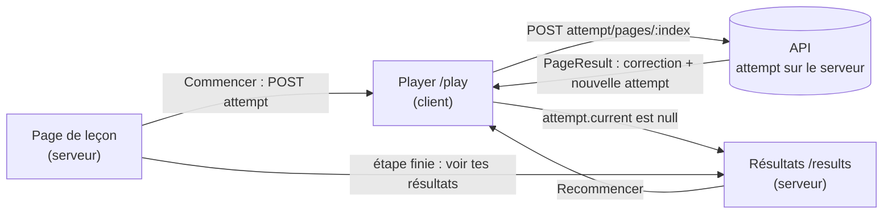
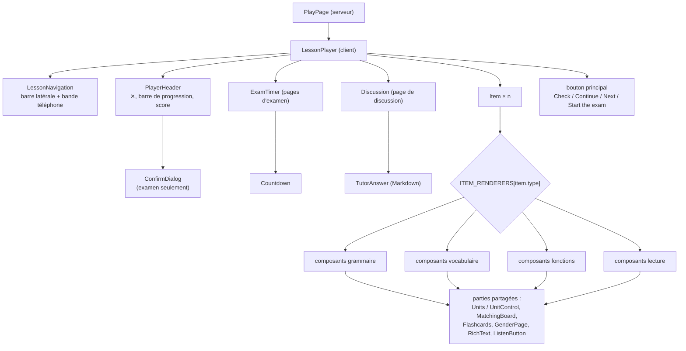
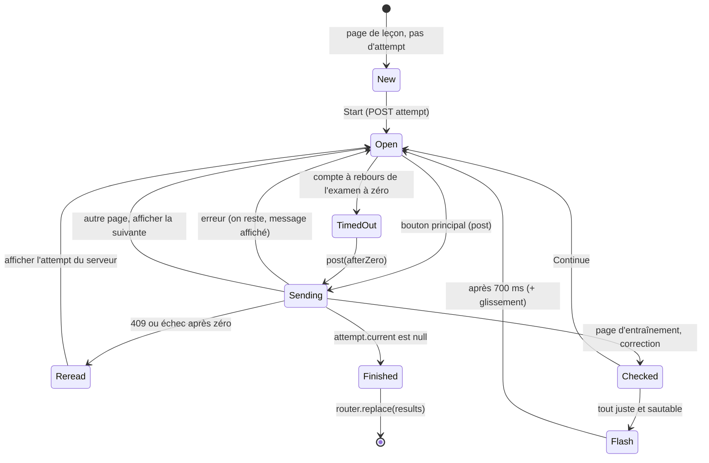
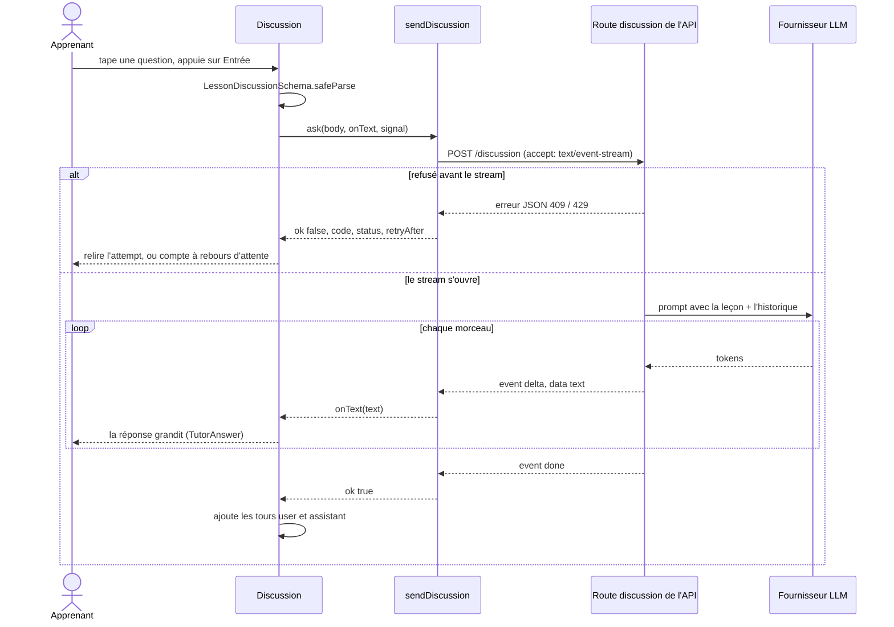

# Chapitre 7 — Le lecteur de leçon

Dans ce chapitre :

- Les trois pages d'une leçon : la **page de leçon** (écran de départ), le **player** (`/play`) et les **résultats** (`/results`).
- La forme des données de leçon que reçoit le navigateur (les schemas partagés `lessons.player`).
- Comment le player garde son state : l'**attempt** du serveur (avec son **cursor**), les **brouillons** (réponses pas encore envoyées), et la mémoire de l'onglet.
- Comment les réponses sont envoyées, comment une page d'entraînement affiche sa correction, et comment marche le **timer** de l'examen.
- Les briques de `components/lesson/` : contrôles d'unité, tableaux d'association, flashcards, page des genres, et les quatre **kinds** de leçon (grammaire, vocabulaire, fonctions, lecture).
- La page des résultats et le détail des XP.
- Le tuteur IA : le streaming de la réponse (SSE lu à la main avec `fetch`) et l'affichage de son Markdown.
- La synthèse vocale avec la Web Speech API du navigateur.

---

## Vue d'ensemble

### Trois pages, une attempt

Un apprenant joue une leçon en trois étapes, et chaque étape a sa propre URL :

| URL                                  | Fichier                                                                                                                                                                                                     | Rendu sur                | Ce qu'elle montre                            |
| ------------------------------------ | ----------------------------------------------------------------------------------------------------------------------------------------------------------------------------------------------------------- | ------------------------ | -------------------------------------------- |
| `/learn/fr/lessons/fr-a1-01`         | [page.tsx](<../../apps/web/app/[locale]/(dashboard)/learn/[lang]/lessons/[id]/page.tsx>)                                                                                                                    | serveur                  | titre, objectif, plan, le bouton principal   |
| `/learn/fr/lessons/fr-a1-01/play`    | [play/page.tsx](<../../apps/web/app/[locale]/(dashboard)/learn/[lang]/lessons/[id]/play/page.tsx>) + [play/player.tsx](<../../apps/web/app/[locale]/(dashboard)/learn/[lang]/lessons/[id]/play/player.tsx>) | serveur, puis navigateur | une page de la leçon à la fois               |
| `/learn/fr/lessons/fr-a1-01/results` | [results/page.tsx](<../../apps/web/app/[locale]/(dashboard)/learn/[lang]/lessons/[id]/results/page.tsx>)                                                                                                    | serveur                  | score, XP, chaque réponse avec sa correction |

Le mot important est **attempt** (tentative). Une attempt, c'est une partie d'une leçon, enregistrée sur le serveur. Elle a un id (`attemptId`) et un **cursor** : l'index de la page où se trouve l'apprenant. Le cursor avance seulement, il ne recule jamais. Quand la dernière page est envoyée, l'attempt est finie et a des résultats.

> Analogie : l'attempt, c'est comme une **partie de jeu de société gardée à la poste**. Tu ne gardes jamais le plateau chez toi. À chaque coup, tu envoies une lettre (« je joue cette page avec ces réponses »), et la poste te renvoie le nouveau plateau. Si tu perds ta copie, tu redemandes à la poste.

C'est exactement la règle du player, écrite en haut de [player.tsx](<../../apps/web/app/[locale]/(dashboard)/learn/[lang]/lessons/[id]/play/player.tsx>) :

```tsx
/**
 * The player: renders the attempt the server sends and never scores.
 * Each move (Check, Continue, Start the exam, Next, the countdown at
 * zero) posts the page at the cursor and renders what comes back. Pages
 * inside the player never touch the history: Back leaves the player.
 */
```

Donc le navigateur **ne décide jamais** si une réponse est juste. Il ne voit même pas la bonne réponse avant que la page soit verrouillée. Le serveur note ; le navigateur dessine.



### Les trois routes de l'API

Tous les appels d'attempt de leçon vont vers un seul chemin, `/api/courses/:lang/lessons/:id/attempt` (voir le [chapitre 8 de la doc de l'API](../api/08-lessons.md)). Le commentaire en haut de [view.ts](../../packages/shared/src/lessons/player/view.ts) les liste :

```ts
 *   GET  attempt              → AttemptRead
 *   POST attempt              StartAttempt → AttemptView
 *   POST attempt/pages/:index SubmitPage   → PageResult
```

Plus une autre pour le tuteur : `POST /api/courses/:lang/lessons/:id/discussion`, qui répond avec un **stream** (flux ; on en reparle plus bas).

---

## La forme des données de leçon (`lessons.player` dans packages/shared)

L'app web et l'API partagent les mêmes types. Ils sont dans [packages/shared/src/lessons/player/view.ts](../../packages/shared/src/lessons/player/view.ts) et sont exportés comme `lessons.player` depuis `@ft/shared`. Ce sont des schemas **zod** : zod est une librairie qui décrit la forme des données et peut la vérifier pendant l'exécution (`Schema.parse(data)` lance une erreur si les données ne collent pas).

Chaque schema est un `z.strictObject`. « Strict » veut dire qu'une clé inconnue fait échouer la vérification. Le commentaire explique pourquoi :

```ts
 * Two rules hold the keys back:
 * - **The keys only come after the lock.** Accepted answers, the right
 *   option or order, the faulty token and the explanations exist only in
 *   UnitFeedback (a practice page, once checked) and in Results (once the
 *   attempt is finished). PageView has none.
 * - **No authored id.** The ids of a lesson file carry answers
 *   (`gap-livre`, a unit ending in `/je`), so units, options, tokens and
 *   cards are named by a Ref instead: an HMAC of the internal id, valid
 *   in one attempt only (#145 computes it).
```

Donc : une page envoyée au navigateur ne contient **aucune réponse**. Même les ids sont cachés derrière une **Ref**, une chaîne de 16 caractères qui a l'air aléatoire (`RefSchema = z.string().regex(/^[A-Za-z0-9_-]{16}$/)`). Un apprenant malin qui ouvre les outils de développement n'apprend rien.

### L'arbre des types

```
AttemptRead                 GET attempt
├── outline: LessonOutline  same for every learner (title, sections, pages...)
└── attempt: AttemptView | null   null = never started
    ├── attemptId           uuid
    ├── current: PageView | null  the page at the cursor; null = finished
    │   ├── index, role, scored, instructions
    │   └── items: ItemView[]     one schema per item type
    │       └── units: UnitView[] text | choice | order | spot
    ├── remainingMs         exam pages only: time left (0 = ran out)
    ├── practice: Tally     the header score { earned, possible }
    └── results: Results | null   set once finished
```

| Type            | Ce que c'est                                                                                                                                                                                                                                                                   |
| --------------- | ------------------------------------------------------------------------------------------------------------------------------------------------------------------------------------------------------------------------------------------------------------------------------ |
| `LessonOutline` | La « table des matières » de la leçon : `title`, `objective`, `minutes`, `sections` (chacune avec des `points` numérotés), `pages` (chacune avec `role`, `seconds`, `limitS`, `questions`, `step`), et des champs propres au kind (`words`, `newVerbs`, `situation`, `roles`). |
| `PageView`      | La page au cursor. Son `role` est l'un de `presentation`, `practice`, `discussion`, `examIntro`, `exam`.                                                                                                                                                                       |
| `ItemView`      | Un bloc d'une page. Une **union discriminée** sur `type` (une union où un champ, ici `type`, dit de quelle forme il s'agit) : `grammar_explanation`, `vocabulary_flashcards`, `function_dialogue`, `reading_document`, … environ 30 types.                                     |
| `UnitView`      | Une réponse à donner, selon `kind` : `text` (la taper), `choice` (choisir une option), `order` (mettre des tokens dans l'ordre), `spot` (trouver le mot faux et le corriger).                                                                                                  |
| `Answer`        | Ce que l'apprenant envoie pour une unité : `{ text, gender? }`, `{ option }`, `{ tokens }` ou `{ token, text }`.                                                                                                                                                               |
| `UnitFeedback`  | La correction d'une unité, après la vérification d'une page d'entraînement : `outcome`, `points` (0, 0.5 ou 1), `answer`, `explanation`, et des aides comme `correct` (les bonnes options), `order`, `faulty`, `marks`.                                                        |
| `Results`       | Toute l'attempt finie : `score`, les totaux `practice` et `exam`, `steps`, une `row` par unité, et `finish` (XP, objectif du jour, meilleur score).                                                                                                                            |

Les quatre résultats possibles viennent du code de notation partagé : `fully_correct`, `orthography_only` (juste mais avec une faute d'orthographe ou d'accent : un demi-point), `incorrect`, `unanswered`.

### Le contrat côté web : [components/lesson/types.ts](../../apps/web/components/lesson/types.ts)

Ce fichier ré-exporte d'abord les types partagés avec des noms courts (`ItemView`, `UnitView`, `Answer`, `Ref`, `LessonOutline`, `Localized`…). Ensuite il définit ce que le player donne à **chaque** composant d'item :

```ts
export interface AnswerProps {
  /** The course language, for the lang attribute of its texts. */
  lang: Language;
  /** The drafts of the page, by unit ref. */
  answers: Readonly<Record<Ref, Answer | undefined>>;
  /** Sets or clears one unit's draft. */
  onAnswer: (ref: Ref, answer: Answer | undefined) => void;
  /** The feedback of a checked practice page, by unit ref; null before, and on the exam. */
  feedback: ReadonlyMap<Ref, UnitFeedback> | null;
  /** No change any more: a request is running, the page was checked, or its time ran out. */
  locked: boolean;
  hold: (key: string, hold: Hold | null) => void;
  nudged: boolean;
  keep: { load: (key: string) => string | null; save: (key: string, value: string) => void };
  outline: LessonOutline;
}
```

Les items n'ont **aucun state de réponse à eux** : les brouillons arrivent par `answers`, et chaque changement repart par `onAnswer`. En React, on appelle ça un **composant contrôlé** : c'est le parent qui possède la valeur.

`Hold` permet à un item de **retenir le bouton principal de la page** :

| `kind`  | Effet                                                                                     | Exemple                                                                                                    |
| ------- | ----------------------------------------------------------------------------------------- | ---------------------------------------------------------------------------------------------------------- |
| `block` | Le bouton est désactivé.                                                                  | Flashcards : « Retourne chaque carte pour continuer. » Association : toutes les cases ne sont pas reliées. |
| `nudge` | Le premier appui affiche seulement une note (`nudged` passe à true) ; le deuxième envoie. | Examen de traduction : « tape l'article ».                                                                 |
| `step`  | Le bouton est prêté à l'item : il affiche `label`, et un appui appelle `onStep`.          | Dialogue : « Ligne suivante » jusqu'à la dernière ligne.                                                   |

Enfin, le **contrat de kind** :

```ts
export type ItemRenderers = { [T in ItemViewType]?: ComponentType<ItemProps<T>> };
export type StartField = ComponentType<{ outline: LessonOutline; lang: Language }>;
export type StartFact = (
  outline: LessonOutline,
  t: (key: string, values?: Record<string, string | number>) => string,
) => string | null;

export interface KindParts {
  kind: LessonKind;
  renderers: ItemRenderers;
  startFields: StartField[];
  startFacts?: StartFact[];
}
```

Un **kind** (grammaire, vocabulaire, fonctions, lecture) apporte une table « type d'item → composant React », plus quelques blocs pour la page de départ de la leçon. Le player cherche dans cette table et ne demande jamais « de quel kind est cette leçon ? ». On verra le registre dans [kinds/index.ts](../../apps/web/components/lesson/kinds/index.ts) plus bas.

---

## Les helpers côté serveur : [lib/lesson.ts](../../apps/web/lib/lesson.ts)

Les trois pages commencent de la même façon, donc elles partagent `loadLesson`. C'est le **guard** (garde) des pages de leçon :

```ts
export async function loadLesson(lang: string, id: string): Promise<LessonData> {
  const { courses } = await requireCourses();

  const parsedLang = LanguageSchema.safeParse(lang);
  const parsedId = LessonIdSchema.safeParse(id);
  if (!parsedLang.success || !parsedId.success) {
    notFound();
  }

  const course = findCourse(courses, parsedLang.data);
  if (course === null || course.level === null) {
    redirect(`/onboarding?lang=${parsedLang.data}`);
  }

  const { read, card } = await readLesson(parsedLang.data, parsedId.data);
  ...
```

Dans l'ordre : pas de session → `/login` (dans `requireCourses`) ; mauvaise langue ou mauvais id → 404 ; pas de cours ou pas de niveau → onboarding ; leçon inconnue → 404 ; API en panne → ça lance une erreur, donc la page d'erreur s'affiche. Ça renvoie `{ lang, id, card, read }` : la **card** (titre, niveau, kind, statut, meilleur score ; la même carte que la page du cours affiche) et le **read** (`AttemptRead` : outline + attempt).

`readLesson` fait les deux appels à l'API **en parallèle** (`Promise.all`) et est enveloppé dans le `cache()` de React :

```ts
const readLesson = cache(async function readLesson(lang: Language, id: string) {
  const base = `/api/courses/${lang}/lessons/${id}`;
  const [read, card] = await Promise.all([
    apiFind(lessons.player.AttemptReadSchema, `${base}/attempt`),
    apiFind(LessonCardSchema, base),
  ]);
  return { read, card };
});
```

`cache()` garde le résultat en mémoire **pour une seule requête serveur**. Pourquoi ? `generateMetadata` (le titre de l'onglet du navigateur) et la page elle-même ont tous les deux besoin de la card. Avec `cache`, l'API est appelée une fois, pas deux.

Les autres exports :

- `lessonTitle(lang, id)` : le titre pour l'onglet, ou `null`. Il ne redirige jamais : « metadata must not race » (les métadonnées ne doivent pas entrer en course avec) la page.
- `lessonPaths(lang, id)` : les URLs `{ page, play, results }`.
- `lessonStage(attempt)` : où en est l'apprenant.

```ts
export type LessonStage = 'new' | 'running' | 'exam' | 'finished';

export function lessonStage(attempt: AttemptRead['attempt']): LessonStage {
  if (attempt === null) return 'new';
  if (attempt.current === null) return 'finished';
  return attempt.current.role === 'exam' ? 'exam' : 'running';
}
```

Testé dans `lib/lesson.test.ts` (l'ordre du guard, le titre, l'étape).

### [lib/lesson-cursor.ts](../../apps/web/lib/lesson-cursor.ts)

Un tout petit fichier partagé par les pages serveur et le code du navigateur (donc il n'importe ni l'un ni l'autre) :

```ts
export interface Cursor {
  attemptId: string;
  index: number | null;
}

export const cursorOf = (attempt: AttemptView | null): Cursor | null =>
  attempt === null ? null : { attemptId: attempt.attemptId, index: attempt.current?.index ?? null };
```

Un cursor, c'est « quelle attempt, quelle page » (page `null` = finie). Il sert à comparer « ce que le serveur a rendu » avec « ce que cet onglet a vu en dernier » (voir `FreshOnReturn` plus bas).

---

## La page de leçon : [page.tsx](<../../apps/web/app/[locale]/(dashboard)/learn/[lang]/lessons/[id]/page.tsx>)

Un **server component** (il est `async` et n'a pas de `'use client'`). `export const dynamic = 'force-dynamic'` dit à Next.js de ne jamais le mettre en cache : il lit la session et l'attempt à chaque requête.

Il dessine la carte de départ :

1. Un lien retour vers le cours, la langue / le niveau, une pastille avec le kind.
2. Le titre (`lang={course}` pour que les lecteurs d'écran le prononcent en français, en allemand…), l'objectif dans la langue de l'interface (`pick(outline.objective, locale)`).
3. Une ligne d'infos : « About 14 minutes · 8 words » (environ 14 minutes · 8 mots). Les minutes viennent d'abord, puis les **start facts** de chaque kind :

```tsx
{[
  t('aboutMinutes', { minutes: outline.minutes }),
  // Each kind's facts: "About 14 minutes · 8 words".
  ...START_FACTS.map((fact) => fact(outline, (key, values) => t(key, values))),
]
  .filter(Boolean)
  .join(' · ')}
```

4. Le statut et le meilleur score.
5. Les **start fields** de chaque kind (`START_FIELDS.map((Field, n) => <Field ... />)`) : un field ne dessine rien quand la leçon n'a pas cette donnée.
6. Le plan : une ligne par section, avec une lettre (A, B, C…) et une couleur de `SECTION_COLORS`, ses minutes, et ses points numérotés. La section d'examen (sans points) affiche « N pages, M questions » à la place.
7. `<LessonActions>` : le bouton principal.

Il rend aussi `<FreshOnReturn>` en haut (expliqué juste après).

---

## [lesson-actions.tsx](<../../apps/web/app/[locale]/(dashboard)/learn/[lang]/lessons/[id]/lesson-actions.tsx>) — le bouton principal

Un fichier client (`'use client'`) avec trois exports utilisés par la page de leçon et la page des résultats.

### `useStartLesson` (hook privé)

```ts
async function start() {
  setPending(true);
  setError(null);
  const result = await startAttempt(lang, id, LocaleSchema.catch('en').parse(locale));
  if (result.ok) {
    rememberAttempt(lang, id, result.data);
    // Pushed, so Back from the player comes to the page before it.
    preparePlayerNavigation(playPath);
    router.push(playPath);
    return;
  }
  setPending(false);
  setError(errorMessage(result.code, result.status));
}
```

Il envoie `POST attempt` avec la locale (la locale fixe la langue maternelle de l'apprenant pour les traductions). Si ça marche, il écrit la nouvelle attempt dans la mémoire de l'onglet (`rememberAttempt`), note d'où le player a été ouvert (`preparePlayerNavigation`) et va sur `/play`. Si ça échoue, il affiche une erreur traduite.

### `LessonActions`

Un bouton, choisi selon l'étape :

| Étape              | Ce qui s'affiche                                                                                        |
| ------------------ | ------------------------------------------------------------------------------------------------------- |
| pas `playable`     | un « Coming soon » (bientôt disponible) désactivé (+ « See your results » si c'est fini)                |
| `new`              | **Start** (commencer ; un bouton, il a besoin de JavaScript pour faire le POST)                         |
| `running` / `exam` | **Resume** / **Resume the exam** (reprendre / reprendre l'examen ; un `<Link>`, marche sans JavaScript) |
| `finished`         | **See your results** (voir tes résultats ; lien) + **Retake** (recommencer)                             |

### `RetakeLesson`

Recommencer remplace les résultats affichés, donc il demande d'abord, avec `<ConfirmDialog>`. `dialog.current?.showModal()` ouvre le `<dialog>` natif ; « oui » le ferme et appelle `start()`. Recommencer une leçon finie crée une nouvelle attempt sur le serveur.

### `FreshOnReturn`

Celui-ci règle un problème subtil. Quand tu appuies sur **Retour** dans le navigateur, Next.js affiche la page **depuis son cache de router**, telle qu'elle a été rendue la première fois. Donc après avoir joué 5 pages et appuyé sur Retour, la page de leçon pourrait encore dire « Start » ou montrer l'ancien cursor.

```tsx
useEffect(() => {
  if (!isStale(lang, id, cursor)) {
    refreshed.current = false;
  } else if (refreshed.current) {
    forgetAttempt(lang, id);
    refreshed.current = false;
  } else {
    refreshed.current = true;
    router.refresh();
  }
}, [lang, id, cursor, router]);
```

- `cursor`, c'est ce que le serveur a rendu. `isStale` le compare avec ce que cet onglet a vu en dernier (voir `lesson-client.ts`).
- Périmé → `router.refresh()` demande au serveur un rendu frais.
- Si le rendu frais est **toujours** différent, le serveur est plus récent que l'onglet (par exemple, on a recommencé sur un autre appareil). L'onglet oublie sa mémoire, pour ne pas rafraîchir à l'infini.

Il ne rend rien (`return null`). C'est un petit composant de « comportement ».

---

## Les helpers navigateur pour l'attempt : [lib/lesson-client.ts](../../apps/web/lib/lesson-client.ts) (en bref)

Le chapitre [04-talking-to-the-api.md](04-talking-to-the-api.md) explique `clientGet` / `clientPost` et `ApiResult`. Ce fichier a trois parties.

**1. Les routes** : `startAttempt` (POST, body `{ locale }`), `readAttempt` (GET), et `submitPage` :

```ts
export function submitPage(
  lang: Language,
  id: string,
  index: number,
  attemptId: string,
  answers: Record<string, Answer>,
): Promise<ApiResult<PageResult>> {
  return clientPost(P.PageResultSchema, `${attemptPath(lang, id)}/pages/${index}`, {
    attemptId,
    answers,
  });
}
```

L'index de la page **et** l'id de l'attempt sont envoyés. Si le cursor du serveur est ailleurs (un autre onglet a avancé, on a recommencé), il répond **409 Conflict**, et le player relit l'attempt.

**2. La mémoire de l'onglet** : une `Map` au niveau du module (`seen`) qui garde « la dernière attempt vue par cet onglet, et quand ». Elle vit aussi longtemps que l'onglet (pas après un rechargement ; un rechargement demande de toute façon au serveur).

- `rememberAttempt`, `forgetAttempt`.
- `isStale(lang, id, rendered)` : vrai quand le cursor rendu est en retard sur ce que l'onglet a vu (ou que c'est une autre attempt).
- `newerAttempt(lang, id, rendered, renderedAt)` : la plus récente des deux. Dans une même attempt, le cursor le plus loin gagne (les attempts avancent seulement) ; un id d'attempt différent veut dire qu'on a recommencé, et c'est celle rendue qui gagne.

**3. Les brouillons dans `localStorage`** : les réponses tapées mais pas encore envoyées, pour qu'un rechargement les garde. La clé est `ft.lesson.drafts.<lang>.<id>.<attemptId>`.

- `loadDrafts(slot)` **nettoie** aussi les vieilles clés de la même leçon (autres attempts), et vérifie chaque valeur stockée avec `AnswerSchema` et `RefSchema` (le stockage pourrait contenir n'importe quoi).
- `saveDrafts`, `clearDrafts` (enlève aussi les notes des items).
- `loadKept` / `saveKept` : des petites notes qu'un item veut garder pour un rechargement, stockées à `<draftKey>:<key>` (par exemple combien de lignes du dialogue sont affichées, ou le compte à rebours du survol).

Chaque accès au stockage est dans un `try/catch` : le stockage peut être désactivé (navigation privée) ou plein, et la leçon doit quand même marcher.

Testé dans `lib/lesson-client.test.ts` (« the attempt routes », « the tab memory », « the drafts »).

### [lib/lesson-history.ts](../../apps/web/lib/lesson-history.ts)

Le bouton ✕ du player doit se comporter comme Retour **si** le player a été ouvert depuis la page de leçon, et sinon aller sur la page de leçon. Ce fichier s'en souvient, dans l'entrée de l'historique du navigateur elle-même :

```ts
export function preparePlayerNavigation(playPath: string) {
  const lessonPath = playPath.replace(/\/play$/, '');
  pendingSource = window.location.pathname.endsWith(lessonPath) ? window.location.pathname : null;
}

export function recordPlayerOrigin(pagePath: string) {
  if (pendingSource?.endsWith(pagePath) && window.location.pathname.endsWith(`${pagePath}/play`)) {
    window.history.replaceState({ ...window.history.state, [marker]: pendingSource }, '');
  }
  pendingSource = null;
}
```

1. Avant de naviguer, `preparePlayerNavigation` note « je viens de la page de leçon » (seulement si on y est vraiment ; recommencer depuis les résultats ne compte pas).
2. Quand le player se monte, `recordPlayerOrigin` le stocke dans `history.state` sous `ftLessonSource`. `history.state` survit à un rechargement et à Avancer.
3. `playerHasLessonOrigin` le relit.

Testé dans `lib/lesson-history.test.ts`.

---

## La route play : [play/page.tsx](<../../apps/web/app/[locale]/(dashboard)/learn/[lang]/lessons/[id]/play/page.tsx>)

Un server component court. Il charge la leçon, puis renvoie l'apprenant sur la page de leçon quand il n'y a rien à jouer :

```tsx
const stage = lessonStage(read.attempt);
// A kind the browser cannot play yet: the lesson page says so.
if (
  read.attempt === null ||
  stage === 'new' ||
  stage === 'finished' ||
  !playable(read.outline.kind)
) {
  redirect(paths.page);
}

return (
  <LessonPlayer
    lang={course}
    id={card.id}
    outline={read.outline}
    initial={read.attempt}
    pagePath={paths.page}
    resultsPath={paths.results}
  />
);
```

Donc le player commence toujours avec une vraie attempt en cours (`initial`). Le serveur a déjà rendu la première page en HTML ; ensuite la partie client prend le relais.

---

## Le player : [play/player.tsx](<../../apps/web/app/[locale]/(dashboard)/learn/[lang]/lessons/[id]/play/player.tsx>)

C'est le plus gros fichier du chapitre. Regardons-le d'abord de l'extérieur.

### L'arbre des composants



### Le state

Le player garde beaucoup de petits morceaux de state. Les voici, avec leur sens :

| State                                               | Sorte      | Sens                                                                                                                                 |
| --------------------------------------------------- | ---------- | ------------------------------------------------------------------------------------------------------------------------------------ |
| `view`                                              | `useState` | L'`AttemptView` affichée. `view.current` est la page au cursor.                                                                      |
| `activeView`                                        | `useRef`   | Comme `view`, mais mis à jour **tout de suite** (une ref n'attend pas un nouveau rendu). Sert à ignorer les réponses en retard.      |
| `receivedAt`                                        | `useState` | Quand (selon l'horloge de cet onglet) la vue a été **demandée**. La date limite de l'examen part de là.                              |
| `drafts`                                            | `useState` | `Record<Ref, Answer>` : les réponses tapées ou choisies, pas encore envoyées.                                                        |
| `checked`                                           | `useState` | Après **Check** sur une page d'entraînement : `{ feedback, next, at }` : les corrections, et l'attempt où le serveur est déjà passé. |
| `flash`, `flashDelay`                               | `useState` | Le flash vert « tout est juste », et combien de temps il attend que les cases d'association glissent.                                |
| `pending`, `error`                                  | `useState` | Une requête est en cours ; le dernier message d'erreur.                                                                              |
| `timedOut`                                          | `useState` | La page d'examen dont le compte à rebours est arrivé à zéro ici : elle reste verrouillée.                                            |
| `loaded`                                            | `useState` | Les brouillons sont venus du stockage, donc à partir de maintenant ils y sont sauvegardés.                                           |
| `holds`, `nudged`                                   | `useState` | Avec quoi les items retiennent le bouton principal ; si le premier appui a rencontré un nudge.                                       |
| `sent`                                              | `useRef`   | L'index de la page pour laquelle un envoi est en cours : un timer à zéro et un clic ne peuvent pas l'envoyer tous les deux.          |
| `moved`, `finished`, `flashTimer`, `top`, `heading` | `useRef`   | Aides pour le focus et le scroll, « attempt finie », l'id du `setTimeout` du flash.                                                  |

> Pourquoi `useRef` pour certaines valeurs ? Un changement de `useState` déclenche un nouveau rendu, et la nouvelle valeur n'est visible qu'au rendu **suivant**. Un `useRef` est une boîte dont le `.current` change tout de suite et ne cause aucun rendu. Le player utilise des refs pour des « gardes » qui doivent être justes même à l'intérieur d'un `await` qui a commencé plus tôt.

### Après l'hydratation : choisir l'attempt la plus récente et charger les brouillons

L'« hydratation », c'est quand React dans le navigateur s'attache au HTML envoyé par le serveur. Le premier effet tourne juste après :

```tsx
useEffect(() => {
  const now = Date.now();
  const newer = newerAttempt(lang, id, initial, now);
  activeView.current = newer.view;
  if (newer.view.current === null) {
    router.replace(resultsPath);
    return;
  }
  setView(newer.view);
  setDrafts(loadDrafts({ lang, id, attemptId: newer.view.attemptId }));
  setLoaded(true);
  rememberAttempt(lang, id, newer.view, newer.at);

  const current = newer.view.current;
  if (current.role !== 'exam') {
    setReceivedAt(newer.at);
    return;
  }
  ...
```

1. Avancer/Retour peut afficher la page telle qu'elle a été rendue la première fois. Donc il prend la plus récente entre `initial` et la mémoire de l'onglet.
2. Si cette attempt est déjà finie, il va aux résultats.
3. Il charge les brouillons depuis `localStorage` (seulement maintenant : le serveur n'a pas de `localStorage`).
4. Sur une page d'**examen**, le `remainingMs` venu avec le HTML est vieux : il a été calculé avant le HTML, le téléchargement du JavaScript et l'hydratation. Donc il relit l'attempt (`readAttempt`) et note `asked = Date.now()` **avant** la requête. Utiliser le début de la requête (et pas son arrivée) veut dire que la date limite de l'onglet n'est jamais plus tard que celle du serveur. Plusieurs vérifications (`live`, `activeView`, `sent`) font en sorte qu'une réponse en retard ne fasse pas reculer un player qui est déjà passé à la suite.

Encore trois effets :

- Les brouillons suivent l'apprenant dans le stockage : `saveDrafts(...)` à chaque changement de `drafts` (une fois chargés, et jusqu'à la fin de l'attempt).
- Quand la page change, le `<h1>` de la nouvelle page prend le focus (`heading.current?.focus(...)`), pour qu'un lecteur d'écran dise où est l'apprenant.
- `useEffect(() => () => stopSpeech(), [pageIndex])` : quand la page change, tout texte lu à voix haute s'arrête.

### Taper une réponse

```tsx
function answer(ref: Ref, value: Answer | undefined) {
  setDrafts((current) => {
    const next = { ...current };
    if (value === undefined) delete next[ref];
    else next[ref] = value;
    return next;
  });
}
```

C'est le `onAnswer` donné à chaque item. `undefined` efface le brouillon (une zone de texte vide, un ordre de mots vide).

### Envoyer une page : `post()`

```tsx
async function post(afterZero = false) {
  if (!page || sent.current === page.index) return;
  sent.current = page.index;
  const refs = new Set(unitRefs(page));
  const answers = Object.fromEntries(
    Object.entries(drafts).filter(([ref]) => refs.has(ref)),
  ) as Record<Ref, Answer>;

  setPending(true);
  setError(null);
  const asked = Date.now();
  const result = await submitPage(lang, id, page.index, view.attemptId, answers);
  setPending(false);

  if (!result.ok) {
    sent.current = null;
    // After the countdown, the server may have closed the page already: its word counts.
    if (result.status === 409 || afterZero || timedOut === page.index) {
      return reread(result.code, result.status);
    }
    setError(errorMessage(result.code, result.status));
    return;
  }
  ...
```

Étape par étape :

1. **Garde** : `sent` empêche un double envoi (le timer à zéro et un clic au même moment).
2. Seuls les brouillons des **unités de cette page** sont envoyés (`unitRefs(page)` liste les refs de chaque unité de chaque item).
3. `submitPage` les envoie.
4. Sur un **409** (le serveur est ailleurs) ou un échec après le compte à rebours, `reread()` relit l'attempt et l'affiche, avec le message d'erreur.

Ensuite, si ça marche :

```tsx
  const { feedback, attempt } = result.data;
  rememberAttempt(lang, id, attempt, asked);
  // The page is locked on the server: its drafts are done with.
  const rest = Object.fromEntries(Object.entries(drafts).filter(([ref]) => !refs.has(ref)));
  saveDrafts(slot, rest);

  if (feedback === null || page.role !== 'practice') {
    setDrafts(rest);
    show(attempt, asked);
    return;
  }

  const byRef = new Map(feedback.map((f) => [f.ref, f]));
  setChecked({ feedback: byRef, next: attempt, at: asked });
  // Right at once on a page whose items all allow it: a green flash, then on.
  const allRight = feedback.every((f) => f.outcome === 'fully_correct');
  const skip = page.items.every((item) => lessons.player.typeSkipsFeedbackWhenRight(item.type));
  if (allRight && skip) {
    const delay = page.items.some((item) => SLIDING_ITEMS.has(item.type)) ? MATCH_SLIDE_MS : 0;
    setFlashDelay(delay);
    setFlash(true);
    flashTimer.current = window.setTimeout(() => {
      flashTimer.current = null;
      setDrafts(rest);
      show(attempt, asked);
    }, delay + FLASH_MS);
  }
}
```

- Pas une page d'entraînement (présentation, examen, discussion, intro d'examen) : pas de correction, on passe directement à la page suivante avec `show()`.
- Une page d'entraînement : on garde la correction dans `checked`. Les items dessinent maintenant leurs corrections, et le bouton principal devient **Continue**. Note que le serveur a **déjà avancé** le cursor : `checked.next` est l'attempt suivante, qui attend.
- Tout est juste, et chaque type d'item le permet (`typeSkipsFeedbackWhenRight`, tiré des traits de kind partagés) : un flash vert pendant `FLASH_MS = 700` ms, puis on avance tout seul. Sur un tableau d'association, le flash attend d'abord `MATCH_SLIDE_MS = 1200` ms que les cases glissent.

`next()` est le clic sur Continue : il jette les brouillons de la page et appelle `show(checked.next, checked.at)`.

### `show()` : passer à une autre page

```tsx
const show = useCallback(
  (next: AttemptView, askedAt: number) => {
    const changedAttempt = next.attemptId !== activeView.current.attemptId;
    if (changedAttempt) {
      setDrafts(loadDrafts({ lang, id, attemptId: next.attemptId }));
      setTimedOut(null);
      finished.current = false;
    }
    ...
    activeView.current = next;
    setChecked(null);
    setFlash(false);
    setError(null);
    setHolds({});
    setNudged(false);
    if (next.current === null) {
      finished.current = true;
      clearDrafts({ lang, id, attemptId: next.attemptId });
      // Replaced, so Back from the results goes to the lesson page.
      router.replace(resultsPath);
      return;
    }
    sent.current = null;
    moved.current = true;
    setView(next);
    setReceivedAt(askedAt);
    top.current?.scrollIntoView({ block: 'start' });
  },
  [lang, id, router, resultsPath],
);
```

Il remet à zéro tout ce qui concerne la page. Quand l'attempt est finie (`current === null`), il efface les brouillons et va aux résultats avec `router.replace` (pas `push`) : le player est remplacé dans l'historique, donc Retour depuis les résultats va sur la page de leçon, pas sur un player mort.

### Diagramme d'états d'une partie



L'attribut `data-state` sur la racine du player (`open`, `checked` ou `flash`) reflète ça pour le CSS et les tests.

### Les holds et le bouton principal

Les items appellent `hold(key, value)`. Le player garde un `Hold` par clé dans `holds`, et le callback `hold` saute la mise à jour si rien n'a changé (pour qu'un item qui l'appelle dans un effet ne boucle pas). Ensuite :

```tsx
// Holds only stand before the page is sent: Continue after a Check is never held.
const pageHolds = checked ? [] : Object.values(holds);
const blocked = pageHolds.some((h) => h.kind === 'block');
const nudging = pageHolds.some((h) => h.kind === 'nudge');
// A step lends the button to an item (Next line) before anything else.
const step = pageHolds.find((h) => h.kind === 'step' && h.onStep);
```

Le texte et l'action du bouton viennent d'un petit `switch` :

| Situation              | Texte                                           | Action          |
| ---------------------- | ----------------------------------------------- | --------------- |
| `checked`              | Continue                                        | `next()`        |
| le `step` d'un item    | par ex. « Next line »                           | `step.onStep()` |
| `practice`             | Check                                           | `post()`        |
| `examIntro`            | Start the exam                                  | `post()`        |
| `exam`                 | Next / Finish the exam (dernière page d'examen) | `post()`        |
| `discussion`           | Continue to the exam                            | `post()`        |
| autre (`presentation`) | Continue                                        | `post()`        |

Deux détails dans le gestionnaire de clic :

```tsx
onClick={(event) => {
  if (event.detail > 1) return;
  // A nudge lets the first press show its notes; the next one sends.
  if (nudging && !nudged && !step) {
    setNudged(true);
    return;
  }
  button.onClick();
}}
```

- `event.detail` est le nombre de clics. Un double-clic ferait tomber son deuxième clic sur le bouton de la page **suivante** et l'enverrait vide. Donc seuls les clics simples comptent (un appui sur une touche a `detail` à 0).
- Un nudge : le premier appui met seulement `nudged`.

`locked` est vrai quand `pending`, `checked`, quand la page n'avait plus de temps (`ranOut`) ou que le temps s'est écoulé ici. Il est passé à chaque item pour que les champs soient désactivés.

### Ce que le player rend

- `<LessonNavigation key={page.index} …/>` sur le côté.
- `<PlayerHeader>` : le ✕, la barre de progression, le score.
- La carte de la tâche : le nom de l'étape, les consignes en `<h1>`, l'`<ExamTimer>` sur les pages d'examen, une note « le temps est écoulé ».
- Une carte d'**intro d'examen** qui liste chaque page d'examen avec ses questions et ses secondes.
- Sur une page de **discussion** : `<Discussion key={view.attemptId} …/>`.
- Les items, dans `<div key={page.index}>`. La `key` fait que React jette les anciens items et en construit de nouveaux à chaque page, donc aucun state ne passe d'une page à l'autre. Sur une page d'examen avec plusieurs réponses à taper, chaque item est une carte numérotée.
- Le pied : erreur, message de hold (une région live `role="status"` : « Line 3 of 8 »), et le bouton.
- La couche du flash et un statut réservé aux lecteurs d'écran (« 3 of 4 right »).

`Item` choisit le composant dans le registre, ou affiche « ne peut pas encore être affiché » :

```tsx
function Item({ item, ...props }: Omit<ItemProps, 'item'> & { item: ItemView }) {
  const t = useTranslations('Lesson');
  const Renderer = ITEM_RENDERERS[item.type] as React.ComponentType<ItemProps> | undefined;
  if (!Renderer) {
    return (
      <ItemCard>
        <p className="text-slate-400">{t('unavailable')}</p>
      </ItemCard>
    );
  }
  return <Renderer item={item} {...props} />;
}
```

### `PlayerHeader`

- **✕ (quitter)** : `leave()` appelle `router.back()` si le player vient de la page de leçon (`playerHasLessonOrigin`), sinon `router.replace(pagePath)`. Pendant l'examen il demande d'abord avec un `ConfirmDialog` (l'examen continue de tourner sur le serveur).
- **Barre de progression** : basée sur les `seconds` des pages du plan, pas sur le nombre de pages : `done / total` secondes. Il n'y a pas de bouton Précédent ; la barre montre seulement le chemin.
- **Score de l'en-tête** : le total de l'entraînement, mis à l'échelle du poids de l'entraînement. Quand la leçon a un examen, l'entraînement vaut `POLICY.practiceWeight` (35) points sur 100 ; sans examen, 100. Après Check, il affiche déjà `checked.next.practice` (les points de la page comptés). L'examen ne fait jamais bouger ce score.

```tsx
earned:
  practice.possible === 0
    ? 0
    : Math.round((10 * practiceWeight * practice.earned) / practice.possible) / 10,
possible: 100,
```

---

## Le timer de l'examen : [play/exam-timer.tsx](<../../apps/web/app/[locale]/(dashboard)/learn/[lang]/lessons/[id]/play/exam-timer.tsx>)

Le serveur stocke quand chaque page d'examen a commencé, et donne `remainingMs` avec la vue. Le player calcule une **date limite** selon l'horloge de cet onglet : `receivedAt + view.remainingMs`, et la donne à `ExamTimer` :

```tsx
export function ExamTimer({ deadline, ranOut, onZero, limitS }: { ... }) {
  const t = useTranslations('Lesson');
  const left = () => Math.max(0, Math.ceil((deadline - Date.now()) / 1000));
  const [seconds, setSeconds] = useState(left);
  const zero = useEffectEvent(onZero);

  useEffect(() => {
    if (ranOut) return;
    const interval = setInterval(() => {
      const now = Math.max(0, Math.ceil((deadline - Date.now()) / 1000));
      setSeconds(now);
      if (now === 0) {
        clearInterval(interval);
        zero();
      }
    }, 250);
    return () => clearInterval(interval);
  }, [deadline, ranOut]);

  return <Countdown label={t('timeLeft')} seconds={seconds} total={limitS} testId="time-left" />;
}
```

Pourquoi une date limite et pas « enlever 1 chaque seconde » ? Le commentaire le dit : **un onglet caché voit ses timers ralentis** (le navigateur peut ne lancer `setInterval` qu'une fois par minute dans un onglet en arrière-plan). Compter les tics finirait par dériver. Comparer avec `Date.now()` est toujours juste. Il vérifie 4 fois par seconde pour que l'affichage change près de la vraie seconde.

`useEffectEvent(onZero)` (un nouveau hook React) enveloppe le callback pour que l'effet appelle toujours le `onZero` **le plus récent** sans le mettre dans les dépendances (ce qui relancerait l'intervalle à chaque rendu).

À zéro, le `zero()` du player tourne : il verrouille la page (`setTimedOut(page.index)`) et appelle `post(true)`, qui envoie les brouillons tels quels. Si la page est arrivée déjà à zéro (`ranOut` : l'apprenant est revenu trop tard), le timer ne fait rien : l'apprenant lit d'abord la note « le temps est écoulé », puis appuie sur Next. Le serveur a aussi un petit temps de grâce (`GRACE_MS = 2000` dans le `attempt.ts` partagé) pour un envoi qui arrive juste après zéro.

Le player donne au timer `key={`${view.attemptId}:${page.index}`}`, donc chaque page d'examen a un timer neuf.

### [components/lesson/countdown.tsx](../../apps/web/components/lesson/countdown.tsx)

La boîte dessinée par le timer de l'examen et par la page de survol de la lecture. Elle affiche le libellé, le temps en `m:ss` (`clock()` de `lib/clock`) et une barre. Les 10 dernières secondes sont en rouge. Pour l'accessibilité, le temps a `role="timer"` et un `aria-label` comme « Time left: 0:45 » ; le libellé visible est `aria-hidden` pour ne pas être lu deux fois. Un timer n'est pas une région live : rien n'est annoncé chaque seconde.

---

## La navigation : [components/lesson/navigation.tsx](../../apps/web/components/lesson/navigation.tsx) et [lib/lesson-navigation.ts](../../apps/web/lib/lesson-navigation.ts)

La barre latérale liste les **points** de la leçon (les points d'enseignement numérotés) et l'examen final. La version téléphone est une bande de marqueurs ronds avec une infobulle.

`lessonPoints(outline)` relie les pages aux points. Plusieurs pages d'entraînement peuvent appartenir à un même point :

```ts
let pointIndex = -1;
outline.pages.forEach((page, index) => {
  if (page.role !== 'presentation' && page.role !== 'practice') return;
  const previous = outline.pages[index - 1];
  if (
    page.role === 'presentation' ||
    previous?.role !== 'practice' ||
    JSON.stringify(previous.step) !== JSON.stringify(page.step)
  ) {
    pointIndex += 1;
  }
  points[pointIndex]?.pages.push(index);
});
```

Un nouveau point commence avec chaque page de présentation, ou avec une page d'entraînement dont le libellé `step` est différent de la précédente. Chaque point reçoit aussi une couleur de `SECTION_COLORS` (une par section). Testé dans `lib/lesson-navigation.test.ts`.

`LessonNavigation` construit ensuite les lignes : `current` (cette page appartient au point), `done` (on a dépassé sa dernière page), ou « pas encore ouvert ». **Pendant l'examen**, la barre latérale passe à une ligne par page d'examen (« Page 1 · 5 questions · 60 s », ✓ quand c'est répondu) et une note qui dit qu'on ne peut pas revenir en arrière. La bande téléphone garde les lignes de la leçon ; un appui sur un marqueur ouvre ou ferme une infobulle, fermée par un clic à l'extérieur ou Échap (deux listeners sur `document` dans un `useEffect`).

`ExamFlag` est la petite icône de drapeau de la ligne de l'examen.

---

## Les briques de components/lesson/

### [units.tsx](../../apps/web/components/lesson/units.tsx)

- `Units` : les unités d'un item, l'une sous l'autre. Pour chaque unité il dessine un `UnitControl`, puis, une fois vérifiée, sa correction : rien de plus pour une unité texte (le contrôle l'affiche), un statut réservé aux lecteurs d'écran pour un choix (les couleurs montrent déjà la bonne option), et un `FeedbackNote` pour les unités order et spot. Chaque unité est dans `<div data-unit={unit.ref}>` : la ref ne dit rien sur la réponse, donc elle est sans danger dans le HTML (les tests l'utilisent).
- `Hint` : l'indice d'un item dans la langue de l'interface.
- `ItemCard` : l'enveloppe `<section className="lesson-item">`.

### [controls.tsx](../../apps/web/components/lesson/controls.tsx) — un contrôle par sorte d'unité (« B1 »)

Le commentaire dit tout :

```ts
/*
 * B1, the unit controls: one per unit kind of the page view (text,
 * choice, order, spot), and the gap that puts a text or a choice inside
 * its sentence. They hold no state: the draft comes in as `value`, and
 * every change goes out through `onChange`. Once the feedback is there,
 * they lock and show it; the right answer only ever comes from it.
 */
```

| Export                                | Ce qu'il fait                                                                                                                                                                                                                                                                                                       |
| ------------------------------------- | ------------------------------------------------------------------------------------------------------------------------------------------------------------------------------------------------------------------------------------------------------------------------------------------------------------------- |
| `outcomeTone(outcome)`                | Classes Tailwind : vert, ambre (demi-point), rouge, ou neutre.                                                                                                                                                                                                                                                      |
| `radioArrows(event)`                  | Les flèches du clavier dans un groupe radio fait maison : aller à l'option suivante/précédente et la choisir, comme les radios natifs.                                                                                                                                                                              |
| `rovingTab(chosen, index, anyChosen)` | « Roving tabindex » : seule l'option choisie (ou la première) a `tabIndex=0`, donc Tab entre une seule fois dans le groupe.                                                                                                                                                                                         |
| `useOrderFocus()`                     | Dans un contrôle d'ordre, le bouton sur lequel tu appuies part dans l'autre liste et disparaît. Ce hook remet le focus sur un bouton logique (`useLayoutEffect`, avant l'affichage), pour qu'un utilisateur au clavier ne soit pas renvoyé en haut de la page.                                                      |
| `PlacedPieceLabel`                    | Libellé caché « Remove _piece_ » (enlever _morceau_), où seul le morceau porte le `lang` du cours.                                                                                                                                                                                                                  |
| `TextControl`                         | Une zone de texte, dans sa phrase quand le prompt a `before`/`after`. Après Check elle est colorée, montre la réponse attendue en vert, et sur un demi-point dessine les **marks** : une couche par-dessus où les lettres fausses sont soulignées en ambre (le vrai texte du champ devient transparent en dessous). |
| `PromptLine`                          | La ligne dans la langue du cours et la ligne dans la langue maternelle d'un prompt.                                                                                                                                                                                                                                 |
| `GapSentence`                         | Une phrase avec un trou qui montre l'option choisie.                                                                                                                                                                                                                                                                |
| `ChoiceControl`                       | Un `role="radiogroup"` de boutons d'option. Après Check : bonnes options en vert, un mauvais choix en rouge. Une option avec `lang: 'ui'` (un genre) est traduite avec les messages `Genders`.                                                                                                                      |
| `OrderControl`                        | « Your sentence » (ta phrase ; les tokens placés) et la « word bank » (banque de mots). Un appui déplace un token de l'une à l'autre.                                                                                                                                                                               |
| `SpotControl`                         | Choisir le mot faux (un groupe radio de mots), puis le corriger (en le tapant ou avec un `<select>`). Il se souvient de ce qui a été tapé pour chaque mot dans une ref, donc revenir sur un mot ramène sa correction.                                                                                               |
| `FeedbackNote`                        | Le texte de correction : résultat, « la réponse était … », « … est accepté aussi », et l'explication.                                                                                                                                                                                                               |
| `UnitControl`                         | Un `switch` sur `unit.kind` pour choisir l'un des quatre contrôles.                                                                                                                                                                                                                                                 |

`TextControl` utilise `gluedAfter` de [lib/lesson-gap.ts](../../apps/web/lib/lesson-gap.ts) :

```ts
export function gluedAfter(after: string | undefined, lang: Language): boolean {
  if (!after) return false;
  return /^[.,…)]/u.test(after) || (lang !== 'fr' && /^[?!;:]/u.test(after));
}
```

Il dit si le texte après un trou doit y être collé (« un ___. » n'a pas d'espace avant le point). La typographie française garde une espace avant `? ! ; :`, donc ceux-là ne se collent qu'en anglais et en allemand. Utilisé aussi par la page des résultats. Testé dans `lib/lesson-gap.test.ts`.

### [board.tsx](../../apps/web/components/lesson/board.tsx) — le tableau d'association (« B2 »)

`MatchingBoard` est un tableau d'unités de choix qui partagent **un seul jeu d'options**, chaque option utilisée une fois. Il a deux mises en page :

- `pairs` → `MatchingPairs` (fichier suivant).
- `drag` → `DragBoard` (dans ce fichier) : une réserve d'options au-dessus des lignes. Tu glisses une option sur une ligne, ou tu cliques sur une option puis sur une ligne (ou dans l'autre sens). `pair(unit, option)` vide la case qui avait cette option avant, donc chaque option est utilisée une fois. Le commentaire note une bizarrerie de navigateur : « Firefox never starts a drag from a `<button>` » (Firefox ne lance jamais un glisser depuis un `<button>`), donc les options sont des `<div role="button" tabIndex=0 draggable>` avec leur propre gestion d'Entrée/Espace. Après Check le texte choisi glisse en place (`animate-lesson-slide`) et les lignes fausses affichent un `FeedbackNote`.

### [matching-pairs.tsx](../../apps/web/components/lesson/matching-pairs.tsx)

Deux colonnes : les options à gauche, les cases des unités à droite. Tu sélectionnes un côté, puis l'autre, et une courbe les relie (un `<path>` SVG). Sur téléphone, des pastilles numérotées remplacent les courbes.

- `measure()` lit la position de chaque bouton (`getBoundingClientRect`) pour dessiner les courbes. Un `ResizeObserver` la rappelle quand les tailles changent.
- Tant qu'un côté est sélectionné, une courbe d'« aperçu » suit la souris (`onPointerMove`).
- Il retient la page (`kind: 'block'`) tant que chaque case n'a pas de partenaire.
- Après Check, `checkedRows()` (exportée, pure) calcule la nouvelle ligne de chaque case de droite : une paire juste garde la ligne de son choix ; une case fausse va à la première ligne libre d'un de ses bons partenaires. Puis chaque case **glisse** vers sa nouvelle ligne : le premier `useLayoutEffect` se souvient du `top` de chaque ligne avant Check ; le deuxième, quand la correction arrive, utilise la Web Animations API (`row.animate(...)`, `MATCH_SLIDE_MS = 1200` ms) et redessine les courbes à chaque image de l'animation (`requestAnimationFrame`) pour qu'elles bougent avec les cases. Le flash vert du player attend ce glissement.
- Avec `speak`, un bouton Écouter est à côté de chaque case ; avec `persons`, il y a un espace entre les lignes du singulier et du pluriel (les six personnes d'un verbe).

### [flashcards.tsx](../../apps/web/components/lesson/flashcards.tsx) — « B3 »

Des cartes avec la traduction au recto et le mot dans la langue du cours au verso (plus une explication et un exemple en option). Le mot et l'exemple ont chacun un bouton Écouter. Deux ensembles : `turned` (retournée au moins une fois : ça compte) et `back` (montre le verso en ce moment). Tant que chaque carte n'a pas été retournée, il retient la page :

```tsx
useEffect(() => {
  hold(`cards:${key}`, done ? null : { kind: 'block', message: t('flipEveryCard') });
  return () => hold(`cards:${key}`, null);
}, [hold, key, done, t]);
```

Le nettoyage (`return () => hold(..., null)`) enlève le hold quand l'item disparaît. Chaque item qui retient fait pareil.

### [gender-page.tsx](../../apps/web/components/lesson/gender-page.tsx) — « B4 »

Une ligne par nom avec une pastille par genre (un groupe radio). Check attend que chaque nom ait un genre (un hold `block`). Avant Check seul le mot nu s'affiche ; la forme enseignée (« le cahier ») et la traduction arrivent avec la correction. `useOptionLabel()` traduit une option `ui` (« masculine ») dans la langue de l'interface.

### [rich-text.tsx](../../apps/web/components/lesson/rich-text.tsx)

Les textes d'enseignement **propres à la leçon** sont écrits dans un tout petit Markdown : paragraphes, listes, `**gras**` et `` `formes` `` dans la langue du cours. `lessons.parseRichText` (partagé) transforme la source en blocs et en éléments en ligne ; `RichText` les dessine. Un élément en ligne `learning` reçoit l'attribut `lang` du cours et une couleur indigo. Pas de state, donc ça marche côté serveur ou client. (Les réponses du tuteur utilisent plutôt une vraie librairie Markdown ; voir `TutorAnswer`.)

### [confirm-dialog.tsx](../../apps/web/components/lesson/confirm-dialog.tsx)

Une question avec deux réponses (Quitter l'examen ? Recommencer ?). Il utilise l'élément natif `<dialog>` : ouvert avec `showModal()`, il apporte gratuitement un piège à focus et Échap. Le bouton « non » est dans `<form method="dialog">`, donc un clic ferme juste la boîte de dialogue. Il est en premier, pour que la boîte s'ouvre sur le choix **sans risque**. Le bouton rouge « oui » appelle `onYes`. La `ref` est passée comme une prop normale (React 19 le permet).

---

## Les quatre kinds de leçon : components/lesson/kinds/

### Le registre : [kinds/index.ts](../../apps/web/components/lesson/kinds/index.ts)

```ts
const KINDS: KindParts[] = [
  { kind: 'grammar', renderers: grammarRenderers, startFields: [NewVerbs] },
  {
    kind: 'vocabulary',
    renderers: vocabularyRenderers,
    startFields: [],
    startFacts: [wordCount],
  },
  { kind: 'functions', renderers: functionsRenderers, startFields: [Situation] },
  { kind: 'reading', renderers: readingRenderers, startFields: [KeyWords] },
];

export const ITEM_RENDERERS: ItemRenderers = Object.assign({}, ...KINDS.map((k) => k.renderers));
export const START_FIELDS: StartField[] = KINDS.flatMap((k) => k.startFields);
export const START_FACTS: StartFact[] = KINDS.flatMap((k) => k.startFacts ?? []);

export function playable(kind: LessonKind): boolean {
  return KINDS.some((k) => k.kind === kind);
}
```

> Analogie : une **multiprise**. Chaque kind branche ses propres composants. Le player cherche seulement la prise par type d'item. Ajouter un cinquième kind, c'est ajouter une ligne ici et ne rien changer dans le player.

`playable(kind)` est faux pour un kind sans parties : la page de leçon affiche « Coming soon » et `/play` redirige.

### Les écrans de départ

| Fichier                                                                             | Export              | Ce qu'il montre sur la page de leçon                    |
| ----------------------------------------------------------------------------------- | ------------------- | ------------------------------------------------------- |
| [grammar-start.tsx](../../apps/web/components/lesson/kinds/grammar-start.tsx)       | `NewVerbs` (field)  | un tableau « verbe / traduction » de `outline.newVerbs` |
| [vocabulary-start.tsx](../../apps/web/components/lesson/kinds/vocabulary-start.tsx) | `wordCount` (fact)  | « · 8 words » après les minutes                         |
| [functions-start.tsx](../../apps/web/components/lesson/kinds/functions-start.tsx)   | `Situation` (field) | la situation du dialogue                                |
| [reading-start.tsx](../../apps/web/components/lesson/kinds/reading-start.tsx)       | `KeyWords` (field)  | « 5 key words » (5 mots-clés)                           |

Chacun renvoie `null` quand le plan n'a pas cette donnée, donc tous les fields peuvent être rendus pour chaque leçon. L'écran de départ de la lecture ne montre **ni** la situation **ni** le genre du texte : « either one would answer the skim question » (l'un ou l'autre donnerait la réponse à la question de survol).

### [kinds/grammar.tsx](../../apps/web/components/lesson/kinds/grammar.tsx)

| Type d'item                                   | Composant                                                                       |
| --------------------------------------------- | ------------------------------------------------------------------------------- |
| `grammar_explanation`                         | titre, `RichText`, un tableau de formes (sujet / forme / exemple), des exemples |
| `grammar_person_matching`                     | `MatchingBoard layout="pairs" persons`                                          |
| `grammar_pronoun_form_match`                  | `MatchingBoard layout="drag"`                                                   |
| `grammar_pronoun_form_typing`                 | `Units` en mise en page ligne                                                   |
| `grammar_gap_choice`, `grammar_gap_typing`    | `Hint` + `Units`                                                                |
| `grammar_word_order`, `grammar_error_spotter` | `Units` (contrôles order / spot)                                                |

La plupart des composants font trois lignes : les parties génériques font le travail.

### [kinds/vocabulary.tsx](../../apps/web/components/lesson/kinds/vocabulary.tsx)

| Type d'item                   | Composant                                                                                                                                                               |
| ----------------------------- | ----------------------------------------------------------------------------------------------------------------------------------------------------------------------- |
| `vocabulary_introduction`     | `RichText`                                                                                                                                                              |
| `vocabulary_flashcards`       | `Flashcards`                                                                                                                                                            |
| `vocabulary_matching`         | `MatchingBoard layout="pairs" speak`                                                                                                                                    |
| `vocabulary_gender_select`    | `GenderPage`                                                                                                                                                            |
| `vocabulary_typed_gap`        | quatre cartes de référence + un `TextControl` (la bonne carte devient verte après Check, désignée par `feedback.card` ; puis la phrase complète avec un bouton Écouter) |
| `vocabulary_translation_exam` | `TranslationExam` : un `ExamWord` par unité                                                                                                                             |

`ExamWord` est le plus intéressant. Une unité peut vouloir un article (badge « with article », avec article). Si l'apprenant a tapé un mot sans article, le badge devient rouge tout de suite, et l'item pose un hold **nudge** : le premier appui sur Next affiche « Type the article » (tape l'article), le deuxième envoie quand même. Pour un pluriel français avec « des », des pastilles de genre apparaissent (le genre fait partie de la réponse : `{ text, gender }`) :

```tsx
useEffect(() => {
  // Not on a page whose time ran out: nothing can be typed any more.
  hold(`article:${unit.ref}`, missing && !locked ? { kind: 'nudge' } : null);
  return () => hold(`article:${unit.ref}`, null);
}, [hold, unit.ref, missing, locked]);
```

Il exporte aussi `useGenderLabel()` et `TranslationExam`, réutilisés par le kind fonctions.

### [kinds/functions.tsx](../../apps/web/components/lesson/kinds/functions.tsx)

Les leçons « fonctions » enseignent des expressions à travers un dialogue entre deux rôles (`outline.roles`).

| Type d'item                    | Composant                                                                                                                                                                                |
| ------------------------------ | ---------------------------------------------------------------------------------------------------------------------------------------------------------------------------------------- |
| `function_flashcards`          | `Flashcards` (explication = quand l'utiliser, ou les genres)                                                                                                                             |
| `function_dialogue`            | `Dialogue` : le dialogue modèle, une ligne de plus à chaque **Next line** (un hold `step`), on peut retourner les lignes pour voir la traduction et la note, expressions mises en valeur |
| `function_matching`            | `MatchingBoard pairs speak`                                                                                                                                                              |
| `function_gender_select`       | `GenderPage`                                                                                                                                                                             |
| `function_dialogue_gap_choice` | la ligne d'ouverture (`Opener`), puis la réponse de l'autre rôle sous forme de choix                                                                                                     |
| `function_word_order`          | la ligne d'ouverture, puis un contrôle d'ordre avec seulement les mots                                                                                                                   |
| `function_listening_choice`    | `ListeningChoice` : un bouton Écouter joue la ligne ; les réponses sont « Reply 1, 2… » jusqu'à « Show the text » (afficher le texte) ou Check                                           |
| `function_translation_exam`    | réutilise le `TranslationExam` du vocabulaire                                                                                                                                            |
| `function_dialogue_gap_typing` | `DialogueGapTyping` : le dialogue de l'examen, déroulé ligne par ligne, trous à taper                                                                                                    |

Helpers : `splitLine` coupe « Marc: Bonjour ! » en rôle et texte ; `otherRole` trouve le rôle qui répond ; `Marked` entoure les mises en valeur de `<strong>` ; `useNewestLine` fait défiler une ligne qui vient d'être ajoutée jusqu'à la vue. Les lignes du dialogue ont une région `aria-live` pour qu'un lecteur d'écran lise chaque nouvelle ligne.

`DialogueGapTyping` garde le nombre de lignes affichées avec `keep.save('lines:<ref>', ...)`, donc un rechargement pendant l'examen montre les mêmes lignes (le timer de l'examen continue de tourner sur le serveur, donc il ne faut pas perdre ta place).

`ListeningChoice` affiche toujours « Show the text » : sans voix dans le navigateur, c'est le seul moyen d'avancer.

### [kinds/reading.tsx](../../apps/web/components/lesson/kinds/reading.tsx) et [lib/reading.ts](../../apps/web/lib/reading.ts)

La logique sans navigateur est dans `lib/reading.ts`, et les composants dessinent seulement ce qu'elle renvoie.

`markKeywords(paragraph, highlights)` coupe un paragraphe en segments `{ text, mark }`. Les règles du commentaire : chaque occurrence est marquée, la plus longue d'abord quand deux se chevauchent (« on se voit » avant « on »), et seulement des mots entiers (« avant » pas à l'intérieur de « auparavant », avec la classe Unicode `[\p{L}\p{N}]`).

La page de **survol** (skim) est spéciale : le document est ouvert pendant peu de temps, puis il disparaît et une question est posée **de mémoire**. Le compte à rebours est celui du navigateur (le serveur ne stocke pas de date limite), donc il est gardé avec les brouillons :

```ts
export type SkimState = { phase: 'reading'; deadline: number } | { phase: 'question' };

export function readSkim(kept: string | null, now: number, seconds: number): SkimState {
  if (kept === 'question') return { phase: 'question' };
  const match = /^reading:(\d+)$/.exec(kept ?? '');
  const deadline = match ? Number(match[1]) : now + seconds * 1000;
  // A deadline further away than a whole countdown was not written here: start again.
  if (!Number.isSafeInteger(deadline) || deadline > now + seconds * 1000) {
    return { phase: 'reading', deadline: now + seconds * 1000 };
  }
  return deadline <= now ? { phase: 'question' } : { phase: 'reading', deadline };
}
```

Donc un rechargement ne redonne pas le temps, et ne remontre pas le document. `skimValue` écrit l'état sous la forme `"reading:<deadline>"` ou `"question"` ; `secondsLeft` fait le même calcul de date limite que le timer de l'examen. Testé dans `lib/reading.test.ts`.

Les composants :

| Type d'item                            | Composant                                                                                                                     |
| -------------------------------------- | ----------------------------------------------------------------------------------------------------------------------------- |
| `reading_flashcards`                   | `Flashcards` (les sens au recto)                                                                                              |
| `reading_keyword_matching`             | `MatchingBoard pairs speak`                                                                                                   |
| `reading_document`                     | `ReadingDocument` : vue `skim` → `SkimDocument` ; `open` / `exam` → le document dans une zone qui défile à côté des questions |
| `reading_skim_choice`                  | `SkimChoice` : « Answer from memory » (réponds de mémoire) + les questions                                                    |
| `reading_choice`, `reading_true_false` | `Questions` (un `ChoiceControl` + `ReadingNote` par question)                                                                 |
| `reading_order`                        | `OrderPieces` : un contrôle d'ordre pour des phrases entières                                                                 |

Comment le document de survol et sa question (deux items séparés) se coordonnent-ils ? Ils ne se parlent pas. Le document est marqué `data-skim="reading"` tant qu'il est ouvert, et le CSS cache la question :

```css
.lesson-items:has([data-skim='reading']) .reading-skim-question { ... }
```

Les états de `SkimDocument` : `null` avant l'hydratation (il dessine une case vide, `aria-busy`, toujours marquée reading, donc la question reste cachée et Check retenu), `reading` (compte à rebours + « I've finished reading » (j'ai fini de lire) + document), `question` (caché), et une fois vérifié le document revient au-dessus de la question. Quand le document disparaît, le focus passe au titre de la question (sauf si le focus est ailleurs sur la page, comme un menu). `SkimOpen` est exporté pour le test du composant.

`reading.test.tsx` joue une leçon de lecture d'exemple : il vérifie qu'elle est jouable, les infos de la page de départ, les flashcards, le tableau, le déroulé du survol, les questions et la mise en ordre à côté du document, le second document sur la page d'examen, les mauvaises réponses, et une partie complète jusqu'aux résultats.

---

## La discussion avec le tuteur

Après l'entraînement et avant l'examen, il y a une page de **discussion** : l'apprenant peut poser des questions sur la leçon à un tuteur IA. L'examen se fait ensuite sans le tuteur.

### [lib/discussion-client.ts](../../apps/web/lib/discussion-client.ts) (en bref ; voir aussi le [chapitre 4](04-talking-to-the-api.md))

Le serveur répond avec des **Server-Sent Events (SSE)** : une longue réponse HTTP qui envoie de petits événements texte l'un après l'autre. Le navigateur a un `EventSource` intégré pour les SSE, mais il ne fait que du GET sans body. Ici on doit faire un POST avec le message et l'historique, donc le code utilise `fetch` et lit le body **à la main** :

```ts
const reader = response.body.getReader();
// stream: a character cut between two pieces of the body waits for the rest.
const decoder = new TextDecoder();
let buffer = '';
try {
  for (;;) {
    const { value, done } = await reader.read();
    if (done) return cut;
    buffer += decoder.decode(value, { stream: true });
    // A piece of the body can end in the middle of an event: the rest waits for the next one.
    let end: number;
    while ((end = buffer.indexOf('\n\n')) >= 0) {
      const event = readEvent(buffer.slice(0, end));
      buffer = buffer.slice(end + 2);
      if (event === null) continue;
      if (event.name === 'delta') onText(String(event.data.text ?? ''));
      else if (event.name === 'done') return { ok: true };
      else if (event.name === 'error') {
        return { ok: false, code: String(event.data.code ?? 'unknown'), status: response.status };
      }
    }
  }
} catch {
  // Stop, or the connection dropped while reading.
  return cut;
} finally {
  // Closes the response when we leave before its end; nothing to do after it.
  reader.cancel().catch(() => undefined);
}
```

- Chaque événement finit par une ligne vide (`\n\n`) et ressemble à `event: delta` / `data: {"text":"…"}`.
- Un morceau reçu du réseau peut s'arrêter au milieu d'un événement (ou même au milieu d'un caractère UTF-8 : d'où `decode(value, { stream: true })`), donc le texte est gardé dans `buffer` jusqu'à ce qu'un événement complet soit là.
- `delta` → un morceau de la réponse, passé à `onText`. `done` → fini. `error` → un code.
- Les lignes qui commencent par `:` sont des heartbeats (signaux de vie) ; `readEvent` renvoie `null` pour elles.
- Refusé **avant** le stream (400, 404, 409, 429) : une erreur JSON normale, avec `retryAfter` sur un 429.
- La connexion qui se termine sans `done`, ou l'`AbortSignal` qui se déclenche (Stop), renvoie `network.unreachable`. Le `finally` annule le reader pour que la réponse se ferme.

Testé dans `lib/discussion-client.test.ts`.

### [components/lesson/discussion.tsx](../../apps/web/components/lesson/discussion.tsx)

Le serveur **ne garde rien** entre deux messages. Les tours vivent dans le state de ce composant, et chaque message renvoie les `DISCUSSION_LIMITS.historyTurns` (10) derniers tours. Quand la page s'en va, la discussion disparaît : elle n'est jamais stockée.

State : `turns` (les tours passés), `draft` (la zone de texte), `asking` (le message en route + la réponse jusqu'ici + une erreur), `invalid`, `waitUntil`/`now`/`waitCode` (après un 429), et `running` (une ref vers l'`AbortController`).

`ask(message, fromBox)` :

1. Vérifie le body avec le `LessonDiscussionSchema` partagé (mêmes règles que l'API : 1 à 500 caractères, 10 tours d'historique au maximum).
2. Crée un `AbortController`, vide la zone si le message venait d'elle, met `asking`.
3. Appelle `sendDiscussion` ; chaque morceau `onText` est ajouté à `answer` et poussé dans `asking`, donc la réponse grandit à l'écran.
4. Fini **ou** arrêté : la paire de tours rejoint `turns` (une réponse arrêtée avant le moindre mot remet le message dans la zone).
5. 409 → `onStale` (le player relit l'attempt). 429 → un compte à rebours « trop de questions / tuteur occupé / reviens demain », le message attend dans la zone. Autres erreurs → la réponse partielle reste, grisée, avec « Try again » (réessayer).

Il y a trois questions suggérées (explique mes erreurs, un résumé, un exemple). Entrée envoie, Maj+Entrée fait une nouvelle ligne, et rien n'est envoyé pendant qu'une méthode de saisie compose (`isComposing`, pour les claviers japonais/chinois). Les boutons Stop et Send ont des `key` différentes : si c'était le même élément, le clic qui a appuyé sur Stop pourrait finir par envoyer le formulaire une fois le bouton devenu Send.

La liste des réponses a `aria-live="polite"` et `aria-busy={streaming}` : un lecteur d'écran attend que la réponse soit complète et la lit une seule fois.

### Séquence : poser une question au tuteur



### [components/lesson/tutor-answer.tsx](../../apps/web/components/lesson/tutor-answer.tsx)

Le modèle écrit du Markdown (gras, listes, titres, tableaux). `TutorAnswer` le rend avec **react-markdown** et le plugin **remark-gfm** (le Markdown façon GitHub : tableaux, ~~texte barré~~). Il fait attention, parce que le texte vient d'un LLM :

```tsx
<Markdown
  remarkPlugins={[remarkGfm]}
  components={components}
  disallowedElements={['img']}
  unwrapDisallowed
>
  {text}
</Markdown>
```

- Pas de HTML brut : sans le plugin `rehype-raw`, react-markdown affiche une balise comme du texte simple. Son `urlTransform` par défaut supprime les liens `javascript:`.
- Pas d'images (`disallowedElements={['img']}`) : une image se chargerait depuis n'importe quel endroit choisi par le modèle.
- `components` associe chaque élément Markdown à un élément stylé. Les titres deviennent un `<p>` en gras (la page a déjà son propre `<h1>`). Les tableaux reçoivent une enveloppe qui défile pour les téléphones. Les liens externes s'ouvrent dans un nouvel onglet avec `rel="noopener noreferrer nofollow"`.
- `cut` : une réponse arrêtée par une erreur finit par « … » sur son dernier bloc.

`tutor-answer.test.tsx` le rend en HTML statique et vérifie qu'il ne reste aucun `*` ou `#`, que les tableaux et le texte barré s'affichent, que les liens s'ouvrent dans un nouvel onglet (les liens de notes de bas de page restent), que le HTML brut, les images et les liens `javascript:` ne passent jamais, et qu'une réponse coupée finit par « … ».

---

## La synthèse vocale : [components/lesson/speech.tsx](../../apps/web/components/lesson/speech.tsx) et [lib/voice.ts](../../apps/web/lib/voice.ts)

La **Web Speech API** a une partie appelée `speechSynthesis` : le navigateur (ou le système d'exploitation) lit du texte à voix haute. Pas de serveur, pas de coût. Rien dans une leçon n'a **besoin** d'une voix : sans voix pour la langue du cours, les boutons Écouter ne sont tout simplement pas rendus.

### Lire la liste des voix

```tsx
function subscribe(onChange: () => void) {
  const s = synth();
  if (!s) return () => {};
  // Chromium fills the list late, and tells with voiceschanged.
  s.addEventListener('voiceschanged', onChange);
  return () => s.removeEventListener('voiceschanged', onChange);
}

export function useSpeech(lang: Language): ((text: string) => void) | null {
  // A string snapshot: getVoices may hand out new objects on every call.
  const uri = useSyncExternalStore(
    subscribe,
    () => voiceFor(lang)?.voiceURI ?? null,
    () => null,
  );
  ...
  return uri ? speak : null;
}
```

`useSyncExternalStore` est le hook React pour lire une valeur qui vit **en dehors** de React (ici, la liste des voix du navigateur), avec une fonction `subscribe` pour être prévenu quand elle change. Le troisième argument est la valeur côté serveur : `null` (pas de voix). Le snapshot est une **chaîne** (`voiceURI`), pas l'objet voix, parce que `getVoices()` peut renvoyer de nouveaux objets à chaque fois, et React croirait que la valeur change à chaque rendu.

`speak(text)` annule ce qui est en train de jouer, crée un `SpeechSynthesisUtterance` avec la voix choisie, le `lang` de la voix, et `rate = SPEECH_RATE` (0.85 : un peu plus lent, pour qu'un apprenant entende chaque son). `stopSpeech()` annule ; le player l'appelle quand la page change.

`ListenButton` est le bouton avec l'icône de haut-parleur. Il appelle `event.stopPropagation()`, parce qu'il est souvent dans une carte cliquable (une flashcard) et doit seulement parler.

### Choisir une bonne voix : `pickVoice`

Les navigateurs listent beaucoup de voix, souvent les voix robotiques d'abord. `pickVoice` classe chaque voix de la langue et garde la meilleure :

```ts
function rank(voice: VoiceInfo, lang: Language): number[] {
  const regions = MAIN_REGIONS[lang];
  const region = regions.indexOf(lower(voice.lang));
  return [
    // 1. The course's main region, in its order, then any other region.
    region === -1 ? 0 : regions.length - region,
    // 2. A natural voice, then a female one, then an online one, then the default.
    NATURAL.test(voice.name) ? 1 : 0,
    FEMALE.test(voice.name) ? 1 : MALE.test(voice.name) ? -1 : 0,
    voice.localService ? 0 : 1,
    voice.default ? 1 : 0,
  ];
}
```

Le classement est une liste de nombres comparés un par un (comme trier des mots lettre par lettre). La région principale d'abord (`fr-FR`, `de-DE`, `en-GB` puis `en-US`) ; puis les noms « naturels » (Google, Natural, Neural, Enhanced, Premium, Online) ; puis les voix féminines (l'API ne dit rien sur le genre, donc il utilise des listes de noms de voix connus) ; puis les voix en ligne ; puis la voix par défaut. En cas d'égalité, on garde l'ordre du navigateur.

`spokenText(text)` nettoie le texte avant qu'il soit prononcé : un trou (`___`) devient une pause (`, `), `a / b` devient `a, b`, et les symboles Markdown sont enlevés, pour que la voix ne dise pas « underscore underscore ».

Testé dans `lib/voice.test.ts` (`pickVoice`, `spokenText`).

---

## La page des résultats : [results/page.tsx](<../../apps/web/app/[locale]/(dashboard)/learn/[lang]/lessons/[id]/results/page.tsx>)

Un server component. Il charge la leçon ; s'il n'y a pas de résultats (`read.attempt?.results ?? null`), il redirige vers la page de leçon. Il appelle aussi `loadXp(course)` pour la barre de rang de la carte XP.

Il rend `<FreshOnReturn>` et `<ResultsReview>` avec :

- un emplacement **résumé** : `<FinishXp>` (la carte XP, de `components/gamification.tsx`) avec les actions (Recommencer si jouable, Retour au cours), la progression de l'objectif du jour, le meilleur score, et les totaux de l'entraînement et de l'examen ;
- un **panneau par étape** (`results.steps`), chacun avec une liste de `ResultRow` pour les lignes de cette étape.

`points(n)` affiche au plus une décimale (« 7.5 », « 12 ») : les demi-points existent.

`ResultRow` affiche une réponse :

- une icône (✓ / ligne ondulée pour un demi-point / ✕) et les points ;
- le prompt (avec `___` pour un trou, en utilisant `gluedAfter`) ;
- « Your answer » (ta réponse) : vide / « no answer » (pas de réponse) si le temps est écoulé / le texte, avec les **marks** (lettres fausses soulignées en rouge) quand elles couvrent la réponse tapée ;
- « Correct answer » (bonne réponse) : `row.accepted ?? row.answer` ;
- pour un pluriel français avec « des », le genre entre crochets ;
- l'explication dans la langue de l'interface.

Une ligne avec `interfaceAnswer` est une **ligne de genre** et va à `GenderRow` : « cahier: ~~Feminine~~ → Masculine », puis le pourquoi. `TONE` donne à chaque résultat une couleur de bordure.

### [components/lesson/results-review.tsx](../../apps/web/components/lesson/results-review.tsx)

Un composant client qui entoure les panneaux d'un menu latéral : « Final exam » (examen final ; le score), chaque partie de l'examen s'il y en a plusieurs, puis chaque étape d'entraînement notée. Chaque entrée est un simple lien `<a href="#part-N">`. La partie choisie vient du **hash** de l'URL :

```tsx
const hash = useSyncExternalStore(subscribeToHash, currentHash, serverHash);
const selected = resultPart(hash, results.steps.length, firstExam);
```

Encore `useSyncExternalStore`, cette fois sur `window.location.hash` avec l'événement `hashchange`. Les ancres natives gardent les liens profonds, les rechargements et Retour/Avancer en état de marche, et marchent même **sans JavaScript** : le CSS affiche le panneau `:target` (`.lesson-result-panel:target`). Le serveur ne peut pas voir un hash, donc il rend `''` et le CSS gère le premier affichage.

Chaque panneau a un bandeau avec le score de la partie, coloré selon son pourcentage.

### [lib/result-part.ts](../../apps/web/lib/result-part.ts) et [lib/result-score-tone.ts](../../apps/web/lib/result-score-tone.ts)

```ts
export function resultPart(hash: string, count: number, fallback: number): number {
  const match = /^#part-([1-9]\d*)$/.exec(hash);
  if (match === null) return fallback;
  const index = Number(match[1]) - 1;
  return Number.isSafeInteger(index) && index >= 0 && index < count ? index : fallback;
}
```

`#part-3` → index 2 ; tout ce qui n'est pas valide → la valeur de repli (la première étape d'examen). `resultScoreTone(score)` associe un pourcentage à une classe CSS : ≥ 90 `score-excellent`, ≥ 70 `score-passed`, ≥ 50 `score-partial`, sinon `score-low`. Les deux ont de petits tests.

### [lib/xp-breakdown.ts](../../apps/web/lib/xp-breakdown.ts)

La carte XP dit de quoi sont faits les XP. `xpBreakdown(finish)` découpe `xpGained` en lignes :

```ts
const goal = finish.goalJustMet ? GOAL_XP : 0;
const challenge = finish.challengeJustDone ? CHALLENGE_XP : 0;
if (finish.xpGained < goal + challenge) {
  return { rows: [], legacyGoal: finish.goalJustMet };
}
return {
  rows: [
    { source: 'lesson', xp: finish.xpGained - goal - challenge },
    ...(goal > 0 ? [{ source: 'goal' as const, xp: goal }] : []),
    ...(challenge > 0 ? [{ source: 'challenge' as const, xp: challenge }] : []),
  ],
  legacyGoal: false,
};
```

La part de la leçon, c'est ce qui reste après le bonus de l'objectif du jour (`GOAL_XP`) et le bonus du défi (`CHALLENGE_XP`). Un cas spécial : une ancienne fin de leçon (faite avant que les XP existent) a `goalJustMet` mais n'a rien gagné. Alors il n'y a pas de lignes (on n'affiche pas un montant qui n'a jamais été donné), et `legacyGoal` dit que l'objectif a été atteint. `FinishXp` dans `components/gamification.tsx` nomme seulement les lignes. Testé dans `lib/xp-breakdown.test.ts`.

---

## Idées clés à retenir

- **Le serveur possède l'attempt.** Le player rend ce qui revient de chaque POST et ne note jamais. Le cursor avance seulement ; un 409 veut dire « un autre onglet ou appareil l'a fait avancer » : relire et afficher.
- **Aucune réponse n'arrive au navigateur avant le verrouillage.** Les vues de page n'ont ni clés ni ids écrits par les auteurs (seulement des `Ref` valables pour une attempt) ; les corrections arrivent dans `UnitFeedback` après Check, ou dans `Results` à la fin. Les schemas zod sont stricts, donc une clé qui fuit fait échouer bruyamment.
- **Les brouillons vivent dans `localStorage`**, rangés par leçon et par id d'attempt, donc un rechargement les garde ; les items peuvent garder de petites notes (`keep`) à côté. Chaque appel au stockage est dans un `try/catch`.
- **Retour/Avancer affichent des pages en cache.** La mémoire de l'onglet (`rememberAttempt`, `newerAttempt`, `isStale`) plus `FreshOnReturn` gardent la page de leçon et le player synchronisés.
- **Les timers utilisent des dates limites, pas des tics**, parce que les onglets cachés ralentissent les timers. La date limite de l'examen est `receivedAt + remainingMs`, mesurée depuis le début de la requête.
- **Les items sont des composants contrôlés** branchés par type d'item (`ITEM_RENDERERS`). Ils parlent au player par `answers`/`onAnswer`, `feedback`, `locked` et `hold` (`block`, `nudge`, `step`).
- **Le stream du tuteur est du SSE lu à la main** avec `fetch` + `getReader()` + `TextDecoder`, parce qu'`EventSource` ne peut pas faire de POST. L'historique vit seulement dans le composant.
- **Le Markdown du LLM est rendu de façon sûre** : react-markdown sans HTML brut, sans images, avec des liens sûrs.
- **La voix est optionnelle** : `useSyncExternalStore` surveille les voix du navigateur, `pickVoice` en choisit une naturelle, et les boutons Écouter disparaissent quand il n'y a pas de voix.
- **Les résultats marchent sans JavaScript** : le serveur rend tout ; le menu des parties utilise des ancres `#part-N` et le CSS `:target`.

---

Précédent : [06-learning-pages.md](06-learning-pages.md) · Suivant : [08-chat.md](08-chat.md) · [Retour à l'index](README.md)
