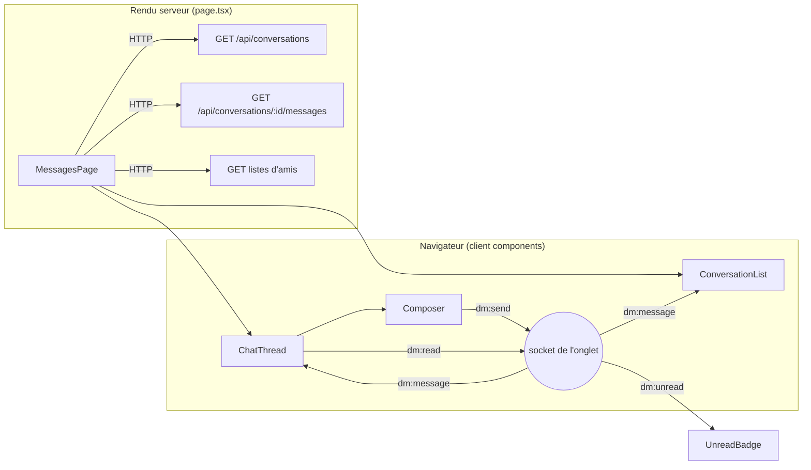
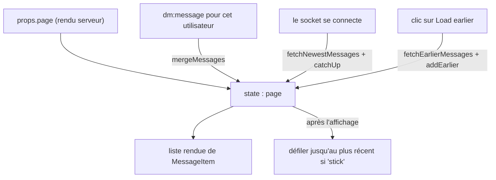
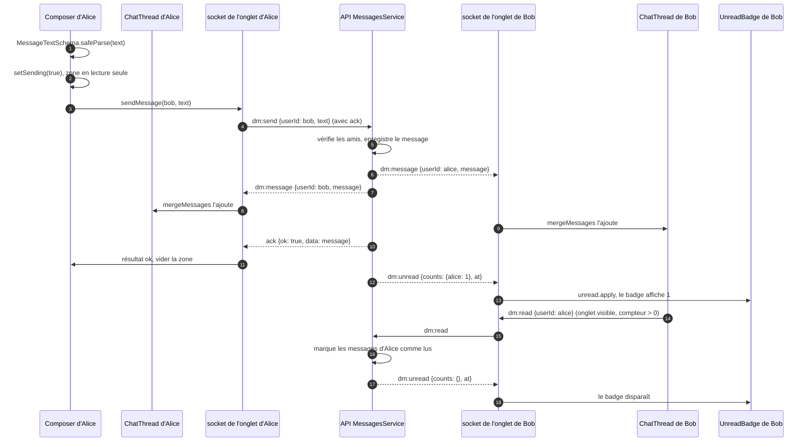
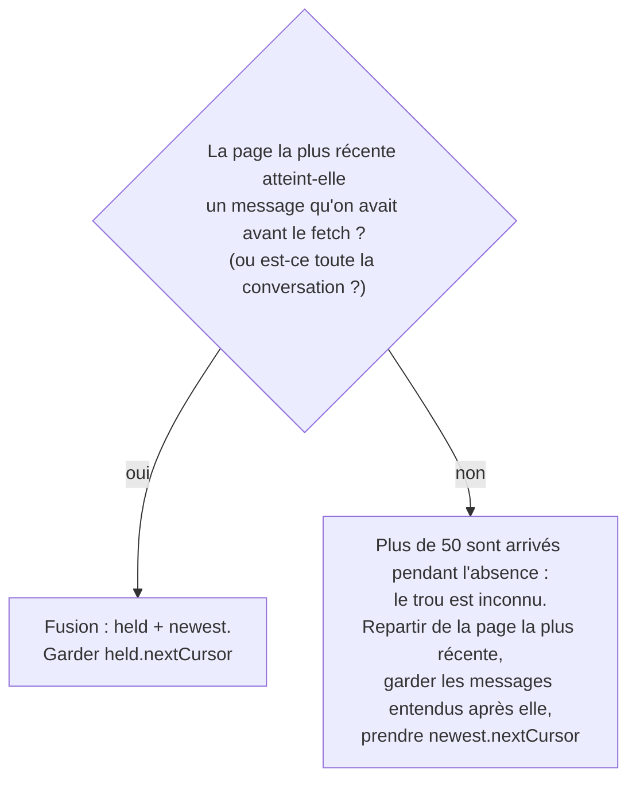
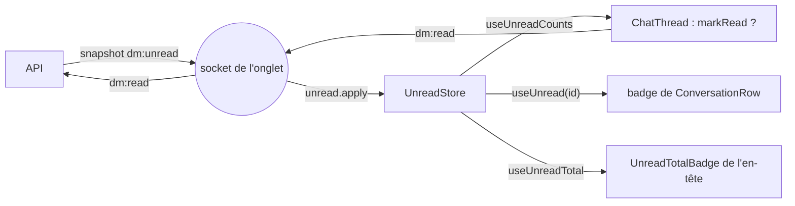
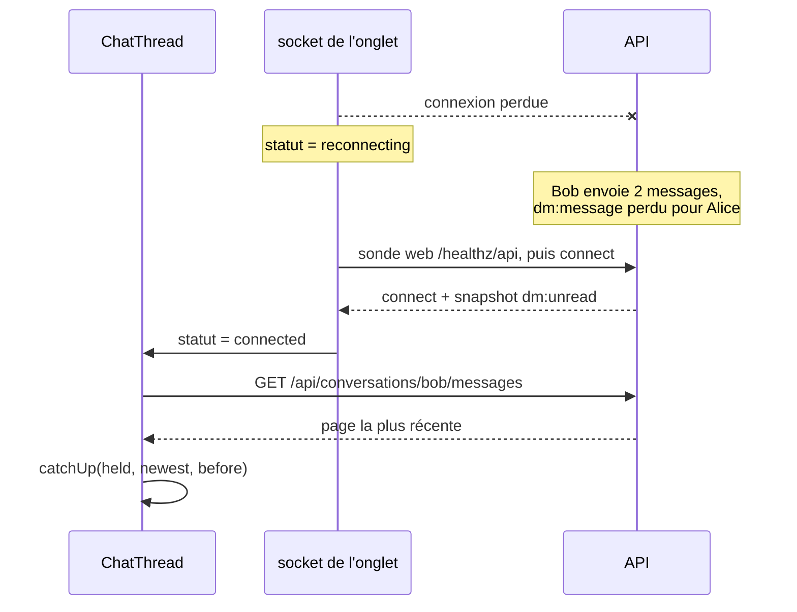

# Chapitre 8 — Le chat

Dans ce chapitre :

- Comment la page `/chat` est construite : une liste de conversations à gauche, un fil à droite.
- Comment un message voyage : de la zone de texte, par le socket, jusqu'au serveur, puis retour vers les deux personnes.
- Ce qu'est une « optimistic UI » (interface optimiste), et pourquoi ce chat ne l'utilise **pas**.
- Comment les nouveaux messages sont fusionnés dans le fil sans doublons.
- Comment les compteurs de non-lus et les badges rouges restent justes, en direct.
- Ce qui se passe quand la connexion est perdue puis revient.

---

## Vue d'ensemble

Imagine le chat comme un **bureau de poste avec un haut-parleur**.

- Quand tu envoies une lettre, tu la donnes au guichet (le serveur) et tu attends un reçu (l'**ack**).
- La poste range la lettre, puis annonce au haut-parleur aux **deux** personnes : « nouvelle lettre dans votre
  conversation ! » (l'événement `dm:message`).
- Elle dit aussi au lecteur « tu as maintenant 3 lettres non lues » (l'événement `dm:unread`).
- Si tu étais absent (ta connexion a coupé), tu as raté le haut-parleur. Donc quand tu reviens, tu vas au
  guichet et tu demandes « donne-moi les lettres les plus récentes » (une requête HTTP normale).

Deux canaux sont utilisés :

| Canal                 | Sert à                                                                                  | Code                                                                                                                                 |
| --------------------- | --------------------------------------------------------------------------------------- | ------------------------------------------------------------------------------------------------------------------------------------ |
| HTTP (`fetch`)        | Premier affichage de la page, « charger plus ancien », rattrapage après une reconnexion | [conversations.ts](../../../apps/web/lib/conversations.ts), [conversations-client.ts](../../../apps/web/lib/conversations-client.ts) |
| WebSocket (socket.io) | Envoyer (`dm:send`), marquer comme lu (`dm:read`), recevoir (`dm:message`, `dm:unread`) | [tab-socket.ts](../../../apps/web/components/tab-socket.ts), [send-message.ts](../../../apps/web/lib/send-message.ts)                |

Un **WebSocket** est une connexion qui reste ouverte, donc le serveur peut envoyer des nouvelles au navigateur à tout
moment. HTTP, c'est « demander, puis recevoir une réponse » ; un WebSocket, c'est « garder la ligne de téléphone ouverte ».
Le chapitre 3 explique le socket de l'onglet lui-même.



### Les fichiers de ce chapitre

```
apps/web/
├── app/[locale]/(messages)/
│   ├── layout.tsx                 the shell of the Messages group
│   └── chat/
│       ├── page.tsx               server component: loads everything, picks the open thread
│       ├── conversation-list.tsx  client: the list, reordered live
│       └── chat-thread.tsx        client: one thread + the text box
├── lib/
│   ├── conversations.ts           server half of the API calls
│   ├── conversations-client.ts    browser half of the API calls
│   ├── thread.ts                  pure functions: merge, catch up, load earlier, time format
│   ├── unread.ts                  the unread-count store
│   ├── send-message.ts            dm:send and its ack
│   ├── presence.ts                who is online (chapter 3)
│   ├── reconnect.ts               retry rules (chapter 3)
│   └── serial-queue.ts            not used by the chat (see the end)
└── components/
    ├── tab-socket.ts              the one socket of the tab (chapter 3)
    ├── unread-badge.tsx           the red number
    ├── presence-dot.tsx           the green/grey dot
    └── message-link.tsx           the "Message" button on /friends and profiles
```

---

## Théorie : l'optimistic UI, et pourquoi ce chat attend

**Optimistic UI** veut dire : quand l'utilisateur clique sur « Envoyer », tu affiches le message dans le fil **tout de suite**,
avant que le serveur réponde. Tu es « optimiste » : tu penses que ça va marcher. Si le serveur dit non plus tard, tu l'enlèves ou tu le marques en rouge.
Ça paraît rapide, mais c'est plus complexe : il te faut un id temporaire, tu dois remplacer le faux message par le vrai,
et tu dois annuler en cas d'échec.

**Pessimistic UI** (l'inverse) veut dire : attendre la réponse du serveur, puis afficher le résultat.

Ce chat **n'est pas optimiste**. Le commentaire sur le `Composer` le dit clairement :

> One send at a time: the box is read-only until the ack, so the text cleared after it is the text that was sent.
> On failure the text stays, to send again. The message joins the thread as a dm:message, which reaches the sending
> tab before the ack.

(Un envoi à la fois : la zone est en lecture seule jusqu'à l'ack, donc le texte effacé après est bien le texte envoyé.
En cas d'échec le texte reste, pour renvoyer. Le message entre dans le fil comme un dm:message, qui arrive à l'onglet
qui envoie avant l'ack.)

Donc le déroulé est :

1. Tu appuies sur Entrée. La zone passe en lecture seule, le bouton est désactivé.
2. Le serveur range le message et envoie `dm:message` aux rooms des **deux** utilisateurs — ton propre onglet aussi.
3. Ton fil reçoit ce `dm:message` et affiche le message (avec son vrai id et sa vraie heure).
4. Ensuite l'ack arrive. La zone est vidée.

Pourquoi ce choix ? Le serveur est rapide, donc l'attente est courte. Et il n'y a qu'**une seule** façon pour un message d'entrer dans le
fil (l'événement `dm:message`), que ce soit toi qui l'aies écrit ou l'autre personne. Pas de faux message, pas de code d'annulation, et
tes autres onglets ouverts l'affichent aussi. Si l'envoi échoue, ton texte est toujours dans la zone, donc tu peux réessayer.

---

## `layout.tsx` — la coque des Messages

[layout.tsx](<../../../apps/web/app/[locale]/(messages)/layout.tsx>) entoure chaque page du route group `(messages)`.
(Un route group est un dossier entre parenthèses : il regroupe des pages sous un même layout sans rien ajouter à l'URL. Voir le chapitre 2.)

```tsx
export default function MessagesLayout({ children }: { children: ReactNode }) {
  return (
    <Shell brand={<Wordmark href="/learn" />} nav={<HeaderNav />} fill footer={<LegalFooter />}>
      {children}
    </Shell>
  );
}
```

- `fill` fixe la coque à la hauteur de l'écran (à partir de la taille `lg`), pour que la liste et le fil puissent **chacun** défiler dans
  leur propre panneau, comme dans la plupart des apps de chat.
- Il n'y a pas de sélecteur de cours ici. Le commentaire explique pourquoi : aucun cours n'est ouvert sur cette page, et le sélecteur
  coûterait un appel à l'API de plus à chaque rendu — et cette page est rendue souvent (sur les événements d'amis).

---

## `chat/page.tsx` — le server component

[page.tsx](<../../../apps/web/app/[locale]/(messages)/chat/page.tsx>) tourne **sur le serveur**. Il charge les données et
rend les deux client components. L'URL est `/chat` (la liste seule) ou `/chat?with=<userId>` (la liste + un fil).

```tsx
export const dynamic = 'force-dynamic';

export default async function MessagesPage({
  searchParams,
}: {
  searchParams: Promise<{ with?: string | string[] }>;
}) {
  const [me, conversations, lists] = await Promise.all([
    requireUser(),
    requireConversations(),
    requireFriends(),
  ]);
```

- `force-dynamic` : cette page montre les messages privés d'une personne, donc Next.js ne doit jamais la mettre en cache ni la pré-rendre.
- Les trois appels tournent **en même temps** avec `Promise.all` : l'utilisateur, les conversations, et les listes d'amis.
  Chaque `require...` envoie un visiteur déconnecté vers `/login` (voir `settle` au chapitre 4).

Ensuite il choisit avec qui est le fil ouvert :

```tsx
const parsed = UserIdInputSchema.safeParse((await searchParams).with);
const withId = parsed.success ? parsed.data : null;
// Someone you may write to, or share a conversation with: nobody else has a thread here.
const friend = lists.friends.find((user) => user.id === withId);
const other = friend ?? conversations.find(({ user }) => user.id === withId)?.user;
const page = other === undefined ? null : await loadMessagePage(other.id);

const friendsOnline = Object.fromEntries(lists.friends.map((user) => [user.id, user.online]));
```

- `?with=` est vérifié avec un schema Zod. Une mauvaise valeur est simplement ignorée : tu vois la liste seule, pas de page d'erreur.
- L'autre personne doit être **un ami** (tu peux lui écrire) **ou** quelqu'un avec qui tu as déjà une conversation
  (un ex-ami : tu peux encore lire les anciens messages, mais pas écrire). Personne d'autre n'a de fil.
- Seulement s'il y a quelqu'un, la page de messages la plus récente est chargée (`loadMessagePage`).
- `friendsOnline` est une petite table `{ userId: true/false }`, utilisée pour les points. Un non-ami n'est pas dans la table, donc
  il n'a pas de point.

Le rendu :

```tsx
<ChatThread
  key={other.id}
  user={other}
  online={friend?.online}
  page={page}
  me={me.id}
  timeZone={me.timeZone}
/>
```

- `key={other.id}` : quand tu ouvres une autre conversation, React voit une nouvelle key et démarre un `ChatThread` **neuf**
  (state neuf). Mais un rafraîchissement de la même conversation garde la même key, donc le state survit.
- `online={friend?.online}` vaut `undefined` pour un ex-ami. Le fil s'en sert pour cacher le point **et** la zone de
  texte.

Sur un téléphone, tu vois la liste **ou** le fil, jamais les deux (classes `max-lg:hidden` et un lien « All messages » (tous les messages)).

À la fin il y a `<RefreshOn events={FRIEND_EVENTS} />` (chapitre 3). Quand une amitié commence ou se termine, la page
est rendue à nouveau depuis le serveur, parce que ça change les personnes à qui tu peux écrire.

---

## `lib/conversations.ts` et `lib/conversations-client.ts` — les appels HTTP

Comme les autres fichiers d'API (chapitre 4), il y a une **moitié serveur** et une **moitié navigateur**.

[conversations.ts](../../../apps/web/lib/conversations.ts) (serveur, utilisé par `page.tsx`) :

```ts
export async function requireConversations(): Promise<Conversation[]> {
  return settle(await apiGet(ConversationsSchema, "/api/conversations"), "conversations")
    .conversations;
}

export async function loadMessagePage(userId: string): Promise<MessagePage> {
  return settle(
    await apiGet(MessagePageSchema, `/api/conversations/${userId}/messages`),
    "messages",
  );
}
```

[conversations-client.ts](../../../apps/web/lib/conversations-client.ts) (navigateur, utilisé par `chat-thread.tsx`) :

```ts
export function fetchNewestMessages(userId: string): Promise<ApiResult<MessagePage>> {
  return clientGet(MessagePageSchema, messagesPath(userId));
}

export function fetchEarlierMessages(
  userId: string,
  cursor: string,
): Promise<ApiResult<MessagePage>> {
  return clientGet(MessagePageSchema, messagesPath(userId), { cursor });
}
```

Les formes des données viennent de `@ft/shared` ([message.ts](../../../packages/shared/src/schemas/message.ts)) :

| Type           | Champs                                            | Sens                                                                                                         |
| -------------- | ------------------------------------------------- | ------------------------------------------------------------------------------------------------------------ |
| `Message`      | `id`, `senderId`, `text`, `createdAt`             | Un message enregistré                                                                                        |
| `MessagePage`  | `messages` (le plus ancien d'abord), `nextCursor` | Jusqu'à 50 messages. `nextCursor` demande la page **avant** eux ; `null` quand le premier message est dedans |
| `Conversation` | `user`, `lastMessageAt`, `unread`                 | Une ligne de la liste                                                                                        |

Un **cursor** est un marque-page : « donne-moi les messages avant celui-ci ». Ici c'est l'id du message le plus ancien de la
page. C'est mieux que « page numéro 3 », parce que les nouveaux messages ne décalent pas les pages.

Tests : [conversations-client.test.ts](../../../apps/web/lib/conversations-client.test.ts) vérifie l'URL avec et
sans `cursor`, et qu'un échec revient sous forme de code.

---

## `chat/conversation-list.tsx` — la liste, en direct

[conversation-list.tsx](<../../../apps/web/app/[locale]/(messages)/chat/conversation-list.tsx>) est un client component.
Il affiche chaque conversation, la plus récente d'abord, chacune avec un avatar, un point, le nom et un badge de non-lus.

La partie clé : quand un nouveau message arrive, sa ligne monte en haut **sans** redemander au serveur.

```tsx
// The last message heard per conversation since the render, which may be later than its own.
const [heard, setHeard] = useState<Partial<Record<string, string>>>({});

useServerEvent(SERVER_EVENTS.DM_MESSAGE, ({ userId, message }) => {
  if (conversations.some(({ user }) => user.id === userId)) {
    setHeard((last) => ({ ...last, [userId]: message.createdAt }));
  } else {
    router.refresh();
  }
});

const latest = ({ user, lastMessageAt }: Conversation) =>
  Math.max(Date.parse(lastMessageAt), Date.parse(heard[user.id] ?? lastMessageAt));
const ordered = [...conversations].sort((a, b) => latest(b) - latest(a));
```

- `useServerEvent` (de `tab-socket.ts`) lance la fonction chaque fois que `dm:message` arrive.
- Si la conversation est **déjà dans la liste**, il retient seulement « entendu en dernier à cette heure » dans `heard`. Le tri
  utilise ensuite la plus tardive des deux heures (le `lastMessageAt` du serveur ou celle entendue).
- Si c'est **quelqu'un de nouveau** (premier message de sa part), la ligne a besoin de son nom et de son avatar, que l'événement
  ne transporte pas. Donc il appelle `router.refresh()` pour rendre à nouveau la page depuis le serveur.

Pourquoi ne pas toujours rafraîchir ? Le commentaire le dit : un rendu coûte trois ou quatre appels à l'API par onglet, et les messages arrivent bien
plus souvent que les événements d'amis. Donc le tri local, peu coûteux, est utilisé dès que possible.

Encore une règle : si tu as ouvert un ami avec `?with=` mais que tu ne lui as jamais écrit, il n'y a pas encore de conversation. La liste
l'ajoute quand même en haut, pour que la liste ne dise jamais « personne » à côté de son fil ouvert :

```tsx
if (open !== null && !conversations.some(({ user }) => user.id === open.id)) {
  rows.unshift({ user: open, unread: 0 });
}
```

Chaque ligne (`ConversationRow`) reçoit son compteur en direct avec `useUnread(user.id, unread)` — voir la section des non-lus plus bas —
et son lien a `prefetch={false}` : précharger toute une liste de personnes coûterait un rendu chacune, face à la limite de
requêtes de l'API.

---

## `chat/chat-thread.tsx` — une conversation

[chat-thread.tsx](<../../../apps/web/app/[locale]/(messages)/chat/chat-thread.tsx>) est le plus gros fichier. Il contient :

- `ChatThread` : les messages et toute la logique pour « rester à jour ».
- `MessageItem` : une bulle.
- `Composer` : la zone de texte.
- De petits helpers : `usePageVisible`, `atNewest`, `showNewest`.

L'idée, d'après le commentaire du haut : **les props sont le point de départ ; à partir de là, il se tient à jour tout seul.**



### State et refs

```tsx
  const status = useSocketStatus();
  const counts = useUnreadCounts();
  const visible = usePageVisible();
  const [page, setPage] = useState(rendered);
  ...
  const stick = useRef(true);
  const shown = useRef(page.messages);
  const anchor = useRef<string | null>(null);
```

- `page` (state) : les messages affichés, en partant de la page du serveur.
- `stick` (ref) : « après le prochain changement, défiler jusqu'au message le plus récent ». `true` au début, pour que le premier affichage montre
  le bas.
- `shown` (ref) : une copie des messages actuels, que le rattrapage peut lire. C'est une **ref**, pas du state, donc un nouveau
  message ne relance pas l'effet de rattrapage.
- `anchor` (ref) : l'id du message qui était en haut avant « Load earlier » (charger plus ancien), pour garder la place du lecteur.

Une **ref** (`useRef`) est une boîte qui garde une valeur entre les rendus, mais la changer ne cause **pas** de nouveau rendu.

### 1. Un nouveau message arrive en direct

```tsx
useServerEvent(SERVER_EVENTS.DM_MESSAGE, ({ userId, message }) => {
  if (userId !== user.id) return;
  stick.current ||= message.senderId === me || atNewest(pane.current, bottom.current);
  setPage((held) => ({ ...held, messages: mergeMessages(held.messages, [message]) }));
});
```

- Le `userId` de l'événement est **l'autre personne** de la conversation (le serveur lui envoie `{ userId: me }` et
  t'envoie `{ userId: them }`). Les événements des autres conversations sont ignorés.
- Défiler en bas si c'est **toi** qui l'as envoyé, ou si tu lisais déjà le message le plus récent. Si tu es remonté pour
  lire d'anciens messages, un nouveau ne te ramène pas brusquement en bas.
- `mergeMessages` l'ajoute, trié, et **une seule fois** (par id). C'est important : le même message peut arriver par l'événement
  et par un fetch de rattrapage.

### 2. Rattrapage à chaque connexion

```tsx
useEffect(() => {
  if (status !== "connected") return;
  let current = true;
  // Taken now: a message heard during the fetch says nothing about the gap.
  const before = shown.current;
  void fetchNewestMessages(user.id).then((result) => {
    if (!current || !result.ok) return;
    stick.current ||= atNewest(pane.current, bottom.current);
    setPage((held) => catchUp(held, result.data, before));
  });
  return () => {
    current = false;
  };
}, [status, user.id]);
```

Chaque fois que le statut du socket devient `connected` (la première fois, et après chaque reconnexion), le fil récupère
la page la plus récente par HTTP. Pourquoi ? Pendant que le socket était coupé, des événements `dm:message` ont été perdus. Le fetch comble le trou.
`current = false` dans le nettoyage ignore une réponse qui revient après que le composant a disparu ou que le statut a changé.
`catchUp` (dans `thread.ts`, plus bas) décide comment fusionner.

### 3. Marquer comme lu

```tsx
useEffect(() => {
  if (visible && status === "connected" && (counts?.[user.id] ?? 0) > 0) markRead(user.id);
}, [visible, status, counts, user.id]);
```

Si l'onglet est au premier plan (`visible`), connecté, et que cette conversation a des messages non lus, envoyer `dm:read`. Le
serveur répond avec un nouveau snapshot (instantané) `dm:unread` — **toujours**, même si rien n'a changé. Ce nouveau snapshot est un nouvel
objet `counts`, donc cet effet tourne à nouveau. Si un message est arrivé pendant que la lecture était en route, il est lu aussi.
Un onglet caché ne marque jamais rien comme lu (`usePageVisible` utilise `document.visibilityState`).

### 4. Le défilement

```tsx
useEffect(() => {
  if (!stick.current) return;
  stick.current = false;
  showNewest(pane.current, bottom.current);
}, [page.messages]);

useLayoutEffect(() => {
  const id = anchor.current;
  if (id === null) return;
  anchor.current = null;
  pane.current?.querySelector(`[data-id="${id}"]`)?.scrollIntoView({ block: "start" });
}, [page.messages]);
```

- `useEffect` tourne **après** l'affichage. Il sert à défiler jusqu'en bas, après que Next.js a fait son propre défilement vers
  le haut d'une nouvelle page.
- `useLayoutEffect` tourne **avant** l'affichage. Après « Load earlier », l'ancien premier message est remis en haut
  avant que l'utilisateur voie quoi que ce soit, donc l'écran ne saute pas.

`atNewest` vérifie deux choses, parce que sur un grand écran c'est le panneau qui défile, et sur un téléphone c'est toute la page :
le panneau est à moins de 80 px (`NEAR_END_PX`) de sa fin, **et** le bas du fil est visible à l'écran.

### 5. Charger plus ancien

```tsx
  async function loadEarlier(cursor: string) {
    const first = page.messages[0]?.id ?? null;
    setEarlier({ loading: true, error: null });
    const result = await fetchEarlierMessages(user.id, cursor);
    if (result.ok) {
      anchor.current = first;
      setPage((held) => addEarlier(held, cursor, result.data));
    }
    ...
  }
```

Le bouton ne s'affiche que quand `page.nextCursor` n'est pas `null`. Une erreur s'affiche sous le bouton.

### Le rendu

Les messages sont dans un `<div role="log">`. `role="log"` dit à un lecteur d'écran que les nouvelles lignes sont ajoutées à la fin,
donc il les lit quand elles arrivent. Chaque `MessageItem` est une bulle à droite (les miens) ou à gauche (les siens), avec un
« You: » caché ou le nom pour les lecteurs d'écran, et un `<time>` formaté avec `timeFormat`. Le `<time>` a
`suppressHydrationWarning` parce que le serveur et le navigateur peuvent formater une heure un tout petit peu différemment.

En bas : le `Composer` pour un ami, ou le texte « only friends can write » (seuls les amis peuvent écrire) pour un ex-ami.

### Le `Composer`

```tsx
async function send() {
  if (sending) return;
  const parsed = MessageTextSchema.safeParse(text);
  if (!parsed.success) {
    setError(errorMessage(parsed.error.issues[0]?.message ?? "unknown"));
    return;
  }

  setSending(true);
  const result = await sendMessage(userId, parsed.data);
  setSending(false);
  if (!result.ok) {
    setError(errorMessage(result.code));
    return;
  }
  setText("");
  setError(null);
}
```

- Le texte est d'abord vérifié dans le navigateur avec le **même** schema que celui du serveur (`MessageTextSchema` : sans espaces au début et à la fin,
  de 1 à 1000 caractères, pas de caractère NUL). Un message vide ne quitte jamais le navigateur.
- `readOnly={sending}` sur le `<textarea>` et `disabled={sending}` sur le bouton : un envoi à la fois.
- Si ça marche, la zone est vidée. Si ça échoue, le texte reste et une erreur s'affiche.

Le clavier :

```tsx
function onKeyDown(event: KeyboardEvent<HTMLTextAreaElement>) {
  const { isComposing, keyCode } = event.nativeEvent;
  if (event.key !== "Enter" || event.shiftKey || isComposing || keyCode === 229) return;
  event.preventDefault();
  event.currentTarget.form?.requestSubmit();
}
```

Entrée envoie, Maj+Entrée fait une nouvelle ligne. Un **IME** est l'outil utilisé pour taper des langues comme le japonais ou le chinois :
tu tapes des lettres, puis tu appuies sur Entrée pour confirmer un mot. Cet Entrée-là ne doit pas envoyer le message. `isComposing` le détecte,
et `keyCode === 229` le détecte sur Safari.

---

## `lib/send-message.ts` — `dm:send` et son ack

[send-message.ts](../../../apps/web/lib/send-message.ts) contient la logique d'envoi. Elle est gardée en dehors de `tab-socket.ts` pour
pouvoir être testée avec un faux socket (le vrai a besoin d'un navigateur). `tab-socket.ts` l'appelle simplement :

```ts
export function sendMessage(userId: string, text: string): Promise<SocketAck<Message>> {
  return sendMessageOver(socket(), userId, text);
}
```

Un **ack** (acknowledgement, accusé de réception) est la façon de socket.io d'obtenir une réponse à un événement, comme une réponse à une lettre.
`emitWithAck` envoie l'événement et renvoie une Promise de la réponse.

```ts
export async function sendMessageOver(
  socket: SendSocket,
  userId: string,
  text: string,
): Promise<SocketAck<Message>> {
  if (!socket.connected) return UNREACHABLE;

  let answer: unknown;
  try {
    answer = await socket
      .timeout(SEND_TIMEOUT_MS)
      .emitWithAck(CLIENT_EVENTS.DM_SEND, { userId, text });
  } catch {
    return UNREACHABLE;
  }

  const parsed = AckSchema.safeParse(answer);
  if (!parsed.success) return { ok: false, code: "unknown" };
  if (!parsed.data.ok && parsed.data.code === "server.unexpected") {
    return { ok: false, code: "unknown" };
  }
  return parsed.data;
}
```

- **Pas connecté → échec tout de suite.** Sinon socket.io garderait l'événement et l'enverrait à la reconnexion, bien après que la
  page a dit « échec ». L'utilisateur verrait alors un message qu'il croyait perdu.
- **Timeout de 10 s** (`SEND_TIMEOUT_MS`). Pas de réponse : « réseau injoignable ». Le commentaire reconnaît un petit risque : le
  serveur l'a peut-être quand même enregistré, donc un nouvel essai pourrait l'afficher deux fois. C'est accepté.
- **La réponse est vérifiée avec Zod** (`AckSchema`) : soit `{ ok: true, data: Message }`, soit `{ ok: false, code }`.
- `server.unexpected` est transformé en `unknown`, parce que son texte traduit parle d'un statut HTTP, ce qu'un
  socket n'a pas.

`SendSocket` est une petite interface : juste `connected` et `timeout(...).emitWithAck(...)`. Le test passe un faux
objet avec cette forme.

Tests : [send-message.test.ts](../../../apps/web/lib/send-message.test.ts) — succès, refus hors ligne (rien
d'envoyé), timeout, un code de refus, `server.unexpected`, et de mauvaises réponses.

---

## Séquence : envoyer un message et l'autre personne qui le voit en direct

Ici Alice écrit à Bob. Les deux ont le chat ouvert. L'onglet de Bob affiche aussi un badge dans l'en-tête.



Notes sur ce diagramme (d'après [messages.service.ts](../../../apps/api/src/messages/messages.service.ts), voir le
chapitre 9 de l'API) :

- Le serveur envoie `dm:message` aux **deux rooms** avant de renvoyer l'ack. Donc le propre fil d'Alice affiche son message
  grâce à l'événement, pas grâce à l'ack.
- Le compteur de non-lus est envoyé avec `void this.tellUnread(them)` : pas attendu avec `await`, donc l'ack n'attend jamais le compteur.
- Si le chat de Bob n'était **pas** ouvert (il est sur `/friends`), les étapes 9 et 14 à 18 n'auraient pas lieu : seul son badge
  afficherait 1.

---

## `lib/thread.ts` — la fusion, gardée pure

[thread.ts](../../../apps/web/lib/thread.ts) contient les règles de fusion sous forme de **fonctions pures** : elles prennent seulement des valeurs et
renvoient de nouvelles valeurs, sans React, sans réseau. Ça les rend faciles à tester.

### `mergeMessages`

```ts
function oldestFirst(a: Message, b: Message): number {
  const byTime = Date.parse(a.createdAt) - Date.parse(b.createdAt);
  if (byTime !== 0) return byTime;
  return a.id < b.id ? -1 : a.id > b.id ? 1 : 0;
}

export function mergeMessages(held: Message[], incoming: Message[]): Message[] {
  const byId = new Map(held.map((message) => [message.id, message]));
  for (const message of incoming) byId.set(message.id, message);
  return [...byId.values()].sort(oldestFirst);
}
```

Une `Map` indexée par id enlève les doublons. Puis on trie par heure, et par id quand deux messages ont la même milliseconde
(le même ordre que celui du serveur).

### `catchUp`

Après une reconnexion, le fil contient des messages, et le serveur donne les 50 plus récents. Deux cas :



```ts
export function catchUp(held: MessagePage, newest: MessagePage, before: Message[]): MessagePage {
  const ids = new Set(before.map((message) => message.id));
  const meets = newest.nextCursor === null || newest.messages.some(({ id }) => ids.has(id));

  if (meets) {
    return { messages: mergeMessages(held.messages, newest.messages), nextCursor: held.nextCursor };
  }
  const last = newest.messages.at(-1);
  const later = held.messages.filter(
    (message) => last !== undefined && oldestFirst(message, last) > 0,
  );
  return { messages: mergeMessages(newest.messages, later), nextCursor: newest.nextCursor };
}
```

`before`, c'est ce que le fil contenait **quand le fetch a commencé**. Un message entendu en direct pendant le fetch peut aussi être dans
la page la plus récente ; il ne doit pas compter comme « on a atteint les anciens messages ». Dans le cas « non », les messages plus anciens peuvent être
rechargés avec « Load earlier ».

### `addEarlier`

```ts
export function addEarlier(held: MessagePage, cursor: string, earlier: MessagePage): MessagePage {
  if (held.nextCursor !== cursor) return held;
  return {
    messages: mergeMessages(earlier.messages, held.messages),
    nextCursor: earlier.nextCursor,
  };
}
```

Si un rattrapage a fait repartir le fil pendant que « Load earlier » chargeait, le cursor a changé, et l'ancienne page est
jetée.

### `timeFormat`

Renvoie les options d'`Intl.DateTimeFormat` : seulement l'heure pour un message d'aujourd'hui, la date et l'heure sinon. « Aujourd'hui » est
décidé dans le fuseau horaire du **lecteur** (celui de son compte). Si le navigateur ne connaît pas ce nom de fuseau, il se rabat
sur le fuseau du navigateur lui-même (`knownZone`).

Tests : [thread.test.ts](../../../apps/web/lib/thread.test.ts) couvre chaque cas : doublons, même milliseconde, un rattrapage
qui rejoint ou non, un message entendu pendant le fetch, une page plus ancienne jetée, et les formats d'heure.

---

## Les compteurs de non-lus : `lib/unread.ts`, `tab-socket.ts`, `unread-badge.tsx`

### Le store

[unread.ts](../../../apps/web/lib/unread.ts) crée un petit store (magasin de données) qui vit aussi longtemps que le socket de l'onglet (pas une seule
page), donc le badge de l'en-tête est juste sur **chaque** page.

Le serveur envoie toujours **l'image complète** (`dm:unread` = `{ counts: { userId: n }, at }`), jamais « +1 ». Donc un
snapshot remplace le précédent. Mais deux snapshots peuvent se croiser en route (une lecture et un nouveau message en même temps).
L'horodatage `at` décide qui gagne :

```ts
    apply(snapshot) {
      if (kept !== undefined && Date.parse(snapshot.at) < Date.parse(kept.at)) return;
      kept = snapshot;
      changed();
    },
```

- Un snapshot plus ancien est ignoré.
- Chaque snapshot gardé prévient ceux qui écoutent, **même si les nombres n'ont pas changé**. C'est ce qui fait retourner l'effet
  « marquer comme lu » du fil (voir plus haut).
- `clear()` à la déconnexion : la prochaine personne qui utilise cet onglet ne doit pas voir ces compteurs.

Il exporte aussi `badgeText` (`"99+"` au-dessus de 99) et `unreadTotal` (la somme de toutes les conversations).

### Les hooks dans `tab-socket.ts`

`tab-socket.ts` crée un store et le remplit depuis le socket :

```ts
created.on(SERVER_EVENTS.DM_UNREAD, (snapshot) => unread.apply(snapshot));
```

Et fournit des hooks React pour le lire (avec `useSyncExternalStore`, la façon de React de lire un store qui vit en dehors de React) :

```ts
export function useUnreadCounts(): UnreadCounts | undefined {
  return useSyncExternalStore(unread.subscribe, unread.get, () => undefined);
}

export function useUnread(userId: string, rendered: number): number {
  const counts = useUnreadCounts();
  return counts === undefined ? rendered : (counts[userId] ?? 0);
}
```

Avant le premier snapshot, `useUnread` utilise `rendered`, le compteur que le serveur a mis dans la page. Après ça, le compteur en direct
gagne. Le serveur envoie un `dm:unread` à chaque connexion, donc ce passage se fait vite.

`markRead` envoie `dm:read` seulement quand on est connecté, et ne le met jamais en file d'attente : le fil redemande à la prochaine connexion.

### Le badge

[unread-badge.tsx](../../../apps/web/components/unread-badge.tsx) :

```tsx
export function UnreadBadge({ count }: { count: number | undefined }) {
  const t = useTranslations("MessagesPage");

  if (count === undefined || count === 0) return null;
  return (
    <span className="inline-flex h-5 min-w-5 ...">
      <span aria-hidden>{badgeText(count)}</span>
      <span className="sr-only">{t("unread", { count })}</span>
    </span>
  );
}

export function UnreadTotalBadge() {
  return <UnreadBadge count={useUnreadTotal()} />;
}
```

- Rien à 0, et rien avant que l'onglet ait entendu quelque chose. Donc un « 0 » ne clignote jamais au premier affichage.
- L'œil voit `99+` ; un lecteur d'écran entend la phrase complète avec le nombre exact.
- `UnreadBadge` est utilisé pour chaque ligne de la liste des conversations. `UnreadTotalBadge` est utilisé dans l'en-tête
  ([header-menu.tsx](../../../apps/web/components/header-menu.tsx), [session-nav.tsx](../../../apps/web/components/session-nav.tsx)).



Tests : [unread.test.ts](../../../apps/web/lib/unread.test.ts) — rien avant le premier snapshot, remplacer et pas fusionner,
snapshots dans le désordre, ceux qui écoutent prévenus même sans changement, clear, `badgeText`, `unreadTotal`.

---

## La présence : `presence-dot.tsx` et `lib/presence.ts`

Le chapitre 3 couvre [presence.ts](../../../apps/web/lib/presence.ts) et les listeners du socket. Dans le chat, c'est utilisé par
`AvatarWithDot` dans [presence-dot.tsx](../../../apps/web/components/presence-dot.tsx), dans chaque ligne de la liste et dans
l'en-tête du fil :

```tsx
export function AvatarWithDot({
  user,
  online,
  size,
}: {
  user: PublicUser;
  online?: boolean;
  size: number;
}) {
  return (
    <span className="relative shrink-0">
      <Avatar src={user.avatarUrl} name={user.displayName} size={size} />
      {online === undefined ? null : (
        <span className="absolute -right-0.5 -bottom-0.5 flex">
          <PresenceDot userId={user.id} online={online} />
        </span>
      )}
    </span>
  );
}
```

- `online === undefined` (pas un ami) → pas de point.
- `PresenceDot` utilise `useFriendOnline(userId, online)` : la valeur en direct de la table de présence, ou la valeur du serveur
  tant que l'onglet n'a rien entendu sur cet ami. Vert quand il est en ligne, gris sinon, avec un libellé « Online »/« Offline » pour les
  lecteurs d'écran.

Tests : [presence.test.ts](../../../apps/web/lib/presence.test.ts).

---

## `message-link.tsx` — la porte d'entrée

[message-link.tsx](../../../apps/web/components/message-link.tsx) est le bouton « Message » sur la
[page des amis](<../../../apps/web/app/[locale]/(main)/friends/page.tsx>) et sur un
[profil utilisateur](<../../../apps/web/app/[locale]/(main)/users/[id]/page.tsx>) :

```tsx
export function MessageLink({ userId }: { userId: string }) {
  const t = useTranslations("FriendsPage");

  return (
    <Link href={`/chat?with=${userId}`} prefetch={false} className={SECONDARY_BUTTON}>
      {t("message")}
    </Link>
  );
}
```

C'est un simple lien vers `/chat?with=<id>`. Son libellé ne contient pas le nom, donc on ne le confond jamais avec le
lien du profil juste à côté. Pas de prefetch, encore pour la limite de requêtes.

---

## La reconnexion : `lib/reconnect.ts` (en bref)

Le chapitre 3 explique la boucle de nouvel essai en détail. Pour le chat, ce qui compte :

| Événement           | Règle dans [reconnect.ts](../../../apps/web/lib/reconnect.ts) | Ce que voit le chat                                                                                                                                 |
| ------------------- | ------------------------------------------------------------- | --------------------------------------------------------------------------------------------------------------------------------------------------- |
| Connexion perdue    | `afterDisconnect` → `'reconnect'`                             | statut `reconnecting` ; les envois échouent tout de suite (`network.unreachable`)                                                                   |
| Nouvel essai        | `backoffMs` : 1, 2, 4, 8, puis 10 s, ±25 % au hasard          | `apiIsUp()` vérifie `/healthz/api` avant de se connecter                                                                                            |
| De nouveau en ligne | événement `connect`                                           | statut `connected` → le fil lance `fetchNewestMessages` + `catchUp` ; un nouveau `dm:unread` arrive ; l'effet « marquer comme lu » tourne à nouveau |
| Session finie       | `afterConnectError` → `'signedOut'`                           | store des non-lus vidé                                                                                                                              |

Donc rien n'est perdu : pendant l'absence, des événements `dm:message` sont ratés, mais le fetch de rattrapage à la reconnexion les
ramène, et `mergeMessages` fait en sorte qu'aucun ne s'affiche deux fois.



Tests : [reconnect.test.ts](../../../apps/web/lib/reconnect.test.ts).

---

## `lib/serial-queue.ts` — pas une partie du chat

[serial-queue.ts](../../../apps/web/lib/serial-queue.ts) lance des tâches async l'une après l'autre, dans l'ordre. Il était listé
avec les fichiers du chat, mais le chat ne l'utilise **pas** : le `Composer` permet un envoi à la fois avec son drapeau `sending`
à la place. Son seul utilisateur est [use-course-save.ts](../../../apps/web/lib/use-course-save.ts) (chapitre 6), pour que deux sauvegardes
du même réglage arrivent au serveur dans l'ordre où l'apprenant les a faites. Le chapitre 9 parcourt son test.

---

## Idées clés à retenir

- `/chat` est un **server component** qui charge la liste, les amis et la page la plus récente ; la liste et le fil sont des
  **client components** qui se tiennent à jour par le socket.
- Le chat n'est **pas optimiste** : la zone attend l'ack, et un message (le tien ou le sien) n'entre dans le fil que
  par l'événement `dm:message`, que le serveur envoie aux deux personnes.
- `mergeMessages` enlève les doublons par id et trie par heure puis par id, donc un message qui arrive deux fois (événement + fetch) s'affiche une seule fois.
- À **chaque connexion**, le fil récupère la page la plus récente et utilise `catchUp` pour combler ce qui a été raté pendant l'absence.
- Les compteurs de non-lus sont des **snapshots complets** avec un horodatage ; le plus récent gagne, quel que soit l'ordre d'arrivée.
- Un fil visible et connecté avec des messages non lus envoie `dm:read` ; le serveur répond toujours avec un nouveau snapshot,
  donc la lecture se répète jusqu'à ce que le compteur soit à 0.
- La liste se re-trie en local sur un nouveau message, et ne se rafraîchit depuis le serveur que pour une toute nouvelle conversation.
- Les envois échouent tout de suite hors ligne, donc socket.io ne livre jamais un vieux message en retard.
- La logique pure (`thread.ts`, `unread.ts`, `send-message.ts`, `reconnect.ts`, `presence.ts`) vit dans `lib/` pour pouvoir
  être testée sans navigateur.

---

Précédent : [Chapitre 7 — Le lecteur de leçon](07-lesson-player.md) · Suivant : [Chapitre 9 — Tester l'app web](09-tests.md) · [Retour à l'index](README.md)
