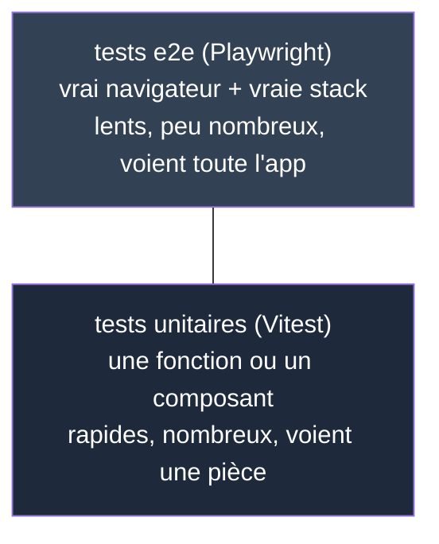
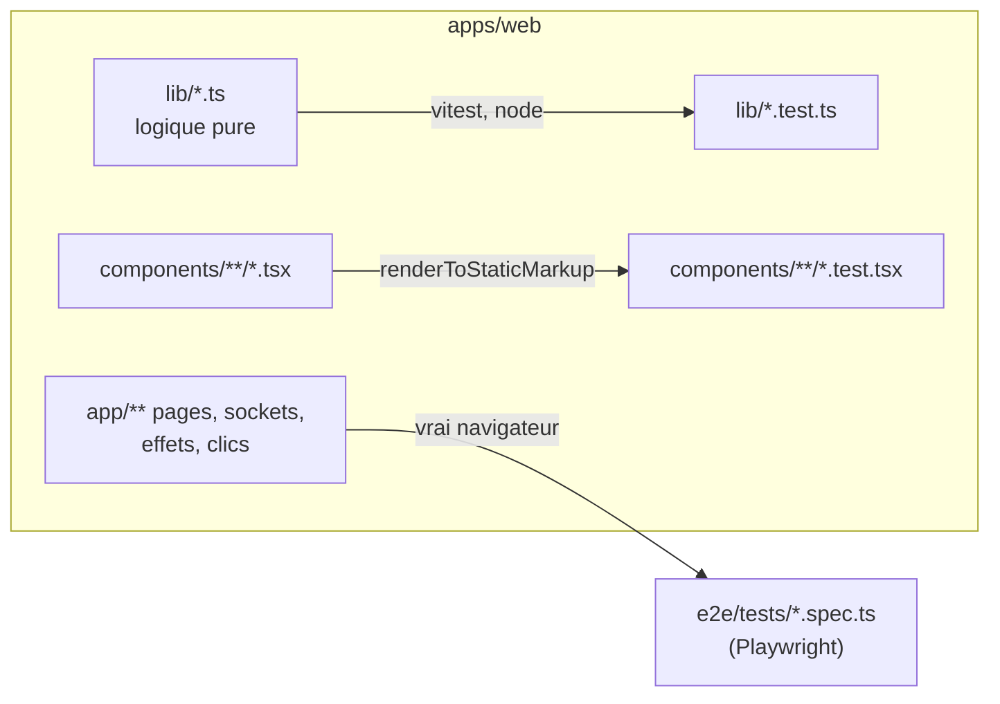
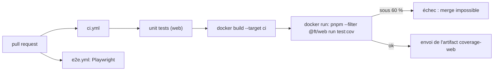

# Chapitre 9 — Tester l'app web

Dans ce chapitre :

- Ce qu'est un test unitaire, et les mots que tu vas rencontrer : test runner, assertion, mock, jsdom.
- Tester des fonctions pures ou tester des composants.
- Comment l'app web lance ses tests : `vitest.config.mts`, les scripts de `package.json`, turbo, `make`, la CI.
- Un test de bibliothèque et un test de composant, lus ligne par ligne.
- Un tableau de **tous** les fichiers de test dans `apps/web`, avec ce qu'ils vérifient.
- Le dossier `coverage/`.
- Les tests end-to-end dans le navigateur (Playwright) dans `e2e/` à la racine.

---

## Théorie : qu'est-ce qu'un test ?

### L'analogie : le cuisinier qui goûte

Un cuisinier n'attend pas que le client dise "trop salé". Avant qu'un plat quitte la cuisine, le cuisinier prend une cuillère
et goûte. Si ce n'est pas bon, le plat n'arrive jamais à table.

Un **test**, c'est cette cuillère, pour le code. C'est un petit bout de code qui :

1. **prépare** des données d'entrée ("arrange"),
2. **lance** le code que tu veux vérifier ("act"),
3. **vérifie** que le résultat est celui que tu attends ("assert").

Si la vérification échoue, le test échoue, et tu sais que quelque chose est cassé — avant qu'un utilisateur ne le voie.

Un **test unitaire** goûte **une petite partie** (une fonction, un composant) toute seule, très vite, sans vrai serveur, sans
vraie base de données et sans vrai navigateur. Un **test end-to-end (e2e)** goûte le repas entier : un vrai navigateur clique
dans la vraie app.



### Les mots que tu vas rencontrer

| Mot                            | Sens simple                                                                                                                                                                         |
| ------------------------------ | ----------------------------------------------------------------------------------------------------------------------------------------------------------------------------------- |
| **Test runner**                | Le programme qui trouve les fichiers de test, les lance et affiche réussi/échoué. Ici : **Vitest**.                                                                                 |
| `describe`                     | Un groupe de tests avec un titre, par ex. `describe('mergeMessages', ...)`.                                                                                                         |
| `it` (ou `test`)               | Un test. Son titre est une phrase : `it('keeps each message once, oldest first', ...)`.                                                                                             |
| `it.each` / `describe.each`    | Le même test lancé avec plusieurs entrées, à partir d'un tableau.                                                                                                                   |
| `expect(x).toBe(y)`            | Une **assertion** : "x doit valoir y". Fait échouer le test sinon.                                                                                                                  |
| **Mock** / **fake**            | Une fausse version de quelque chose que le code utilise (comme `fetch` ou un socket), pour que le test contrôle sa réponse et que rien de réel ne soit appelé.                      |
| `vi.fn()`                      | L'outil de Vitest pour créer une fausse fonction. Il enregistre chaque appel, donc tu peux vérifier "a-t-elle été appelée, et avec quoi ?".                                         |
| `vi.stubGlobal('fetch', ...)`  | Remplace une variable globale (ici `fetch`) par un faux pendant le test. `vi.unstubAllGlobals()` remet la vraie.                                                                    |
| `vi.mock('next/headers', ...)` | Remplace tout un module importé par un faux.                                                                                                                                        |
| **jsdom**                      | Une fausse page de navigateur écrite en JavaScript. Elle donne à Node un `document` et une `window`, pour que tu puisses cliquer sur des boutons dans un test sans vrai navigateur. |
| **Coverage**                   | Les lignes de ton code qui ont été exécutées par les tests, en pourcentage (la couverture).                                                                                         |

### Fonctions pures ou composants

Une **fonction pure** prend seulement des entrées et renvoie une sortie. Pas de réseau, pas d'écran, pas d'horloge (ou l'horloge
est passée en paramètre). Exemple : `mergeMessages(held, incoming)` du chapitre 8. La tester est facile : on l'appelle, on compare le résultat.

Un **composant** dessine du HTML et peut réagir aux clics, aux minuteurs et aux effets. Le tester est plus dur : il faut l'afficher
quelque part et regarder le résultat. Il y a deux façons courantes :

| Façon                       | Comment                                                                        | Voit les effets et les clics ?               |
| --------------------------- | ------------------------------------------------------------------------------ | -------------------------------------------- |
| **jsdom + Testing Library** | Afficher dans un faux DOM, puis "cliquer" et lire la page comme un utilisateur | Oui                                          |
| **`renderToStaticMarkup`**  | Demander à React la chaîne HTML, comme le serveur la dessinerait               | Non : pas de DOM, les effets ne tournent pas |

**Ce projet a choisi la deuxième façon.** Le commentaire dans `vitest.config.mts` dit :

> Components are tested with renderToStaticMarkup, as in packages/ui: no DOM.

(Les composants sont testés avec renderToStaticMarkup, comme dans packages/ui : pas de DOM.)

Donc : **l'app web n'utilise pas jsdom, et n'utilise pas Testing Library.** L'environnement de test est du Node tout simple.
C'est pour cela qu'autant de logique est sortie des composants et mise dans `lib/` sous forme de fonctions pures (`thread.ts`, `unread.ts`,
`reconnect.ts`, `send-message.ts`...) : là, on peut la tester sans navigateur. Les parties qui ont vraiment besoin d'un navigateur
(le socket, le défilement, les clics) sont vérifiées par les tests e2e Playwright à la place.



---

## `vitest.config.mts` — les réglages des tests

[vitest.config.mts](../../apps/web/vitest.config.mts) dit à Vitest comment lancer les tests web.

```ts
export default defineConfig({
  resolve: {
    alias: {
      '@': rootDir,
    },
  },
  // tsconfig keeps JSX for Next ("preserve"): the component tests need it compiled.
  oxc: { jsx: { runtime: 'automatic' } },
  test: {
    environment: 'node',
    // Components are tested with renderToStaticMarkup, as in packages/ui: no DOM.
    include: ['lib/**/*.test.ts', 'components/**/*.test.tsx'],
    coverage: {
      provider: 'v8',
      reporter: ['text-summary', 'lcov'],
      reportsDirectory: 'coverage',
      // Server components and route handlers need a browser runtime plus an RSC
      // renderer to exercise; the logic they call lives in lib/ instead, which
      // is what the thresholds below actually measure.
      include: ['lib/**/*.ts'],
      exclude: ['lib/**/*.test.ts'],
      thresholds: {
        lines: 60,
        functions: 60,
      },
    },
  },
});
```

Ligne par ligne :

- `alias '@'` : pour que `import ... from '@/lib/thread'` marche dans les tests, comme dans l'app (tsconfig a le même alias).
- `oxc.jsx` : Next.js laisse le JSX tel quel (`"jsx": "preserve"` dans tsconfig) car Next le compile lui-même. Vitest n'utilise
  pas Next, donc il doit compiler le JSX des fichiers `.test.tsx`. `oxc` est le compilateur rapide qu'utilise Vite.
- `environment: 'node'` : pas de faux navigateur. Pas de `document`, pas de `window` (un test qui a besoin de `window` le simule lui-même,
  voir `lesson-history.test.ts`).
- `include` : seulement les fichiers de test dans `lib/` et `components/`. Rien sous `app/`.
- `coverage` :
  - `provider: 'v8'` : utilise le compteur de couverture intégré au moteur de Node (V8).
  - `reporter` : un court résumé dans le terminal (`text-summary`) et des fichiers `lcov` (voir la section sur la couverture).
  - `include: ['lib/**/*.ts']` : seul `lib/` est mesuré. Le commentaire explique : les server components et les route handlers
    ont besoin d'un navigateur et d'un moteur de rendu RSC pour tourner ; la logique qu'ils appellent est dans `lib/`, et c'est
    ce que les seuils mesurent.
  - `thresholds` : si moins de **60 % des lignes** ou **60 % des fonctions** de `lib/` sont couvertes, la commande **échoue**.

---

## Comment les tests sont lancés

### Les scripts

Dans [apps/web/package.json](../../apps/web/package.json) :

```json
    "test": "vitest run",
    "test:cov": "vitest run --coverage"
```

- `vitest run` lance chaque test une fois et s'arrête (sans `run`, Vitest surveillerait les fichiers et relancerait à chaque changement).
- `--coverage` mesure aussi la couverture et vérifie les seuils.

Dans le [package.json](../../package.json) racine, turbo lance le même script dans **chaque** package :

```json
    "test": "turbo run test",
    "test:cov": "turbo run test:cov",
    ...
    "ci": "pnpm run format:check && turbo run lint typecheck test:cov build"
```

**turbo** est le lanceur de tâches du monorepo. Dans [turbo.json](../../turbo.json), `test` et `test:cov` dépendent de
`^build` (faire d'abord le build des packages que celui-ci importe, comme `@ft/shared`) et de `db:generate`. `test:cov` déclare
`coverage/**` comme sa sortie, pour que turbo puisse la mettre en cache.

### Où ils tournent

| Où                                     | Commande                                                                                                   | Ce que ça lance pour le web                                                                                                                              |
| -------------------------------------- | ---------------------------------------------------------------------------------------------------------- | -------------------------------------------------------------------------------------------------------------------------------------------------------- |
| Ta machine, une app                    | `pnpm --filter @ft/web test` (ou `test:cov`)                                                               | Vitest dans `apps/web`                                                                                                                                   |
| Ta machine, tout                       | `make test` → `pnpm run test`                                                                              | Les tests unitaires de chaque package                                                                                                                    |
| Ta machine, les vérifications de la CI | `make ci`                                                                                                  | Les vérifications du dépôt dans `scripts/`, puis `pnpm run ci` (format, lint, typecheck, `test:cov`, build), `prisma migrate deploy` et les e2e de l'API |
| Ta machine, tout le pipeline           | `make` (cible `all`)                                                                                       | `make ci`, puis la stack de production (`make run`), `make monitoring-check` et Playwright sur Chromium                                                  |
| Étape Docker `ci`                      | `CMD` de [apps/web/Dockerfile](../../apps/web/Dockerfile) : `pnpm lint && pnpm typecheck && pnpm test:cov` | La même chose, dans l'image                                                                                                                              |
| CI GitHub                              | [ci.yml](../../.github/workflows/ci.yml), job `unit tests (web)`                                           | `pnpm --filter @ft/web run test:cov` dans l'étape Docker `ci`                                                                                            |
| hook git pre-push                      | [.husky/pre-push](../../.husky/pre-push)                                                                   | Seulement lint et typecheck, **pas** les tests (pour rester rapide)                                                                                      |

En CI, le job `unit-tests` fait le build de l'étape `ci` du Dockerfile et lance les tests **dans** cette image, donc
"ça passe en CI" veut dire "ça passe sur la même image Node de base que la production" (`node:24.22.3-trixie-slim`).
L'image de production elle-même est testée par Playwright ([e2e.yml](../../.github/workflows/e2e.yml)). Le dossier de couverture est ensuite copié dehors
et envoyé comme un artifact nommé `coverage-web` (gardé 7 jours). Le commentaire de la CI ajoute : les seuils **bloquent le
merge** — la commande de test elle-même sort avec une erreur en dessous de 60 %.



---

## Visite 1 : un test de bibliothèque — `lib/serial-queue.test.ts`

D'abord le code testé, [serial-queue.ts](../../apps/web/lib/serial-queue.ts) :

```ts
export function serialQueue() {
  let tail: Promise<unknown> = Promise.resolve();

  return function run<T>(task: () => Promise<T>): Promise<T> {
    const result = tail.then(task);
    tail = result.catch(() => undefined);
    return result;
  };
}
```

`serialQueue()` te donne une fonction `run`. Chaque tâche que tu donnes à `run` ne démarre qu'après la fin de la précédente
(`tail.then(task)`). `tail = result.catch(...)` veut dire qu'une tâche ratée ne bloque pas les suivantes. Elle est
utilisée par [use-course-save.ts](../../apps/web/lib/use-course-save.ts), pour que deux enregistrements arrivent au serveur dans l'ordre.

Maintenant le test, [serial-queue.test.ts](../../apps/web/lib/serial-queue.test.ts) :

```ts
import { describe, expect, it } from 'vitest';

import { serialQueue } from './serial-queue';

const later = <T>(value: T, ms: number) =>
  new Promise<T>((resolve) => setTimeout(() => resolve(value), ms));
```

- On importe les outils de test depuis `vitest`, et la fonction à tester.
- `later` est un helper : une Promise qui donne `value` après `ms` millisecondes. Il sert à créer une tâche "lente".

```ts
describe('serialQueue', () => {
  it('starts a task only once the one before it has finished', async () => {
    const run = serialQueue();
    const log: string[] = [];

    const slow = run(async () => {
      log.push('slow start');
      await later(null, 20);
      log.push('slow end');
      return 'slow';
    });
    const fast = run(async () => {
      log.push('fast start');
      return 'fast';
    });

    await expect(Promise.all([slow, fast])).resolves.toEqual(['slow', 'fast']);
    expect(log).toEqual(['slow start', 'slow end', 'fast start']);
  });
```

- **Arrange** : une nouvelle file, et un `log` vide pour noter l'ordre dans lequel les choses se passent.
- **Act** : on met en file une tâche lente (20 ms) puis une tâche rapide.
- **Assert** :
  - Les deux rendent leur propre valeur : `['slow', 'fast']`. `.resolves` attend la Promise.
  - Le log prouve l'ordre : la tâche rapide n'a **pas** démarré avant la fin de la lente. Sans la file, le log
    serait `['slow start', 'fast start', 'slow end']`.

```ts
  it('runs the next task after one that fails, and keeps the failure for its caller', async () => {
    const run = serialQueue();

    const failed = run(() => Promise.reject(new Error('refused')));
    const next = run(() => Promise.resolve('next'));

    await expect(failed).rejects.toThrow('refused');
    await expect(next).resolves.toBe('next');
  });
});
```

- La première tâche échoue. Celui qui a appelé cette tâche voit quand même l'erreur (`rejects.toThrow('refused')`).
- La deuxième tâche tourne quand même et réussit. Cela vérifie la ligne `tail = result.catch(...)`.

Aucun mock n'est nécessaire : la fonction est pure à part le temps, et de vrais minuteurs de 20 ms suffisent.

### Un test avec un mock : `lib/conversations-client.test.ts`

Beaucoup de fichiers `lib/*-client.test.ts` suivent le même modèle : remplacer `fetch` par un faux qui renvoie une réponse choisie,
appeler la fonction, puis vérifier à la fois le résultat **et** la façon dont `fetch` a été appelé.

```ts
function respondWith(status: number, body: unknown): typeof fetch {
  return vi.fn(
    async () =>
      new Response(JSON.stringify(body), {
        status,
        headers: { 'content-type': 'application/json' },
      }),
  ) as unknown as typeof fetch;
}

afterEach(() => {
  vi.unstubAllGlobals();
});

describe('fetchNewestMessages', () => {
  it('asks for the conversation with the other user, without a cursor', async () => {
    const fetchMock = respondWith(200, page);
    vi.stubGlobal('fetch', fetchMock);

    await expect(fetchNewestMessages(them)).resolves.toEqual({ ok: true, data: page });
    expect(fetchMock).toHaveBeenCalledWith(
      `/api/conversations/${them}/messages`,
      expect.objectContaining({ method: 'GET' }),
    );
  });
```

- `respondWith` construit un faux `fetch` avec `vi.fn`, qui répond toujours avec ce statut et ce corps JSON.
- `vi.stubGlobal('fetch', ...)` met le faux à la place du vrai `fetch` ; `afterEach` remet le vrai après
  chaque test, pour que les tests ne se gênent pas entre eux.
- `toHaveBeenCalledWith` vérifie l'URL et que la méthode était `GET`. `expect.objectContaining` veut dire "au moins ces
  champs ; d'autres sont permis".

D'autres sortes de faux utilisés dans ce dossier :

- [send-message.test.ts](../../apps/web/lib/send-message.test.ts) construit un **faux socket** : un objet avec
  `connected` et `timeout(...).emitWithAck(...)`, c'est tout ce dont `sendMessageOver` a besoin (voir chapitre 8).
- [api.test.ts](../../apps/web/lib/api.test.ts) et [session.test.ts](../../apps/web/lib/session.test.ts) utilisent
  `vi.mock('next/headers', ...)` et `vi.mock('next/navigation', ...)` pour simuler les cookies, les headers et `redirect`
  (qui ici lance une erreur avec le chemin, pour que le test puisse vérifier où il irait).

---

## Visite 2 : un test de composant — `components/lesson/tutor-answer.test.tsx`

Le composant, [tutor-answer.tsx](../../apps/web/components/lesson/tutor-answer.tsx) (chapitre 7), montre la réponse du tuteur
IA. La réponse est du Markdown écrit par un LLM, donc elle doit être jolie (gras, listes, tableaux) **et** sûre
(pas de HTML brut, pas de liens `javascript:`, pas d'images).

Le test, [tutor-answer.test.tsx](../../apps/web/components/lesson/tutor-answer.test.tsx) :

```tsx
import { renderToStaticMarkup } from 'react-dom/server';
import { describe, expect, it } from 'vitest';

import { TutorAnswer } from './tutor-answer';

/** The answer as the server draws it: no DOM, as the other component tests. */
const html = (text: string, cut = false) =>
  renderToStaticMarkup(<TutorAnswer text={text} cut={cut} />);
```

- `renderToStaticMarkup` (de React) transforme un composant en **chaîne** HTML. Pas besoin de navigateur.
- `html(text)` est un helper pour que chaque test tienne en une courte ligne : on donne du Markdown, on reçoit du HTML.

### Test 1 : le Markdown devient du vrai HTML

```tsx
  it('renders the Markdown the model writes, with no * or # left', () => {
    const out = html(
      [
        '### Your mistakes',
        '',
        'You wrote **je suis allé** but *elle*:',
        '',
        '* the participle agrees',
        '* with the subject',
        '',
        '1. first',
        '2. second',
      ].join('\n'),
    );
    expect(out).toContain('<strong class="font-semibold text-slate-100">je suis allé</strong>');
    expect(out).toContain('<em class="italic">elle</em>');
    expect(out).toMatch(/<ul [^>]*list-disc[^>]*>\s*<li>the participle agrees<\/li>/);
    expect(out).toMatch(/<ol [^>]*list-decimal/);
    expect(out).toContain('>Your mistakes</p>');
    expect(out).not.toMatch(/[*#]/);
  });
```

- `toContain` vérifie un morceau exact du HTML ; `toMatch` vérifie avec une expression régulière (plus souple sur
  l'ordre des classes).
- `>Your mistakes</p>` : un titre `###` devient un `<p>`, pas un `<h3>` (la page a ses propres titres).
- `not.toMatch(/[*#]/)` : aucun symbole Markdown ne reste dans la sortie.

### Tests 4 et 5 : la sécurité

```tsx
  it('shows raw HTML as text, never as markup', () => {
    const out = html('Look: <script>alert(1)</script> and ');
    expect(out).not.toContain('<script');
    expect(out).not.toContain(' {
    const out = html(' [click](javascript:alert(1))');
    expect(out).not.toContain('` doit apparaître comme du texte (`&lt;script&gt;`), jamais comme une balise.

### Les autres tests

- Un tableau GFM et `~~strikethrough~~` (texte barré) s'affichent en `<table>`, `<th>`, `<td>`, `<del>`, avec l'alignement gardé.
- Un lien normal s'ouvre dans un nouvel onglet avec `rel="noopener noreferrer nofollow"` ; un lien de note de bas de page reste sur la page.
- Une réponse coupée (`cut = true`) reçoit une classe CSS qui ajoute `…` après son dernier bloc.

Ce que ce style de test **ne peut pas** faire : cliquer, taper, ou lancer des effets (`useEffect` ne tourne pas dans
`renderToStaticMarkup`). Pour un composant avec des traductions, le test l'enveloppe dans `NextIntlClientProvider`, comme le fait
[reading.test.tsx](../../apps/web/components/lesson/kinds/reading.test.tsx) avec `messages/en.json`.

---

## Tous les fichiers de test dans `apps/web`

37 fichiers : 35 dans `lib/`, 2 dans `components/`.

### `components/`

| Fichier                                                                                  | Ce qu'il vérifie                                                                                                                                                                                                                                                                                                                                              |
| ---------------------------------------------------------------------------------------- | ------------------------------------------------------------------------------------------------------------------------------------------------------------------------------------------------------------------------------------------------------------------------------------------------------------------------------------------------------------- |
| [lesson/tutor-answer.test.tsx](../../apps/web/components/lesson/tutor-answer.test.tsx)   | Le Markdown du tuteur s'affiche en HTML stylé (gras, listes, tableaux, texte barré), les liens sont sûrs, le HTML brut/les images/`javascript:` ne s'affichent jamais, une réponse coupée finit par `…`.                                                                                                                                                      |
| [lesson/kinds/reading.test.tsx](../../apps/web/components/lesson/kinds/reading.test.tsx) | Joue la leçon de lecture d'exemple "Lire un SMS" via le cœur de leçon partagé et affiche chaque page : cartes de mots clés, tableau d'association, compte à rebours de lecture rapide, questions de détail, mise en ordre, page d'examen ; mauvaises réponses marquées, avec la bonne réponse à côté ; score 100 quand tout est juste, 0 quand tout est faux. |

### `lib/` — couche API et session

| Fichier                                                                         | Ce qu'il vérifie                                                                                                                                                                                                                                     |
| ------------------------------------------------------------------------------- | ---------------------------------------------------------------------------------------------------------------------------------------------------------------------------------------------------------------------------------------------------- |
| [api.test.ts](../../apps/web/lib/api.test.ts)                                   | URL de base de l'API (valeur de secours, espaces retirés, slashs), `buildApiUrl`, `describeFetchError` ; `fetchSession` transmet le cookie et l'adresse, lit 401 comme non connecté et 429/500/204/JSON invalide/délai dépassé comme "indisponible". |
| [api-client.test.ts](../../apps/web/lib/api-client.test.ts)                     | `clientGet`/`clientPost` : validation par schema, credentials, codes d'erreur et statut, panne réseau, 204, paramètres de requête, corps JSON ou `FormData`, headers, refus d'un chemin avec `?`.                                                    |
| [session.test.ts](../../apps/web/lib/session.test.ts)                           | `currentUser` transmet les cookies et l'adresse, donne `null` quand l'API est en panne ; `requireUser` renvoie l'utilisateur, redirige vers la connexion, ou lance une erreur quand l'API est en panne.                                              |
| [auth-client.test.ts](../../apps/web/lib/auth-client.test.ts)                   | Inscription, connexion (un facteur ou 202 pour la 2FA), déconnexion et désactivation de la 2FA (204), vérification, enrôlement, modification du profil, envoi/suppression de l'avatar ; les erreurs et le réseau coupé deviennent des codes.         |
| [friends-client.test.ts](../../apps/web/lib/friends-client.test.ts)             | Envoyer, accepter, supprimer une demande d'ami, retirer un ami : bonne URL et bonne méthode, erreurs sous forme de codes.                                                                                                                            |
| [friends.test.ts](../../apps/web/lib/friends.test.ts)                           | `relationTo` : quelqu'un est un ami, une demande reçue, une demande envoyée, ou personne.                                                                                                                                                            |
| [conversations-client.test.ts](../../apps/web/lib/conversations-client.test.ts) | Page la plus récente sans curseur, page plus ancienne avec curseur, échec sous forme de code.                                                                                                                                                        |
| [courses-client.test.ts](../../apps/web/lib/courses-client.test.ts)             | `startCourse` et `setCourseLevel` : résultat, langue dans le chemin, conflit/cours manquant sous forme de codes, mauvaise réponse refusée.                                                                                                           |
| [placement-client.test.ts](../../apps/web/lib/placement-client.test.ts)         | Démarrer, répondre (y compris `null` quand le temps est écoulé), résultat, quitter l'examen de placement ; codes de conflit et d'onboarding ; mauvais payloads refusés.                                                                              |
| [placement-schema.test.ts](../../apps/web/lib/placement-schema.test.ts)         | Le schema d'état du placement accepte/refuse des formes, garde les textes de lecture ; `isPlacementResult` distingue un résultat d'une question.                                                                                                     |
| [lesson-client.test.ts](../../apps/web/lib/lesson-client.test.ts)               | Routes des tentatives (démarrer, envoyer une page, page périmée, aucune clé de réponse divulguée), la mémoire des tentatives dans l'onglet, et les brouillons enregistrés dans le stockage.                                                          |
| [discussion-client.test.ts](../../apps/web/lib/discussion-client.test.ts)       | Le flux de discussion avec le tuteur : morceaux transmis au fur et à mesure, événements d'erreur, connexion coupée, 429 avec temps d'attente, refus, panne réseau.                                                                                   |

### `lib/` — chat et socket

| Fichier                                                         | Ce qu'il vérifie                                                                                                                                                                                                                                                    |
| --------------------------------------------------------------- | ------------------------------------------------------------------------------------------------------------------------------------------------------------------------------------------------------------------------------------------------------------------- |
| [send-message.test.ts](../../apps/web/lib/send-message.test.ts) | `sendMessageOver` avec un faux socket : message enregistré renvoyé, refusé tout de suite hors ligne, délai dépassé vu comme injoignable, codes de refus, `server.unexpected` reformulé, mauvais acks.                                                               |
| [thread.test.ts](../../apps/web/lib/thread.test.ts)             | `mergeMessages` (sans doublons, tri par id dans la même milliseconde), `catchUp` (rejoint ou recommence, messages entendus pendant le fetch), `addEarlier` (jette une page périmée), `timeFormat` (aujourd'hui, plus ancien, fuseau du lecteur, fuseau de secours). |
| [unread.test.ts](../../apps/web/lib/unread.test.ts)             | Store des non-lus : rien avant le premier snapshot, remplacer et non fusionner, le snapshot le plus récent gagne, observateurs prévenus à chaque fois, clear, désabonnement ; `badgeText` 99+ ; `unreadTotal`.                                                      |
| [presence.test.ts](../../apps/web/lib/presence.test.ts)         | Map de présence : inconnu tant que rien n'est entendu, dernier statut gardé, observateurs prévenus seulement en cas de changement, forget, clear, désabonnement.                                                                                                    |
| [reconnect.test.ts](../../apps/web/lib/reconnect.test.ts)       | `backoffMs` (doublement, dispersion, plafond), `afterDisconnect`, `afterConnectError`, `apiIsUp` (en marche, en panne, mauvais corps, requête échouée, pas de cache).                                                                                               |

### `lib/` — cours, leçons et résultats

| Fichier                                                                   | Ce qu'il vérifie                                                                                                                                                                 |
| ------------------------------------------------------------------------- | -------------------------------------------------------------------------------------------------------------------------------------------------------------------------------- |
| [courses.test.ts](../../apps/web/lib/courses.test.ts)                     | `findCourse`, sur quel cours arriver (cookie, puis `activeLang`, puis le premier), `landingPath`, lire la langue dans un chemin `/learn/...`.                                    |
| [onboarding.test.ts](../../apps/web/lib/onboarding.test.ts)               | Quelle étape d'onboarding afficher : choix de la langue, choix du niveau, cours non fini le plus récent, le cours d'où vient l'apprenant.                                        |
| [level.test.ts](../../apps/web/lib/level.test.ts)                         | `nextLevel` (un au-dessus, C2 reste C2, débutant en A1) et `masteredBelow`, aller-retour pour chaque niveau.                                                                     |
| [lesson.test.ts](../../apps/web/lib/lesson.test.ts)                       | `loadLesson` : carte et tentative, 404 pour les leçons invalides/pas prêtes, redirection vers l'onboarding, redirection vers la connexion ; `lessonTitle` ; l'étape de la leçon. |
| [lesson-list.test.ts](../../apps/web/lib/lesson-list.test.ts)             | Filtres d'URL de la liste des leçons, regroupement des lignes par statut et par jour, `previousDay` à travers les mois et les années bissextiles.                                |
| [lesson-navigation.test.ts](../../apps/web/lib/lesson-navigation.test.ts) | La frise de la leçon : pages d'entraînement sur un seul point, explications répétées séparées, une couleur par section.                                                          |
| [lesson-history.test.ts](../../apps/web/lib/lesson-history.test.ts)       | La cible "retour" du lecteur est mémorisée dans l'historique du navigateur (fausse `window`), jamais de retour vers les résultats en cas de reprise, ni hors du site.            |
| [lesson-gap.test.ts](../../apps/web/lib/lesson-gap.test.ts)               | `gluedAfter` : ponctuation collée à un trou, l'espace français avant `?` et `!`.                                                                                                 |
| [reading.test.ts](../../apps/web/lib/reading.test.ts)                     | `markKeywords` (chaque occurrence, la plus longue gagne, mots entiers) et le compte à rebours de lecture rapide (échéance gardée après rechargement, m:ss).                      |
| [result-part.test.ts](../../apps/web/lib/result-part.test.ts)             | Les fragments `#part-N` de la page de résultats pointent vers la bonne partie d'entraînement ou d'examen.                                                                        |
| [result-score-tone.test.ts](../../apps/web/lib/result-score-tone.test.ts) | Tranches de score : faible sous 50, partiel, réussi à partir de 70, excellent à partir de 90.                                                                                    |
| [xp-breakdown.test.ts](../../apps/web/lib/xp-breakdown.test.ts)           | Les lignes d'XP d'une fin de leçon (objectif, défi) font bien `xpGained` au total ; anciennes fins et fins simples.                                                              |
| [voice.test.ts](../../apps/web/lib/voice.test.ts)                         | `pickVoice` (ordre des régions, préférences naturelle/féminine/en ligne) et `spokenText` (trous lus comme des pauses, Markdown retiré).                                          |

### `lib/` — textes, traductions et petits helpers

| Fichier                                                         | Ce qu'il vérifie                                                                                                                                                 |
| --------------------------------------------------------------- | ---------------------------------------------------------------------------------------------------------------------------------------------------------------- |
| [messages.test.ts](../../apps/web/lib/messages.test.ts)         | `messages/en.json`, `fr.json`, `de.json` ont exactement les mêmes clés, traduisent chaque code d'erreur, chaque succès/défi, et n'ont aucun texte vide.          |
| [legal.test.ts](../../apps/web/lib/legal.test.ts)               | Pages de confidentialité et de conditions : assez longues, ancres uniques et stables, aucune section vide, date fixe, metadata, mêmes ancres dans chaque langue. |
| [localized.test.ts](../../apps/web/lib/localized.test.ts)       | `pick` : le texte dans la langue de l'interface, avec des valeurs de secours.                                                                                    |
| [avatar.test.ts](../../apps/web/lib/avatar.test.ts)             | Initiale de l'avatar (majuscule, jamais un demi-caractère, valeur de secours) et couleur (stable pour un nom, dans les limites).                                 |
| [serial-queue.test.ts](../../apps/web/lib/serial-queue.test.ts) | Les tâches tournent l'une après l'autre ; un échec n'arrête pas la suivante.                                                                                     |

`messages.test.ts` mérite une remarque : next-intl ne fait **pas** échouer le build quand une traduction manque — il affiche le
chemin de la clé sur la page en ligne. Ce test est la seule chose qui repère une traduction manquante avant un humain.

---

## Le dossier `coverage/`

Quand tu lances `pnpm --filter @ft/web test:cov`, Vitest écrit `apps/web/coverage/` :

```
apps/web/coverage/
├── lcov.info          the raw numbers, one block per file (for tools and CI)
└── lcov-report/       a website: open index.html in a browser
    ├── index.html     a table of every lib/ file with its % of lines, functions, branches
    ├── lib/           one page per file, lines coloured green (run) or red (never run)
    └── *.css, *.js    the report's own style and scripts
```

- Il est **généré** : ne le modifie jamais. Il est dans le `.gitignore` racine, et `make clean` le supprime.
- Il ne couvre que `lib/**/*.ts` (voir la config). Les fichiers de composants ne sont pas comptés.
- En CI, il est envoyé comme l'artifact `coverage-web`, donc tu peux télécharger le rapport HTML depuis la page du run.
- Le terminal affiche aussi une ligne `text-summary` ; si les lignes ou les fonctions sont sous 60 %, la commande échoue.

La couverture te dit quel code a été **exécuté**, pas qu'il a été bien **vérifié**. Un test qui appelle une fonction mais ne vérifie
rien compte quand même. Utilise les lignes rouges du rapport pour trouver la logique qu'aucun test ne touche.

---

## Tests end-to-end dans le navigateur : `e2e/` (Playwright)

Oui, il y a de vrais tests dans le navigateur, dans leur propre package du workspace `@ft/e2e` à la racine du repo :

```
e2e/
├── playwright.config.ts    projects (chromium, firefox, webkit), base URL, no retries
├── package.json            test:e2e, test:e2e:restart, report
├── support/                shared helpers: sign-up session fixtures, console guard, live socket wait...
└── tests/*.spec.ts         29 spec files: auth, friends, messages, lesson, console, legal, i18n, ...
```

**Playwright** pilote un vrai navigateur (Chromium, Firefox et WebKit/Safari) : il ouvre des pages, tape, clique et lit
ce qu'il y a à l'écran, comme une personne. Ces tests tournent contre la stack de **production** (construite avec Docker Compose),
jamais contre `next dev`.

Les règles principales de [playwright.config.ts](../../e2e/playwright.config.ts) :

- Pas de `webServer` : Docker Compose démarre la stack, Playwright visite seulement `E2E_BASE_URL` (par défaut
  `https://localhost`).
- `retries: 0` : un test qui ne passe qu'à la deuxième fois veut dire une **app** instable, donc il doit échouer.
- `forbidOnly` en CI : un `test.only` oublié ne lancerait qu'un seul test en silence et paraîtrait quand même vert.
- Chaque spec tourne sur les trois projets (chromium, firefox, webkit). Quelques tests se sautent eux-mêmes hors de Chromium avec un `test.skip` qui donne la raison : `restart.spec.ts`, cinq endroits dans `lesson.spec.ts` (le test du temps écoulé pendant l'absence, et quatre blocs `describe` : les trois « every French A1 … lesson », qui bouclent sur beaucoup de leçons, et la leçon de vocabulaire avec une voix) et un dans `level-complete.spec.ts`. Les deux tests de `discussion.spec.ts` qui lisent la réponse du tuteur de fixture se sautent sur une stack qui lance un autre `LLM_PROVIDER` (la CI lance le fixture).
- `restart.spec.ts` (avec le tag `@restart`) redémarre l'API sous une page ouverte, donc il tourne seul, après les autres, sur Chromium seulement (`test:e2e:restart`).

Deux specs sont des contrôles spéciaux :

- [console.spec.ts](../../e2e/tests/console.spec.ts) : visite chaque route et échoue sur **n'importe quelle** erreur ou avertissement dans la console,
  exception non attrapée ou requête échouée.
- [legal.spec.ts](../../e2e/tests/legal.spec.ts) : `/privacy` et `/terms` répondent 200 avec un vrai contenu.

Pour le chat (chapitre 8), [messages.spec.ts](../../e2e/tests/messages.spec.ts) vérifie ce que les tests unitaires ne peuvent pas :
deux vrais navigateurs, l'un écrit, l'autre voit arriver en direct le message et le compteur de non-lus, ouvrir la conversation remet
le compteur à zéro, Maj+Entrée fait une nouvelle ligne, un ami à qui tu écris pour la première fois apparaît dans la liste, un long fil défile
dans son propre panneau et les écrans tiennent sur un téléphone, sur un téléphone le bouton du menu de l'en-tête, fermé, montre le compteur
(en allemand), un message envoyé pendant que le socket était coupé arrive quand il revient, la
conversation d'un ancien ami n'a pas de zone de saisie, et les heures s'affichent dans le fuseau horaire du compte.

Comment les lancer :

| Où                                    | Commande                                                                                                                                                                                                                                                     |
| ------------------------------------- | ------------------------------------------------------------------------------------------------------------------------------------------------------------------------------------------------------------------------------------------------------------ |
| En local, stack déjà lancée           | `make playwright` (Chromium) ou `make playwright-all` (trois navigateurs)                                                                                                                                                                                    |
| En local, en démarrant aussi la stack | `make test-e2e`                                                                                                                                                                                                                                              |
| Dernier rapport                       | `make report` (sert `e2e/playwright-report` sur le port 9323)                                                                                                                                                                                                |
| GitHub                                | [e2e.yml](../../.github/workflows/e2e.yml) : 3 navigateurs x 2 parties (`lesson.spec.ts` seul, et le reste), chacune sur sa propre stack ; le job chromium « rest » lance aussi `restart.spec.ts` ; un job de contrôle final `playwright (production stack)` |

En cas d'échec, la CI envoie `e2e/playwright-report` et `e2e/test-results` (traces et captures d'écran).

Note : l'API a aussi ses propres tests (tests unitaires Jest et tests e2e Supertest), expliqués dans le
[chapitre 10 de l'API](../api/10-tests.md).

---

## Les idées clés à retenir

- Un test unitaire, c'est arrange → act → assert, sur une petite pièce, rapide et sans vrai serveur.
- L'app web utilise **Vitest** dans un environnement **Node** tout simple : **pas de jsdom, pas de Testing Library**.
- Les composants sont testés avec `renderToStaticMarkup` : tu vérifies la chaîne HTML ; les effets et les clics ne tournent pas.
- La logique est déplacée dans des fonctions pures de `lib/` pour qu'on puisse la tester facilement ; c'est aussi ce que mesure la couverture.
- Les mocks remplacent ce avec quoi le code parle : `vi.fn`, `vi.stubGlobal('fetch', ...)`, `vi.mock(module)`, ou un petit
  objet faux (le faux socket).
- `pnpm --filter @ft/web test` lance les tests ; `test:cov` ajoute la couverture avec un seuil de **60 % des lignes / 60 % des fonctions** sur
  `lib/`.
- La CI lance `test:cov` dans l'étape Docker `ci` et envoie `coverage/` comme artifact.
- `coverage/` est généré (`lcov.info` + un rapport HTML) ; ne le modifie jamais et ne le commit jamais.
- Le vrai comportement du navigateur (sockets, défilement, clics, erreurs de console) est vérifié par **Playwright** dans `e2e/`, contre
  la stack de production, sur trois navigateurs.

---

Précédent : [Chapitre 8 — Le chat](08-chat.md) · [Retour au sommaire](README.md)
