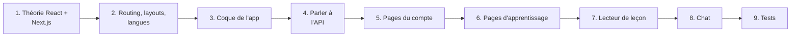

# L'application web, expliquée depuis zéro

Ce dossier explique **`apps/web`**, le site web que les gens utilisent : surtout `app/`, `components/`, `lib/`
et `i18n/`. Il est écrit en français simple et ne suppose aucune connaissance de React.
Lis les chapitres dans l'ordre.

## Les chapitres

| #   | Chapitre                                             | Ce que tu apprends                                                                              | Dossiers principaux                      |
| --- | ---------------------------------------------------- | ----------------------------------------------------------------------------------------------- | ---------------------------------------- |
| 1   | [React et Next.js](01-react-and-nextjs.md)           | Components, props, state, hooks, server et client components, l'App Router, les outils          | fichiers à la racine de `apps/web/`      |
| 2   | [Routing, layouts, i18n](02-routing-layouts-i18n.md) | Comment une URL devient une page, les layouts, les trois langues                                | `app/`, `i18n/`, `messages/`, `proxy.ts` |
| 3   | [La coque de l'app](03-shell-components.md)          | Header, menus, le socket par onglet, petits helpers de synchronisation                          | `components/` (pièces partagées)         |
| 4   | [Parler à l'API](04-talking-to-the-api.md)           | Comment les pages et les boutons appellent l'API, et comment les erreurs deviennent des phrases | `lib/` (couche API)                      |
| 5   | [Pages du compte](05-account-pages.md)               | Accueil, inscription, connexion, onboarding, profil, 2FA, amis                                  | `app/[locale]/(main)`                    |
| 6   | [Pages d'apprentissage](06-learning-pages.md)        | Dashboard, page du cours, objectif du jour, recherche de leçons, examen de placement            | `app/[locale]/(dashboard)`               |
| 7   | [Lecteur de leçon](07-lesson-player.md)              | Jouer une leçon, résultats, XP, le tuteur IA, la voix                                           | `lessons/[id]`, `components/lesson`      |
| 8   | [Chat](08-chat.md)                                   | Conversations, messages en direct, compteurs de non-lus                                         | `app/[locale]/(messages)`                |
| 9   | [Tests](09-tests.md)                                 | Vitest, tester des fonctions et des components, couverture                                      | `*.test.ts(x)`                           |

L'API avec laquelle ce site parle a son propre guide : [docs-fr/api](../api/README.md).
