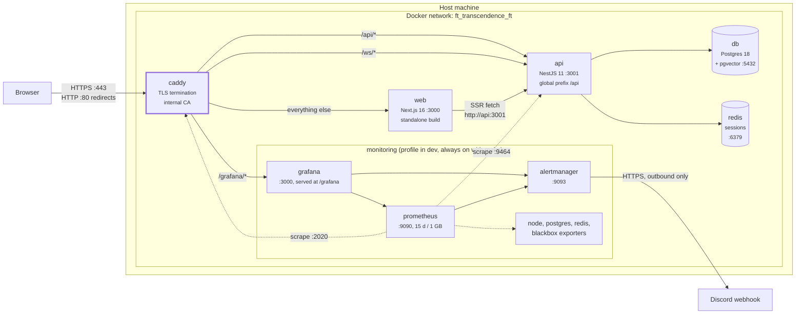
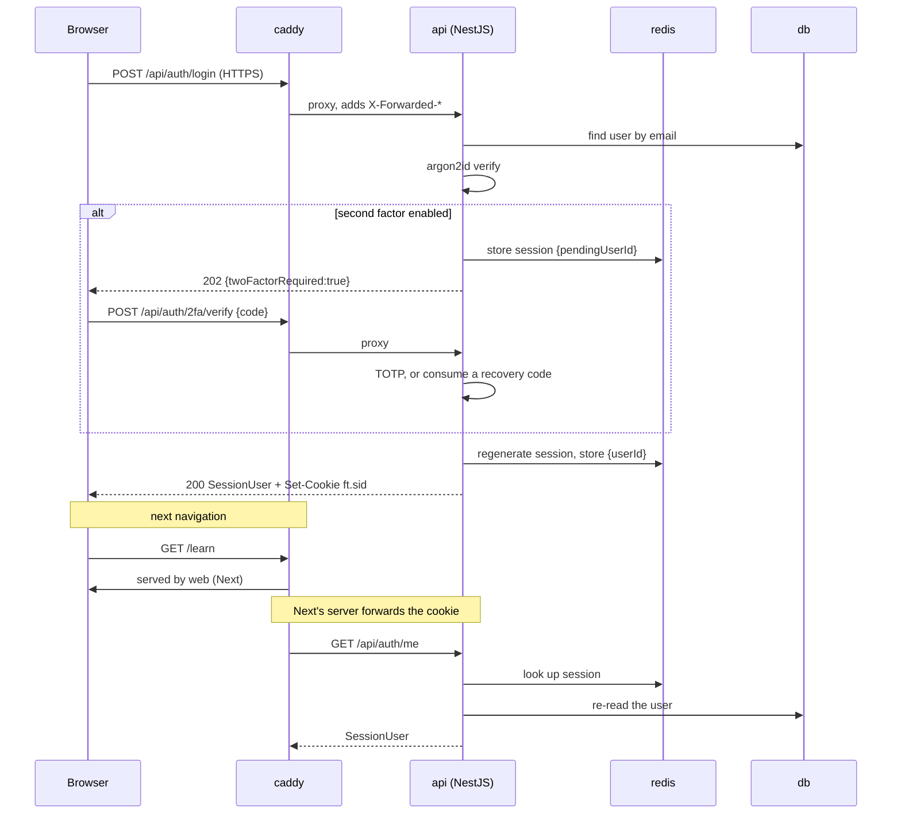
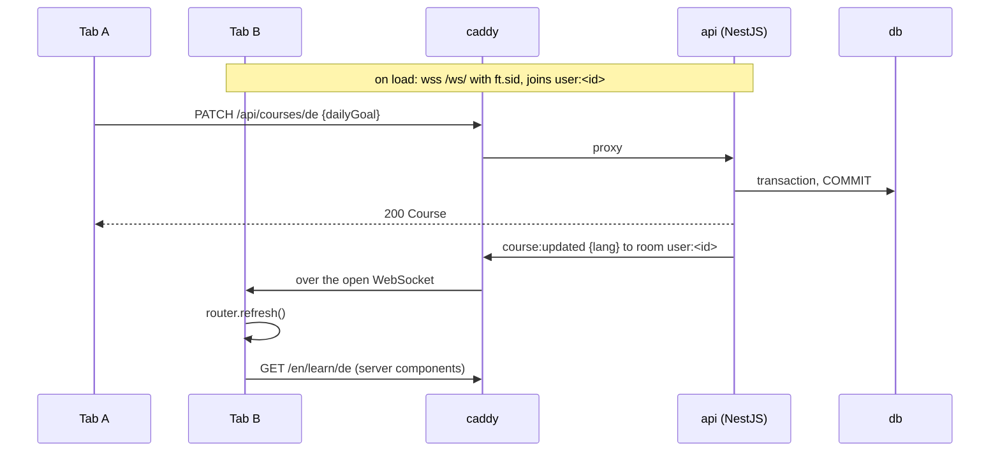
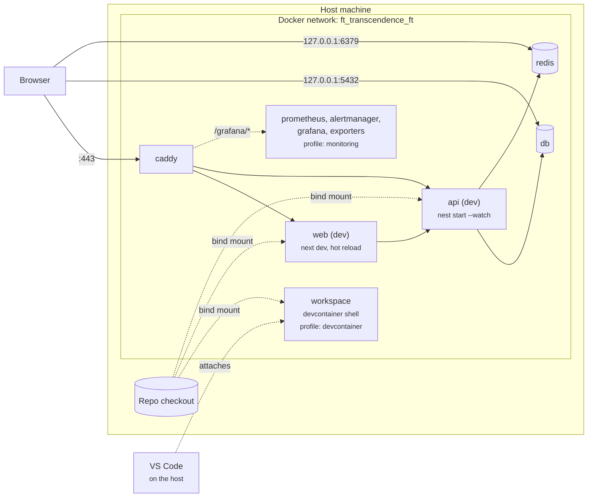
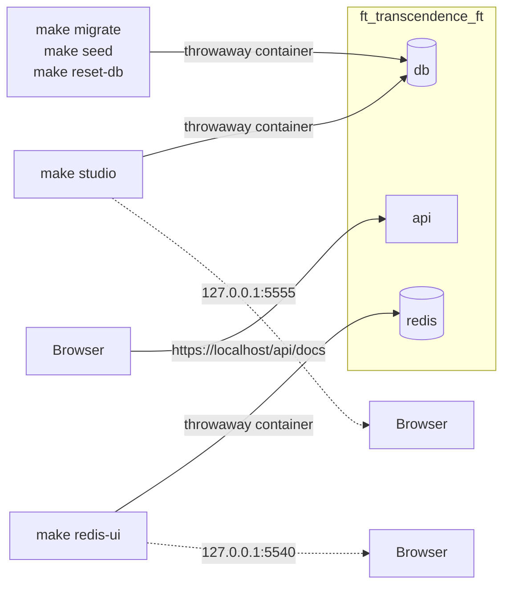
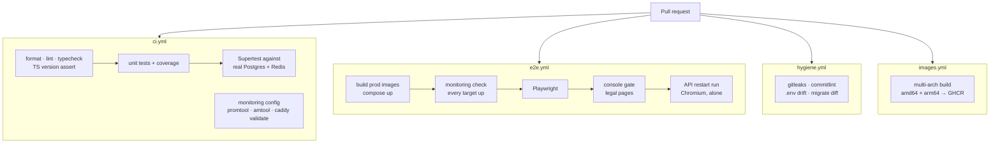
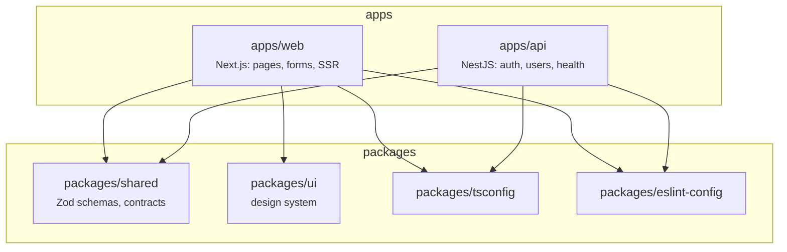

# Architecture

How the containers fit together, in production and in development.
Companions: [TECHNICAL_PLAN.md](TECHNICAL_PLAN.md) (decisions and rationale),
[VERSIONS.md](VERSIONS.md) (pins), [SUBJECT_SUMMARY.md](SUBJECT_SUMMARY.md) (requirements).

Every diagram below is generated from the compose files as they actually are. If
you change a port or a route, change the diagram in the same commit.

---

## 1. The rule that explains the rest

> **NestJS owns all business logic and data access. Next.js does presentation and
> SSR only.** No Prisma client in `apps/web`, no domain logic in server actions.

Next's server calls NestJS over the internal network, exactly like the browser
does, only without leaving Docker. At defence, "which runtime owns what" has to
be a one-sentence answer, and this is it.

---

## 2. Production (`make`, `make run`, `make up`)

Files: `compose.yml` + `compose.prod.yml`. Images are built at the `prod` stage,
no source is bind-mounted, and every service carries `restart: unless-stopped`.
The monitoring stack is always on here ([MONITORING.md](MONITORING.md)).

**Only caddy publishes a port.** `web`, `api`, `db`, `redis` and the monitoring
services are unreachable from outside the network, which is what the subject
permits for internal traffic while still requiring HTTPS at the edge.

| Published | Service | Purpose |
|---|---|---|
| `:80` | caddy | Redirects to HTTPS |
| `:443` tcp + udp | caddy | The only way in. udp is HTTP/3 |

Monitoring adds listeners on the network only. None of them is in a `ports:` list,
and `scripts/check-monitoring-config.sh` fails if one ever is:

| Internal only | What | Reached by |
|---|---|---|
| `api:9464` | the api's metrics listener, outside Nest | Prometheus |
| `caddy:2020` | Caddy's request metrics, a site of its own | Prometheus |
| `prometheus:9090` | Prometheus | Grafana |
| `alertmanager:9093` | Alertmanager | Prometheus, Grafana |
| `grafana:3000` | Grafana | caddy at `/grafana`, the blackbox probe |
| `node-exporter:9100` | host metrics | Prometheus |
| `blackbox-exporter:9115` | HTTP probes of web and Grafana | Prometheus |
| `redis-exporter:9121` | Redis metrics | Prometheus |
| `postgres-exporter:9187` | Postgres metrics | Prometheus |

### Why one origin matters

Because `/` and `/api` are the same origin, the session cookie is first-party:
no CORS configuration, no `SameSite=None`, and `httpOnly` costs nothing. Routing
happens in `infra/caddy/Caddyfile`:

| Path | Goes to | Note |
|---|---|---|
| `/api`, `/api/*` | `api:3001` | Prefix forwarded intact; `handle_path` would strip it and every route would 404 |
| `/ws`, `/ws/*` | `api:3001` | socket.io. Caddy detects the Upgrade handshake inside `reverse_proxy` |
| `/grafana/metrics`, `/grafana/metrics/*` | nothing, 404 | Grafana's metrics are off, and would be unauthenticated if on. Caddy refuses them too, and this matcher must stay above the next one |
| `/grafana`, `/grafana/*` | `grafana:3000` | Prefix forwarded intact, like `/api`: Grafana serves itself under `/grafana` |
| everything else | `web:3000` | Next.js |

`/api/metrics` is not a route. The api serves its metrics on `:9464`, which Caddy
never proxies, so that path reaches Nest and answers 404.

---

## 3. A request through the stack

Signing in touches every layer, so it is the useful one to trace.

Two details worth knowing:

- **`trust proxy` is 1, not `true`.** Caddy terminates TLS and forwards plain
  HTTP, so Express only learns the request was secure from `X-Forwarded-Proto`.
  Trusting exactly one hop means a client-supplied `X-Forwarded-For` never
  becomes `req.ip`, which is what the login throttler counts.
- **The guard re-reads the user on every request** rather than trusting a copy in
  the session, so a deleted account loses access immediately instead of at expiry.

---

## 4. A live update over the gateway

A goal or level change in one tab shows in the account's other open tabs. The
gateway is socket.io on `/ws`, inside the api and on its http server, so Caddy's
`/ws/*` route above is all the plumbing.

- **The cookie is the only credential.** engine.io answers `/ws` before Express
  does, so `SessionIoAdapter` hands it the same express-session middleware:
  same cookie, same store, nothing parsed by hand. A socket.io middleware then
  refuses a page of another origin, a session with no `userId` and a deleted
  account, all with `auth.sessionRequired`. The Origin check matters because
  `ft.sid` is `SameSite=Lax`, and same-site is not same-origin: a page on a
  sibling subdomain would send it too.
- **Refused quietly.** A refusal is a CONNECT_ERROR over a WebSocket that opened
  fine, which the browser does not log; an HTTP 401 on the upgrade would be a
  console error.
- **Rooms, never a broadcast.** Each socket joins `user:<id>` and
  `session:<sid>` before its CONNECT reply. `SocketsService.toUser()` is the
  only way to reach a user; the gateway itself only answers the socket that sent
  a bad event.
- **Sockets close with their session**: on logout (that session's sockets
  only), on every session id change (signup, login, 2FA verify, 2FA enable and
  disable), and when a session ends any other way, through a sweep every 60 s
  that asks Redis for each open socket's `sess:<sid>` (known keys, never a scan).
- **One screen for every inbound event**: 20 events per 10 s per socket, frames
  capped at 16 KiB, a zod parse from `CLIENT_EVENT_SCHEMAS`. A bad event gets
  `app:error { code }`, an `ERROR_CODES` entry, and is dropped, never a crash;
  past the limit, the first one is told `server.rateLimited` and the rest are
  dropped.
  No cap on sockets per user: on one instance it is not worth the code.
- **Sent after the commit.** `course:updated { lang }` means "read this course
  again": the page is rendered on the server, so the tab calls
  `router.refresh()` rather than keeping a second copy of the course.
- **One connection per tab**, held in module scope (`components/tab-socket.ts`)
  and opened by `SessionNav` for a signed-in user, so a route group remount or a
  locale switch never drops it and an anonymous page never opens one. WebSocket
  transport only: a long poll keeps a request open, and a polled 502 is a
  console error.
- **Reconnecting without console noise.** A failed WebSocket dial is a console
  error no code can hide, so each retry (1, 2, 4, 8, then every 10 s, jittered)
  first asks `/healthz/api`, a web route that always answers 200, and dials only
  once the api answers. "Reconnecting…" shows meanwhile, and coming back
  refreshes the page, since events sent while away are lost.
- **What the probe cannot hide**: the api dying between a probe and the dial
  (one line), and the probe's own failure when web restarts too or the laptop
  goes offline.
- **In dev**, every save in `apps/api` restarts the process, so sockets drop and
  the badge flashes; Fast Refresh of `tab-socket.ts` leaves the old socket open
  until a reload.
- **No CSP today.** If one is added, `connect-src 'self'` covers same-origin
  `wss:` in current engines.

---

## 5. Development (`make dev`)

Files: `compose.yml` + `compose.override.yml`, which loads automatically. Images
are built at the `dev` stage, source is bind-mounted, and both apps hot reload.

Dev publishes two more ports, both **loopback only**, so a database is never
exposed to the room:

| Published | Service |
|---|---|
| `127.0.0.1:5432` | db, for a local SQL client |
| `127.0.0.1:6379` | redis, for `redis-cli` |

### node_modules and generated output

Source is bind-mounted, but dependencies live in the image. Each `node_modules`
path is masked by a named volume, and so is anything a container writes as root:

| Masked path | Volume | Why |
|---|---|---|
| every `*/node_modules` | `api-node-modules-*`, `web-node-modules-*` | Host and container dependencies would otherwise collide |
| `apps/api/dist` | `api-dist` | `nest start --watch` compiles as root |
| `apps/api/src/generated` | `api-generated` | `prisma generate` runs as root at container start |
| `apps/web/.next` | `web-next` | Same reasoning |

Without those, a `make dev` leaves uid 0 files in the checkout and the next
`make` fails with `EACCES`.

### The devcontainer

`workspace` sits behind `profiles: [devcontainer]`, so a plain `docker compose up`
skips it while `.devcontainer/devcontainer.json` naming the service activates it.
`shutdownAction: none` is deliberate: the default would stop the whole stack when
the editor window closes.

> **Ports inside the devcontainer.** Compose publishes to the *host's* loopback,
> and the devcontainer is just another container on the network. From a terminal
> inside it, reach the stack by service name, `https://caddy/api/health` rather than
> `https://localhost`. From your browser on the host, `https://localhost` is right.

### The monitoring profile

The seven monitoring services are defined in `compose.yml` with no profile, and
`compose.override.yml` puts each one behind `profiles: [monitoring]`. So `make dev`
and the devcontainer stay as light as before, `make monitoring-up` opts in, and the
prod overlay, which never loads the override, always runs them. Without the profile
`/grafana` answers 502. `make down`, `make clean` and `make logs` pass the profile,
so they reach the monitoring containers too. Day to day:
[DEVELOPMENT.md](DEVELOPMENT.md).

---

## 6. Tools that are not services

Neither runs as part of the stack; both are throwaway containers on the same
network, built from the api `build` stage (`ft_transcendence/api-tooling`).

| Tool | Reach it at | Notes |
|---|---|---|
| **Swagger UI** | `https://localhost/api/docs` | Served by the api itself, so it arrives through Caddy on the same origin. `/api/docs-json` is the raw OpenAPI document. Signed in? The `ft.sid` cookie rides along, so "Try it out" works on guarded routes with nothing to paste. |
| **Prisma Studio** | `http://127.0.0.1:5555` after `make studio` | Loopback only: it is unauthenticated read-write access to the whole database. `STUDIO_PORT=5556` if the port is taken. Restart it after `make` or `make reset-db`, since db gets a new container and Studio keeps the old connection. |
| **RedisInsight** | `http://127.0.0.1:5540` after `make redis-ui` | Loopback only, for the same reason: it reads and deletes any key, with no login. Shows sessions and placement runs live. `REDIS_UI_PORT=5541` if the port is taken. Nothing is kept between runs; the connection comes from the environment. |

There is no Adminer or pgAdmin service in this project; Prisma Studio is the
database browser, and it already knows the schema.

---

## 7. What CI runs

Four workflows. `ci` and `e2e` are the ones that gate a merge on behaviour.

Two of those checks are **subject rejection criteria**, which is why they run
against production images rather than a dev server:

- **console gate**: zero console errors, warnings, uncaught exceptions or failed
  requests, on every route, including client-side navigation.
- **legal pages**: `/privacy` and `/terms` answer 200 with real content.

`make ci` runs the same checks natively, and `make` runs all of it plus the
production stack, the live monitoring check and Playwright.

---

## 8. Where the code lives

`packages/shared` is the reason validation cannot drift: the signup form and the
signup endpoint apply the *same* `CreateUserSchema`, which is what the subject
means by validating in both frontend and backend. The one rule that keeps it
honest is that `passwordHash` never appears in any schema there.
