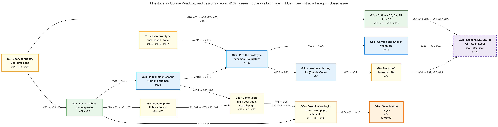

# How we replanned Milestone 2 (October 21, 2026)

This page tells, step by step, everything that happened in one working session between VYAntares and Claude Code on October 21, 2026, from counting our module points to the new Milestone 2 plan now on GitHub.

If you only want the result, read [the outcome](#9-the-outcome). The tracking issue on GitHub is **#137**.

---

## 1. Where it started: how many points do we have?

The first question was simple: **how many module points do we have, and can we reach 125?**

We started from the module list we wrote on October 4, then checked every module against the actual code on `origin/main`.

**The grading rule.** The subject requires 14 points of modules (= 100). Up to 5 bonus points count on top, so **19 points = 125**. A module that does not fully work at evaluation is worth 0.

What the code showed, compared with our October 4 list:

- **Monitoring** (Prometheus + Grafana, Major) is merged in #130. It moved from "to confirm" to done.
- **WebSockets** (Major) were marked "almost done", but there is no gateway in `apps/api`. Only the event contract exists, in `packages/shared/src/events/socket.ts`.
- **The analytics dashboard** (Minor) was marked done, but there is no analytics code, and `/dashboard` redirects to `/learn`.
- **Additional browsers** (Minor) were marked done, but Playwright only tests Chromium.

The totals:

| | Points |
|---|---|
| Every module on our list, if finished | 24 |
| Really done today | 10 |
| Done, plus what is in progress | 17 |
| Needed for 125 | 19 |

The full list is in [docs/MODULES_STATUS.md](MODULES_STATUS.md), first written in French and then translated to English.

## 2. Reading the subject PDF itself

The first answers came from [docs/SUBJECT_SUMMARY.md](SUBJECT_SUMMARY.md), because the tool to read the PDF was not installed. We then installed `poppler-utils` and read `docs/ft_transcendence.pdf` directly. It confirmed the summary:

- **General requirements (chapter III).** Missing any of these means the project is rejected:
  - Docker with a single command;
  - no console errors;
  - Privacy Policy and Terms of Service pages with real content;
  - multi-user support;
  - HTTPS;
  - validation on both frontend and backend.
- **Modules (chapter IV):** *"You will need to earn 14 points in total"*. *"Non-functional or incomplete modules = 0 points."*
- **Bonus (chapter VII):** only counted once the 14 points are validated, and capped at **5 points**.
- **Evaluation (chapter VIII):** you can be asked to make a small live change to the code.

The PDF never writes "100" or "125". Mapping 14 points to 100, and 14 + 5 to 125, is the usual 42 grading.

## 3. A message to get the team moving

Next, a rewrite of a message to the team in clearer English. Its points:

- the reading prototype is done;
- we have stalled for two weeks;
- the hard deadline is **December 29**;
- we focus on finishing modules to reach 125, not on adding features.

## 4. Reading every Milestone 2 issue

Milestone 2 ("Course Roadmap and Lessons") had **17 open issues**. Reading all of them and their comments showed one blocking chain:

```
#117 prototype + final lesson schema
  └─► #83 offline lesson generator
        └─► #84 French A1 lessons (120)
              ├─► #86 daily goal page ─┐
              ├─► #87 all lessons page + search ─┼─► #96 stub page + e2e ─► #97 achievements pages
              └─► #91 / #92 / #93 every other language and level (~3,900 lessons)
```

What we found:

- **The lesson model was undecided.** On `main`, a lesson is a short **tutor brief** (#77): an objective, points, examples and pitfalls, in the course language only, in **one file per level**. The prototype (`bastian-schnitzler/lesson_prototype`) has a **full playable lesson**: exercises, answer keys, an exam, scoring, and support text in en/fr/de, in **one file per lesson**. Nobody had decided which one wins.
- **The generator (#83) was stuck.** The Gemini free tier allows about **20 requests a day**, which cannot produce about 4,000 lessons. #83 had already been emptied and was waiting for a redesign; the old design moved to #124.
- **`content/lessons/` is still empty.** What we got recently were the lesson schemas and the outlines (#88, #89, #90, #105), not the lessons.
- **Some issues never depended on the brief:** #82, #85, #94 and #95.

## 5. A brief for the prototype session

The lesson prototype lives in another repository, worked on in another Claude Code session. So we wrote a **context brief** for that session (in English). It explained the situation above and asked seven questions:

1. Can #117 be closed?
2. Which schemas must be ported?
3. Does the prototype model replace ours?
4. Does it work for German and English?
5. Is generation feasible, and at what cost?
6. What is the smallest path to the 120 French A1 lessons?
7. What effort remains before December 29?

## 6. Two side questions

**What is the "offline generator"?** It is a script a developer runs once, on their own machine, to write all lessons ahead of time as JSON files committed to the repo. The app never calls an LLM to create a lesson while someone uses it. It was planned that way for:
- volume: ~4,000 lessons;
- quota: 20 requests a day on the free tier;
- review before commit;
- a one-time cost.

**Can we use our Claude subscription instead of an API?** Not through the script as designed: the script calls an AI API with a key, and a Claude subscription gives no API key. But **Claude Code itself** can write the lesson JSON files directly into the repo, including from the command line (`claude -p` in a loop) for a whole level. The schema checks validate the files the same way, whoever wrote them.

**What a lesson looks like:**
- In our current format, a lesson is about **1 KB** in a per-level file.
- In the prototype's format, a brief is **7–25 KB**, and a grammar lesson goes up to **59 KB**, with every learner-facing text in three languages.

## 7. What the prototype session answered

Its verdict: **ready, with changes.** It ran the prototype's 699 unit tests (all green) and validated its 33 lessons. It also found that the fr/de/en A1 outlines are identical in both repos.

- **#117:** the data model is final for all four kinds (vocabulary, grammar, functions, reading), each with a schema, a validator and a working player. #117 can close once the product owner confirms D55 (reading is hand-authored) and decides P4-06 (how function lessons are produced), and once `schemaVersion: 2` is frozen.
- **What to port:**
  - `src/schemas/*`, `src/validation/*`, the pure helpers in `src/domain` and `answers.ts`, about 2,600 lines with no React;
  - not `manifest.ts` or `src/catalog/scan.ts`;
  - adapt them by reusing our `LocaleSchema`/`LanguageSchema`, fixing the zod version, and dropping the `.ts` import extensions.
- **Mapping:**
  - the prototype model replaces `LessonBriefSchema`, `LessonDraftSchema` and `LessonDraftFileSchema`;
  - files become per lesson: `content/briefs/<id>.json`, plus `content/lessons/<id>.json` for every kind except vocabulary;
  - `title` comes from the envelope, and `objective` replaces `summary`.
- **Languages:**
  - the schemas are neutral, but the validators assume French;
  - an English vocabulary lesson fails the noun gender rule;
  - German has no article policy;
  - some copy says "French".
- **Generation:**
  - the prototype's Gemini generator only covers vocabulary and grammar;
  - by its estimate, generating everything through the paid API would cost about $800 (Sonnet 5.5) to $1,600 (Opus 5.5);
  - **agent authoring is what actually worked**: 23 of its 33 lessons were written by an agent and completed by `scripts/author-*.ts`.
- **Shortest path:**
  - seed lesson rows from the outlines now, so #86, #87 and #96 stop waiting;
  - then port the schemas, import the 33 lessons, and author the 87 missing French A1 lessons.

## 8. From the answer to the plan

**A first plan** (French A1 only) proposed:
- placeholder lessons first;
- authoring in the prototype repo;
- porting in parallel;
- porting the lesson player in November.

**The team's scope decision changed it:** we author **all four kinds, for all three languages and all six levels**, even if we cannot review all of it, to have content in the app.

That scope brought two changes:
- the **German and English validators** become a real blocker;
- authoring moves **into ft_transcendence**, so 4,000 files have one source of truth.

**The issue proposal** then went through these decisions:
- A review policy issue (a `reviewed` flag and sample reviews) was **dropped**. The issues make no claim about human review.
- Two lesson player issues (porting the prototype's exercise screens to Next.js) were **left out for now**. They belong to Milestone 3. Without them, lessons are listed but cannot be played yet.
- #115 was already closed.
- New issues get GitHub numbers, everything is written in English, and the old issues are updated in place.

## 9. The outcome

### New issues

| # | Title | Needs |
|---|---|---|
| **#134** | feat(api): seed placeholder lessons from the outlines | #79 |
| **#135** | feat(shared): port the prototype's lesson schemas, validators and answer classifier | #117, #134 |
| **#136** | feat(shared): make the lesson validators work for German and English | #135 |
| **#137** | docs: replan Milestone 2 (tracking issue) | — |

### Changed issues

| Issue | Change |
|---|---|
| #117 | New Done when: D55 and P4-06 decided, `schemaVersion: 2` frozen |
| #83 | Rewritten: **lesson authoring kit for Claude Code**, with a guide per kind, the ported author scripts, and a `lessons:author` runner on top of `claude -p` |
| #84 | French A1: import the 33 prototype lessons, author the other 87 |
| #91, #92 | German and English, A1 to C2, authored with the kit. Also need #136 |
| #93 | French A2 to C2, authored with the kit |
| #76 | Decision 2 and `docs/LESSONS.md` describe per-lesson files and the authoring kit |
| #86, #87, #96 | Need #134 (placeholder lessons) instead of #84 |

The old texts of these issues are kept in [docs/old-issues/](old-issues/).

### Dependencies



Green is done, yellow is open, blue is new in the replan, and a struck-through number is a closed issue. The source is [milestone2-roadmap.mmd](milestone2-roadmap.mmd) (Mermaid). The same graph as text:

```
#79 ─► #134 placeholders ─┬─► #86 ─┐
                          ├─► #87 ─┼─► #96 ─► #97
                          │        │
#82 ─► #85 ───────────────┴────────┘
#94 ─► #95 ─► #97

#117 ─► #135 port ─┬─► #136 de/en ──────────────┐
                   └─► #83 authoring kit ─┬─► #84 fr A1 ─► #93 fr A2–C2
                                          ├─► #91 de ◄────┤
                                          └─► #92 en ◄────┘
```

Order of the authoring runs: **fr A1 → de A1 → en A1**, then A2 to C2.

### What to start now

- **#134** can start today: it only needs #79, which is merged. It unblocks #86, #87 and #96, and through them the advanced search and gamification modules.
- **#82, #85, #94 and #95** never depended on lessons.
- **The modules that have nothing to do with lessons** (WebSockets, the LLM interface, Firefox/WebKit, friends) go on in parallel. They are the points we need for 125.

### Risks to watch

- **Subscription quota.** About 4,000 lessons of 10 to 60 KB each means weeks of Claude Code usage, even split across several members' subscriptions. That is why A1 in all three languages comes first.
- **The lesson player** is not planned in Milestone 2. Until it is ported, lessons can be listed and searched, but not played.
- **The deadline** is December 29, 2026.

### Files written during this session

- [docs/MODULES_STATUS.md](MODULES_STATUS.md): module status and points.
- [docs/old-issues/](old-issues/): the issue texts before the replan.
- This page.
