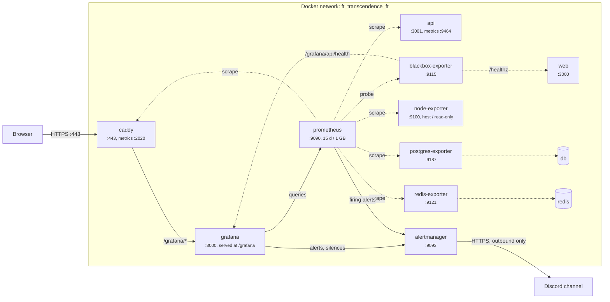

# Monitoring

The Major module "Monitoring system with Prometheus and Grafana": Prometheus collects metrics
from the app, the stores and the host, Grafana shows them on four dashboards behind its own
login, and alert rules post to Discord through Alertmanager.
Companions: [ARCHITECTURE.md](ARCHITECTURE.md) (where it sits in the stack),
[DEPLOYMENT.md](DEPLOYMENT.md) (the server), [VERSIONS.md](VERSIONS.md) (pins, traps 4 to 8).

| The subject asks for | Here |
|---|---|
| Prometheus collecting metrics | 7 scrape jobs and 3 probes, every 30 s (section 1) |
| Exporters and integrations | node, postgres, redis and blackbox exporters; Caddy's and the API's own metrics (section 5) |
| Custom Grafana dashboards | Overview, API, Learning, Infrastructure, provisioned from the repo (section 3) |
| Alerting rules | 25 rules, unit-tested with promtool, routed to Discord (section 4) |
| Secured access to Grafana | Grafana's login only, no sign-up, no anonymous access, nothing else published (section 6) |

---

## 1. What runs and where

Seven services join the `ft` network. None of them publishes a port.

| Service | Image | Does | Port (internal) | `mem_limit` |
|---|---|---|---|---|
| `prometheus` | built from `infra/monitoring/prometheus` | scrapes every target, evaluates the rules, sends alerts to Alertmanager | 9090 | 256m |
| `alertmanager` | built from `infra/monitoring/alertmanager` | groups, inhibits and routes alerts to Discord | 9093 | 64m |
| `grafana` | built from `infra/monitoring/grafana` | dashboards; read-only views of the rules, alerts and silences | 3000, served at `/grafana` | 320m |
| `node-exporter` | upstream | host CPU, memory, swap, load, root disk | 9100 | 48m |
| `postgres-exporter` | upstream | Postgres up, connections, transactions, cache, size, deadlocks | 9187 | 48m |
| `redis-exporter` | upstream | Redis up, memory, clients, commands, AOF status, stored sessions | 9121 | 32m |
| `blackbox-exporter` | upstream | probes web's `/healthz` and `/healthz/upstream`, and Grafana's health | 9115 | 32m |

Two existing services gain an internal listener, and no published port:

| Service | Listener | Serves |
|---|---|---|
| `api` | `:9464` | `GET /metrics` only, from a bare `node:http` server outside Nest (`apps/api/src/metrics`) |
| `caddy` | `:2020` | Caddy's request metrics, on a site of its own. The admin API on `:2019` stays on loopback |

Prometheus has 10 targets: 7 jobs with one target each, plus the 3 blackbox probes. It scrapes
them and evaluates the rules every 30 s, and keeps 15 days or 1 GB of data, whichever limit comes
first.



### When it runs

| Stack | Files | Monitoring |
|---|---|---|
| `make dev` | `compose.yml` + `compose.override.yml` | off: the override puts the seven services behind the `monitoring` profile, so laptops stay light, and `make dev` removes the ones `make` left running |
| `make monitoring-up` | the same, with `--profile monitoring` | on, built from `infra/monitoring/*` |
| `make`, `make up`, e2e.yml, evaluators | `-f compose.yml -f compose.prod.yml` | always on: the override is not loaded, so there is no profile |
| The server | `compose.deploy.yml` | always on, images pulled from GHCR |

### Where the config lives

| Config | In | Reaches the container by |
|---|---|---|
| `prometheus.yml`, `rules/alerts.yml` | `infra/monitoring/prometheus/` | `COPY` in its Dockerfile |
| `alertmanager.yml`, `silent.yml`, `templates/`, `entrypoint.sh` | `infra/monitoring/alertmanager/` | `COPY` in its Dockerfile |
| `grafana.ini`, `provisioning/`, `dashboards/`, `entrypoint.sh` | `infra/monitoring/grafana/` | `COPY` in its Dockerfile |
| Root URL, Grafana secrets, Discord webhook | `.env` | compose `environment:` |
| The `/grafana` route and the `:2020` site | `infra/caddy/Caddyfile`, `Caddyfile.prod` | the existing bind mount, the server's `Caddyfile` |

Baked rather than bind-mounted, because the server has no checkout and holds exactly three files
(DEPLOYMENT.md). images.yml publishes the three images with the same revision label as `api` and
`web`, so `deploy.sh` rolls out a rule or dashboard change like any code change, and dev, CI and
the server run the same config. The cost: a config edit in dev needs a rebuild, which
`make monitoring-up` does in seconds.

---

## 2. Opening Grafana

| From | URL | Password |
|---|---|---|
| Your browser | <https://localhost/grafana> (`https://localhost:<HTTPS_PORT>/grafana` if you set one) | `grep GRAFANA_ADMIN_PASSWORD .env` |
| A terminal inside the devcontainer | `https://caddy/grafana` | the same |
| The server | <https://transcendence.dpdns.org/grafana> | `grep GRAFANA_ADMIN_PASSWORD ~/.env` on the server |

The user is `admin`. There is no other account and no sign-up.

`make`, `make up` and `make monitoring-up` run `make env-file` first. It creates `.env` from
`.env.example` if there is none, and writes 48 random hex characters into
`GRAFANA_ADMIN_PASSWORD` and `GRAFANA_SECRET_KEY` when they are empty. It never changes a value
that is set. The server's `.env` is filled by hand (DEPLOYMENT.md).

### The password is applied once

Grafana uses `GRAFANA_ADMIN_PASSWORD` only when the `grafana-data` volume is created. Changing
`.env` later changes nothing until you reset it. Edit `.env`, run `make up` (or
`make monitoring-up`) so grafana is recreated with the new value, then:

```bash
docker compose exec grafana sh -c 'grafana cli --homepath /usr/share/grafana admin reset-admin-password "$GF_SECURITY_ADMIN_PASSWORD"'
```

Single quotes on purpose: the container expands the variable, so `.env` stays the only source and
the password never lands in your shell history. On the server, use
`docker compose -f compose.deploy.yml exec grafana ...`. Locally, `make clean` also works, by
dropping `grafana-data` with every other volume.

`GRAFANA_SECRET_KEY` replaces the key Grafana ships with, which is published in its source. Set it
once: changing it later breaks whatever Grafana has encrypted.

### Finding your way

- **Home** is the Overview dashboard. **Dashboards**, folder `ft_transcendence`, holds all four.
- **Alerting** lists the 25 Prometheus rules with their state, the alerts Alertmanager holds, and
  its silences. Pick the Alertmanager data source at the top of the alerts and silences pages.
  A silence made there mutes Discord too.
- **Explore** queries Prometheus directly, for anything no panel shows.

The dashboards are provisioned: you can edit a panel in the browser, but saving is refused
("Cannot save provisioned dashboard"). The repo is the source of truth (section 7).

---

## 3. Dashboards

Every dashboard refreshes every 30 s, opens on the last 6 hours, and shares the crosshair across
panels. Overview and API mark each API restart with a "Deploys" annotation: the Version stat
cannot, because on the server the version is always `latest`.

### Overview (`ft-overview`, the home dashboard)

Is the app up, and is anything on fire.

| Row | Panels |
|---|---|
| Is it up | API, Web, Web to API, Postgres, Redis, Caddy (green Up, red Down); targets down; running version |
| Traffic | requests through Caddy by status; API 5xx ratio; API latency p50, p95 and p99; signed in now; stored sessions |
| Alerts | firing alerts; pending alerts |
| Host | memory used; disk used on `/`; CPU busy |

The latency panels leave out `static`, `unmatched` and `/api/health`: health checks are frequent
and fast, and would pull the percentiles down.

### API (`ft-api`)

How the NestJS API behaves, per route. Variable: `route` (multi-select).

| Row | Panels |
|---|---|
| Traffic | requests by route; responses by status; requests in flight |
| Latency | p95 by route; latency heatmap; the 10 slowest routes over the last hour |
| Auth | sign-ins by result (200 signed in, 202 second factor needed, 401 wrong credentials, 429 throttled); sign-ups in 24 h; 2FA failures; rate-limited requests by route |
| Runtime | event loop lag p99; RSS and heap; CPU; GC time by kind; restarts in the last hour |
| WebSocket | open connections; events by direction, event and outcome |

### Learning (`ft-learning`)

What learners do, and whether the question bank keeps up. Variable: `lang` (multi-select).

| Row | Panels |
|---|---|
| People | accounts; signed in over the last 5 minutes; stored sessions |
| Placement | exams per hour by event (started, completed, quit); completion rate over 24 h; questions served by source; levels whose pool ran out in the last hour |
| Question bank | questions by level and source; the 10 thinnest cells, empty ones included; restocks by outcome; restock failures by reason; questions generated in 24 h |
| LLM | provider and model; calls by outcome; latency p95; tokens per hour |

"Questions served by source" shows `written`, `generated` and `seen_fallback`. The last one is a
learner who has seen every question at that level and gets an old one again.

Under `LLM_PROVIDER=fixture`, the default wherever evaluators run, the LLM row shows "fixture"
and no calls, and restock failures show as `llm_disabled`. A text panel at the top of the row
says so, so the empty graphs do not read as broken.

### Infrastructure (`ft-infrastructure`)

The host, the stores, Caddy, and the monitoring stack itself.

| Row | Panels |
|---|---|
| Host | CPU by mode (including `steal`, which matters on a shared core); load against cores; memory and swap used; disk free on `/`; disk busy |
| Postgres | connections against `max_connections`; connections by state; transactions and rollbacks per second; cache hit ratio; database size; deadlocks in 24 h |
| Redis | memory; commands per second; clients; keys; hit ratio; AOF last write |
| Caddy | requests by status; time to first byte p95; requests in flight (an open WebSocket counts for its whole life) |
| Monitoring | every target, up or down; scrape duration by job; active series; TSDB size on disk; memory per process; notifications sent and failed |

"Memory per process" covers only the processes Prometheus scrapes: the API, Caddy, Prometheus,
Alertmanager and the exporters. Grafana, web and the Postgres server are not in it, and Redis has
its own panel. `docker stats` covers the rest.

---

## 4. Alerts

Prometheus evaluates `infra/monitoring/prometheus/rules/alerts.yml` every 30 s and sends firing
alerts to Alertmanager. Alertmanager groups them by name, applies the inhibitions below, and posts
to Discord when `DISCORD_WEBHOOK_URL` is set. Without a webhook it loads `silent.yml` and sends
nothing. Either way, Grafana shows every rule and alert behind its login.

Two severities. **critical**: learners see an outage. **warning**: degraded, or about to be.

### The rules

| # | Group | Alert | Fires when | For | Severity |
|---|---|---|---|---|---|
| 1 | availability | `ApiDown` | Prometheus cannot scrape the API | 1m | critical |
| 2 | availability | `WebDown` | web's `/healthz` probe fails | 1m | critical |
| 3 | availability | `WebCannotReachApi` | web's `/healthz/upstream` probe fails: web cannot reach the API | 2m | warning |
| 4 | availability | `PostgresDown` | Postgres refuses connections (`pg_up` is 0) | 1m | critical |
| 5 | availability | `RedisDown` | Redis is down (`redis_up` is 0) | 1m | critical |
| 6 | availability | `GrafanaDown` | Grafana's health probe fails | 5m | warning |
| 7 | availability | `TargetDown` | any other target cannot be scraped | 5m | warning |
| 8 | api | `ApiErrorRateHigh` | more than 5% of API requests answer 5xx, with at least 3 requests a minute | 5m | critical |
| 9 | api | `ApiLatencyHigh` | API p95 latency is above 1 s, health checks left out | 10m | warning |
| 10 | api | `ApiRestarting` | the API restarted twice or more in 15 minutes | 0m | warning |
| 11 | api | `ApiEventLoopBlocked` | the event loop lag p99 is above 500 ms | 5m | warning |
| 12 | api | `SignInFailuresSpike` | more than 20 failed (401) or throttled (429) sign-ins and 2FA checks a minute | 5m | warning |
| 13 | learning | `QuestionRestocksFailing` | more than 3 restock failures in 15 minutes, `llm_disabled` left out | 5m | warning |
| 14 | learning | `LlmErrorRateHigh` | more than half of the LLM calls over 15 minutes fail | 15m | warning |
| 15 | learning | `PlacementPoolExhausted` | a learner ran out of questions for a language and level in the last 30 minutes | 0m | warning |
| 16 | stores | `PostgresConnectionsHigh` | Postgres is above 80% of `max_connections` | 5m | warning |
| 17 | stores | `PostgresDeadlocks` | Postgres detected a deadlock in the last 10 minutes | 0m | warning |
| 18 | stores | `RedisAofWriteFailing` | Redis cannot write its AOF, so sessions are not persisted | 1m | critical |
| 19 | host | `HostMemoryLow` | less than 10% of RAM and swap together is available | 5m | critical |
| 20 | host | `HostDiskAlmostFull` | less than 15% of `/` is free | 10m | warning |
| 21 | host | `HostDiskFullSoon` | at the trend of the last 6 hours, `/` fills within a day | 30m | warning |
| 22 | host | `HostCpuSaturated` | CPU is above 90%, idle, iowait and steal left out | 15m | warning |
| 23 | monitoring | `AlertNotificationsFailing` | Alertmanager failed to deliver to Discord in the last 15 minutes | 0m | warning |
| 24 | monitoring | `AlertmanagerUnreachable` | Prometheus has no Alertmanager to send to | 5m | warning |
| 25 | monitoring | `RuleEvaluationFailing` | a rule failed to evaluate in the last 10 minutes | 0m | warning |

Each rule carries a one-line `summary`, which becomes the Discord message, and a `description`
that says what to check first. The unit tests in
`infra/monitoring/prometheus/tests/alerts.test.yml` run with `promtool test rules` in CI. Every
critical rule has a firing test, because it is the one that posts to Discord every hour.

Why some rules look the way they do:

- **13** leaves out `llm_disabled`: the fixture provider fails every restock on purpose, and it is
  the default where evaluators run.
- **14 and 15** read series the API creates at 0 on start (section 5), so the first failure counts.
  With the fixture, rule 14 has no series at all and never fires.
- **19** counts swap. The OOM killer acts when RAM and swap are both gone, and the 1 GB server is
  expected to sit near 90% of RAM with a swapfile. A RAM-only rule would post a critical alert
  every hour while nothing is wrong. Without swap (laptops, CI) the two are the same.
- **None should fire during a normal `make`.** The Playwright suite produces a handful of 401s,
  not 20 a minute for 5 minutes, and every rate-based rule waits 5 minutes or more.

### Routing

| Setting | Value | Why |
|---|---|---|
| Grouped by | `alertname` | one message per kind of problem |
| `group_wait` | 30 s | the first message waits for the rest of its group |
| `group_interval` | 1 m | a resolved alert is only sent at the next tick: a short outage says it is over within a minute or two |
| `repeat_interval` | 4 h, 1 h for critical | an outage repeats hourly until it is fixed or silenced |

Inhibitions, so one cause sends one message: while `ApiDown` fires, `WebCannotReachApi` and the
API's error rate, latency, restart and event loop alerts are muted. While `PostgresDown` or
`RedisDown` fires, `ApiErrorRateHigh`, `ApiLatencyHigh` and `QuestionRestocksFailing` are muted.
Grafana still shows them; only Discord stays quiet. The inhibitions live in `alertmanager.yml`
only: without a webhook, `silent.yml` has none, so Grafana's alert groups show the muted alerts
as active too.

From `docker compose stop api`, `ApiDown` reaches Discord in about 2 to 2.5 minutes: up to 30 s
to the failed scrape, up to 30 s to the evaluation, the 1 minute `for`, and 30 s `group_wait`. The
resolved message follows `docker compose start api` within about 1 to 2 minutes.

### The Discord webhook

The webhook is a credential: anyone holding the URL can post to the channel. So:

- It lives only in `.env`, as `DISCORD_WEBHOOK_URL`. Both templates keep it empty, and nothing in
  the repo holds a real one.
- Alertmanager never expands environment variables in its config (VERSIONS.md trap 6), so the
  image's entrypoint writes the variable to a file on a tmpfs, mode 0600, unsets it, and the
  config reads the file with `webhook_url_file`. It never lands on a volume.
- Empty means `silent.yml`, and the container log says
  `alertmanager: DISCORD_WEBHOOK_URL is empty, alerts are not sent anywhere`. It never means one
  failed notification per alert.
- Keep it empty on a laptop, so `make` does not post its test runs to the team. Set it on the
  server.
- Like every value in `.env`, it is visible to anyone who can run `docker inspect` on the host.

To create one in Discord: Server Settings, Integrations, Webhooks, New Webhook, pick the channel,
Copy Webhook URL. Then add it to `.env` (on the server, with the `read -rs` line in
DEPLOYMENT.md, so it stays out of your shell history) and run `make up`, `make monitoring-up`, or
on the server `docker compose -f compose.deploy.yml up -d`. Compose recreates alertmanager because
its environment changed.

### Testing that an alert reaches Discord

1. **The webhook is loaded.** `docker compose logs alertmanager` does not say "alerts are not
   sent anywhere".
2. **Routing, offline.** This prints `discord`. CI runs the same check against the file.

   ```bash
   docker compose exec alertmanager amtool config routes test \
     --config.file=/etc/alertmanager/alertmanager.yml --verify.receivers=discord \
     alertname=ApiDown severity=critical
   ```

3. **A synthetic alert, through Alertmanager.** A "[FIRING:1] DiscordTest" message arrives after
   30 s. It resolves by itself after 5 minutes, and a green "[RESOLVED]" message follows.

   ```bash
   docker compose exec alertmanager amtool --alertmanager.url=http://127.0.0.1:9093 \
     alert add DiscordTest severity=warning \
     --annotation=summary="Test from $(whoami)" --annotation=description="amtool, safe to ignore"
   ```

4. **A real alert, from a scrape.** `docker compose stop api`. Under Alerting, `ApiDown` goes
   pending, then firing after a minute, and Discord gets "[FIRING:1] ApiDown" within about
   2.5 minutes. `docker compose start api`, and "[RESOLVED]" follows within 1 to 2 minutes.
5. **Delivery health.** On Infrastructure, "Notifications sent and failed" shows failures for
   `discord` flat at 0. A wrong URL fires `AlertNotificationsFailing`, which shows in Grafana,
   with a `reason` label such as `authError`, `rateLimited` or `clientError`.

Then empty the variable again if this was a laptop.

---

## 5. Metrics reference

### Application metrics (api)

Labels are always bounded: never a user id, an email, a session id, a lesson id or a raw URL.

| Metric | Type | Labels | Recorded in |
|---|---|---|---|
| `http_request_duration_seconds` | histogram, 5 ms to 10 s | `method` (the 7 usual ones, else `OTHER`); `route` (the Express template with its prefix, such as `/api/courses/:lang/lessons/:id`, else `static` below 400 or `unmatched`); `status_code` (`499` when the client left) | `httpMetrics` middleware, first in `configureApp` |
| `http_requests_in_flight` | gauge | none | the same middleware |
| `ft_llm_requests_total` | counter | `provider`, `model`, `purpose`, `outcome` (`ok`, `unreachable`, `rate_limited`, `http_error`, `blocked`, `incomplete`, `invalid`) | `GeminiProvider.generateStructured` |
| `ft_llm_request_duration_seconds` | histogram, 0.5 s to 60 s | `provider`, `model`, `purpose` | the same |
| `ft_llm_tokens_total` | counter | `provider`, `model`, `purpose`, `type` (`prompt`, `output`, `total`) | the same, from the usage Gemini reports |
| `ft_llm_provider_info` | gauge, always 1 | `provider`, `model` (`none` for the fixture) | `createLlmProvider` |
| `ft_question_restocks_total` | counter | `lang`, `level`, `category`, `status` (`busy`, `cooling`, `filled`, `empty`, `failed`) | `QuestionStockService` |
| `ft_question_restock_failures_total` | counter | `category`, `reason` (`llm`, `llm_disabled`, `other`) | the same, when a fill throws |
| `ft_question_restock_inserted_total` | counter | `lang`, `level`, `category` | the same, rows inserted |
| `ft_question_restock_duration_seconds` | histogram, 0.5 s to 120 s | `category` | the same, LLM call to insert |
| `ft_question_bank_questions` | gauge, read at scrape | `lang`, `level`, `category`, `source` (`written`, `generated`) | `MetricsCollector`, cached 60 s. All 108 cells, empty ones at 0 |
| `ft_placement_draws_total` | counter | `lang`, `level`, `category`, `source` (`written`, `generated`, `seen_fallback`) | `PlacementQuestionService` |
| `ft_placement_pool_exhausted_total` | counter | `lang`, `level` | the same, when no question is left |
| `ft_placement_exams_total` | counter | `lang`, `event` (`started`, `completed`, `quit`) | `PlacementService` |
| `ft_users` | gauge, read at scrape | none | `MetricsCollector`, cached 60 s |
| `ft_active_users` | gauge, read at scrape | none | signed-in users seen by `AuthGuard` in the last 5 minutes |
| `ft_ws_connections` | gauge | none | `SocketGateway`, accepted sockets only |
| `ft_ws_events_total` | counter | `direction` (`in`, `out`); `event` (a known name, else `unknown`); `outcome` (`ok`, `invalid`, `rate_limited`) | `SocketGateway` (in, and the `app:error` it answers) and `SocketsService.toUser` (out) |
| `ft_app_info` | gauge, always 1 | `version` (`APP_VERSION`) | `main.ts` |
| Node defaults | various | none | `collectDefaultMetrics`: event loop lag, heap, GC, `process_*` |

All of them live in `apps/api/src/metrics/metrics.ts`, on the API's own registry, so nothing a
dependency registers leaks into the scrape. Sessions are counted by redis-exporter, not by the
API, so the API never scans Redis.

`increase()` cannot see a counter's first increment when the series is born at 1. So every label
set an alert or a panel reads exists at 0 from the start: `ft_placement_exams_total` for every
language and event; `ft_placement_draws_total`, `ft_question_restocks_total` and
`ft_question_restock_inserted_total` for every cell of the bank, by source or status;
`ft_placement_pool_exhausted_total` for every language and level;
`ft_question_restock_failures_total` for every category and reason; `ft_llm_requests_total` and
`ft_llm_tokens_total` for every purpose, outcome and token type of the configured Gemini model;
`ft_ws_events_total` for every server event going out and every client event (and `unknown`)
coming in, by outcome;
and `http_request_duration_seconds` for the results the Auth row reads (`POST` sign-up 201,
sign-in 200, 202, 401 and 429, 2FA 401). Every other route and status is born with its first
request, so a panel misses that one request after each API start. So is the LLM duration
histogram, where that only shifts a percentile.

A collected gauge that fails or takes more than 3 s (Postgres hiccups or hangs) logs a warning and
keeps its last value, and a scrape never starts a second query while one is still running. It
never fails or stalls the whole scrape, which would turn "Postgres hiccupped" into "the API is
down".

### Exporters and integrations

| Source | What the dashboards and rules read |
|---|---|
| Prometheus itself | `up`, scrape durations, active series, TSDB size, rule evaluation failures, Alertmanagers found |
| Alertmanager | alerts held, notifications sent and failed per integration |
| Caddy | request duration, time to first byte and in-flight requests by status code. No path label. Every query filters on `handler="subroute"`, the one count per request on the app's site (VERSIONS.md trap 8). An open WebSocket is one request in flight for its whole life, and its lifetime lands in the duration histogram when it closes |
| node-exporter | CPU by mode, load, memory and swap, root filesystem size and free space, disk I/O time |
| postgres-exporter | `pg_up`, backends, `max_connections`, connections by state, commits and rollbacks, cache hits and reads, deadlocks, database size |
| redis-exporter | `redis_up`, memory, clients, commands, keys, keyspace hits and misses, AOF last write status, stored sessions (`redis_keys_count{key="sess:*"}`) |
| blackbox-exporter | `probe_success`, duration and status code for each probe |
| Grafana | not scraped: its `/metrics` is off (section 6). Its health is a blackbox probe |

web has no metrics endpoint: any web route would be public through Caddy's catch-all. It is
probed from outside its process instead.

---

## 6. What is exposed, and why

The rules this setup keeps:

1. **Only caddy publishes ports** (80, 443, 443/udp). No monitoring service, and neither
   `api:9464` nor `caddy:2020`, ever gets a `ports:` entry. `scripts/check-monitoring-config.sh`
   asserts it on the resolved config of all three stacks.
2. **Caddy routes only `/grafana` and `/grafana/*` to the monitoring stack.** Prometheus and
   Alertmanager have no login of their own, so they have no route either. Grafana shows their
   rules, alerts and silences behind its login.
3. **`/grafana/metrics` is refused twice**: Grafana's metrics endpoint is off in `grafana.ini`,
   and Caddy answers 404 for the path before proxying.
4. **`/api/metrics` does not exist.** The API's metrics listener sits outside Nest's prefix,
   guards, throttler, sessions and Swagger. A Supertest and a Playwright test pin the 404.
5. **Scrapes are plain http inside the network**, which the subject allows: "Internal
   container-to-container traffic may be unencrypted".

### Grafana's security settings

All in `infra/monitoring/grafana/grafana.ini`, baked into the image, so dev, CI and the server
run the same ones.

| Setting | Value | Why |
|---|---|---|
| Admin password | from `.env`; the entrypoint refuses empty or `admin` | Grafana would otherwise fall back to `admin`/`admin` (VERSIONS.md trap 4) |
| `allow_sign_up`, `allow_org_create` | false | the admin is the only account |
| `[auth.anonymous] enabled` | false | no view without a login |
| Brute-force protection | 5 failures in 5 minutes lock that client IP for 5 minutes, never the user name | a lock on `admin` would let anyone keep the only account out; Caddy overwrites `X-Real-IP`, so the IP cannot be faked with a header |
| `cookie_secure`, `cookie_samesite` | true, lax | the browser only talks https; lax so a link from a Discord alert opens logged in |
| Session lifetime | 1 day idle, 7 days at most | an admin console |
| `allow_embedding` | false | no framing, like the rest of the site |
| Public dashboards, snapshots | off | both are readable without a login |
| `[metrics] enabled` | false | unauthenticated, and it would be public at `/grafana/metrics` |
| Plugins | 12 unused bundled data sources disabled, no installs from the UI, no downloads at start | 60 MiB less memory, and the image stays the source of truth |
| Analytics, update checks, news | off | no calls home |
| `min_refresh_interval` | 30 s | a 5 s auto-refresh would load a shared-core server |
| `secret_key` | `GRAFANA_SECRET_KEY` from `.env` | the default is published in Grafana's source |

Grafana is served from the app's own origin, behind the same certificate and the same Caddy
security headers. The trade-off: an XSS in either one could act with the other's session in the
same browser. The risk is kept small by a current Grafana, no embedding, lax cookies, no
anonymous access and a single account. If it ever matters, the way out is a `grafana.<site>`
subdomain.

### Checking it by hand

Against the stack `make` started (`-k`: the certificate is Caddy's local CA):

```bash
curl -sk https://localhost/grafana/api/health                                     # 200, "database": "ok"
curl -sk -o /dev/null -w '%{http_code}\n' https://localhost/grafana/api/search    # 401
curl -sk -o /dev/null -w '%{http_code}\n' https://localhost/grafana/metrics       # 404
curl -sk -o /dev/null -w '%{http_code}\n' https://localhost/api/metrics           # 404
curl -sk -o /dev/null -w '%{http_code}\n' https://localhost/grafana/login \
  -H 'Content-Type: application/json' -d '{"user":"admin","password":"admin"}'    # 401
docker ps --format '{{.Names}}\t{{.Ports}}'                                       # only caddy has a ->
```

The last `curl` is a failed login, so it counts towards the lockout of your IP: run it once, not
five times.
`/grafana/api/health` is the only public JSON. It names Grafana's version, which the login page
shows too.

---

## 7. Changing it

### Add an app metric

1. Define it in `apps/api/src/metrics/metrics.ts`, with bounded labels.
2. Record it where it happens.
3. Add a spec.
4. Add it to the table in section 5.

### Add or change a panel

1. `make monitoring-up`, then edit the panel in Grafana. It cannot be saved there, which is the
   point.
2. Export, Export as JSON, in the **Classic** model (not the v1 or v2 resource formats Grafana
   also offers), with "Export the dashboard to use in another instance" **off**.
3. Replace the file in `infra/monitoring/grafana/dashboards/`, keeping `"id": null` and the uid.
4. `make format`, then `make monitoring-up` to rebuild, and check it.
5. If the panel reads a metric that a healthy idle stack always has, add it to `REQUIRED_SERIES`
   in `scripts/check-monitoring.sh`.

Conventions: every data source is `{"type": "prometheus", "uid": "prometheus"}` (or
`alertmanager`), no `__inputs`, a uid starting `ft-`, rates over `$__rate_interval`. A ratio whose
numerator only exists after an event (5xx, failures) is written `(sum(...) or vector(0)) /
sum(...)`, so a healthy stack shows 0% instead of "No data". The static check enforces the
first three.

### Add an alert

1. Add the rule to `infra/monitoring/prometheus/rules/alerts.yml`, with `severity`, a one-line
   `summary` and a `description`.
2. Add a test to `infra/monitoring/prometheus/tests/alerts.test.yml`: at least a firing test for
   a critical rule. promtool compares annotations exactly, so copy them verbatim.
3. If its metric always exists on a healthy idle stack, add it to `REQUIRED_SERIES` in
   `scripts/check-monitoring.sh`.
4. `./scripts/check-monitoring-config.sh`, then `make monitoring-up` and `make monitoring-check`.
5. Add it to the table in section 4.

### The checks

| Check | Runs in | Proves |
|---|---|---|
| `scripts/check-monitoring-config.sh` | ci.yml (`monitoring config`), `make ci` | promtool on the config and rules, the rule unit tests, amtool on both Alertmanager configs and the Discord route, `caddy validate` on both Caddyfiles, dashboard lint, both entrypoints in the pinned image, the exposure rule on all three stacks, and exporter pins equal in `compose.yml` and `compose.deploy.yml` |
| `scripts/check-monitoring.sh`, `make monitoring-check` | e2e.yml, `make` | every target up, every rule healthy, an Alertmanager found, every probe succeeding, and every series a rule or panel reads present. A misspelt metric does not make a rule unhealthy; it silently matches nothing, and only this sees it |
| `e2e/tests/monitoring.spec.ts` | e2e.yml, `make` | Grafana through Caddy: login only, no sign-up, 401 for anonymous reads, 404 for both metrics paths, the four dashboards provisioned, data from the API and the seeded bank |

The static check uses the validators shipped in the pinned images, so the check and the runtime
agree on the syntax. It never prints a resolved compose config: that would carry your `.env`.

---

## 8. Evaluation demo

1. `make`. Its `run` step prints the Grafana URL and how to read the password.
2. `make monitoring-check` prints all 10 targets up, every rule healthy and one Alertmanager.
3. Open <https://localhost/grafana> and log in as `admin`. Overview shows every stat green, the
   version, and traffic from the Playwright run. Learning shows the seeded question bank by level.
4. Show what is not reachable: the `curl` lines in section 6.
5. `docker compose stop api`. Within about 1.5 minutes, Overview's firing alerts and Alerting
   show `ApiDown`, with `WebCannotReachApi` muted in Discord. With a webhook set, Discord gets
   the message.
6. `docker compose start api`. The alert resolves, and Discord gets the resolved message within
   about 1 to 2 minutes.

For "a small live modification": change a threshold or a `for` in `alerts.yml` and its test, run
`./scripts/check-monitoring-config.sh` and `make up`, and show the changed rule under Alerting.

---

## 9. Troubleshooting

**grafana exits with "GRAFANA_ADMIN_PASSWORD is empty or the default".** The entrypoint refuses an
empty password, `admin`, or an empty secret key. Run `make env-file`, which writes both into
`.env`, or set them there, then start again.

**Compose says "run make, which writes one into .env, or set GRAFANA_ADMIN_PASSWORD".** The prod
overlay requires both Grafana keys. `make env-file`, or any `make` target that starts the stack.

**The pre-push hook (`check-env-example.sh`) names `GRAFANA_ADMIN_PASSWORD`,
`GRAFANA_SECRET_KEY` or `DISCORD_WEBHOOK_URL` as missing.** Your `.env` predates them.
`make env-file` adds all three.

**The login refuses the password in `.env`.** Grafana applied an older one when `grafana-data`
was created: reset it (section 2). The Playwright suite stops at the first refusal with "does not
match grafana-data" rather than locking your IP out. After 5 failures, wait 5 minutes.

**`/grafana` answers 502 under `make dev`.** The monitoring profile is off, so `grafana` does not
resolve. `make monitoring-up`.

**`/grafana` shows the web app's 404, or the `caddy` target is down.** caddy is still running the
Caddyfile from before monitoring: Caddy reads it only at start, and compose does not recreate
caddy for a change to a bind-mounted file. `docker compose restart caddy`, once.
`check-monitoring.sh` prints the same hint.

**node-exporter will not start (rootless Docker, Docker Desktop).** Its one host bind is
`/:/rootfs:ro`. If a machine refuses it, the fallback is to drop that bind in `compose.yml`:
CPU, memory, load and disk I/O still come from the container's own `/proc`, and only the root
disk panels and rules are lost. On Docker Desktop the host is the Linux VM, not the laptop, and
the VM may have no `/` filesystem to report, which `check-monitoring.sh` only warns about.

**A panel says "No data".** Event-born metrics only exist after the event: the LLM row under
the fixture, 5xx before an error. Anything else: `make monitoring-check` names the missing series.

**An info icon on the Postgres panels.** Prometheus 3 notes that postgres-exporter's counters
have no `_total` suffix. Harmless: the values are right.

**Nothing reaches Discord.** `docker compose logs alertmanager`: "alerts are not sent anywhere"
means the webhook is empty in the environment alertmanager got. Otherwise, check
`AlertNotificationsFailing` and the "Notifications sent and failed" panel on Infrastructure,
whose `reason` label says why.

**Containers restart on the server, or `HostMemoryLow` fires.** Memory. `free -m` and
`docker stats --no-stream`, then [DEPLOYMENT.md](DEPLOYMENT.md), Memory. Each monitoring service
has a hard `mem_limit`, so a runaway one is OOM-killed and restarted instead of the kernel
picking the app.

---

## 10. Not covered

- **Logs.** No ELK or Loki: `docker compose logs` is the log tool.
- **Nothing watches Prometheus.** If Prometheus or Alertmanager stops, no alert fires, and
  Grafana shows "No data". The usual fix is an always-firing alert checked by a dead man's switch
  outside the server.
- **A slow deploy can fire `ApiDown` once.** deploy.sh recreates the API, and a Nest boot over a
  minute on the shared core outlasts the `for`.
- **Per-container memory.** No cAdvisor: it needs privileges and host cgroups, crashes on
  multi-user rootless Docker, and costs real CPU on a shared core. Each scraped process reports
  its own memory, and `docker stats` covers the rest.
