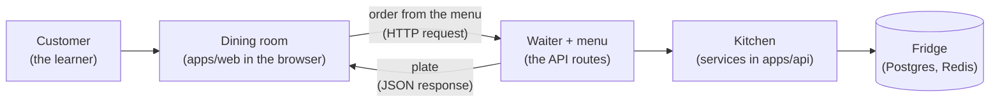
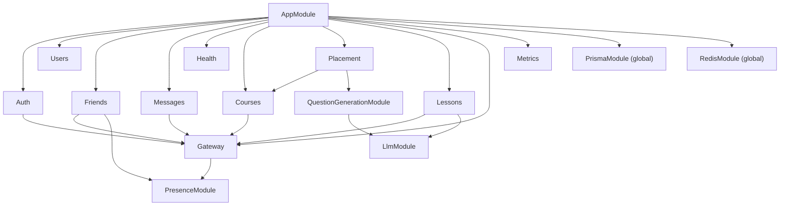
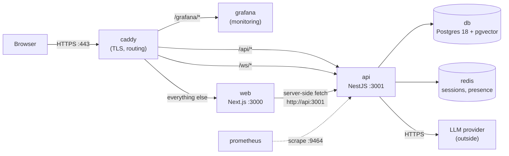
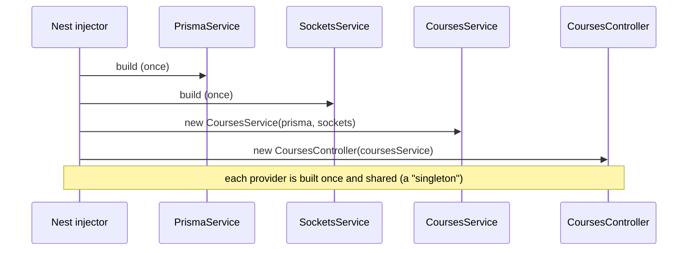
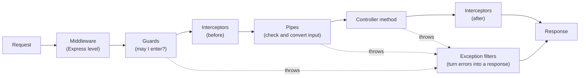
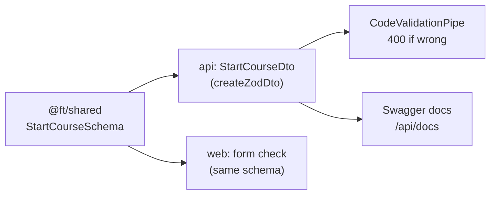
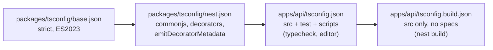
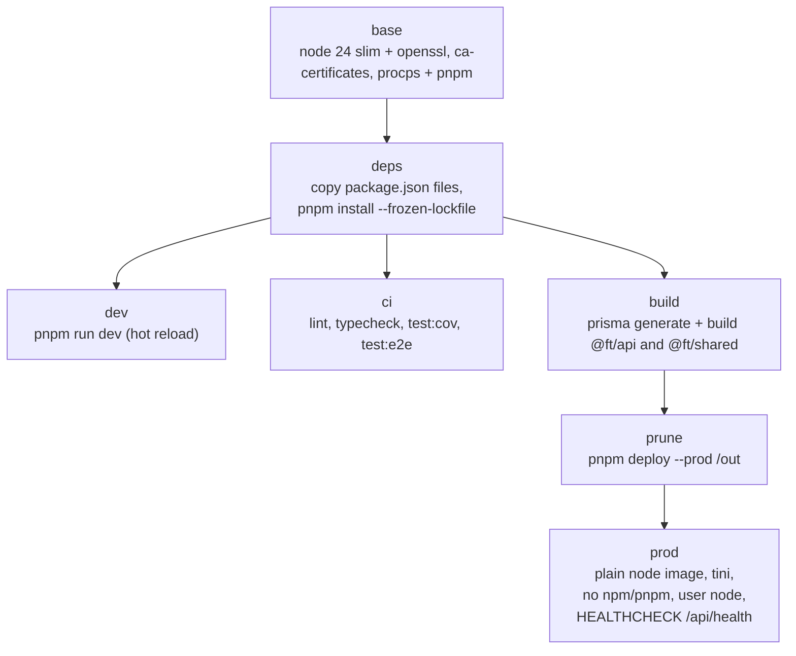

# Chapter 1 — The big picture

In this chapter:

- What a backend (an API) is, with a simple analogy
- The basics of HTTP: methods, status codes, JSON, cookies, and the REST style
- What this API does: every module in `apps/api/src`, one line each
- Where the API sits in the whole system (browser, Caddy, web, api, Postgres, Redis)
- Node.js and TypeScript in two minutes
- NestJS theory: modules, controllers, providers, dependency injection, decorators, the request pipeline
- Zod, `nestjs-zod` and the `@ft/shared` package
- A map of the `apps/api` folder, and every tooling file at its root

---

## 1. What is a backend? What is an API?

Think of a restaurant.

- The **dining room** is the web app in the browser. It is what the customer sees.
- The **kitchen** is the backend. The customer never goes in there. It holds the food (the data) and the recipes (the rules).
- The **waiter and the menu** are the API. API means *Application Programming Interface*: a fixed list of things you can ask for, and the exact way to ask. You cannot walk into the kitchen; you order from the menu, and the waiter brings back a plate.

In this project the kitchen is `apps/api`, a NestJS program. The dining room is `apps/web`, a Next.js program. The rule of the whole project is written in [docs/architecture/overview.md](../architecture/overview.md):

> **NestJS owns all business logic and data access. Next.js does presentation and SSR only.**

So every rule ("can this user see this lesson?", "how much XP does a finished lesson give?") and every read or write in the database happens in the API. The web app only asks and shows.



---

## 2. HTTP basics

The browser and the API talk with **HTTP**. HTTP is a text protocol: one side sends a *request*, the other sends back a *response*.

A request has:

| Part | Example | Meaning |
|---|---|---|
| Method | `POST` | What kind of action |
| Path | `/api/auth/login` | Which thing |
| Headers | `Content-Type: application/json`, `Cookie: ft.sid=...` | Extra information |
| Body (optional) | `{"email":"a@b.c","password":"..."}` | The data you send |

A response has a **status code**, headers, and usually a body.

### Methods

| Method | Use | Example in this API |
|---|---|---|
| `GET` | Read something. Never changes data. | `GET /api/courses` lists my courses |
| `POST` | Create something, or run an action | `POST /api/auth/login`, `POST /api/courses` |
| `PATCH` | Change part of something | `PATCH /api/users/me` changes my profile |
| `DELETE` | Remove something | `DELETE /api/friends/:userId` |
| `PUT` | Replace something completely | Not used in this API |

### Status codes

The status code is a number that says how it went. The first digit is the family.

| Code | Name | When this API sends it |
|---|---|---|
| `200` | OK | Normal success |
| `201` | Created | A `POST` that made something (Nest sends 201 for every `POST` unless `@HttpCode()` says otherwise) |
| `202` | Accepted | Login with 2FA on: the password is right, but a code is still needed |
| `204` | No Content | Success with no body, for example `DELETE /api/friends/:userId` (`@HttpCode(HttpStatus.NO_CONTENT)`) |
| `400` | Bad Request | The body failed its Zod schema |
| `401` | Unauthorized | No valid session (not logged in) |
| `403` | Forbidden | Logged in, but not allowed |
| `404` | Not Found | No such route or no such thing |
| `409` | Conflict | For example: you already study this language |
| `413` | Payload Too Large | The avatar file is too big |
| `429` | Too Many Requests | The rate limiter said "slow down" |
| `500` | Internal Server Error | A bug or a crash |

In this API, the `message` of every error is a **code** like `"auth.sessionRequired"`, never a sentence. The browser knows the reader's language, so it turns the code into words ([apps/web/lib/error-message.ts](../../apps/web/lib/error-message.ts)). Chapter 2 shows how.

### JSON

JSON (*JavaScript Object Notation*) is the text format of the bodies:

```json
{ "courses": [{ "lang": "fr", "level": "A2", "dailyGoal": 30 }], "activeLang": "fr" }
```

A NestJS controller method returns a normal JavaScript object, and Nest turns it into JSON for you.

### Cookies and sessions

HTTP has no memory: each request is alone. To remember "this is Alice", the API uses a **session cookie**.

1. Alice logs in. The API stores `{ userId: "..." }` in **Redis** under a random id.
2. The API answers with the header `Set-Cookie: ft.sid=<random id>`.
3. The browser sends `Cookie: ft.sid=<random id>` on every next request, by itself.
4. The API reads the id, finds the session in Redis, and knows it is Alice.

The cookie is `httpOnly` (JavaScript in the page cannot read it), so a script injected in the page cannot steal it. This is set up in [app.setup.ts](../../apps/api/src/app.setup.ts) (chapter 2) and used by the auth module (chapter 5).

### REST

REST is a *style* for designing HTTP APIs, not a library. The main ideas:

- A URL names a **resource** (a thing): `/courses`, `/users/:id`, `/friends`.
- The **method** says what to do with it: `GET` reads, `POST` creates, `PATCH` changes, `DELETE` removes.
- Each request carries everything needed (here, the cookie).

So `PATCH /api/courses/fr/level` means "change the level of my French course". This API follows REST for most routes, and adds two things that are not plain request/response:

- **WebSockets** on `/ws` (socket.io): a connection that stays open, so the server can *push* events (a new chat message, a friend coming online). Chapter 9.
- **Server-Sent Events** (`text/event-stream`) for the AI tutor's answer, which comes word by word. Chapter 8.

---

## 3. What this API does: the modules

The code in [apps/api/src](../../apps/api/src) is split into **modules** (section 6 explains what a module is). Here is each one, with its routes. All HTTP routes start with `/api` (the global prefix set in `app.setup.ts`).

| Folder | Module | What it does | Routes / entry points |
|---|---|---|---|
| [prisma/](../../apps/api/src/prisma) | `PrismaModule` (global) | Gives every module `PrismaService`, the connection to Postgres | none |
| [redis/](../../apps/api/src/redis) | `RedisModule` (global) | Gives every module `RedisService`, the connection to Redis (sessions, presence, counters) | none |
| [throttler/](../../apps/api/src/throttler) | no module, a guard | Rate limiting: how many requests per minute, counted per account or per IP | applies to every route |
| [metrics/](../../apps/api/src/metrics) | `MetricsModule` | Prometheus numbers (request times, active users), served on a separate port 9464 | `:9464/metrics` (internal) |
| [health/](../../apps/api/src/health) | `HealthModule` | "Am I alive? Are Postgres and Redis reachable?" for Docker and CI | `GET /api/health` |
| [auth/](../../apps/api/src/auth) | `AuthModule` | Sign up, log in, log out, sessions, two-factor auth (TOTP); the global `AuthGuard` | `/api/auth/signup`, `login`, `logout`, `me`, `2fa`, `2fa/setup`, `2fa/enable`, `2fa/verify` |
| [users/](../../apps/api/src/users) | `UsersModule` | Profiles: list and search users, read one, change my profile, upload or delete my avatar | `/api/users`, `/api/users/recently-active`, `/api/users/:id`, `/api/users/me`, `/api/users/me/avatar` |
| [llm/](../../apps/api/src/llm) | `LlmModule` | Picks the AI provider (`gemini`, the real model; `fixture`, a fake for tests; or `disabled`) and exports it as `LLM_PROVIDER` | none |
| [courses/](../../apps/api/src/courses) | `CoursesModule` | The languages a user studies, the daily goal, the level | `/api/courses`, `/api/courses/:lang`, `/api/courses/:lang/level` |
| [question-generation/](../../apps/api/src/question-generation) | `QuestionGenerationModule` | Writes new placement questions with the LLM when the stock runs low | none (used by placement) |
| [placement/](../../apps/api/src/placement) | `PlacementModule` | The placement exam that finds your level | `/api/placement`, `/api/placement/answers` |
| [lessons/](../../apps/api/src/lessons) | `LessonsModule` | Today's lesson, the lesson list, one lesson, achievements, attempts (answering pages), XP, the AI tutor discussion | `/api/courses/:lang/today`, `.../lessons`, `.../lessons/:id`, `.../achievements`, `.../lessons/:id/attempt`, `.../attempt/pages/:index`, `.../lessons/:id/discussion` |
| [gateway/](../../apps/api/src/gateway) | `GatewayModule` | The socket.io server on `/ws`; `SocketsService` lets other modules push events to a user | WebSocket `/ws` |
| [presence/](../../apps/api/src/presence) | `PresenceModule` | Who is online right now (kept in Redis) | none |
| [friends/](../../apps/api/src/friends) | `FriendsModule` | Friend list, send, accept, refuse requests, remove a friend | `/api/friends`, `/api/friends/requests/:userId`, `.../accept`, `/api/friends/:userId` |
| [messages/](../../apps/api/src/messages) | `MessagesModule` | Direct messages: list conversations, read a conversation; send and mark read over the socket | `/api/conversations`, `/api/conversations/:userId/messages`, socket events |
| [demo/](../../apps/api/src/demo) | no module | Demo learners, replayed day by day through the real services. Run by the seed, outside Nest | none |
| [items/](../../apps/api/src/items) | no module, one test | `item-files.spec.ts` checks the authored placement questions in `content/items` | none |
| [generated/](../../apps/api/src/generated) | no module | The Prisma client, generated from `schema.prisma`. Never edited by hand | none |

Next to them, at the top of `src`, are the boot files: `main.ts`, `app.setup.ts`, `app.module.ts`, `validation.pipe.ts`, `error-code.filter.ts`. They are chapter 2.

How the modules import each other (from the `imports` arrays of each `*.module.ts`; Prisma and Redis are global, so everyone uses them without an arrow):



---

## 4. Where the API sits in the system

The whole app runs as Docker containers, described in [compose.yml](../../compose.yml) (plus the overlays `compose.override.yml` for dev and `compose.prod.yml`, and `compose.deploy.yml` for the server, plus `compose.deploy.proxy.yml` on a host where another proxy already owns ports 80 and 443). Only **Caddy** opens a port to the outside world (in dev, Postgres and Redis also open one, but only on `127.0.0.1`; with `compose.deploy.proxy.yml`, Caddy opens none and the front proxy reaches it over a Docker network). Caddy is a *reverse proxy*: one front door that sends each request to the right container, and does HTTPS.



The routing rules live in [infra/caddy/Caddyfile](../../infra/caddy/Caddyfile):

```text
	# NestJS sets a global "api" prefix, so the prefix is forwarded intact.
	# handle_path would strip it and every route would answer 404.
	@api path /api /api/*
	handle @api {
		reverse_proxy api:3001 {
```

Why one front door for both web and api? Because `/` and `/api` then have the same *origin* (same scheme, host and port). The session cookie is "first-party", so there is no CORS setup to write. (CORS is the browser rule that blocks a page from calling a different origin unless that origin allows it.)

The `api` service in `compose.yml` shows what the API needs to start:

```yaml
  api:
    logging: *logging
    build:
      context: .
      dockerfile: apps/api/Dockerfile
    depends_on:
      db:
        condition: service_healthy
      redis:
        condition: service_healthy
    environment:
      NODE_ENV: ${NODE_ENV:-development}
      # Prometheus scrapes metrics on 9464 (apps/api/src/metrics). Internal
      # only: never add it to ports.
      PORT: 3001
```

It waits for Postgres and Redis to be healthy, and gets its settings from environment variables: `DATABASE_URL`, `REDIS_URL`, `SESSION_SECRET`, `LLM_PROVIDER`, `LLM_API_KEY`, `LLM_MODEL`, `APP_VERSION`, the rate limits (`RATE_LIMIT_PER_MINUTE`, `SIGNUP_LIMIT_PER_MINUTE`, `LOGIN_LIMIT_PER_MINUTE`) and the AI tutor limits (`LLM_DISCUSSION_*`), and `AVATAR_STORAGE_DIR` (where uploaded avatars go, a Docker volume).

---

## 5. Node.js and TypeScript

**Node.js** runs JavaScript outside the browser, on a server. It has one main thread and an *event loop*: when the code waits for the database, Node does not block; it handles other requests and comes back when the answer arrives. That is why you see `async` / `await` everywhere in the API. The Docker image uses Node 24.

**TypeScript** is JavaScript with types. You write `.ts` files, and the compiler (`tsc`) checks the types and produces plain `.js` files in `dist/`. Node runs `dist/main.js`. Types exist only before compilation; at run time they are gone. Keep this in mind: it is why NestJS needs *decorator metadata* (section 6.5).

---

## 6. NestJS theory

NestJS is a framework on top of **Express** (the classic Node web server library). Express gives you "when a request comes to this URL, call this function". Nest adds structure: modules, classes, decorators, and an automatic way to connect classes together.

### 6.1 Modules

A **module** is a box that groups the pieces of one feature. It is a class with the `@Module()` decorator, and it lists four things:

| Key | Meaning |
|---|---|
| `imports` | Other modules whose exported pieces I need |
| `controllers` | My classes that answer HTTP routes |
| `providers` | My classes Nest must build (services, guards, factories) |
| `exports` | Which of my providers other modules may use |

Here is a real one, [courses.module.ts](../../apps/api/src/courses/courses.module.ts):

```ts
@Module({
  imports: [GatewayModule],
  controllers: [CoursesController],
  providers: [CoursesService],
  exports: [CoursesService],
})
export class CoursesModule {}
```

The class body is empty: the decorator carries all the information. `CoursesModule` needs `SocketsService` from `GatewayModule` (to push "course changed" events), and it exports `CoursesService` because `PlacementModule` uses it.

All modules hang from one root, [app.module.ts](../../apps/api/src/app.module.ts), which lists them in `imports`. Nest starts from there and walks the tree.

A module can be **global** with `@Global()`. Then its exports are available everywhere without importing it. Only two modules do this, and [prisma.module.ts](../../apps/api/src/prisma/prisma.module.ts) explains why:

```ts
/**
 * Global: every feature module needs the database, and re-importing this in each
 * of them is boilerplate that only ever gets forgotten. Nothing else in this
 * codebase should be @Global.
 */
@Global()
@Module({
  providers: [PrismaService],
  exports: [PrismaService],
})
export class PrismaModule {}
```

### 6.2 Controllers

A **controller** is the waiter. It receives HTTP requests, reads the input (body, URL parameters, current user), calls a service, and returns the result. It should hold no business rules. From [courses.controller.ts](../../apps/api/src/courses/courses.controller.ts):

```ts
@ApiTags('courses')
@Controller('courses')
export class CoursesController {
  constructor(private readonly courses: CoursesService) {}

  @Get()
  @ApiOperation({ summary: 'List courses for the current user' })
  @ApiOkResponse({ type: CoursesDto })
  @ApiUnauthorizedResponse({ description: 'No valid session' })
  listCourses(@CurrentUser() user: SessionUser) {
    return this.courses.listCoursesUser(user.id);
  }

  @Post()
  @ApiOperation({ summary: 'Start a course in a new language' })
  @ApiCreatedResponse({ type: CourseDto })
  @ApiUnauthorizedResponse({ description: 'No valid session' })
  @ApiConflictResponse({ description: 'Language already studied' })
  createNewCourse(@CurrentUser() user: SessionUser, @Body() body: StartCourseDto) {
    return this.courses.createCourse(user.id, body);
  }
```

- `@Controller('courses')` + `@Get()` = `GET /api/courses`.
- `@Post()` = `POST /api/courses`.
- `@CurrentUser()` gives the logged-in user; `@Body()` gives the parsed JSON body.
- The `@Api...` decorators only describe the route for the Swagger documentation page at `/api/docs`. They change nothing at run time.

### 6.3 Providers and services

A **provider** is any class (or value) that Nest builds and hands out. The most common kind is a **service**: the cook, where the real work is. A service is a class marked `@Injectable()`. From [courses.service.ts](../../apps/api/src/courses/courses.service.ts):

```ts
@Injectable()
export class CoursesService {
  constructor(
    private readonly prisma: PrismaService,
    private readonly sockets: SocketsService,
  ) {}

  async listCoursesUser(userId: string) {
    const user = await this.prisma.user.findUnique({
      where: { id: userId },
      select: {
        activeLang: true,
        userLevels: { select: COURSE_SELECT, orderBy: { createdAt: 'asc' } },
      },
    });
    if (!user) {
      throw new UnauthorizedException('auth.sessionRequired');
    }
    return { courses: user.userLevels, activeLang: user.activeLang };
  }
```

Notice two things. The service never says `new PrismaService()`: it just *asks* for one in its constructor. And it throws an `UnauthorizedException` with a code; Nest turns that into a `401` response.

A provider is not always a class. [llm.module.ts](../../apps/api/src/llm/llm.module.ts) uses a **factory provider**: a function Nest calls once at startup, and a Symbol token as its name:

```ts
    {
      // The name other classes use to ask for this provider.
      // It is a Symbol (a real value that exists at runtime),
      // because the LlmProvider interface is erased when the code is compiled.
      provide: LLM_PROVIDER,

      // The things Nest must give to the factory below.
      // Here: the ConfigService, which reads the .env file.
      // The order matches the factory's parameters.
      inject: [ConfigService],
```

### 6.4 Dependency injection

**Dependency injection (DI)** means: a class does not build the things it needs; someone else gives them.

Analogy: a cook does not grow vegetables or build an oven. The restaurant manager puts them in the kitchen before the shift. The cook just says "I need an oven and carrots". In Nest, the manager is the **injector** (also called the IoC container).



At startup, Nest reads each constructor, sees what types it asks for, builds those first, and passes them in. Each provider is built **once** and shared by everyone in the app.

Why this is good:

- **Less wiring code**: no `new X(new Y(new Z()))` chains.
- **Easy tests**: a test can give a fake `PrismaService` instead of the real one (chapter 10).
- **Clear borders**: a module can only use what it imports, so the `imports` lists show who depends on whom.

### 6.5 Decorators

A **decorator** is the `@Something()` written above a class, method or parameter. It is a function that runs when the class is defined and attaches information (*metadata*) to it. Nest reads that metadata later.

| Kind | Examples | Effect |
|---|---|---|
| Class | `@Module()`, `@Controller('courses')`, `@Injectable()`, `@Global()` | Says what the class is |
| Method | `@Get()`, `@Post(':id')`, `@Public()`, `@SkipThrottle()`, `@UseInterceptors()` | Route, rules for one route |
| Parameter | `@Body()`, `@Param('lang')`, `@CurrentUser()` | Which part of the request goes into this argument |

How does Nest know the constructor asks for a `PrismaService`, if types disappear at compile time? The TypeScript options `experimentalDecorators` and `emitDecoratorMetadata` (in [packages/tsconfig/nest.json](../../packages/tsconfig/nest.json)) make the compiler write the constructor types into hidden metadata called `design:paramtypes`. The `reflect-metadata` package reads it. That is why `main.ts` starts with `import 'reflect-metadata'`, and why the ESLint config turns off the rule that would change `import { X }` into `import type { X }` (a type-only import is erased, and the metadata is lost).

This project also makes its own decorators. From [auth.decorators.ts](../../apps/api/src/auth/auth.decorators.ts):

```ts
/** Opens a route to anonymous callers. Everything else requires a session. */
export const Public = () => SetMetadata(IS_PUBLIC, true);

/** The user AuthGuard resolved. Only meaningful on a guarded route. */
export const CurrentUser = createParamDecorator((_data: unknown, context: ExecutionContext) => {
  return context.switchToHttp().getRequest<Request & { user?: SessionUser }>().user;
});
```

`@Public()` only writes a flag. The `AuthGuard` reads that flag to decide whether to ask for a session.

### 6.6 The request pipeline

Between the moment a request arrives and the moment your controller method runs, Nest passes it through several kinds of pieces, always in the same order:



| Piece | Question it answers | Example in this API |
|---|---|---|
| **Middleware** | "Do something with every raw request" | `httpMetrics` (times each request), `express-session` (loads the session from Redis). Both in `app.setup.ts` |
| **Guard** | "Is this caller allowed in?" Returns true or throws | `AuthGuard` (needs a session unless `@Public()`), `IdentityThrottlerGuard` (rate limit). Both global, registered with `APP_GUARD` |
| **Interceptor** | "Wrap the handler: do something before and after" | `FileInterceptor('avatar', ...)` from `@nestjs/platform-express` reads the uploaded avatar file (uses `multer`) |
| **Pipe** | "Is the input valid? Convert it" | `CodeValidationPipe` (Zod check of every body), `LangParam` (checks `:lang`) in [validation.pipe.ts](../../apps/api/src/validation.pipe.ts) |
| **Exception filter** | "Something threw: what response do we send?" | `ErrorCodeFilter` (global), `AvatarTooLargeFilter` in users, `SocketExceptionFilter` for sockets |

A comment in [http-metrics.middleware.ts](../../apps/api/src/metrics/http-metrics.middleware.ts) shows why the order matters:

```ts
/**
 * A middleware, not an interceptor: interceptors run after guards, so they
 * would never see the 401s, the 429s, unknown routes or body parser errors.
 * Timed on `close`, after ErrorCodeFilter has set the final status.
 */
```

Chapter 2 follows one real request through every one of these pieces.

---

## 7. Zod, nestjs-zod and @ft/shared

### Zod

**Zod** is a library to describe the *shape* of data and check it at run time. TypeScript types vanish at run time, so they cannot check what a user sends. A Zod schema can:

```ts
export const StartCourseSchema = z.object({
  lang: LanguageSchema,
  dailyGoal: DailyGoalSchema,
});
export type StartCourseInput = z.infer<typeof StartCourseSchema>;
```

`StartCourseSchema.parse(data)` throws if `data` is wrong. `z.infer` gives the TypeScript type for free, so the type and the check never disagree.

### @ft/shared

This schema does not live in the API. It lives in [packages/shared/src/schemas/course.ts](../../packages/shared/src/schemas/course.ts). The `@ft/shared` package is the **contract** between the API and the web app. Its [index.ts](../../packages/shared/src/index.ts) says why:

```ts
/**
 * @ft/shared is the contract layer.
 *
 * The subject requires every user input to be validated on the server and, where
 * a form exists, on the client too. Writing those rules twice guarantees the two
 * copies drift apart. So each payload that crosses the network is declared once
 * here as a Zod schema: NestJS parses requests with it, Next parses form input
 * and API responses with it, and both derive their TypeScript types from the same
 * `z.infer`. One edit, both sides.
 *
 * This package is a leaf. It must never import from apps/*.
 */
```

What is inside:

| Folder | Content |
|---|---|
| `src/schemas/` | Request and response schemas: user, course, placement, item (questions), lesson, friend, message, gamification, two-factor, health, language, locale, and `errors.ts` (the list of `ERROR_CODES`) |
| `src/events/` | Socket event names and payloads (`CLIENT_EVENTS`, `SERVER_EVENTS`) |
| `src/lessons/` | The lesson format (domain, player, schemas, validation), exported as `lessons` |

It is compiled to `packages/shared/dist`, and the API imports it as `@ft/shared` (`"@ft/shared": "workspace:*"` in `package.json`, which means "the copy in this repo"). That is why some scripts build `@ft/shared` first.

### nestjs-zod

Nest normally validates with *DTO classes* (Data Transfer Object: a class that describes a body). `nestjs-zod` builds such a class from a Zod schema. From [courses.dto.ts](../../apps/api/src/courses/courses.dto.ts):

```ts
import { createZodDto } from 'nestjs-zod';
import {
  StartCourseSchema,
  SetGoalSchema,
  SetLevelSchema,
  CourseSchema,
  CoursesSchema,
} from '@ft/shared';

export class StartCourseDto extends createZodDto(StartCourseSchema) {}
```

When a controller writes `@Body() body: StartCourseDto`, the global `CodeValidationPipe` (built with `createZodValidationPipe` from `nestjs-zod`) sees the DTO, runs its Zod schema, and sends a `400` with error codes if it fails. Swagger also reads the DTO to document the body.



`class-validator` and `class-transformer` are in `package.json` too, but no file in `src` imports them. As `app.setup.ts` says: *"Zod, not class-validator: @ft/shared owns the rules and the browser applies the same ones."*

---

## 8. Folder map of apps/api

```text
apps/api/
├── src/                 the application code (chapters 2-9)
│   ├── main.ts          starts the server
│   ├── app.setup.ts     global setup (prefix, sessions, pipes, filters, Swagger)
│   ├── app.module.ts    the root module
│   ├── validation.pipe.ts, error-code.filter.ts
│   ├── auth/ users/ courses/ placement/ question-generation/ lessons/
│   ├── friends/ messages/ gateway/ presence/ llm/ demo/
│   ├── prisma/ redis/ throttler/ metrics/ health/ items/
│   └── generated/prisma/   Prisma client (generated, git-ignored)
├── prisma/              database: schema.prisma, migrations/, seed.ts (chapter 4)
├── scripts/             command-line tools: lessons/, check-outlines.ts, try-generation.ts (chapter 11)
├── test/                end-to-end tests *.e2e-spec.ts, *.fixtures.ts, fixtures/ (chapter 10)
├── coverage/            test coverage report (generated, not in git)
├── dist/                compiled JavaScript (generated, not in git)
├── package.json  nest-cli.json  nest-cli.dev.json
├── tsconfig.json  tsconfig.build.json
├── eslint.config.mjs  vitest.config.mts  vitest.config.e2e.mts
├── prisma.config.ts
├── Dockerfile  .dockerignore  Dockerfile.dockerignore
└── .gitignore
```

| Folder | What it is | Edited by hand? |
|---|---|---|
| `src/` | All the code that runs in the server. Unit tests (`*.spec.ts`) sit next to the file they test | Yes |
| `src/generated/` | The Prisma client: TypeScript code made by `prisma generate` from `schema.prisma`. [.gitignore](../../apps/api/.gitignore) keeps it out of git: *"committing it would put a build artifact under review"* | No |
| `prisma/` | The database schema, the migration history, and the seed script | Yes |
| `scripts/` | Tools you run by hand with `tsx`: write and check lessons, check outlines, try the LLM question generation. Not part of the server | Yes |
| `test/` | End-to-end tests: they boot the whole app and send real HTTP requests with Supertest | Yes |
| `coverage/` | HTML and `lcov` report made by `pnpm test:cov` | No |
| `dist/` | Output of `nest build`. This is what runs in production | No |

---

## 9. Tooling files

### 9.1 package.json

[package.json](../../apps/api/package.json) names the package `@ft/api` and lists its scripts and dependencies. `"files": ["dist"]` says that only `dist` is shipped when the Dockerfile runs `pnpm deploy`.

Run a script from the repo root with `pnpm --filter @ft/api <script>`, or from `apps/api` with `pnpm <script>`.

| Script | Command | What it does |
|---|---|---|
| `dev` | `nest start --watch --config nest-cli.dev.json` | Starts the API and restarts it on every file save |
| `build` | `nest build` | Compiles `src` to `dist` |
| `start` | `node dist/main.js` | Runs the compiled API (production) |
| `lint` | `eslint .` | Checks code style and common mistakes |
| `format:check` | `prettier --check . --ignore-path ../../.prettierignore` | Checks formatting, does not change files |
| `typecheck` | `tsc --noEmit` | Checks all types (src, test, scripts), writes nothing |
| `test` | `vitest run` | Runs the unit tests (`src/**/*.spec.ts`) |
| `test:cov` | `vitest run --coverage` | Same, plus the coverage report and its thresholds |
| `test:e2e` | `vitest run --config vitest.config.e2e.mts` | Runs the end-to-end tests in `test/` (needs a real Postgres and Redis) |
| `db:generate` | `prisma generate` | Writes the Prisma client into `src/generated` |
| `db:migrate` | `prisma migrate dev` | Development: creates a new migration from schema changes and applies it |
| `db:deploy` | `prisma migrate deploy` | Production: applies the migrations that are not applied yet |
| `db:seed` | `tsx prisma/seed.ts` | Fills the database with base data and demo users |
| `generation:try` | `tsx --env-file-if-exists=../../.env scripts/try-generation.ts` | Tries the LLM question generation by hand, with your `.env` keys |
| `outlines:check` | `tsx scripts/check-outlines.ts` | Checks the lesson outline files in `content/outlines` |
| `lessons:author` | build `@ft/shared`, then `tsx scripts/lessons/author.ts` | Writes lessons with the LLM |
| `lessons:check` | build `@ft/shared`, then `tsx scripts/lessons/check.ts` | Validates the lesson files |

`tsx` runs a TypeScript file directly, without compiling it first. It is used for the seed and the scripts, which run outside Nest.

**Main dependencies** (needed at run time):

| Package | Role |
|---|---|
| `@nestjs/common`, `@nestjs/core` | NestJS itself: decorators, modules, injector |
| `@nestjs/platform-express` | Runs Nest on Express; also gives `FileInterceptor` |
| `@nestjs/config` | `ConfigService`, reads environment variables |
| `@nestjs/websockets`, `@nestjs/platform-socket.io`, `socket.io` | The WebSocket gateway on `/ws` |
| `@nestjs/swagger` | The API documentation page at `/api/docs` |
| `@nestjs/throttler` | Rate limiting |
| `@prisma/client`, `@prisma/adapter-pg` | The database client, and its adapter for the `pg` Postgres driver |
| `redis`, `connect-redis`, `express-session` | Redis client, and sessions stored in Redis |
| `argon2` | Password hashing |
| `otpauth`, `qrcode-generator` | 2FA: TOTP codes, and the QR code to scan |
| `multer` | Reads file uploads (avatars) |
| `zod`, `nestjs-zod` | Validation (section 7) |
| `@ft/shared` | The shared schemas (section 7) |
| `@prometheus-io/client` | Prometheus metrics |
| `reflect-metadata` | Reads decorator metadata (section 6.5) |
| `rxjs` | A library for streams of events. Nest needs it inside; our code does not import it |
| `class-validator`, `class-transformer` | Listed but not imported by our code (section 7) |

**Main dev dependencies** (only for building and testing): `@nestjs/cli` (the `nest` command), `typescript`, `prisma` (the CLI), `vitest` + `@vitest/coverage-v8` (tests and coverage), `vite`, `unplugin-swc` + `@swc/core` (compile TypeScript with decorator metadata inside tests), `@nestjs/testing` (build a test module), `supertest` (send HTTP requests in e2e tests), `socket.io-client` (connect to the gateway in tests), `tsx`, `eslint`, `prettier`, the `@types/*` packages, and the shared configs `@ft/eslint-config` and `@ft/tsconfig`.

### 9.2 nest-cli.json and nest-cli.dev.json

These configure the `nest` command. [nest-cli.json](../../apps/api/nest-cli.json):

```json
{
  "$schema": "https://json.schemastore.org/nest-cli",
  "collection": "@nestjs/schematics",
  "sourceRoot": "src",
  "compilerOptions": {
    "deleteOutDir": true,
    "tsConfigPath": "tsconfig.build.json"
  }
}
```

- `sourceRoot: "src"`: the code is in `src`.
- `tsConfigPath`: compile with `tsconfig.build.json` (no tests).
- `deleteOutDir: true`: empty `dist` before each build, so no old file stays behind.
- `collection`: the templates used by `nest generate` (not used by the scripts).

[nest-cli.dev.json](../../apps/api/nest-cli.dev.json) is the same file with `"deleteOutDir": false`. Only the `dev` script uses it. The file gives no reason; the effect is that watch mode does not wipe `dist` (and the incremental build info kept there) each time it starts.

### 9.3 tsconfig.json and tsconfig.build.json

There are three levels:



[tsconfig.json](../../apps/api/tsconfig.json) is used by `pnpm typecheck` and by your editor. It includes tests and scripts so they are type-checked too:

```jsonc
    // Nothing imports this app's types, and emitting declarations makes every
    // inferred type have to be nameable: createZodDto returns a type from a
    // hashed internal path and fails with TS2883.
    "declaration": false,
```

```jsonc
  // Tests and the tsx scripts (scripts/) are typechecked here and excluded from
  // the build (tsconfig.build.json).
  // src/generated is in: the Prisma client is TypeScript that has to compile
  // into dist, and excluding it would only hide errors until runtime.
  "include": ["src/**/*.ts", "test/**/*.ts", "scripts/**/*.ts"],
```

[tsconfig.build.json](../../apps/api/tsconfig.build.json) extends it for `nest build`: only `src`, no `test` and no `*.spec.ts`. It sets `rootDir: "./src"` so the output is `dist/main.js` and not `dist/src/main.js`. The two files use different `tsBuildInfoFile` names so a type-check run and a build run do not mix their saved state.

The shared [nest.json](../../packages/tsconfig/nest.json) uses `"module": "commonjs"` (the old Node module system, which Nest expects) and turns on `experimentalDecorators` and `emitDecoratorMetadata` (section 6.5).

### 9.4 eslint.config.mjs

[eslint.config.mjs](../../apps/api/eslint.config.mjs) reuses the shared Nest rules and ignores generated folders:

```js
// .mjs, not .js: this package must stay CommonJS ("type": "module" would make
// Nest's dist/main.js unloadable), and ESLint imports the config file as-is.
import nest from '@ft/eslint-config/nest';

export default [
  ...nest,
  {
    // src/generated is the Prisma client: emitted code, never hand-edited.
    ignores: ['dist/**', 'coverage/**', '**/generated/**'],
  },
];
```

The shared [packages/eslint-config/nest.js](../../packages/eslint-config/nest.js) turns off `consistent-type-imports` (it would break DI, section 6.5) and `no-extraneous-class` (a Nest module is an empty class with a decorator).

### 9.5 Test config: vitest.config.mts and vitest.config.e2e.mts

You may expect a Jest config, but this project uses **Vitest**, not Jest. Vitest is a test runner with almost the same API (`describe`, `it`, `expect`). There is no Jest file.

[vitest.config.mts](../../apps/api/vitest.config.mts) is for unit tests. The key part is the compiler:

```ts
  plugins: [
    // Nest's injector reads constructor parameter types off `design:paramtypes`.
    // Neither esbuild nor a plain type-stripping transform emits that metadata,
    // so swc has to do the transform or every test that resolves a provider
    // fails with "Nest can't resolve dependencies".
    swc.vite({
```

It runs `src/**/*.spec.ts`, loads `reflect-metadata` first, sets `AVATAR_STORAGE_DIR` (the app refuses to load without it), and asks for at least 60% line and function coverage, ignoring `main.ts`, `app.setup.ts`, `*.module.ts` and `src/generated`.

[vitest.config.e2e.mts](../../apps/api/vitest.config.e2e.mts) is for `test/**/*.e2e-spec.ts`. It forces `LLM_PROVIDER: 'fixture'` (so no test spends money on a real AI), resets the rate limits to their defaults, gives 30 seconds per test, and runs files one at a time (`fileParallelism: false`) because they share database rows. Both files end in `.mts` because the package is CommonJS and Vite must load the config as ESM. Chapter 10 covers tests in depth.

### 9.6 prisma.config.ts

[prisma.config.ts](../../apps/api/prisma.config.ts) tells the Prisma CLI where the schema, the migrations and the seed command are, and which database URL to use:

```ts
export default defineConfig({
  schema: 'prisma/schema.prisma',
  migrations: {
    path: 'prisma/migrations',
    seed: 'pnpm db:seed',
  },
```

It reads `process.env.DATABASE_URL ?? ''` instead of Prisma's `env()` helper, because `prisma generate` runs in the Docker build where no database exists. Chapter 4 explains it fully.

### 9.7 Dockerfile

[Dockerfile](../../apps/api/Dockerfile) builds the API image. Its build context is the **repo root**, not `apps/api`, because pnpm needs the root lockfile to resolve `workspace:*` packages:

```text
#   docker build -f apps/api/Dockerfile --target prod -t ft/api .
```

It has several *stages* (steps that can reuse each other). Each `--target` picks the stage to stop at:



Points worth knowing, each explained by a comment in the file:

- **base** installs `openssl` (Prisma needs it to pick the right engine) and `procps` (`nest start --watch` uses `ps` to kill the old process; without it the old server keeps port 3001 and hot reload serves old code).
- **deps** copies only the `package.json` files first. Docker caches this layer, so editing source code does not reinstall everything. A new workspace package must be added to that copy list.
- **build** runs `prisma generate` inside the image, then `pnpm --filter "@ft/api..." run build`; the `...` also builds `@ft/shared` first.
- **prune** uses `pnpm deploy --prod` to keep only production dependencies.
- **prod** starts from a clean Node image, deletes npm, npx, corepack and yarn (they only bring security findings), runs as user `node`, exposes 3001 and 9464, and checks health with a small `fetch` to `/api/health`. `tini` is a tiny init program that passes stop signals to Node correctly.

### 9.8 .dockerignore and Dockerfile.dockerignore

They list what Docker must **not** send into the build: `node_modules`, `dist`, `generated`, `coverage`, `.env` files, `docs`, `*.md`, and so on. The two files have the same rules on purpose (only their header comment differs):

```text
# BuildKit prefers <dockerfile>.dockerignore over <context>/.dockerignore, which
# makes THIS the file it reads when the context is the repo root. Keep it identical
# to the sibling .dockerignore.
```

So [Dockerfile.dockerignore](../../apps/api/Dockerfile.dockerignore) is the one actually used (context = repo root), and [.dockerignore](../../apps/api/.dockerignore) would be used if someone built with `apps/api` as the context.

### 9.9 .gitignore

[.gitignore](../../apps/api/.gitignore) has one rule (under a comment): `src/generated/`. The Prisma client is rebuilt on install and in the Docker build.

---

## Key ideas to remember

- The API is the kitchen: all rules and all data access live in `apps/api`. The web app only asks and shows.
- HTTP = method + path + headers + body; the answer has a status code. Bodies are JSON. Errors carry a code, not a sentence.
- Login is remembered by the `ft.sid` session cookie; the session itself is stored in Redis.
- Only Caddy faces the outside. `/api/*` and `/ws/*` go to the API, `/grafana/*` to Grafana, everything else to Next.js, all on one origin.
- A Nest **module** groups a feature; a **controller** answers routes; a **service** does the work; Nest **injects** services into constructors and builds each one once.
- **Decorators** attach metadata; `emitDecoratorMetadata` + `reflect-metadata` let Nest see constructor types at run time. Never use `import type` for something you inject.
- A request goes: middleware → guards → interceptors → pipes → controller → interceptors; anything thrown goes to an exception filter.
- Schemas are written once in `@ft/shared` with Zod; the API turns them into DTOs with `nestjs-zod`, and the web uses the same ones.
- Tests use Vitest (not Jest) with swc, so decorator metadata exists in tests too.
- The Dockerfile builds from the repo root in stages: `dev`, `ci`, `build`, `prod`.

---

Previous: none · Next: [Chapter 2 — Boot and request flow](02-boot-and-request-flow.md) · [Back to index](README.md)
