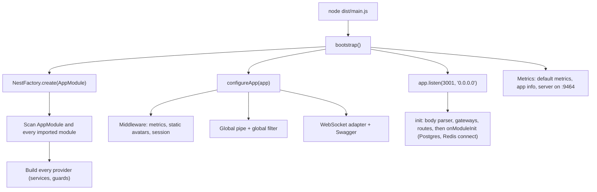
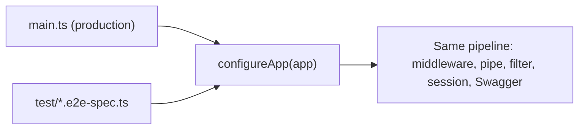
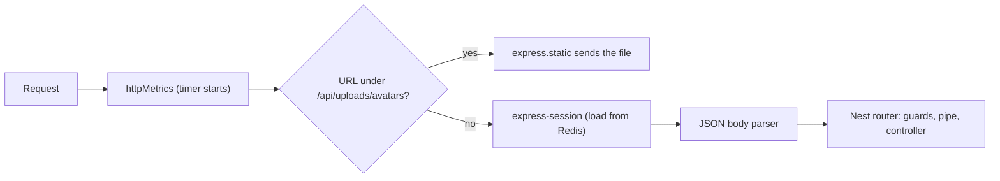
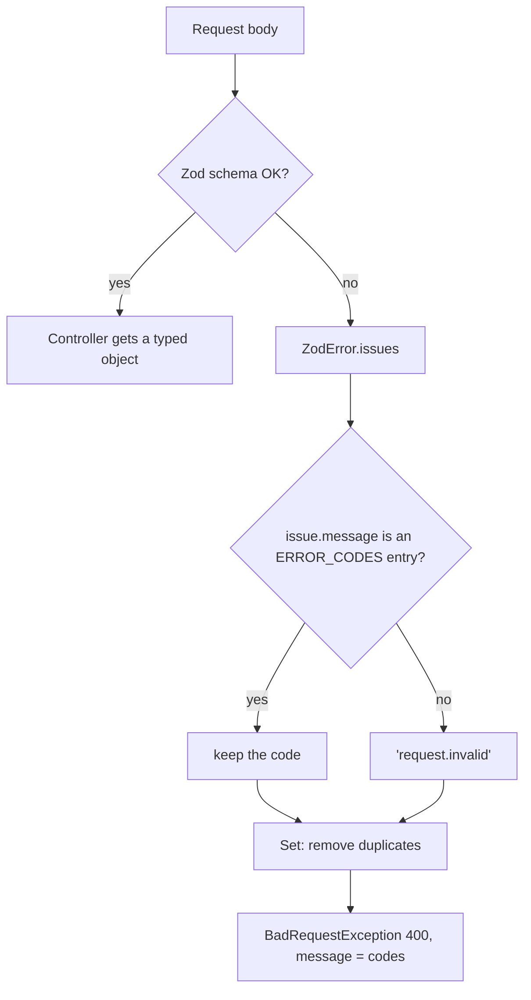
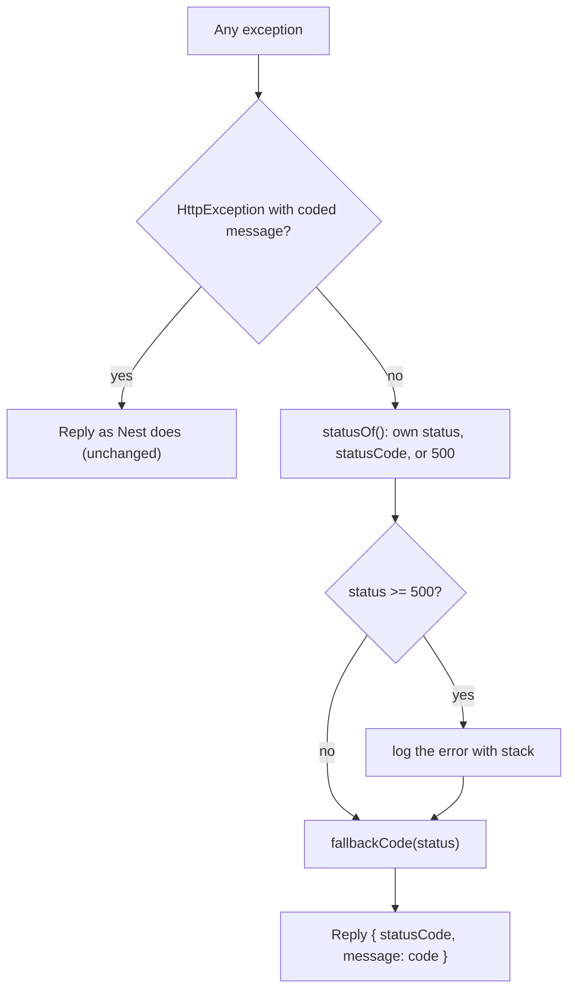
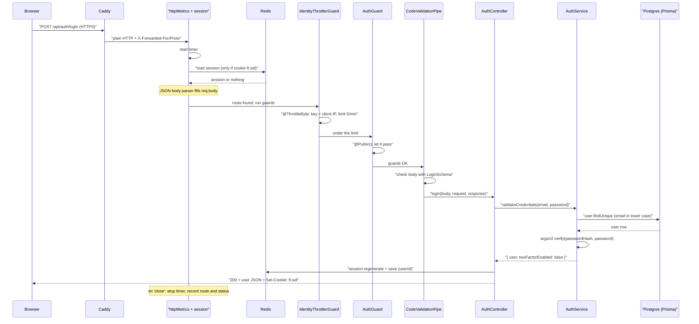
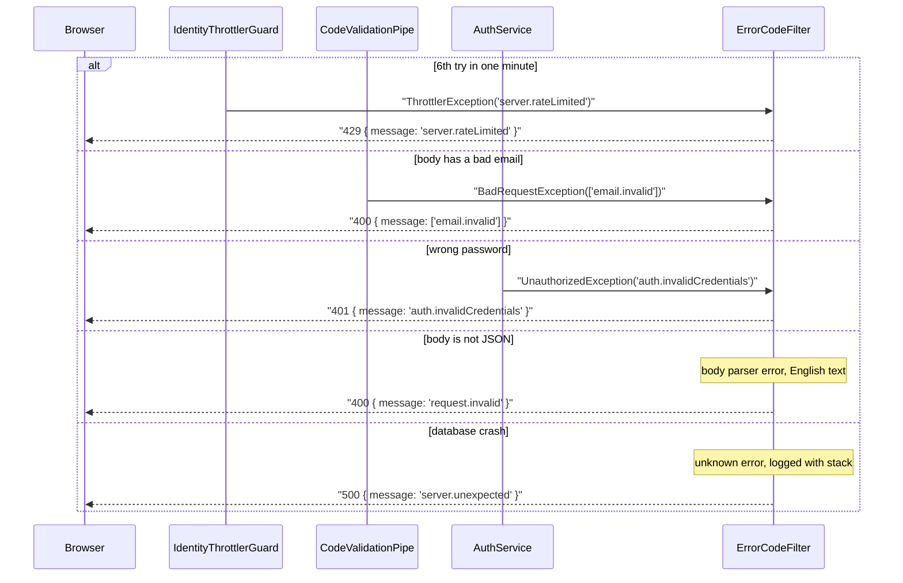

# Chapter 2 — Boot and the life of a request

In this chapter:

- What happens, step by step, when you start the API (`main.ts`).
- What `configureApp` sets up, line by line (`app.setup.ts`), and why the e2e tests call it too.
- How `AppModule` plugs every module together (`app.module.ts`).
- How a bad request body becomes a list of error codes (`validation.pipe.ts`).
- How every other error also leaves with an error code (`error-code.filter.ts`).
- The full trip of one request, `POST /api/auth/login`, from the network to the database and back.

## The big picture

Starting the API is like opening a restaurant in the morning:

1. **Hire the staff** — Nest builds every module, controller and service (`NestFactory.create(AppModule)`).
2. **Set the house rules** — how every customer is greeted and checked at the door (`configureApp`: sessions, validation, error format...).
3. **Open the door** — start listening for HTTP requests (`app.listen`).
4. **Turn on the security camera** — start a small separate server that shows numbers about the restaurant (the metrics server).



The files in this chapter:

| File | Role |
|---|---|
| [main.ts](../../apps/api/src/main.ts) | The real entry point. Starts everything. |
| [app.setup.ts](../../apps/api/src/app.setup.ts) | `configureApp`: every global rule of the request pipeline. |
| [app.module.ts](../../apps/api/src/app.module.ts) | The root module: lists all the other modules. |
| [validation.pipe.ts](../../apps/api/src/validation.pipe.ts) | Checks request bodies and params with Zod, answers with error codes. |
| [error-code.filter.ts](../../apps/api/src/error-code.filter.ts) | Last safety net: every error reply carries an error code. |

Two words used a lot in this chapter:

- **Middleware**: a function that runs on every request *before* Nest picks the controller. It can read or change the request, then calls `next()` to pass it on. Think of the people at the restaurant door.
- **Pipeline**: the fixed chain of steps every request goes through (middleware, guards, pipes, controller, filters).

## main.ts — the entry point

`main.ts` is the file Node runs. It is short: it only puts the pieces in order.

```ts
const DEFAULT_PORT = 3001;

async function bootstrap(): Promise<void> {
  const app = await NestFactory.create(AppModule);
  configureApp(app);

  // 0.0.0.0, not localhost: bound to the loopback interface the process is
  // unreachable from outside the container.
  await app.listen(Number(process.env.PORT ?? DEFAULT_PORT), '0.0.0.0');

  // After listen: a boot that fails never leaves a metrics port answering.
  collectDefaultMetrics({ register: registry });
  appInfo.set({ version: process.env.APP_VERSION ?? '0.0.0' }, 1);
  // Logged, not thrown: monitoring must never take the app down. Prometheus
  // then reports the api as down, which is the right alarm.
  startMetricsServer(METRICS_PORT).catch((error: unknown) =>
    new Logger('Metrics').error(`metrics listener failed: ${String(error)}`),
  );
}

void bootstrap();
```

Line by line:

- `import 'reflect-metadata'` (first line of the file): a small library that lets decorators like `@Injectable()` store information on classes. Nest needs it loaded before anything else.
- `NestFactory.create(AppModule)`: Nest reads `AppModule`, follows every `imports: [...]`, and builds every provider it finds (dependency injection, see [01-big-picture.md](01-big-picture.md)). It also creates an Express server inside. Note: just *importing* some files already runs code, even before `bootstrap()`. For example `app.setup.ts` reads `AVATAR_STORAGE_DIR` at import time, and `throttler/rate-limits.ts` reads the rate limit variables. A missing `AVATAR_STORAGE_DIR`, or a rate limit that is not a positive whole number, stops the API there, before anything listens. (An empty rate limit keeps its default.)
- `configureApp(app)`: adds all the global rules (next section).
- `app.listen(port, '0.0.0.0')`: this calls Nest's `init()` first. `init()` adds Nest's JSON body parser, binds the gateways, adds the routes, and then runs every `onModuleInit()`: `PrismaService` connects to Postgres and `RedisService` connects to Redis (see [03-infrastructure.md](03-infrastructure.md)). Then the HTTP server starts. `0.0.0.0` means "listen on every network card", so other containers (Caddy, the web app) can reach it. `localhost` would only accept calls from inside the same container.
- After `listen`: the metrics part. `collectDefaultMetrics` adds standard Node.js numbers (memory, CPU, event loop). `appInfo` records the running version. `startMetricsServer` opens a second small HTTP server on port 9464 for Prometheus. If it fails, the error is only logged: the app keeps working.
- `void bootstrap()`: runs the async function. `void` tells TypeScript "I know this returns a Promise and I do not wait for it".

## app.setup.ts — the house rules

[app.setup.ts](../../apps/api/src/app.setup.ts) exports constants and one function, `configureApp`.

### Why a separate file?

```ts
/**
 * Called by main.ts and by the e2e suite so both exercise the same request
 * pipeline. Anything global belongs here, not in bootstrap().
 */
export function configureApp(app: INestApplication): void {
```

The e2e tests (in `apps/api/test/`, see [10-tests.md](10-tests.md)) build the app themselves (all but `demo` and `seed`, which run the seed code without an app) and send real HTTP requests with Supertest. If the global rules lived inside `bootstrap()`, the tests would run *without* sessions, without the validation pipe, without the error filter. They would test a different app. So both use the same function:

```ts
// apps/api/test/app.e2e-spec.ts
    configureApp(app);
    await app.init();
```



### The exported constants

| Constant | Value | Used for |
|---|---|---|
| `AVATAR_STORAGE_DIR` | from env `AVATAR_STORAGE_DIR` (required) | Folder where avatar images are saved. |
| `API_PREFIX` | `'api'` | Every route starts with `/api`. |
| `AVATAR_ROUTE` | `'/api/uploads/avatars'` | URL where avatar files are served. |
| `SESSION_COOKIE` | `'ft.sid'` | Name of the session cookie. |
| `SESSION_KEY_PREFIX` | `'sess:'` | Prefix of session keys in Redis. |
| `SESSION_TTL_MS` | 7 days | How long an idle session lives. |

Two required settings are checked at start: `AVATAR_STORAGE_DIR` here, and `SESSION_SECRET` (below).

```ts
export const AVATAR_STORAGE_DIR = requireAvatarStorageDir();

function requireAvatarStorageDir(): string {
  const dir = process.env.AVATAR_STORAGE_DIR;
  if (dir === undefined || dir.trim() === '') {
    throw new Error('AVATAR_STORAGE_DIR is unset: the api cannot start. See compose.yml.');
  }
  return dir;
}
```

The comment above it gives the why: with a "temporary folder" default, uploads would work, then vanish on the next restart without any error. Failing at start is better. `requireSessionSecret()` does the same for `SESSION_SECRET`, and also asks for at least 32 characters (a short secret is easy to guess).

`SESSION_KEY_PREFIX` has a comment: the same `sess:` string is written in the compose files, so the redis-exporter (a monitoring tool) can count open sessions.

### Step 1 — metrics middleware, first

```ts
  // First, so it also times the avatars, the session load and every rejection.
  app.use(httpMetrics);
```

`httpMetrics` starts a timer for each request and stops it when the reply is sent (details in [03-infrastructure.md](03-infrastructure.md)). It is the first middleware, so the time also covers everything after it, even requests that are refused early.

### Step 2 — global prefix

```ts
  app.setGlobalPrefix(API_PREFIX);
```

A controller with `@Controller('auth')` and `@Post('login')` answers at `/api/auth/login`, not `/auth/login`. Caddy (the reverse proxy in front) sends every `/api/...` URL to this API and the rest to the web app.

### Step 3 — avatar files

```ts
  // Here rather than in bootstrap() so the Supertest suite can reach it.
  (app as NestExpressApplication).useStaticAssets(AVATAR_STORAGE_DIR, { prefix: AVATAR_ROUTE });
```

`useStaticAssets` serves files from a folder as they are (Express's `express.static`). A file `abc.png` in the folder is available at `/api/uploads/avatars/abc.png`. The prefix repeats `api` because static files do not get the global prefix. The cast `as NestExpressApplication` is needed because `useStaticAssets` only exists on the Express version of a Nest app.

### Step 4 — trust proxy

```ts
  // Caddy terminates TLS and forwards plain http, so express only learns the
  // request was secure from X-Forwarded-Proto. Without this, `cookie.secure`
  // suppresses the Set-Cookie header and nobody can log in.
  app.getHttpAdapter().getInstance().set('trust proxy', 1);
```

A **reverse proxy** is a server that receives the browser's request and passes it to the real server. Here Caddy does HTTPS with the browser, then talks plain HTTP to the API. So the API sees "HTTP". Caddy adds headers like `X-Forwarded-Proto: https` and `X-Forwarded-For: <client IP>`. `trust proxy = 1` tells Express: "trust one proxy in front of you, believe its headers". Two effects:

- `req.secure` is true, so the session cookie marked `secure` is really sent.
- `req.ip` is the real client address, which the rate limiter uses ([03-infrastructure.md](03-infrastructure.md)).

### Step 5 — the global pipe and the global filter

```ts
  app.useGlobalPipes(new CodeValidationPipe());
  // And whatever never reaches the pipe or our throws: a malformed or oversized
  // body, an unknown route, a crash.
  app.useGlobalFilters(new ErrorCodeFilter(app.getHttpAdapter()));
```

- A **pipe** transforms or checks the input of a controller method before it runs. Global means "on every route".
- A **filter** catches errors (exceptions) and builds the HTTP reply.

The comment in the file states the main rule of this API: **every `message` the API returns is an error code, never a sentence**. The API does not know the reader's language; the browser does. So the API sends `"auth.invalidCredentials"`, and the web app turns it into English, French or German (`apps/web/lib/error-message.ts`). Both classes are explained in detail below.

### Step 6 — sessions stored in Redis

```ts
  const sessionMiddleware = session({
    name: SESSION_COOKIE,
    secret: requireSessionSecret(),
    store: new RedisStore({ client: app.get(RedisService).client, prefix: SESSION_KEY_PREFIX }),
    // The cookie is an opaque id, so there is nothing to write back unless the
    // session itself changed, and an anonymous visitor gets no session at all.
    resave: false,
    saveUninitialized: false,
    rolling: true,
    cookie: {
      httpOnly: true,
      secure: process.env.NODE_ENV === 'production',
      sameSite: 'lax',
      maxAge: SESSION_TTL_MS,
      path: '/',
    },
  });
  app.use(sessionMiddleware);
```

A **session** is how the server remembers you between requests. Analogy: a cloakroom. You leave your coat (your data: `userId`), you get a ticket with a number (the cookie `ft.sid`). Each time you come back, you show the ticket and the server finds your coat. The ticket alone says nothing about you.

- `express-session` is the middleware. On each request it reads the cookie, loads the session from the store and puts it in `req.session`. At the end it saves it if needed.
- `store: new RedisStore(...)`: sessions are saved in Redis under `sess:<id>`, not in memory. They survive an API restart. `app.get(RedisService)` asks Nest's container for the already-built Redis service, so the session store uses the one shared Redis connection.
- `secret`: used to sign the cookie, so nobody can invent a valid session id.
- `resave: false`: do not write the session back if it did not change.
- `saveUninitialized: false`: do not create a session for a visitor who never logs in. No cookie for anonymous visitors.
- `rolling: true`: each request resets the 7-day timer. So 7 days is an *idle* timeout.

Cookie options:

| Option | Meaning |
|---|---|
| `httpOnly: true` | JavaScript in the page cannot read the cookie. Protects against stolen cookies (XSS). |
| `secure` | In production, the cookie only travels over HTTPS. |
| `sameSite: 'lax'` | The browser does not send it on most requests started by other sites (protects against CSRF). |
| `maxAge` | 7 days. |
| `path: '/'` | Sent for every URL of the site. |

The login code (in [05-auth-and-users.md](05-auth-and-users.md)) writes `req.session.userId`; the guards read it.

### Step 7 — sessions on WebSockets too

```ts
  // engine.io answers /ws before Express does, so the gateway gets the same
  // middleware. Here, before init, which is when gateways bind.
  app.useWebSocketAdapter(new SessionIoAdapter(app, sessionMiddleware));
```

Real-time features (chat, presence) use Socket.IO on `/ws`. Those connections do not go through Express middleware. [SessionIoAdapter](../../apps/api/src/gateway/session-io.adapter.ts) gives the *same* `sessionMiddleware` object to Socket.IO's engine (`server.engine.use(this.session)`), so a socket knows who is connected with the same cookie. It must be set before `init()`, because that is when gateways start. More in [09-social-and-realtime.md](09-social-and-realtime.md).

### Step 8 — Swagger (API documentation page)

```ts
  const config = new DocumentBuilder()
    .setTitle('ft_transcendence API')
    ...
    .setVersion(process.env.APP_VERSION ?? '0.0.0')
    // Registered under the name `cookie`, which is what the decorators reference.
    .addCookieAuth(SESSION_COOKIE)
    // AuthGuard is global, so the document is deny-by-default too. @Public()
    // routes clear it with `security: []`.
    .addSecurityRequirements('cookie')
    .build();

  // SwaggerModule does not inherit the global prefix, so the path repeats it.
  // cleanupOpenApiDoc strips nestjs-zod's internal extensions and the 3.1 null
  // syntax it emits, which are invalid under the 3.0.0 header.
  SwaggerModule.setup(
    `${API_PREFIX}/docs`,
    app,
    cleanupOpenApiDoc(SwaggerModule.createDocument(app, config)),
  );
```

**Swagger** (or OpenAPI) is a standard description of all the routes of an API. Nest builds it by reading decorators like `@ApiOperation` and `@ApiOkResponse`. You can open it at `/api/docs` and try the routes in the browser.

- `addCookieAuth` + `addSecurityRequirements('cookie')`: every route is marked "needs the session cookie", like the real API. Public routes say `security: []` (you can see it on login and health).
- `cleanupOpenApiDoc` (from `nestjs-zod`) removes extra fields that the Zod integration adds and that are not valid in OpenAPI 3.0.

### The order of middleware matters

Express runs middleware in the order they were added. After `configureApp`, Nest's `init()` adds the JSON body parser and the routes. So a request meets:



Avatars are served before the session middleware, so loading an image does not touch Redis.

## app.module.ts — the root module

[app.module.ts](../../apps/api/src/app.module.ts) is the module given to `NestFactory.create`. It has no code of its own; it lists modules.

```ts
@Module({
  imports: [
    ConfigModule.forRoot({ isGlobal: true }),
    // One ceiling for everyone, 100 a minute by default (RATE_LIMIT_PER_MINUTE).
    // What IdentityThrottlerGuard changes is not the number but who it is
    // counted against: each account on its own key, each anonymous visitor on
    // their own address.
    ThrottlerModule.forRoot({
      throttlers: [{ ttl: 60_000, limit: RATE_LIMITS.perAccount }],
      errorMessage: 'server.rateLimited',
    }),
    PrismaModule,
    RedisModule,
    AuthModule,
    ...
    MetricsModule,
  ],
  providers: [{ provide: APP_GUARD, useClass: IdentityThrottlerGuard }],
})
export class AppModule {}
```

Every import:

| Import | What it gives | Chapter |
|---|---|---|
| `ConfigModule.forRoot({ isGlobal: true })` | `ConfigService` to read env variables, usable in every module without importing again. | — |
| `ThrottlerModule.forRoot(...)` | Rate limiting: 100 requests per 60 s by default. A refused request gets the code `server.rateLimited`. | [03](03-infrastructure.md) |
| `PrismaModule` | `PrismaService`, the database client (global). | [03](03-infrastructure.md), [04](04-database.md) |
| `RedisModule` | `RedisService`, the Redis connection (global). | [03](03-infrastructure.md) |
| `AuthModule` | Signup, login, 2FA, and the global `AuthGuard`. | [05](05-auth-and-users.md) |
| `UsersModule` | Profile, avatar, settings. | [05](05-auth-and-users.md) |
| `FriendsModule` | Friend requests and friend list. | [09](09-social-and-realtime.md) |
| `MessagesModule` | Private chat messages. | [09](09-social-and-realtime.md) |
| `HealthModule` | `GET /api/health`. | [03](03-infrastructure.md) |
| `CoursesModule` | Courses per language. | [07](07-courses-placement.md) |
| `PlacementModule` | The placement exam. | [07](07-courses-placement.md) |
| `LessonsModule` | Lessons, attempts, roadmap, discussion. | [08](08-lessons.md) |
| `GatewayModule` | The Socket.IO gateway (`/ws`). | [09](09-social-and-realtime.md) |
| `MetricsModule` | `MetricsCollector`, the database-based metrics. | [03](03-infrastructure.md) |

Modules not listed here (LLM, presence, question generation) are imported by the feature modules that need them. (`demo/` is not a module: the seed runs it outside Nest.)

Does the order matter? Mostly no: Nest builds a dependency graph, so a service is built after the services it needs, whatever the order in this list. Order only matters for a few "first registered, first run" things, like global guards (next part).

### Global guards

A **guard** decides if a request may reach the controller (`true` = go on, or it throws an error). Analogy: the bouncer at the door. A guard registered with the special token `APP_GUARD` runs on *every* route.

There are two global guards:

1. `IdentityThrottlerGuard`, registered here in `AppModule`. It counts requests and refuses with 429 when there are too many ([03-infrastructure.md](03-infrastructure.md)).
2. `AuthGuard`, registered in `AuthModule` (`{ provide: APP_GUARD, useClass: AuthGuard }`). It refuses with 401 if there is no logged-in user, unless the route is marked `@Public()` ([05-auth-and-users.md](05-auth-and-users.md)).

Nest scans `AppModule` before the modules it imports, so the throttler guard is registered first and runs first. It does not need `AuthGuard`: it reads `req.session.userId` itself.

Why register guards with `APP_GUARD` and not `app.useGlobalGuards(...)` in `configureApp`? With `APP_GUARD`, Nest builds the guard through dependency injection, so the guard can receive services (`AuthGuard` needs `AuthService`, `Reflector`).

## validation.pipe.ts — checking input with Zod

[validation.pipe.ts](../../apps/api/src/validation.pipe.ts) exports three things: `CodeValidationPipe` (a class), and two ready instances, `LangParam` and `UserIdParam`.

### Theory: what is validation?

Data from the network can be anything: a missing field, a number instead of a string, a 10 MB "name". **Validation** checks the shape and rules before the code uses it. This project uses **Zod**, a library where you describe a shape once:

```ts
// packages/shared/src/schemas/user.ts
export const LoginSchema = z.object({
  email: z.email('email.invalid'),
  password: z.string('password.required').min(1, 'password.required').max(128, 'password.tooLong'),
});
```

The schema lives in `@ft/shared`, so the browser checks the form with the same rules before sending. The text given to each rule (`'email.invalid'`) is not a sentence, it is an error code.

On the API side, `nestjs-zod` turns the schema into a DTO class (**DTO** = Data Transfer Object, a class that describes the shape of a request or reply):

```ts
// apps/api/src/auth/auth.dto.ts
export class LoginDto extends createZodDto(LoginSchema) {}
```

When a controller says `@Body() body: LoginDto`, the global pipe sees the type `LoginDto`, finds the Zod schema inside it, and checks the body.

### Why a custom pipe?

The comment at the top of the file explains it. The normal `nestjs-zod` pipe answers:

```json
{ "statusCode": 400, "message": "Validation failed", "errors": [...] }
```

The browser only reads `message`, so it showed "Something went wrong". This pipe puts the codes directly in `message`:

```json
{ "statusCode": 400, "message": ["email.invalid", "password.tooShort"] }
```

### How it works

```ts
export const CodeValidationPipe = createZodValidationPipe({
  // nestjs-zod types the error as unknown, so check it is Zod's before reading issues.
  createValidationException: (error: unknown) =>
    new BadRequestException(
      error instanceof ZodError
        ? [
            // A Set keeps one copy of each code: three mistyped fields give one
            // `request.invalid`, not three. Spread back into an array, which is
            // what BadRequestException puts in `message`.
            ...new Set(
              error.issues.map((issue) =>
                // An issue no rule names (the body is not an object, a key holds
                // the wrong type) carries Zod's English default instead of a code.
                isErrorCode(issue.message) ? issue.message : 'request.invalid',
              ),
            ),
          ]
        : // Never happens with nestjs-zod, which always passes a ZodError: a
          // code anyway, so even this branch keeps the contract.
          'request.invalid',
    ),
});
```

Step by step:

1. `createZodValidationPipe` (from `nestjs-zod`) makes a pipe class. We only change one option: how to build the error.
2. When validation fails, Zod gives a `ZodError` with a list of `issues` (one per problem).
3. For each issue, take `issue.message`. If it is a known code (`isErrorCode`), keep it. If not (for example Zod's English default "Invalid input: expected string, received number"), use `request.invalid`.
4. `new Set(...)` removes duplicates: three wrong fields with the same code give one code.
5. `BadRequestException` (HTTP 400) with this array as `message`.



### LangParam and UserIdParam

```ts
export const LangParam = new CodeValidationPipe(LanguageSchema);

/** A user id in the path, lower-cased like every user id the API keys on. */
export const UserIdParam = new CodeValidationPipe(UserIdInputSchema);
```

A URL parameter like `:lang` has no DTO class, so the pipe is created with a schema directly. Controllers use them like `@Param('lang', LangParam) lang: Language`. A URL like `/api/courses/xx` then gets a 400 `course.unknownLanguage` before any service runs.

## ERROR_CODES — the shared list

[errors.ts](../../packages/shared/src/schemas/errors.ts) in `@ft/shared` holds the list of all codes:

```ts
export const ERROR_CODES = [
  'displayName.tooShort',
  ...
  'auth.invalidCredentials',
  ...
  'request.invalid',
  /** A body over the parser's size limit. */
  'request.tooLarge',
  /** The browser never reached the API: offline, DNS, proxy down. */
  'network.unreachable',
  /** A status the client has no specific wording for. Carries `{status}`. */
  'server.unexpected',
  /** Too many requests from one address or session; the throttler's reply. */
  'server.rateLimited',
  /** Last resort, so an unrecognised code degrades to a translated sentence
   *  instead of leaking English server text into a French page. */
  'unknown',
] as const;

export type ErrorCode = (typeof ERROR_CODES)[number];

export function isErrorCode(value: string): value is ErrorCode {
  return (ERROR_CODES as readonly string[]).includes(value);
}
```

- `as const` makes TypeScript keep each exact string, so `ErrorCode` is the union `'displayName.tooShort' | ... | 'unknown'`. A typo in `throw new UnauthorizedException('auth.invalidCredential')` is not caught by this type (Nest's exceptions accept any string), but it is caught at run time by the filter below.
- `isErrorCode` checks a string at run time.
- Codes are grouped by a prefix: `password.*`, `auth.*`, `course.*`, `llm.*`, `request.*`, `server.*`...
- The file comment says: each code needs a translation in `apps/web/messages/{en,fr,de}.json`, and a test fails if one is missing.

## error-code.filter.ts — the last safety net

[error-code.filter.ts](../../apps/api/src/error-code.filter.ts) exports `ErrorCodeFilter`.

### Theory: exception filters

When code throws an error, Nest does not crash. It gives the error to an **exception filter**, which writes the HTTP reply. By default Nest replies `{ "statusCode": 404, "message": "Cannot GET /api/xyz" }` — an English sentence. Our rule says only codes. Our own code already throws codes (`throw new UnauthorizedException('auth.invalidCredentials')`), and the pipe sends codes. The filter handles the rest:

- Express refuses the body before Nest sees it (not JSON, or bigger than 100 kB).
- An unknown route ("Cannot GET ...").
- A crash ("Internal server error").

### How it works

```ts
@Catch()
export class ErrorCodeFilter extends BaseExceptionFilter {
  // Nest's own name for its handler, so these lines read like the ones it logs.
  private readonly logger = new Logger('ExceptionsHandler');

  override catch(exception: unknown, host: ArgumentsHost): void {
    // Almost every error lands here: already coded, so Nest replies as usual.
    if (exception instanceof HttpException && isCoded(messageOf(exception.getResponse()))) {
      super.catch(exception, host);
      return;
    }

    const status = statusOf(exception);
    // A 500 is a bug: keep the stack in the log, as Nest's own handler does.
    // A 4xx is the caller's mistake and needs no log.
    if (status >= 500) {
      this.logger.error(exception);
    }
    // Same status, coded message: the reply keeps Nest's { statusCode, message } shape.
    super.catch(new HttpException(fallbackCode(status), status), host);
  }
}
```

- `@Catch()` with no argument: catch every kind of error.
- `extends BaseExceptionFilter`: reuse Nest's normal reply logic (`super.catch`). This is why the constructor receives `app.getHttpAdapter()` in `app.setup.ts`: the base filter needs it to write replies.
- If the error is already an `HttpException` with a coded message: let Nest reply as usual.
- Otherwise: find the status, log it if it is a 5xx (a bug), and replace the message with a code.

The helper functions:

| Function | Job |
|---|---|
| `messageOf(response)` | Get `message` from an exception's reply (a string, or an object with `message`). |
| `isCoded(message)` | True if it is one code, or a non-empty array where every item is a code. |
| `statusOf(exception)` | `HttpException` → its status. An `http-errors` error (from the body parser) → its `statusCode` (e.g. 413). Anything else → 500. |
| `fallbackCode(status)` | 400 → `request.invalid`, 413 → `request.tooLarge`, anything else → `server.unexpected`. |



Example: `GET /api/nothing-here` → Nest throws `NotFoundException('Cannot GET /api/nothing-here')` → not a code → reply `{ "statusCode": 404, "message": "server.unexpected" }`. The browser shows a translated message with the status 404.

The file comment also notes: a filter declared on a controller or route (like `AvatarTooLargeFilter` in the users module) runs before this global one.

## The life of a request: POST /api/auth/login

Now all the pieces together. A user types their email and password and clicks "Log in". The browser sends:

```
POST /api/auth/login
Content-Type: application/json

{ "email": "ana@example.com", "password": "Secret123" }
```

The route in [auth.controller.ts](../../apps/api/src/auth/auth.controller.ts):

```ts
  @Public()
  @Post('login')
  @HttpCode(HttpStatus.OK)
  // Tighter than signup: this is the endpoint a password guesser hammers.
  @ThrottleByIp(RATE_LIMITS.login)
  ...
  async login(
    @Body() body: LoginDto,
    @Req() request: Request,
    @Res({ passthrough: true }) response: Response,
  ): Promise<SessionUser | TwoFactorRequired> {
    const { user, twoFactorEnabled } = await this.auth.validateCredentials(
      body.email,
      body.password,
    );
```

The happy path:



Step by step:

1. **Caddy** receives HTTPS, forwards plain HTTP to `api:3001` with `X-Forwarded-*` headers. Thanks to `trust proxy`, Express knows the real client IP.
2. **httpMetrics** starts a timer and counts one "request in flight".
3. The URL is not an avatar, so **express-session** runs. If the browser sent a `ft.sid` cookie, the session is loaded from Redis. A first visit has none.
4. **Body parser** turns the JSON text into `req.body`.
5. Nest finds the route (`AuthController.login`) and runs the **global guards**:
   - `IdentityThrottlerGuard`: the route has `@ThrottleByIp(RATE_LIMITS.login)` (5 by default, `LOGIN_LIMIT_PER_MINUTE`), so the key is the client IP, limit 5 per minute. Under the limit: go on.
   - `AuthGuard`: the route is `@Public()`, so it lets it pass.
6. The **global pipe** checks `req.body` against `LoginSchema` (because the parameter type is `LoginDto`).
7. The **controller** calls `AuthService.validateCredentials`, which calls **Prisma** to find the user (email in lower case), then checks the password hash with argon2. An unknown email still runs argon2 on a dummy hash, so the answer takes the same time.
8. Back in the controller, `startSession` regenerates the session (a new id, to block session fixation, see [05-auth-and-users.md](05-auth-and-users.md)), writes `userId`, and saves it to **Redis**. Then `sockets.closeSession(...)` closes any socket still open on the old session id. express-session adds `Set-Cookie: ft.sid=...` to the reply.
9. Nest sends `200` with the user as JSON (`@HttpCode(HttpStatus.OK)`; without it a POST answers 201).
10. On the `close` event, **httpMetrics** stops the timer and records `POST /api/auth/login 200`.

If the user has 2FA on, step 8 starts a "pending" session instead and the reply is `202 { "twoFactorRequired": true }`.

### When something goes wrong

Every failure is an exception, and every exception goes through `ErrorCodeFilter`:



The first three are already coded, so the filter passes them through unchanged. The last two are rewritten by the filter. In all cases, `httpMetrics` still records the final status, because it waits for the `close` event.

## Key ideas to remember

- `main.ts` does four things in order: create the app, `configureApp`, `listen`, start metrics.
- Missing required env variables (`DATABASE_URL`, `REDIS_URL`, `SESSION_SECRET`, `AVATAR_STORAGE_DIR`) stop the API at start, on purpose.
- `configureApp` holds every global rule so that production and the e2e tests run the exact same pipeline.
- Sessions are a cookie (`ft.sid`) holding only an id; the data is in Redis under `sess:`. The same session middleware is given to Socket.IO.
- `trust proxy` is needed because Caddy sits in front: without it, secure cookies and client IPs break.
- `AppModule` only lists modules. Two guards run on every route: the rate limiter (`IdentityThrottlerGuard`) and `AuthGuard` (private by default, `@Public()` to open).
- The golden rule: every error `message` is an `ERROR_CODES` code, never a sentence. The browser translates.
- `CodeValidationPipe` turns Zod issues into a list of codes; `ErrorCodeFilter` turns every other error into a code by status.
- The order of a request: metrics → static files → session → body parser → guards → pipe → controller → service → Prisma → reply (or filter).

Previous: [01-big-picture.md](01-big-picture.md) · Next: [03-infrastructure.md](03-infrastructure.md) · [Back to index](README.md)
