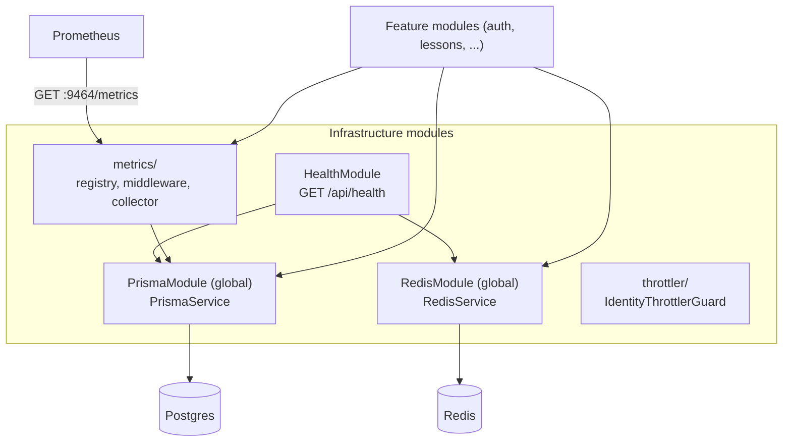
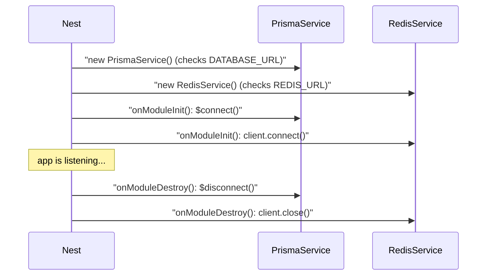
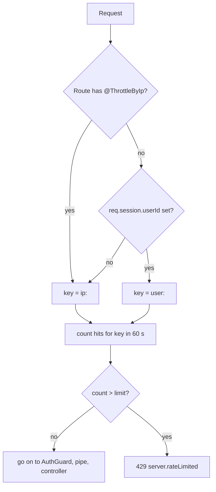
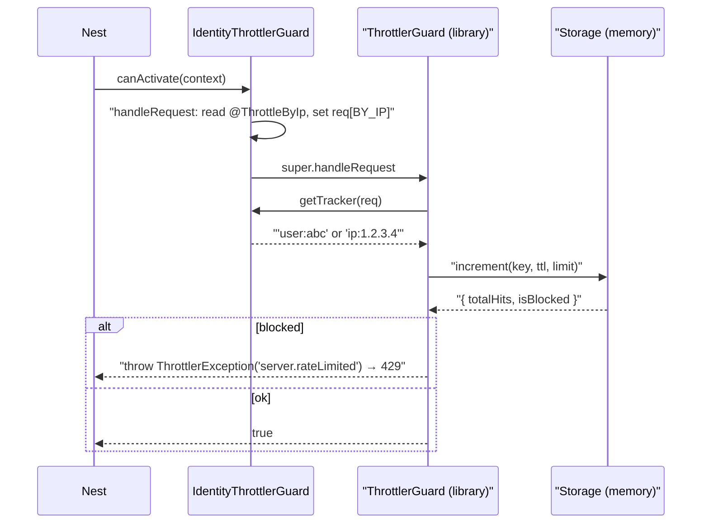
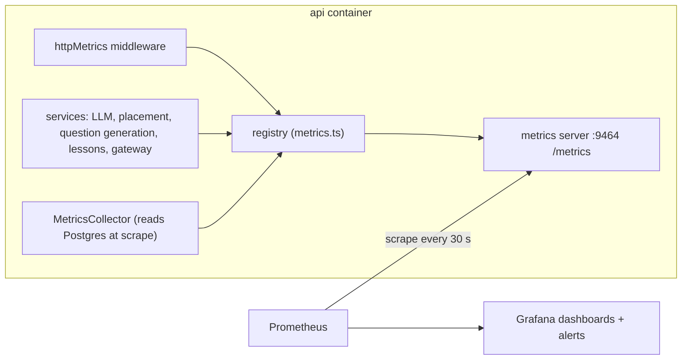
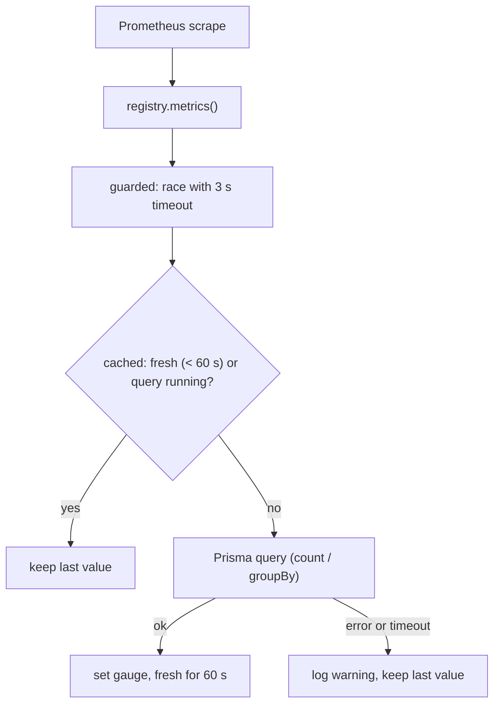
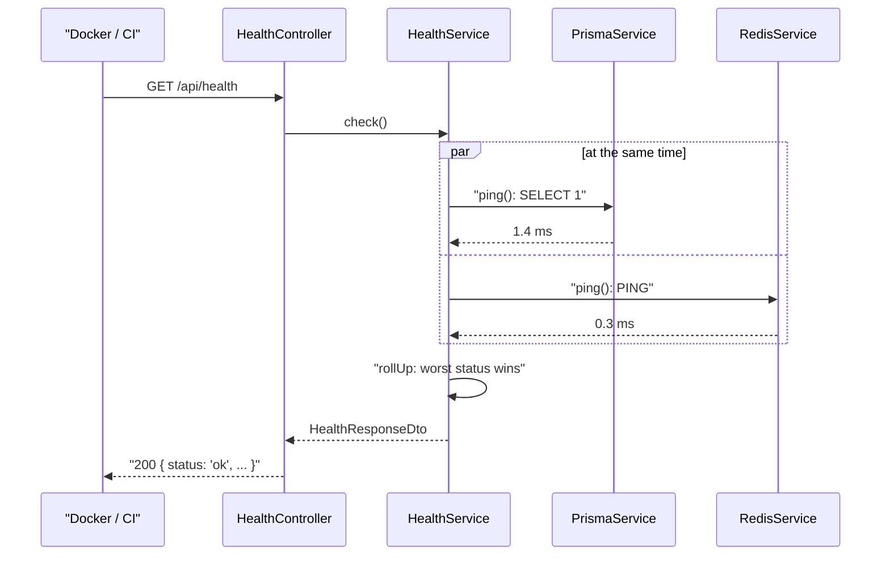

# Chapter 3 — The infrastructure modules

In this chapter:

- `prisma/`: the one database client, `PrismaService`.
- `redis/`: what Redis is, and the one Redis connection, `RedisService`.
- `throttler/`: what rate limiting is, and how this API counts requests per account or per address.
- `metrics/`: what Prometheus metrics are, and every metric the API records.
- `health/`: what a health check is, and `GET /api/health`.

## The big picture

These five folders hold no product feature. They are the "building services" of the restaurant: water and electricity (database, Redis), the doorman who stops people coming in too fast (throttler), the counters on the wall (metrics), and the nurse who checks that everyone is alive (health).



Folder map:

```
apps/api/src/
├── prisma/      prisma.module.ts, prisma.service.ts (+ spec)
├── redis/       redis.module.ts, redis.service.ts (+ spec)
├── throttler/   rate-limits.ts, throttle-by-ip.decorator.ts, identity-throttler.guard.ts (+ 3 specs)
├── metrics/     metrics.ts, http-metrics.middleware.ts, metrics-server.ts,
│                metrics.collector.ts, metrics.module.ts (+ 4 specs)
└── health/      health.module.ts, health.controller.ts, health.service.ts,
                 dto/health-response.dto.ts (+ 2 specs)
```

All of them follow the start order from [02-boot-and-request-flow.md](02-boot-and-request-flow.md): the services are built by `NestFactory.create`, they connect during `init()` (inside `app.listen`), and they close when the app is closed with `app.close()` (the tests do this). `main.ts` turns on no shutdown hooks, so a stopped container just exits.

### Lifecycle hooks

Two Nest words appear in almost every file here:

- `OnModuleInit` → method `onModuleInit()`: Nest calls it once, after building the service, during start. Good place to connect.
- `OnModuleDestroy` → method `onModuleDestroy()`: Nest calls it when the app closes (for example at the end of a test). Good place to disconnect.



## prisma/ — the database client

**Prisma** is an ORM: a library that lets you talk to the database with TypeScript methods (`prisma.user.findUnique(...)`) instead of writing SQL by hand. The database schema and the generated client are covered in [04-database.md](04-database.md). Here we look only at how the API holds the client.

### prisma.module.ts

[prisma.module.ts](../../apps/api/src/prisma/prisma.module.ts) exports `PrismaModule`:

```ts
/**
 * Global: every feature module needs the database, and re-importing this in each
 * of them is boilerplate that only ever gets forgotten. Nothing else in this
 * codebase should be @Global.
 */
@Global()
@Module({
  providers: [PrismaService],
  exports: [PrismaService],
})
export class PrismaModule {}
```

`@Global()` means: once `AppModule` imports it, any service in any module can ask for `PrismaService` in its constructor without importing `PrismaModule` again. The comment says this should be rare. (`RedisModule` is the other one.)

### prisma.service.ts

[prisma.service.ts](../../apps/api/src/prisma/prisma.service.ts) exports `PrismaService`. It *is* the Prisma client: it `extends PrismaClient`, so `this.prisma.user.findMany()` works directly on it.

First, a check before anything else:

```ts
function requireDatabaseUrl(): string {
  const url = process.env.DATABASE_URL;
  if (url === undefined || url.trim() === '') {
    throw new Error('DATABASE_URL is unset: the api cannot start. See .env.example.');
  }
  return url;
}
```

Why: without it, the Postgres driver uses its own defaults and fails later with an error about `localhost`, which sends you to debug the wrong thing. It is a free function (not a method) because it runs inside the `super(...)` arguments, before `this` exists, so it cannot be an instance method.

```ts
@Injectable()
export class PrismaService extends PrismaClient implements OnModuleInit, OnModuleDestroy {
  private readonly logger = new Logger(PrismaService.name);

  constructor() {
    // Read from the environment rather than through ConfigService: the client is
    // constructed before Nest resolves providers, and prisma.config.ts reads the
    // same variable for the CLI, so the two cannot point at different databases.
    super({ adapter: new PrismaPg({ connectionString: requireDatabaseUrl() }) });
  }
```

- `PrismaClient` comes from `../generated/prisma/client` (code generated from the schema, see [04-database.md](04-database.md)).
- `adapter: new PrismaPg(...)`: this version of Prisma has no engine of its own; it uses the `pg` (node-postgres) driver through this adapter. The comment says it is required: without an adapter, `new PrismaClient()` throws.

```ts
  async onModuleInit(): Promise<void> {
    await this.$connect();
    this.logger.log('database connected');
  }

  async onModuleDestroy(): Promise<void> {
    await this.$disconnect();
  }
```

The comment says this connects at start so that a wrong `DATABASE_URL` fails the container's start. That is not what happens: with `@prisma/adapter-pg`, `$connect()` only builds a `pg.Pool`, and a pool opens no connection before its first query. So with a wrong `DATABASE_URL`, `$connect()` resolves, the API logs "database connected", and the first query is what fails (`/api/health` then reports `database` as `down`). Issue #221 tracks this.

```ts
  async ping(): Promise<number> {
    const startedAt = process.hrtime.bigint();
    await this.$queryRaw`SELECT 1`;
    return Number(process.hrtime.bigint() - startedAt) / 1_000_000;
  }
```

`ping()` sends the smallest possible query and returns how long it took, in milliseconds. `process.hrtime.bigint()` is a very precise clock in nanoseconds; dividing by 1 000 000 gives milliseconds. The health service uses it (below). If the database is down, `ping()` rejects and the caller decides what that means.

**Who uses it:** almost every service (`AuthService`, `LessonsService`, `MetricsCollector`, `HealthService`...).

**Spec** ([prisma.service.spec.ts](../../apps/api/src/prisma/prisma.service.spec.ts)): checks it connects on init, disconnects on shutdown, that `ping` reports a latency, that a failing ping rejects, and that it refuses to build when `DATABASE_URL` is unset, empty or blank.

## redis/ — the shared fast memory

### What is Redis?

**Redis** is a database that keeps everything in memory (RAM), as simple `key → value` pairs. It is very fast, and keys can expire by themselves after a time (a TTL, "time to live").

Analogy: Postgres is the archive room with filing cabinets: safe, organized, slower. Redis is the whiteboard next to the door: very quick to read and write, good for short-lived notes, and you can wipe a note after a time.

In this API, Redis holds:

| Data | Key example | Where |
|---|---|---|
| Sessions | `sess:<id>` | [app.setup.ts](../../apps/api/src/app.setup.ts) (connect-redis) |
| Online presence counters | `presence:<userId>` | [presence.service.ts](../../apps/api/src/presence/presence.service.ts) |
| Placement exam run state | `user:<userId>:eval` (+ `:eval_questions`, `:eval_lock`) | [placement-session.service.ts](../../apps/api/src/placement/placement-session.service.ts) |
| Lesson discussion limits | `discussion:user:<userId>:minute`, `discussion:user:<userId>:day`, `discussion:global:minute` | [discussion-limits.ts](../../apps/api/src/lessons/discussion-limits.ts) |

The socket gateway uses it too: it checks that the `sess:<id>` key of a socket still exists. Each of these is explained in its own chapter.

### redis.module.ts

[redis.module.ts](../../apps/api/src/redis/redis.module.ts) exports `RedisModule`. Same shape as `PrismaModule`: `@Global()`, provides and exports `RedisService`.

### redis.service.ts

[redis.service.ts](../../apps/api/src/redis/redis.service.ts) exports `RedisService`. It starts with `requireRedisUrl()`, the same "fail at start if `REDIS_URL` is missing" check as Prisma.

```ts
/**
 * The one Redis connection. Sessions, presence, the placement run state, and
 * later the generated lesson cache, all share it rather than opening their own.
 */
@Injectable()
export class RedisService implements OnModuleInit, OnModuleDestroy {
  private readonly logger = new Logger(RedisService.name);
  readonly client: RedisClientType;

  constructor() {
    // A wrong host hangs instead of refusing, so bound it: five seconds turns a
    // misconfiguration into a startup error rather than a stuck container.
    this.client = createClient({
      url: requireRedisUrl(),
      socket: { connectTimeout: 5_000 },
    });
    // Without a listener, a dropped connection raises an unhandled 'error' event
    // and takes the process down. Reconnection is automatic.
    this.client.on('error', (error: Error) => this.logger.error(`redis: ${error.message}`));
  }
```

- Unlike Prisma, it does not *extend* the client. It holds it in a public field, `client`. Other code writes `this.redis.client.incr(...)`.
- `connectTimeout: 5_000`: ends one connection attempt after five seconds. The comment says this turns a wrong host into a start error, but it does not: the `redis` library then retries (its default strategy retries after every error except a socket timeout, waiting up to about 2 seconds between tries), so `client.connect()` never settles and the API hangs before `listen` instead of stopping. Issue #221 tracks this.
- `client.on('error', ...)`: in Node, an `'error'` event with no listener crashes the process. Here it is only logged, and the `redis` library reconnects by itself.

`onModuleInit` calls `client.connect()`, `onModuleDestroy` calls `client.close()`, and `ping()` measures `client.ping()` in milliseconds, exactly like Prisma's.

**Spec** ([redis.service.spec.ts](../../apps/api/src/redis/redis.service.spec.ts)): connect on init, close on shutdown, `ping` returns a finite latency, a failing ping rejects, and it refuses to build when `REDIS_URL` is unset, empty or blank.

## throttler/ — rate limiting

### What is rate limiting?

**Rate limiting** (or throttling) means: "one caller may make at most N requests in T seconds". The next one gets **HTTP 429 Too Many Requests**.

Analogy: a ticket machine at the door that gives each person 100 tickets per minute. When your tickets run out, you wait for the next minute.

It protects against:

- Password guessing (try thousands of passwords on `/login`).
- One user or script overloading the server.

The library is `@nestjs/throttler`. For each request it builds a **tracker** (a key like `user:abc` or `ip:1.2.3.4`), counts hits for that key in a time window, and refuses when the count is over the limit. The counters are kept by the library's default storage, in the memory of the API process (`AppModule` does not give it another store).



The global setup is in `AppModule` ([02-boot-and-request-flow.md](02-boot-and-request-flow.md)): one throttler named `default`, window 60 000 ms, limit `RATE_LIMITS.perAccount`, error message `server.rateLimited`, and `IdentityThrottlerGuard` as a global guard.

### rate-limits.ts

[rate-limits.ts](../../apps/api/src/throttler/rate-limits.ts) exports `readLimit` and `RATE_LIMITS`.

```ts
export const RATE_LIMITS = {
  /** Requests a minute on every route, per account, or per address when signed out. */
  perAccount: readLimit(process.env, 'RATE_LIMIT_PER_MINUTE', 100),
  /** ... */
  signup: readLimit(process.env, 'SIGNUP_LIMIT_PER_MINUTE', 20),
  /** Password or 2FA code checks a minute per address, on each route that makes one. */
  login: readLimit(process.env, 'LOGIN_LIMIT_PER_MINUTE', 5),
} as const;
```

| Limit | Env variable | Default | Counted per |
|---|---|---|---|
| `perAccount` | `RATE_LIMIT_PER_MINUTE` | 100 | account, or address if signed out |
| `signup` | `SIGNUP_LIMIT_PER_MINUTE` | 20 | address |
| `login` | `LOGIN_LIMIT_PER_MINUTE` | 5 | address |

`readLimit` reads one variable:

```ts
  const raw = env[name]?.trim();
  if (raw === undefined || raw === '') {
    return fallback;
  }
  const value = Number(raw);
  if (!/^\d+$/.test(raw) || !Number.isSafeInteger(value) || value < 1) {
    throw new Error(`${name} must be a positive integer, not "${raw}"`);
  }
  return value;
```

- Unset or empty → the default.
- Only plain digits are accepted. `Number()` alone would accept `0x10`, `1e3`... The regex `^\d+$` refuses them.
- Anything wrong stops the API at start, so nobody runs with a limit they did not choose.

The values are read once, when the file is imported. The doc comment explains why: decorators like `@ThrottleByIp(RATE_LIMITS.login)` need a number when the class is defined, before `ConfigService` exists.

**Spec** ([rate-limits.spec.ts](../../apps/api/src/throttler/rate-limits.spec.ts)): default when unset/empty, accepts a positive integer (with spaces trimmed), refuses everything else with the variable's name in the error.

### throttle-by-ip.decorator.ts

[throttle-by-ip.decorator.ts](../../apps/api/src/throttler/throttle-by-ip.decorator.ts) exports `THROTTLE_BY_IP` (a metadata key) and the decorator `ThrottleByIp`.

```ts
export const THROTTLE_BY_IP = 'throttle:by-ip';

export function ThrottleByIp(limit: number, ttl = 60_000) {
  return applyDecorators(Throttle({ default: { limit, ttl } }), SetMetadata(THROTTLE_BY_IP, true));
}
```

- `applyDecorators` combines several decorators into one.
- `Throttle({ default: {...} })` (from the library) changes the limit of the `default` throttler for this route.
- `SetMetadata(THROTTLE_BY_IP, true)` sticks a label on the route: "count me by IP". The guard reads it.

**Why count by IP on these routes?** The comment explains with an attack: on a route that checks a password, if we counted per account, an attacker with N accounts would get N budgets, so "5 per minute" would become 5×N. Counting by machine gives one budget whatever account is used.

It is used on the five routes that check a secret: `POST /api/auth/signup` (limit `signup`), and `POST /api/auth/login`, `POST /api/auth/2fa/verify`, `POST /api/auth/2fa/enable`, `DELETE /api/auth/2fa` (limit `login`). See [05-auth-and-users.md](05-auth-and-users.md).

One other route sets its own limit with the library's plain `@Throttle`, so it is still counted per account: `POST /api/friends/requests/:userId`, 10 a minute.

Why its own metadata key and not the library's? The comment lists three ways the library's key could silently fail (its name depends on the throttler name, it is not exported, and it is missing when only a ttl is set).

### identity-throttler.guard.ts

[identity-throttler.guard.ts](../../apps/api/src/throttler/identity-throttler.guard.ts) exports `IdentityThrottlerGuard`, a subclass of the library's `ThrottlerGuard`.

**The problem it solves** (from the class comment): the default guard counts by `req.ip`. But in this deployment, browsers go through Caddy, and Next.js server renders call the API from the `web` container. Many users can share one address, so with the default the whole platform shared one budget: the 101st visitor in a minute was refused.

**The fix:** count by account when signed in, by the forwarded client address otherwise.

```ts
  protected override async getTracker(req: Request): Promise<string> {
    // Checked before the session: a route guarding a secret must count every
    // attempt from one machine against one budget, whoever is signed in.
    if ((req as TrackedRequest)[BY_IP] === true) {
      return `ip:${this.clientAddress(req)}`;
    }

    // saveUninitialized is false, so an anonymous visitor carries no session.
    const userId = req.session?.userId;
    return userId === undefined ? `ip:${this.clientAddress(req)}` : `user:${userId}`;
  }
```

Why the user id and not the session id? Login creates a new session id (`regenerate()`). Counting by session would let someone reset their counter just by logging in again.

```ts
  private clientAddress(req: Request): string {
    return req.ip ?? req.socket.remoteAddress ?? 'unknown';
  }
```

`req.ip` is correct because of `trust proxy = 1` in `app.setup.ts`: Express takes the last address in `X-Forwarded-For`, the one Caddy wrote. The comment notes this header can be faked in general, and is safe here only because Caddy is the only way in.

**How does `getTracker` know the route asked for "by IP"?** `getTracker` only receives the request, not the route. So `handleRequest`, which does see the route, writes a flag on the request first:

```ts
const BY_IP = Symbol('identity-throttler:by-ip');

  protected override async handleRequest(request: ThrottlerRequest): Promise<boolean> {
    const { context } = request;

    // Assigned on every pass rather than only when true. handleRequest runs
    // once per configured throttler, and a flag that is only ever set would
    // leak from one throttler to the next within a single request.
    (this.getRequestResponse(context).req as TrackedRequest)[BY_IP] =
      this.reflector.getAllAndOverride<boolean>(THROTTLE_BY_IP, [
        context.getHandler(),
        context.getClass(),
      ]) ?? false;

    return super.handleRequest(request);
  }
```

- `reflector.getAllAndOverride` reads the `THROTTLE_BY_IP` label from the method, then from the controller class.
- The flag uses a `Symbol` as key, so it cannot clash with any property Express puts on `req`.
- Then `super.handleRequest` does the normal counting, which calls our `getTracker`.



**Specs:**

- [identity-throttler.guard.spec.ts](../../apps/api/src/throttler/identity-throttler.guard.spec.ts): signed-in users are keyed on their id, two users behind one IP get separate keys, anonymous callers fall back to the address, and full `canActivate` runs count against the right bucket.
- [throttler-storage.spec.ts](../../apps/api/src/throttler/throttler-storage.spec.ts): checks the library's in-memory storage keeps separate keys separate (when a block on one key ends, it does not cancel the expiry timers of another key, so the next signup burst gets no false 429).

## metrics/ — numbers for Prometheus

### What are metrics and Prometheus?

**Metrics** are numbers that describe the app over time: "how many requests per second", "how long login takes", "how many users are online". **Prometheus** is a program that, every 30 seconds here, visits a URL of the app (`/metrics`), reads all the numbers, and stores them with the time. Then Grafana draws graphs and alerts fire when a number looks bad.

Analogy: the dashboard of a car. The car does not record a video of the trip; it shows a few gauges (speed, fuel, temperature). Prometheus is a passenger who writes down the gauges every 30 seconds (`scrape_interval: 30s` in [prometheus.yml](../../infra/monitoring/prometheus/prometheus.yml)).

The main metric types (from the `@prometheus-io/client` library):

| Type | What it is | Example here |
|---|---|---|
| **Counter** | A number that only goes up. | `ft_llm_requests_total` |
| **Gauge** | A number that goes up and down. | `http_requests_in_flight`, `ft_users` |
| **Histogram** | Counts values in ranges ("buckets"), to compute averages and percentiles. | `http_request_duration_seconds` |

Each metric can have **labels**: extra dimensions, like `method="POST"`, `status_code="200"`. Each different set of label values is a separate **series**. Too many series (for example one per user id) would overload Prometheus, so labels must stay **bounded** (a small, known list of values).

All metrics are kept in a **registry** (a list of metrics). Prometheus reads the registry in a text format:

```
http_request_duration_seconds_count{method="POST",route="/api/auth/login",status_code="200"} 42
```



### metrics.ts — the registry and every metric

[metrics.ts](../../apps/api/src/metrics/metrics.ts) is a plain file, not a Nest service:

```ts
// Module level, not an injected service: the services that record are built by
// hand in their specs, and GeminiProvider is not built by Nest at all.
// Our own registry, so nothing a dependency registers leaks into the scrape.
// Labels are always bounded: never a user id, an email or a raw URL.
export const registry = new Registry();

export const httpRequestDuration = new Histogram({
  name: 'http_request_duration_seconds',
  help: 'HTTP requests by method, route template and final status code',
  labelNames: ['method', 'route', 'status_code'] as const,
  registers: [registry],
});
```

Any file can `import { llmRequests } from '../metrics/metrics'` and call `llmRequests.inc({...})`. No injection is needed.

The exported metrics:

| Export | Type | Labels | Recorded by |
|---|---|---|---|
| `httpRequestDuration` | Histogram | method, route, status_code | `httpMetrics` middleware |
| `httpRequestsInFlight` | Gauge | — | `httpMetrics` middleware |
| `wsConnections` | Gauge | — | socket gateway ([09](09-social-and-realtime.md)) |
| `wsEvents` | Counter | direction, event, outcome | socket gateway |
| `llmRequests` | Counter | provider, model, purpose, outcome | `gemini.provider.ts` ([06](06-llm.md)) |
| `llmRequestDuration` | Histogram (0.5 s to 90 s) | provider, model, purpose | `gemini.provider.ts` |
| `llmTokens` | Counter | provider, model, purpose, type | `gemini.provider.ts` |
| `llmProviderInfo` | Gauge (always 1) | provider, model | `llm.factory.ts` |
| `discussionLimited` | Counter | limit | lesson discussion ([08](08-lessons.md)) |
| `questionRestocks` | Counter | lang, level, category, status | question generation ([07](07-courses-placement.md)) |
| `questionRestockFailures` | Counter | category, reason | question generation |
| `questionRestockInserted` | Counter | lang, level, category | question generation |
| `questionRestockDuration` | Histogram | category | question generation |
| `placementDraws` | Counter | lang, level, category, source | placement |
| `placementPoolExhausted` | Counter | lang, level | placement |
| `placementExams` | Counter | lang, event | placement |
| `lessonAttempts` | Counter | lang, event | lessons |
| `appInfo` | Gauge (always 1) | version | `main.ts` |

It also exports the allowed label values as constant lists (`WS_OUTCOMES`, `RESTOCK_STATUSES`, `RESTOCK_FAILURE_REASONS`, `DRAW_SOURCES`, `EXAM_EVENTS`, `LESSON_ATTEMPT_EVENTS`, `AUTH_SERIES`), and three of their types (`RestockStatus`, `RestockFailureReason`, `DrawSource`). This keeps labels bounded.

**Series created at 0.** At the end of the file, loops create every important series with value 0:

```ts
// increase() misses a counter's first increment when the series is born at 1,
// so every label set an alert or a panel reads exists at 0 from the start.
for (const lang of LEARNABLE_LANGUAGES) {
  for (const event of EXAM_EVENTS) placementExams.inc({ lang, event }, 0);
  for (const event of LESSON_ATTEMPT_EVENTS) lessonAttempts.inc({ lang, event }, 0);
  ...
```

Why: Prometheus's `increase()` compares two values in time. If a series appears for the first time already at 1, there is no "before" value, so that first event is missed. Starting at 0 fixes it. `AUTH_SERIES` does the same for the signup, login and 2FA verify routes, with `httpRequestDuration.zero(...)`, for the auth dashboard panels.

**Active users.** The file also keeps a small in-memory list of users seen recently:

```ts
const ACTIVE_WINDOW_MS = 5 * 60_000;

// In memory, so per process: enough for the single API replica, like the
// restock maps (question-stock.service.ts). Oldest first: a touch moves the
// user to the end, so pruning stops at the first recent entry.
const lastSeen = new Map<string, number>();

/** Called by AuthGuard for every signed-in request. */
export function touchActiveUser(userId: string, now = Date.now()): void {
  lastSeen.delete(userId);
  lastSeen.set(userId, now);
  prune(now);
}
```

A JavaScript `Map` keeps insertion order. Deleting then setting moves the user to the end, so the oldest are always first. `prune` removes entries from the start while they are older than 5 minutes, and stops at the first recent one. `countActiveUsers()` returns the size. It lives in memory, so it counts per process; the comment says that is enough for one API instance.

**Spec** ([metrics.spec.ts](../../apps/api/src/metrics/metrics.spec.ts)): checks the zero series exist from the start, and that active users are counted once and drop out after 5 minutes.

### http-metrics.middleware.ts — timing every request

[http-metrics.middleware.ts](../../apps/api/src/metrics/http-metrics.middleware.ts) exports `httpMetrics`, `routeOf` and `methodOf`. It is the first middleware added in `configureApp`.

```ts
/**
 * A middleware, not an interceptor: interceptors run after guards, so they
 * would never see the 401s, the 429s, unknown routes or body parser errors.
 * Timed on `close`, after ErrorCodeFilter has set the final status.
 */
export function httpMetrics(req: Request, res: Response, next: NextFunction): void {
  const stop = httpRequestDuration.startTimer({ method: methodOf(req) });
  httpRequestsInFlight.inc();
  res.once('close', () => {
    httpRequestsInFlight.dec();
    // 499: the client left before the reply finished.
    const status = res.writableFinished ? res.statusCode : 499;
    stop({ route: routeOf(req, status), status_code: status });
  });
  next();
}
```

- `startTimer` returns a `stop` function. Calling `stop(labels)` records the time spent.
- In-flight gauge: +1 at the start, −1 at the end.
- `res.once('close', ...)`: runs once when the connection for this reply closes. `res.writableFinished` tells if the reply was fully sent; if not, the client left early, recorded as 499 (a common convention, not a real HTTP status).

```ts
/** The template, never the URL: ids and query strings would make a series per request. */
export function routeOf(req: Request, status: number): string {
  if (req.route?.path) return `${req.baseUrl ?? ''}${req.route.path}`;
  // No route: an avatar from express.static, or a request nothing handled. An
  // abort before routing (499) is unmatched, whatever the default 200 said.
  return status < 400 ? 'static' : 'unmatched';
}
```

The route label is the *template* (`/api/users/:id`), not the real URL (`/api/users/42`), to keep labels bounded. With no matched route: `static` for a served avatar, `unmatched` for a 404 or an early abort.

`methodOf` returns the method if it is one of the 7 common ones, else `OTHER`. Anyone can send a strange method like `PROPFIND`; this keeps the label bounded.

**Spec** ([http-metrics.middleware.spec.ts](../../apps/api/src/metrics/http-metrics.middleware.spec.ts)): records on close with route and status, 499 for an early leave, `unmatched` when no route, counts once even if `close` fires twice, plus `routeOf` and `methodOf` cases.

### metrics-server.ts — the /metrics door

[metrics-server.ts](../../apps/api/src/metrics/metrics-server.ts) exports `METRICS_PORT` (9464) and `startMetricsServer`.

```ts
/**
 * Its own port, outside Nest: caddy never routes here and compose never
 * publishes it, so no guard, throttler or Swagger exemption is needed, and
 * /api/metrics does not exist.
 */
export function startMetricsServer(port: number): Promise<Server> {
  const server = createServer((req, res) => {
    if (req.method !== 'GET' || req.url !== '/metrics') {
      res.writeHead(404).end();
      return;
    }
    registry.metrics().then(
      (body) => res.writeHead(200, { 'content-type': registry.contentType }).end(body),
      () => res.writeHead(500).end(),
    );
  });
  return new Promise((resolve, reject) => {
    server.once('error', reject);
    server.listen(port, '0.0.0.0', () => resolve(server));
  });
}
```

It uses Node's plain `http` module, not Nest. Only `GET /metrics` works; everything else is 404. `registry.metrics()` builds the text (and runs the collectors below). Because it is on a separate port that Caddy never routes to and compose never publishes, only containers on the Docker network (Prometheus) can reach it, so it needs no login and no rate limit.

`main.ts` does three things after `listen`, so a failed boot never leaves a metrics port answering: `collectDefaultMetrics({ register: registry })` adds the library's standard Node process metrics (memory, CPU, event loop...), `appInfo` is set to 1 with the version, and `startMetricsServer(METRICS_PORT)` starts. If the port fails, the error is only logged: monitoring must never take the app down.

**Spec** ([metrics-server.spec.ts](../../apps/api/src/metrics/metrics-server.spec.ts)): serves the registry with the right content type, answers 404 to another path or method, answers 500 when the registry fails, rejects when the port is taken.

### metrics.collector.ts — numbers read from the database

[metrics.collector.ts](../../apps/api/src/metrics/metrics.collector.ts) exports `MetricsCollector`, a Nest service (it needs `PrismaService`). In `onModuleInit` it creates three gauges whose value is computed **when Prometheus scrapes** (the `collect` function), instead of being updated when something happens:

| Gauge | Value |
|---|---|
| `ft_question_bank_questions` | Number of questions in the bank, per lang, level, category and source (`written` or `generated`). |
| `ft_users` | Number of accounts (`prisma.user.count()`). |
| `ft_active_users` | `countActiveUsers()` from metrics.ts. |

```ts
    new Gauge({
      name: USERS,
      help: 'Accounts',
      registers: [registry],
      collect: this.guarded(
        USERS,
        cached(CACHE_MS, async (gauge: Gauge) => gauge.set(await this.prisma.user.count())),
      ),
    });
```

Two wrappers protect the database queries of the first two gauges (`ft_active_users` only reads memory, so it has none):

- `cached(ttlMs, collect)`: runs the query at most once per minute (`CACHE_MS = 60_000`), and never twice at the same time. Between, the gauge keeps its last value. Questions and accounts change slowly, so one query a minute is enough.
- `guarded(name, collect)`: if the query fails or takes more than 3 s (`COLLECT_TIMEOUT_MS`), it logs a warning and keeps the last value. The comment explains: a failing `collect` would fail the *whole* scrape, and Prometheus would think the API is down when only Postgres had a small problem.



`countBank` runs two `groupBy` queries (written questions have a `sourceId`, generated ones do not). After both succeed, it resets the gauge, sets every cell (each language × level × category × source) to 0, then fills the real counts. So an empty cell shows as 0 instead of missing.

`onModuleDestroy` removes the three gauges from the registry. The comment says why: an e2e test that builds two apps would otherwise get "metric already registered".

**Spec** ([metrics.collector.spec.ts](../../apps/api/src/metrics/metrics.collector.spec.ts)): counts by cell and source, empty cells at 0, at most one query a minute, keeps last values when the database fails, answers within 3 s when it hangs, unregisters on destroy.

### metrics.module.ts

[metrics.module.ts](../../apps/api/src/metrics/metrics.module.ts) exports `MetricsModule`, which only provides `MetricsCollector`. It is not `@Global` and exports nothing: other code records through the plain functions and objects of `metrics.ts`.

## health/ — "are you alive?"

### What is a health check?

A **health check** is a small endpoint that answers "am I working?". Other tools call it again and again:

- Docker's `HEALTHCHECK` decides if the container is healthy.
- CI waits for it before running the e2e tests (`docker compose up --wait` waits for that `HEALTHCHECK`).
- Dashboards show it.

Analogy: a nurse who passes every few minutes and asks "how do you feel?". The patient answers, and also reports how the heart (Postgres) and the lungs (Redis) are doing.

### health.module.ts

[health.module.ts](../../apps/api/src/health/health.module.ts) exports `HealthModule`: one controller (`HealthController`), one provider (`HealthService`). It does not import Prisma or Redis because both are global.

### health.controller.ts

[health.controller.ts](../../apps/api/src/health/health.controller.ts) exports `HealthController`, route `GET /api/health`.

```ts
@ApiTags('health')
// The Docker HEALTHCHECK has no session and must never get a 401.
@Public()
// The Docker HEALTHCHECK and CI poll this endpoint. Sharing the per-IP throttle
// budget with real traffic would make container health depend on load.
@SkipThrottle()
@Controller('health')
export class HealthController {
  constructor(private readonly health: HealthService) {}

  @Get()
  @ApiOperation({ summary: 'Liveness probe', security: [] })
  @ApiOkResponse({ type: HealthResponseDto })
  // Always 200, including when a dependency is down: the body carries the
  // verdict. A non-2xx here would make Docker restart a container whose only
  // problem is that Postgres is still starting.
  check(): Promise<HealthResponseDto> {
    return this.health.check();
  }
}
```

- `@Public()`: no login needed, so `AuthGuard` lets it pass.
- `@SkipThrottle()`: the rate limiter ignores this route. Otherwise a busy site could make the health check fail with 429.
- `security: []`: in Swagger, this route needs no cookie.
- It **always answers 200**. The real state is in the body. The comment says a non-2xx would make Docker restart the container, but Docker and Compose never restart an `unhealthy` container (only Swarm does): a non-2xx would only mark it `unhealthy` and make `docker compose up --wait` fail. Issue #221 tracks this.

**Spec** ([health.controller.spec.ts](../../apps/api/src/health/health.controller.spec.ts)): the reply matches the shared Zod contract.

### health.service.ts

[health.service.ts](../../apps/api/src/health/health.service.ts) exports `SLOW_DEPENDENCY_MS` (250) and `HealthService`. It receives `ConfigService`, `PrismaService` and `RedisService`.

```ts
  private async probe(name: DependencyHealth['name'], run: () => Promise<number>) {
    try {
      const latencyMs = await run();
      return {
        name,
        status: latencyMs > SLOW_DEPENDENCY_MS ? 'degraded' : 'ok',
        latencyMs,
      } satisfies DependencyHealth;
    } catch (error) {
      this.logger.warn(`${name} probe failed: ${error instanceof Error ? error.message : error}`);
      return { name, status: 'down', latencyMs: 0 } satisfies DependencyHealth;
    }
  }
```

`probe` never throws. It runs one `ping()`:

| Result | Status |
|---|---|
| Answer in 250 ms or less | `ok` |
| Answer slower than 250 ms | `degraded` |
| Error | `down` (and a warning in the log) |

`satisfies DependencyHealth` asks TypeScript to check the object matches the shared type, without changing its type.

```ts
  private static rollUp(dependencies: DependencyHealth[]): HealthStatus {
    if (dependencies.some((dependency) => dependency.status === 'down')) {
      return 'down';
    }
    return dependencies.some((dependency) => dependency.status === 'degraded') ? 'degraded' : 'ok';
  }
```

The global status is the **worst** one: one `down` makes everything `down`.

```ts
  async check(): Promise<HealthResponseDto> {
    // Probed together: one slow dependency should not add its latency to the
    // other's reported number.
    const dependencies = await Promise.all([
      this.probe('database', () => this.prisma.ping()),
      this.probe('redis', () => this.redis.ping()),
    ]);

    return {
      status: HealthService.rollUp(dependencies),
      service: 'api',
      version: this.config.get<string>('APP_VERSION', '0.0.0'),
      uptimeSeconds: Math.floor(process.uptime()),
      checkedAt: new Date().toISOString(),
      dependencies,
    };
  }
```

`Promise.all` runs both pings at the same time. The reply looks like:

```json
{
  "status": "ok",
  "service": "api",
  "version": "0.0.0",
  "uptimeSeconds": 42,
  "checkedAt": "2026-11-24T10:00:00.000Z",
  "dependencies": [
    { "name": "database", "status": "ok", "latencyMs": 1.42 },
    { "name": "redis", "status": "ok", "latencyMs": 0.31 }
  ]
}
```



**Spec** ([health.service.spec.ts](../../apps/api/src/health/health.service.spec.ts)): version and service name, whole-second uptime, payload accepted by the `@ft/shared` schema, `ok` when fast, `degraded` when slow, `down` without throwing when a probe fails (also when only Redis is down).

### dto/health-response.dto.ts

[health-response.dto.ts](../../apps/api/src/health/dto/health-response.dto.ts) exports `DependencyHealthDto` and `HealthResponseDto`.

The shape of the reply is defined once in Zod in `@ft/shared` ([health.ts](../../packages/shared/src/schemas/health.ts)): `HealthResponseSchema`, `DependencyHealthSchema`, `HealthStatusSchema` (`ok | degraded | down`), `DependencyNameSchema` (`database | redis`). But Swagger reads class decorators, not Zod. So this file describes the same shape as classes:

```ts
/**
 * Swagger reads decorators off classes, and @ft/shared speaks Zod, so the two
 * describe the same payload in the two forms each tool needs. `implements`
 * is what keeps them from drifting: change the Zod schema and this stops
 * compiling.
 */
export class DependencyHealthDto implements DependencyHealth {
  @ApiProperty({ enum: DependencyNameSchema.options, example: 'database' })
  name!: DependencyHealth['name'];

  @ApiProperty({ enum: HealthStatusSchema.options, example: 'ok' })
  status!: HealthStatus;
  ...
```

- `@ApiProperty` tells Swagger the type, the allowed values (`enum`) and an example.
- `implements DependencyHealth`: TypeScript checks the class has every field of the Zod type. If someone changes the schema, this file stops compiling. So the two cannot drift apart.
- `name!:` — the `!` says "this field will be set, trust me"; the class is only used as a type and for Swagger, never built with `new`.

`HealthResponseDto` does the same for the whole reply, with `dependencies` typed as `[DependencyHealthDto]`.

## Key ideas to remember

- `PrismaModule` and `RedisModule` are the only `@Global` modules: one shared database client, one shared Redis connection.
- Both services check their URL variable at construction, connect in `onModuleInit` (meant to fail a bad setup at start, but neither does: Prisma's `$connect()` opens nothing, and Redis retries forever), close in `onModuleDestroy`, and offer a `ping()` that returns milliseconds.
- Redis is fast in-memory key/value storage: here for sessions, presence, placement state and discussion limits.
- Rate limiting gives each caller a budget per minute. `IdentityThrottlerGuard` counts per account (or per address when signed out), and `@ThrottleByIp` routes count per address, so an attacker cannot multiply budgets with many accounts.
- Limits come from env variables, read once at import, and a bad value stops the API.
- Metrics live in one registry in `metrics.ts`, with bounded labels. Prometheus reads them on a separate port, 9464, outside Nest.
- `httpMetrics` is a middleware (not an interceptor) so it sees every request, even refused ones, and records the route template, not the URL.
- Database-based gauges are cached for a minute and guarded by a 3 s timeout, so a slow database never breaks the scrape.
- `GET /api/health` is public, not rate limited, always 200, and reports `ok / degraded / down` per dependency; the worst wins.

Previous: [02-boot-and-request-flow.md](02-boot-and-request-flow.md) · Next: [04-database.md](04-database.md) · [Back to index](README.md)
