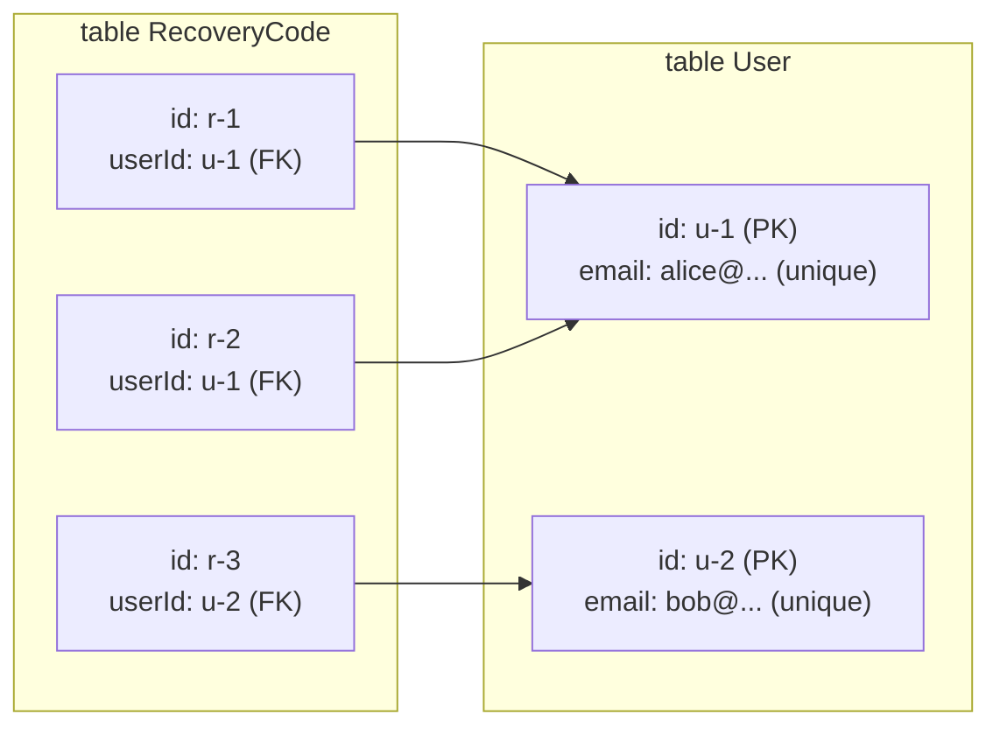
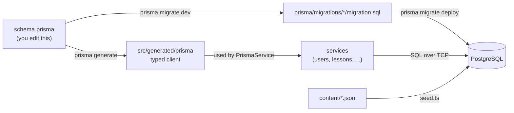
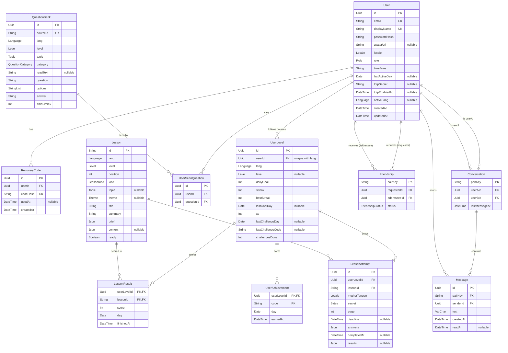
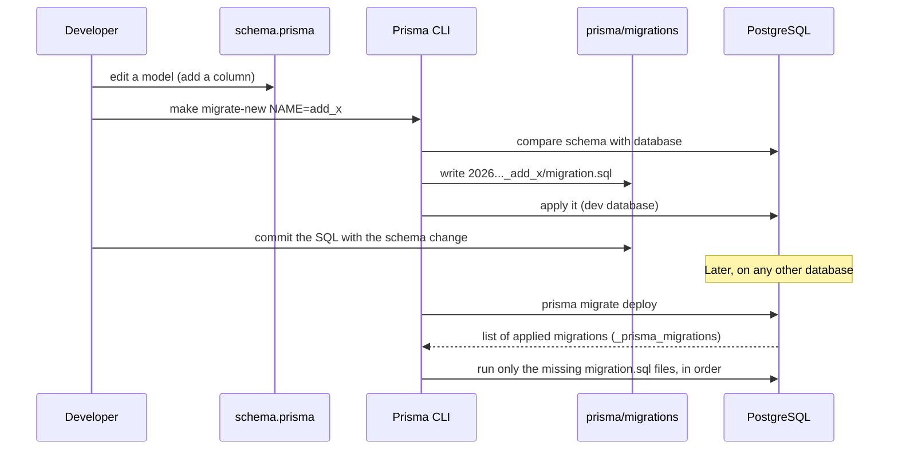
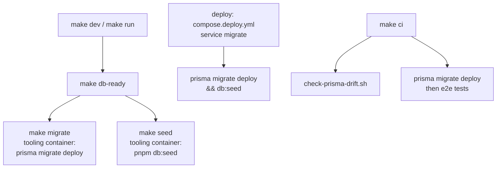
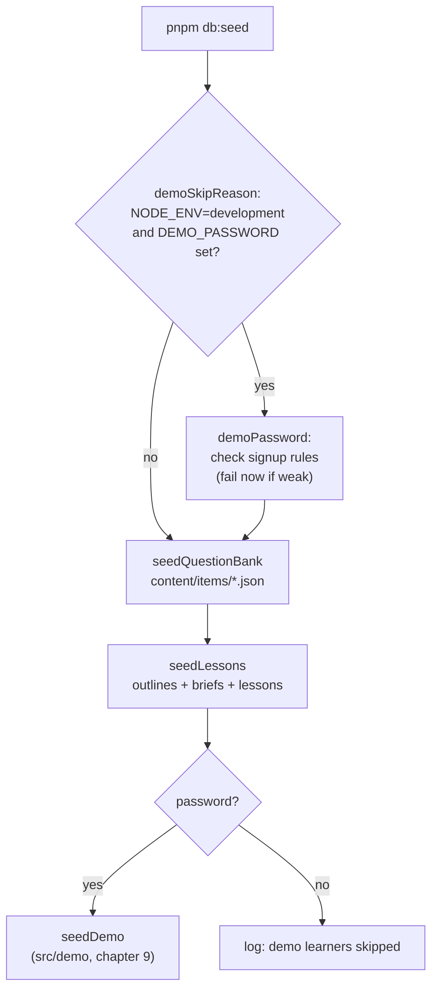

# Chapter 4 — The database with Prisma

In this chapter:

- What a relational database is, and what PostgreSQL is
- Tables, rows, columns, keys, relations and indexes, with simple pictures
- What an ORM is, and what Prisma does for us
- [schema.prisma](../../apps/api/prisma/schema.prisma): every table (model) and every enum of the app
- [prisma.config.ts](../../apps/api/prisma.config.ts): where Prisma finds the database
- Migrations: what they are, the list of all 15, and how they reach a database
- [seed.ts](../../apps/api/prisma/seed.ts): how the questions and lessons in `content/` get into the database
- `src/generated/prisma`: the code Prisma writes for us
- Real queries from the services

Chapter 3 showed `PrismaService`, the object the services use to talk to the database.
This chapter shows **what is inside the database**, and how its shape is defined and changed.

---

## 1. Theory: relational databases

### What is a database?

The API must remember things after it stops: users, their courses, their messages.
Memory (RAM) is lost on restart, so the API keeps this data in a **database**: a separate program
whose only job is to store data safely and find it fast.

We use **PostgreSQL** (often called "Postgres"). It is a free, very common **relational** database.
It runs in its own Docker container, the `db` service in [compose.yml](../../compose.yml)
(the image is `pgvector/pgvector`, a Postgres build that also has the pgvector extension).
The API connects to it with a URL like this one from `.env.example`:

```
DATABASE_URL=postgresql://ft:ft_local_dev@db:5432/ft_transcendence?schema=public
```

Read it as: user `ft`, password `ft_local_dev`, host `db`, port `5432`, database `ft_transcendence`.

### Tables, rows and columns

Think of a database as a **binder of spreadsheets**.

| Database word | Spreadsheet picture | Example in this app |
| --- | --- | --- |
| **table** | one sheet | `User` |
| **column** | one column title, with a fixed type | `email` (text), `createdAt` (date-time) |
| **row** | one line of the sheet | the user `alice@example.com` |
| **enum** | a column that only accepts a short list of words | `Role` is `USER` or `ADMIN` |
| **null** | an empty cell | `avatarUrl` is null when there is no picture |

Unlike a spreadsheet, every column has a **type** and the database refuses a wrong value.
You cannot put the word `"hello"` in a number column, and you cannot leave a `NOT NULL` column empty.

### Keys

- A **primary key** (PK) is the column that names a row, like a passport number.
  No two rows can have the same one. In most tables it is `id`, a random **UUID**
  (a 128-bit random value such as `3f2a...-...`).
- A **unique constraint** says "no two rows may share this value". `User.email` is unique,
  so two accounts cannot use the same email. The database checks it, not only the code.
- A **foreign key** (FK) is a column that holds the primary key of a row in *another* table.
  `RecoveryCode.userId` holds a `User.id`. It is like writing "see file #42" on a sticky note:
  the database checks that file #42 really exists.

### Relations

A foreign key creates a **relation** between two tables:

- **one-to-many**: one user has many recovery codes, each code belongs to one user.
- **many-to-many**: users see many questions, a question is seen by many users.
  This needs a third table in the middle (`UserSeenQuestion`), with one row per (user, question) pair.

What happens to the codes when the user is deleted? The foreign key says it:

- `onDelete: Cascade`: delete them too (like throwing away a folder with all its papers).
- `onDelete: Restrict`: refuse to delete the user while codes still point to it.

### Indexes

An **index** is like the index at the back of a book. Without it, to find every page about
"Paris", you read the whole book. With it, you jump to the right pages.
The database does the same: without an index, "find the messages of this conversation" reads
every message of every user. An index on `pairKey` makes it jump straight to them.
Indexes cost a little space and make writes a bit slower, so we add them only where a query needs them.
A unique constraint is also an index (a unique one).



### SQL, and what an ORM is

The database speaks **SQL**, a language of commands like:

```sql
SELECT * FROM "User" WHERE "email" = 'alice@example.com';
```

Writing SQL strings inside TypeScript works, but TypeScript cannot check them: a typo in a column
name only fails when the code runs. An **ORM** (Object-Relational Mapper) is a library that lets you
write the query as normal code, and turns it into SQL for you. The rows come back as normal
JavaScript objects.

**Prisma** is the ORM of this project. It has three parts:

| Part | What it is | Where |
| --- | --- | --- |
| **Schema** | One file that describes every table, in Prisma's own small language | `apps/api/prisma/schema.prisma` |
| **Prisma CLI** | A command-line tool: `prisma generate`, `prisma migrate dev`, `prisma migrate deploy`, `prisma studio`... | the `prisma` dev dependency |
| **Prisma Client** | TypeScript code *generated from the schema*, with one typed method set per table | `apps/api/src/generated/prisma` |

So `prisma.user.findUnique({ where: { email } })` is checked by TypeScript: if `email` were not a
column, the code would not compile.



The rest of the chapter follows this picture: the schema, the config, the migrations, the seed,
then the generated client.

---

## 2. `prisma/schema.prisma`: the shape of the data

[schema.prisma](../../apps/api/prisma/schema.prisma) is the single source of truth for the
database. Everything else (SQL migrations, the typed client) comes from it.

### The two header blocks

```prisma
// Prisma 7. Two things differ from every v6 tutorial:
//   - the connection URL lives in ../prisma.config.ts, not in this block;
//   - the generator is `prisma-client` (Rust-free) and `output` is mandatory.
datasource db {
  provider = "postgresql"
}

// Inside src/ because the prisma-client generator emits TypeScript, not JavaScript:
// it has to be compiled by `nest build` like any other source file, and rootDir
// is src, so anything above it cannot be emitted. Lint, coverage and git all
// exclude src/generated explicitly instead.
generator client {
  provider     = "prisma-client"
  output       = "../src/generated/prisma"
  runtime      = "nodejs"
  moduleFormat = "cjs"
}
```

- `datasource db` says which database type we use. The **URL is not here**: in Prisma 7 it lives in
  `prisma.config.ts` (section 3). Many online tutorials show `url = env("DATABASE_URL")` here; that is the old way.
- `generator client` says what code to generate and where. `output` points inside `src/`, because the
  generated code is TypeScript and must be compiled with the rest of the API. `moduleFormat = "cjs"`
  matches the CommonJS output of `nest build`.

### How to read a model

A `model` is a table. Each line is a column: `name  Type  @attributes`.

| Syntax | Meaning |
| --- | --- |
| `String`, `Int`, `Boolean`, `DateTime`, `Json`, `Bytes` | column types (text, whole number, true/false, date-time, JSON document, raw bytes) |
| `String?` | the `?` means the column can be null (empty) |
| `String[]` | a list of strings in one column (a Postgres array) |
| `@id` | primary key |
| `@default(uuid())` / `@default(now())` / `@default(0)` | value used when the code gives none |
| `@updatedAt` | Prisma sets it to "now" on every update |
| `@unique` | unique constraint on one column |
| `@db.Uuid`, `@db.Date`, `@db.VarChar(1000)` | the exact Postgres type: a real UUID, a date with no time, text of at most 1000 characters |
| `@relation(fields: [userId], references: [id], onDelete: Cascade)` | `userId` is a foreign key to `User.id`, delete with the user |
| `RecoveryCode[]` (a field with a model type) | not a column: the "other side" of a relation, so the code can write `include: { recoveryCodes: true }` |
| `@@unique([a, b])` | the *pair* (a, b) is unique |
| `@@index([a, b])` | an index on the columns a then b |
| `@@id([a, b])` | a primary key made of two columns (a "composite key") |

### The whole schema in one picture

Relation fields (like `recoveryCodes`) are left out: only real columns are shown. To keep the picture small,
most `createdAt` / `updatedAt` / `startedAt` columns are left out too (the code blocks below show them).
`PK` = primary key, `FK` = foreign key, `UK` = unique.



There are **12 models** in four families:

| Family | Models | Explained in |
| --- | --- | --- |
| Account and security | `User`, `RecoveryCode` | [05-auth-and-users.md](05-auth-and-users.md) |
| Courses and placement | `UserLevel`, `QuestionBank`, `UserSeenQuestion` | [07-courses-placement.md](07-courses-placement.md) |
| Lessons and rewards | `Lesson`, `LessonResult`, `LessonAttempt`, `UserAchievement` | [08-lessons.md](08-lessons.md) |
| Social | `Friendship`, `Conversation`, `Message` | [09-social-and-realtime.md](09-social-and-realtime.md) |

Now each model, in that order.

### `User`

```prisma
// Mirrors UserSchema in packages/shared/src/schemas/user.ts. passwordHash, the
// totp columns and lastActiveDay have no counterpart there, and must stay that way.
model User {
  id           String   @id @default(uuid()) @db.Uuid
  email        String   @unique
  displayName  String   @unique
  passwordHash String
  avatarUrl    String?
  locale       Locale   @default(en)
  role         Role     @default(USER)
  createdAt    DateTime @default(now())
  updatedAt    DateTime @updatedAt
  timeZone     String   @default("UTC")

  // The UTC day a tab last opened its socket, written by the gateway once a
  // day. Keeps the user in Recently active for a week; never sent.
  lastActiveDay DateTime? @db.Date

  // Set when enrolment starts; totpEnabledAt stays null until a first code is
  // verified, so an abandoned enrolment never blocks a login.
  totpSecret    String?
  totpEnabledAt DateTime?
  ...
  activeLang           Language?
}
```

One row per account.

- `id`: a UUID made by Prisma (`uuid()`), stored as a real Postgres `UUID` (`@db.Uuid`), not as text.
- `email` and `displayName` are both `@unique`: two accounts cannot share either. The sign-up code
  relies on this (section 7, example 1).
- `passwordHash`: never the password itself, only its argon2 hash (chapter 5).
- `locale`: the language of the interface (`en`, `fr`, `de`). It is set at sign-up, and the web app
  saves it again with `PATCH /api/users/me` when the URL's language differs from it (#211).
  The lesson tutor reads it to answer in that language. `activeLang`: the course the user
  is learning right now (null before the first course).
- `timeZone`: an IANA name like `Europe/Paris`, used to know when "today" starts for the streak.
- `lastActiveDay`: a `DATE` (no time). Written once a day by the WebSocket gateway (chapter 9).
  It keeps the user in "Recently active" for a week.
- `totpSecret` / `totpEnabledAt`: two-factor login. The comment explains why there are two columns:
  the secret is saved when setup starts, but 2FA is only "on" once `totpEnabledAt` is set.
- The comment at the top is important: some columns (the hash, the TOTP columns, `lastActiveDay`) are **private**.
  The shared `UserSchema` that the browser sees must never get them.

The relation fields at the bottom (`recoveryCodes`, `userLevels`, `friendshipsRequested`, ...) are
not columns. Note the names in `@relation("FriendshipRequester")`: `User` has *two* relations to
`Friendship` (and two to `Conversation`), so each pair gets a name to tell them apart.

### `RecoveryCode`

```prisma
// Single-use fallback when the authenticator is lost. Stored as a SHA-256 digest
// rather than argon2: the codes are 160 bits of randomness, so there is nothing
// to brute force, and a plain digest lets a login check one indexed lookup
// instead of ten argon2 verifications.
model RecoveryCode {
  id        String    @id @default(uuid()) @db.Uuid
  userId    String    @db.Uuid
  user      User      @relation(fields: [userId], references: [id], onDelete: Cascade)
  codeHash  String    @unique
  usedAt    DateTime?
  createdAt DateTime  @default(now())

  @@index([userId])
}
```

Backup codes for 2FA. `codeHash` is unique, so checking a code is one fast index lookup.
`usedAt` is null until the code is spent. `@@index([userId])` makes "all codes of this user" fast.
`onDelete: Cascade`: delete the user, the codes go too.

### `UserLevel`: one course of one user

```prisma
model UserLevel {
  id        String   @id @default(uuid()) @db.Uuid
  userId    String   @db.Uuid
  user      User     @relation(fields: [userId], references: [id], onDelete: Cascade)
  lang      Language
  level     Level?
  dailyGoal Int
  ...
  streak      Int       @default(0)
  bestStreak  Int       @default(0)
  lastGoalDay DateTime? @db.Date

  xp                Int       @default(0)
  lastChallengeDay  DateTime? @db.Date
  lastChallengeCode String?
  challengesDone    Int       @default(0)
  ...
  @@unique([userId, lang])
}
```

The name is a bit misleading: a `UserLevel` row is **one course** (for example "Alice learns German").

- `@@unique([userId, lang])`: a user has at most one course per language.
- `level` is null until the placement test (or the user) picks a level (A1 to C2).
- `dailyGoal`: minutes a day the user wants to study: 10, 30 or 60 (`DAILY_GOALS` in `@ft/shared`).
  With 10 minutes a lesson, that means 1, 3 or 6 lessons a day.
- `streak`, `bestStreak`, `lastGoalDay`: the "days in a row" counter.
- `xp`, `lastChallengeDay`, `lastChallengeCode`, `challengesDone`: points and the daily challenge (gamification, chapter 8).

Lesson results, attempts and achievements hang off this row (not off `User`), so each course keeps its own progress.

### `QuestionBank` and `UserSeenQuestion`: the placement test

```prisma
model QuestionBank {
  id         String           @id @default(uuid()) @db.Uuid
  sourceId   String?          @unique
  lang       Language
  level      Level
  topic      Topic
  category   QuestionCategory
  readText   String?
  question   String
  options    String[]
  answer     String
  timeLimitS Int
  ...
  @@index([lang, level, category])
}
```

One multiple-choice question.

- `sourceId`: the id written in the JSON file (`de-gram-0001`). It is unique, so the seed can find
  "the same question" again and update it instead of adding a copy. It is optional (`?`) because
  questions written by the AI (chapter 7) have none.
- `readText`: a short text to read first, for `reading` questions.
- `options`: the choices, a Postgres text array. `answer`: the right one. `timeLimitS`: seconds allowed.
- `@@index([lang, level, category])`: the placement test asks "give me German B1 grammar questions";
  this index matches that exact filter, in that order.

```prisma
model UserSeenQuestion {
  ...
  userId       String       @db.Uuid
  questionId   String       @db.Uuid
  ...
  @@unique([userId, questionId])
}
```

The many-to-many table "this user has already seen this question", so a new test can avoid repeats.
The unique pair stops a duplicate row.

### `Lesson`

```prisma
// Seeded from content/outlines/*.json, one row per entry. A lesson whose files
// are written (content/briefs/<id>.json, and content/lessons/<id>.json for
// every kind but vocabulary) takes its title, summary, brief and content from
// them; until then, title and summary come from the entry, brief is {} and
// content null. The id is the authored key the seed matches on, so a shipped
// lesson is edited or moved, never deleted.
model Lesson {
  id        String     @id
  lang      Language
  level     Level
  position  Int
  kind      LessonKind
  topic     Topic?
  theme     Theme?
  title     String
  summary   String
  brief     Json
  // Null for a vocabulary lesson, whose lesson is built from its brief.
  content   Json?
  // Set by the seed on every run: true when the lesson's files exist and pass
  // validateLesson. Only ready lessons are proposed and count toward a level.
  ready     Boolean    @default(false)
  updatedAt DateTime   @updatedAt
  ...
  @@index([lang, level, position])
}
```

- `id` is **not** a UUID: it is the human id from the file, like `fr-greetings-and-goodbyes`.
  No `@default`: the seed always gives it.
- `position`: the order inside its (lang, level), from 1. The index `[lang, level, position]` serves
  "the lessons of French A1, in order".
- `kind`: `grammar`, `vocabulary`, `functions` or `reading`. A grammar lesson has a `topic`,
  the others a `theme`, so both are optional.
- `brief` and `content` are `Json` (Postgres `JSONB`): the lesson body is a big structured document,
  not something we query column by column.
- `ready`: false until the lesson's files are written and valid. Section 5 shows how the seed sets it.

### `LessonResult`: the best score of a finished lesson

```prisma
// One row per course and lesson: a redo updates it rather than adding one.
// Restrict, so deleting a lesson that has results fails instead of erasing them.
model LessonResult {
  userLevelId String    @db.Uuid
  userLevel   UserLevel @relation(fields: [userLevelId], references: [id], onDelete: Cascade)
  lessonId    String
  lesson      Lesson    @relation(fields: [lessonId], references: [id], onDelete: Restrict)
  score       Int
  day         DateTime  @db.Date
  finishedAt  DateTime

  @@id([userLevelId, lessonId])
  @@index([userLevelId, day])
}
```

- No `id` column: the primary key is the pair `(userLevelId, lessonId)`. This *is* the rule
  "one row per course and lesson".
- Two different delete rules: delete the course, its results go (`Cascade`); try to delete a lesson
  that has results, and Postgres **refuses** (`Restrict`). Learners' work is never lost by accident.
- `day` (a date) plus the index `[userLevelId, day]` answer "how many lessons did this course
  finish today?" for the daily goal.

### `LessonAttempt`: a lesson being played

```prisma
/// One learner's current or last attempt at one lesson.
model LessonAttempt {
  id           String    @id @default(uuid()) @db.Uuid
  ...
  motherTongue Locale // fixed at the start
  secret       Bytes // 32 random bytes, the key of every ref; never sent
  startedAt    DateTime  @default(now())
  page         Int       @default(0) // the cursor
  deadline     DateTime? // deadline of the exam page at the cursor
  answers      Json      @default("{}") // unit id -> { response, outcome, points, timedOut, gender? }
  completedAt  DateTime?
  results      Json? // written once, when the attempt closes

  @@unique([userLevelId, lessonId])
}
```

The server-side state of one lesson being played (chapter 8 explains the flow).
`@@unique([userLevelId, lessonId])`: only one attempt per course and lesson is kept. A start
resumes the attempt still in progress, or deletes a finished one and creates a new one. `secret` is raw bytes (`BYTEA`) used to sign references, and never leaves the server.
`completedAt` null means "still in progress".

### `UserAchievement`

```prisma
// One achievement a course earned (#95). The code is an AchievementCode of
// @ft/shared: it never changes once shipped, so a row never goes stale. The
// primary key is what stores a code once, whatever two finishes do at once.
model UserAchievement {
  userLevelId String    @db.Uuid
  ...
  code        String
  // The course day it was earned on.
  day         DateTime  @db.Date
  earnedAt    DateTime  @default(now())

  @@id([userLevelId, code])
}
```

A badge. The composite primary key `(userLevelId, code)` means a course can earn each badge only
once, even if two lessons finish at the same moment. The code writes with `createMany({ ..., skipDuplicates: true })`
([gamification.ts](../../apps/api/src/lessons/gamification.ts)), so the second write of the same badge is just skipped.

### `Friendship`

```prisma
// One row per pair of users, whoever asked first: a request while pending, a
// friendship once accepted. Declining, cancelling and removing delete it.
model Friendship {
  // Both ids, smaller first (src/friends/pair.ts): A to B and B to A share one
  // key, so two requests that cross cannot make two rows.
  pairKey     String           @id
  requesterId String           @db.Uuid
  requester   User             @relation("FriendshipRequester", fields: [requesterId], references: [id], onDelete: Cascade)
  addresseeId String           @db.Uuid
  addressee   User             @relation("FriendshipAddressee", fields: [addresseeId], references: [id], onDelete: Cascade)
  status      FriendshipStatus @default(pending)
  ...
  @@index([requesterId])
  @@index([addresseeId])
}
```

A nice trick: the primary key is `pairKey`, the two user ids sorted and joined with `:` (`pairKey()` in
[pair.ts](../../apps/api/src/friends/pair.ts)). Alice-to-Bob and
Bob-to-Alice give the **same** key, so if both click "add friend" at the same time, the database
keeps only one row. `status` is `pending` (a request) or `accepted`. The two indexes serve
"requests I sent" and "requests I received".

### `Conversation` and `Message`

```prisma
// One row per pair who have exchanged a message, keyed like Friendship. It
// outlives the friendship: the history stays readable by both.
model Conversation {
  // Both ids, smaller first (src/friends/pair.ts), so a pair cannot get two.
  pairKey       String    @id
  // The smaller id.
  userAId       String    @db.Uuid
  ...
  userBId       String    @db.Uuid
  ...
  // Orders the list: set with each message.
  lastMessageAt DateTime  @default(now())
  messages      Message[]

  @@index([userAId])
  @@index([userBId])
}

model Message {
  id           String       @id @default(uuid()) @db.Uuid
  pairKey      String
  conversation Conversation @relation(fields: [pairKey], references: [pairKey], onDelete: Cascade)
  senderId     String       @db.Uuid
  ...
  text         String       @db.VarChar(1000)
  createdAt    DateTime     @default(now())
  // Null until the other user reads it. Never sent.
  readAt       DateTime?

  // The history's keyset, newest first.
  @@index([pairKey, createdAt, id])
  // What a pair has unread, for the counts and a read: they cost what is
  // unread rather than the whole history.
  @@index([pairKey, readAt])
}
```

- `Conversation` uses the same `pairKey` idea. `userAId` is always the smaller id, `userBId` the bigger.
- A `Message` points to its conversation through `pairKey` (a foreign key that is text, not a UUID).
- `text` is `VARCHAR(1000)`: the database itself refuses a longer message.
- Index `[pairKey, createdAt, id]`: loading the history page by page, newest first (section 7, example 3).
  `id` is in it because two messages can have the same `createdAt` millisecond.
- Index `[pairKey, readAt]`: counting unread messages (`readAt` null) without reading the whole history.

### The enums

An enum becomes a real Postgres type (`CREATE TYPE ... AS ENUM`), so the database rejects any
other value.

| Enum | Values | Used by |
| --- | --- | --- |
| `Role` | `USER`, `ADMIN` | `User.role` |
| `Locale` | `en`, `fr`, `de` | `User.locale`, `LessonAttempt.motherTongue` |
| `Language` | `en`, `fr`, `de` | the language being learned: `User.activeLang`, `UserLevel.lang`, `QuestionBank.lang`, `Lesson.lang` |
| `Level` | `A1` to `C2` (the European CEFR levels) | `UserLevel`, `QuestionBank`, `Lesson` |
| `QuestionCategory` | `vocabulary`, `grammar`, `reading` | `QuestionBank.category` |
| `Topic` | 13 grammar topics (`pronouns`, `verbs_morphology`, `negation`, ...) | `QuestionBank.topic`, `Lesson.topic` |
| `LessonKind` | `grammar`, `vocabulary`, `functions`, `reading` | `Lesson.kind` |
| `Theme` | 14 themes (`daily_life`, `travel`, `food_and_drink`, ...) | `Lesson.theme` |
| `FriendshipStatus` | `pending`, `accepted` | `Friendship.status` |

`Locale` and `Language` have the same values but mean different things (the interface language
versus the course language), so they are two types. The schema explains why the list is in the
database at all:

```prisma
// Values match UserRoleSchema and LocaleSchema in @ft/shared. Adding a locale is
// already a code change there (next-intl routing reads the same tuple), so the
// migration this forces is a feature rather than a cost: the database rejects a
// value the application has not been taught to render.
```

The same values also live in `packages/shared` (as zod schemas); the comments mark which ones must match.

---

## 3. `prisma.config.ts`: where Prisma finds the database

[prisma.config.ts](../../apps/api/prisma.config.ts) is read by the **Prisma CLI** (not by the running API).

```ts
import { defineConfig } from 'prisma/config';

const shadowDatabaseUrl = process.env.SHADOW_DATABASE_URL;

// Not `env('DATABASE_URL')` from prisma/config: that helper throws when the
// variable is unset, and `prisma generate` runs during the Docker build, where
// no database exists yet. Migration commands fail with a clear error instead.
export default defineConfig({
  schema: 'prisma/schema.prisma',
  migrations: {
    path: 'prisma/migrations',
    seed: 'pnpm db:seed',
  },

  datasource: {
    url: process.env.DATABASE_URL ?? '',
    // `migrate diff --from-migrations` needs this; every other command rejects
    // it as an empty string with P1013, so unset means absent, not ''.
    ...(shadowDatabaseUrl ? { shadowDatabaseUrl } : {}),
  },
});
```

- `schema` and `migrations.path`: where the files are.
- `migrations.seed`: the command Prisma runs when it wants to seed (for example after `prisma migrate reset`).
- `datasource.url`: read from `DATABASE_URL`, with `''` as fallback. Why not throw when it is missing?
  Because `prisma generate` runs in the Docker build, where there is no database and no URL.
  Generating code does not need a database, so it must not fail there.
- `shadowDatabaseUrl`: a **shadow database** is a throwaway, empty database that Prisma uses to replay
  all migrations and compare the result with the schema. Only the drift check
  ([scripts/check-prisma-drift.sh](../../scripts/check-prisma-drift.sh)) sets it. The spread
  `...(x ? { x } : {})` adds the key only when it has a value, because Prisma rejects an empty string.

The running API does not use this file: [PrismaService](../../apps/api/src/prisma/prisma.service.ts)
(chapter 3) reads `DATABASE_URL` itself and connects through the `@prisma/adapter-pg` driver.

---

## 4. Migrations

### What is a migration?

The schema says what the database *should* look like. But a real database already exists, with real
data in it. To go from "old shape" to "new shape" without losing data, we need the exact SQL steps:
"add this column", "create this table". A **migration** is one such step, saved as a SQL file.

Analogy: the schema is the **plan of the house**. Migrations are the **list of building works**,
in order: "1. build the walls. 2. add a kitchen. 3. add a window". A new house (an empty database)
runs all the works from the start. An old house only runs the works it has not done yet.

Prisma keeps a table named `_prisma_migrations` inside the database, with the names of the migrations
already applied. That is how it knows what is "not done yet".



### Every migration in this project

Each folder is `<date and time>_<name>/migration.sql`. The date at the front keeps them in order.

| Folder | What it changed |
| --- | --- |
| `20260807022236_init_user` | Creates the `Role` and `Locale` enums and the `User` table, with unique `email` and `displayName`. |
| `20260809004816_two_factor` | Adds `totpSecret` and `totpEnabledAt` to `User`; creates `RecoveryCode` (unique `codeHash`, index on `userId`, cascade). |
| `20260913181513_add_user_levels_and_question_bank` | Creates the `QuestionCategory`, `Level`, `Language`, `Topic` enums and the `UserLevel`, `QuestionBank`, `UserSeenQuestion` tables with their keys and indexes. |
| `20260913184446_question_bank_source_id_unique` | Makes `QuestionBank.sourceId` unique (so the seed can upsert on it). |
| `20260917234934_add_active_lang` | Adds `User.activeLang`. |
| `20261003124401_add_user_time_zone` | Adds `User.timeZone`, default `'UTC'`. |
| `20261007134739_add_lessons` | Creates the `LessonKind` and `Theme` enums, the `Lesson` and `LessonResult` tables; adds `streak`, `bestStreak`, `lastGoalDay` to `UserLevel`. |
| `20261024122424_add_lesson_content` | Adds `Lesson.content` (JSONB, nullable). |
| `20261028175100_add_lesson_ready` | Adds `Lesson.ready`, default `false`. |
| `20261103225542_add_lesson_attempt` | Creates `LessonAttempt`, unique on `(userLevelId, lessonId)`. |
| `20261104003255_add_friendships` | Creates the `FriendshipStatus` enum and the `Friendship` table with its two indexes. |
| `20261106181514_add_user_last_active_day` | Adds `User.lastActiveDay` (DATE). |
| `20261107184854_add_gamification` | Adds `xp`, `lastChallengeDay`, `lastChallengeCode`, `challengesDone` to `UserLevel`; creates `UserAchievement`. |
| `20261116224104_add_messages` | Creates `Conversation` and `Message`, with the history index `(pairKey, createdAt, id)`. |
| `20261118210619_add_message_unread_index` | Adds the index `Message(pairKey, readAt)` for unread counts. |

Reading the list from top to bottom is a good way to see how the app grew: accounts, then 2FA,
then courses and placement, then lessons, then social features.

A small example, the 2FA migration (beginning):

```sql
-- AlterTable
ALTER TABLE "User" ADD COLUMN     "totpEnabledAt" TIMESTAMP(3),
ADD COLUMN     "totpSecret" TEXT;

-- CreateTable
CREATE TABLE "RecoveryCode" (
    "id" UUID NOT NULL,
    "userId" UUID NOT NULL,
    "codeHash" TEXT NOT NULL,
    "usedAt" TIMESTAMP(3),
    "createdAt" TIMESTAMP(3) NOT NULL DEFAULT CURRENT_TIMESTAMP,

    CONSTRAINT "RecoveryCode_pkey" PRIMARY KEY ("id")
);
```

You can see how Prisma words map to SQL: `DateTime` becomes `TIMESTAMP(3)` (millisecond precision),
`String?` becomes `TEXT` without `NOT NULL`, `@default(now())` becomes `DEFAULT CURRENT_TIMESTAMP`.
Two Prisma defaults have no SQL `DEFAULT` at all: `id` is `UUID NOT NULL` because `uuid()` is made by
the client, and `updatedAt` (in `User`, first migration) is `TIMESTAMP(3) NOT NULL` because Prisma fills it
from the client side, not in SQL.

Migrations are **never edited** after they are committed: a database somewhere may already have run
them. A change is always a *new* migration.

### `migration_lock.toml`

```toml
# Please do not edit this file manually
# It should be added in your version-control system (e.g., Git)
provider = "postgresql"
```

It records which database type the migrations were written for. If someone switched the schema to
another database (MySQL, say), Prisma would see the mismatch and stop, because the old SQL would not work there.

### How migrations are applied

The `package.json` of the API has four `db:` scripts:

| Script | Command | When |
| --- | --- | --- |
| `db:generate` | `prisma generate` | write the typed client (section 6) |
| `db:migrate` | `prisma migrate dev` | **development only**: write a new migration from schema changes and apply it |
| `db:deploy` | `prisma migrate deploy` | apply the missing migrations, never write new ones (safe for any server) |
| `db:seed` | `tsx prisma/seed.ts` | load the content (section 5) |

In practice you use the [Makefile](../../Makefile):

- `make migrate-new NAME=add_streaks` runs `prisma migrate dev --name add_streaks`, then
  `db:generate`. The Makefile comment says why the second step is there: Prisma 7's `migrate dev`
  no longer regenerates the client by itself.
- `make migrate` runs `prisma migrate deploy` inside a throwaway **tooling container**.
  Why a container? The production image has no Prisma CLI and no migration files (it only has the
  compiled `dist`), so the Makefile builds the `build` stage of
  [apps/api/Dockerfile](../../apps/api/Dockerfile) as `ft_transcendence/api-tooling` and runs the command there,
  on the compose network so it can reach the `db` service.
- `make db-ready` = `make migrate` then `make seed`. `make dev`, `make run` and `make reset-db` call it,
  so a fresh clone always gets tables and data. Both steps are safe to repeat.
- `make ci` runs `prisma migrate deploy` before the e2e tests, plus two checks:
  [check-prisma-format.sh](../../scripts/check-prisma-format.sh) (the schema is formatted) and
  [check-prisma-drift.sh](../../scripts/check-prisma-drift.sh). The drift check replays every
  migration into a shadow database and compares it with `schema.prisma`. If you edited the schema
  but forgot `make migrate-new`, it fails with "schema.prisma has changes with no migration".

On the deployed server, [compose.deploy.yml](../../compose.deploy.yml) has a one-shot `migrate`
service (behind a profile, so `up` never starts it). It uses the published tooling image and runs:

```
pnpm --filter @ft/api exec prisma migrate deploy && pnpm --filter @ft/api run db:seed
```

It runs **before** the new API starts, because an API booting against an older schema fails in ways
that are harder to understand than a failed migration.



---

## 5. `prisma/seed.ts`: loading the content

A **seed** fills the database with the data the app needs to work: here the placement questions
and the lessons. These are written by the team as JSON files in the repo-level
[content/](../../content) folder, not typed into the database by hand:

```
content/
├── items/       de-grammar.json, fr-reading.json, ...  (9 files: 3 languages x 3 categories) -> QuestionBank
├── outlines/    fr-a1.json ... de-c2.json  (18 files: 3 languages x 6 levels)            -> Lesson rows
├── briefs/      <lesson id>.json  (the written brief of a lesson)                        -> Lesson.brief
└── lessons/     <lesson id>.json  (the content, for every kind but vocabulary)           -> Lesson.content
```

It is run with `pnpm db:seed`, which is `tsx prisma/seed.ts` (`tsx` runs TypeScript directly, no build).
`make seed` and the deploy `migrate` service call it. It is safe to run many times: it **upserts**
(update if it exists, insert if not). The questions are upserted again on every run; the lessons
part only writes what changed.

### The main block: what runs, in order

```ts
if (require.main === module) {
  // Before anything is written: a bad password fails the seed at once.
  const skip = demoSkipReason(process.env);
  const password = skip === null ? demoPassword(process.env) : null;

  // PrismaService, not a bare PrismaClient: the demo learners build the api
  // services on it, outside Nest. Its constructor checks DATABASE_URL, and
  // without Nest nothing calls onModuleInit: Prisma connects on the first query.
  const prisma = new PrismaService();

  seedQuestionBank(findContentDir('items'), prisma)
    .then((count) => console.log(`seeded ${count} questions from ${findContentDir('items')}`))
    .then(() => seedLessons(dirname(findContentDir('outlines')), prisma))
    .then((count) =>
      console.log(`seeded ${count} lessons from ${dirname(findContentDir('outlines'))}`),
    )
    .then(async () => {
      if (password === null) {
        console.log(`demo learners skipped: ${skip}`);
        return;
      }
      // Loaded here only, so the public server never even reads the demo code.
      const { seedDemo } = await import('../src/demo/demo');
      await seedDemo(prisma, { runNow: new Date(), password });
    })
    .catch((err) => {
      console.error(err);
      process.exit(1);
    })
    .finally(() => prisma.$disconnect());
}
```

- `require.main === module` is true only when this file is the program being run. The e2e test
  [test/seed.e2e-spec.ts](../../apps/api/test/seed.e2e-spec.ts) imports the functions, and this guard
  stops the import from seeding the real database.
- It uses `PrismaService` (chapter 3), not a bare `PrismaClient`, because the demo part reuses API services.
- Three steps: questions, lessons, then (only in development) demo learners.
- Any error prints and exits with code 1, so `make` and the deploy stop.



### `findContentDir`

```ts
export function findContentDir(kind: 'items' | 'lessons' | 'outlines'): string {
  const candidateFromRoot = resolve(process.cwd(), 'content', kind);
  if (existsSync(candidateFromRoot)) {
    return candidateFromRoot;
  }

  const candidateFromApi = resolve(process.cwd(), '../../content', kind);
  if (existsSync(candidateFromApi)) {
    return candidateFromApi;
  }
  ...
}
```

The seed may be started from the repo root or from `apps/api` (pnpm `--filter` runs it in `apps/api`).
So it looks in `./content` first, then `../../content`, and fails with a clear message otherwise.

### `seedQuestionBank`

For each `.json` file in `content/items`:

1. `JSON.parse`, with an error naming the file if the JSON is broken.
2. Validate with `ItemFileSchema` from `@ft/shared` (a zod schema). A file looks like this:

   ```json
   {
     "lang": "de",
     "category": "grammar",
     "items": [
       {
         "sourceId": "de-gram-0001",
         "level": "A1",
         "topic": "verbs_morphology",
         "question": "Wir ___ heute Abend zu Hause.",
         "options": ["bleiben", "bleibt", "bleibst", "bleibe"],
         "answer": "bleiben",
         "timeLimitS": 30
       },
   ```

3. Refuse a `sourceId` used twice, naming both files.
4. Prepare one `upsert` per item, keyed on `sourceId`:

```ts
      operations.push(
        prisma.questionBank.upsert({
          where: { sourceId: item.sourceId },
          create: { sourceId: item.sourceId, ...itemFields },
          update: itemFields,
        }),
      );
    }
  }

  await prisma.$transaction(operations);
  return operations.length;
```

All the upserts go in **one transaction**: a group of writes that succeed all together or not at all.
If item 200 fails, items 1 to 199 are not written either, so the database is never half-seeded.
This is why `sourceId` had to become unique (migration `question_bank_source_id_unique`):
`upsert` needs a unique column to find the existing row.

### `seedLessons`

This is the bigger one. Its doc comment explains the rules:

```ts
/**
 * Seeds one Lesson row per outline entry, from a content folder:
 *
 *   outlines/<lang>-<level>.json   the entries: id, kind, place, working title
 *   briefs/<id>.json               the lesson's brief, once written
 *   lessons/<id>.json              its content, for every kind but vocabulary
 *
 * An entry without files gets its working title and intent, an empty brief,
 * no content, and ready false. An entry with files must pass validateLesson,
 * and then takes its title, summary, brief and content from them, and ready
 * true. A file that no entry plans, or an invalid lesson, stops the seed
 * before anything is written.
 ...
 */
```

Step by step:

1. **Read every outline** (`content/outlines/*.json`), validate it with `LessonOutlineFileSchema`.
   Each entry becomes a draft row: `position` is its place in the file (`index + 1`),
   `title` is the `workingTitle`, `summary` is the `intent`, `brief: {}`, `content: null`, `ready: false`.
   A lesson id used in two files is an error.
2. **Look for stray files**: a brief with no outline entry, a content file with no outline entry, or a
   content file with no brief. Any of these stops the seed.
3. **Validate written lessons**: for each brief, read it (and its content file if there is one) and call
   `lessons.validateLesson` from `@ft/shared`. If it fails, the error lists every issue with its path.
   If it passes, the row takes the real title, summary, brief and content, and `ready: true`.
4. **Refuse deletions**: read every lesson in the database. If one is in no file, stop:
   "A shipped lesson is edited or moved, never deleted." (Ids starting with `<lang>-test-` are test
   leftovers and are ignored.) Learners' results point to lesson ids, so ids must live forever.
5. **Write only changes**: compare each row with the database row using `isDeepStrictEqual`
   (key order ignored, because JSONB does not keep it). Only new or changed rows are written, so a
   second run writes 0 rows and every `updatedAt` stays the same.
6. **Clean old attempts**: if a lesson's brief or content changed, an *unfinished* attempt was built
   from the old version and would point to pages that no longer exist. Those are deleted.

```ts
  await prisma.$transaction([
    ...writes.map(({ content, ...fields }) => {
      const row = { ...fields, content: content ?? Prisma.DbNull };
      return prisma.lesson.upsert({ where: { id: row.id }, create: row, update: row });
    }),
    ...(edited.length > 0
      ? [
          prisma.lessonAttempt.deleteMany({
            where: { lessonId: { in: edited }, completedAt: null },
          }),
        ]
      : []),
  ]);
```

Again one transaction. `Prisma.DbNull` is how you say "SQL NULL" for a `Json?` column (a plain `null`
would be ambiguous with the JSON value `null`). The `LessonRow` type at the top keeps `content` as a
normal `null` during the comparison, and only turns it into `DbNull` here, "or every run would see a change".

So `ready` is a pure result of the files: add a lesson's files and reseed, it becomes ready; remove
them, it stops being ready. No migration needed.

### `demoSkipReason` and `demoPassword`

```ts
export function demoSkipReason(env: NodeJS.ProcessEnv): string | null {
  // An allowlist: the public server seeds with only DATABASE_URL, NODE_ENV unset.
  if (env.NODE_ENV !== 'development') {
    return `NODE_ENV is ${env.NODE_ENV ?? 'unset'}, not development`;
  }
  // Every .env has the key (make env-file adds it empty), so empty means skip.
  if ((env.DEMO_PASSWORD ?? '').trim() === '') {
    return 'DEMO_PASSWORD is empty';
  }
  return null;
}
```

Demo learners (fake users with friends and progress, chapter 9) are created only when
`NODE_ENV` is exactly `development` **and** `DEMO_PASSWORD` is set. The check is an allowlist:
anything else, including "unset" on the public server, means no demo users.
`demoPassword` checks the password against the same `PasswordSchema` as sign-up, so a weak demo
password fails before anything is written. It never prints the password.

**Tests**: [test/seed.e2e-spec.ts](../../apps/api/test/seed.e2e-spec.ts) runs these functions
against a real database: idempotent upserts, clear errors on bad files, `Restrict` on lessons with
results, `ready` following the files, and the demo skip rules. Chapter 10 covers it.

---

## 6. `src/generated/prisma`: the generated client

### What is generated code?

`prisma generate` reads `schema.prisma` and **writes TypeScript files** for you: one set of types
and methods per model. You never edit them; the top of each file says so:

```ts
/* !!! This is code generated by Prisma. Do not edit directly. !!! */
```

If you change the schema, you regenerate, and the files are rewritten.

### Is it committed to git?

**No.** [apps/api/.gitignore](../../apps/api/.gitignore) says:

```
# Prisma client output. Generated from schema.prisma on install and in the Docker
# build; committing it would put a build artifact under review.
src/generated/
```

It is a build output: reviewing thousands of generated lines in each pull request would be useless.
Instead, every place that needs it generates it first:

- [turbo.json](../../turbo.json): the `build`, `lint` (and other) tasks depend on `db:generate`. Its
  comment: "without it, a fresh clone fails to typecheck, test or build until someone runs prisma generate by hand."
- [apps/api/Dockerfile](../../apps/api/Dockerfile): the `ci` and `build` stages run `prisma generate`.
- [compose.override.yml](../../compose.override.yml): the dev `api` container runs `prisma generate` before `pnpm dev`.
- `make migrate-new` runs `db:generate` after writing the migration.

It also sits inside `src/` (see the generator comment in section 2), so ESLint
(`ignores: ['**/generated/**']`) and coverage (`src/generated/**` in
[vitest.config.mts](../../apps/api/vitest.config.mts)) skip it explicitly.

### What each file is, roughly

```
src/generated/prisma/
├── client.ts              the main import: PrismaClient class, Prisma namespace, enums, model types
├── browser.ts             same types and enums, without PrismaClient (safe outside Node)
├── enums.ts               each enum as a JS object + a TS type, e.g. Level.A1 === 'A1'
├── models.ts              re-exports the types of every file in models/
├── commonInputTypes.ts    shared filter types (StringFilter, DateTimeFilter...) used in `where`
├── models/
│   ├── User.ts            types for one model: its row type, where/create/update inputs, select/include
│   ├── Lesson.ts          ... one file per model, 12 in total
│   └── ...
└── internal/
    ├── class.ts           the PrismaClient class itself ($connect, $transaction, one property per model)
    ├── prismaNamespace.ts the Prisma namespace (Prisma.DbNull, Prisma.LessonCreateInput, error types...)
    └── prismaNamespaceBrowser.ts  the browser-safe part of that namespace
```

The API imports from `client.ts`. For example [prisma.service.ts](../../apps/api/src/prisma/prisma.service.ts)
does `import { PrismaClient } from '../generated/prisma/client';`, and `seed.ts` imports `Prisma` and
`PrismaClient` from the same place.

---

## 7. Real queries from the services

Here is what Prisma code looks like in the services. The details of each service are in later chapters.

### Example 1: create a user, and let the unique constraint do the checking

From [auth.service.ts](../../apps/api/src/auth/auth.service.ts):

```ts
    try {
      const user = await this.prisma.user.create({
        data: {
          email: input.email.toLowerCase(),
          displayName: input.displayName,
          passwordHash,
          ...(input.locale ? { locale: input.locale } : {}),
        },
      });
      return AuthService.toSessionUser(user);
    } catch (error) {
      // P2002 is the unique constraint on email or displayName. Caught rather
      // than pre-checked: a SELECT before INSERT still races another signup.
      if (
        typeof error === 'object' &&
        error !== null &&
        'code' in error &&
        error.code === 'P2002'
      ) {
        throw new ConflictException('auth.identityTaken');
      }
      throw error;
    }
```

`id`, `role`, `createdAt` and the others are not given: the schema defaults fill them. The code does
not first ask "is this email free?": two sign-ups at the same moment could both get "yes". Instead it
just inserts, and if the `@unique` on `email` or `displayName` refuses it, Prisma throws error code
`P2002`, which becomes a `409 Conflict`. The database is the only judge that cannot be raced.

Reading back is just as short (same file):

```ts
    const user = await this.prisma.user.findUnique({ where: { email: email.toLowerCase() } });
```

`findUnique` only accepts unique fields in `where` (`id`, `email`, `displayName`), and returns the
row or `null`.

### Example 2: `select` and a relation in one query

From [users.service.ts](../../apps/api/src/users/users.service.ts):

```ts
    const user = await this.prisma.user.findUnique({
      where: { id },
      select: {
        ...PUBLIC_USER_SELECT,
        timeZone: true,
        userLevels: { orderBy: { createdAt: 'asc' } },
      },
    });
```

`select` lists the columns to return, so private columns like `passwordHash` never even leave the
database. `userLevels` is a relation field: Prisma also loads the user's courses, sorted, in the same call.

### Example 3: a transaction, and keyset paging on an index

From [messages.service.ts](../../apps/api/src/messages/messages.service.ts), sending a message:

```ts
    const [, row] = await this.prisma.$transaction([
      this.prisma.conversation.upsert({
        where: { pairKey: key },
        create: { pairKey: key, userAId, userBId, createdAt: now, lastMessageAt: now },
        update: { lastMessageAt: now },
      }),
      this.prisma.message.create({
        data: { pairKey: key, senderId: me, text, createdAt: now },
        select: MESSAGE_SELECT,
      }),
    ]);
```

Create the conversation if it is the first message (or just move `lastMessageAt`), and add the
message, both or neither. And loading the history, one page at a time:

```ts
    const rows = await this.prisma.message.findMany({
      where: { pairKey: key, ...before },
      select: MESSAGE_SELECT,
      orderBy: [{ createdAt: 'desc' }, { id: 'desc' }],
      take: MESSAGE_PAGE_SIZE + 1,
    });
```

`where pairKey`, `orderBy createdAt, id`: exactly the columns of the index
`@@index([pairKey, createdAt, id])`. The database reads the page straight from the index.
`take: MESSAGE_PAGE_SIZE + 1` asks for one extra row only to know whether an older page exists.

---

## Key ideas to remember

- PostgreSQL stores the data in **tables** of typed columns. **Primary keys** name rows,
  **foreign keys** link tables, **unique constraints** forbid duplicates, **indexes** make lookups fast.
- **Prisma** is the ORM: you write `prisma.user.findUnique(...)`, it writes the SQL, and TypeScript checks it.
- [schema.prisma](../../apps/api/prisma/schema.prisma) is the single source of truth: 12 models, 9 enums.
  In Prisma 7 the URL lives in [prisma.config.ts](../../apps/api/prisma.config.ts), not in the schema.
- Several rules live in the database on purpose: unique email/name, one course per language,
  one `pairKey` per pair, `Restrict` on lessons with results. The code relies on them instead of racing checks.
- A **migration** is one committed SQL step. `make migrate-new NAME=...` writes one; `prisma migrate deploy`
  applies the missing ones. Never edit an old migration. The drift check catches a forgotten migration.
- The **seed** loads `content/items` into `QuestionBank` and `content/outlines` + `briefs` + `lessons` into `Lesson`.
  It validates everything first, writes in one transaction, only writes changes, and never deletes a lesson.
- `ready` is computed from the files on each seed. Demo learners only appear with `NODE_ENV=development` and a `DEMO_PASSWORD`.
- `src/generated/prisma` is generated by `prisma generate`, **not committed**, and regenerated by turbo, Docker and the dev container.

Previous: [03-infrastructure.md](03-infrastructure.md) · Next: [05-auth-and-users.md](05-auth-and-users.md) · [Back to index](README.md)
