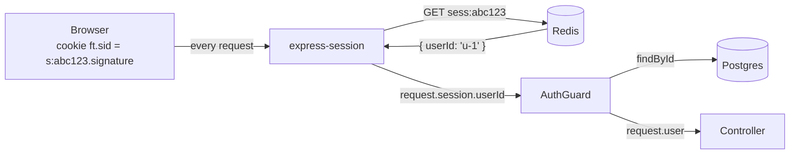
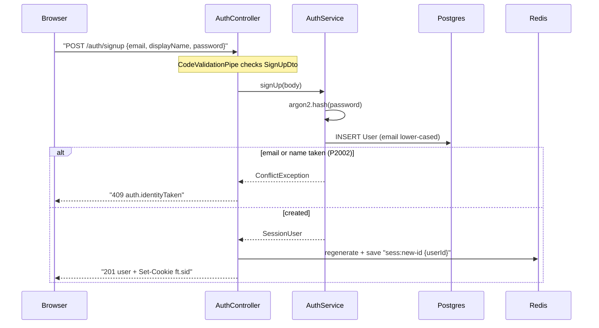
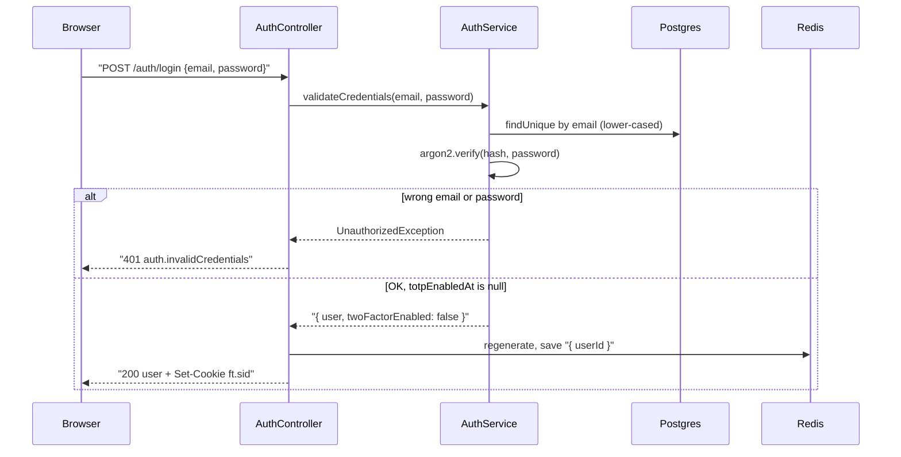
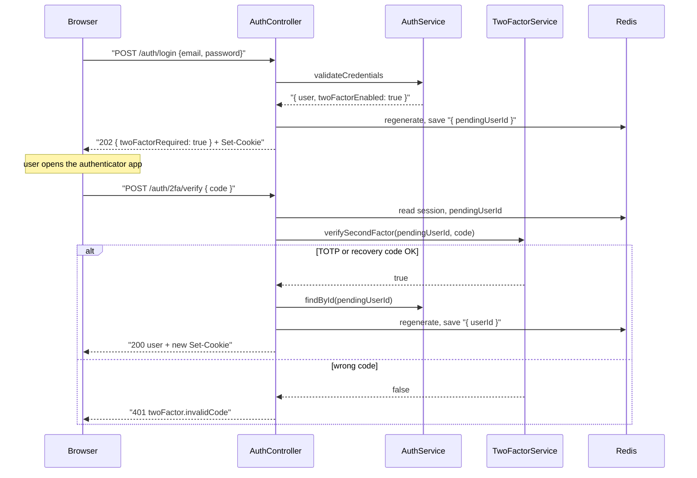
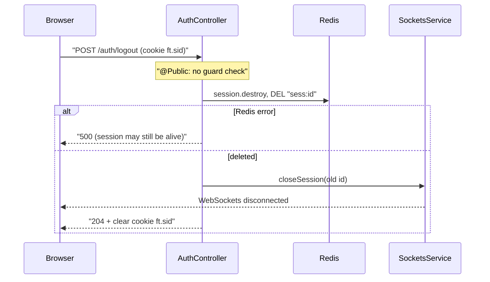
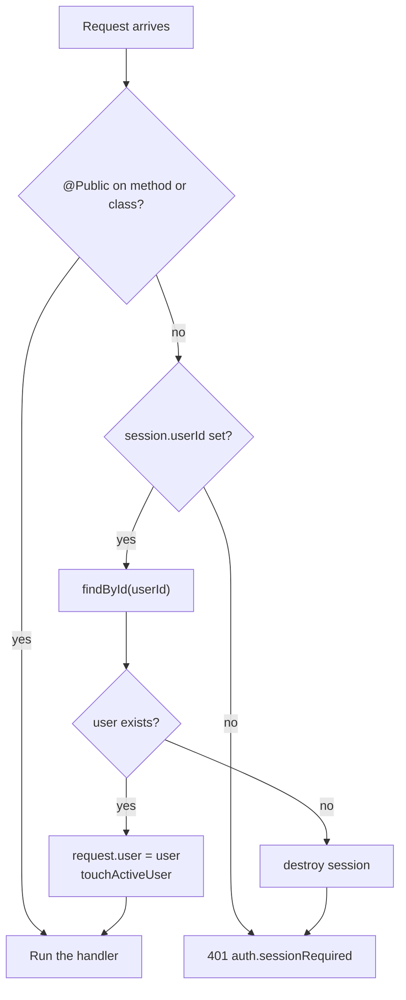
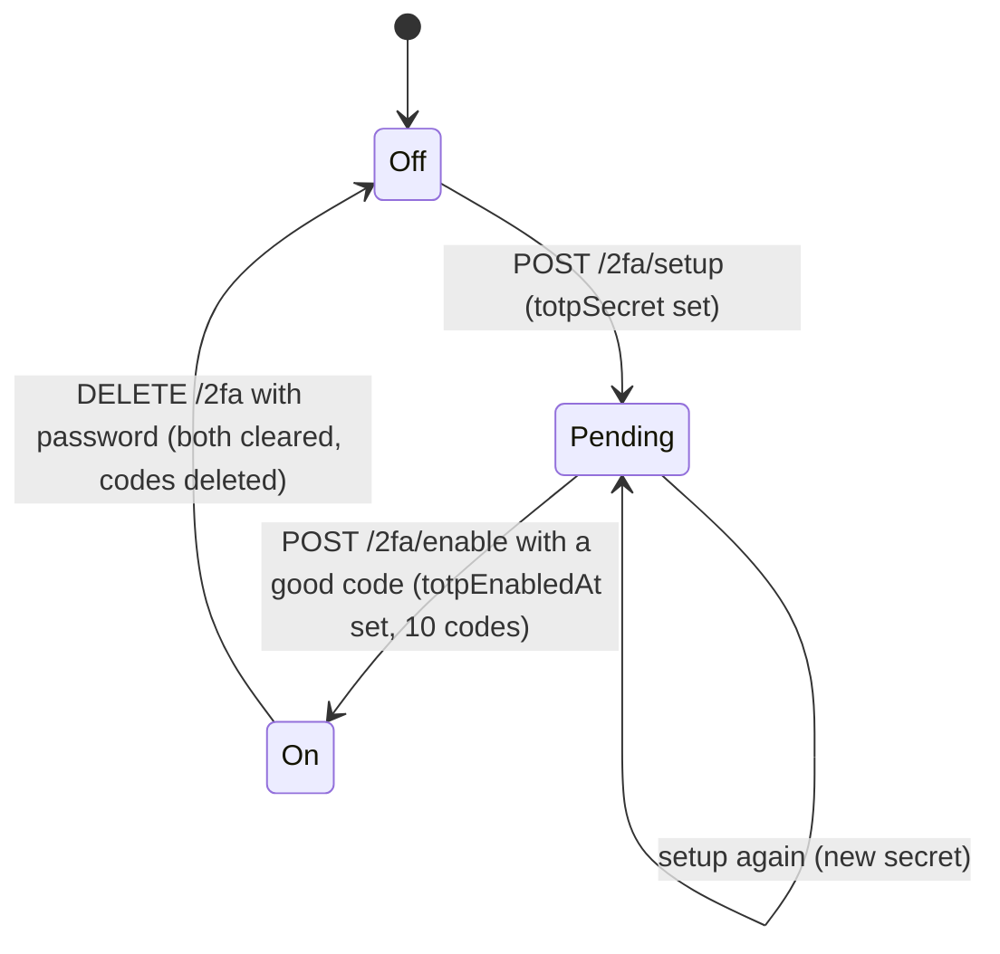
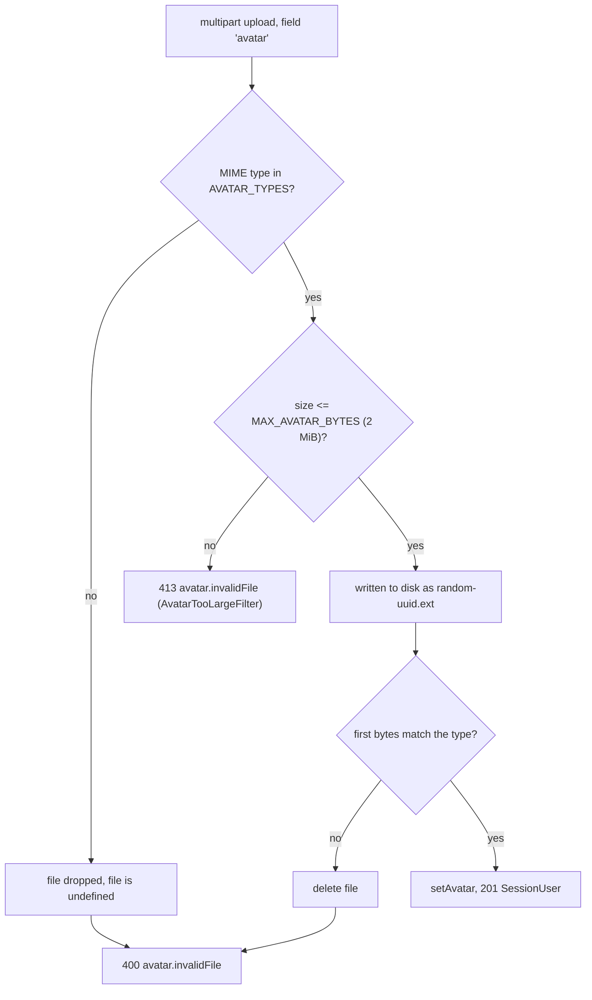
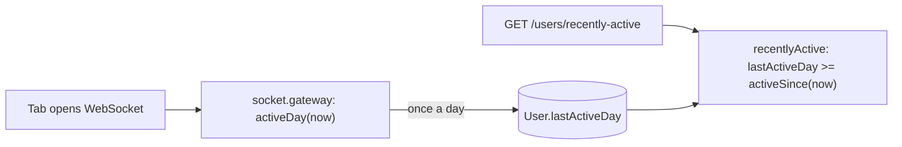

# Chapter 5 — Accounts: auth and users

In this chapter:

- The theory: authentication vs authorization, password hashing, sessions and cookies, 2FA and recovery codes
- How a session lives in Redis and travels in a cookie
- The `auth/` folder, file by file: module, DTOs, controller (every route), service, guard, decorators, `session.d.ts`, two-factor service
- Four sequence diagrams: signup, login without 2FA, login with 2FA, logout
- The `users/` folder, file by file: module, controller (every route, with the avatar upload), DTOs, service, `public-user.ts`, `active-day.ts`

---

## The big picture

### Authentication vs authorization

Two words that look the same, but they answer two different questions:

| Word | Question | Example in this app |
|---|---|---|
| **Authentication** ("authn") | *Who are you?* | You send your email and password; the API checks them. |
| **Authorization** ("authz") | *What are you allowed to do?* | You may edit **your own** profile (`PATCH /users/me`), but there is no route to edit someone else's. |

In this API, authentication is the job of `AuthService` (check the password) and `AuthGuard` (check the session on each request).
Authorization is mostly done by **design of the routes**: every "write" route works on `me` (the user from the session), never on an id from the URL.

### Password hashing

The database never stores your password. It stores a **hash**: the result of a one-way function.
You can compute `hash(password)`, but you cannot go back from the hash to the password.
At login, the API hashes what you typed and compares.

A normal hash (like SHA-256) is **too fast** for passwords. An attacker who steals the database can try billions of guesses per second.
So password hashing uses a **slow, memory-hungry** function on purpose.

This project uses **argon2** (the `argon2` npm package), with the **argon2id** variant.
argon2 won the Password Hashing Competition and is the first choice in the OWASP guidelines (OWASP is a well-known web security group).
"Memory-hungry" means each guess needs 19 MiB of RAM, which makes guessing on graphic cards very expensive.

Every argon2 hash also contains a random **salt** (random bytes mixed in), so two users with the same password get two different hashes.
The library stores the salt and the settings inside the hash string itself, so `argon2.verify(hash, password)` needs nothing else.

### Sessions and cookies vs tokens

HTTP has no memory: every request arrives alone. So how does the API know that request number 2 comes from the same person who logged in at request number 1?

**Analogy: the cloakroom ticket.** At a theatre, you give your coat and get a small ticket with a number.
The ticket itself says nothing about you. The coat (your data) stays behind the counter.
When you come back, you show the ticket and they find your coat. If they lose your coat or throw it away, your ticket is worthless.

- The **ticket** is the **cookie** `ft.sid`. It holds only a random session id.
- The **cloakroom** is **Redis**. It holds the session data (`userId`) under that id.
- **Logout** is "throw away the coat": delete the Redis entry. The ticket now matches nothing.

The other common approach is a **token** (for example a JWT, "JSON Web Token"). A token is more like a **signed ID card**:
the data is written on the card itself, and the server only checks the signature. That is nice because the server keeps nothing,
but it is hard to **cancel** a card before it expires. With a server-side session, logout or "account deleted" works at once.
That is why this project uses sessions.

| | Session + cookie (this app) | Token (JWT) |
|---|---|---|
| What the browser holds | A random id | All the claims, signed |
| Where the data lives | Server (Redis) | In the token |
| Logout now | Delete the Redis key | Hard (need a block list) |
| Readable by JavaScript? | No (`httpOnly` cookie) | Often stored in `localStorage`, so yes |

### How the session is stored in Redis

The session setup is in [app.setup.ts](../../apps/api/src/app.setup.ts) (see [02-boot-and-request-flow.md](02-boot-and-request-flow.md)).
It uses the `express-session` middleware with a `connect-redis` store:

```ts
  const sessionMiddleware = session({
    name: SESSION_COOKIE,
    secret: requireSessionSecret(),
    store: new RedisStore({ client: app.get(RedisService).client, prefix: SESSION_KEY_PREFIX }),
    // The cookie is an opaque id, so there is nothing to write back unless the
    // session itself changed, and an anonymous visitor gets no session at all.
    resave: false,
    saveUninitialized: false,
    rolling: true,
    cookie: {
      httpOnly: true,
      secure: process.env.NODE_ENV === 'production',
      sameSite: 'lax',
      maxAge: SESSION_TTL_MS,
      path: '/',
    },
  });
```

What this means:

- The cookie is named `ft.sid` (`SESSION_COOKIE`). Its value is the session id, **signed** with `SESSION_SECRET` (at least 32 characters), so nobody can make up an id.
- In Redis, the key is `sess:<session id>` (`SESSION_KEY_PREFIX`). The value is a small JSON object, for example `{"cookie":{...},"userId":"..."}`.
- `saveUninitialized: false`: a visitor who never logs in gets **no** session and no cookie.
- `rolling: true` + `maxAge` of 7 days: the session expires after 7 days **without** a request. Each request starts the 7 days again.
- `httpOnly`: browser JavaScript cannot read the cookie (protects against stolen cookies through XSS).
- `secure` in production: the cookie is only sent over HTTPS.
- `sameSite: 'lax'`: the browser does not send the cookie on most requests started by another site (protects against CSRF).



The same middleware also runs for WebSocket connections (`SessionIoAdapter`), so the chat knows who you are too (see [09-social-and-realtime.md](09-social-and-realtime.md)).

### What 2FA / TOTP is

**2FA** (two-factor authentication) means you need two different things to log in:
something you **know** (the password) and something you **have** (your phone).

This app uses **TOTP** ("Time-based One-Time Password"), the standard used by Google Authenticator, Authy, etc.:

1. The server creates a random **secret** and shows it as a QR code.
2. You scan it. Now your phone and the server share the same secret.
3. Every 30 seconds, both sides compute `HMAC-SHA1(secret, current time / 30)` and keep 6 digits.
4. At login you type the 6 digits from your phone. The server computes the same number and compares.

The code changes every 30 seconds, so a code seen by someone else is useless very soon.

### Recovery codes

If you lose your phone, you lose the second factor. **Recovery codes** solve that.
When you turn 2FA on, the API gives you 10 random codes (like `abcde-fghjk-mnpqr-stuvw`). You write them down.
Each one can replace a TOTP code **once**. The server keeps only a SHA-256 digest of each code, never the code itself.

### Where things live

```
apps/api/src/
├── auth/
│   ├── auth.module.ts          wires the auth part, registers the global guard
│   ├── auth.dto.ts             DTO classes from the shared Zod schemas
│   ├── auth.controller.ts      /auth/* routes
│   ├── auth.service.ts         argon2, signup, credential check
│   ├── auth.guard.ts           global guard: "is there a session?"
│   ├── auth.decorators.ts      @Public() and @CurrentUser()
│   ├── session.d.ts            types for request.session
│   └── two-factor.service.ts   TOTP + recovery codes
└── users/
    ├── users.module.ts
    ├── users.controller.ts     /users/* routes, avatar upload
    ├── users.dto.ts
    ├── users.service.ts        search, profile, recently active, avatar files
    ├── public-user.ts          the columns other users may see
    └── active-day.ts           UTC day helpers for "Recently active"
```

---

## auth.module.ts

[auth.module.ts](../../apps/api/src/auth/auth.module.ts) groups the auth part of the app:

```ts
@Module({
  imports: [GatewayModule],
  controllers: [AuthController],
  providers: [AuthService, TwoFactorService, { provide: APP_GUARD, useClass: AuthGuard }],
  exports: [AuthService],
})
export class AuthModule {}
```

- `imports: [GatewayModule]` — the controller needs `SocketsService` from there, to close WebSocket connections when a session ends or changes.
- `providers` — `AuthService` and `TwoFactorService` are normal providers.
- `{ provide: APP_GUARD, useClass: AuthGuard }` — this is the important line. `APP_GUARD` is a special token from `@nestjs/core`.
  A provider with this token becomes a **global guard**: Nest runs it before **every** route of the whole app, not only the routes in this module.
- `exports: [AuthService]` — other modules may inject `AuthService`.

`AuthModule` is imported in [app.module.ts](../../apps/api/src/app.module.ts) with all the other feature modules.

## auth.dto.ts and the shared schemas

A **DTO** ("Data Transfer Object") is a class that describes the shape of a request body or response.
In this project, the real rules are **Zod schemas** in `packages/shared`, and [auth.dto.ts](../../apps/api/src/auth/auth.dto.ts) only wraps them:

```ts
/**
 * The Zod schemas in @ft/shared are the rules; these wrap them so Nest validates
 * requests with them and Swagger documents them. The browser imports the same
 * schemas, which is what keeps client and server validation identical.
 */
export class SignUpDto extends createZodDto(CreateUserSchema) {}
export class LoginDto extends createZodDto(LoginSchema) {}
export class SessionUserDto extends createZodDto(SessionUserSchema) {}
export class UpdateProfileDto extends createZodDto(UpdateProfileSchema) {}

export class SecondFactorDto extends createZodDto(SecondFactorSchema) {}
export class EnableTwoFactorDto extends createZodDto(EnableTwoFactorSchema) {}
export class DisableTwoFactorDto extends createZodDto(DisableTwoFactorSchema) {}
```

`createZodDto` (from `nestjs-zod`) turns a schema into a class. The global `CodeValidationPipe` checks each body against it,
and Swagger (`/api/docs`) shows it. The same file also wraps the response schemas (`TwoFactorSetupDto`, `TwoFactorStatusDto`, `RecoveryCodesDto`, `TwoFactorRequiredDto`) — those are only for Swagger.

Every error message in these schemas is a **code** like `'password.tooShort'`, not a sentence. The browser translates it (see [02-boot-and-request-flow.md](02-boot-and-request-flow.md)).

### The schemas from packages/shared

From [user.ts](../../packages/shared/src/schemas/user.ts):

| Schema | Used by | Rules |
|---|---|---|
| `CreateUserSchema` | `SignUpDto` | `email`, `displayName`, `password`, optional `locale` |
| `DisplayNameSchema` | signup, profile, search | 3 to 32 characters, letters, digits, `.` `_` `-` only |
| `PasswordSchema` | signup | 12 to 128 characters, one lowercase, one uppercase, one digit |
| `LoginSchema` | `LoginDto` | email + any non-empty password up to 128 |
| `SessionUserSchema` | responses | the user **without** `updatedAt` (and there is never a `passwordHash` in any shared schema) |
| `UpdateProfileSchema` | `UpdateProfileDto` | optional `displayName`, `locale`, `timeZone`, at least one |

Two comments in that file explain choices well:

```ts
/**
 * Login deliberately does not reuse PasswordSchema. Its rules describe what a
 * NEW password must contain, and applying them here would reject an older
 * account's valid password with a message that reads like a policy complaint.
 */
export const LoginSchema = z.object({
  email: z.email('email.invalid'),
  password: z.string('password.required').min(1, 'password.required').max(128, 'password.tooLong'),
});
```

The `max(128)` matters: argon2 hashes any length, so without a limit someone could send a huge password and make the server work hard.

`UpdateProfileSchema` leaves out `email`, `role` and `avatarUrl` on purpose: changing email or role is a privilege change,
and `avatarUrl` names a file on the server disk, so a caller who could set it "could name someone else's file and have us delete it".

From [two-factor.ts](../../packages/shared/src/schemas/two-factor.ts):

| Schema | Rules |
|---|---|
| `TotpCodeSchema` | exactly 6 digits (a string, so `012345` keeps its leading zero) |
| `RecoveryCodeSchema` | removes spaces and `-`, lower-cases, then 20 characters `a-z0-9` |
| `SecondFactorSchema` | `{ code }` where code is **either** a TOTP code **or** a recovery code |
| `EnableTwoFactorSchema` | `{ code }`, TOTP only |
| `DisableTwoFactorSchema` | `{ password }` |
| `TwoFactorSetupSchema` | response: `secret`, `otpauthUri`, `qrDataUrl` |
| `TwoFactorStatusSchema` | response: `enabled`, `enrolmentPending`, `recoveryCodesRemaining` |
| `RecoveryCodesSchema` | response: `{ recoveryCodes: string[] }` |
| `TwoFactorRequiredSchema` | response: `{ twoFactorRequired: true }` |

The same file holds the constants `RECOVERY_CODE_COUNT = 10`, `RECOVERY_CODE_GROUPS = 4` and `RECOVERY_CODE_GROUP_LENGTH = 5`, which the two-factor service uses.

## auth.controller.ts

[auth.controller.ts](../../apps/api/src/auth/auth.controller.ts) holds all `/api/auth/*` routes. First, the full list:

| Method | Path | Guard | Rate limit (per IP) | What it does |
|---|---|---|---|---|
| POST | `/auth/signup` | `@Public` | signup (20/min) | Create account, start a session, return the user (201) |
| POST | `/auth/login` | `@Public` | login (5/min) | Check password. No 2FA: session + user (200). With 2FA: pending session + `{ twoFactorRequired: true }` (202) |
| POST | `/auth/2fa/verify` | `@Public` | login | Finish a pending login with a TOTP or recovery code |
| GET | `/auth/2fa` | session | — | 2FA status of my account |
| POST | `/auth/2fa/setup` | session | — | Start enrolment: new secret + QR code (409 if 2FA is already on) |
| POST | `/auth/2fa/enable` | session | login | Confirm with a first code, turn 2FA on, return recovery codes |
| DELETE | `/auth/2fa` | session | login | Turn 2FA off, needs the password again (204) |
| POST | `/auth/logout` | `@Public` | — | Destroy the session, clear the cookie (204) |
| GET | `/auth/me` | session | — | Return the signed-in user |

"session" in the Guard column means the global `AuthGuard` applies (no `@Public`).
The rate limits come from `@ThrottleByIp(RATE_LIMITS.…)` (see [03-infrastructure.md](03-infrastructure.md)); the numbers are the defaults from `SIGNUP_LIMIT_PER_MINUTE` and `LOGIN_LIMIT_PER_MINUTE`.

The controller gets three services by dependency injection:

```ts
  constructor(
    private readonly auth: AuthService,
    private readonly twoFactor: TwoFactorService,
    private readonly sockets: SocketsService,
  ) {}
```

### The helper functions: a new session id every time

At the top of the file, outside the class, there are three helpers:

```ts
function regenerate(request: Request, assign: () => void): Promise<string> {
  const replaced = request.sessionID;
  return new Promise((resolve, reject) => {
    request.session.regenerate((error) => {
      if (error) {
        reject(error instanceof Error ? error : new Error(String(error)));
        return;
      }
      assign();
      request.session.save((saveError) => {
        if (saveError) {
          reject(saveError instanceof Error ? saveError : new Error(String(saveError)));
          return;
        }
        resolve(replaced);
      });
    });
  });
}
```

`request.session.regenerate` deletes the old session and creates a new, empty one with a **new id**. Then `assign()` writes the data, and `save` writes it to Redis.
`express-session` uses callbacks, so the helper wraps them in a `Promise` to use `await`.

Why a new id? The comment explains: this blocks **session fixation**. In that attack, a bad person puts a known session id in your browser before you log in.
If the id stayed the same after login, they could use it too. With a new id at each login, the old one is worth nothing.

The helper returns the **old** id. The callers pass it to `this.sockets.closeSession(...)`, which disconnects every WebSocket that was opened with the old session.

```ts
function startSession(request: Request, userId: string): Promise<string> {
  return regenerate(request, () => {
    request.session.userId = userId;
    delete request.session.pendingUserId;
  });
}

function startPendingSession(request: Request, userId: string): Promise<string> {
  return regenerate(request, () => {
    request.session.pendingUserId = userId;
  });
}
```

- `startSession`: a **full** login. Sets `userId`, the key the guard reads.
- `startPendingSession`: password OK, but a 2FA code is still needed. Sets only `pendingUserId`, which the guard ignores.

### POST /auth/signup

```ts
  @Public()
  @Post('signup')
  @ThrottleByIp(RATE_LIMITS.signup)
  @ApiOperation({ summary: 'Create an account and sign in', security: [] })
  @ApiCreatedResponse({ type: SessionUserDto })
  @ApiConflictResponse({ description: 'Email or display name already taken' })
  async signUp(@Body() body: SignUpDto, @Req() request: Request): Promise<SessionUser> {
    const user = await this.auth.signUp(body);
    this.sockets.closeSession(await startSession(request, user.id));
    return user;
  }
```

The body is validated by `SignUpDto` before the method runs. `AuthService.signUp` creates the user, then `startSession` logs them in right away.
The `@Api…` decorators only feed Swagger. `security: []` tells Swagger this route needs no cookie.
The code comment notes signup is the most expensive public route (a database row + argon2), so it has its own rate limit.



### POST /auth/login

```ts
  async login(
    @Body() body: LoginDto,
    @Req() request: Request,
    @Res({ passthrough: true }) response: Response,
  ): Promise<SessionUser | TwoFactorRequired> {
    const { user, twoFactorEnabled } = await this.auth.validateCredentials(
      body.email,
      body.password,
    );

    if (twoFactorEnabled) {
      this.sockets.closeSession(await startPendingSession(request, user.id));
      // 202 rather than 200: the credentials were accepted, the login is not
      // finished, and the body carries no user for a caller to mistake for one.
      response.status(HttpStatus.ACCEPTED);
      return { twoFactorRequired: true };
    }

    this.sockets.closeSession(await startSession(request, user.id));
    return user;
  }
```

`@HttpCode(HttpStatus.OK)` makes the normal answer 200 (Nest's default for POST is 201).
`@Res({ passthrough: true })` gives access to the Express response **only** to change the status code; Nest still sends the returned value as JSON.
If the password is wrong, `validateCredentials` throws and the client gets `401 auth.invalidCredentials`.



### POST /auth/2fa/verify

The second step of a login with 2FA. It is `@Public` because the user is **not** logged in yet: only `pendingUserId` is set.

```ts
  async verifySecondFactor(
    @Body() body: SecondFactorDto,
    @Req() request: Request,
  ): Promise<SessionUser> {
    const pendingUserId = request.session.pendingUserId;
    if (pendingUserId === undefined) {
      throw new UnauthorizedException('auth.passwordFirst');
    }

    if (!(await this.twoFactor.verifySecondFactor(pendingUserId, body.code))) {
      throw new UnauthorizedException('twoFactor.invalidCode');
    }

    const user = await this.auth.findById(pendingUserId);
    if (user === null) {
      throw new UnauthorizedException('auth.passwordFirst');
    }

    this.sockets.closeSession(await startSession(request, user.id));
    return user;
  }
```

It has the same tight rate limit as login: "six digits is a far smaller space than a password".



### GET /auth/2fa, POST /auth/2fa/setup

```ts
  twoFactorStatus(@CurrentUser() user: SessionUser): Promise<TwoFactorStatus> {
    return this.twoFactor.status(user.id);
  }

  setUpTwoFactor(@CurrentUser() user: SessionUser): Promise<TwoFactorSetup> {
    return this.twoFactor.beginEnrolment(user.id, user.email);
  }
```

Both need a session. `@CurrentUser()` gives the user the guard loaded. The settings page uses the status to show "on", "off" or "setup started", and how many recovery codes are left.
Setup answers 409 if 2FA is already on: to change the authenticator you must turn 2FA off first, and that step asks for the password.

### POST /auth/2fa/enable

```ts
  async enableTwoFactor(
    @Body() body: EnableTwoFactorDto,
    @CurrentUser() user: SessionUser,
    @Req() request: Request,
  ): Promise<RecoveryCodes> {
    const recoveryCodes = await this.twoFactor.confirmEnrolment(user.id, body.code);
    await this.rotateSession(request, user.id);
    return { recoveryCodes };
  }
```

The user types the first code from their app. If it is right, 2FA is on and the user gets the 10 recovery codes (shown only this once).
The session id changes because privileges changed. It is rate limited because "a stolen cookie must not turn into a code-guessing oracle".

### DELETE /auth/2fa

```ts
    // The password again, not just the session: an unattended browser should not
    // be enough to remove a factor.
    if (!(await this.auth.verifyPassword(user.id, body.password))) {
      throw new UnauthorizedException('auth.incorrectPassword');
    }
    await this.twoFactor.disable(user.id);
    await this.rotateSession(request, user.id);
```

This is called **re-authentication**: for a sensitive action, a live session is not enough. Answer: 204 No Content.

### POST /auth/logout

```ts
  // Public so that logging out of an expired session is not itself a 401.
  @Public()
  @Post('logout')
  @HttpCode(HttpStatus.NO_CONTENT)
  async logout(@Req() request: Request): Promise<void> {
    const ended = request.sessionID;
    // Failing loudly rather than returning 204: if the store entry survives, the
    // session is still usable and reporting success would be a lie.
    await new Promise<void>((resolve, reject) => {
      request.session.destroy((error) => {
        if (error) {
          reject(error instanceof Error ? error : new Error(String(error)));
          return;
        }
        resolve();
      });
    });
    // After the DEL, so a new handshake finds the session gone. One already past
    // express-session checks the session again once in its rooms (the gateway).
    this.sockets.closeSession(ended);
    // The store entry is gone; this clears the now-dangling browser cookie.
    request.res?.clearCookie('ft.sid', { path: '/' });
  }
```

Order matters: first delete the Redis entry, then close the sockets, then clear the cookie.



### GET /auth/me

```ts
  me(@CurrentUser() user: SessionUser): SessionUser {
    return user;
  }
```

The web app calls it to know "am I logged in, and as whom?". The guard has already done all the work.

### rotateSession

```ts
  private async rotateSession(request: Request, userId: string): Promise<void> {
    try {
      this.sockets.closeSession(await startSession(request, userId));
    } catch (error) {
      this.logger.warn(`session not rotated: ${String(error)}`);
    }
  }
```

Used after enabling or disabling 2FA. It only **logs** an error instead of throwing: the 2FA change is already saved,
and the recovery codes must still reach the user.

**Tests:** [auth.controller.spec.ts](../../apps/api/src/auth/auth.controller.spec.ts) checks that logout clears the cookie and closes sockets, fails when Redis cannot destroy the session,
that every route that makes a new session id closes the old id's sockets, and that recovery codes are returned even when rotation fails.

## auth.service.ts

[auth.service.ts](../../apps/api/src/auth/auth.service.ts) does the password work. It only needs `PrismaService`.

### The argon2 settings

```ts
/**
 * OWASP's second recommended argon2id configuration: 19 MiB, 2 iterations,
 * 1 degree of parallelism. Raising memoryCost is what raises the cost to an
 * attacker, so tune that before the others.
 */
const ARGON2_OPTIONS = {
  type: argon2.argon2id,
  memoryCost: 19_456,
  timeCost: 2,
  parallelism: 1,
} as const;

/**
 * Hashing a throwaway string so a login for an unknown email takes as long as
 * one for a real account. Skipping it leaks which emails are registered through
 * response timing alone.
 */
const DUMMY_HASH = argon2.hash('timing-equaliser', ARGON2_OPTIONS);
```

`memoryCost` is in KiB: 19 456 KiB = 19 MiB. `DUMMY_HASH` is a **Promise**, computed once when the file loads.

### toSessionUser

```ts
  /** Everything the owner may see about themselves. Never the password hash. */
  static toSessionUser(user: User): SessionUser {
    return {
      id: user.id,
      email: user.email,
      displayName: user.displayName,
      avatarUrl: user.avatarUrl,
      locale: user.locale,
      timeZone: user.timeZone,
      role: user.role,
      createdAt: user.createdAt.toISOString(),
    };
  }
```

A database row has `passwordHash`, `totpSecret` and more. This function copies **only** the safe fields, by name.
It is `static`, so `UsersService` can call `AuthService.toSessionUser(...)` without injecting `AuthService`.

### signUp

```ts
  async signUp(input: CreateUserInput): Promise<SessionUser> {
    const passwordHash = await argon2.hash(input.password, ARGON2_OPTIONS);

    try {
      const user = await this.prisma.user.create({
        data: {
          email: input.email.toLowerCase(),
          displayName: input.displayName,
          passwordHash,
          ...(input.locale ? { locale: input.locale } : {}),
        },
      });
      return AuthService.toSessionUser(user);
    } catch (error) {
      // P2002 is the unique constraint on email or displayName. Caught rather
      // than pre-checked: a SELECT before INSERT still races another signup.
```

- The email is lower-cased, so `Alice@x.com` and `alice@x.com` are one account.
- `email` and `displayName` are `@unique` in the database. If one is taken, Prisma throws error code `P2002`, and the service turns it into `409 auth.identityTaken`.
  The comment explains why it does not check first: two signups at the same moment could both pass a check, but only one can pass the unique constraint.

### validateCredentials

```ts
    const user = await this.prisma.user.findUnique({ where: { email: email.toLowerCase() } });

    if (user === null) {
      await argon2.verify(await DUMMY_HASH, password).catch(() => false);
      throw new UnauthorizedException('auth.invalidCredentials');
    }

    if (!(await argon2.verify(user.passwordHash, password))) {
      throw new UnauthorizedException('auth.invalidCredentials');
    }

    return {
      user: AuthService.toSessionUser(user),
      twoFactorEnabled: user.totpEnabledAt != null,
    };
```

Two protections here:

1. **Same message** for "no such email" and "wrong password", so an attacker cannot learn which emails exist.
2. **Same time**: for an unknown email it still runs a (slow) argon2 verify on the dummy hash. Without it, "unknown email" would answer much faster, and the timing would tell the secret.

It also returns whether 2FA is on (`totpEnabledAt` is set), so the controller can choose a full or a pending session without a second query.

### verifyPassword and findById

- `verifyPassword(userId, password)` — re-authentication, used by `DELETE /auth/2fa`. Returns `true`/`false`, never throws for a wrong password.
- `findById(id)` — returns a `SessionUser` or `null`. Used by the guard on every request and by `2fa/verify`.

**Tests:** [auth.service.spec.ts](../../apps/api/src/auth/auth.service.spec.ts) checks that an argon2id hash is stored (never the password), that emails are lower-cased, that the hash is never returned,
that P2002 becomes a 409 and other errors pass through, that an unknown email gets the same message as a wrong password, and that `findById` returns null for a missing user.

## auth.decorators.ts

[auth.decorators.ts](../../apps/api/src/auth/auth.decorators.ts) is small but central:

```ts
export const IS_PUBLIC = 'auth:public';

/** Opens a route to anonymous callers. Everything else requires a session. */
export const Public = () => SetMetadata(IS_PUBLIC, true);

/** The user AuthGuard resolved. Only meaningful on a guarded route. */
export const CurrentUser = createParamDecorator((_data: unknown, context: ExecutionContext) => {
  return context.switchToHttp().getRequest<Request & { user?: SessionUser }>().user;
});
```

- `@Public()` uses `SetMetadata`: it sticks a small label (`'auth:public' = true`) on the method or class. It does nothing by itself; the guard reads the label.
- `@CurrentUser()` is a **parameter decorator**: in a method like `me(@CurrentUser() user)`, Nest calls this function and passes its result as `user`. It reads `request.user`, which the guard set.

## auth.guard.ts

A **guard** in Nest is a class with a `canActivate` method. It runs before the route handler. If it returns `true`, the request goes on; if it throws, the request stops.

[auth.guard.ts](../../apps/api/src/auth/auth.guard.ts):

```ts
/**
 * Registered globally, so a new route is private unless it says otherwise.
 * The opposite default is how endpoints end up unprotected by omission.
 */
@Injectable()
export class AuthGuard implements CanActivate {
  constructor(
    private readonly reflector: Reflector,
    private readonly auth: AuthService,
  ) {}

  async canActivate(context: ExecutionContext): Promise<boolean> {
    const isPublic = this.reflector.getAllAndOverride<boolean>(IS_PUBLIC, [
      context.getHandler(),
      context.getClass(),
    ]);
    if (isPublic) {
      return true;
    }

    const request = context.switchToHttp().getRequest<Request & { user?: SessionUser }>();
    const userId = request.session?.userId;
    if (userId === undefined) {
      throw new UnauthorizedException('auth.sessionRequired');
    }

    // Re-read the user rather than trusting a copy in the session: a deleted or
    // demoted account must lose access on its next request, not at expiry.
    const user = await this.auth.findById(userId);
    if (user === null) {
      request.session.destroy(() => undefined);
      throw new UnauthorizedException('auth.sessionRequired');
    }

    request.user = user;
    touchActiveUser(user.id);
    return true;
  }
}
```

Step by step:

1. `Reflector` reads metadata. `getAllAndOverride` looks for `IS_PUBLIC` on the **method** first, then on the **class**. If found, let the request in.
2. Otherwise, read `request.session.userId` (filled by `express-session` from Redis). No `userId` means 401. A pending 2FA login has only `pendingUserId`, so it also gets 401.
3. Load the user from Postgres. If the account was deleted, destroy the session and answer 401.
4. Put the user on `request.user` (for `@CurrentUser()`), and call `touchActiveUser` for the "active users" metric (see [03-infrastructure.md](03-infrastructure.md)).



"Private by default" is the key design: if a developer forgets a decorator, the route is **closed**, not open.

**Tests:** [auth.guard.spec.ts](../../apps/api/src/auth/auth.guard.spec.ts) checks that `@Public` routes pass without touching the session, that a missing session is rejected,
that a valid session attaches the user and counts them as active, and that a session whose user is gone is destroyed.

## session.d.ts

By default, TypeScript does not know what you put in `request.session`. Writing `request.session.userId` would be a type error.
[session.d.ts](../../apps/api/src/auth/session.d.ts) fixes that:

```ts
import 'express-session';

declare module 'express-session' {
  interface SessionData {
    /** Set only once authentication is complete. The guard reads this. */
    userId?: string;

    /**
     * The password was right but a second factor is still owed. Deliberately a
     * different key from userId, so a half-finished login can never satisfy the
     * guard by accident.
     */
    pendingUserId?: string;
  }
}
```

This is **declaration merging**. `express-session` already declares an (empty) `interface SessionData`. In TypeScript, two interfaces with the same name in the same module are **merged** into one.
So `declare module 'express-session' { interface SessionData { ... } }` adds two fields to the library's own type. It is a `.d.ts` file: types only, no JavaScript is produced.

The first line `import 'express-session'` makes this file a module, which is needed so `declare module` *adds to* the existing module instead of replacing it.

## two-factor.service.ts

[two-factor.service.ts](../../apps/api/src/auth/two-factor.service.ts) does all the 2FA work with two libraries: `otpauth` (TOTP math) and `qrcode-generator` (draws the QR image).
The data lives on the `User` row (`totpSecret`, `totpEnabledAt`) and in the `RecoveryCode` table (see [04-database.md](04-database.md)).

### The 2FA life cycle



A "Pending" account still logs in with only the password: `validateCredentials` looks at `totpEnabledAt`, not at `totpSecret`.

### Constants and helpers

```ts
const ISSUER = 'ft_transcendence';

/**
 * One step either side of the current one, so a code typed as the interval
 * rolls over is still accepted. Wider windows extend the replay window for a
 * code an attacker has already observed.
 */
const VALIDATION_WINDOW = 1;

/** Excludes look-alike characters, because these get copied off a screen by hand. */
const RECOVERY_ALPHABET = 'abcdefghjkmnpqrstuvwxyz23456789';

function totpFor(secret: string, label: string): OTPAuth.TOTP {
  return new OTPAuth.TOTP({
    issuer: ISSUER,
    label,
    algorithm: 'SHA1',
    digits: 6,
    period: 30,
    secret: OTPAuth.Secret.fromBase32(secret),
  });
}
```

- `ISSUER` and `label` (the user's email) are what the authenticator app shows in its list.
- `SHA1`, 6 digits, 30 seconds: the standard settings every authenticator app supports.
- `VALIDATION_WINDOW = 1` accepts the previous, current and next 30-second code, so a code typed just as it changes still works.
- The alphabet has no `i`, `l`, `o`, `0`, `1`, which look alike when copied by hand.

```ts
/**
 * Recovery codes are high-entropy random, so a plain digest is enough and lets a
 * login find one by indexed lookup. Passwords need argon2 precisely because they
 * are not random; these are.
 */
function digest(code: string): string {
  return createHash('sha256').update(code).digest('hex');
}
```

This is an interesting contrast with passwords: a 20-character random code from 31 characters cannot be guessed, so a fast hash is safe.
A fast hash with no salt is also the **same** every time, so the database can find a code with a simple `WHERE codeHash = ...` (the column is `@unique`).

`generateRecoveryCode` picks 20 random characters with `randomBytes` (cryptographic randomness). `formatRecoveryCode` splits them into 4 groups of 5 with `-`.

### beginEnrolment (POST /2fa/setup)

```ts
  async beginEnrolment(userId: string, email: string) {
    const secret = new OTPAuth.Secret({ size: 20 }).base32;
    const { count } = await this.prisma.user.updateMany({
      where: { id: userId, totpEnabledAt: null },
      data: { totpSecret: secret },
    });
    if (count === 0) {
      throw new ConflictException('twoFactor.alreadyEnabled');
    }

    const otpauthUri = totpFor(secret, email).toString();
    return { secret, otpauthUri, qrDataUrl: this.qrDataUrl(otpauthUri) };
  }
```

- A 20-byte random secret, written in base32 (the format authenticator apps expect).
- `updateMany` with `totpEnabledAt: null` in the `WHERE`: the check "2FA is not on yet" and the write happen in **one** SQL statement, so no other request can sneak in between (issue #216).
- `otpauthUri` looks like `otpauth://totp/ft_transcendence:me@x.com?secret=...`. It is what the QR code contains.
- `qrDataUrl` draws the QR on the server and returns it as a `data:image/gif;base64,...` URL, so the browser needs no QR library.

### status (GET /2fa)

Returns `enabled` (`totpEnabledAt` is set), `enrolmentPending` (a secret but not enabled), and `recoveryCodesRemaining` (unused codes).

### confirmEnrolment (POST /2fa/enable)

```ts
  async confirmEnrolment(userId: string, code: string): Promise<string[]> {
    const user = await this.prisma.user.findUnique({
      where: { id: userId },
      select: { email: true, totpSecret: true, totpEnabledAt: true },
    });
    if (user?.totpEnabledAt != null) {
      throw new ConflictException('twoFactor.alreadyEnabled');
    }
    if (user?.totpSecret == null) {
      throw new BadRequestException('twoFactor.setupFirst');
    }
    if (!this.verifyCode(user.totpSecret, user.email, code)) {
      throw new UnauthorizedException('twoFactor.invalidCode');
    }

    await this.enable(userId, user.totpSecret);
    return this.issueRecoveryCodes(userId);
  }
```

The user must prove the phone was set up correctly **before** 2FA becomes required. Otherwise a badly scanned QR would lock them out.

The private `enable` method again puts the conditions in the `WHERE`:

```ts
    const { count } = await this.prisma.user.updateMany({
      where: { id: userId, totpSecret: checkedSecret, totpEnabledAt: null },
      data: { totpEnabledAt: new Date() },
    });
```

It turns on **only the secret that was checked**. If another setup replaced the secret in the meantime, or two confirmations race, `count` is 0 and it throws (409 or 400) — so no second set of recovery codes is made.

### verifySecondFactor (POST /2fa/verify)

```ts
  /** Accepts either factor, so a lost authenticator is not a lost account. */
  async verifySecondFactor(userId: string, code: string): Promise<boolean> {
    const user = await this.prisma.user.findUnique({
      where: { id: userId },
      select: { email: true, totpSecret: true, totpEnabledAt: true },
    });
    if (user?.totpSecret == null || user.totpEnabledAt === null) {
      return false;
    }

    if (/^\d{6}$/.test(code) && this.verifyCode(user.totpSecret, user.email, code)) {
      return true;
    }
    return this.consumeRecoveryCode(userId, code.replace(/[\s-]/g, '').toLowerCase());
  }
```

Six digits: try TOTP. Otherwise (or if TOTP failed): try it as a recovery code, after removing spaces and hyphens.

### Recovery codes

```ts
  async issueRecoveryCodes(userId: string): Promise<string[]> {
    const codes = Array.from({ length: RECOVERY_CODE_COUNT }, generateRecoveryCode);
    await this.prisma.$transaction([
      this.prisma.recoveryCode.deleteMany({ where: { userId } }),
      this.prisma.recoveryCode.createMany({
        data: codes.map((code) => ({ userId, codeHash: digest(code) })),
      }),
    ]);
    return codes.map(formatRecoveryCode);
  }

  async consumeRecoveryCode(userId: string, code: string): Promise<boolean> {
    const { count } = await this.prisma.recoveryCode.updateMany({
      where: { userId, codeHash: digest(code), usedAt: null },
      data: { usedAt: new Date() },
    });
    return count > 0;
  }
```

- Issuing **replaces** the old set in one transaction. Only digests are stored; the plain codes are returned once.
- Using a code sets `usedAt` in the same statement that finds it. Two logins at the same moment cannot both spend one code.
- `countUnusedRecoveryCodes` counts rows with `usedAt: null`.

### disable (DELETE /2fa)

Clears `totpSecret` and `totpEnabledAt` and deletes all recovery codes, in one transaction. So turning 2FA on again always starts with a fresh secret.

**Tests:** [two-factor.service.spec.ts](../../apps/api/src/auth/two-factor.service.spec.ts) covers enrolment (secret stored but not enabled, refusals once 2FA is on (#216), wrong code, race cases)
and the second factor (current TOTP accepted, refused when never enabled, recovery codes with or without hyphens, a spent code refused).

---

## users.module.ts

[users.module.ts](../../apps/api/src/users/users.module.ts) is a plain module:

```ts
@Module({
  controllers: [UsersController],
  providers: [UsersService],
  exports: [UsersService],
})
export class UsersModule {}
```

It does not import `AuthModule`. It does not need to: the guard is global, `@CurrentUser()` is just a function, and `AuthService.toSessionUser` is a static method.

## users.controller.ts

[users.controller.ts](../../apps/api/src/users/users.controller.ts) holds the `/api/users/*` routes. None are `@Public`, so all need a session.

| Method | Path | Body / params | What it does |
|---|---|---|---|
| GET | `/users?q=…` | `UserSearchQueryDto` | Search other users by display name |
| GET | `/users/recently-active` | — | Users active in the last 7 days, to add as friends |
| GET | `/users/:id` | `UserIdParam` | Someone's public profile (with course streaks) |
| PATCH | `/users/me` | `UpdateProfileDto` | Change my display name, locale or time zone |
| POST | `/users/me/avatar` | multipart, field `avatar` | Upload my avatar (PNG, JPEG, WebP, max 2 MiB) |
| DELETE | `/users/me/avatar` | — | Remove my avatar |

### The read routes

```ts
  // Before :id, which would take "recently-active" for a malformed id.
  @Get('recently-active')
  ...
  recentlyActive(@CurrentUser() user: SessionUser): Promise<RecentlyActive> {
    return this.users.recentlyActive(user.id, new Date());
  }

  @Get(':id')
  ...
  profile(@Param('id', UserIdParam) id: string): Promise<PublicProfile> {
    return this.users.profile(id, new Date());
  }
```

- Route **order** matters: Express tries routes top to bottom, so `recently-active` must come before `:id`.
- `UserIdParam` (from [validation.pipe.ts](../../apps/api/src/validation.pipe.ts)) checks the id is a UUID and lower-cases it. A bad id answers 400 before the service runs.
- The controller passes `new Date()` as "now". This makes the service easy to test with a fixed date.

### PATCH /users/me

```ts
  // No PATCH :id: editing someone else's profile is the advanced permissions
  // module, and an id in the path invites forgetting to check it.
  @Patch('me')
  ...
  updateProfile(
    @Body() body: UpdateProfileDto,
    @CurrentUser() user: SessionUser,
  ): Promise<SessionUser> {
    return this.users.updateProfile(user.id, body);
  }
```

This is the authorization-by-design idea: the id comes from the session, never from the URL, so you cannot edit someone else by changing a number.

### POST /users/me/avatar: the upload

File uploads use **multipart/form-data** (the browser sends the file in parts, not as JSON). Nest uses the **multer** library through `FileInterceptor`:

```ts
  @UseInterceptors(
    FileInterceptor('avatar', {
      storage: diskStorage({
        destination: AVATAR_STORAGE_DIR,
        filename: (_req, file, callback) =>
          callback(null, `${randomUUID()}${AVATAR_TYPES[file.mimetype].extension}`),
      }),
      limits: { fileSize: MAX_AVATAR_BYTES },
      // A rejected type is dropped silently, so the `!file` guard answers for it.
      fileFilter: (_req, file, callback) => callback(null, file.mimetype in AVATAR_TYPES),
    }),
  )
  @UseFilters(AvatarTooLargeFilter)
  async uploadAvatar(
    @UploadedFile() file: Express.Multer.File | undefined,
    @CurrentUser() user: SessionUser,
  ): Promise<SessionUser> {
    if (!file) {
      throw new BadRequestException('avatar.invalidFile');
    }

    if (!(await looksLikeItsMimeType(file.path, file.mimetype))) {
      await unlink(file.path).catch(() => undefined);
      throw new BadRequestException('avatar.invalidFile');
    }

    return this.users.setAvatar(user.id, file.filename);
  }
```

Several safety checks, one after the other:



1. **File name**: a random UUID plus an extension taken from **our** table, never the client's file name. So no `../../evil.sh`.
2. **Type filter**: only `image/png`, `image/jpeg`, `image/webp`.
3. **Size limit**: `MAX_AVATAR_BYTES` (2 MiB) is shared with the browser, which checks first; the server checks again.
4. **Magic bytes**: the MIME type is only what the client *says*. `looksLikeItsMimeType` reads the first 12 bytes of the saved file and compares with what a real PNG/JPEG/WebP starts with:

```ts
const AVATAR_TYPES: Record<string, { extension: string; matchesHead: (head: Buffer) => boolean }> =
  {
    'image/png': {
      extension: '.png',
      matchesHead: (head) => head.subarray(0, 8).equals(Buffer.from('89504e470d0a1a0a', 'hex')),
    },
    'image/jpeg': {
      extension: '.jpg',
      matchesHead: (head) => head.subarray(0, 3).equals(Buffer.from('ffd8ff', 'hex')),
    },
```

A text file renamed to `.png` fails here and is deleted.

`AvatarTooLargeFilter` is a small **exception filter** defined in the same file. Multer throws `PayloadTooLargeException` with the English sentence "File too large"; the filter replaces it with the code `avatar.invalidFile`, like every other error of this API.

The saved files are served as static files under `/api/uploads/avatars/` (`AVATAR_ROUTE`, set up in [app.setup.ts](../../apps/api/src/app.setup.ts)).

### DELETE /users/me/avatar

Calls `clearAvatar`: the user goes back to the default image, and the old file is deleted.

## users.dto.ts

[users.dto.ts](../../apps/api/src/users/users.dto.ts) wraps four schemas from `packages/shared/src/schemas/user.ts`:

```ts
// The search params (?q=…), checked like a display name before the controller gets them.
export class UserSearchQueryDto extends createZodDto(UserSearchQuerySchema) {}
// What goes out: only documents the answer in Swagger (/api/docs).
export class UserSearchResultDto extends createZodDto(UserSearchResultSchema) {}
export class PublicProfileDto extends createZodDto(PublicProfileSchema) {}
export class RecentlyActiveDto extends createZodDto(RecentlyActiveSchema) {}
```

- `UserSearchQuerySchema`: `q` is trimmed, then must be a valid display name (3 to 32 allowed characters). The shortest name is the shortest search, so a full name always finds its person.
- `UserSearchResultSchema`: `{ users: PublicUser[] }`.
- `PublicProfileSchema`: a `PublicUser` plus `courses: { lang, level, streak }[]`.
- `RecentlyActiveSchema`: `{ users: (PublicUser + languages)[] }`.

`PATCH /users/me` reuses `UpdateProfileDto` and `SessionUserDto` from `auth.dto.ts`.

## public-user.ts

[public-user.ts](../../apps/api/src/users/public-user.ts) is one constant:

```ts
/** The columns another user may see, tied to PublicUserSchema's keys. */
export const PUBLIC_USER_SELECT = {
  id: true,
  displayName: true,
  avatarUrl: true,
} as const satisfies Record<keyof PublicUser, true>;
```

It is a Prisma `select`: "read only these columns". Another user never sees your email or time zone.

The `satisfies Record<keyof PublicUser, true>` part is a TypeScript check. It says: "this object must have **exactly** the keys of `PublicUser`, each set to `true`".
If someone adds a field to `PublicUserSchema` in `packages/shared` and forgets this file, TypeScript shows an error. The schema and the query cannot drift apart.

It is used by `UsersService` and also by other modules that show users (friends, messages).

## users.service.ts

[users.service.ts](../../apps/api/src/users/users.service.ts) holds the logic. It needs only `PrismaService`.

### search

```ts
  async search(me: string, q: string): Promise<UserSearchResult> {
    const users = await this.prisma.user.findMany({
      where: {
        id: { not: me },
        displayName: { contains: q.replace(/[\\%_]/g, '\\$&'), mode: 'insensitive' },
      },
      select: PUBLIC_USER_SELECT,
      orderBy: { displayName: 'asc' },
      take: USER_SEARCH_LIMIT,
    });
    return { users };
  }
```

- `contains` + `mode: 'insensitive'` becomes SQL `ILIKE '%q%'`.
- In `ILIKE`, `_` means "any one character" and `%` means "anything". A display name may contain `_`, so the code **escapes** them with `\` to mean the real character.
- Never yourself (`id: { not: me }`), at most 20 results (`USER_SEARCH_LIMIT`).

### profile and time zones

```ts
  async profile(id: string, now: Date): Promise<PublicProfile> {
    const user = await this.prisma.user.findUnique({
      where: { id },
      select: {
        ...PUBLIC_USER_SELECT,
        timeZone: true,
        userLevels: { orderBy: { createdAt: 'asc' } },
      },
    });
    if (user === null) {
      throw new NotFoundException('user.notFound');
    }

    // The course page's day and rule, so both show the same streak.
    const courses = await Promise.all(
      user.userLevels.map(async (course) => {
        const day = await currentDay(this.prisma, course, user.timeZone, now);
        const streak = currentStreak(storedStreak(course), day);
        return { lang: course.lang, level: course.level, streak };
      }),
    );
    return { id: user.id, displayName: user.displayName, avatarUrl: user.avatarUrl, courses };
  }
```

A **streak** is the number of days in a row the learner met their daily goal (see [08-lessons.md](08-lessons.md)).
"Today" is not the same day everywhere: at 06:00 UTC on Nov 6, it is still Nov 5 in Los Angeles.
So the service reads the **owner's** `timeZone` and uses the same functions as the course page (`currentDay`, `currentStreak` from the lessons module) to compute "their today".
The time zone is read but **not** returned: the result is built field by field.

### recentlyActive

```ts
    const users = await this.prisma.user.findMany({
      where: {
        id: { not: me },
        lastActiveDay: { gte: activeSince(now) },
        friendshipsRequested: { none: { addresseeId: me } },
        friendshipsAddressed: { none: { requesterId: me } },
      },
      select: {
        ...PUBLIC_USER_SELECT,
        userLevels: { select: { lang: true }, orderBy: { createdAt: 'asc' } },
      },
      orderBy: { displayName: 'asc' },
      take: RECENTLY_ACTIVE_LIMIT,
    });
```

People seen in the last 7 days, not you, and not someone you already have a friend request or friendship with. Each row also lists the languages they learn.
It is sorted **by name, not by activity** on purpose: sorting by time would let someone who polls the list see when each learner first opens the app each day.

### updateProfile

Updates the row with the validated input and returns a `SessionUser`. A taken display name (Prisma `P2002`) becomes `409 auth.displayNameTaken` — same "catch, don't pre-check" reasoning as signup.

### Avatars: setAvatar, clearAvatar, replaceAvatar, deleteAvatarFile

```ts
/** Relative on purpose: see setAvatar. */
export const AVATAR_URL_PREFIX = `${AVATAR_ROUTE}/`;
...
  private async replaceAvatar(userId: string, avatarUrl: string | null): Promise<SessionUser> {
    const before = await this.prisma.user.findUniqueOrThrow({
      where: { id: userId },
      select: { avatarUrl: true },
    });
    const user = await this.prisma.user.update({ where: { id: userId }, data: { avatarUrl } });

    if (before.avatarUrl) {
      await this.deleteAvatarFile(before.avatarUrl);
    }
    return AuthService.toSessionUser(user);
  }
```

- The stored value is a **relative** path like `/api/uploads/avatars/<uuid>.png`. An absolute URL built from the request could carry a fake `Host` header into the database, and `next/image` refuses unknown hosts.
- The file to delete comes from the user's **own row**, never from the request.
- `deleteAvatarFile` checks the prefix, then uses `basename(filename)` so a strange value like `../../etc/passwd` stays inside the avatar folder. It is "best effort": if the file is already gone (`ENOENT`) it does nothing, other errors are only logged, because the database row is already updated.

**Tests:** [users.service.spec.ts](../../apps/api/src/users/users.service.spec.ts) checks the avatar path is relative, the old file is deleted (and only inside the folder), unlink errors do not fail the request,
the search escapes `_` and excludes you, recently active uses the last 7 UTC days sorted by name, P2002 becomes a 409, and the profile streak uses the owner's time zone.

## active-day.ts

[active-day.ts](../../apps/api/src/users/active-day.ts) has two tiny date helpers for "Recently active":

```ts
export const ACTIVE_DAYS = 7;

/** Midnight UTC of `now`, the value a @db.Date column holds for that day. */
export function activeDay(now: Date): Date {
  return new Date(now.toISOString().slice(0, 10));
}

/** The oldest day still in Recently active: today and the 6 before it. */
export function activeSince(now: Date): Date {
  const day = activeDay(now);
  day.setUTCDate(day.getUTCDate() - (ACTIVE_DAYS - 1));
  return day;
}
```

- `toISOString()` gives `"2026-11-06T14:30:00.000Z"`. The first 10 characters are `"2026-11-06"`, and `new Date("2026-11-06")` is midnight UTC that day.
- `activeSince` goes back 6 days, so the window is "today + 6 days before" = 7 days. `setUTCDate` handles month and year changes by itself.

**Why UTC here, and the user's time zone in `profile`?** The streak must match what the learner sees on their own course page, so it needs their local day.
"Recently active" only needs a rough "seen this week", so one shared UTC day is simpler. The comment says it plainly: "nothing finer".

Who writes `lastActiveDay`? Not this module: the WebSocket gateway (`socket.gateway.ts`) writes `activeDay(new Date())` when a tab connects, at most once a day (see [09-social-and-realtime.md](09-social-and-realtime.md)). The demo seeder also sets it.



**Tests:** [active-day.spec.ts](../../apps/api/src/users/active-day.spec.ts) checks that any time keeps its UTC day, and that `activeSince` goes back 6 days, also across a month and a year.

---

## Key ideas to remember

- **Authentication** = who you are (password, 2FA, session). **Authorization** = what you may do; here, write routes act on `me`, never on an id from the URL.
- Passwords are hashed with **argon2id** (19 MiB memory), slow on purpose. Unknown emails still run a dummy verify, so timing reveals nothing.
- The browser holds only the `ft.sid` cookie (a signed random id, `httpOnly`). The session data lives in **Redis** under `sess:<id>`, for 7 days of inactivity.
- Every login and privilege change gets a **new session id** (`regenerate`), against session fixation, and the old id's WebSockets are closed.
- `AuthGuard` is **global** (`APP_GUARD`): every route is private unless marked `@Public()`. It re-reads the user from Postgres on each request.
- `session.d.ts` uses **declaration merging** to add `userId` and `pendingUserId` to `express-session`'s type.
- A 2FA login is two steps: `login` sets `pendingUserId` (202), `2fa/verify` sets `userId`. The guard only trusts `userId`.
- TOTP secrets are stored per user; recovery codes are random, stored as SHA-256 digests, single use, checked and spent in one SQL statement.
- Race safety comes from putting conditions in the `WHERE` of one `updateMany`, and from catching `P2002` instead of checking first.
- Avatars: random file name, type filter, size limit, magic-byte check, relative URL, deletion kept inside the folder.

Previous: [04-database.md](04-database.md) · Next: [06-llm.md](06-llm.md) · [Back to index](README.md)
