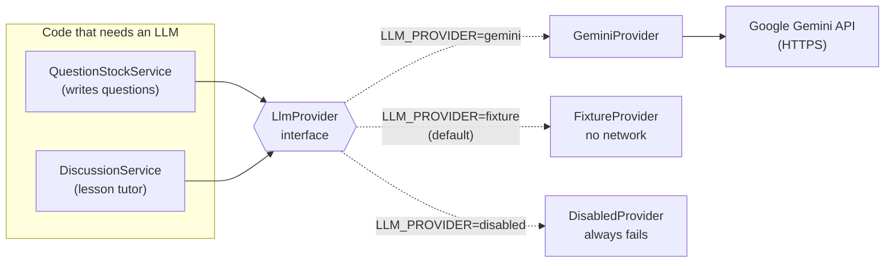
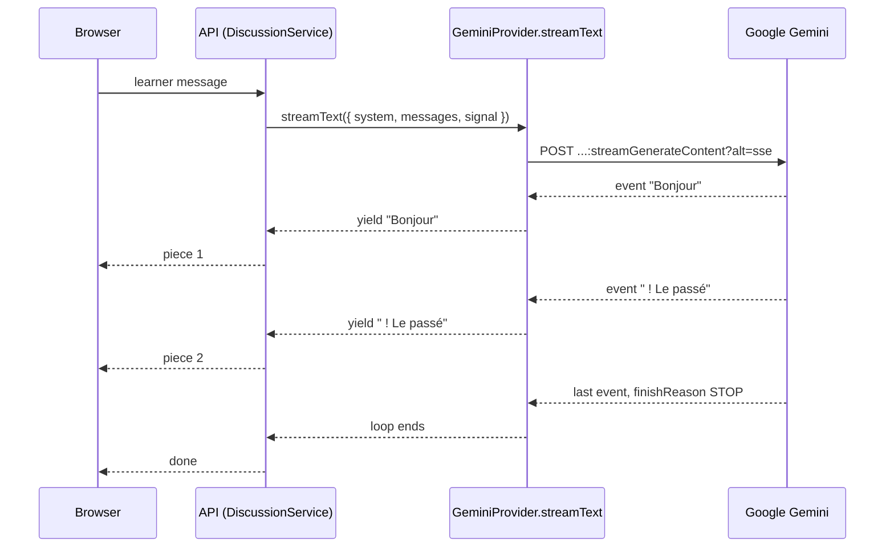
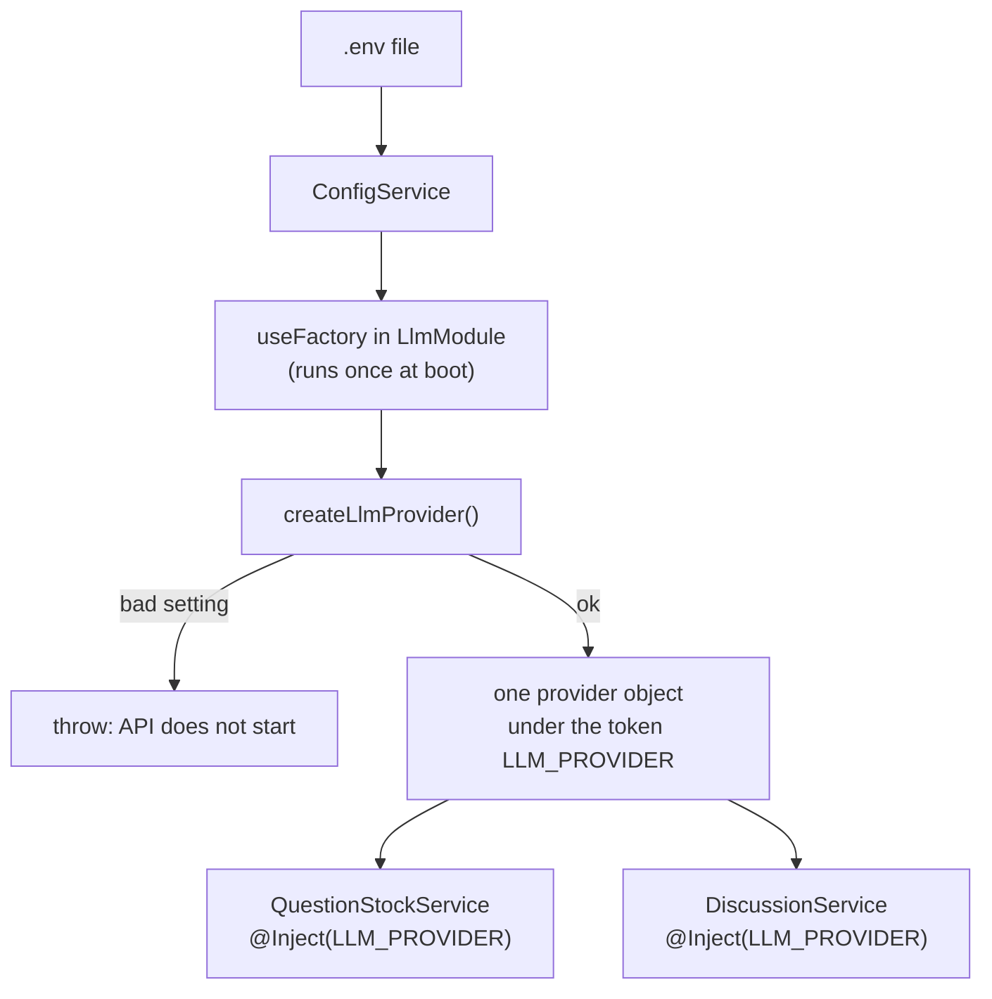
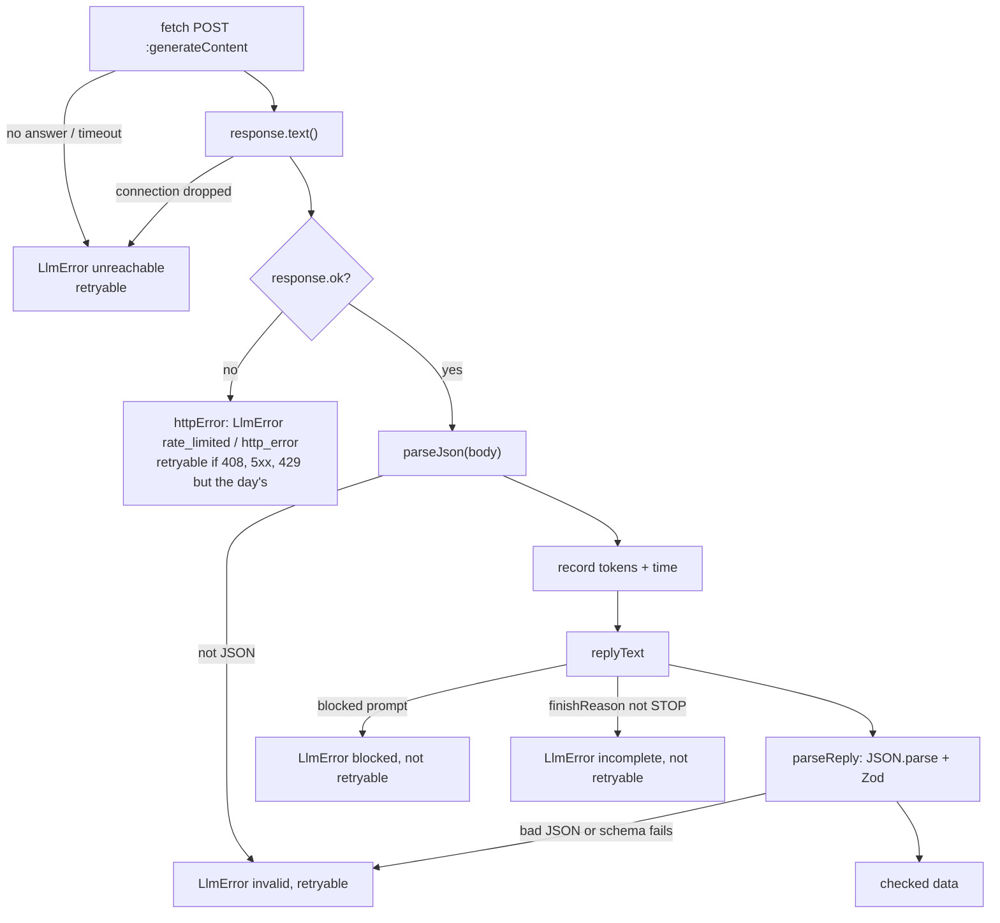

# Chapter 6 — Talking to an AI model

In this chapter:

- What an LLM is, and what the API uses it for
- The "provider" pattern: one interface, several classes behind it (like power plug adapters)
- What streaming is, and why the tutor answer is streamed
- [llm.provider.ts](../../apps/api/src/llm/llm.provider.ts): the contract and the error type
- [llm.factory.ts](../../apps/api/src/llm/llm.factory.ts) and [llm.module.ts](../../apps/api/src/llm/llm.module.ts): how one provider is picked from the `.env` file
- [gemini.provider.ts](../../apps/api/src/llm/gemini.provider.ts): the real one (HTTP requests, streaming, errors, timeouts, metrics, the key check)
- [fixture.provider.ts](../../apps/api/src/llm/fixture.provider.ts) and [disabled.provider.ts](../../apps/api/src/llm/disabled.provider.ts): the fake ones, for tests and for a stack with no key
- Who uses the LLM in the rest of the API, including [src/tutor](../../apps/api/src/tutor/tutor.controller.ts): the routes that test the key

---

## The big picture

### What is an LLM?

An **LLM** (Large Language Model) is a program trained on a huge amount of text. You send it text (a **prompt**),
and it writes text back. Gemini (by Google), GPT and Claude are LLMs. We do not run the model ourselves: it runs
on Google's servers, and we call it over HTTP, like any other web API.

The model reads and writes **tokens**. A token is a piece of a word (about 3 to 4 letters in English). Google
bills by the number of tokens: the tokens we send (the prompt) plus the tokens the model writes (the output).

A prompt has two parts in this project:

| Part     | What it is                                              | Example                                     |
| -------- | ------------------------------------------------------- | ------------------------------------------- |
| `system` | The rules and the role of the model. Same for many calls. | "You are an expert CEFR language exam designer." |
| `user`   | The precise request (or the conversation, for the tutor). | "Write 13 B1 grammar questions in "fr", one per topic." |

The API uses the LLM for **two jobs**:

1. **Writing placement questions** (chapter 7). The answer must be JSON with an exact shape, so the code can save
   it in the database. This is `generateStructured`.
2. **The lesson tutor** (chapter 8). The learner asks a question about the lesson, and the model answers in free
   text, shown word by word. This is `streamText`.

### The provider pattern: a power plug adapter

Think of a travel plug adapter. Your laptop charger has one plug. In France, Switzerland or the UK the wall socket
is different, so you put an adapter between them. The charger never changes: only the adapter does.

Here:

- The **charger** is the rest of the API (the question stock, the tutor). It only knows one "plug shape":
  the `LlmProvider` interface.
- The **adapters** are the classes that follow that interface: `GeminiProvider`, `FixtureProvider`,
  `DisabledProvider`.
- The **wall** is what is really behind: Google's servers, or nothing at all.



Why build it like this?

- **Changing vendor is a config change plus one file.** The `.env.example` file says it: "App code calls the
  LlmProvider interface, so swapping vendors is a config change plus one file."
- **Tests and local development need no key and no money.** With the fixture, nothing goes on the network.
- **One place for Google details.** HTTP, Google's JSON format and its error codes all live in one file. The rest of
  the code never sees them.

### Streaming: words as they come

A normal HTTP call waits for the whole answer, then gets it at once. For a tutor answer, that can take many
seconds, and the page would look frozen.

**Streaming** means the server sends the answer in small pieces, as the model writes them, on one connection that
stays open. Google uses **Server-Sent Events (SSE)** for this: a text format where each event is a few lines that
start with `data:`, and an empty line ends the event.

```text
data: {"candidates":[{"content":{"parts":[{"text":"Bonjour"}]}}]}

data: {"candidates":[{"content":{"parts":[{"text":" ! Le passé"}]}}]}

data: {"candidates":[{"content":{"parts":[{"text":" composé..."}]}, "finishReason":"STOP"}]}

```

In TypeScript, a stream of pieces is an **`AsyncIterable<string>`**: something you read with
`for await (const piece of stream) { ... }`. Each turn of the loop waits for the next piece. Functions written
with `async *` (an **async generator**) make such a stream: each `yield` hands one piece to the loop.



---

## The files of `src/llm`

```text
apps/api/src/llm/
├── llm.provider.ts             the contract (interface), request types, LlmError
├── llm.factory.ts              picks one provider from the .env settings
├── llm.module.ts               the Nest module that offers the provider to others
├── gemini.provider.ts          the real provider: Google Gemini over HTTP
├── fixture.provider.ts         fake provider: no network (default)
├── disabled.provider.ts        fake provider: everything fails
├── GEMINI_PROVIDER.md          long French explanation of gemini.provider.ts
└── *.spec.ts                   unit tests (one per file but llm.provider.ts, three for Gemini)
```

We read them in the order the app uses them: first the contract, then how the app picks a provider at boot,
then each provider.

---

## `llm.provider.ts` — the contract

[llm.provider.ts](../../apps/api/src/llm/llm.provider.ts) holds no logic. It describes the "plug shape" that
every provider must have. It exports:

| Export              | Kind           | Role                                                                                      |
| ------------------- | -------------- | ----------------------------------------------------------------------------------------- |
| `LLM_PROVIDER`      | `Symbol` value | The name (token) other classes use to ask Nest for the provider                           |
| `LlmPurpose`        | type           | What a call is for, used in logs and metrics                                              |
| `StructuredRequest` | interface      | What we send to get JSON back                                                             |
| `LlmMessage`        | interface      | One turn of a conversation                                                                |
| `StreamRequest`     | interface      | What we send to get a streamed text answer                                                |
| `LlmCheck`          | type           | What a key check finds: a status, a time, Google's HTTP status, when the quota comes back |
| `LlmProvider`       | interface      | The contract: three methods and an `info` field                                           |
| `LlmFailure`        | type           | The fixed list of failure reasons                                                         |
| `QuotaRefusal`      | interface      | Which quota a 429 hit (the day's or the minute's), and the wait                           |
| `LlmError`          | class          | The error every provider throws                                                           |

### The injection token

```ts
// The name other classes use to ask Nest for the LLM provider.
// It is a Symbol, a unique value that still exists at runtime,
// because the LlmProvider interface is erased when the code is compiled.
export const LLM_PROVIDER = Symbol('LLM_PROVIDER');
```

In chapter 1 we saw that Nest finds what to inject by the **class** of a constructor parameter. An interface cannot
do that: TypeScript removes interfaces when it compiles to JavaScript, so at runtime `LlmProvider` does not exist.
So we give Nest a real value as a name. A `Symbol` is a value that is unique: no other code can make the same one
by mistake. A class asks for the provider with `@Inject(LLM_PROVIDER)`.

### The purpose

```ts
export type LlmPurpose = `question-batch:${QuestionCategory}` | 'lesson-discussion';
```

This is a **template literal type**. `QuestionCategory` is `'grammar' | 'vocabulary' | 'reading'`, so the allowed
values are exactly `question-batch:grammar`, `question-batch:vocabulary`, `question-batch:reading` and
`lesson-discussion`. A typo does not compile. The purpose shows in the logs and labels the metrics, so you can see
what each call cost.

### The two requests

```ts
export interface StructuredRequest<S extends z.ZodType> {
  purpose: LlmPurpose;
  /** The rules and the role of the model, for example "You are an exam designer". */
  system: string;
  /** The precise request, for example "Write 13 A1 grammar questions". */
  user: string;
  /** Describes the JSON we expect back, and checks the reply against it. */
  schema: S;
}
```

`S` is a **generic**: a type filled in at each call. `S extends z.ZodType` means "S must be a Zod schema". The
schema does two jobs: it tells the model what JSON shape to write, and it checks the reply.

```ts
export interface StreamRequest {
  purpose: LlmPurpose;
  system: string;
  /** The conversation so far, oldest first. The last one is the learner's new message. */
  messages: LlmMessage[];
  /** The longest answer we pay for, in tokens. The model stops there, mid-sentence if it must. */
  maxOutputTokens: number;
  /**
   * Cancels the call. The route aborts it when the learner closes the page, so the
   * provider stops reading the answer and Google stops writing it.
   * It is required: a stream nobody can stop keeps spending tokens for no one.
   */
  signal: AbortSignal;
}
```

`LlmMessage` is `{ role: 'user' | 'assistant'; text: string }`. The names are ours; each provider translates
them (Gemini calls the model "model").

`signal` is an **`AbortSignal`**: a small object that can say "stop now". The route fires it when the learner
closes the page. The comment explains why it is required, not optional: "a stream nobody can stop keeps spending
tokens for no one".

### The contract

```ts
export interface LlmProvider {
  generateStructured<S extends z.ZodType>(request: StructuredRequest<S>): Promise<z.output<S>>;

  streamText(request: StreamRequest): AsyncIterable<string>;

  readonly info: TutorInfo;

  check(): Promise<LlmCheck>;
}
```

- `generateStructured` returns `Promise<z.output<S>>`: "later, an object with the shape of the schema, already
  checked". TypeScript reads the type from the schema you pass, so nobody writes the result type by hand.
- `streamText` returns an `AsyncIterable<string>`: pieces of text, read with `for await`. A failure is thrown
  **from the loop**, maybe after some pieces were already sent. If the caller aborts the signal, the loop ends
  with an `AbortError`, not an `LlmError`: "the caller asked for it, the LLM did not fail".
- `info` is `{ provider, model }`, for example `{ provider: 'gemini', model: 'gemini-3.6-flash' }`. The model is
  `null` for the fixture and for `disabled`. It never holds the key, nor any part of it.
- `check` tests the key and the model with the **smallest real request**: for Gemini, a one-word answer. It
  spends one request of the key's quota, so a key over its quota reads as such. It never throws: every ending is a
  status (`ok`, `invalid_key`, `quota`, `quota_day`...), as a health probe's is.
  `LlmCheck` is `Pick<TutorCheck, 'status' | 'latencyMs' | 'httpStatus' | 'retryAt'>`: the fields of the shared
  `TutorCheck` schema ([tutor.ts](../../packages/shared/src/schemas/tutor.ts)) that the provider knows.
  [TutorService](#tutorservice-and-the-two-tutor-routes) adds the rest.

### `LlmFailure` and `LlmError`

```ts
export type LlmFailure =
  'unreachable' | 'rate_limited' | 'http_error' | 'blocked' | 'incomplete' | 'invalid' | 'disabled';

export class LlmError extends Error {
  constructor(
    message: string,
    /** Whether sending the same request again may succeed. */
    readonly retryable: boolean,
    /** Why it failed, for the metrics. The message says it to a person. */
    readonly reason: LlmFailure,
    /**
     * rate_limited only: which quota refused it. The reason stays rate_limited for
     * both quotas, so the metrics count them as one; the error code tells them apart.
     */
    readonly quota?: QuotaRefusal,
  ) {
    super(message);
    this.name = 'LlmError';
  }
}
```

Every provider failure is an `LlmError` with three things, and a fourth on a 429:

| Field       | For whom                     | Example                                |
| ----------- | ---------------------------- | -------------------------------------- |
| `message`   | a person reading logs        | `Gemini 429: {"error": ...}`           |
| `retryable` | the caller                   | `true`: a second try may work          |
| `reason`    | the metrics, the error codes | `rate_limited`                         |
| `quota`     | the error codes              | `{ scope: 'day', retryAfterS: 48933 }` |

`quota` is a `QuotaRefusal`: `scope` is `'day'` for the quota of the day, which comes back tomorrow, or
`'minute'`; `retryAfterS` is the wait Google gave, in seconds, or `null`. Only a `rate_limited` error has one.

`reason` is a fixed list, never free text, because the metrics count failures by it: free text would make a new
metric series for each message. The meaning of each reason:

| Reason         | Meaning                                                                              |
| -------------- | ------------------------------------------------------------------------------------ |
| `unreachable`  | No HTTP answer at all (network, DNS, timeout), or the connection dropped midway      |
| `rate_limited` | HTTP 429: our key is over its quota of the minute or of the day (`quota` says which) |
| `http_error`   | Any other status outside 2xx                                                         |
| `blocked`      | Google's safety filters refused the prompt or stopped the reply                      |
| `incomplete`   | The reply was cut short for another reason                                           |
| `invalid`      | The reply is not JSON, or fails the schema                                           |
| `disabled`     | No real LLM behind the provider (fixture questions, `LLM_PROVIDER=disabled`)         |

`LlmError` is a **class**, not an interface, so it exists at runtime and callers can test
`error instanceof LlmError`.

---

## `llm.factory.ts` — picking one provider

[llm.factory.ts](../../apps/api/src/llm/llm.factory.ts) exports one function, `createLlmProvider`. It reads three
settings and builds the right provider.

| Setting        | Values                                 | Default              |
| -------------- | -------------------------------------- | -------------------- |
| `LLM_PROVIDER` | `fixture`, `gemini`, `disabled`        | `fixture`            |
| `LLM_API_KEY`  | the Gemini key (required for `gemini`) | none                 |
| `LLM_MODEL`    | a Gemini model id                      | `gemini-3.6-flash`   |

```ts
export function createLlmProvider({
  LLM_PROVIDER = 'fixture',
  LLM_API_KEY,
  LLM_MODEL,
}: LlmEnv): LlmProvider {
  switch (LLM_PROVIDER) {
    case 'fixture':
      showProvider('fixture', 'none');
      return new FixtureProvider();
    case 'gemini': {
      if (!LLM_API_KEY) throw new Error('LLM_PROVIDER=gemini needs LLM_API_KEY. See .env.example.');
      // The braces after "case" give this "model" its own scope inside the switch.
      const model = LLM_MODEL || DEFAULT_GEMINI_MODEL;
      showProvider('gemini', model);
      return new GeminiProvider({ apiKey: LLM_API_KEY, model });
    }
    case 'disabled':
      showProvider('disabled', 'none');
      return new DisabledProvider();
    default:
      throw new Error(
        `LLM_PROVIDER must be "fixture", "gemini" or "disabled", got "${LLM_PROVIDER}". See .env.example.`,
      );
  }
}
```

How it works:

- The `{ ... }` in the parameter list **destructures** the settings object: each key becomes a variable.
  `LLM_PROVIDER = 'fixture'` is a default value, so with no `.env` the API starts with the fixture: no network,
  no cost.
- The return type is `LlmProvider`. The caller does not know which class it got. That is the point.
- **It throws on a bad setting.** The function runs once, when the API starts. A missing key or a typo in
  `LLM_PROVIDER` stops the start with a clear message. Without this, the problem would only appear later, on the
  first restock, while learners use the app.

`showProvider` sets a metric, `ft_llm_provider_info{provider, model} = 1`, so the dashboard shows which provider
runs. It calls `reset()` first, so a second call (in a test) leaves one provider, not two.

[llm.factory.spec.ts](../../apps/api/src/llm/llm.factory.spec.ts) checks each case: the fixture by default, the
disabled provider, Gemini with its key and model, and the errors.

---

## `llm.module.ts` — offering the provider to the app

[llm.module.ts](../../apps/api/src/llm/llm.module.ts) is a small Nest module. It uses a **factory provider**: instead
of giving Nest a class to build, we give it a function to call.

```ts
@Module({
  providers: [
    {
      provide: LLM_PROVIDER,
      inject: [ConfigService],
      useFactory: (config: ConfigService) =>
        createLlmProvider({
          LLM_PROVIDER: config.get('LLM_PROVIDER'),
          LLM_API_KEY: config.get('LLM_API_KEY'),
          LLM_MODEL: config.get('LLM_MODEL'),
        }),
    },
  ],
  exports: [LLM_PROVIDER],
})
export class LlmModule {}
```

- `provide: LLM_PROVIDER`: the token other classes ask for.
- `inject: [ConfigService]`: what Nest passes to the factory. `ConfigService` reads the `.env` file (chapter 2).
- `useFactory`: Nest calls it **once at startup**. What it returns is the single provider object the whole API
  shares.
- `exports: [LLM_PROVIDER]`: modules that import `LlmModule` can inject it too.

This is why `GeminiProvider` has no `@Injectable()`: Nest never builds it from its class. The factory calls
`new GeminiProvider({ apiKey, model })` itself, after checking the key.



[llm.module.spec.ts](../../apps/api/src/llm/llm.module.spec.ts) builds the real module with a fake `ConfigService`:
it checks that the provider named in `LLM_PROVIDER` is built, that the fixture is the default, and that Gemini
without a key fails.

---

## `gemini.provider.ts` — the real provider

[gemini.provider.ts](../../apps/api/src/llm/gemini.provider.ts) is the biggest file. It calls Google's Gemini API
over HTTP. The French document [GEMINI_PROVIDER.md](../../apps/api/src/llm/GEMINI_PROVIDER.md) next to it explains
it line by line, with a history of the changes since PR #69. Here is the tour.

The file has three parts:

1. **At the top**: constants and the `GeminiReply` interface (the part of Google's JSON we read).
2. **The class**: three public methods (`generateStructured`, `streamText`, `check`), the `info` field, and three
   private methods (`send`, `stream`, `record`).
3. **At the bottom**: small helper functions (`requestBody`, `streamBody`, `unreachable`, `isRetryable`,
   `httpError`, `quotaRefusal`, `checkVerdict`, `checkStatus`, `isGeminiReply`, `replyText`, `answerText`,
   `parseReply`, `parseJson`, `sseData`, `eventData`). Only `quotaRefusal` is exported, so its spec can feed it
   Google's bodies.

### The constants

```ts
const API = 'https://generativelanguage.googleapis.com/v1beta/models';
// How long we wait for Gemini before giving up: 90 seconds. "90_000" is just 90000,
// the "_" only makes the number easier to read. A free key waited 73 to 83 s for
// its first word on 2026-11-18, where 2 to 40 s was usual before.
const TIMEOUT_MS = 90_000;
// How long a key check waits. It asks for one word, which usually comes in a second or
// two, but a busy free key can take far longer (see TIMEOUT_MS). 30 s covers a slow day,
// and the button never spins for the 90 s of a tutor's answer.
const CHECK_TIMEOUT_MS = 30_000;
// What a key check sends: the smallest real generation, so Google applies the same key,
// model and quotas as for a tutor's answer. 16 tokens leave room for "OK". The thinking
// setting is the tutor's (streamBody): a model that refuses to turn its thinking off
// fails every tutor answer, so the check must fail on it too.
const CHECK_BODY = {
  contents: [{ role: 'user', parts: [{ text: 'Reply with the word OK.' }] }],
  generationConfig: { maxOutputTokens: 16, thinkingConfig: { thinkingBudget: 0 } },
};
// The longest wait quotaRefusal accepts from a 429: two days, in seconds. Google's longest
// quota is the day's, so a longer retryDelay is a broken body, and it would push retryAt
// past the dates JavaScript can write.
const MAX_RETRY_AFTER_S = 2 * 24 * 60 * 60;
```

- `API` is the base address. Each call adds `/<model>:generateContent` (one answer, and the key check) or
  `/<model>:streamGenerateContent?alt=sse` (streamed answer).
- `TIMEOUT_MS`: we give up after 90 seconds. The comment gives the real reason for this big number: a free key
  was measured waiting more than 70 seconds.
- `CHECK_TIMEOUT_MS`: the key check gives up after 30 seconds. One word is quick, but a person waits on the button.
- `CHECK_BODY`: the one-word request of the key check. Its `thinkingConfig` is the tutor's (`thinkingBudget: 0`,
  see `streamBody`): a model that refuses to turn its thinking off fails every tutor answer, and the check must
  say so.
- `MAX_RETRY_AFTER_S`: the longest wait `quotaRefusal` takes from a 429, two days. A longer one is a broken body,
  and would give a `retryAt` past the last date JavaScript can write.
- `OUTCOMES`, `TOKEN_TYPES`, `PURPOSES`: the lists of metric labels (see "The constructor: metrics start at zero" and "`record`" below).
- `FILTERED`: the finish reasons that mean Google's filters stopped the answer (`SAFETY`, `PROHIBITED_CONTENT`,
  `BLOCKLIST`, `SPII`, `RECITATION`).

### `GeminiReply`: Google's answer, as far as we read it

```ts
interface GeminiReply {
  promptFeedback?: { blockReason?: string };
  candidates?: {
    finishReason?: string;
    content?: { parts?: { text?: string; thought?: boolean }[] };
  }[];
  usageMetadata?: {
    promptTokenCount?: number;
    candidatesTokenCount?: number;
    thoughtsTokenCount?: number;
    totalTokenCount?: number;
  };
}
```

Every field has a `?` because this JSON comes from outside and we do not trust it. TypeScript then forces the code
to check each field (`?.`, `??`) before using it.

| Field                        | Meaning                                                          |
| ---------------------------- | ---------------------------------------------------------------- |
| `promptFeedback.blockReason` | Set when Google refused our prompt (safety filters)              |
| `candidates[0]`              | The answer (we ask for one)                                      |
| `finishReason`               | Why the model stopped. `"STOP"` = finished normally              |
| `content.parts`              | The text, maybe cut in several parts. `thought: true` marks the model's reasoning, not the answer |
| `usageMetadata`              | Token counts: what we pay                                        |

Note: for `generateStructured`, the model's text is **itself a JSON string**. So there are two `JSON.parse`: one for
Google's envelope, one for the model's text.

### The constructor: metrics start at zero

```ts
constructor(private readonly options: { apiKey: string; model: string }) {
  this.info = { provider: 'gemini', model: options.model };
  // Every purpose, outcome and token type starts at 0. A counter that appears at 1
  // hides its first call from Prometheus' rate(), so the first failures would not
  // count, nor the first call's tokens.
  for (const purpose of PURPOSES) {
    for (const outcome of OUTCOMES) {
      llmRequests.inc({ provider: 'gemini', model: options.model, purpose, outcome }, 0);
    }
    for (const type of TOKEN_TYPES) {
      llmTokens.inc({ provider: 'gemini', model: options.model, purpose, type }, 0);
    }
  }
}
```

`private readonly options` in the parameter list declares a field and fills it in one step. The class never reads
the `.env` itself, so a test can build it with `new GeminiProvider({ apiKey: 'test', model: 'x' })`. `info` takes
the model from the options, and leaves the key out.

The loops create every metric series with the value 0. Prometheus (chapter 3) computes rates from the
**difference** between two readings; a counter that appears directly at 1 has no "before", so its first call would
be invisible.

### `generateStructured`: measure, then `send`

```ts
async generateStructured<S extends z.ZodType>(
  request: StructuredRequest<S>,
): Promise<z.output<S>> {
  const labels = { provider: 'gemini', model: this.options.model, purpose: request.purpose };
  // startTimer starts a clock; calling stop() records the time since then.
  const stop = llmRequestDuration.startTimer(labels);
  try {
    const reply = await this.send(request);
    llmRequests.inc({ ...labels, outcome: 'ok' });
    return reply;
  } catch (error) {
    // send() only throws LlmErrors, each with its reason.
    if (error instanceof LlmError) llmRequests.inc({ ...labels, outcome: error.reason });
    throw error;
  } finally {
    // "finally" runs either way, so failures are timed too.
    stop();
  }
}
```

The public method only **measures**: how long, and how it ended (`ok` or the error's `reason`). Then it throws the
same error again, so metrics never change the behaviour. The work is in `send`.

### `send`: one HTTP call, step by step

```ts
const response = await fetch(`${API}/${model}:generateContent`, {
  method: 'POST',
  headers: { 'content-type': 'application/json', 'x-goog-api-key': apiKey },
  body: JSON.stringify(requestBody(request)),
  signal: AbortSignal.timeout(TIMEOUT_MS),
}).catch(unreachable);
const body = await response.text().catch(unreachable);
if (!response.ok) throw httpError(response.status, body);

const reply = parseJson(body, 'response') as GeminiReply;
// Counted before the reply is checked: one that fails the check was still billed.
this.record(request.purpose, reply.usageMetadata, started);
return parseReply(request.schema, replyText(reply));
```

1. **`fetch`** sends the request. The key goes in a **header** (`x-goog-api-key`), not in the URL: URLs often end
   up in logs. `AbortSignal.timeout(TIMEOUT_MS)` cancels the call after 90 s.
2. `fetch` only rejects when there is **no HTTP answer at all** (no network, DNS error, timeout). A 500 or a 429 is
   still an answer. `.catch(unreachable)` turns a rejection into a retryable `LlmError`.
3. The body is read as **text**, not `response.json()`, so an error page can still be put in the message. The
   timeout also covers this step, so it has the same `.catch(unreachable)`.
4. A status outside 200–299 throws the error `httpError` builds (see "Errors: retry or not?" below).
5. Google's JSON is parsed, tokens are logged and counted (`record`), then the model's text is extracted
   (`replyText`) and checked against the schema (`parseReply`).



### `requestBody`: what Google receives

```ts
function requestBody({ system, user, schema }: StructuredRequest<z.ZodType>) {
  return {
    systemInstruction: { parts: [{ text: system }] },
    contents: [{ role: 'user', parts: [{ text: user }] }],
    generationConfig: {
      responseMimeType: 'application/json',
      responseJsonSchema: z.toJSONSchema(schema),
    },
  };
}
```

`z.toJSONSchema(schema)` turns our Zod schema into a **JSON Schema**, a standard format that describes a JSON
shape. Gemini then writes JSON with exactly those fields, types and array lengths. So the prompt does not need to
describe the format in words.

One limit, from the comment: rules written with Zod's `.refine()` (like "the answer is one of the options")
cannot be turned into JSON Schema. Gemini never sees them. They are checked only later, in `parseReply`.

### Errors: retry or not?

```ts
function isRetryable(status: number): boolean {
  return status === 408 || status === 429 || status >= 500;
}
```

408 (timeout), 429 (too many requests) and 5xx (Google's server failed) are temporary. A 400, 401, 403 or 404 fails
the same way twice.

Both calls build their error for a status outside 2xx the same way:

```ts
function httpError(status: number, body: string): LlmError {
  const message = `Gemini ${status}: ${body}`;
  if (status !== 429) return new LlmError(message, isRetryable(status), 'http_error');
  const quota = quotaRefusal(body);
  return new LlmError(message, quota.scope !== 'day', 'rate_limited', quota);
}
```

A 429 is always `rate_limited`, whichever quota said no: the outcome series of `ft_llm_requests_total` and the
`LlmErrorRateHigh` alert count both quotas as one. It also carries `quota`, read from Google's body by
`quotaRefusal`, so the tutor route can tell the learner "tomorrow" instead of "in a minute"
([08-lessons.md](08-lessons.md)). The quota of the day is the one 429 that is not retryable: a second try a moment
later meets the same refusal, for hours.

### `quotaRefusal`: which quota said no

Google's 429 says which quota the call went over, and how long to wait. The body a free key got on 2026-11-27,
once its 20 requests of the day on `gemini-3.6-flash` were spent, shortened:

```text
{"error": {"code": 429, "status": "RESOURCE_EXHAUSTED", "details": [
  {"@type": "type.googleapis.com/google.rpc.QuotaFailure",
   "violations": [{"quotaId": "GenerateRequestsPerDayPerProjectPerModel-FreeTier", "quotaValue": "20", ...}]},
  {"@type": "type.googleapis.com/google.rpc.Help", ...},
  {"@type": "type.googleapis.com/google.rpc.RetryInfo", "retryDelay": "48933s"}]}}
```

`quotaRefusal(body)` reads two of the `details`, each found by its `@type`:

| Google's body                                                    | `quotaRefusal` gives                                         |
| ---------------------------------------------------------------- | ------------------------------------------------------------ |
| a `QuotaFailure` whose `quotaId` holds `PerDay` (the body above) | `{ scope: 'day', retryAfterS: 48933 }`                       |
| a `quotaId` with `PerMinute`, and `retryDelay` `"21s"`           | `{ scope: 'minute', retryAfterS: 21 }`                       |
| a `retryDelay` in fractions, `"21.5s"`                           | rounded up: `retryAfterS: 22`                                |
| no `RetryInfo`                                                   | `retryAfterS: null`                                          |
| not JSON                                                         | `{ scope: 'minute', retryAfterS: null }`                     |
| JSON with no `QuotaFailure` (no quota named)                     | `scope: 'minute'`, `retryAfterS` still read from `RetryInfo` |
| a `retryDelay` over two days (`MAX_RETRY_AFTER_S`)               | `retryAfterS: null`                                          |

48933 s is about 13.6 hours: Google's quota of the day resets at midnight, Pacific time. When the body names no
quota, the minute is the milder guess, and what the learner was told before. It never throws: every field is read
as `unknown` and checked before use (`Array.isArray` for a list, `typeof` for a text, so a field that is not a
text matches nothing), because it runs while an error is being built, and a `TypeError` there would hide Google's
refusal. `String(...)` would not do: it throws on an object such as `{"toString": 1}`, and JSON can hold one.

`replyText` checks the reply before using it:

```ts
function replyText(reply: GeminiReply): string {
  // Gemini refused to answer our prompt at all (safety filters).
  const blocked = reply.promptFeedback?.blockReason;
  if (blocked) throw new LlmError(`Gemini blocked the prompt: ${blocked}`, false, 'blocked');

  const candidate = reply.candidates?.[0];
  if (candidate?.finishReason !== 'STOP') {
    const reason = candidate ? (candidate.finishReason ?? 'no finish reason') : 'no candidate';
    throw new LlmError(`Gemini stopped early: ${reason}`, false, 'incomplete');
  }
  return answerText(candidate);
}
```

A blocked prompt or a cut reply (`MAX_TOKENS`, `SAFETY`) comes back the same on a retry: not retryable.

`answerText` glues the text parts together and **drops the reasoning parts** (`thought: true`). Those are the
model's "thinking", not the answer, and they would break `JSON.parse`.

`parseReply` does `JSON.parse` then `schema.safeParse`. `safeParse` does not throw: it returns
`{ success: true, data }` or `{ success: false, error }`. A failure becomes a **retryable** `invalid` error: the
model writes something different each time, so the next try may be fine. `z.prettifyError` makes the Zod error
readable in the logs.

`parseJson` is `JSON.parse` that throws an `LlmError` instead of a `SyntaxError`. It is retryable too: a 200 whose
body is not JSON is usually an error page from a proxy on the way.

Summary of all errors:

| Situation                                             | Reason         | Retryable |
| ----------------------------------------------------- | -------------- | --------- |
| No network, DNS, timeout, dropped connection          | `unreachable`  | yes       |
| HTTP 429, the quota of the minute (or no quota named) | `rate_limited` | yes       |
| HTTP 429, the quota of the day                        | `rate_limited` | no        |
| HTTP 408 or 5xx                                       | `http_error`   | yes       |
| Other non-2xx (400, 401, 403, 404...)                 | `http_error`   | no        |
| Body or model text is not JSON                        | `invalid`      | yes       |
| JSON fails the schema                                 | `invalid`      | yes       |
| Prompt blocked                                        | `blocked`      | no        |
| No candidate, or stopped before `STOP`                | `incomplete`   | no        |
| Streamed: stopped by a filter                         | `blocked`      | no        |
| Streamed: other early stop, no `STOP`, empty answer   | `incomplete`   | no        |

The provider decides `retryable` because it knows Google best. The caller only reads the flag (see
`QuestionStockService` in chapter 7).

### `record`: logs and token counts

```ts
this.logger.log(
  `${purpose} on ${model}: ${usage?.promptTokenCount ?? '?'} in, ` +
    `${usage?.candidatesTokenCount ?? '?'} out, ${thinking} thinking, ` +
    `${usage?.totalTokenCount ?? '?'} total tokens, ` +
    `${Date.now() - started} ms`,
);
```

One log line per call, for example:

```text
[GeminiProvider] question-batch:grammar on gemini-3.6-flash: 5200 in, 1800 out, 0 thinking, 7000 total tokens, 8432 ms
```

Then it adds the token numbers to the `llmTokens` metric. A number Google left out is skipped, not counted as 0.
`record` is shared by `send` and `stream`, so both log and count the same way.

### `streamText` and `stream`: the tutor's answer

`streamText` has the same "measure, then do the work" shape as `generateStructured`, but as an async generator:

```ts
async *streamText(request: StreamRequest): AsyncIterable<string> {
  const labels = { provider: 'gemini', model: this.options.model, purpose: request.purpose };
  const stop = llmRequestDuration.startTimer(labels);
  try {
    yield* this.stream(request);
    llmRequests.inc({ ...labels, outcome: 'ok' });
  } catch (error) {
    if (error instanceof LlmError) llmRequests.inc({ ...labels, outcome: error.reason });
    throw error;
  } finally {
    stop();
  }
}
```

`yield*` passes on every piece that `stream()` yields. The call counts as `ok` only once the whole answer went
through. Two endings count no outcome, only the time: the learner leaving (an `AbortError`), and a caller that
stops reading early.

The body of `stream`:

```ts
// Two reasons to cancel, whichever comes first: the learner left (request.signal),
// or the whole answer took longer than TIMEOUT_MS.
const signal = AbortSignal.any([request.signal, AbortSignal.timeout(TIMEOUT_MS)]);
// What a failed read becomes. If the learner left, the error stays as it is: it is
// not Gemini's failure. Anything else (network, timeout, a cut connection) is unreachable.
const lost = (error: Error): never => {
  if (request.signal.aborted) throw error;
  return unreachable(error);
};
```

- `AbortSignal.any` makes one signal from two: the learner's signal and the 90 s timeout. Note the timeout covers
  the **whole** answer, not only the first byte.
- `lost` decides what a failed read becomes: the learner's own abort passes unchanged, anything else is
  `unreachable`.

Then it posts to `:streamGenerateContent?alt=sse` with `streamBody(request)`, and reads events:

```ts
for await (const data of sseData(response.body, lost)) {
  const reply = parseJson(data, 'response') as GeminiReply;
  usage = reply.usageMetadata ?? usage;
  const blocked = reply.promptFeedback?.blockReason;
  if (blocked) throw new LlmError(`Gemini blocked the prompt: ${blocked}`, false, 'blocked');

  const candidate = reply.candidates?.[0];
  const text = answerText(candidate);
  if (text) {
    wrote = true;
    yield text;
  }
  const reason = candidate?.finishReason;
  if (reason && reason !== 'STOP') {
    const failure = FILTERED.has(reason) ? 'blocked' : 'incomplete';
    throw new LlmError(`Gemini stopped early: ${reason}`, false, failure);
  }
  if (reason === 'STOP') finished = true;
}
```

Each event is a small `GeminiReply`. Its text is handed on **at once** (`yield`). Only the last event has a
`finishReason`. After the loop: no `STOP` means Google closed early (`incomplete`), and no text at all means an
empty answer (`incomplete`). A `finally` calls `record` in every case, even when the learner leaves, because the
tokens used so far were billed.

`streamBody` differs from `requestBody`:

```ts
function streamBody({ system, messages, maxOutputTokens }: StreamRequest) {
  return {
    systemInstruction: { parts: [{ text: system }] },
    contents: messages.map(({ role, text }) => ({
      role: role === 'assistant' ? 'model' : 'user',
      parts: [{ text }],
    })),
    generationConfig: { maxOutputTokens, thinkingConfig: { thinkingBudget: 0 } },
  };
}
```

- The whole conversation is sent, with `assistant` renamed `model` (Google's word).
- `maxOutputTokens` caps the cost.
- `thinkingBudget: 0` turns off the model's "thinking". The comment explains why: thinking counts against
  `maxOutputTokens` (250 to 660 tokens were measured before answers of 66 to 120), it could cut the answer, and it
  is billed too. A short tutor answer does not need it.
- No JSON schema: the answer is free text. A real model often writes it in Markdown; the browser renders it (`tutor-answer.tsx`, #214, see [web chapter 7](../web/07-lesson-player.md)). The API passes the text on as it is.

### `sseData` and `eventData`: reading the event stream

The body arrives in network **packets**, and a packet is not an event: one packet can hold an event and a half.
So `sseData` keeps a `buffer` and only lets complete events out:

```ts
const reader = body.pipeThrough(new TextDecoderStream()).getReader();
let buffer = '';
try {
  for (;;) {
    const { done, value } = await reader.read().catch(lost);
    if (done) return;
    buffer = (buffer + value).replace(/\r\n/g, '\n');
    let end = buffer.indexOf('\n\n');
    while (end !== -1) {
      const data = eventData(buffer.slice(0, end));
      buffer = buffer.slice(end + 2);
      if (data !== undefined) yield data;
      end = buffer.indexOf('\n\n');
    }
  }
} finally {
  // cancel() rejects on a body that already failed; there is nothing left to close then.
  await reader.cancel().catch(() => undefined);
}
```

- `TextDecoderStream` turns bytes into text, and keeps a character cut between two packets (`é` is two bytes in
  UTF-8) until its second byte comes.
- `\r\n` becomes `\n`, because SSE allows both line endings.
- An event ends with an empty line (`\n\n`). Text after the last one waits for the next packet; if the body ends,
  it is dropped (the SSE standard says an unfinished event does not count).
- `finally` cancels the body when the reader stops early, so the connection to Google closes.

`eventData` takes the `data:` lines of one event, removes `data:` and one optional space, and joins them with
`\n`. An event with no data (a comment line `: ...` that keeps the connection alive) gives `undefined` and is
skipped.

### `check`: one real request, as a learner's

Every learner shares one key. When it is wrong, revoked or over its quota, a lesson only shows the tutor failing.
`check` tells these apart, for the **Test connection** button of the profile page.

```ts
async check(): Promise<LlmCheck> {
  const { apiKey, model } = this.options;
  const started = Date.now();
  try {
    const response = await fetch(`${API}/${model}:generateContent`, {
      method: 'POST',
      headers: { 'content-type': 'application/json', 'x-goog-api-key': apiKey },
      body: JSON.stringify(CHECK_BODY),
      signal: AbortSignal.timeout(CHECK_TIMEOUT_MS),
    });
    const body = await response.text();
    const verdict = checkVerdict(response.status, body, Date.now());
    // 500 characters: enough for Google's reason, short enough for one log line.
    if (verdict.status !== 'ok') {
      this.logger.warn(`key check on ${model}: Gemini ${response.status}: ${body.slice(0, 500)}`);
    }
    return { ...verdict, latencyMs: Date.now() - started, httpStatus: response.status };
  } catch (error) {
    // No HTTP answer (network, DNS, the timeout), or the body was cut while read.
    const reason = error instanceof Error ? error.message : String(error);
    this.logger.warn(`key check on ${model}: unreachable: ${reason}`);
    return {
      status: 'unreachable',
      latencyMs: Date.now() - started,
      httpStatus: null,
      retryAt: null,
    };
  }
}
```

- It `POST`s `CHECK_BODY` to `:generateContent`, the route `generateStructured` uses: "Reply with the word OK.",
  at most 16 tokens, with the tutor's thinking setting. A real request is the only way to meet the key, the model
  and the quotas as a learner's question does: Google applies its quotas to generations only, so a key over
  today's quota still reads its model's description without trouble. The price is **one request of the key's
  quota per check**, and a few tokens. The key goes in the same header as for a tutor's answer, never in the URL.
- It never throws. `try`/`catch` turns every failure into the status `unreachable`, so the route always has a
  verdict to show.
- Google's body goes to the log, never into the answer. A `403` body can name the Google Cloud project.
- It counts nothing in `ft_llm_requests_total` nor `ft_llm_tokens_total`: checks would dilute the error rate that
  `LlmErrorRateHigh` alerts on, and their few tokens are no learner's. `TutorService` counts checks in their own
  counter, `ft_llm_checks_total`.

`checkVerdict` reads the status, and the body when it must:

| Google answers                                                                 | Status            |
| ------------------------------------------------------------------------------ | ----------------- |
| `200` with Gemini's reply (`isGeminiReply`), with or without text              | `ok`              |
| `200` that is not Gemini's reply, usually a proxy's page                       | `unexpected`      |
| `400` with `API_KEY_INVALID`, `401` or `403`                                   | `invalid_key`     |
| `404`                                                                          | `model_not_found` |
| `429` for the quota of the minute, or one that names no quota (`quotaRefusal`) | `quota`           |
| `429` for the quota of the day                                                 | `quota_day`       |
| `408` or `5xx`, no answer, the 30 s timeout                                    | `unreachable`     |
| anything else, for example a `400` about the region or a `402`                 | `unexpected`      |

A `200` must be Gemini's reply, a JSON object with `candidates` or `usageMetadata` (`isGeminiReply`), but it needs
no text: a model may stop at `MAX_TOKENS` before writing "OK", and Google still answered with this key and this
model. A `200` with any other body is usually a proxy's page on the way, not Google, so it is `unexpected`, and
the body goes to the log. A wrong key gets `400` with `API_KEY_INVALID` (checked by
hand on 2026-11-27), not `401`. A `400` for another reason is not the key's fault, so it is `unexpected`, and
`httpStatus` says which status came back.

On a `429`, `retryAt` is when Google said the quota comes back: the time of the answer plus the `retryDelay`
that `quotaRefusal` read, as an ISO date. It is `null` for every other status, and when Google gave no wait.
For the quota of the day it is also `null` when the wait is under an hour: that is the minute's wait of a `429`
that hit both quotas, not the day's reset, and the card then says midnight Pacific time.

Each check spends one of the key's requests (20 a day per model on a free key, on 2026-11-27): one more reason
for `TutorService` to share one check between every account for 15 s, and for the route to allow 3 a minute per
account.

### The Gemini tests

- [gemini.provider.spec.ts](../../apps/api/src/llm/gemini.provider.spec.ts) mocks `fetch` and checks
  `generateStructured`: the key is in a header and never in the URL, the JSON schema is sent, the 90 s timeout,
  joining parts without thoughts, logs, which errors are retryable, the quota a 429 names (`quotaRefusal`, with
  the body a free key got on 2026-11-27, and bodies with fields missing or of the wrong type, objects that make
  `String()` throw, or a wait too long for a date), and the metrics.
- [gemini.provider.stream.spec.ts](../../apps/api/src/llm/gemini.provider.stream.spec.ts) checks `streamText`:
  the SSE endpoint, events cut across packets (even inside a character), comments skipped, every early stop, the
  learner leaving (an `AbortError`, no outcome counted, body cancelled), a 429 for the quota of the day, and the
  metrics.
- [gemini.provider.check.spec.ts](../../apps/api/src/llm/gemini.provider.check.spec.ts) checks `check`: a `POST`
  of the one-word body, with the tutor's thinking setting, to `:generateContent`, with the key in a header and not
  in the URL, the 30 s timeout, the status of each answer in the table above (with the real `API_KEY_INVALID` body,
  `200`s that are not Gemini's reply, and both `429` bodies with their `retryAt`, or none when the wait is too
  long), no throw on a network failure, Google's body in the log but not in the answer, nothing counted in the
  metrics of real calls, and `info` without the key.
- The `429` bodies come from [gemini.fixtures.ts](../../apps/api/test/gemini.fixtures.ts): the one a free key got
  on 2026-11-27 for the quota of the day, and the same written for the quota of the minute.

---

## `fixture.provider.ts` — fake answers, for tests and development

[fixture.provider.ts](../../apps/api/src/llm/fixture.provider.ts) is the **default** provider. It never touches the
network. Why does it exist?

- **No key, no cost.** A new developer can run the whole app without a Google account.
- **Tests and CI.** The `.env.example` file says "CI only runs fixture". Tests must not depend on Google being up,
  or spend money.
- **Error paths on demand.** Special words make it fail on purpose, so the e2e tests (and the project defence) can
  show each error without a network.

### It writes no questions

```ts
async generateStructured(): Promise<never> {
  throw new LlmError('LLM_PROVIDER=fixture writes no questions', false, 'disabled');
}
```

This is a deliberate choice, explained in the class comment: "It writes no questions, because a canned one in the
bank is served to learners as real." So a restock with the fixture always fails, like an LLM outage, and placement
falls back to questions the learner saw longest ago (chapter 7).

- `Promise<never>`: the promise never gets a value, it is only rejected. `never` fits any type, so this still
  follows the contract. The method also takes no parameter: a method that uses fewer parameters still fits.
- `retryable: false`: asking again would fail the same way.
- `reason: 'disabled'`: the restock alert leaves these failures out; on a stack without a key they are expected.

### It does answer the tutor

```ts
export const FIXTURE_ANSWER = [
  'This is the fixture tutor. ',
  'It gives the same answer to every question. ',
  'Set LLM_PROVIDER=gemini for a real one.',
];

export const FIXTURE_FAILURES = {
  /** Sends part of the answer, then the connection drops. */
  midstream: '#fail-midstream',
  /** No answer comes in time. */
  timeout: '#timeout',
  /** The prompt is refused before any text. */
  blocked: '#blocked',
  /** The key is over its quota of the day, as Google's 429 says it. */
  quotaDay: '#quota-day',
} as const;
```

A fixed tutor answer is harmless: "it is never stored and says what it is".

```ts
async *streamText({ messages, signal }: StreamRequest): AsyncIterable<string> {
  // "?." because the list could be empty; "?? ''" then gives a text with no word in it.
  const last = messages.at(-1)?.text ?? '';
  if (last.includes(FIXTURE_FAILURES.blocked)) {
    throw new LlmError('Fixture blocked the prompt', false, 'blocked');
  }
  if (last.includes(FIXTURE_FAILURES.timeout)) {
    throw new LlmError('Fixture timed out', true, 'unreachable');
  }
  // What GeminiProvider throws on a 429 for today's quota: back in an hour, here.
  if (last.includes(FIXTURE_FAILURES.quotaDay)) {
    throw new LlmError('Fixture is over its quota of the day', false, 'rate_limited', {
      scope: 'day',
      retryAfterS: 3600,
    });
  }
  for (const [index, piece] of FIXTURE_ANSWER.entries()) {
    // Two pieces out, then the connection "drops": the caller has already sent part of the answer.
    if (index === 2 && last.includes(FIXTURE_FAILURES.midstream)) {
      throw new LlmError('Fixture dropped the connection midway', true, 'unreachable');
    }
    await sleep(this.delayMs, undefined, { signal });
    yield piece;
  }
}
```

- It reads **only the last message**, so an old failure word in the history does not fail the new answer.
- `sleep` (from `node:timers/promises`) waits `delayMs` (50 ms by default) before each piece, so the answer arrives
  over time like a real one, and a test has time to cancel it midway.
- `sleep` gets the `signal`: when the route cancels, the pause rejects with an `AbortError` at once, like a real
  call whose connection is closed.

| Learner's last message contains | What happens                                                           |
| ------------------------------- | ---------------------------------------------------------------------- |
| `#blocked`                      | fails before any text, reason `blocked`                                |
| `#timeout`                      | fails before any text, reason `unreachable`                            |
| `#fail-midstream`               | sends 2 pieces, then fails with `unreachable`                          |
| `#quota-day`                    | fails before any text, reason `rate_limited` with the quota of the day |
| anything else                   | sends the 3 pieces of `FIXTURE_ANSWER`                                 |

There is no key and no network behind the fixture, so there is nothing to check:

```ts
/** No real model behind it, so no model name. */
readonly info: TutorInfo = { provider: 'fixture', model: null };

/** No key and no network: nothing to check. */
async check(): Promise<LlmCheck> {
  return { status: 'fixture', latencyMs: null, httpStatus: null, retryAt: null };
}
```

[fixture.provider.spec.ts](../../apps/api/src/llm/fixture.provider.spec.ts) checks each row of this table, the
abort, that `generateStructured` always fails as not retryable, and that `check` answers `fixture` without calling
`fetch`.

---

## `disabled.provider.ts` — no LLM at all

[disabled.provider.ts](../../apps/api/src/llm/disabled.provider.ts) is for a stack that must run **no** LLM, not
even the fixture's canned tutor.

```ts
export class DisabledProvider implements LlmProvider {
  readonly info: TutorInfo = { provider: 'disabled', model: null };

  /** No key to check: the setting itself says there is no LLM. */
  async check(): Promise<LlmCheck> {
    return { status: 'disabled', latencyMs: null, httpStatus: null, retryAt: null };
  }

  async generateStructured(): Promise<never> {
    throw disabled();
  }

  // A generator that fails before its first piece: the caller's "for await" throws.
  // eslint-disable-next-line require-yield
  async *streamText(): AsyncIterable<string> {
    throw disabled();
  }
}

/** Not retryable: a second try meets the same setting. */
const disabled = () => new LlmError('LLM_PROVIDER=disabled', false, 'disabled');
```

Every call fails at once with reason `disabled`. The lesson discussion then ends with the error code
`llm.disabled`, and a restock counts as `llm_disabled`, which the alert leaves out. `streamText` is an `async *`
generator with no `yield`, so ESLint's `require-yield` rule is turned off for that line. `check` does not fail: it
answers the status `disabled`, because there is no key to test.

[disabled.provider.spec.ts](../../apps/api/src/llm/disabled.provider.spec.ts) checks both calls fail, and what
`check` and `info` give.

The three providers side by side:

| Provider           | `generateStructured` (questions) | `streamText` (tutor)                 | `check` (key test)                     | Network |
| ------------------ | -------------------------------- | ------------------------------------ | -------------------------------------- | ------- |
| `GeminiProvider`   | real questions, checked by Zod   | real answer, piece by piece          | one word from `:generateContent`, 30 s | yes     |
| `FixtureProvider`  | always fails (`disabled`)        | fixed answer, or a failure on demand | `fixture`, no call                     | no      |
| `DisabledProvider` | always fails (`disabled`)        | always fails (`disabled`)            | `disabled`, no call                    | no      |

---

## Who uses the LLM

A search for `LLM_PROVIDER` outside `src/llm` finds exactly three users:

| User                                                                                     | Module                                         | Method               | Purpose                                         |
| ---------------------------------------------------------------------------------------- | ---------------------------------------------- | -------------------- | ----------------------------------------------- |
| [QuestionStockService](../../apps/api/src/question-generation/question-stock.service.ts) | `QuestionGenerationModule` imports `LlmModule` | `generateStructured` | `question-batch:<category>`                     |
| [DiscussionService](../../apps/api/src/lessons/discussion.service.ts)                    | `LessonsModule` imports `LlmModule`            | `streamText`         | `lesson-discussion`                             |
| [TutorService](../../apps/api/src/tutor/tutor.service.ts)                                | `TutorModule` imports `LlmModule`              | `info`, `check`      | none: the check's one word is no learner's call |

`LlmModule` is a plain (static) module, so Nest builds its provider once: the three users share the same
instance. All of them ask for it the same way:

```ts
@Inject(LLM_PROVIDER) private readonly llm: LlmProvider,
```

The tutor call, from `DiscussionService`:

```ts
answer(system: string, body: LessonDiscussionInput, signal: AbortSignal): AsyncIterable<string> {
  return this.llm.streamText({
    purpose: 'lesson-discussion',
    system,
    messages: [...body.history, { role: 'user', text: body.message }],
    maxOutputTokens: MAX_OUTPUT_TOKENS,
    signal,
  });
}
```

[discussion.controller.ts](../../apps/api/src/lessons/discussion.controller.ts) catches an `LlmError` and turns its
`reason` (and, on a 429, its `quota`) into an error code for the browser. The question stock reads `retryable` to decide on a second try. Both
are explained in their own chapters: [07-courses-placement.md](07-courses-placement.md) and
[08-lessons.md](08-lessons.md).

### `TutorService` and the two tutor routes

`src/tutor` lets a signed-in user see what the tutor runs on, and test the server's key from the **AI tutor**
section of `/profile` ([web chapter 5](../web/05-account-pages.md)).

```text
apps/api/src/tutor/
├── tutor.module.ts             imports LlmModule, declares the controller and the service
├── tutor.controller.ts         GET /api/tutor and POST /api/tutor/check
├── tutor.service.ts            shares one check between accounts, counts it, builds the answer
├── tutor.dto.ts                the Swagger shapes, made from the shared schemas
└── tutor.service.spec.ts       unit tests of the service
```

| Route                   | Answers                                                                             | Calls Google | Limit                   |
| ----------------------- | ----------------------------------------------------------------------------------- | ------------ | ----------------------- |
| `GET /api/tutor`        | `TutorInfo`: `{ provider, model }`                                                  | no           | the global 100 a minute |
| `POST /api/tutor/check` | `TutorCheck`: the info, `status`, `latencyMs`, `httpStatus`, `retryAt`, `checkedAt` | maybe        | 3 a minute per account  |

Both need a session, like every route that is not `@Public()`, so no visitor can make the API call Google. Both
shapes are Zod schemas in [tutor.ts](../../packages/shared/src/schemas/tutor.ts), so the browser checks the answer
with the same rules.

The check route:

```ts
@Post('check')
@HttpCode(HttpStatus.OK)
@Throttle({ default: { limit: TUTOR_CHECKS_PER_MINUTE, ttl: 60_000 } })
```

- **POST, not GET.** It may call Google and spend a request of the key's quota, so nothing must prefetch or
  cache it.
- **Always `200` once the check ran**, like health: the body carries the verdict. A wrong key is a
  `200` with `status: 'invalid_key'`. The only HTTP errors are `401 auth.sessionRequired` and
  `429 server.rateLimited`.
- **3 checks a minute per account.** `@Throttle` replaces the global 100 for this route only, as on the friend
  requests (chapter 9). `IdentityThrottlerGuard` counts it per account.

`TutorService` adds two things the provider does not do:

```ts
check(now = Date.now()): Promise<TutorCheck> {
  if (this.last && now - this.last.startedAt < this.reuseMs) return this.last.result;
  const result = this.run();
  this.last = { startedAt: now, result };
  return result;
}
```

- **One check for everyone, for 15 seconds** (`reuseMs`). It keeps the **promise**, not the result, so a check
  that is still running is shared too. Clicks from many accounts share one call: at most about 4 calls to Google a
  minute, whatever the number of accounts, each one request of the key's quota. `reuseMs` is public so the e2e
  suite can set it to 0.
- **Known fields only.** `run()` builds the answer field by field, from `info` and the provider's `LlmCheck`, so
  nothing else a provider returns can reach the browser. A provider whose `check` breaks its promise and throws
  gives `unexpected`, and the error goes to the log.
- **Its own counter.** Each check that reaches the provider adds 1 to
  `ft_llm_checks_total{provider, model, status}`. The constructor starts every status at 0, as `GeminiProvider`
  does for its own counters. A reused answer counts nothing: it reached nobody.

The throttle storage and the reuse both live in the API's memory, so they are per process. The compose files run
one API, so this is enough today.

Tests: [tutor.service.spec.ts](../../apps/api/src/tutor/tutor.service.spec.ts) (the exact keys of the answer, the
15 s reuse, a running check shared, a throwing provider, the counter) and
[tutor.e2e-spec.ts](../../apps/api/test/tutor.e2e-spec.ts) (`401` without a session, `200` for every status, with
`retryAt` on a `429`, one check shared between two accounts, the Swagger document, the `429` after 3 checks).

---

## Key ideas to remember

- The rest of the API only knows the `LlmProvider` interface. It asks Nest for it with the token `LLM_PROVIDER`
  (a `Symbol`, because interfaces vanish at runtime).
- `createLlmProvider` picks the provider **once, at boot**, from `LLM_PROVIDER`, `LLM_API_KEY` and `LLM_MODEL`.
  A bad setting stops the start. The default is `fixture`.
- `generateStructured` returns JSON already checked by a Zod schema. The same schema is sent to Gemini as a JSON
  Schema, but `.refine()` rules are only checked on our side.
- `streamText` returns an `AsyncIterable<string>`: the answer piece by piece, read from Google's SSE events. The
  learner's `AbortSignal` can stop it.
- Every failure is an `LlmError` with `retryable` (try again?) and `reason` (a fixed word for metrics and error
  codes). A 429 also has `quota`: the quota of the day or of the minute, read from Google's body.
- Gemini waits at most 90 seconds; the key is in a header, never in the URL; tokens and time are logged and
  counted on every call.
- The fixture writes no questions (so the bank stays clean) but answers the tutor with a fixed text, and fails on
  demand with `#blocked`, `#timeout`, `#fail-midstream`, `#quota-day`.
- `DisabledProvider` makes every call fail, for a stack with no LLM at all.
- `check` tests the key with a one-word request: one request of the key's quota, never a throw, and a `429` that
  says which quota (`quota` or `quota_day`) and when it comes back (`retryAt`). `POST /api/tutor/check` shares
  one check between every account for 15 s, allows 3 a minute per account, and sends a status, never Google's body
  or the key.

---

Previous: [Chapter 5 — Auth and users](05-auth-and-users.md) · Next: [Chapter 7 — Courses, the placement test and question generation](07-courses-placement.md) · [Back to index](README.md)
