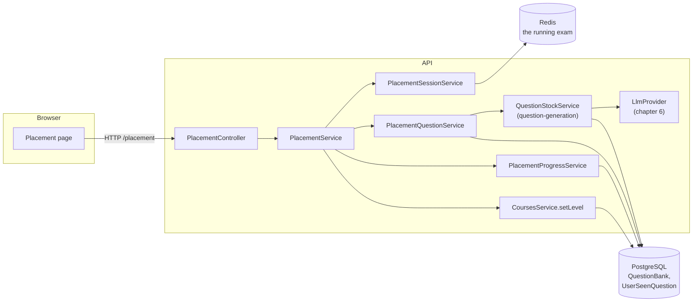
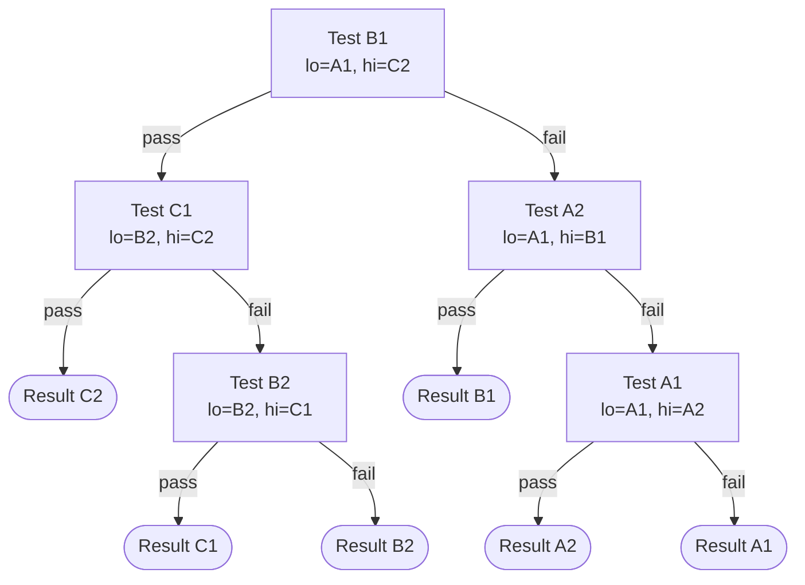
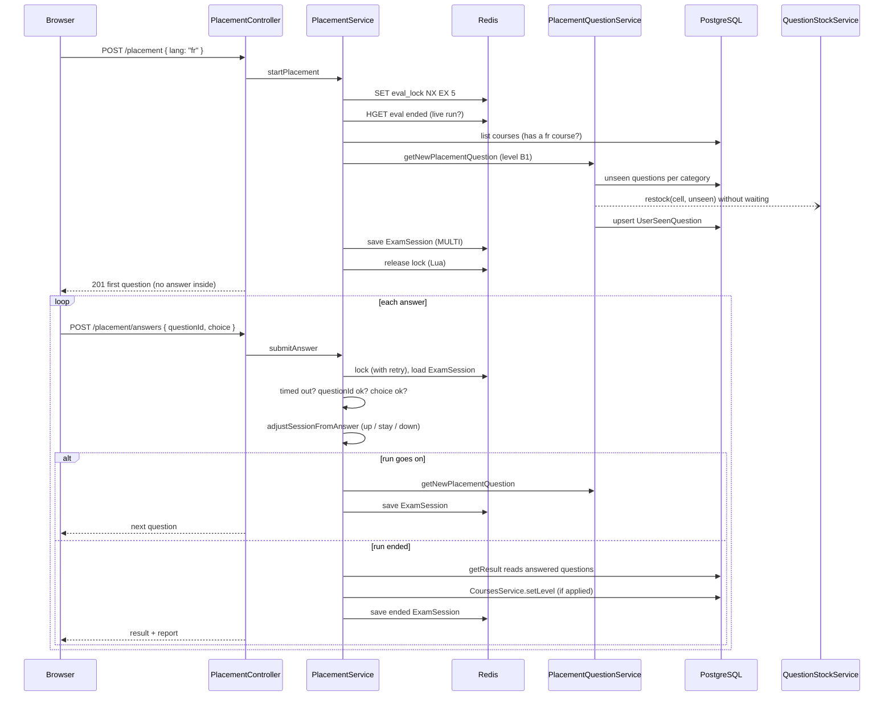
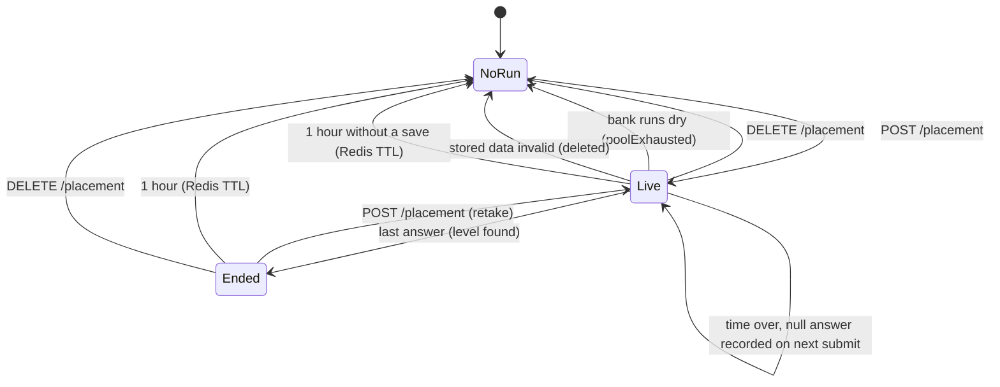
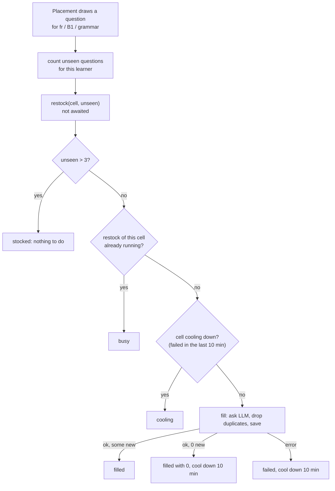

# Chapter 7 — Courses, the placement test and question generation

In this chapter:

- What a **course** is: one language a learner studies, at one CEFR level, with a daily goal
- What CEFR levels are (A1 to C2), in simple words
- The `courses/` module: controller, service, DTOs
- The **placement exam**: a short adaptive test that finds the learner's level
  - where a running exam is kept (Redis), how it is locked, how a question is picked, how the level moves, how the
    result is built
- The **question bank**, and how the LLM refills it when a learner runs low (`question-generation/`)

---

## The big picture

### Courses and CEFR levels

A **course** is "this learner studies this language". The app teaches three languages: `en`, `fr` and `de`
(`LEARNABLE_LANGUAGES` in `@ft/shared`). A learner can have one course per language. In the database a course is a
row of the `UserLevel` table (chapter 4).

A course has three fields that the browser sees:

| Field       | Meaning                                         | Values                             |
| ----------- | ----------------------------------------------- | ---------------------------------- |
| `lang`      | the language studied                            | `en`, `fr`, `de`                   |
| `level`     | the learner's CEFR level, or `null` before the placement exam | `A1` ... `C2`, or `null` |
| `dailyGoal` | minutes per day the learner wants to study      | `10`, `30`, `60`                   |

**CEFR** (Common European Framework of Reference for Languages) is a European scale used by schools and language
exams. It has six levels, from beginner to expert:

| Level | Name            | In simple words                                                       |
| ----- | --------------- | --------------------------------------------------------------------- |
| A1    | Beginner        | Greets, says their name, orders a coffee, with learned phrases        |
| A2    | Elementary      | Talks about daily life, the past and plans, with short sentences      |
| B1    | Intermediate    | Manages alone in most daily situations, gives a simple opinion        |
| B2    | Upper-intermediate | Discusses many topics with arguments, understands complex texts   |
| C1    | Advanced        | Uses the language with precision, understands what is implied        |
| C2    | Mastery         | Understands almost everything, catches irony and fine nuance          |

In code this is `LEVELS = ['A1', 'A2', 'B1', 'B2', 'C1', 'C2']`. The placement exam often works with the **index**
in this list (A1 = 0, B1 = 2, C2 = 5), because numbers are easy to move up and down.

### The placement exam, in one picture

A new course has `level: null`. To find the right level, the learner takes the **placement exam**: multiple-choice
questions (4 options each) in three **categories**: `grammar`, `vocabulary`, `reading`. It starts at B1. Do well,
and the next questions are harder; make mistakes, and they get easier. It is like guessing a number between 1 and
100 by asking "higher or lower?": each answer cuts the possible range in half (a **binary search**).

Questions come from the **question bank** (table `QuestionBank`). Some were written by people (files in
`content/items/`, loaded by the seed), and some are written by the LLM when the bank runs low for a learner.



Why Redis for the running exam? It is short-lived data (one hour at most), changed on every answer, and it needs
a lock so two clicks do not race. Redis is fast and has automatic expiry (chapter 3). Only the **final level** goes
to PostgreSQL, in the course row. Which questions a learner has seen is kept in PostgreSQL too
(`UserSeenQuestion`), because it must last across exams.

### Folder map

```text
apps/api/src/
├── courses/
│   ├── courses.module.ts
│   ├── courses.controller.ts        GET/POST /courses, PATCH /courses/:lang, PATCH /courses/:lang/level
│   ├── courses.dto.ts
│   ├── courses.service.ts
│   └── courses.service.spec.ts
├── placement/
│   ├── placement.module.ts
│   ├── placement.controller.ts      POST/GET/DELETE /placement, POST /placement/answers
│   ├── placement.dto.ts
│   ├── placement.schema.ts          the shape of a running exam (ExamSession)
│   ├── placement.service.ts         the conductor: start, read, answer, quit
│   ├── placement-session.service.ts Redis: save, load, lock
│   ├── placement-question.service.ts pick the next question, shuffle, progress
│   ├── placement-progress.service.ts score an answer, move the level, build the result
│   └── *.spec.ts
└── question-generation/
    ├── question-generation.module.ts
    ├── question-stock.service.ts    decides when to restock and calls the LLM
    ├── question-batch.ts            pure helpers: remove duplicates, build rows
    ├── prompts/question-batch.prompt.ts  the text sent to the LLM
    ├── QUESTION_GENERATION.md       long French explanation of this folder
    └── *.spec.ts
```

---

## `courses/` — the courses module

### `courses.module.ts`

[courses.module.ts](../../apps/api/src/courses/courses.module.ts) declares the controller and the service, imports
`GatewayModule` (for `SocketsService`, to tell the user's other tabs that a course changed, chapter 9), and
**exports** `CoursesService`. `PlacementModule` imports it, because the exam writes the final level with
`CoursesService.setLevel`.

### `courses.dto.ts`

[courses.dto.ts](../../apps/api/src/courses/courses.dto.ts) turns the shared Zod schemas into Nest DTO classes with
`createZodDto` (chapter 2 explains how the validation pipe uses them):

```ts
export class StartCourseDto extends createZodDto(StartCourseSchema) {}
export class SetGoalDto extends createZodDto(SetGoalSchema) {}
export class SetLevelDto extends createZodDto(SetLevelSchema) {}
export class CourseDto extends createZodDto(CourseSchema) {}
export class CoursesDto extends createZodDto(CoursesSchema) {}
```

The schemas live in [packages/shared/src/schemas/course.ts](../../packages/shared/src/schemas/course.ts), so the
web app checks the same rules:

| Schema              | Shape                                     | Notes |
| ------------------- | ----------------------------------------- | ----- |
| `StartCourseSchema` | `{ lang, dailyGoal }`                     | "No level here: only the placement exam sets it." |
| `SetGoalSchema`     | `{ dailyGoal }`                           | `dailyGoal` is `10`, `30` or `60` (each value is a button in the UI) |
| `SetLevelSchema`    | `{ level }`                               | error code `course.invalidLevel` |
| `CourseSchema`      | `{ lang, level \| null, dailyGoal }`      | what one course looks like in a response |
| `CoursesSchema`     | `{ courses: Course[], activeLang \| null }` | the list, plus the language the user last worked on |

### `courses.controller.ts`

[courses.controller.ts](../../apps/api/src/courses/courses.controller.ts) has four routes. All need a session (the
global auth guard from chapter 5); `@CurrentUser()` gives the logged-in user.

| Method and path              | Service call                  | Answer | Errors |
| ---------------------------- | ----------------------------- | ------ | ------ |
| `GET /courses`               | `listCoursesUser(user.id)`    | `CoursesDto` | 401 |
| `POST /courses`              | `createCourse(user.id, body)` | 201 `CourseDto` | 409 `course.alreadyStarted` |
| `PATCH /courses/:lang`       | `setGoal(user, lang, body, now)` | `CourseDto` | 404 `course.notFound` |
| `PATCH /courses/:lang/level` | `setLevel(user.id, lang, body)` | `CourseDto` | 404 `course.notFound` |

```ts
@Patch(':lang')
@ApiOperation({ summary: 'Change the daily goal, without touching level' })
// Declared by hand: `Language` is a type-only alias, so it reflects as Object
// and swagger drops the parameter instead of rendering a field for it.
@ApiParam({ name: 'lang', enum: [...LEARNABLE_LANGUAGES] })
...
setGoal(
  @CurrentUser() user: SessionUser,
  @Body() body: SetGoalDto,
  @Param('lang', LangParam) lang: Language,
) {
  return this.courses.setGoal(user, lang, body, new Date());
}
```

- `LangParam` (from `validation.pipe.ts`, chapter 2) checks that `:lang` is a known language.
- `@ApiParam` is written by hand because `Language` is only a type, and Swagger cannot see types at runtime.
- The controller passes `new Date()` to the service, so a test can give any "now".
- The summary of `PATCH /courses/:lang/level` names three cases: the learner skipped onboarding, the placement
  result, or the learner chooses another level by hand. In fact the web app calls it for onboarding and for a level
  picked by hand. The placement result does not go through this route: `PlacementService` calls
  `CoursesService.setLevel` directly (below).

### `courses.service.ts`

[courses.service.ts](../../apps/api/src/courses/courses.service.ts) talks to Prisma.

```ts
const COURSE_SELECT = { lang: true, dailyGoal: true, level: true } as const;
```

The reads and the writes of `listCoursesUser`, `createCourse` and `write` ask for these three columns only.
`setGoal` reads the whole row (the goal helpers take the whole row), but its answer goes through `CourseSchema.parse`, which
keeps only these three fields. So ids, streak and XP never leak into a course response.

**`listCoursesUser`** reads the user with their courses (`userLevels`), oldest first, and their `activeLang`. It
reads **through the user** (`where: { id: userId }`), so another user's courses are unreachable by construction. A
user that no longer exists gives 401 `auth.sessionRequired`.

**`createCourse`** inserts a row with `level: null`:

```ts
const course = await this.prisma.userLevel.create({
  data: { userId, lang: dto.lang, dailyGoal: dto.dailyGoal, level: null },
  select: COURSE_SELECT,
});
return CourseSchema.parse(course);
```

The table has a unique key on `(userId, lang)`. A second course in the same language makes Prisma throw the error
code `P2002` (unique constraint), which becomes 409 `course.alreadyStarted`. Any other error goes up unchanged.

**`setGoal`** is more careful, because changing the goal can complete today's goal:

```ts
async setGoal(user: SessionUser, lang: Language, dto: SetGoalDto, now: Date) {
  const course = await this.prisma.$transaction(async (tx) => {
    const locked = checkCourse(await lockCourse(tx, user.id, lang));
    const course = await tx.userLevel.update({
      where: { id: locked.id },
      data: { dailyGoal: dto.dailyGoal },
    });
    await tx.user.update({ where: { id: user.id }, data: { activeLang: lang } });

    const day = await currentDay(tx, course, user.timeZone, now);
    const goal = await meetGoal(tx, course, day);
    await award(tx, course, day, { type: 'goal', goal });
    return CourseSchema.parse(course);
  });
  // After the commit: sent from inside the transaction, the other tab could
  // read the old row, or a row that then rolls back.
  this.sockets.toUser(user.id, SERVER_EVENTS.COURSE_UPDATED, { lang });
  return course;
}
```

Example: the goal is 30 minutes and the learner did 10 minutes today. They lower it to 10: today is now met, so
the streak and XP must move. The whole thing runs in one transaction, under a row lock (`lockCourse` does
`SELECT ... FOR UPDATE`), so a lesson finish at the same moment cannot meet the day twice. `checkCourse` turns "no
row" into 404 `course.notFound`. `currentDay`, `meetGoal` and `award` come from `lessons/` and are explained in
[08-lessons.md](08-lessons.md). The socket event is sent **after** the commit.

**`setLevel`** uses the private `write` helper:

```ts
private async write(userId: string, lang: Language, data: CourseWrite) {
  try {
    const [course] = await this.prisma.$transaction([
      this.prisma.userLevel.update({
        where: { userId_lang: { userId, lang } },
        data,
        select: COURSE_SELECT,
      }),
      this.prisma.user.update({
        where: { id: userId },
        data: { activeLang: lang },
      }),
    ]);
    return CourseSchema.parse(course);
  } catch (error) {
    if (typeof error === 'object' && error !== null && 'code' in error && error.code === 'P2025')
      throw new NotFoundException('course.notFound');
    throw error;
  }
}
```

- Two writes in one transaction: the level, and `activeLang` moves to this language.
- The course is found by the **composite key** `userId_lang`, never by a bare id from the browser.
- `P2025` is Prisma's "record not found": 404 instead of creating a course.
- The type `CourseWrite` is `{ dailyGoal } | { level }` with `never` on the other key: one write changes one
  field, never both.
- After it, `setLevel` sends `COURSE_UPDATED` to the user's sockets.

[courses.service.spec.ts](../../apps/api/src/courses/courses.service.spec.ts) tests each method with a mocked
Prisma: the conflict, the not-found, the lock and the goal awards, the composite key, and that sockets hear only
after a commit.

---

## `placement/` — the placement exam

### The rules of the exam

From [packages/shared/src/schemas/placement.ts](../../packages/shared/src/schemas/placement.ts):

```ts
/** A level is `perCategory` times the three QUESTION_CATEGORIES, and the second mistake ends it. */
export const PLACEMENT_ROUNDS = { perCategory: 2, maxMistakes: 1 } as const;
```

So at each level the learner gets **at most 6 questions** (2 per category × 3 categories,
`MAX_QUESTIONS_PER_LEVEL`).

- **Second mistake at this level** → the level is failed, go **down**.
- **6 questions with at most one mistake** → the level is passed, go **up**.
- Each question has a **time limit** (`timeLimitS`). No answer in time counts as wrong (`choice: null`).
- The exam starts at **B1** (`START_LEVEL`) with the range `lo = 0` (A1) to `hi = 5` (C2).

The result is **the level just above the highest level passed**, or A1 if the learner fails everything. That is
the level to study next. Example runs:



So an exam tests 2 or 3 levels, with between 6 and 18 questions.

### The HTTP routes: `placement.controller.ts`

[placement.controller.ts](../../apps/api/src/placement/placement.controller.ts) has four routes. Each one just
calls `PlacementService`.

| Route                     | Service             | Answer                               | Main errors |
| ------------------------- | ------------------- | ------------------------------------ | ----------- |
| `POST /placement`         | `startPlacement`    | 201, the first question              | 409 `placement.inProgress`, 409 `placement.onboardingIncomplete`, 404 `placement.poolExhausted` |
| `GET /placement`          | `getPlacement`      | the current question **or** the result | 404 `placement.notFound`, 409 `placement.invalidSession` |
| `POST /placement/answers` | `submitAnswer`      | the next question **or** the result  | 400 `placement.invalidChoice`, 409 `placement.questionMismatch` / `inProgress` / `invalidSession`, 404 |
| `DELETE /placement`       | `quitPlacement`     | 204, nothing                         | 409 `placement.inProgress` |

Two of them answer "a question or a result". For Swagger, the controller says so with `oneOf`, and
`@ApiExtraModels(PlacementQuestionDto, PlacementResultDto)` registers both schemas so `getSchemaPath` can point to
them. The `GET` comment insists it is "strictly read-only to preserve HTTP GET idempotency": reading twice must
change nothing.

### The DTOs: `placement.dto.ts`

[placement.dto.ts](../../apps/api/src/placement/placement.dto.ts) wraps four shared schemas:

| DTO                    | Shape | Notes |
| ---------------------- | ----- | ----- |
| `StartPlacementDto`    | `{ lang }` | |
| `SubmitAnswerDto`      | `{ questionId, choice: string \| null }` | "null is a timeout, scored wrong; absent is a broken client" |
| `PlacementQuestionDto` | `{ lang, questionId, category, level, question, readText?, options[4], timeLimitS, remainingS, progress }` | a **strict** object |
| `PlacementResultDto`   | `{ lang, targetLevel, applied, report[] }` | |

`PlacementQuestionSchema` is a `strictObject` on purpose. The `QuestionBank` row has an `answer` field. If the code
ever put the row's `answer` in the payload by mistake, a strict parse **fails loudly** instead of dropping the
field silently. So the answer cannot leak to the browser. The answer is published only in the result's `report`.

`progress` has `answered` (also the index of this question) and `maxQuestionsRemaining`, explained below.

### The running exam: `placement.schema.ts`

[placement.schema.ts](../../apps/api/src/placement/placement.schema.ts) describes one running exam, the
`ExamSession`. It is checked with Zod each time it is loaded from Redis.

```ts
export const ExamSessionSchema = z.object({
  evalId: z.uuid(),
  lang: LanguageSchema,
  lo: z.number().int().min(0).max(6),
  hi: z.number().int().min(0).max(6),
  level: z.number().int().min(0).max(6).nullable(),
  mistakesPerLevel: z
    .number()
    .int()
    .min(0)
    .max(PLACEMENT_ROUNDS.maxMistakes + 1),
  askedPerCategory: z.record(
    QuestionCategorySchema,
    z.number().int().nonnegative().min(0).max(PLACEMENT_ROUNDS.perCategory),
  ),
  totalAnswered: z.number().int().nonnegative(),
  answers: z.array(SubmitAnswerSchema),
  ended: z.boolean(),
  currentQuestionId: z.string().nullable(),
  /** Shuffled once when served, so a reload shows the same order. */
  currentOptions: z.array(z.string().min(1)).length(OPTIONS_PER_ITEM).nullable(),
  servedAt: z.iso.datetime(),
});
```

| Field               | Meaning |
| ------------------- | ------- |
| `evalId`            | a random id for this run |
| `lang`              | the language tested |
| `lo`, `hi`          | the range of level indexes still possible (binary search bounds) |
| `level`             | the level index being tested now; at the end, the result |
| `mistakesPerLevel`  | mistakes at the current level |
| `askedPerCategory`  | questions asked at the current level, per category, e.g. `{ grammar: 1, vocabulary: 2, reading: 0 }` |
| `totalAnswered`     | answers in the whole run |
| `answers`           | every `{ questionId, choice }`, in order |
| `ended`             | the run is finished |
| `currentQuestionId` | the question on screen |
| `currentOptions`    | its 4 options, in the shuffled order shown |
| `servedAt`          | when it was shown: starts its clock |

### Redis storage and the lock: `placement-session.service.ts`

[placement-session.service.ts](../../apps/api/src/placement/placement-session.service.ts) is the only file that
touches Redis for the exam. One user has three keys:

| Key                          | Redis type | Content                         | Lifetime |
| ---------------------------- | ---------- | ------------------------------- | -------- |
| `user:<id>:eval`             | hash       | every `ExamSession` field except `answers` | 1 hour (`PLACEMENT_REDIS_KEY_TTL = 3600`), reset on each save |
| `user:<id>:eval_questions`   | list       | the answers, one JSON per item  | 1 hour |
| `user:<id>:eval_lock`        | string     | the lock token                  | 5 seconds (`PLACEMENT_LOCK_TTL_SECONDS`) |

There is **one** exam key per user, not per language: a user runs one exam at a time.

**Saving.** `saveExamSession` writes all fields in one `MULTI` (a Redis transaction: all commands run together):

```ts
const transaction = this.redis.client.multi().hSet(key, {
  evalId: session.evalId,
  lang: session.lang,
  ...
  ended: session.ended.toString(),
  currentQuestionId: session.currentQuestionId ?? '',
  currentOptions: session.currentOptions ? JSON.stringify(session.currentOptions) : '',
  servedAt: session.servedAt,
});

transaction.expire(key, PLACEMENT_REDIS_KEY_TTL).del(questionsListKey);
for (const answer of session.answers) {
  transaction.rPush(questionsListKey, JSON.stringify(answer));
}
```

A Redis hash stores only strings, so numbers become text, `null` becomes `''`, and objects become JSON. The answer
list is deleted and written again in full, so no leftover answers survive.

**Loading.** `loadExamSession` reads the hash and the list in one `MULTI`, turns the strings back into numbers and
objects, and checks the result with `ExamSessionSchema`. It also refuses two answers to the same question. If
anything is wrong, the stored run is **deleted** and the call throws 409 `placement.invalidSession`: a broken run
must not block the learner forever. An empty hash means "no run" and gives `null`.

**Live or not.** `hasLiveSession` reads only the `ended` field: the run is live when it is the text `'false'`. A
finished run stays in Redis (for up to an hour) only to show its report. `liveSessionLang` gives the language of a
live run, without a full load, "so quitting must work on a run too broken to load".

**The lock.** Two requests from the same user at the same time (a double-click, two tabs) must not both change the
run. The service uses a small Redis lock:

```ts
async acquireLock(
  userId: string,
  ttlSeconds = PLACEMENT_LOCK_TTL_SECONDS,
): Promise<string | null> {
  const token = randomUUID();
  const result = await this.redis.client.set(this.evalLockKey(userId), token, {
    NX: true,
    EX: ttlSeconds,
  });
  if (result === null) return null;

  return token;
}
```

- `NX`: set only if the key does **not** exist. Only one caller wins.
- `EX: 5`: the lock vanishes after 5 seconds, so a crashed request cannot hold it forever.
- The random `token` proves who owns it.

`acquireLockWithRetry` tries again up to 10 times, 50 ms apart, "to absorb rapid double-clicks". `releaseLock`
deletes the key **only if it still holds our token**, with a tiny Lua script that Redis runs in one step:

```ts
const script = `if redis.call("get",KEYS[1]) == ARGV[1] then return redis.call("del",KEYS[1]) else return 0 end`;
```

Without the check, a slow request whose lock already expired could delete the lock of the next request.

### Picking a question: `placement-question.service.ts`

[placement-question.service.ts](../../apps/api/src/placement/placement-question.service.ts) picks the next question
and formats it for the browser.

**`getNewQuestion`** works in steps:

1. Refuse an ended run (409 `placement.expired`).
2. Keep the categories that still have room at this level (fewer than 2 asked). If none, use all three.
3. For each category, read up to 100 questions of this language and level **the user has never seen**
   (`userSeenQuestions: { none: { userId } }`), written ones first.
4. Tell the stock how many are left, **without waiting** (`void this.stock.restock(...)`).
5. Prefer written questions: generated ones wait until no written one is left.
6. Pick a random category, then a random question in it.
7. If nothing unseen is left anywhere: serve the question this user **saw longest ago**, but not one from this run.
8. If even that is empty: 404 `placement.poolExhausted`.

```ts
const questions = await this.prisma.questionBank.findMany({
  where: {
    lang: session.lang,
    level,
    category: cat,
    userSeenQuestions: {
      none: {
        userId,
      },
    },
  },
  // Written rows first, so the take never hides one behind generated rows.
  orderBy: { sourceId: { sort: 'asc', nulls: 'last' } },
  take: LIMIT_UNSEEN_QUESTIONS_TO_RETRIEVE,
});

availableByCategory[cat] = questions.length;
void this.stock.restock({ lang: session.lang, level, category: cat }, questions.length);
// Nobody reviewed a generated row, so it waits until the written ones are all seen.
const written = questions.filter((question) => question.sourceId !== null);
const servable = written.length > 0 ? written : questions;
```

- A written question has a `sourceId` like `fr-gram-0001`; a generated one has `sourceId: null`. Sorting with
  `nulls: 'last'` puts written ones first.
- `void` means "start it, do not wait". The restock runs in the background; the learner gets a question at once.
- `take: 100` is more than the restock threshold (3), so a full cell is seen as full and left alone.

The fallback to an old question:

```ts
// Serving it bumps updatedAt, so repeated fallbacks cycle through the whole level.
const oldest = await this.prisma.userSeenQuestion.findFirst({
  where: {
    userId,
    ...(excludeQuestionIds.length > 0
      ? { questionId: { notIn: [...new Set(excludeQuestionIds)] } }
      : {}),
    questionBank: {
      lang: session.lang,
      level,
      category: { in: [...pool] },
    },
  },
  orderBy: {
    updatedAt: 'asc',
  },
  include: {
    questionBank: true,
  },
});
```

This is what happens with the fixture provider (no new questions): a learner who has seen the whole level gets
the questions they saw longest ago.

Each draw is counted in a metric (`placementDraws`) by source: `written`, `generated` or `seen_fallback`. Many
`seen_fallback` means "the restocks are not keeping up". An empty pool counts `placementPoolExhausted`.

**`shuffleOptions`** mixes the 4 options with the Fisher–Yates algorithm. The comment gives the reason: "The bank
lists the answer first in almost every item, so the order must not leak it."

**`getNewPlacementQuestion`** puts it together: draw a question, store its id and the shuffled options in the
session, restart the clock (`servedAt`), and mark it seen in `UserSeenQuestion` with an `upsert` (create the row,
or update its `updatedAt` if it exists). Then it calls `createPlacementQuestion`.

**`createPlacementQuestion`** builds the browser payload. It computes `remainingS` from `servedAt`, so a page
reload resumes the countdown instead of restarting it. It sends the options **in the stored shuffled order**, so a
reload shows the same order. And it parses with the strict `PlacementQuestionSchema` (no `answer` can slip out).

**`getMaxQuestionsRemaining`** gives the progress bar its "at most N questions left":

```ts
private maxProbes(lo: number, hi: number, level: number): number {
  const upProbes =
    level >= hi - 1 ? 0 : this.maxProbes(level + 1, hi, level + Math.ceil((hi - level) / 2));
  const downProbes =
    level <= lo ? 0 : this.maxProbes(lo, level, level - Math.ceil((level - lo) / 2));
  return 1 + Math.max(upProbes, downProbes);
}
```

`maxProbes` plays the binary search in advance and counts the worst number of levels still to test. Times 6
questions per level, minus the questions already asked at this level, gives the maximum left. It goes down fast
when the learner makes mistakes.

### Scoring and moving the level: `placement-progress.service.ts`

[placement-progress.service.ts](../../apps/api/src/placement/placement-progress.service.ts) holds the exam logic.

**`getQuestion`** reads one bank row by id, or 404 `placement.notFound`.

**`hasTimedOut`** says if the time is over, with a small gift for slow networks:

```ts
export const NETWORK_GRACE_S = 2;
...
hasTimedOut(question: QuestionBank, servedAt: string): boolean {
  const elapsedS = Math.floor((Date.now() - new Date(servedAt).getTime()) / 1000);
  return elapsedS >= question.timeLimitS + NETWORK_GRACE_S;
}
```

The clock is on the **server** (`servedAt`), so the browser cannot cheat by stopping its timer.

**`adjustSessionFromAnswer`** is the heart of the binary search:

```ts
const isCorrect = answer !== null && answer === question.answer;

if (!isCorrect) {
  session.mistakesPerLevel += 1;
}

let levelChange: 'down' | 'stay' | 'up' = 'stay';

if (session.mistakesPerLevel > PLACEMENT_ROUNDS.maxMistakes) {
  levelChange = 'down';
} else {
  const askedInCurrentLevel = Object.values(session.askedPerCategory).reduce(
    (sum, count) => sum + count,
    0,
  );
  if (askedInCurrentLevel + 1 >= MAX_QUESTIONS_PER_LEVEL) {
    levelChange = 'up';
  }
}
```

Then:

- `stay`: only count the question in its category.
- `up` at the top of the range (`level === hi - 1`): the result is `hi`, the run ends.
- `down` at the bottom (`level === lo`): the result is `lo`, the run ends.
- Otherwise reset the counters for the new level, and move:
  - `up`: `lo = level + 1`, jump halfway toward `hi`.
  - `down`: `hi = level`, jump halfway toward `lo`.

```ts
if (levelChange === 'up') {
  session.lo = Math.min(session.hi, session.level + 1);
  const nextIndex = Math.min(
    session.hi - 1,
    session.level + Math.ceil((session.hi - session.level) / 2),
  );
  session.level = nextIndex;
} else {
  session.hi = session.level;
  const nextIndex = Math.max(
    session.lo,
    session.level - Math.ceil((session.level - session.lo) / 2),
  );
  session.level = nextIndex;
}
```

Note that `hi` itself is never tested: passing `hi - 1` gives `hi` as the result. That is why the start range is
`hi = 5` (C2): passing C1 gives C2.

**`getResult`** returns `undefined` while the run is going. When it has ended, it reads every answered question
from the bank and builds the **report**: for each answer, the question, its level, the options, what was chosen,
the right answer, and `wasCorrect`. Rows gone from the bank are skipped.

```ts
return PlacementResultSchema.parse({
  lang: session.lang,
  targetLevel: LEVELS[Math.max(0, Math.min(session.level, LEVELS.length - 1))],
  // A learner who walked away from the run measured nothing.
  applied: session.answers.some((answer) => answer.choice !== null),
  report,
});
```

`applied` is `false` when **every** answer timed out: the learner walked away, so the course is left alone. One real
answer, even a wrong one, is enough to apply the result.

### The conductor: `placement.service.ts`

[placement.service.ts](../../apps/api/src/placement/placement.service.ts) uses the three helpers and
`CoursesService`. It also re-exports a few constants (`PLACEMENT_REDIS_KEY_TTL`, `MAX_QUESTIONS_PER_LEVEL`,
`NETWORK_GRACE_S`) and defines `START_LEVEL = 'B1'`.

**`startPlacement`**:

```ts
const lockToken = await this.sessionService.acquireLock(userId);
if (!lockToken) {
  throw new ConflictException('placement.inProgress');
}

try {
  // Live in any language: a second tab must not wipe a run someone is answering.
  if (await this.sessionService.hasLiveSession(userId)) {
    throw new ConflictException('placement.inProgress');
  }

  const { courses } = await this.coursesService.listCoursesUser(userId);
  if (!courses.some((course) => course.lang === dto.lang)) {
    throw new ConflictException('placement.onboardingIncomplete');
  }

  const examSession: ExamSession = {
    evalId: randomUUID(),
    lang: dto.lang,
    lo: 0,
    hi: 5,
    level: LEVELS.indexOf(START_LEVEL),
    ...
  };

  const newQuestion = await this.questionService.getNewPlacementQuestion(userId, examSession);
  // A retake overwrites the finished run only now, so one that cannot draw keeps its report.
  await this.sessionService.saveExamSession(userId, examSession);
  placementExams.inc({ lang: dto.lang, event: 'started' });
  return newQuestion;
} finally {
  await this.sessionService.releaseLock(userId, lockToken);
}
```

- Start takes the lock **without** retry: a second start at the same time is simply refused.
- The user must already have a course in this language (they made it during onboarding).
- A finished run can be replaced (a retake), but only once the first question is drawn.
- `finally` always releases the lock.

**`getPlacement`** loads the run. If it has ended, it returns the result. Otherwise it returns the current question
again (same options, clock still running). It never changes anything.

**`submitAnswer`** takes the lock **with** retry, then:

1. `checkEndedOrTimedOutAndSaveNullAnswerIfTimedOut` (a long but honest name): load the run; if it has ended,
   return the result; if the current question timed out, record a `null` answer for it and return what comes next.
   In that case the learner's late answer is ignored, "even a right one".
2. Check the `questionId` is the current one (409 `placement.questionMismatch`), and that the `choice` is one of the
   options (400 `placement.invalidChoice`).
3. `processAnswer`.

If the bank runs dry mid-run (`placement.poolExhausted`), the run is deleted, "so the learner can start again".

**`processAnswer`** does the work of one answer:

```ts
if (session.answers.some((answer) => answer.questionId === question.id)) {
  throw new ConflictException('placement.invalidSession');
}
session.answers.push({
  questionId: question.id,
  choice,
});
session.totalAnswered += 1;
this.progressService.adjustSessionFromAnswer(choice, question, session);

const result = await this.progressService.getResult(session);
if (result !== undefined) {
  if (result.applied) {
    await this.coursesService.setLevel(userId, session.lang, { level: result.targetLevel });
  }
  await this.sessionService.saveExamSession(userId, session);
  // Here, not wherever a result is read: this answer is the one that ended the run.
  placementExams.inc({ lang: session.lang, event: 'completed' });
  return result;
}

const newQuestion = await this.questionService.getNewPlacementQuestion(userId, session);
await this.sessionService.saveExamSession(userId, session);
return newQuestion;
```

When the run ends and the result is applied, the level is written to the course in PostgreSQL with
`CoursesService.setLevel` (which also tells the user's other tabs).

**`quitPlacement`** takes the lock, reads the live language first (for the `quit` metric), then deletes both Redis
keys. Deleting is safe to repeat.

### The whole exam, end to end



### The states of a run



In `Ended`, `GET /placement` and `POST /placement/answers` both return the result.

### `placement.module.ts`

[placement.module.ts](../../apps/api/src/placement/placement.module.ts) imports `CoursesModule` (for `setLevel` and
`listCoursesUser`) and `QuestionGenerationModule` (for the stock). It provides and exports the four services.
`RedisService` and `PrismaService` come from global modules (chapter 3).

### The placement tests

- [placement.service.spec.ts](../../apps/api/src/placement/placement.service.spec.ts): start at B1, retakes, the
  course check, the lock, reload shows the same question, late answers scored as timeouts, the pool running dry,
  quit, metrics, and the `applied` rule.
- [placement-session.service.spec.ts](../../apps/api/src/placement/placement-session.service.spec.ts): the lock (one
  owner, release by token only, retries) and save/load (TTL of one hour, live or not, old runs without
  `currentOptions`).
- [placement-question.service.spec.ts](../../apps/api/src/placement/placement-question.service.spec.ts): written
  before generated, the fallback to the oldest seen question, restock calls not awaited, `poolExhausted`,
  `getMaxQuestionsRemaining`, and that the payload never holds the answer.
- [placement-progress.service.spec.ts](../../apps/api/src/placement/placement-progress.service.spec.ts): the level
  moves, the timeout with grace, and the report.

---

## `question-generation/` — refilling the bank with the LLM

[QUESTION_GENERATION.md](../../apps/api/src/question-generation/QUESTION_GENERATION.md) (in French) explains this
folder in full detail, with a long worked example. Here is the tour.

### The question bank and the "cell"

A `QuestionBank` row holds one question: `lang`, `level`, `category`, `topic`, `question`, `options` (4),
`answer`, `readText` (reading only), `timeLimitS`, and `sourceId`.

| Kind of row     | `sourceId`     | Where it comes from                                   |
| --------------- | -------------- | ----------------------------------------------------- |
| Written         | `fr-gram-0001` | `content/items/*.json`, loaded by the seed, reviewed by a person |
| Generated       | `null`         | this module, never reviewed                           |

A **cell** is one language + one level + one category, for example `fr / B1 / grammar`. It is the slice the exam
draws from, and the unit that is restocked.

```ts
export type Cell = { lang: Language; level: Level; category: QuestionCategory };
```

The field names match the table columns, so a `Cell` can be used directly as a Prisma filter (`where: cell`).

How many questions one LLM call writes (from `@ft/shared`):

| Category     | Per batch | Topic                                      | Shape |
| ------------ | --------- | ------------------------------------------ | ----- |
| `grammar`    | 13        | one per `TOPICS` entry, each exactly once  | one sentence with a blank `___` |
| `vocabulary` | 10 (`VOCABULARY_BATCH_SIZE`) | one of `VOCABULARY_TOPICS` | one sentence with a blank `___` |
| `reading`    | 5 (`READING_BATCH_SIZE`)     | always `information_structure_and_pragmatics` | each with its own 25–100 word passage |

`generatedBatchSchema(category)` in
[packages/shared/src/schemas/item.ts](../../packages/shared/src/schemas/item.ts) is the Zod schema of one batch: the
exact count, 4 different options, the answer among the options, one grammar question per topic, distinct reading
passages. A generated item has **no** `sourceId`, `level` or `timeLimitS`: the server sets those, never the model.

### When does a restock happen?



### `question-generation.module.ts`

[question-generation.module.ts](../../apps/api/src/question-generation/question-generation.module.ts) imports
`LlmModule` (so `QuestionStockService` can inject `LLM_PROVIDER`), provides `QuestionStockService`, and exports
it for `PlacementModule`.

### `question-stock.service.ts` — the stock keeper

[question-stock.service.ts](../../apps/api/src/question-generation/question-stock.service.ts) only **fills** the
bank. Choosing a question to show is `PlacementQuestionService`'s job.

```ts
/** A learner down to this many unseen questions in a cell triggers a restock. */
const RESTOCK_AT = 3;
/** After a failure, or a batch with nothing new, a cell is left alone this long (10 minutes). */
const COOLDOWN_MS = 10 * 60_000;
```

The service keeps two `Map`s in memory:

```ts
private readonly inFlight = new Map<string, Promise<RestockOutcome>>();
private readonly coolingUntil = new Map<string, number>();
```

- `inFlight`: restocks running now, by cell key like `"fr:B1:grammar"`.
- `coolingUntil`: for each cell, the time before which we leave it alone.

Nest builds one instance for the whole API (a **singleton**), so these maps are shared by all learners. That is how
a second learner sees that a restock is already running. The comment notes the limit: it is per process, "enough
for the single API replica"; with several API servers each would have its own maps.

**`restock`** is the entry door:

```ts
async restock(cell: Cell, unseen: number): Promise<RestockOutcome> {
  if (unseen > RESTOCK_AT) return { status: 'stocked', inserted: 0 };

  const key = `${cell.lang}:${cell.level}:${cell.category}`;
  if (this.inFlight.has(key)) return counted(cell, { status: 'busy', inserted: 0 });
  // "?? 0": a cell that never failed has no entry, so it counts as "cooling until 1970".
  if (Date.now() < (this.coolingUntil.get(key) ?? 0)) {
    return counted(cell, { status: 'cooling', inserted: 0 });
  }

  // No "await" on fill(): we keep its promise. ".finally" runs when it ends, success or
  // not, and frees the cell. Without it, the cell would stay "busy" forever.
  const job = this.fill(cell, key).finally(() => this.inFlight.delete(key));
  this.inFlight.set(key, job);
  return job;
}
```

Why is the `busy` check safe with many learners? JavaScript runs one thing at a time. There is no `await` between
`inFlight.has` and `inFlight.set`, so no other request can run in between and start the same restock.

`restock` **never rejects**. That matters because placement calls it with `void` (nobody waits): a promise that
rejects with nobody listening ("unhandled rejection") can crash the Node process.

**`fill`** does the work, all inside `try/catch`:

```ts
// 1. Ask the LLM (with one retry when it makes sense, see generate).
const items = await this.generate(cell, key);
// 2. Read the questions already in this cell. "where: cell" works because Cell's
//    fields have the same names as the columns. "select" reads only two columns.
const stored = await this.prisma.questionBank.findMany({
  where: cell,
  select: { question: true, readText: true },
});
// 3. Keep only the new ones, turn them into rows, save them all in one query.
//    createMany returns how many rows it inserted ("count").
const { count } = await this.prisma.questionBank.createMany({
  data: toRows(cell, freshItems(items, stored)),
});
this.logger.log(`restocked ${key}: ${count} of ${items.length} questions were new`);
// Nothing new: the model keeps writing questions we already have.
// Asking again right away would cost money for nothing, so the cell cools down.
if (count === 0) this.coolingUntil.set(key, Date.now() + COOLDOWN_MS);
```

1. Ask the LLM (`generate`).
2. Read the questions already in this cell (only two columns).
3. Drop duplicates (`freshItems`), build rows (`toRows`), insert them all in one query.

On any error (LLM or database) it logs a warning, cools the cell for 10 minutes ("otherwise a broken LLM would be
called on every single draw"), and returns `failed`.

**`generate`** calls the LLM, with one retry only when it makes sense:

```ts
const request = {
  purpose: `question-batch:${cell.category}`,
  schema: generatedBatchSchema(cell.category),
  ...buildQuestionBatchPrompt(cell),
} as const;
try {
  return (await this.llm.generateStructured(request)).items;
} catch (error) {
  // "instanceof LlmError" checks the error's class (a catch can receive anything).
  // Only a retryable LlmError gets a second try; anything else is thrown again.
  if (!(error instanceof LlmError && error.retryable)) throw error;
  this.logger.warn(`retrying ${key}: ${error.message}`);
  return (await this.llm.generateStructured(request)).items;
}
```

This is where chapter 6 pays off: the provider already checked the reply with the schema, and it already decided
`retryable`. The stock just reads the flag. With the fixture or disabled provider, the error is not retryable, so
there is no second call.

**`counted`** and **`failureReason`** feed the metrics. A `filled` with 0 inserted is counted as `empty`, so the
dashboard tells it apart. A failure with reason `disabled` counts as `llm_disabled` (expected without a key, left
out of the alert); a non-LLM error counts as `other`.

| `RestockOutcome.status` | Meaning |
| ----------------------- | ------- |
| `stocked` | the learner still has enough, nothing done (not counted) |
| `busy`    | a restock of this cell is already running |
| `cooling` | this cell failed or gave nothing new less than 10 minutes ago |
| `filled`  | new questions saved (`inserted` says how many) |
| `failed`  | the LLM or the database failed |

### `question-batch.ts` — pure helpers

[question-batch.ts](../../apps/api/src/question-generation/question-batch.ts) has no database, no LLM, no Nest: it
takes data and returns data, so it is easy to test.

**Time limits** are set by the server, by category and level (the model never chooses them):

```ts
const TIME_LIMIT_S: Record<QuestionCategory, Record<Level, number>> = {
  vocabulary: { A1: 30, A2: 45, B1: 45, B2: 45, C1: 60, C2: 60 },
  grammar: { A1: 30, A2: 45, B1: 60, B2: 60, C1: 75, C2: 90 },
  reading: { A1: 75, A2: 105, B1: 90, B2: 120, C1: 165, C2: 180 },
};
```

**Duplicate detection** compares a normalised key:

```ts
const normalise = (text: string) => text.trim().toLowerCase().replace(/\s+/g, ' ');

const itemKey = ({ question, readText }: GeneratedItem | Stored) =>
  [readText ?? '', question].map(normalise).join('\n');

export function freshItems(items: readonly GeneratedItem[], stored: readonly Stored[]) {
  const seen = new Set(stored.map(itemKey));
  return items.filter((item) => {
    const key = itemKey(item);
    if (seen.has(key)) return false;
    seen.add(key);
    return true;
  });
}
```

- `"Je  mange ___ ."` and `"je mange ___ ."` count as the same question.
- The passage is part of the key: "What is the main idea?" can rightly appear for every text.
- `seen` starts with the stored questions, and grows with each kept item, so a second copy inside the same batch
  is dropped too.

**`toRows`** turns items into database rows:

```ts
export function toRows(
  cell: Cell,
  items: readonly GeneratedItem[],
): Prisma.QuestionBankCreateManyInput[] {
  const timeLimitS = TIME_LIMIT_S[cell.category][cell.level];
  return items.map((item) => ({ ...item, ...cell, sourceId: null, timeLimitS }));
}
```

`sourceId: null` marks the row as generated (so placement serves written ones first). The level comes from the
cell, never from the model, so a question cannot be filed at the wrong level.

### `prompts/question-batch.prompt.ts` — what the LLM reads

[question-batch.prompt.ts](../../apps/api/src/question-generation/prompts/question-batch.prompt.ts) only builds
text: the `system` and `user` messages for one batch.

It has three parts:

1. **`CEFR_LEVEL_REFERENCE`**: a long fixed text that describes each level A1 to C2 (ability, vocabulary, grammar,
   sentence length, reading, what to test, what is "too easy" and "too hard", English examples). Then a
   calibration rule ("an item does not become B2 because it contains one difficult word"), rules for good wrong
   options (**distractors**), and a list of anti-patterns. The examples are in English; the model must adapt them,
   never copy or translate them.
2. **`categoryBrief(cell)`**: what changes by category. It returns `count`, extra `rules`, a `calibration` text and
   the short `user` message. For example, for grammar:

   ```ts
   user: `Write ${TOPICS.length} ${level} grammar questions in "${lang}", one per topic.`,
   ```

   The numbers read the same constants as `generatedBatchSchema`, so the prompt and the schema cannot disagree.
3. **`buildQuestionBatchPrompt(cell)`**: assembles the `system` message, in order: the task, the RULES, the CEFR
   reference, the category calibration, and an "internal calibration check" the model must run silently before
   each item.

```ts
const index = LEVELS.indexOf(level);
const lower: Level | undefined = LEVELS[index - 1];
const upper: Level | undefined = LEVELS[index + 1];
...
- Calibrate every item with the CEFR LEVEL REFERENCE below.${lower ? ` Each item must be clearly harder than typical ${lower} material.` : ''}${upper ? ` No item may require knowledge normally associated with ${upper} or above.` : ''}
```

The levels just below and above frame the difficulty: "harder than A2, nothing from B2". For A1 there is no
"harder than" sentence, for C2 no "nothing above" sentence.

The prompt does **not** describe the JSON format. The comment says why: "The format comes from the response schema,
so the prompt only carries the content rules." The shape is sent to Gemini as `responseJsonSchema` (chapter 6).

### The question-generation tests

- [question-batch.spec.ts](../../apps/api/src/question-generation/question-batch.spec.ts): duplicates ignore case
  and spaces, keep a real difference, drop a repeat inside a batch, tell reading questions apart by passage; rows
  get the cell, `sourceId: null` and the cell's time limit.
- [question-batch.prompt.spec.ts](../../apps/api/src/question-generation/prompts/question-batch.prompt.spec.ts):
  each category's prompt holds the language, level, shared rules and its own rules.
- [question-stock.service.spec.ts](../../apps/api/src/question-generation/question-stock.service.spec.ts): the
  threshold of 3, only new questions saved, one restock per cell (`busy`), the 10-minute cooldown, the retry, a
  database failure becomes `failed`, the fixture saves nothing, and the metrics.

---

## Key ideas to remember

- A **course** (`UserLevel` row) is one language per user, with a CEFR `level` (null until placement) and a
  `dailyGoal` of 10, 30 or 60 minutes.
- CEFR has six levels, A1 to C2. The exam works with their index (0 to 5).
- The **placement exam** is a binary search that starts at B1. At each level: at most 6 questions (2 per category);
  the second mistake goes down, 6 answers with at most one mistake go up. The result is the level above the highest
  passed.
- The running exam lives in **Redis** (`user:<id>:eval` hash + answer list, one hour TTL), checked with Zod on every
  load. A short Redis **lock** (`SET NX EX 5`, released by token with Lua) stops double-clicks from racing.
- The clock is on the server. A late answer counts as a timeout (`null`), with 2 seconds of grace.
- The question payload is a **strict** schema, so the answer can never leak; options are shuffled once and kept, so
  a reload looks the same.
- Questions are drawn unseen first, **written before generated**, then the oldest seen one. Only when even that is
  empty does the run fail with `poolExhausted`.
- Each draw calls `restock` without waiting. At 3 or fewer unseen questions, `QuestionStockService` asks the LLM
  for a batch, drops duplicates, and saves rows with `sourceId: null` and server-set time limits.
- A restock is never doubled (`busy`), never rejects, retries once only on a retryable `LlmError`, and cools a cell
  for 10 minutes after a failure or an empty batch.

---

Previous: [Chapter 6 — Talking to an AI model](06-llm.md) · Next: [Chapter 8 — Lessons](08-lessons.md) · [Back to index](README.md)
