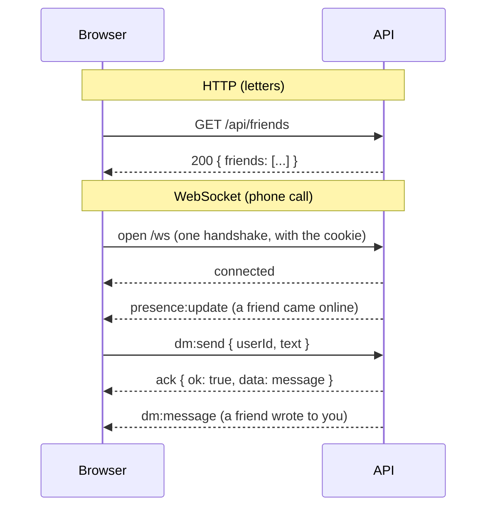
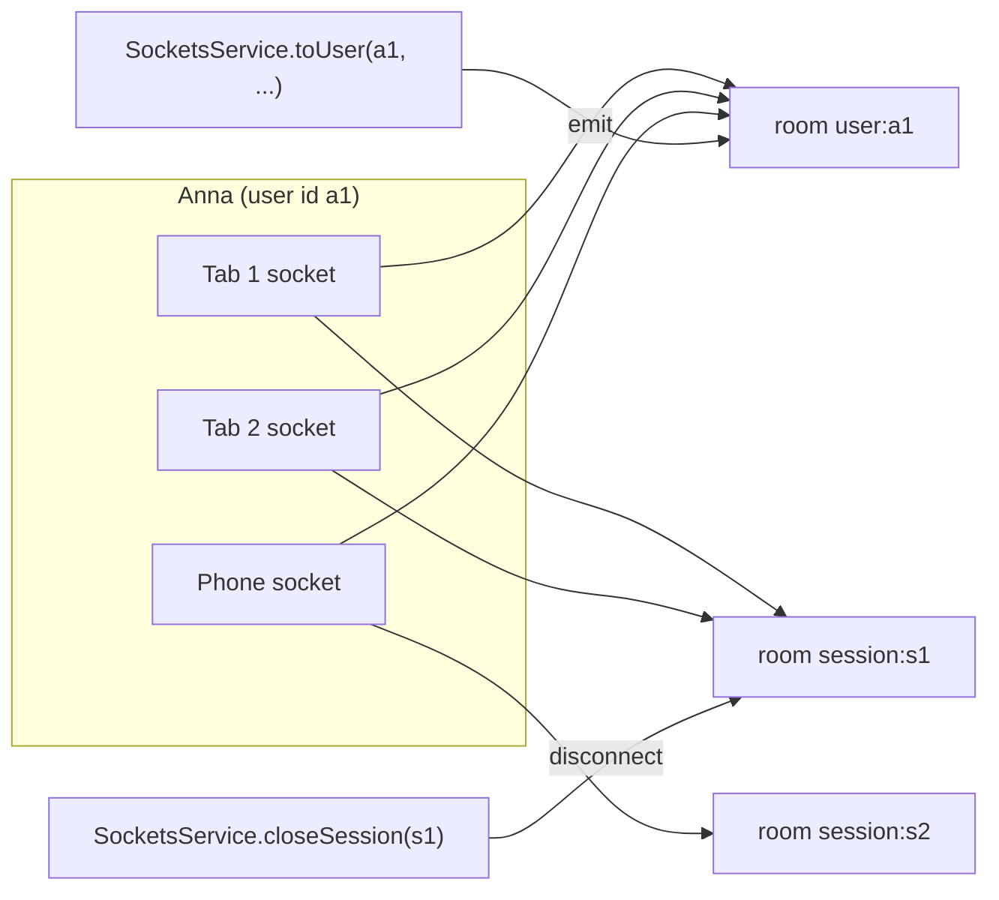
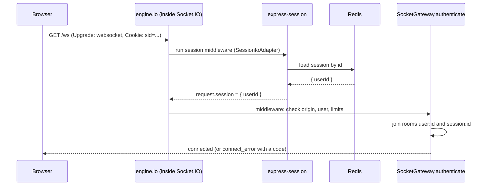
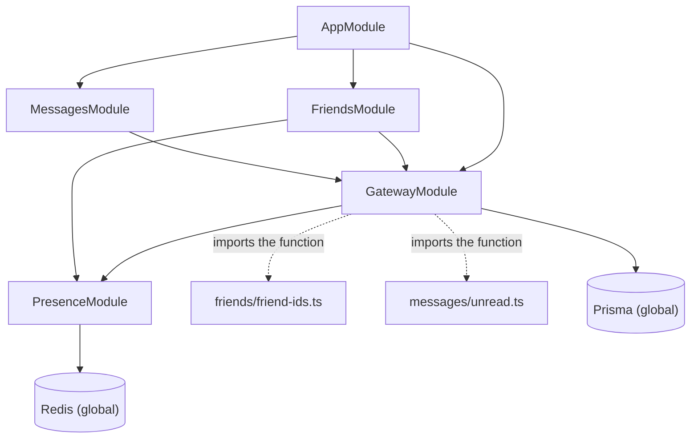
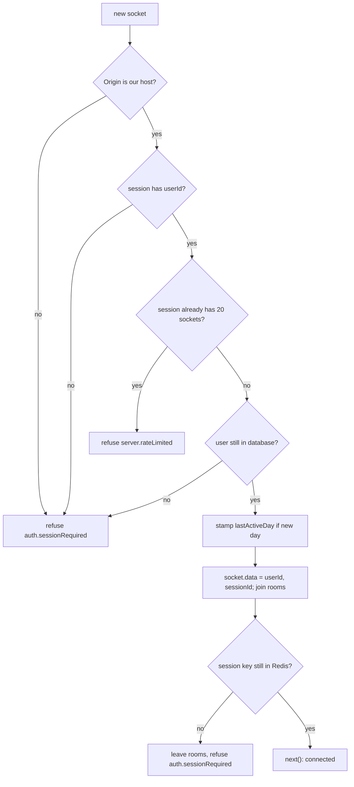
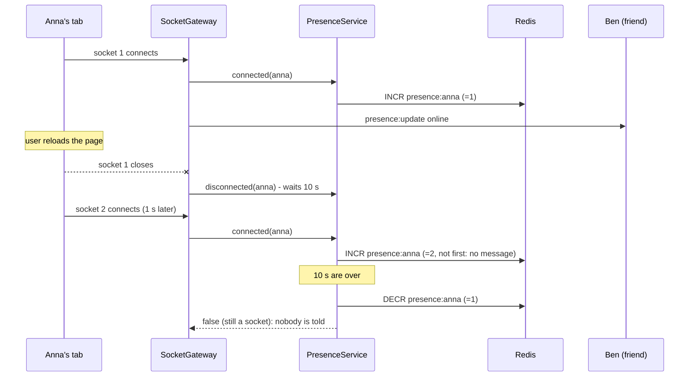
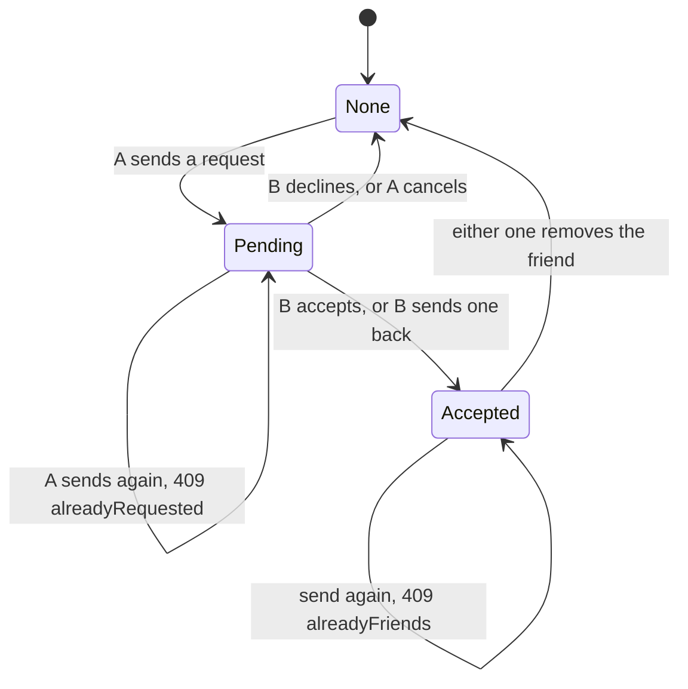
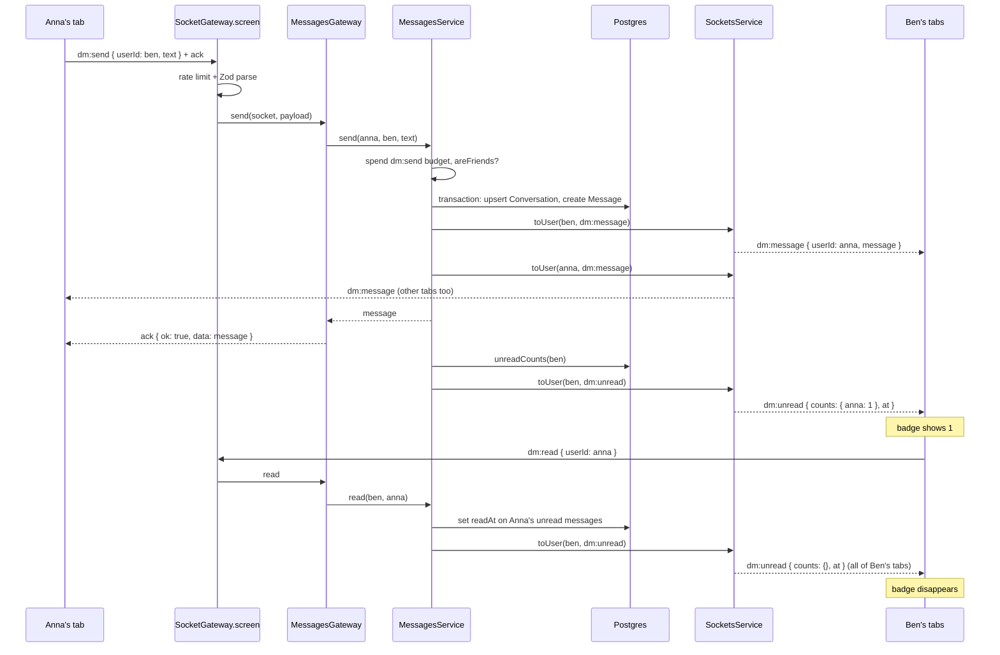
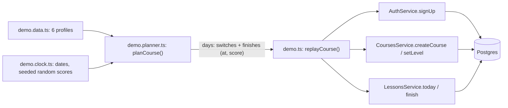

# Chapter 9 — Friends, messages and real time

In this chapter:

- What a WebSocket is, and why the app needs one next to normal HTTP
- Socket.IO, rooms, and how the API finds "all the tabs of one user"
- How a socket is logged in with the **same session cookie** as HTTP
- What "presence" (online / offline) means, and how Redis counts it
- The friends module: routes, the friend request life cycle, `pair.ts`, `friend-ids.ts`
- The messages module: reading over HTTP, sending over the socket, unread counts
- The `demo/` folder: the fake learners the seed builds for local development
- A table of every socket event

---

## The big picture

### HTTP vs WebSocket: letters vs a phone call

Until now, every chapter used **HTTP**. HTTP is like sending **letters**: the browser
writes a letter (a request), the server writes back (a response), and that is the end.
The server can never write first. If a friend sends you a message, the server has no way
to tell your browser. Your browser would have to ask again and again ("any new
message?"), which is slow and wasteful.

A **WebSocket** is like a **phone call**. The browser calls once, the line stays open,
and after that **both sides can talk at any time**. When your friend sends a message,
the server just says it on the open line, and your page shows it at once.



The app uses **both**:

| Job | Uses | Why |
| --- | --- | --- |
| Read the friends list, the conversation list, a page of old messages | HTTP (`GET`) | Simple, cacheable, works with server rendering |
| Send / accept / remove a friend request | HTTP (`POST`, `DELETE`) | A normal write with a status code |
| Send a message, mark as read | Socket (`dm:send`, `dm:read`) | Fast, and the answer comes on the same line |
| "Something changed, look again" pushed by the server | Socket (server events) | Only a socket lets the server talk first |

### Socket.IO

The API does not use raw WebSockets. It uses **Socket.IO**, a library built on top of
them. Socket.IO adds three things this chapter uses a lot:

- **Named events.** Instead of raw text, each message has a name, like `dm:send`, and a
  payload (a JSON object). It is like an `emit("name", data)` / `on("name", handler)`
  pair on each side.
- **Acks** (acknowledgements). The client can pass a callback as the last argument. The
  server calls it with an answer. This is like a reply to one precise question, a bit
  like an HTTP response.
- **Rooms.** A room is a named group of sockets on the server. You can say "send this to
  room `user:42`" and every socket in that room gets it.

NestJS wraps Socket.IO with **gateways**. A gateway is to sockets what a controller is to
HTTP: a class marked with `@WebSocketGateway()` whose methods, marked with
`@SubscribeMessage('event-name')`, handle client events.

### Rooms: how the API reaches "one user"

One user can have the app open in several tabs, or on a phone and a laptop. Each tab
opens **its own socket**. So "send to Anna" really means "send to all of Anna's sockets".
The API solves this with rooms. When a socket connects, it joins two rooms:



- `user:<userId>` — every socket of this user. Used to **send** events.
- `session:<sessionId>` — every socket opened with one login session (the laptop's tabs
  share one cookie, so one session). Used to **close** sockets when that session ends
  (logout, 2FA change, a new login).

### The socket uses the same session cookie

In [Chapter 5](05-auth-and-users.md) you saw that login stores a session in Redis and
gives the browser a cookie. When the browser opens the socket at `/ws`, it sends that
same cookie with the handshake (the first HTTP request that "upgrades" into a
WebSocket). The API runs the **same** `express-session` middleware on that handshake, so
it finds the same session and the same `userId`. There is no token, no second login.



### Presence: online and offline

**Presence** means "is this friend using the app right now?". The rule is simple:

- A user is **online** while at least one of their tabs holds an open socket.
- A user is **offline** once the last socket has been closed for **10 seconds** (the
  "grace period").

Why the grace period? When you reload a page, the old socket closes and a new one opens
a moment later. Without the wait, your friends would see you go offline and come back
online at every reload. The count of open sockets lives in **Redis** (`presence:<userId>`),
not in the API's memory.

---

## Where the files sit

```
apps/api/src/
├── gateway/                 the socket server, shared by everyone
│   ├── gateway.module.ts
│   ├── session-io.adapter.ts
│   ├── socket.gateway.ts         handshake, screen every event, presence, sweep
│   ├── sockets.service.ts        toUser(), closeSession(): how others reach a browser
│   └── socket-exception.filter.ts
├── presence/
│   ├── presence.module.ts
│   └── presence.service.ts       socket counts in Redis
├── friends/
│   ├── friends.module.ts
│   ├── friends.controller.ts     /api/friends routes
│   ├── friends.dto.ts
│   ├── friends.service.ts
│   ├── pair.ts                   pairKey(a, b)
│   └── friend-ids.ts             friendIds(), areFriends()
├── messages/
│   ├── messages.module.ts
│   ├── messages.controller.ts    /api/conversations routes (read only)
│   ├── messages.dto.ts
│   ├── messages.gateway.ts       dm:send, dm:read
│   ├── messages.service.ts
│   └── unread.ts                 unreadCounts()
└── demo/                    fake learners for the seed (not real time)
    ├── demo.ts  demo.data.ts  demo.planner.ts  demo.clock.ts
```

How the modules depend on each other. Note there is no loop: the gateway never imports
friends or messages modules, it imports two small **functions** instead.



Also, other modules use `SocketsService` to push events: `courses.service.ts` and
`lessons/attempts.service.ts` send `course:updated`, and `auth.controller.ts` calls
`closeSession()` on signup, login, logout and 2FA changes (see chapters 5, 7 and 8).

---

## gateway/gateway.module.ts

[gateway.module.ts](../../apps/api/src/gateway/gateway.module.ts) is tiny:

```ts
/**
 * Prisma and Redis are the two globals. Presence imports nothing, so this module
 * and FriendsModule, which imports this one, can both import it.
 */
@Module({
  imports: [PresenceModule],
  providers: [SocketGateway, SocketsService],
  exports: [SocketsService],
})
export class GatewayModule {}
```

- It **provides** the `SocketGateway` (the socket server itself) and `SocketsService`.
- It **exports** only `SocketsService`. Other modules (friends, messages, courses, auth,
  lessons) import `GatewayModule` to get `SocketsService` and push events. They never
  touch the gateway class.
- It imports `PresenceModule` because the gateway counts sockets.

## gateway/session-io.adapter.ts

[session-io.adapter.ts](../../apps/api/src/gateway/session-io.adapter.ts) is the piece
that lets the socket reuse the login cookie.

```ts
/**
 * engine.io answers /ws on the http server before Express sees the request, so
 * the session middleware Express runs is handed to it as well: same cookie,
 * same store, nothing parsed by hand.
 */
export class SessionIoAdapter extends IoAdapter {
  constructor(
    app: INestApplicationContext,
    private readonly session: RequestHandler,
  ) {
    super(app);
  }

  override createIOServer(port: number, options?: ServerOptions): Server {
    const server = super.createIOServer(port, options) as Server;
    server.engine.use(this.session);
    return server;
  }
}
```

- An **adapter** is how Nest creates its socket server. `IoAdapter` is Nest's default
  one for Socket.IO. This class extends it and changes one thing.
- **engine.io** is the low-level part of Socket.IO that handles the HTTP handshake. It
  answers `/ws` *before* Express, so Express middlewares (like the session one) never
  run on it.
- `server.engine.use(this.session)` gives engine.io the **same** session middleware.
  After it runs, `socket.request.session` holds the session, exactly like `req.session`
  in an HTTP controller.

Who calls it? [app.setup.ts](../../apps/api/src/app.setup.ts) (Chapter 2), right after
it builds the session middleware:

```ts
  app.use(sessionMiddleware);
  // engine.io answers /ws before Express does, so the gateway gets the same
  // middleware. Here, before init, which is when gateways bind.
  app.useWebSocketAdapter(new SessionIoAdapter(app, sessionMiddleware));
```

## gateway/socket.gateway.ts

[socket.gateway.ts](../../apps/api/src/gateway/socket.gateway.ts) is the biggest file of
this chapter. It does five jobs:

1. Sets the server options (path, transport, size limit).
2. **Authenticates** every new socket (a middleware run during the handshake).
3. **Screens** every client event: rate limit and Zod validation, before any handler.
4. Handles **presence**: tells friends when you come online / go offline, and tells a
   new tab where each friend stands and what is unread.
5. **Sweeps** every minute to close sockets whose session expired in Redis.

### Constants and small helpers

```ts
/** Caddy sends /ws and /ws/* to the api, in dev and in prod. */
export const SOCKET_PATH = '/ws';
export const EVENT_LIMIT = 20;
/** Sockets one session may hold: one per tab, and nobody keeps 20 tabs of the app open. */
export const SESSION_SOCKET_LIMIT = 20;
export const EVENT_WINDOW_MS = 10_000;
const SWEEP_MS = 60_000;
```

So: at most 20 events of one name per socket every 10 seconds, at most 20 sockets per
session, and a sweep every 60 seconds.

`fixedWindow()` is a tiny counter for the rate limit. It returns a function; each call
counts one event and returns the count in the current window. When the window time is
over, the count starts again at zero.

`sameOrigin()` checks the `Origin` header:

```ts
/**
 * Same-site is not same-origin: a page on a sibling subdomain sends our Lax
 * cookie too. Browsers always send Origin on a WebSocket; a client without one
 * is not a browser and holds the cookie itself.
 */
export function sameOrigin(origin: string | undefined, host: string | undefined): boolean {
  if (origin === undefined) return true;
  try {
    return new URL(origin).host === host;
  } catch {
    return false; // "null" and other junk
  }
}
```

Why? A cookie with `SameSite=Lax` is also sent by pages on a *sibling* subdomain. Such
a page could open a socket "as you". Checking that the page's origin is our own host
blocks this. (A tool with no `Origin` header is not a browser, so it already owns the
cookie; nothing to protect.)

`refuse()` is how the gateway says "no" to an event:

```ts
export function refuse(socket: AppSocket, ack: Ack | undefined, code: ErrorCode): void {
  if (ack) {
    ack({ ok: false, code });
    return;
  }
  socket.emit(SERVER_EVENTS.APP_ERROR, { code });
  wsEvents.inc({ direction: 'out', event: SERVER_EVENTS.APP_ERROR, outcome: 'ok' });
}
```

If the client sent the event with an ack, the answer goes in the ack
(`{ ok: false, code }`), because the client is waiting for it. Otherwise the server emits
`app:error` to **this socket only**. The `code` is an error code from `@ft/shared`
(like `server.rateLimited`), the same kind HTTP errors use, so the browser translates it.

`GATEWAY_OPTIONS` is shared by every gateway (there are two: this one and
`MessagesGateway`), because they share one server:

```ts
export const GATEWAY_OPTIONS = {
  path: SOCKET_PATH,
  serveClient: false,
  // One transport: the handshake is a single upgrade and nothing long-polls.
  transports: ['websocket'],
  // Events are small; socket.io's 1 MB default would let 20 events be 20 MB of zod input.
  maxHttpBufferSize: 16_384,
} satisfies GatewayMetadata;
```

`transports: ['websocket']` turns off Socket.IO's fallback mode ("long polling", where
the browser keeps sending HTTP requests). Only real WebSockets are used.

### Start-up: `afterInit`

```ts
  afterInit(server: SocketServer): void {
    // A middleware, not handleConnection: a refused socket never connects, and
    // the browser gets a CONNECT_ERROR it does not log rather than an HTTP 401 it would.
    server.use((socket, next) => void this.authenticate(socket, next));
    this.sockets.attach(server);
    this.sweep = setInterval(() => void this.closeEndedSessions(), SWEEP_MS).unref();
  }
```

Nest calls `afterInit` once the Socket.IO server exists. Three things happen:
the auth middleware is installed, `SocketsService` gets a reference to the server (so the
rest of the API can emit), and the sweep timer starts. `.unref()` means "this timer
alone must not keep Node running". `onModuleDestroy` clears it on shutdown.

### The handshake: `authenticate`

This runs for every new socket, before it is connected. It calls `next()` to let the
socket in, or `next(new Error(code))` to refuse it.



The interesting parts, with the code comments that explain them:

```ts
      // Like AuthGuard: a deleted account is refused although its session lives.
      const user = await this.prisma.user.findUnique({
        where: { id: userId },
        select: { lastActiveDay: true },
      });
      ...
      // The day only, so the first tab of the day writes and the others just read.
      const today = activeDay(new Date());
      if (user.lastActiveDay?.getTime() !== today.getTime()) {
        await this.prisma.user.update({ where: { id: userId }, data: { lastActiveDay: today } });
      }
      socket.data = { userId, sessionId: sessionID };
      // Before next(): the client's CONNECT ack then means it is in the room.
      rooms.push(userRoom(userId), sessionRoom(sessionID));
      await socket.join(rooms);
      // A logout between the session middleware and the join closed the room
      // before this socket was in it. Asked after the join, the session is
      // either still here, or gone and the socket leaves: no window left.
      if ((await this.redis.client.exists(`${SESSION_KEY_PREFIX}${sessionID}`)) === 0) {
        this.leave(socket, rooms);
        next(new Error('auth.sessionRequired'));
        return;
      }
      next();
```

- `lastActiveDay` is used by the "Recently active" list of users (Chapter 5). Opening
  the app counts as being active that day.
- `socket.data` keeps `userId` and `sessionId` on the socket for later. Every handler
  reads `socket.data.userId`: the user id **never** comes from the client.
- The last Redis check closes a small race: if you log out at the exact moment a socket
  is being set up, the logout's `closeSession()` could run before the socket joined its
  session room and so miss it. Checking after the join closes that gap.
- Any crash (database down...) is caught: the socket leaves its rooms and is refused
  with `server.unexpected`.

### Connect and disconnect

```ts
  handleConnection(socket: AppSocket): void {
    wsConnections.inc();
    const windows = new Map<string, () => number>();
    socket.use((packet, next) => this.screen(socket, packet, next, windows));
    void this.arrived(socket);
  }

  handleDisconnect(socket: AppSocket): void {
    wsConnections.dec();
    void this.left(socket.data.userId);
  }
```

`wsConnections` is a Prometheus gauge (Chapter 3, metrics). `socket.use(...)` installs
`screen` as a per-socket middleware for every incoming event. `arrived` and `left` deal
with presence.

### `arrived`: the snapshot for a new tab

When a socket connects, the page was maybe rendered a moment ago. A friend may have come
online since, or a message arrived. So the gateway sends this new socket a full
**snapshot**:

```ts
      const [first, friends] = await Promise.all([
        this.presence.connected(userId),
        friendIds(this.prisma, userId),
      ]);
      if (first) this.tellFriends(friends, userId, 'online');
      const online = await this.presence.isOnline(friends);
      for (const friend of friends) {
        const status = online.has(friend) ? 'online' : 'offline';
        socket.emit(SERVER_EVENTS.PRESENCE_UPDATE, presenceUpdate(friend, status));
        ...
      }
```

1. `presence.connected()` adds 1 to the user's count. If it is the **first** socket,
   every friend gets `presence:update { status: 'online' }`.
2. The new socket (only it, with `socket.emit`) gets one `presence:update` per friend.
3. Last, it gets `dm:unread` with the unread counts — **even if empty**, so the tab can
   tell "nothing unread" from "not heard yet". The unread count is started at the
   beginning but awaited at the end, and a failure there does not stop the presence part.

### `left`: going offline after the grace period

```ts
  private async left(userId: string): Promise<void> {
    try {
      if (!(await this.presence.disconnected(userId))) return;
      // Asked now, not on connect: a friendship may have begun or ended since.
      this.tellFriends(await friendIds(this.prisma, userId), userId, 'offline');
    } ...
  }
```

`presence.disconnected()` waits 10 seconds, then lowers the count. Only if no socket is
left are the friends told `offline`. `tellFriends` uses `SocketsService.toUser()`, so
each friend gets it in all their tabs.

### `screen`: every client event passes here first

Think of `screen` as the security guard at the door of every handler.

```ts
    const [name, ...args] = packet;
    const ack: Ack | undefined = typeof args.at(-1) === 'function' ? args.pop() : undefined;
    const schema = clientEventSchema(name);
    const event = schema ? name : 'unknown';
    // A window per event, so reads never spend the budget for sends. Unknown
    // events share one: a new name is not a new budget.
    let counter = windows.get(event);
    ...
    const seen = counter();
    try {
      if (seen > EVENT_LIMIT) {
        // Told once a window, so a flood is not answered with one. An ack is
        // answered every time: its caller is waiting on it.
        if (ack || seen === EVENT_LIMIT + 1) refuse(socket, ack, 'server.rateLimited');
        ...
        return;
      }
      // One payload: Nest hands a handler any extra arguments as an array in its place.
      const parsed = args.length === 1 ? schema?.safeParse(args[0]) : undefined;
      if (!parsed?.success) {
        refuse(socket, ack, issueCode(parsed?.error));
        ...
        return;
      }
      packet[1] = parsed.data;
      ...
      next();
```

Step by step:

1. Take the event name, and the ack if the last argument is a function.
2. Find the Zod schema for this event name in `@ft/shared` (`clientEventSchema`). An
   unknown name has no schema.
3. Count the event in its own 10-second window. Over 20: refuse with
   `server.rateLimited` (only once per window when there is no ack, so a flood does not
   get a flood of answers back).
4. Require **exactly one** payload and validate it with Zod. If it fails, refuse with
   the first rule's error code (e.g. `message.empty`, `message.tooLong`), or
   `request.invalid`. An unknown event also ends here, with `request.invalid`.
5. Replace the payload with the **parsed** version (trimmed text, etc.) and call
   `next()`: now the Nest handler runs.

Note the comment above `screen`: it never calls `next(err)`, because Socket.IO would
re-emit it as an `error` event, which crashes Node if nobody listens.

### `closeEndedSessions`: the sweep

```ts
  /**
   * Redis expires an idle session without telling anyone, and its sockets would
   * outlive it. Known keys only, never a scan.
   */
  async closeEndedSessions(): Promise<void> {
    const ids = new Set([...this.server.sockets.sockets.values()].map((s) => s.data.sessionId));
    try {
      for (const id of ids) {
        if ((await this.redis.client.exists(`${SESSION_KEY_PREFIX}${id}`)) === 0) {
          this.sockets.closeSession(id);
        }
      }
    } catch (error) {
      // Redis unreachable is not a session ending: the next round asks again.
      ...
    }
  }
```

Sessions in Redis have a time to live. When one expires, nobody is told, so its sockets
would stay open forever. Every minute, the gateway looks at the session ids of the open
sockets and closes those whose key is gone.

**Spec:** [socket.gateway.spec.ts](../../apps/api/src/gateway/socket.gateway.spec.ts)
tests `sameOrigin`, `fixedWindow`, every refusal of `authenticate`, the rate limit and
validation in `screen`, the presence messages on connect / disconnect, the unread
snapshot, and the sweep.

## gateway/sockets.service.ts

[sockets.service.ts](../../apps/api/src/gateway/sockets.service.ts) is the **only door**
the rest of the API uses to reach a browser.

```ts
/** Private to the API: the browser never needs to name a session. */
export const sessionRoom = (sessionId: string): string => `session:${sessionId}`;

/**
 * How the rest of the API reaches a browser. It can only address one user, so
 * nothing can broadcast to everyone by mistake.
 */
@Injectable()
export class SocketsService {
  private server?: SocketServer;

  /** By the gateway once socket.io is up. Outside Nest (the seed) it never is, and emits go nowhere. */
  attach(server: SocketServer): void {
    this.server = server;
  }

  toUser<E extends ServerEventName>(
    userId: string,
    event: E,
    ...args: Parameters<ServerToClientEvents[E]>
  ): void {
    if (!this.server) return;
    this.server.to(userRoom(userId)).emit(event, ...args);
    wsEvents.inc({ direction: 'out', event, outcome: 'ok' });
  }

  /** Every socket opened with this session id: the session has ended or been replaced. */
  closeSession(sessionId: string): void {
    this.server?.in(sessionRoom(sessionId)).disconnectSockets(true);
  }
}
```

- It also exports the types `SocketServer` and `AppSocket`: Socket.IO's `Server` and
  `Socket` typed with the event maps from `@ft/shared`. Thanks to them,
  `toUser(id, 'dm:message', payload)` only compiles if `payload` has the right shape for
  `dm:message`.
- `toUser` can only send to **one user's room**. There is no "send to everyone" method,
  on purpose.
- If no server is attached (the seed script runs outside Nest), emits do nothing. This
  is why the demo code can build `new SocketsService()` safely (see the demo section).
- `closeSession` disconnects every socket of that session. `true` means "close the
  underlying connection too".

**Spec:** [sockets.service.spec.ts](../../apps/api/src/gateway/sockets.service.spec.ts)
checks that `toUser` emits to the user's room only, does nothing before `attach`, and
that `closeSession` closes only that session's sockets.

## gateway/socket-exception.filter.ts

[socket-exception.filter.ts](../../apps/api/src/gateway/socket-exception.filter.ts) is
the socket version of the `ErrorCodeFilter` from Chapter 2.

```ts
// No argument: catches every exception, not only one class of them.
@Catch()
export class SocketExceptionFilter implements ExceptionFilter {
  // Nest's own name for its handler, so these lines read like the ones it logs.
  private readonly logger = new Logger('WsExceptionsHandler');

  catch(exception: unknown, host: ArgumentsHost): void {
    // What Nest hands a handler: the socket, the payload, the ack, the event name.
    const [socket, , ack] = host.getArgs<[AppSocket, unknown, Ack | undefined]>();
    let code: ErrorCode = 'server.unexpected';
    if (exception instanceof HttpException && isErrorCode(exception.message)) {
      code = exception.message;
    } else {
      this.logger.error(exception);
    }
    refuse(socket, typeof ack === 'function' ? ack : undefined, code);
  }
}
```

Why is it needed? Global filters (set with `app.useGlobalFilters`) only work for HTTP.
When a socket handler throws, Nest's default would emit an `exception` event that our
client does not listen to. This filter does the right thing instead:

- A service threw `new ForbiddenException('message.notFriends')`? The code
  `message.notFriends` is kept and sent back with `refuse()` (in the ack, or as
  `app:error`).
- Anything else is a bug: it is logged and answered `server.unexpected`.

So the services can throw the same `HttpException`s for HTTP and for sockets. A gateway
with handlers declares it with `@UseFilters(SocketExceptionFilter)`: today that is
`MessagesGateway` (`SocketGateway` has no `@SubscribeMessage` handler).

**Spec:** [socket-exception.filter.spec.ts](../../apps/api/src/gateway/socket-exception.filter.spec.ts)
checks that a coded exception keeps its code (in the ack, or as `app:error` without an ack),
and that a crash, or an `HttpException` holding a sentence, is logged and answered `server.unexpected`.

---

## presence/presence.module.ts and presence/presence.service.ts

[presence.module.ts](../../apps/api/src/presence/presence.module.ts) provides and exports
`PresenceService`, and imports nothing (Redis is global). That is why both
`GatewayModule` and `FriendsModule` can import it without a loop.

[presence.service.ts](../../apps/api/src/presence/presence.service.ts) keeps, **in
Redis**, how many sockets each user holds, under the key `presence:<userId>`. It only
answers questions; telling friends is the gateway's job.

```ts
export const PRESENCE_GRACE_MS = 10_000;

const presenceKey = (userId: string): string => `presence:${userId}`;
```

The e2e test `e2e/tests/friends.spec.ts` cannot import the API, so it keeps its own copy of
`PRESENCE_GRACE_MS`. Change both together.

| Method | What it does | Redis command |
| --- | --- | --- |
| `onApplicationBootstrap()` | At start, delete every `presence:*` key. No socket survives a restart, but a crash may have left counts behind. | `SCAN` + `DEL` |
| `connected(userId)` | +1. Returns `true` if the count is now 1 (first socket: user came online). | `INCR` |
| `disconnected(userId)` | Waits 10 s, then −1. Returns `true` if the count is now 0 or less (user is offline). Puts a negative count back to 0. | `DECR` (+ `SET 0`) |
| `isOnline(ids)` | Returns the set of ids whose count is > 0. Used by the gateway and by `GET /api/friends`. | `MGET` |

The clever part is in `disconnected`:

```ts
  /**
   * A socket closed. Resolves after the grace period, true when the user has
   * no socket left.
   *
   * The socket comes off the count only once the wait is over. Meanwhile
   * isOnline still says online, a reload's new socket counts 2 (no second
   * online), and since the last DECR to land is the last close's, offline goes
   * out exactly PRESENCE_GRACE_MS after it, never earlier and never twice.
   */
  async disconnected(userId: string): Promise<boolean> {
    // unref: a pending wait must not hold the process open on shutdown.
    await new Promise((resolve) => setTimeout(resolve, PRESENCE_GRACE_MS).unref());
    const count = await this.redis.client.decr(presenceKey(userId));
    if (count < 0) await this.redis.client.set(presenceKey(userId), '0');
    return count <= 0;
  }
```

It **waits first, then subtracts**. Look at a page reload:



Ben never sees Anna "blink" offline. Note the comment: the code assumes **one** API
instance (the start-up cleanup would wipe the counts of other instances).

**Spec:** [presence.service.spec.ts](../../apps/api/src/presence/presence.service.spec.ts)
uses fake timers to check the first-socket rule, the grace period, reloads, the reset
of negative counts, `isOnline`, and the start-up cleanup.

---

## friends/pair.ts

[pair.ts](../../apps/api/src/friends/pair.ts) is three lines, but it is used
everywhere in this chapter:

```ts
/** The same for (a, b) and (b, a): the key of a Friendship and of a Conversation. */
export function pairKey(a: string, b: string): string {
  return a < b ? `${a}:${b}` : `${b}:${a}`;
}
```

It builds one key for a **pair** of users, with the smaller id first. So
`pairKey(anna, ben) === pairKey(ben, anna)`. In the database (Chapter 4), `pairKey` is
the primary key of `Friendship` and of `Conversation`. This means:

- There can be **only one** friendship row between two people. If Anna and Ben both
  click "add friend" at the same moment, the second insert fails (unique key) instead
  of creating two rows.
- Every query is built from **the caller's own id** + the other id. A user can never
  reach a row that does not include them.

## friends/friend-ids.ts

[friend-ids.ts](../../apps/api/src/friends/friend-ids.ts) has two plain functions (not
service methods):

```ts
// Functions, not FriendsService methods: the gateway cannot import
// FriendsModule, which imports it, and messages need no more than these.

/** The ids of everyone `me` is friends with. */
export async function friendIds(prisma: PrismaService, me: string): Promise<string[]> {
  const rows = await prisma.friendship.findMany({
    where: { status: 'accepted', OR: [{ requesterId: me }, { addresseeId: me }] },
    select: { requesterId: true, addresseeId: true },
  });
  return rows.map((row) => (row.requesterId === me ? row.addresseeId : row.requesterId));
}

/** A pending request is not a friendship, and nobody is their own friend. */
export async function areFriends(prisma: PrismaService, a: string, b: string): Promise<boolean> {
  ...
  return row?.status === 'accepted';
}
```

- `friendIds` — used by `SocketGateway` to know whom to tell about presence.
- `areFriends` — used by `MessagesService.send`: you can only message a friend.

Why functions? `FriendsModule` imports `GatewayModule`. If the gateway imported
`FriendsModule` back, Nest would have a circular import. A function that takes `prisma`
as a parameter avoids that.

## friends/friends.module.ts

[friends.module.ts](../../apps/api/src/friends/friends.module.ts) registers
`FriendsController` and `FriendsService`, and imports `GatewayModule` (for
`SocketsService`) and `PresenceModule` (for `isOnline`).

## friends/friends.dto.ts

[friends.dto.ts](../../apps/api/src/friends/friends.dto.ts) turns two Zod schemas from
`@ft/shared` into classes with `createZodDto`. They are only used to **document the
answers** in Swagger (`/api/docs`); no request body is validated here, because every
friend route takes only a user id in the path.

## friends/friends.controller.ts

[friends.controller.ts](../../apps/api/src/friends/friends.controller.ts) defines five
routes under `/api/friends`. All need a session (the global `AuthGuard`, Chapter 5).
The other user is always in the path, checked by `UserIdParam` (Chapter 2): a path that is not a
user id gets 400.

| Method and path | Service call | Success | Errors |
| --- | --- | --- | --- |
| `GET /api/friends` | `list(me)` | 200 `{ friends, received, sent }` | 401 |
| `POST /api/friends/requests/:userId` | `send(me, them)` | 201 `{ status: 'pending' \| 'accepted' }` | 400 `friend.self`, 404 `user.notFound` (or `friend.requestNotFound` if their request was cancelled meanwhile), 409 `friend.alreadyRequested` / `friend.alreadyFriends` |
| `POST /api/friends/requests/:userId/accept` | `accept(me, them)` | 204 | 404 `friend.requestNotFound` |
| `DELETE /api/friends/requests/:userId` | `deleteRequest(me, them)` | 204 (declined or cancelled) | 404 `friend.requestNotFound` |
| `DELETE /api/friends/:userId` | `remove(me, them)` | 204 | 404 `friend.notFound` |

The send route has its own, tighter rate limit:

```ts
  // Tighter than the global 100: a declined request can be sent again at once,
  // and each send pushes an event and a refresh to the other person.
  @Post('requests/:userId')
  @Throttle({ default: { limit: 10, ttl: 60_000 } })
```

## friends/friends.service.ts

[friends.service.ts](../../apps/api/src/friends/friends.service.ts) holds the rules.

### The friend request life cycle

A `Friendship` row has a `status`: `pending` or `accepted`. "No row" is the third state.
Here is every way to move between them:



Each arrow that changes something sends an event to **both** users
(`friend:request`, `friend:accepted` or `friend:removed`).

### `list`

```ts
    for (const row of rows) {
      const mine = row.requesterId === me;
      const other = mine ? row.addressee : row.requester;
      if (row.status === 'accepted') friends.push(other);
      else (mine ? lists.sent : lists.received).push(other);
    }
    const online = await this.presence.isOnline(friends.map((friend) => friend.id));
    lists.friends = friends.map((friend) => ({ ...friend, online: online.has(friend.id) }));
```

It reads every row where you are the requester or the addressee, newest first, and sorts
them in three lists: `friends` (accepted), `sent` (pending, you asked) and `received`
(pending, they asked). Only friends get an `online` flag, from Redis, in one `MGET`.
`PUBLIC_USER_SELECT` (from `users/`) picks only public fields of a user.

### `send` and `trySend`

```ts
  private async trySend(me: string, them: string): Promise<FriendRequestResult> {
    const key = pairKey(me, them);
    const row = await this.prisma.friendship.findUnique({
      where: { pairKey: key },
      select: { status: true, requesterId: true },
    });
    if (row === null) {
      await this.create(key, me, them);
      this.notify(me, them, SERVER_EVENTS.FRIEND_REQUEST);
      return { status: 'pending' };
    }
    if (row.status === 'accepted') throw new ConflictException('friend.alreadyFriends');
    if (row.requesterId === me) throw new ConflictException('friend.alreadyRequested');
    await this.accept(me, them);
    return { status: 'accepted' };
  }
```

- No row: create a pending request, notify, answer `pending`.
- Already friends, or you already asked: 409.
- **They** already asked you: sending back simply **accepts** their request.

`send` first refuses yourself (`friend.self`). Then it handles a race:

```ts
    try {
      return await this.trySend(me, them);
    } catch (error) {
      // Their request got in between our read and our insert: read again, and
      // it is theirs to accept. Once only: ...
      if (hasCode(error, 'P2002')) return this.trySend(me, them);
      throw error;
    }
```

`P2002` is Prisma's "unique key already exists" error. It happens if both users click at
the same time: one insert wins, the other fails. The loser tries once more, finds the
winner's request, and accepts it. `create` turns `P2003` (foreign key failed: the other
user does not exist) into `404 user.notFound`. `hasCode` checks the error code without
importing Prisma's classes, so plain mocks work in tests.

### `accept`, `deleteRequest`, `remove`

```ts
  async accept(me: string, them: string): Promise<void> {
    const { count } = await this.prisma.friendship.updateMany({
      where: { pairKey: pairKey(me, them), requesterId: them, status: 'pending' },
      data: { status: 'accepted' },
    });
    if (count === 0) {
      throw new NotFoundException('friend.requestNotFound');
    }
    this.notify(me, them, SERVER_EVENTS.FRIEND_ACCEPTED);
  }
```

Each write is **one conditional query**: "update / delete the row of this pair *if* it is
in this state". If nothing matched, `count` is 0 and the answer is 404. You can only
accept a request where **they** are the requester. `deleteRequest` only deletes a
`pending` row, `remove` only an `accepted` one, both through the private `drop()`. So an
old tab that still shows a request cannot remove a friend by mistake.

### `notify`

```ts
  /** After the write, to both rooms: the other user, and the actor's other tabs. */
  private notify(me: string, them: string, event: FriendEventName): void {
    this.sockets.toUser(them, event, { userId: me });
    this.sockets.toUser(me, event, { userId: them });
  }
```

The event only carries the **other** user's id. It means "your friends list changed,
read it again with `GET /api/friends`". There is one source of truth (the HTTP route),
and the socket only says "look again".

**Spec:** [friends.service.spec.ts](../../apps/api/src/friends/friends.service.spec.ts)
tests `pairKey`, sending (self, new request, the race, a deleted account), conditional
deletes, and the sorting and `online` flag of `list`.

---

## messages/messages.module.ts

[messages.module.ts](../../apps/api/src/messages/messages.module.ts) registers
`MessagesController`, `MessagesService` and `MessagesGateway`, and imports
`GatewayModule` for `SocketsService`. The throttler storage it injects comes from the
global `ThrottlerModule` (Chapter 3).

## messages/messages.dto.ts

[messages.dto.ts](../../apps/api/src/messages/messages.dto.ts):

- `MessagePageQueryDto` — **validates** the query string `?cursor=...` before the
  controller sees it.
- `ConversationsDto`, `MessagePageDto` — only document the answers in Swagger.

## messages/messages.controller.ts

[messages.controller.ts](../../apps/api/src/messages/messages.controller.ts) is
**read-only**:

```ts
// Reading only: messages are sent over the socket (dm:send), where the ack
// answers. The other user is named in the path, never a row id.
@ApiTags('messages')
@Controller('conversations')
export class MessagesController {
```

| Route | Service call | Answer |
| --- | --- | --- |
| `GET /api/conversations` | `conversations(me)` | Your conversations, newest first, each with the other user, `lastMessageAt` and `unread` |
| `GET /api/conversations/:userId/messages?cursor=` | `page(me, them, cursor)` | 50 messages, oldest first, and `nextCursor` for older ones |

## messages/messages.gateway.ts

[messages.gateway.ts](../../apps/api/src/messages/messages.gateway.ts) is the second
gateway. It uses the same `GATEWAY_OPTIONS`, so it lives on the same server and the same
`/ws` path as `SocketGateway`.

```ts
/**
 * The payloads arrive parsed and the sender limited: SocketGateway's screen
 * runs before any handler. A refusal is SocketExceptionFilter's to answer.
 */
@WebSocketGateway(GATEWAY_OPTIONS)
@UseFilters(SocketExceptionFilter)
export class MessagesGateway {
  constructor(private readonly messages: MessagesService) {}

  // Nest sends what a handler returns as the ack.
  @SubscribeMessage(CLIENT_EVENTS.DM_SEND)
  async send(
    @ConnectedSocket() socket: AppSocket,
    @MessageBody() { userId, text }: DmSend,
  ): Promise<SocketAck<Message>> {
    return { ok: true, data: await this.messages.send(socket.data.userId, userId, text) };
  }

  @SubscribeMessage(CLIENT_EVENTS.DM_READ)
  async read(...): Promise<void> {
    await this.messages.read(socket.data.userId, userId);
  }
}
```

- `@SubscribeMessage('dm:send')` is like `@Post()` for sockets.
- `@ConnectedSocket()` gives the socket; `@MessageBody()` gives the payload, already
  validated by `screen`.
- The **sender** is `socket.data.userId` (from the session), never from the payload. The
  payload's `userId` is the **other** person.
- What `send` returns becomes the **ack** answer: `{ ok: true, data: message }`.
- If the service throws, `SocketExceptionFilter` answers `{ ok: false, code }`.

## messages/messages.service.ts

[messages.service.ts](../../apps/api/src/messages/messages.service.ts) has four public
methods.

### Rate limits shared by all sockets

```ts
// Per account: a write that pushes to another person, like friend requests at
// 10 a minute. 30 is far above anyone typing.
export const SEND_LIMIT_PER_MINUTE = 30;
...
  /** One `event` from the account, refused past its budget of a minute, from all its sockets together. */
  private async spend(event: string, me: string, limit: number): Promise<void> {
    const { isBlocked } = await this.throttler.increment(
      `${event}:${me}`,
      60_000,
      limit,
      60_000,
      'default',
    );
    if (isBlocked) {
      throw new HttpException('server.rateLimited', HttpStatus.TOO_MANY_REQUESTS);
    }
  }
```

The `screen` limit in the gateway is **per socket**. A user with 10 tabs would get 10
times the budget. So the service also counts **per account**, reusing the HTTP
throttler's storage (gateways never run the HTTP throttler guard): 30 sends a minute,
and the normal per-account limit (100 by default) for reads.

### `send`

```ts
  async send(me: string, them: string, text: string): Promise<Message> {
    // When it arrived, and one instant for the message and the list's order.
    const now = new Date();
    // Before the friendship check: a refused send costs a query too.
    await this.spend('dm:send', me, SEND_LIMIT_PER_MINUTE);
    if (!(await areFriends(this.prisma, me, them))) {
      throw new ForbiddenException('message.notFriends');
    }
    const key = pairKey(me, them);
    const [userAId, userBId] = [me, them].sort();
    const [, row] = await this.prisma.$transaction([
      this.prisma.conversation.upsert({
        where: { pairKey: key },
        create: { pairKey: key, userAId, userBId, createdAt: now, lastMessageAt: now },
        update: { lastMessageAt: now },
      }),
      this.prisma.message.create({
        data: { pairKey: key, senderId: me, text, createdAt: now },
        select: MESSAGE_SELECT,
      }),
    ]);
    const message = toMessage(row);
    // Both rooms: the sending tab gets it too, and the page dedupes by id.
    this.sockets.toUser(them, SERVER_EVENTS.DM_MESSAGE, { userId: me, message });
    this.sockets.toUser(me, SERVER_EVENTS.DM_MESSAGE, { userId: them, message });
    // Not awaited: the message is stored and delivered, so the ack never waits on the count.
    void this.tellUnread(them);
    return message;
  }
```

1. Spend one unit of the send budget.
2. Only friends can message each other (403 `message.notFriends`).
3. In **one transaction**: create the conversation if it does not exist yet (an
   **upsert** = "update or insert"), move its `lastMessageAt`, and insert the message.
   `userAId` is always the smaller id, like in `pairKey`.
4. Push `dm:message` to **both** users. The sender's other tabs see it too; the sending
   tab may get it twice (ack + event), so the web page removes duplicates by id.
5. Send the receiver a fresh `dm:unread` snapshot, without waiting for it.
6. Return the message: it becomes the ack.

### `read`

```ts
  /** Answered with a snapshot whether or not anything changed, so every read converges. */
  async read(me: string, them: string): Promise<void> {
    await this.spend('dm:read', me, READ_LIMIT_PER_MINUTE);
    await this.prisma.message.updateMany({
      where: { pairKey: pairKey(me, them), senderId: them, readAt: null },
      data: { readAt: new Date() },
    });
    await this.tellUnread(me);
  }
```

"I have read what they sent me": every unread message **from them** in this pair gets a
`readAt` date. Then every tab of the reader gets a new `dm:unread` snapshot, so the badge
goes down in all tabs. No friendship check: you can still read an old conversation.

### `conversations` and `page`

`conversations(me)` lists your conversations (newest `lastMessageAt` first), names each
by the **other** user, and adds its unread count from `unreadCounts()`.

`page(me, them, cursor)` uses **keyset pagination** (load "the 50 messages before this
one" instead of "page number 3"):

```ts
      // (createdAt, id) strictly before the cursor: two messages may share a millisecond.
      before = {
        OR: [
          { createdAt: { lt: from.createdAt } },
          { createdAt: from.createdAt, id: { lt: from.id } },
        ],
      };
    }
    // One more than a page tells whether an older one exists.
    const rows = await this.prisma.message.findMany({
      where: { pairKey: key, ...before },
      select: MESSAGE_SELECT,
      orderBy: [{ createdAt: 'desc' }, { id: 'desc' }],
      take: MESSAGE_PAGE_SIZE + 1,
    });
```

- The cursor is a message id. It must belong to this pair, or the answer is 400
  `request.invalid`.
- It asks for 51 rows newest first. If 51 come back, there are older messages, and
  `nextCursor` is the oldest id of the page. The page is reversed so it reads oldest
  first, like a chat.
- No friendship needed: history stays readable after unfriending.

**Spec:** [messages.service.spec.ts](../../apps/api/src/messages/messages.service.spec.ts)
tests the transaction and its single timestamp, the two `dm:message` events, that the
ack does not wait for the unread count, the per-account limits, `read`, the pagination,
and `conversations`.

## messages/unread.ts

[unread.ts](../../apps/api/src/messages/unread.ts) counts what you have not read:

```ts
export async function unreadCounts(prisma: PrismaService, me: string): Promise<DmUnread> {
  // Before the query: a stamp taken after it could outrank the snapshot of a write it missed.
  const at = new Date().toISOString();
  const rows = await prisma.message.groupBy({
    by: ['senderId'],
    where: {
      readAt: null,
      senderId: { not: me },
      conversation: { OR: [{ userAId: me }, { userBId: me }] },
    },
    _count: { _all: true },
  });
  return { counts: Object.fromEntries(rows.map((row) => [row.senderId, row._count._all])), at };
}
```

- One `GROUP BY` query: in my conversations, unread messages not sent by me, grouped by
  sender. In a two-person conversation, the sender who is not me **is** the other user,
  so the sender id names the conversation.
- The result is the **whole picture**: `{ counts: { benId: 2, eveId: 1 }, at }`. A
  conversation with 0 is left out. The browser replaces its counts; it never adds.
- `at` is taken **before** the query. Snapshots may arrive out of order; the browser
  keeps the one with the latest `at`. A stamp taken after the query could make an old
  snapshot look newer than one that saw a later write.
- It is a function, like `friend-ids.ts`, because the gateway (which sends it on connect)
  cannot import `MessagesModule`.

**Spec:** [unread.spec.ts](../../apps/api/src/messages/unread.spec.ts) checks the query,
that empty conversations are left out, and that `at` is taken before the count.

### The whole flow: Anna sends Ben a message



---

## Every socket event

The names live in [packages/shared/src/events/socket.ts](../../packages/shared/src/events/socket.ts),
with a Zod schema for each payload. The browser and the API import the same file.

| Event | Direction | Payload | Sent by | Meaning |
| --- | --- | --- | --- | --- |
| `dm:send` | client → server, with ack | `{ userId, text }` | chat page | Send a message to `userId`. Ack: `{ ok: true, data: Message }` or `{ ok: false, code }` |
| `dm:read` | client → server | `{ userId }` | chat page | "I have read what `userId` sent me" |
| `dm:message` | server → client | `{ userId, message }` | `MessagesService.send` | A new message in the conversation with `userId` (to both users) |
| `dm:unread` | server → client | `{ counts, at }` | `SocketGateway.arrived`, `MessagesService` | Full snapshot of unread counts, keyed by the other user |
| `presence:update` | server → client | `{ userId, status, at }` | `SocketGateway` | A friend is now `online` or `offline` |
| `friend:request` | server → client | `{ userId }` | `FriendsService` | A request was sent between you and `userId`: reload friends |
| `friend:accepted` | server → client | `{ userId }` | `FriendsService` | You and `userId` are now friends |
| `friend:removed` | server → client | `{ userId }` | `FriendsService` | The row between you is gone (declined, cancelled or unfriended) |
| `course:updated` | server → client | `{ lang }` | `CoursesService`, `AttemptsService` | "Read this course again" (chapters 7 and 8) |
| `app:error` | server → client | `{ code }` | `refuse()` | An event without ack was refused (rate limit, bad payload, error) |

Two rules from the comment at the top of that file: the server never uses Socket.IO's
reserved names (`connect`, `connect_error`, `disconnect`...), which is why errors use
`app:error` and not `error`;
and no client event may be called `error`, because it would crash the server.

Socket.IO's own events are also used: the handshake refusal arrives in the browser as
`connect_error` with the code as the message (`auth.sessionRequired`,
`server.rateLimited`, `server.unexpected`).

---

## The demo/ folder

The `demo/` folder has **nothing to do with real time**. It sits in this chapter because
of the folder plan. It builds the **demo learners**: six fake accounts with a realistic
history (streaks, results, levels), so that a developer who runs the seed locally sees
the app "in use" instead of empty pages (issue #85).

### Who calls it

Nobody in the running API. Only the **seed** script, and one e2e test:

```
pnpm db:seed  (apps/api/package.json: "tsx prisma/seed.ts")
  └── prisma/seed.ts
        ├── seedQuestionBank()  seedLessons()       (Chapter 4)
        └── if NODE_ENV=development and DEMO_PASSWORD is set:
              await import('../src/demo/demo') → seedDemo(prisma, { runNow, password })

apps/api/test/demo.e2e-spec.ts  → replayLearner() with replay-<stamp> identities
apps/api/src/demo/demo.planner.spec.ts → unit tests of the planner and clock
```

`prisma.config.ts` also sets `seed: 'pnpm db:seed'`, the command `prisma db seed`
runs (Prisma 7 no longer seeds after `migrate reset`). From [seed.ts](../../apps/api/prisma/seed.ts):

```ts
    .then(async () => {
      if (password === null) {
        console.log(`demo learners skipped: ${skip}`);
        return;
      }
      // Loaded here only, so the public server never even reads the demo code.
      const { seedDemo } = await import('../src/demo/demo');
      await seedDemo(prisma, { runNow: new Date(), password });
    })
```

`demoSkipReason()` in the seed skips the demo unless `NODE_ENV` is exactly
`development` **and** `DEMO_PASSWORD` is not empty. So the public server never gets fake
users. The password is checked with the normal signup rules first.

### The idea: replay, don't fake

The comment at the top of `demo.ts` says it best:

```ts
/*
 * The demo learners (#85), replayed through the real services day by day
 * with an injected clock. Never progress rows written by hand: finish and
 * setLevel decide every streak and result, so the learners follow every
 * rule, and whatever finish gains later (XP, #95) they gain too.
 */
```

Instead of inserting rows like "streak = 12", the seed **plays the past**: it signs up
each learner with the real `AuthService`, creates courses with `CoursesService`, and
finishes lessons day by day with `LessonsService.finish`, passing a fake date. The real
rules then compute streaks and results. If the rules change, the demo stays correct.



### demo/demo.data.ts

[demo.data.ts](../../apps/api/src/demo/demo.data.ts) is pure data: the six profiles and
what each one shows.

| Learner | Time zone | What the pages show on French A1 |
| --- | --- | --- |
| anna | Europe/Zurich | streak 3, today's goal met |
| ben | America/New_York | streak 12, "Reach today's goal to keep it", 1 of 3 today; switched to A2 and back |
| chloe | Asia/Tokyo | streak 0, best 12; today 2 of 3, one failed |
| david | Europe/London | streak 6 still alive, 0 today |
| eva | Europe/Berlin | French A1 complete, "Start A2" |
| felix | UTC | no French; English course with no level (lands on onboarding step 2) |

Each `DemoCourse` has `lang`, `level` (or `null`), `switches` (level changes `daysAgo`),
`goal`, `passRate`, `days` and `todayScores`. `days` is either a list (`[3, 0, 3]` = 3
finishes yesterday, none the day before, 3 the day before that) or
`{ untilAllAttempted: 6 }` (keep going back until every lesson of the level has a
result — used for eva). Today's scores are fixed so today's state never depends on chance.

It also exports `demoEmail(name)` → `demo-<name>@example.com`, `demoDisplayName(name)` →
`demo.<name>`, `SMALLEST_LEVEL = 48`, and `DEMO_EMAIL_FILTER` (`startsWith: 'demo-'`,
`endsWith: '@example.com'`), which the seed uses to delete old demo users.

### demo/demo.clock.ts

[demo.clock.ts](../../apps/api/src/demo/demo.clock.ts) is "the time and chance" of the
demo. All functions are **pure** (no database, same input → same output):

- `daysBefore(day, count)` — the calendar day `count` days earlier (uses
  `previousDay` from the roadmap rules).
- `atLocalTime(day, minutes, timeZone)` — the real instant of, say, 19:00 on a day in
  Tokyo. It measures the time zone offset twice, because on a day the clocks change the
  first guess can be wrong.
- `seedOf(text)` — turns a text (the email) into a number (FNV-1a hash).
- `randomFrom(seed)` — a small random number generator (mulberry32) that always gives the
  **same series** for the same seed.
- `pastScore(random, passRate)` — a score: a pass (`LESSON_PASS_MARK` to 100) with
  probability `passRate`, else a fail. Always draws twice so changing the pass rate does
  not shift every later score.

Result: two seeds on the same day write the same rows.

### demo/demo.planner.ts

[demo.planner.ts](../../apps/api/src/demo/demo.planner.ts) turns one `DemoCourse` into
a list of days to replay, oldest first, today last:

```ts
export type PlannedDay = {
  day: CourseDay;
  /** setLevel calls, in order, before the day's finishes. */
  switches: Level[];
  finishes: PlannedFinish[];
};
```

- Past days' finishes start at **19:00 local time**, one lesson length apart.
- Today's finishes are spread evenly between local midnight and `runNow`, so none is in
  the future.
- For `untilAllAttempted`, `daysToAttemptAll()` simulates the real `plan` and `merge`
  rules on made-up days to know how many days are needed (a failed lesson comes back
  first, so it depends on the scores). It stops with an error after 365 days, so a bad
  profile cannot loop forever.
- The random series is per learner **and** per course (`email/lang`), so adding a course
  never changes the scores of another.

The planner does not choose the lessons. The replay asks `LessonsService.today` for
them, like a learner following the daily page.

### demo/demo.ts

[demo.ts](../../apps/api/src/demo/demo.ts) runs the replay. It exports:

- `seedDemo(prisma, { runNow, password })` — builds the services **by hand** (the seed
  runs outside Nest, so there is no dependency injection), deletes all old demo users
  (the database cascade removes their courses and results), then replays each profile:

```ts
  const services: DemoServices = {
    prisma,
    auth: new AuthService(prisma),
    // Never attached outside Nest: the replay's level changes reach no socket.
    courses: new CoursesService(prisma, new SocketsService()),
    lessons: new LessonsService(prisma),
  };

  await prisma.user.deleteMany({ where: { email: DEMO_EMAIL_FILTER } });
```

  This is the link to this chapter: `CoursesService` needs a `SocketsService`, and an
  unattached one simply sends nothing.

- `replayLearner(services, identity, profile, runNow)` — signs up, writes the time zone
  and `lastActiveDay` (a seeded learner never opens a socket, so this makes them show in
  "Recently active"), reads the user again, then replays each course.
- `replayCourse` (private) — creates the course, sets the level, then for each planned
  day: applies the level switches, asks `lessons.today(...)` for the lessons offered
  that day, and calls `lessons.finish(...)` with the planned date and score.
- Types `DemoServices` and `DemoIdentity`.

The file is in `src/` on purpose: if a service gains a new constructor argument, the
TypeScript check fails here, not only when someone runs the seed.

**Specs:** [demo.planner.spec.ts](../../apps/api/src/demo/demo.planner.spec.ts) tests
`atLocalTime`, `daysBefore`, `pastScore`, `planCourse` (time zones, 19:00 finishes,
today's spread, same plan on a second run, switches), `daysToAttemptAll`, and the
profiles themselves. [demo.e2e-spec.ts](../../apps/api/test/demo.e2e-spec.ts) replays
ben's and chloe's profiles against a real Postgres under `replay-<stamp>` emails (see
[10-tests.md](10-tests.md)).

---

## Key ideas to remember

- HTTP is letters, a WebSocket is a phone call: the server can talk first. The app reads
  with HTTP and uses the socket for messages and "look again" pushes.
- Socket.IO adds named events, acks and rooms. Each socket joins `user:<id>` (to send to
  every tab) and `session:<id>` (to close on logout).
- `SessionIoAdapter` runs the same `express-session` middleware on the `/ws` handshake,
  so the socket is logged in with the same cookie. The user id always comes from
  `socket.data`, never from the client.
- `SocketGateway.authenticate` checks origin, session, socket count and user;
  `screen` rate-limits and Zod-validates every event before any handler.
- `SocketsService.toUser()` is the only way to push, and it can only reach one user.
- Presence is a socket count in Redis with a 10-second grace period: wait first, then
  subtract, so reloads never show offline.
- `pairKey(a, b)` gives one key per pair: one friendship row, one conversation, and no
  way to reach someone else's rows.
- Friend events and `course:updated` only say "read again"; `dm:unread` is always the
  whole picture, stamped with `at` before the query.
- `friend-ids.ts` and `unread.ts` are plain functions to avoid circular module imports.
- `demo/` is not real time: the seed replays six fake learners through the real services
  with a fake clock, only in development with `DEMO_PASSWORD` set.

---

Previous: [08-lessons.md](08-lessons.md) · Next: [10-tests.md](10-tests.md) · [Back to index](README.md)
